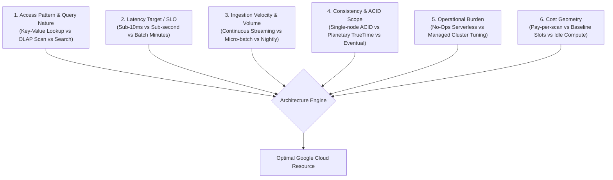
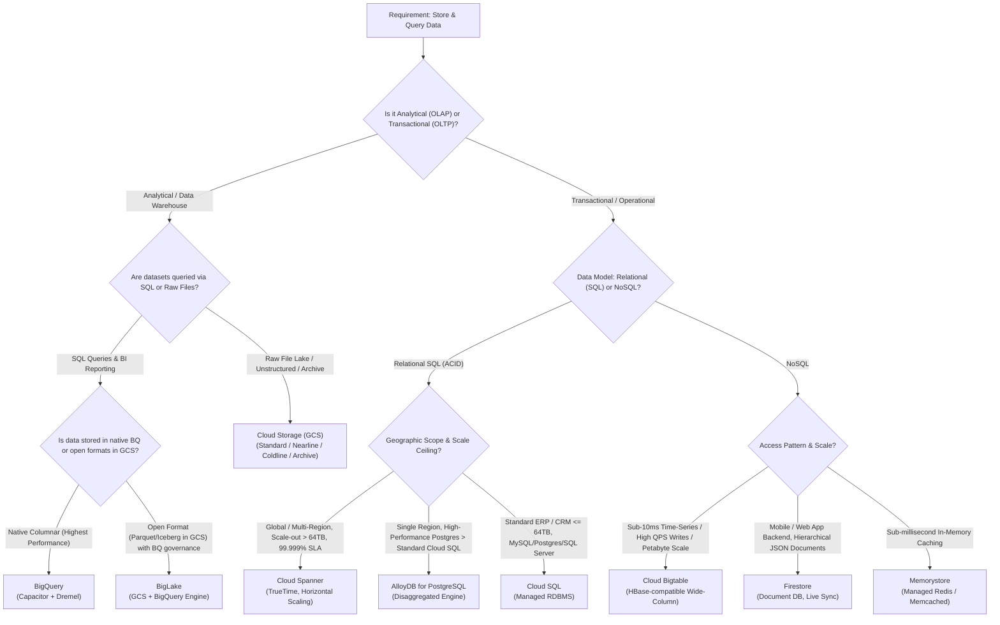
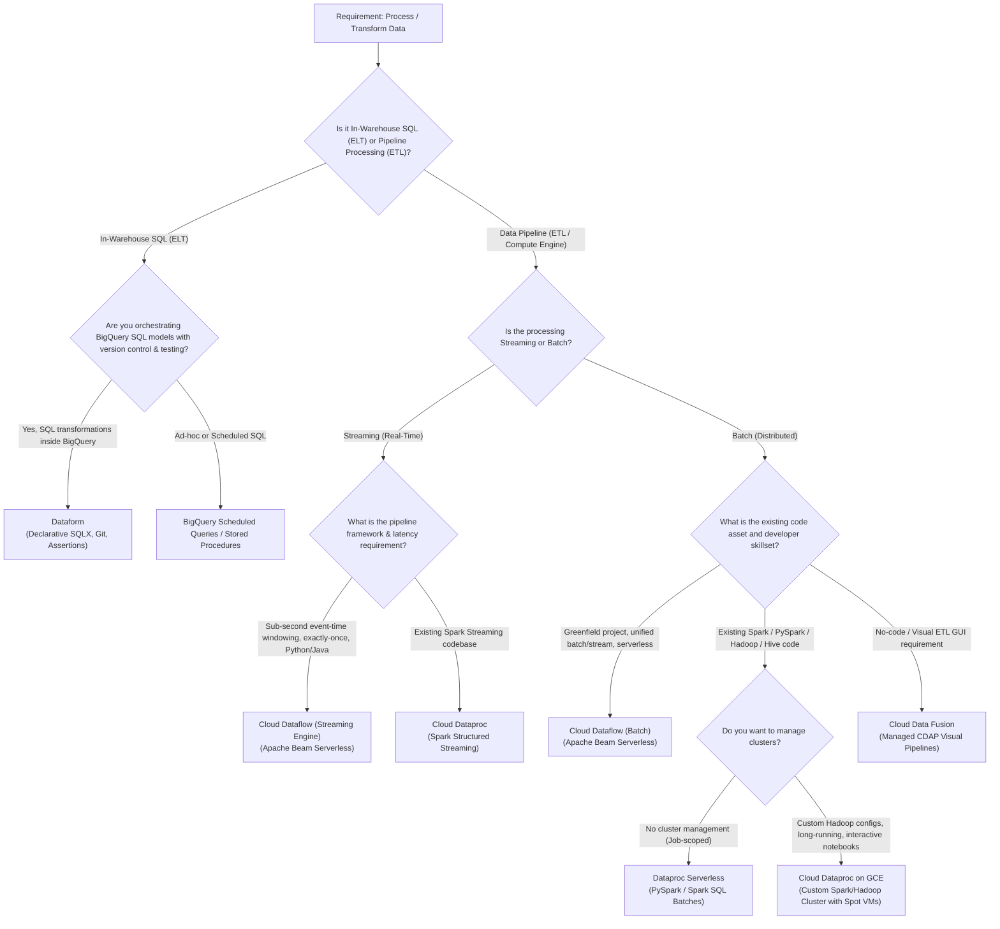
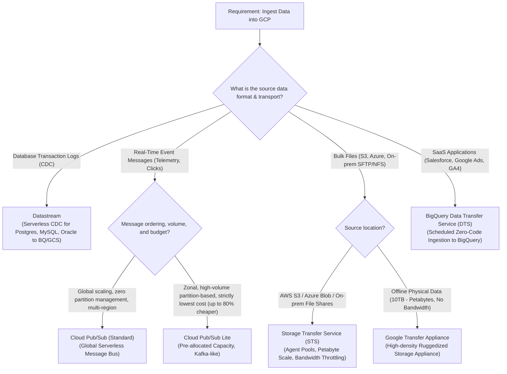
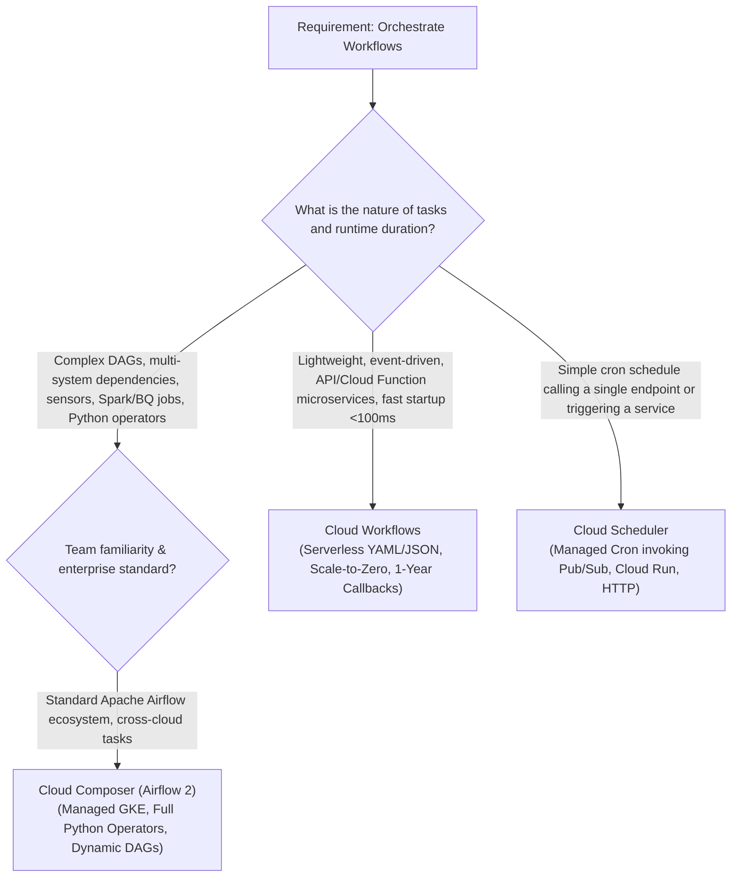

# Architectural Decision Blueprint: How a Professional Data Engineer Selects Google Cloud Resources
**Target Role**: Google Cloud Principal Data Architect / Professional Data Engineer  
**Companion Documents**:
- Pairwise Compute Analysis: [01_compute_comparisons.md](./05_phase4_comparisons_and_decision_trees/01_compute_comparisons.md)
- Pairwise Storage Analysis: [02_storage_database_comparisons.md](./05_phase4_comparisons_and_decision_trees/02_storage_database_comparisons.md)
- Pairwise Ingestion Analysis: [03_ingestion_orchestration_comparisons.md](./05_phase4_comparisons_and_decision_trees/03_ingestion_orchestration_comparisons.md)

---

## 1. The Architectural Mindset: Beyond Feature Checklists

Junior engineers ask: *"What features does this service have?"*  
**Principal Data Engineers ask**:
1. *What is the access pattern (point read by key vs. full-table scan)?*
2. *What is the latency target / application SLO (microseconds, single-digit milliseconds, seconds, or minutes)?*
3. *What is the write velocity and concurrency (100 QPS vs. 1,000,000 QPS)?*
4. *What are the consistency and failure boundaries (Strict ACID across regions vs. Eventual consistency)?*
5. *What is the total operational overhead and developer ecosystem gravity (Serverless SQL vs. Custom Beam/Spark pipelines)?*
6. *What does the FinOps cost curve look like at $10\times$ current scale?*

This guide formalizes the mental models, decision trees, and elimination heuristics that Google Cloud Data Architects use to select the right resource for any enterprise data workload.

---

## 2. The 6 Architectural Evaluation Vectors

Every data requirement must be filtered through these six non-negotiable vectors before proposing an architecture:

### Vector 1: Access Pattern & Query Dialect
- **Point Lookups by Single Key / Prefix Scan**: Cloud Bigtable, Memorystore, Firestore.
- **Complex Analytical Aggregations (`GROUP BY`, `JOIN`, Window functions)**: BigQuery.
- **Relational Normalized Queries (`JOIN` across 10 tables with foreign keys)**: Cloud Spanner, AlloyDB, Cloud SQL.
- **Full-Text / Vector Similarity Search**: BigQuery Vector Search, Vertex AI Vector Search.
- **Raw Object Retrieval (`GET /blob/image.png`)**: Cloud Storage (GCS).

### Vector 2: Latency Profile / Application SLO (Operational Targets)
- **Sub-millisecond ($\le 1\text{ms}$)**: Memorystore (Redis/Memcached in-memory cache).
- **Single-digit millisecond ($5 - 10\text{ms}$)**: Cloud Bigtable, Firestore, Cloud SQL / AlloyDB primary reads.
- **Sub-second ($100 - 800\text{ms}$)**: BigQuery with BI Engine in-memory acceleration, Cloud Spanner global reads.
- **Interactive Analytical ($1 - 5\text{seconds}$)**: BigQuery standard queries.
- **Batch Pipeline Latency (Minutes to Hours)**: Cloud Dataflow batch, Cloud Dataproc, Dataform.

### Vector 3: Ingestion Velocity & Data Shape
- **Unstructured Blobs (Audio, Video, PDF, Parquet files, CSV landing)**: Cloud Storage.
- **High-Velocity Event Streams ($100\text{k}+ \text{events/sec}$)**: Cloud Pub/Sub $\to$ Dataflow $\to$ BigQuery/Bigtable.
- **Transactional CDC Stream (WAL log tailing from OLTP)**: Datastream $\to$ BigQuery / Cloud Storage.
- **Structured Relational Rows with Frequent Updates/Deletes**: Cloud SQL, AlloyDB, Cloud Spanner.
- **High-Throughput Time-Series Append-Only ($1\text{M}+ \text{QPS}$)**: Cloud Bigtable.

### Vector 4: Consistency & Transaction Boundaries
- **Planetary Strict Serializability (Multi-Region 99.999% SLA)**: Cloud Spanner (backed by TrueTime atomic clocks/GPS).
- **Regional ACID Transactions (Up to 64 TB)**: AlloyDB for PostgreSQL, Cloud SQL.
- **Document-Level ACID Transactions**: Firestore.
- **Analytical Read Consistency (Point-in-time snapshot isolation)**: BigQuery (supports multi-statement transactions, but optimized for appends/merges, not OLTP).
- **Strong Global Consistency (Object Operations)**: Cloud Storage guarantees strong global consistency for all object uploads, overwrites, deletes, and bucket/object metadata listings across all locations (regional, dual-region, and multi-region). Once a write is acknowledged, any subsequent read or list operation immediately reflects the mutation.
- **Eventual Consistency Systems**: Cloud Bigtable multi-cluster replication (replication across remote clusters is asynchronous and eventually consistent); Datastream CDC replication lag; and IAM policy propagation delays across global control planes.

### Vector 5: Operational Burden (The "No-Ops" Rule)
Google Cloud has a strong philosophical bias toward **Serverless**:
- *Level 1 (Zero-Ops / Fully Serverless)*: BigQuery, Pub/Sub, Dataflow (with Streaming Engine), Datastream, Firestore, Cloud Workflows. *Choose these by default unless hard constraints rule them out.*
- *Level 2 (Managed Infrastructure)*: Cloud Spanner, AlloyDB, Cloud Composer (Airflow), Bigtable. (Managed clusters, but you do not patch OS or manage VMs).
- *Level 3 (Configurable Infrastructure)*: Cloud Dataproc (Compute Engine VMs running Spark/Hadoop). *Use only when migrating legacy Apache code that cannot be re-architected.*

### Vector 6: Cost Geometry & Pricing Models
- **On-Demand Variable Cost**: BigQuery On-demand (\$6.25/TB scanned), Pub/Sub (\$40/TB ingested), Cloud Storage per GB stored. (Best for unpredictable or bursty workloads).
- **Committed Capacity Cost**: BigQuery Editions (Baseline slots), Dataproc long-running clusters, Cloud Spanner Processing Units, Bigtable nodes. (Best for predictable 24/7 production workloads).

---

## 3. Storage & Database Selection Framework

### The Storage Decision Matrix

| Candidate Service | Optimal Workload | When to REJECT It |
|---|---|---|
| **BigQuery** | Serverless SQL data warehousing, multi-terabyte aggregations, lakehouse analytics, in-database ML. | Reject for row-by-row OLTP transactions, single-key lookups requiring sub-50ms latency, or continuous single-record updates. |
| **Cloud Bigtable** | Large-scale ($>1\text{TB}$) time-series, IoT telemetry, high-throughput writes ($>10\text{k}\text{ QPS}$), real-time user profiles requiring $<10\text{ms}$ latency. | Reject for datasets $<1\text{TB}$ (cost-inefficient), complex SQL joins, multi-row transactional atomicity, or frequent ad-hoc aggregations. |
| **Cloud Spanner** | Mission-critical global financial ledgers, distributed transactional systems requiring scale-out relational SQL, zero downtime, and 99.999% multi-region SLA. | Reject if single-region Cloud SQL/AlloyDB is sufficient and budget is constrained (Spanner has a higher minimum baseline cost). |
| **AlloyDB** | Enterprise PostgreSQL workloads needing 4x transactional and 100x analytical query acceleration, read pool horizontal autoscaling, or hybrid transactional/analytical processing (HTAP). | Reject if multi-region active-active writes are mandatory (use Spanner) or if running MySQL/SQL Server. |
| **Cloud SQL** | General-purpose relational workloads ($<64\text{TB}$) running standard MySQL, PostgreSQL, or SQL Server. | Reject if database exceeds 64 TB, requires horizontal write sharding, or demands multi-region active-active synchronization. |
| **Firestore** | Web and mobile backends, user session state, hierarchical document JSON storage, real-time client sync. | Reject for analytical scanning, heavy aggregations, or high-throughput IoT time-series. |
| **Cloud Storage** | Unstructured data (images, logs, audio), raw Bronze landing lakes, long-term regulatory WORM archiving. | Reject for transactional queries, indexed point lookups, or low-latency row retrieval. |

---

## 4. Processing & Compute Selection Framework

### The Compute Decision Matrix

| Candidate Service | Optimal Workload | When to REJECT It |
|---|---|---|
| **Dataflow (Apache Beam)** | Unified batch and streaming, complex event-time processing (sliding/session windows, watermarks, triggers), serverless autoscaling with Dynamic Work Rebalancing. | Reject if the team only knows SQL (use Dataform/BigQuery) or has massive legacy Spark codebases that cannot be rewritten. |
| **Dataproc Serverless** | Running standalone PySpark, Spark SQL, or Spark ML batch jobs without provisioning or sizing Compute Engine VM clusters. | Reject for streaming workloads requiring continuous sub-second uptime, or when specialized third-party non-Spark binaries are required on worker OS nodes. |
| **Dataproc on GCE** | Migrating legacy on-prem Hadoop, Spark, Hive, or Presto environments directly with custom initialization actions, third-party connectors, or long-running interactive clusters. | Reject for greenfield cloud pipelines where serverless architectures (Dataflow/Dataform) eliminate cluster maintenance overhead. |
| **Dataform** | In-warehouse transformation (ELT), building curated data marts from raw BigQuery tables using SQLX, Git-based CI/CD, and declarative quality assertions. | Reject for processing unstructured media files, streaming ingestion, or transformations that must occur before data lands in BigQuery. |
| **Cloud Data Fusion** | Enterprise organizations requiring an interactive drag-and-drop visual GUI for ETL pipeline construction, built on open-source CDAP. | Reject if high code flexibility is required, or for lightweight pipelines where the 24/7 underlying cluster cost is unjustified. |

---

## 5. Ingestion & Messaging Selection Framework

---

## 6. Orchestration Selection Framework

---

## 7. Real-World Scenario Deconstructions: How a Principal Thinks

### Scenario A: Real-Time Fraud Detection Engine
- **Business Requirement**: Process 40,000 payment authorizations per second. Every transaction must be validated against customer profile features and account balances with a strict latency target / application SLO of $<15\text{ms}$ roundtrip before approving the credit card swipe.
- **Architectural Thought Process**:
  1. *Can BigQuery do this?* **No**. BigQuery query latency is 1–3 seconds minimum. Reject.
  2. *Can Cloud SQL handle 40k QPS writes with $<15\text{ms}$ latency target?* **No**. Vertical scale limit, locking contention on balance tables. Reject.
  3. *What engine can read customer feature vectors in $<5\text{ms}$ at 40k QPS?* **Cloud Bigtable** or **Memorystore (Redis)**.
  4. *What engine must guarantee strict ACID financial consistency for balance debits across multiple regions with zero split-brain?* **Cloud Spanner** with TrueTime.
- **Winning Architecture**:
  - Event arrives via **Cloud Pub/Sub**.
  - Pipeline executed in **Cloud Dataflow** (Streaming Engine).
  - Feature lookup executed against **Vertex AI Feature Store (backed by Cloud Bigtable)** for sub-5ms feature reads.
  - Final atomic transactional debit committed in **Cloud Spanner**.
  - Historical records streamed to **BigQuery** asynchronously for analytical reporting and fraud model retraining.

---

### Scenario B: Migrating On-Premise Hadoop/Hive Pipeline on a Strict Deadline
- **Business Requirement**: A financial institution has 800 complex PySpark and Hive SQL jobs running on an on-premise Cloudera Hadoop cluster. The data center lease expires in 45 days. Minimum engineering rewrite is required.
- **Architectural Thought Process**:
  1. *Should we re-architect everything to Apache Beam on Dataflow?* **No**. 800 jobs cannot be rewritten and tested in 45 days. Massive project risk.
  2. *Should we migrate all tables to BigQuery and write Dataform SQLX?* **No**. Not within the 45-day window.
  3. *What service runs native PySpark, Hive, and Hadoop code with zero code modifications?* **Cloud Dataproc**.
  4. *How do we optimize cost immediately without risking job failures?* Use ephemeral **Dataproc on Compute Engine** with primary master/workers on Standard VMs and secondary workers on **Spot VMs** with **Graceful Decommissioning** enabled. Replace HDFS with the **Cloud Storage Connector (`gs://`)** to decouple compute and storage.
- **Winning Architecture**:
  - Raw data migrated via **Storage Transfer Service (STS)** into **Cloud Storage**.
  - Compute deployed on **Cloud Dataproc on GCE** running existing PySpark jobs pointing to GCS buckets.
  - Post-migration roadmap: Refactor repetitive ELT jobs into **BigQuery + Dataform** over the following year.

---

### Scenario C: Global Real-Time Inventory for Omnichannel Retail
- **Business Requirement**: 1,200 physical stores and an online website sell inventory from shared distribution centers. If the last item of an SKU is purchased online in New York, a store in Tokyo must immediately see zero stock to prevent double-selling.
- **Architectural Thought Process**:
  1. *Can we use Cloud SQL with cross-region read replicas?* **No**. Read replicas use asynchronous replication. Tokyo will read stale data and double-sell (violates RPO=0 requirement).
  2. *Can we use Bigtable?* **No**. Bigtable does not support multi-row distributed ACID transactions across regions out of the box.
  3. *What service guarantees global external consistency (strict serializability) across multiple continents with 99.999% availability?* **Cloud Spanner**.
- **Winning Architecture**:
  - Primary inventory ledger deployed on **Cloud Spanner (Multi-Region instance configuration)**.
  - POS registers and e-commerce carts invoke backend APIs on **Cloud Run** connecting to Spanner.
  - Real-time changes captured via **Spanner Change Streams** $\to$ **Dataflow** $\to$ **BigQuery** for inventory velocity forecasting.

---

## 8. The 12 Golden Rules of Google Cloud Data Architecture

When evaluating exam questions or real-world system designs, memorize these immediate elimination rules:

1. **Sub-10ms latency + Millions QPS + Time-Series/Key-Value = Cloud Bigtable.** Never BigQuery.
2. **Sub-millisecond latency + Microsecond Cache = Memorystore.**
3. **Global Multi-Region + Relational SQL + Strict Serializability (99.999% SLA) = Cloud Spanner.**
4. **Single-Region PostgreSQL needing 4x throughput acceleration = AlloyDB.**
5. **Serverless Analytical SQL + Petabyte Scanning + In-Database ML = BigQuery.**
6. **Querying Open Parquet/Iceberg in GCS with Centralized Governance = BigLake.**
7. **Existing Spark/Hadoop Migration with Zero Code Changes = Cloud Dataproc.**
8. **Greenfield Unified Stream/Batch + Complex Event-Time Watermarking = Cloud Dataflow (Apache Beam).**
9. **In-Warehouse SQL Transformations + Git Version Control + Assertions = Dataform.**
10. **Database Log-Based CDC Replication without Agents = Datastream.**
11. **Complex Airflow DAGs + Sensors + Cross-System Orchestration = Cloud Composer.**
12. **Lightweight Event-Driven Microservice Coordination (Scale-to-Zero) = Cloud Workflows.**
