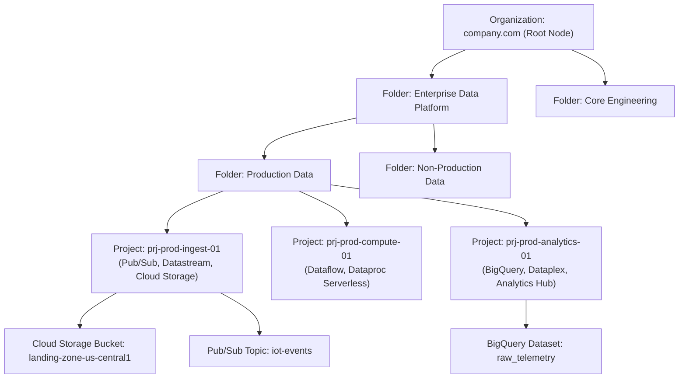
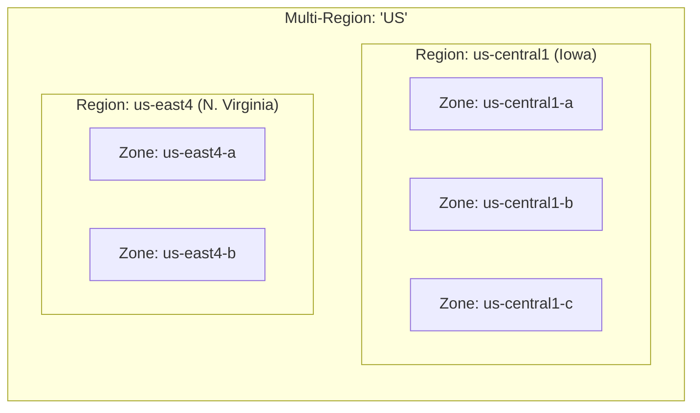
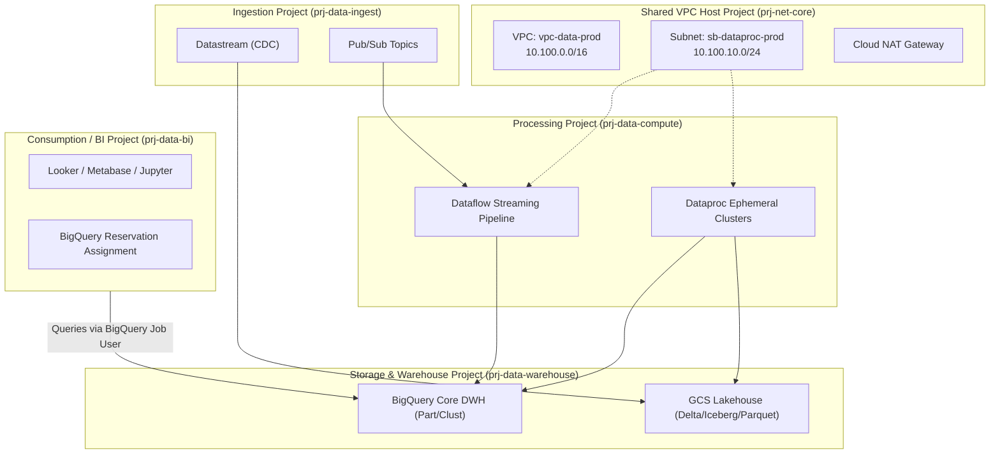

# Resource Hierarchy, Tenancy & Regional Architecture

**Tag**: Required (Exam Objective 1.1: Designing project, dataset, and table architecture for governance; dev vs. prod environments; data sovereignty)  
**Sources**: Official Google Cloud Documentation + PDE Exam Syllabus + Enterprise Architect Commentary

---

## 1. Architectural Overview & The GCP Tenancy Model

### 1.1 What Is It?
Google Cloud structures all infrastructure, compute, and data assets within a strict, multi-tiered directed acyclic tree known as the **Resource Hierarchy**:
$$\text{Organization} \longrightarrow \text{Folders} \longrightarrow \text{Projects} \longrightarrow \text{Resources}$$

> [!NOTE]
> **The Plain-English Analogy**: Think of a corporate enterprise headquarters.
> - The **Organization** is the entire corporate building, tied to the company's verified domain.
> - **Folders** are departmental floors or business wings (e.g., Retail Operations, Analytics & BI, Core Engineering).
> - **Projects** are locked, fireproof filing cabinets on each floor. Every resource (dataset, bucket, VM) lives inside exactly one cabinet.
> - **Resources** are the individual files, ledgers, and documents inside the cabinet.
> 
> A security rule posted at the entrance of a floor applies automatically to every cabinet on that floor. A team working at Cabinet A cannot open Cabinet B unless explicitly granted a key.

Unlike platforms where compute clusters or metastores sit at the tenancy root, Google Cloud anchors identity, billing, network boundaries, and administrative governance directly to this hierarchy. For a Principal Data Architect or an engineer transitioning from Databricks and AWS environments, understanding this hierarchy is critical. Misunderstanding the boundary of a **Project** or how inheritance flows from an **Organization** or **Folder** will lead to broken security boundaries, quota exhaustion across pipelines, or uncontained blast radiuses during pipeline failures.



---

## 2. Core Hierarchy Entities

### 2.1 The Organization Node
- **Root of the Hierarchy**: Tied 1:1 to a Google Workspace or Cloud Identity domain (e.g., `acme-corp.com`).
- **Control Plane Anchor**: Central point for Organization Policies, top-level IAM role grants, and default Cloud Logging sinks.
- **Superadmin Persona**: The `roles/resourcemanager.organizationAdmin` manages lifecycle and delegation, but should never manage data pipelines directly.

### 2.2 Folders
- **Logical Grouping**: Organizes projects by line of business (LOB), environment (`prod`, `staging`, `dev`), or compliance boundary (`pci-dss`, `hipaa`).
- **Nesting**: Can be nested up to **10 levels deep**.
- **Policy Aggregation**: Applying an IAM role or Org Policy at the folder level automatically propagates downward to all child folders and projects through policy inheritance.
``` shell
gcloud resource-manager folders create \
    --display-name="DISPLAY_NAME" \
    --organization=ORGANIZATION_ID

```
### 2.3 The Project: The Sovereign Boundary
In Google Cloud, the **Project** is the foundational atom of tenancy. It is not merely a tag or a namespace; it establishes the explicit boundary for:
1. **IAM Boundary**: IAM bindings assigned to users, groups, or Service Accounts apply across all resources within the project unless constrained at lower resource levels.
2. **Billing Boundary**: Every project is linked to exactly one Cloud Billing Account. All SKU usage (CPU, RAM, storage, network egress, queries) inside that project rolls up to that billing account.
3. **Quota Boundary**: API rate limits, regional compute quota (e.g., Dataproc vCPUs), BigQuery reservation allocations, and IP address allocations are metered per-project.
4. **Network Boundary**: A Virtual Private Cloud (VPC) network belongs to a project. While Shared VPC allows cross-project network sharing, the network lifecycle lives inside a host project.
5. **API Activation**: Google Cloud APIs (e.g., `bigquery.googleapis.com`, `dataflow.googleapis.com`) are enabled or disabled per project.

> [!IMPORTANT]
> **Enterprise Data Platform Pattern**: Never deploy end-to-end data pipelines (ingestion + compute + warehousing + egress) in a single monolithic project. Separate ingestion, processing, storage/warehouse, and orchestration into distinct projects to prevent compute jobs from starving analytics quotas or exposing raw data through permissive project-level IAM.

### 2.4 Resources
The leaf nodes of the hierarchy:
- BigQuery datasets, tables, routines, and models.
- Cloud Storage buckets and objects.
- Cloud Pub/Sub topics, subscriptions, and schemas.
- Dataproc clusters and batch workloads.
- Dataflow streaming and batch jobs.

---

## 3. Structural Comparison: Google Cloud vs. Databricks

Engineers coming from Databricks often conflate Unity Catalog metastores or workspace clusters with GCP projects. The following mapping clarifies architectural boundaries:

| Dimension | Databricks (AWS/Azure) | Google Cloud Platform | Architectural Implications |
| :--- | :--- | :--- | :--- |
| **Tenancy Root** | Databricks Account Console | Cloud Identity / GCP Organization | GCP governs IAM, billing, and networking natively above the project level. |
| **Namespace Boundary** | Workspace | GCP Project | Databricks workspaces share metastores via Unity Catalog; GCP projects own their own APIs, quotas, and service boundaries. |
| **Catalog / Governance** | Unity Catalog Metastore | Dataplex / Dataplex Catalog | Metastore is a single catalog entity; Dataplex provides a logical mesh across distributed projects and buckets. |
| **Relational Hierarchy** | `catalog.schema.table` | `project_id.dataset_id.table_id` | BigQuery tables natively require 3-part qualification (`project.dataset.table`). |
| **Compute Tenancy** | Spark Cluster (Driver + Workers) on EC2/Compute Engine | Dataflow (Managed Beam) / Dataproc (Spark/Hadoop) / BigQuery Slots | Databricks runs VMs in customer VPCs with Databricks control plane; Dataflow and BigQuery execute queries in Google-managed multi-tenant compute planes. |
| **Storage Separation** | External Volumes / S3 Buckets / ADLS Gen2 | Cloud Storage (GCS) Buckets / BigQuery Managed Storage | Both decouple compute from storage, but BigQuery storage can be queried directly without starting or managing clusters. |

---

## 4. Physical Geography: Regions, Zones, Dual-Regions, and Multi-Regions

Data residency, pipeline latency, and disaster recovery (DR) depend on selecting the correct physical deployment target.



### 4.1 Zone
- A single failure domain within a region, typically backed by one or more physical data centers.
- Connected to other zones in the same region via high-bandwidth, sub-millisecond latency networks.
- Used for: GCE instances, Dataproc worker nodes.

### 4.2 Region
- A distinct geographic location with **three or more zones**.
- Examples: `us-central1` (Iowa), `europe-west1` (Belgium), `asia-east1` (Taiwan).
- Inter-zone latency inside a region is < 1ms. Cross-region latency varies from 10ms to 200ms+.
- Storage in a regional bucket (99.9% availability SLA for Standard class) or single-region BigQuery dataset (99.9% Standard, 99.99% Enterprise) guarantees strict data sovereignty (data never leaves the country/region boundary).

### 4.3 Dual-Region
- Specific to Cloud Storage: Spans two specific regions (e.g., `nam4` for `us-central1` and `us-east4`).
- Provides active-active replication with low RPO for object data via Turbo Replication (15-minute SLA guaranteeing $\ge 99.9\%$ monthly volume conformance and $\ge 99.0\%$ monthly time conformance).
- Ideal for critical staging lakes feeding analytics pipelines that require cross-region disaster recovery without paying for full multi-region spread.

### 4.4 Multi-Region
- Large geographic areas containing two or more independent regions (e.g., `US`, `EU`, `ASIA`).
- **BigQuery Multi-Region (`US`)**: Queries run across dynamically allocated slots in data centers throughout the US. Datasets stored in `US` cannot be joined with datasets in single regions (e.g., `us-central1`) without cross-region data transfer or data copy.
- Cloud Storage Multi-Region provides 99.95% availability SLA and geo-redundancy against regional catastrophic events.

### 4.5 The Underlying Fabric: Jupiter Network
Google Cloud compute and storage do not travel over commodity internet backbones. They traverse **Jupiter**, Google's custom software-defined datacenter network fabric:
- **Bisection Bandwidth**: Over 1 Petabit/sec of total bisection bandwidth.
- **Compute-Storage Decoupling**: BigQuery worker nodes (Borg containers) read from BigQuery storage (Colossus) across Jupiter with bandwidth comparable to local NVMe disks, eliminating the traditional Hadoop co-location requirement.

---

## 5. Resource Manager & Organizational Policies

While IAM governs *who* (identities) can do *what* on *which* resources, **Organization Policies** define hard configuration guardrails across the entire resource hierarchy regardless of IAM permissions.

### 5.1 Inheritance Rules
1. **Hierarchical Evaluation**: Policies evaluate top-down (Org -> Folders -> Project).
2. **Deny Overrides Allow**: If a constraint is enforced at the organization level, a project administrator cannot disable it unless explicitly permitted by inheritance rules.
3. **Inheritance Modes**:
   - `inheritFromParent`: Merges values from parent nodes.
   - `reset`: Clears inherited values and restarts policy at this node.

### 5.2 Critical Data Engineering Org Constraints

The PDE exam frequently tests organizational constraints used to secure data platforms and prevent accidental data exfiltration or misconfiguration:

| Constraint Name | Type | Data Engineering Impact & Purpose |
| :--- | :--- | :--- |
| `constraints/compute.vmExternalIpAccess` | List (Deny All) | Prevents Dataproc and Compute Engine worker nodes from getting public IPs. Forces traffic through Cloud NAT or Private Google Access. |
| `constraints/storage.uniformBucketLevelAccess` | Boolean (Enforced) | Disables legacy Object ACLs across all Cloud Storage buckets; enforces uniform IAM control at the bucket level. |
| `constraints/storage.publicAccessPrevention` | Boolean (Enforced) | Blocks public read access (`allUsers`, `allAuthenticatedUsers`) on GCS data lake buckets, preventing data exposure. |
| `constraints/gcp.resourceLocations` | List (Allowed) | Restricts resource creation (BigQuery datasets, GCS buckets) to compliant regions (e.g., `in:eu-locations` for GDPR). |
| `constraints/iam.disableServiceAccountKeyCreation` | Boolean (Enforced) | Blocks users from downloading downloadable JSON private keys for Service Accounts, forcing Workload Identity Federation and SA impersonation. |

### 5.3 Concrete Implementation: Declaring Organizational Policies

Setting an organization policy using `gcloud`:

```bash
# Enforce Uniform Bucket-Level Access across all projects in a folder
gcloud resource-manager org-policies enable-enforce \
    storage.uniformBucketLevelAccess \
    --folder=1049283746501

# Restrict BigQuery and GCS creation to us-central1 and us-east4 only
cat <<EOF > location_constraint.yaml
constraint: constraints/gcp.resourceLocations
listPolicy:
  allowedValues:
    - in:us-central1-locations
    - in:us-east4-locations
EOF

gcloud resource-manager org-policies set-policy \
    location_constraint.yaml \
    --organization=987654321098
```

---

## 6. Enterprise Multi-Project Topologies for Data Platforms

A production-grade Google Cloud data architecture isolates concerns across functional projects:



### Key Isolation Principles:
1. **prj-data-ingest**: Contains external ingress endpoints, Datastream CDC instances, Pub/Sub topics. No analytical queries run here.
2. **prj-data-compute**: Runs Dataflow and Dataproc. Uses **Service Project** attachment to the Shared VPC. Dataproc workers pull code and write processed data to the warehouse project.
3. **prj-data-warehouse**: Hosts raw GCS buckets and BigQuery datasets. Compute permissions are strictly segregated from storage permissions.
4. **prj-data-bi**: Analysts submit queries from this project. They pay for their own query execution slots/costs while reading shared tables from `prj-data-warehouse`.

---

## 7. Exam Relevance & Anti-Patterns (PDE Exam Guide)

### Anti-Patterns to Spot in Exam Scenarios:
- **Anti-Pattern 1**: Running Dataproc or Dataflow in the same project where raw PII datasets reside, while giving data engineers `Editor` or `Owner` roles on that project.
  - *Correction*: Isolate compute into a compute project where engineers have job execution privileges; grant granular `roles/bigquery.dataViewer` or Dataplex reader roles on specific datasets in the warehouse project.
- **Anti-Pattern 2**: Creating BigQuery datasets in `US` multi-region while raw staging GCS buckets are in `us-central1`, and expecting serverless BigQuery external tables to query GCS without network egress charges or cross-region query errors.
  - *Correction*: External tables and underlying GCS buckets **must reside in the exact same region or multi-region**.
- **Anti-Pattern 3**: Attempting to resolve cross-project quota starvation by creating new datasets inside the same project.
  - *Correction*: Quotas (slots, API rate limits) are bounded by the project. Workloads must be isolated into dedicated projects or bound to distinct BigQuery Reservations.

---

## 8. Concrete Enterprise Scenario: ShopSphere Architecture

Throughout this handbook, we follow **ShopSphere**, a multinational omnichannel retail enterprise processing 50M transactions/day with web storefronts, mobile apps, and 850 retail stores across Europe and North America.

### ShopSphere Resource & Multi-Project Layout

| Folder | Project ID | Primary Workload & Services | Why It Is Isolated |
|---|---|---|---|
| **Production** | `shopsphere-ingest-prod` | Cloud Pub/Sub, Datastream (CDC from PostgreSQL), Storage Transfer Service, landing GCS buckets. | Isolates ingress blast radius and prevents external network exposure from touching data marts. |
| **Production** | `shopsphere-warehouse-prod` | BigQuery datasets (`raw`, `curated`, `marts`), BigLake tables over GCS. | Storage ownership boundary. Query slots are NOT consumed here by ad-hoc analysts. |
| **Production** | `shopsphere-bi-prod` | BI Engine reservations, Looker dashboards, analyst ad-hoc query jobs. | **Compute billing boundary**: Query processing costs roll up to the BI team's cost center. |
| **Production** | `shopsphere-compute-prod` | Cloud Dataflow (Beam), Dataproc Serverless, Cloud Composer 3. | Pipeline compute quotas (CPU, worker memory, IP pools) are isolated from interactive queries. |
| **Non-Production** | `shopsphere-data-dev`, `shopsphere-data-test` | Identical pipeline topologies running over sanitized/masked micro-datasets. | Full sandbox isolation preventing dev pipelines from ever mutating production datasets. |
| **Shared Services** | `shopsphere-network-host`, `shopsphere-monitoring` | Shared VPC host network, Cloud NAT gateways, centralized Cloud Logging sinks and Monitoring alert dashboards. | Governed centrally by Cloud NetOps and InfoSec teams. |

### Databricks Architectural Bridge (Comparison)
- In Databricks, tenancy typically revolves around **Account $\to$ Workspaces $\to$ Catalogs (Unity Catalog) $\to$ Schemas $\to$ Tables**.
- In Google Cloud:
  - An **Organization** is your top-level tenancy (like the Databricks Account).
  - A **Project** is NOT a workspace notebook folder: it is an ironclad boundary for **billing, IAM, regional quotas, API enablement, and networking**.
  - A **BigQuery Dataset** corresponds closely to a **Catalog/Schema** in Unity Catalog.
  - Query compute is completely decoupled: users in `shopsphere-bi-prod` run queries against tables stored in `shopsphere-warehouse-prod` without moving data.

---

## 9. Scenario-Based Knowledge Checks

### Question 0.1 (Single-Select: Billing & Compute Isolation)
ShopSphere's financial analysts work in the `shopsphere-bi-prod` project. They need to query production datasets hosted in the `shopsphere-warehouse-prod` project. Finance mandates that all query processing costs must be charged to the BI department's budget rather than the central data warehouse storage budget. What IAM configuration satisfies this requirement?

- [ ] A. Grant the BI analysts `roles/bigquery.admin` on `shopsphere-warehouse-prod`.
- [ ] B. Grant the BI analysts `roles/bigquery.jobUser` in `shopsphere-bi-prod`, and `roles/bigquery.dataViewer` on the specific datasets in `shopsphere-warehouse-prod`. Ensure queries specify `shopsphere-bi-prod` as the billing project.
- [ ] C. Configure an automated nightly Dataproc batch job to replicate warehouse tables into local datasets in `shopsphere-bi-prod`.
- [ ] D. Move the BI analysts' user accounts into `shopsphere-warehouse-prod` and apply BigQuery row-level filters.

**Correct Answer**: **B**

#### Detailed Distractor Analysis:
- **Why B is Correct**: In Google Cloud BigQuery, **query execution is billed to the project that submits the query job**, while **storage is billed to the project that owns the dataset**. Granting `roles/bigquery.jobUser` on `shopsphere-bi-prod` allows analysts to allocate compute and slots in their own project, while `roles/bigquery.dataViewer` at the dataset level in `shopsphere-warehouse-prod` provides read access to data without incurring storage charges or duplicating tables.
- **Why A is Incorrect**: Granting `roles/bigquery.admin` on `shopsphere-warehouse-prod` violates least privilege and causes query jobs submitted in the warehouse project to bill against warehouse storage budgets.
- **Why C is Incorrect**: Replicating tables nightly creates stale data copies, introduces operational overhead, and doubles storage charges.
- **Why D is Incorrect**: IAM users do not "reside" inside projects; they exist in Cloud Identity / Workspace and are bound to roles.

*Underlying Concept*: Separation of Storage and Compute Billing; Dataset-level IAM scoping.  
*Official Documentation Reference*: [BigQuery Access Control & Billing Projects](https://cloud.google.com/bigquery/docs/access-control).

---

### Question 0.2 (Single-Select: Data Sovereignty & Location Immutability)
ShopSphere is expanding retail operations into Germany and is legally bound by European GDPR regulations requiring that customer order transactions never leave the European Union. A junior engineer created the analytics dataset in the `US` multi-region. What must the Principal Data Architect do to resolve this non-compliance?

- [ ] A. Open the BigQuery console, edit the dataset configuration, and update the location dropdown from `US` to `europe-west3` (Frankfurt).
- [ ] B. Set up a Cross-Region VPC Network Peering between `us-central1` and `europe-west3`, and establish an authorized view.
- [ ] C. Create a new dataset in `europe-west3` (Frankfurt), copy the historical data using a cross-region copy job or BigQuery Data Transfer Service, reconfigure upstream ingestion pipelines to point to the new dataset, verify row integrity, and delete the US dataset. Apply an Organization Policy with constraint `constraints/gcp.resourceLocations` restricting future creation to `in:eu-locations`.
- [ ] D. Attach a Cloud KMS Customer-Managed Encryption Key (CMEK) located in Frankfurt to the US dataset.

**Correct Answer**: **C**

#### Detailed Distractor Analysis:
- **Why C is Correct**: In Google Cloud, **dataset location and Cloud Storage bucket location are strictly immutable after creation**. A dataset created in `US` can never be edited or migrated in-place. The data must be copied to a newly created regional dataset in the approved geography, pipelines repointed, and the non-compliant dataset dropped. Enforcing `constraints/gcp.resourceLocations` programmatically prevents future accidental provisioning outside approved EU regions.
- **Why A is Incorrect**: BigQuery dataset location is permanent and cannot be modified via console or API after creation.
- **Why B is Incorrect**: VPC peering governs private IP networking for Compute Engine VMs and has zero impact on where managed BigQuery multi-tenant storage resides.
- **Why D is Incorrect**: Encrypting US-stored data with a German CMEK key does not change the physical location of the stored ciphertext blocks on Colossus; it remains in violation of GDPR data residency.

*Underlying Concept*: Immutability of Storage Geography; Organization Policy Resource Location Constraints.  
*Official Documentation Reference*: [BigQuery Dataset Locations](https://cloud.google.com/bigquery/docs/locations) and [Resource Location Restriction Org Policy](https://cloud.google.com/resource-manager/docs/organization-policy/defining-locations).
