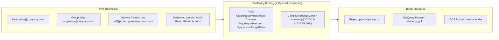
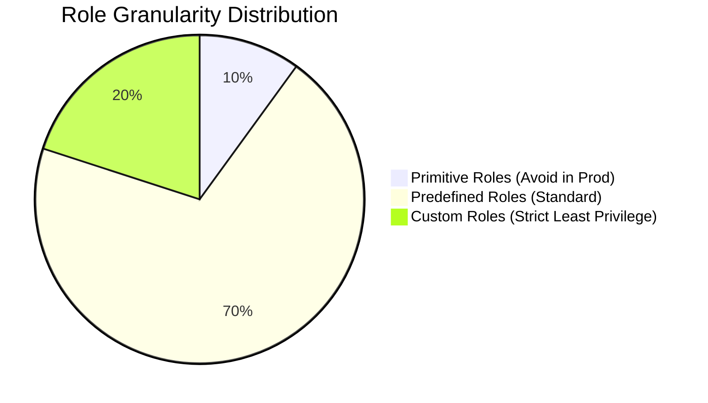
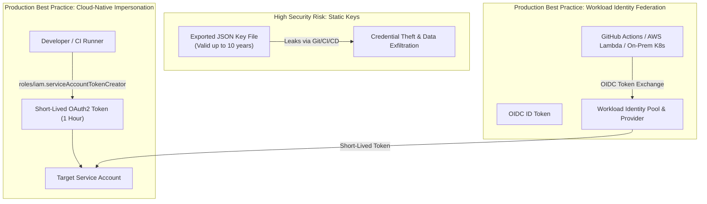
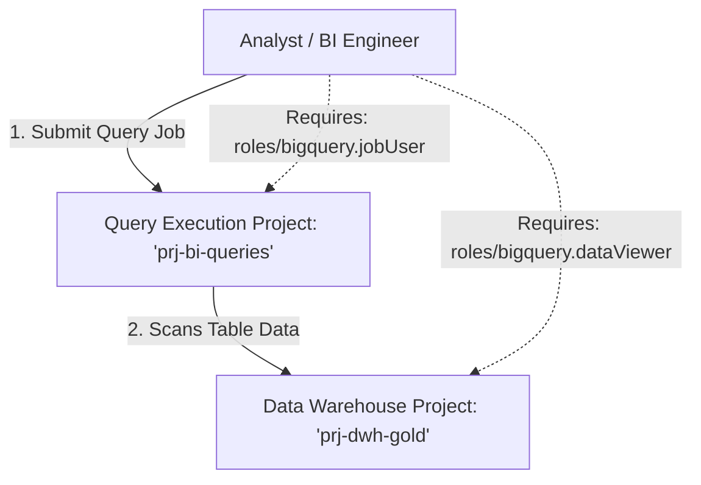
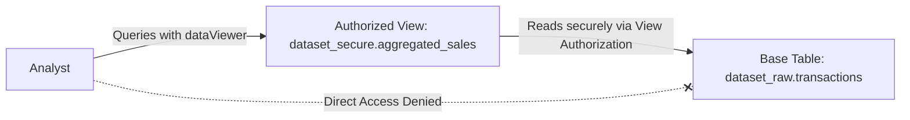

# Identity, Access Management (IAM), Service Accounts & Authentication

**Tag**: Required (Exam Objective 1.1: IAM, Service Accounts, and Organization Policies; Objective 2.1: Pipeline Identity & Auth)  
**Sources**: Official Google Cloud Documentation + PDE Exam Syllabus + Enterprise Security Best Practices

---

## 1. Google Cloud IAM Architecture

Identity and Access Management (IAM) in Google Cloud establishes an authorization framework where access is defined by binding **who** (Identities/Principals) can do **what** (Roles containing specific Permissions) on **which** (Resources in the hierarchy).



In Google Cloud, permissions are never assigned directly to principals. Instead, permissions are bundled into **roles**, and roles are bound to principals via **IAM Policies** at specific nodes in the resource hierarchy.

---

## 2. Role Classifications: Primitive, Predefined, and Custom

Understanding role granularity is central to designing compliant, audit-ready data pipelines.



### 2.1 Primitive Roles (Legacy)
- **Roles**: `roles/owner`, `roles/editor`, `roles/viewer`.
- **Characteristics**: Coarse-grained, historical legacy roles that apply universally across every Google Cloud service in the project.
- **Risks**: `roles/editor` allows reading and deleting BigQuery datasets, modifying Cloud Composer environments, dropping Spanner databases, and provisioning expensive GPU instances.
- **Rule of Thumb**: **Never** assign primitive roles in production environments or to automated data pipeline service accounts.

### 2.2 Predefined Roles (Google-Managed)
- Fine-grained roles created and maintained by Google Cloud per service.
- When Google adds a new API capability (e.g., a new BigQuery metadata inspection feature), Google automatically updates the predefined role with the appropriate `bigquery.*` permission.
- Examples in Data Engineering:
  - `roles/bigquery.jobUser`: Grants permission to run queries and load jobs (`bigquery.jobs.create`). **Does not** grant read access to table data.
  - `roles/bigquery.dataViewer`: Grants read access to dataset metadata and table contents (`bigquery.tables.getData`). **Does not** grant query execution rights.
  - `roles/storage.objectAdmin`: Full control over objects in GCS buckets.
  - `roles/dataproc.editor`: Create and manage Dataproc clusters and submit jobs.

### 2.3 Custom Roles (User-Managed)
- Tailored collections of granular permissions created by the organization when predefined roles are too broad.
- **Limitation**: Cannot contain permissions from services that do not support custom roles. If a service introduces new API methods, custom roles do not update automatically.
- Custom Role Definition Example (YAML):

```yaml
title: "DataflowPipelineSubmitter"
description: "Allows staging GCS files and submitting Dataflow batch/streaming jobs"
stage: "GA"
includedPermissions:
  - dataflow.jobs.create
  - dataflow.jobs.get
  - dataflow.jobs.list
  - storage.objects.create
  - storage.objects.get
  - storage.objects.list
```

Create via CLI:
```bash
gcloud iam roles create DataflowPipelineSubmitter \
    --project=prj-data-compute \
    --file=custom_dataflow_role.yaml
```

---

## 3. Service Accounts: The Backbone of Pipeline Automation

A **Service Account (SA)** is a special identity representing non-human automated processes (Dataflow workers, Airflow tasks, Datastream capture engines, Cloud Run jobs).

### 3.1 Types of Service Accounts
1. **User-Managed Service Accounts**: Created by the data engineering team (e.g., `sa-composer-worker@prj-data-orchestration.iam.gserviceaccount.com`).
2. **Default Service Accounts**: Automatically generated when certain APIs are enabled (e.g., Compute Engine default SA: `PROJECT_NUMBER-compute@developer.gserviceaccount.com`).
   > [!CAUTION]
   > Default Service Accounts are historically assigned `roles/editor` automatically upon creation. In production, disable this behavior via the Org Policy `constraints/iam.automaticIamGrantsForDefaultServiceAccounts` and attach custom, minimal service accounts instead.
3. **Google-Managed Service Agents**: Dedicated service accounts operated by Google internal systems to act on your behalf (e.g., `service-PROJECT_NUMBER@gcp-sa-bigquerydatatransfer.iam.gserviceaccount.com`).

---

## 4. Modern Authentication: JSON Keys vs. Impersonation & WIF



### 4.1 The Security Vulnerability of Downloaded JSON Keys
Traditional pipelines relied on downloading a private key pair as a JSON file:
- Keys do not expire for up to 10 years by default.
- Keys are difficult to audit, frequently leak into version control or CI/CD logs, and bypass network perimeter restrictions.
- **Enterprise Best Practice**: Block JSON key generation at the organization level:
  ```bash
  gcloud resource-manager org-policies enable-enforce \
      iam.disableServiceAccountKeyCreation \
      --organization=987654321098
  ```

### 4.2 Service Account Impersonation
Instead of storing long-lived credentials, an identity with `roles/iam.serviceAccountTokenCreator` generates short-lived (15–60 minute) OAuth2 access tokens on the fly:

```bash
# Allow developer to impersonate the production dataflow runner
gcloud iam service-accounts add-iam-policy-binding \
    sa-dataflow-prod@prj-data-compute.iam.gserviceaccount.com \
    --member="user:dataengineer@company.com" \
    --role="roles/iam.serviceAccountTokenCreator"

# Run gcloud or bq commands via impersonation without storing credentials locally
gcloud storage ls gs://landing-lake-bucket \
    --impersonate-service-account=sa-dataflow-prod@prj-data-compute.iam.gserviceaccount.com
```

### 4.3 Workload Identity Federation (WIF)
Workload Identity Federation allows external workloads (such as GitHub Actions, AWS Step Functions, or Azure DevOps pipelines) to authenticate to Google Cloud **without any GCP service account keys**.

1. External workload authenticates to its local provider (e.g., AWS STS or GitHub Actions OIDC).
2. External workload exchanges its signed JSON Web Token (JWT) with Google Cloud STS (Security Token Service).
3. Google Cloud STS verifies the token against the configured **Workload Identity Pool Provider**.
4. STS returns a short-lived GCP federation token, which is then used to impersonate a target Google Cloud Service Account.

---

## 5. Least Privilege Architecture in BigQuery & Storage

A frequent source of security failure and exam questions is the distinction between query submission (compute) and data access (storage).



### 5.1 BigQuery Job User vs. Data Viewer Separation
To run `SELECT * FROM \`prj-dwh-gold.telemetry.metrics\``, an analyst needs:
1. **At the compute project (`prj-bi-queries`)**:
   - `roles/bigquery.jobUser`: Grants rights to allocate query slots, write to temporary cached tables, and charge the billing account attached to `prj-bi-queries`.
2. **At the data project / dataset (`prj-dwh-gold.telemetry`)**:
   - `roles/bigquery.dataViewer`: Grants rights to read schema and read table records.
   - The user **does not** need `roles/bigquery.jobUser` on `prj-dwh-gold`, preventing unauthorized ad-hoc query charges against the production warehouse project.

### 5.2 Authorized Views and Authorized Datasets
When an analyst needs aggregated insights without having access to raw underlying records (e.g., medical records, financial transactions):



- The analyst is granted `roles/bigquery.dataViewer` **only** on the dataset containing the Authorized View.
- The view itself is authorized to read from the base table dataset (`dataset_raw`), even though the querying user has zero IAM rights on `dataset_raw`.

---

## 6. Advanced IAM: Conditions and Tag-Based Access Control

### 6.1 IAM Conditions
IAM conditions allow role grants to be restricted based on contextual attributes such as resource name prefixes, request timestamps, or destination IP ranges using Common Expression Language (CEL).

Example: Grant GCS bucket read access strictly to objects with prefix `stage-gold/` during business hours:
```yaml
bindings:
- members:
  - "group:bi-contractors@company.com"
  role: "roles/storage.objectViewer"
  condition:
    title: "Gold Staging Access Only"
    description: "Limits access to specific object paths and business hours"
    expression: >
      resource.name.startsWith("projects/_/buckets/company-lakehouse/objects/stage-gold/") &&
      request.time.getHours("America/New_York") >= 9 &&
      request.time.getHours("America/New_York") <= 17
```

### 6.2 Tag-Based IAM
Google Cloud **Tags** (distinct from label metadata) are strongly-typed key-value pairs governed at the Organization level and integrated into the Resource Manager.
- Tags can be applied to folders, projects, or BigQuery tables.
- IAM policies can evaluate tags dynamically:
  ```yaml
  condition:
    title: "Access Non-Confidential Data Only"
    expression: >
      resource.matchTag('987654321098/classification', 'public')
  ```

---

## 7. Comparison: Google Cloud IAM vs. Databricks Unity Catalog

| Security Capability | Databricks / Unity Catalog | Google Cloud IAM & Dataplex | Architectural Nuance |
| :--- | :--- | :--- | :--- |
| **Identity Authority** | SCIM synced with IdP (Okta/Azure AD) | Google Cloud Identity / Google Workspace | GCP IAM binds directly to Cloud Identity groups; Databricks synchronizes groups into the account console. |
| **Object Authorization** | SQL Grants (`GRANT SELECT ON TABLE ...`) | IAM Roles on Datasets/Tables + Dataplex Lake/Zone ACLs | GCP IAM handles authorization via resource hierarchy; BigQuery also supports standard SQL `GRANT` statements. |
| **Row/Column Security** | Dynamic Column Masks & Row Filters in SQL | BigQuery Column Policy Tags (via Dataplex Taxonomy) & Row Access Policies | BigQuery uses native tag taxonomies and fine-grained readers; Databricks embeds masks in SQL expressions. |
| **Machine Identities** | Databricks Service Principals (OAuth M2M) | GCP Service Accounts (OIDC, WIF, Short-lived tokens) | GCP SAs are native GCP compute resources that can be impersonated or federated without client secrets. |
| **Auditing & Traceability** | Unity Catalog System Tables (`system.access.audit`) | Cloud Logging (`data_access` audit logs) -> BigQuery Sink | GCP writes immutable audit logs for every API access (`read`, `write`, `admin`) to Cloud Logging sinks. |

---

## 8. Exam Relevance & Common Traps (PDE Exam Guide)

1. **Trap: Authorizing Dataflow to access GCS/BigQuery**:
   - Assigning roles to the developer submitting the Dataflow job is insufficient.
   - The job executes under the **Dataflow Worker Service Account** (by default, the Compute Engine SA, or preferably a custom SA specified with `--serviceAccount`).
   - The *worker service account* must possess `roles/storage.objectAdmin` on staging buckets and `roles/bigquery.dataEditor` on target tables.
2. **Trap: Storage Object Admin vs Storage Admin**:
   - `roles/storage.admin`: Grants permission to delete buckets, change bucket-level IAM policies, and modify bucket encryption keys.
   - `roles/storage.objectAdmin`: Grants permission to create, read, and delete objects *inside* buckets. Pipelines should almost always use `roles/storage.objectAdmin` or `objectUser`.
3. **Trap: BigQuery Admin vs BigQuery Job User**:
   - Exam questions asking how to grant developers the ability to run queries without giving them the right to delete datasets will offer `roles/bigquery.admin`, `roles/bigquery.user`, and `roles/bigquery.jobUser`.
   - The minimal, correct answer is `roles/bigquery.jobUser` on the compute project, paired with `roles/bigquery.dataViewer` on the target dataset.
4. **Trap: Service Account User vs Service Account Token Creator**:
   - `roles/iam.serviceAccountUser` ("ActAs"): Grants permission to attach the Service Account to an execution runtime (Compute Engine VM, Dataflow worker, Dataproc node). Required by deployers and CI/CD pipelines.
   - `roles/iam.serviceAccountTokenCreator`: Grants permission to mint short-lived OAuth 2.0 access tokens to impersonate the identity directly via CLI or API.

---

## 9. ShopSphere Enterprise Pipeline Identity Mapping

In the **ShopSphere** retail platform, we strictly ban long-lived downloaded JSON service account keys (`iam.disableServiceAccountKeyCreation` Org Policy constraint is active). Every workload executes under a purpose-built, least-privilege machine identity:

| Service Account Email | Dedicated Workload | Roles Granted | Resource Scope |
|---|---|---|---|
| `sa-orders-stream@shopsphere-ingest-prod.iam.gserviceaccount.com` | Dataflow streaming pipeline consuming orders | `roles/pubsub.subscriber`<br/>`roles/dataflow.worker`<br/>`roles/bigquery.dataEditor` | Subscription in `shopsphere-ingest-prod`; `raw` dataset in `shopsphere-warehouse-prod` |
| `sa-datastream-cdc@shopsphere-ingest-prod.iam.gserviceaccount.com` | Datastream capturing Cloud SQL changes | `roles/datastream.admin`<br/>`roles/storage.objectAdmin` | GCS landing bucket in `shopsphere-ingest-prod` |
| `sa-composer-runner@shopsphere-compute-prod.iam.gserviceaccount.com` | Cloud Composer 3 orchestrator | `roles/composer.worker`<br/>`roles/bigquery.jobUser` | Project `shopsphere-compute-prod` |

---

## 10. Scenario-Based Knowledge Checks

### Question 0.5 (Single-Select: Least Privilege Pipeline Service Accounts)
A newly developed Cloud Dataflow streaming pipeline must ingest clickstream messages from a Cloud Pub/Sub subscription in `shopsphere-ingest-prod` and write validated, formatted records into the `fact_clickstream` table within the `analytics_curated` dataset in `shopsphere-warehouse-prod`. The pipeline will be deployed by the data engineering team. Which security configuration enforces the Principle of Least Privilege?

- [ ] A. Run the Dataflow pipeline under the default Compute Engine service account (`<project-number>-compute@developer.gserviceaccount.com`), which has the `Editor` role on both projects.
- [ ] B. Create a custom service account `sa-dataflow-clickstream`. Grant it `roles/dataflow.worker` on `shopsphere-compute-prod`, `roles/pubsub.subscriber` strictly on the target subscription, and `roles/bigquery.dataEditor` strictly on the `analytics_curated` dataset. Grant the data engineers `roles/iam.serviceAccountUser` on `sa-dataflow-clickstream`.
- [ ] C. Create a service account with `roles/owner` on the Organization, generate a JSON key, and store it in an encrypted Cloud Storage bucket read by the pipeline at startup.
- [ ] D. Grant the data engineers `roles/bigquery.admin` on `shopsphere-warehouse-prod` and launch the pipeline with the engineers' individual user credentials.

**Correct Answer**: **B**

#### Detailed Distractor Analysis:
- **Why B is Correct**: Least privilege mandates creating a dedicated machine identity (`sa-dataflow-clickstream`) carrying only the exact permissions needed to pull messages, run Dataflow workers, and append data into the destination dataset. Furthermore, data engineers need `roles/iam.serviceAccountUser` ("ActAs" permission) to attach this service account to the Dataflow job at deployment time without possessing direct write permissions to production tables themselves.
- **Why A is Incorrect**: Relying on default service accounts with primitive `Editor` roles provides massive over-permissioning across all project resources and is a classic exam security anti-pattern.
- **Why C is Incorrect**: Long-lived JSON keys introduce critical credential leakage risks, and `roles/owner` on the organization is catastrophic over-privilege.
- **Why D is Incorrect**: Production automated pipelines must never execute under human user credentials, and `roles/bigquery.admin` violates least privilege.

*Underlying Concept*: Dedicated Service Accounts, Service Account User ("ActAs"), Scoped Dataset Roles.  
*Official Documentation Reference*: [Dataflow Security and Permissions](https://cloud.google.com/dataflow/docs/concepts/security-and-permissions) and [Service Account User Role](https://cloud.google.com/iam/docs/service-account-overview).
