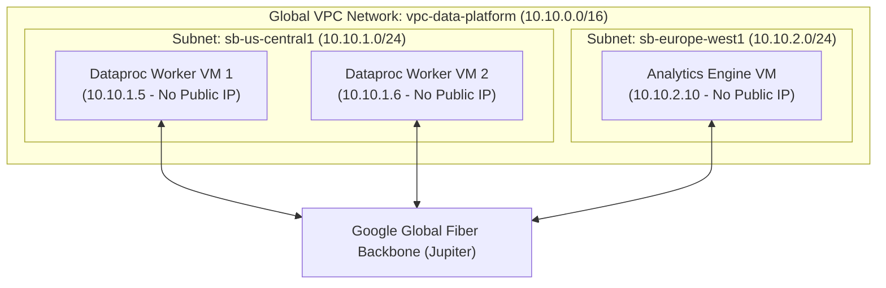
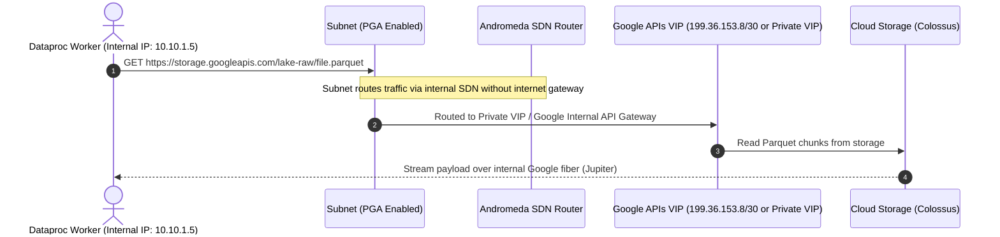
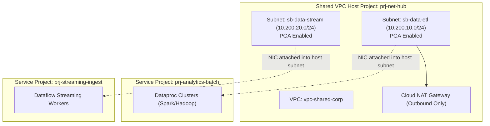
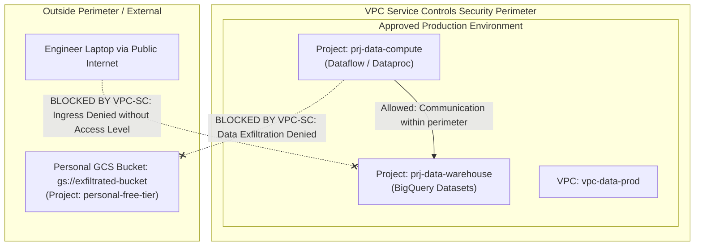

# Network Topology, VPC, Firewalls & Private Connectivity

**Tag**: Required (Exam Objective 1.4: Migration Networking; Objective 2.1: Networking Fundamentals & Private Pipelines)  
**Sources**: Official Google Cloud Documentation + PDE Exam Syllabus + Enterprise Network Architecture

---

## 1. Network Topology Fundamentals in Google Cloud

In Google Cloud, a Virtual Private Cloud (VPC) is **global** by design. Unlike other public cloud environments where a VPC is tied to a single physical region, a GCP VPC spans every Google Cloud region across the globe without requiring inter-region VPNs or complex routing peering fabrics.



### 1.1 Auto Mode vs. Custom Mode VPCs
- **Auto Mode**: Automatically provisions a `/20` subnet in every GCP region using predefined CIDR ranges.
  - *Risk in Enterprise*: Uncontrolled overlapping subnets that conflict with on-premises RFC 1918 address space. Cannot be shared easily across hybrid interconnects.
- **Custom Mode**: The enterprise standard. Zero subnets are created automatically. The network architect explicitly specifies regions, CIDR ranges, and secondary ranges (used for GKE/Dataproc on GKE pods and services).

### 1.2 Firewall Rules
GCP firewalls are stateful, applied at the instance level (via network tags or service accounts), and evaluate ingress and egress:
- **Implied Rules**: Default Deny Ingress (`priority: 65535`), Default Allow Egress (`priority: 65535`).
- **Internal Cluster Communication**: Data processing frameworks (Spark on Dataproc) require extensive peer-to-peer traffic between master and worker nodes for shuffle data and heartbeat signaling. A firewall rule allowing all internal communication within the subnet or tagged cluster nodes is mandatory.

---

## 2. Private Google Access (PGA): Isolated Compute Execution

Enterprise compliance mandates that compute nodes handling data (Dataproc clusters, Dataflow workers, Compute Engine ETL runners) **must not have external public IP addresses**.

However, data pipelines must interact with Google Cloud APIs (such as reading from Cloud Storage, writing to BigQuery, publishing to Pub/Sub). If compute instances lack public IPs, how do they reach `storage.googleapis.com` or `bigquery.googleapis.com`?

**Private Google Access (PGA)** solves this challenge at the subnet level.



### 2.1 Enabling Private Google Access
PGA is enabled per subnet with a single configuration flag:

```bash
gcloud compute networks subnets update sb-dataproc-prod \
    --region=us-central1 \
    --enable-private-ip-google-access
```

### 2.2 Operational Considerations:
1. **DNS Resolution**: Compute instances must resolve Google API domain names (`*.googleapis.com`) to either default public IPs (which are intercepted by Andromeda when PGA is active) or to the `restricted.googleapis.com` / `private.googleapis.com` VIP blocks.
2. **Restricted VIP (`199.36.153.4/30`)**: Only resolves APIs that are supported by VPC Service Controls (VPC-SC), preventing accidental leaks to non-compliant APIs.
3. **Private VIP (`199.36.153.8/30`)**: Resolves all supported Google Cloud APIs.

---

## 3. Shared VPC: Enterprise Multi-Project Topologies

In modern enterprise data platforms, network infrastructure is decoupled from data workloads using **Shared VPC**.



### 3.1 Host Project vs. Service Project
- **Host Project**: Managed exclusively by the Central Network / Cloud Ops team. Owns the VPC, subnets, route tables, interconnects, Cloud NAT, and firewall rules.
- **Service Projects**: Managed by Data Engineering teams. They contain no VPC networks of their own. Instead, resources (Compute instances, Dataproc, GKE, Dataflow) are authorized to attach their network interfaces directly into subnets hosted in the Host Project.
- **Role Delegation**: The network team grants `roles/compute.networkUser` to the Data Engineering Service Accounts on **specific subnets** only.

### 3.2 Deploying Dataproc in a Shared VPC
When spinning up Dataproc in a Service Project, the cluster must explicitly reference the Host Project's subnet:

```bash
gcloud dataproc clusters create cluster-etl-prod \
    --project=prj-analytics-batch \
    --region=us-central1 \
    --subnet=projects/prj-net-hub/regions/us-central1/subnetworks/sb-data-etl \
    --no-address \
    --master-machine-type=n2-standard-8 \
    --worker-machine-type=n2-standard-16 \
    --num-workers=10
```

---

## 4. Private Service Connect (PSC) vs. Cloud NAT

Data pipelines frequently need to connect to services outside the local VPC:
1. Third-party SaaS (e.g., Snowflake, MongoDB Atlas, Salesforce).
2. Managed Google-hosted tenant projects (e.g., Cloud SQL, Cloud Composer GKE control plane, Vertex AI endpoints).
3. External public APIs (e.g., downloading FX exchange rates, weather feeds).

```mermaid
graph LR
    subgraph VPC["Consumer VPC (prj-data-compute)"]
        ETLJob["Dataflow Worker / Cloud Run"]
        PSC_Endpoint["PSC Endpoint (10.10.1.50)<br/>Forwarding Rule"]
        NAT_Gateway["Cloud NAT Gateway"]
    end

    subgraph ProducerVPC["Managed Producer VPC (e.g., Cloud SQL / SaaS)"]
        ManagedDB["Cloud SQL Postgres / MongoDB Atlas"]
    end

    subgraph Internet["Public Internet"]
        PublicAPI["External REST API (Currency Rates)"]
    end

    ETLJob -->|Private RFC 1918 traffic| PSC_Endpoint
    PSC_Endpoint -->|Private Service Connect (Unidirectional NAT)| ManagedDB
    ETLJob -->|Outbound HTTPS only| NAT_Gateway
    NAT_Gateway -->|Internet Egress| PublicAPI
```

### 4.1 Private Service Connect (PSC)
- **Mechanism**: Exposes producer services to consumer VPCs via private RFC 1918 IP addresses (Forwarding Rules).
- **Advantages**:
  - **No IP Address Overlap Risk**: Unidirectional NAT decouples the consumer CIDR space from the producer CIDR space.
  - **Fine-Grained Governance**: Consumers connect to an explicit target endpoint, not the entire peer network (unlike traditional VPC Peering).
  - **No Transitive Routing Limitations**: Overcomes VPC Peering's non-transitive routing constraint.

### 4.2 Cloud NAT (Network Address Translation)
- **Mechanism**: A fully managed, software-defined egress NAT service that allows internal instances (without public IPs) to reach the public internet for outbound traffic.
- **Use Case**: Downloading public open-source Python wheels (`pip install`) during Dataproc cluster initialization actions, or fetching public third-party REST API feeds.
- **Security Rule**: Cloud NAT **does not allow ingress** connections from the internet to internal workers.

---

## 5. VPC Service Controls (VPC-SC): Preventing Data Exfiltration

A common enterprise misconception is that IAM alone prevents data theft. 
Consider this insider threat scenario:
*A malicious or compromised data engineer has valid credentials (`roles/bigquery.admin`). The engineer runs a query on production customer data and writes the result to a personal GCS bucket (`gs://malicious-bucket`) in a personal GCP project.*

Because the engineer holds valid IAM privileges, IAM permits the operation. **VPC Service Controls (VPC-SC)** exists specifically to stop this scenario.



### 5.1 Anatomy of a VPC-SC Perimeter
1. **Protected Projects**: Projects enclosed within the perimeter.
2. **Restricted Services**: Google Cloud APIs guarded by the perimeter (e.g., `bigquery.googleapis.com`, `storage.googleapis.com`, `pubsub.googleapis.com`).
3. **Access Levels**: Context-aware criteria (client IP ranges, device compliance, user identity) required to breach the perimeter for administration.
4. **Ingress and Egress Rules**: Cryptographically enforced bridges allowing explicit data exchange between perimeters or between a perimeter and an external authorized AWS/Azure bucket.

---

## 6. Comparison: GCP Networking vs. Databricks Network Architecture

| Architectural Concept | Databricks (AWS/Azure) | Google Cloud Platform | Practical Impact |
| :--- | :--- | :--- | :--- |
| **VPC Scope** | Regional (AWS VPC / Azure VNet) | Global VPC across all regions | GCP pipelines can share subnets across regions without VPC peering or transit gateways. |
| **Secure Compute Execution** | Databricks Secure Cluster Connectivity (No Public IPs via Relay) | Private Google Access (PGA) + `--no-address` on Dataproc/Dataflow | Both prevent public IPs on workers; GCP routes API calls internally via Jupiter without an external relay proxy. |
| **Cross-Project Networking** | AWS VPC Peering / AWS Transit Gateway | GCP Shared VPC (Native Host/Service relationship) | GCP Shared VPC eliminates transit gateway maintenance costs and routing latency. |
| **Data Exfiltration Defense** | AWS S3 Bucket Policies / Azure Private Endpoints | VPC Service Controls (Perimeter boundary around APIs & storage) | VPC-SC establishes an overarching perimeter around multiple services simultaneously. |
| **Private Service Exposure** | AWS PrivateLink | Private Service Connect (PSC) | PSC allows publishing and consuming services across disparate organizations without CIDR coordination. |

---

## 7. Exam Relevance & Troubleshooting Guide (PDE Exam Guide)

### Troubleshooting Common Exam Scenarios:
1. **Scenario: Dataproc cluster creation fails with "Initialization action failed: connection timed out"**:
   - *Cause*: The cluster was provisioned with `--no-address` (no public IPs), but the initialization script attempted to download an external package from `pypi.org` or GitHub.
   - *Fix*: Provision a **Cloud NAT** gateway on the subnet to allow outbound internet access, or mirror required libraries into an internal Cloud Storage bucket accessible via Private Google Access.
2. **Scenario: Dataflow pipeline cannot reach BigQuery in a different project**:
   - *Cause*: If VPC-SC is active, both the Dataflow project and the BigQuery project must reside inside the **same service perimeter**, or an explicit **Egress/Ingress Rule** must be declared.
3. **Scenario: BigQuery external table over Cloud Storage returns "Access Denied" despite correct IAM**:
   - *Cause*: VPC Service Controls perimeter blocks BigQuery service agent from accessing the GCS bucket project, or Restricted VIP DNS mapping is missing.

---

## 8. Data Migration & Hybrid Connectivity Decision Guide

When ingesting data from on-premises data centers or third-party clouds, select the network transport based on data volume, bandwidth constraints, and security requirements:

| Ingestion Requirement | Recommended Network Mechanism | Why This Selection Wins on the Exam |
|---|---|---|
| **Private worker needs Google APIs only** (BigQuery, GCS, Pub/Sub) | **Private Google Access (PGA)** | Enables internal-only VMs/workers to communicate with `*.googleapis.com` without public IPs or NAT gateways. Zero egress charge to internal APIs. |
| **Private worker needs external internet** (fetching PyPi libraries, 3rd-party REST APIs) | **Cloud NAT** | Provides outbound-only source network address translation without assigning inbound public IPs to worker VMs. |
| **Many data projects, single governed network** | **Shared VPC** | Centralizes network routing, subnets, and firewalls in a Host Project, while service projects attach Dataproc/Dataflow workers securely. |
| **Encrypted hybrid link, modest bandwidth ($<3\text{Gbps}$)** | **Cloud HA VPN** | Fast, encrypted IPSec tunnels over public internet with 99.99% SLA; cost-effective for moderate continuous replication. |
| **Sustained high-bandwidth private link ($10\text{Gbps} - 100\text{Gbps}$)** | **Cloud Interconnect** (Dedicated or Partner) | Physical fiber connection bypassing public internet. Delivers lowest latency, deterministic throughput, and reduced data egress pricing. |
| **Massive historical dataset ($>20\text{TB} - \text{Petabytes}$) with limited uplink bandwidth** | **Transfer Appliance** | High-density physical storage device shipped to on-premises data center, loaded locally over NFS, and shipped back to Google for ingestion into GCS. |
| **Automated, recurring online object transfers from AWS S3, Azure Blob, or SFTP** | **Storage Transfer Service (STS)** | Fully managed, serverless, scalable data transfer service with scheduled runs, checksum validation, and bandwidth throttling. |

### Public vs. Private vs. Restricted Google APIs
- **Default (`*.googleapis.com`)**: Resolved to public IP addresses over internet routes.
- **Private Google Access (Private VIP: `199.36.153.8/30` - `private.googleapis.com`)**: Routes traffic strictly over internal Google fiber to all Google APIs.
- **Restricted VIP (`199.36.153.4/30` - `restricted.googleapis.com`)**: Resolves strictly to Google APIs that are **supported by VPC Service Controls**. Mandatory when configuring VPC-SC perimeters to eliminate DNS leaks.

---

## 9. Scenario-Based Knowledge Check

### Question 0.6 (Single-Select: Private Pipeline Connectivity)
ShopSphere's security policy strictly forbids assigning public IP addresses to any Compute Engine instances or data processing nodes. A newly deployed Cloud Dataflow streaming pipeline running in a custom VPC subnetwork fails during startup with connection timeout errors when attempting to read from a Cloud Pub/Sub subscription and write temporary staging files to Cloud Storage. What is the most direct, architecturally sound resolution?

- [ ] A. Assign ephemeral public IPv4 addresses to each Dataflow worker node, but configure a firewall rule to block all inbound traffic.
- [ ] B. Enable **Private Google Access** on the custom subnetwork hosting the Dataflow workers.
- [ ] C. Establish a Cloud HA VPN tunnel between the custom subnetwork and Google's public IP range.
- [ ] D. Move the Dataflow pipeline into an Auto Mode VPC network where default firewall rules permit public API traffic.

**Correct Answer**: **B**

#### Detailed Distractor Analysis:
- **Why B is Correct**: Dataflow workers without external IP addresses cannot reach public Google API endpoints by default. Enabling **Private Google Access (PGA)** on the worker's subnetwork instructs Google's software-defined network (Andromeda) to route requests destined for Google APIs (Cloud Storage, Pub/Sub, BigQuery) internally across Google's private network fabric without requiring external IP addresses, NAT gateways, or internet hops.
- **Why A is Incorrect**: Assigning public IP addresses directly violates the mandatory enterprise security policy forbidding external IPs.
- **Why C is Incorrect**: Cloud HA VPN is designed for hybrid connectivity to on-premises networks or other clouds, not for connecting VPC instances to Google's internal API control plane.
- **Why D is Incorrect**: Moving to an Auto Mode VPC does not solve the problem if instances lack external IPs, and Auto Mode networks are an enterprise anti-pattern due to unpredictable CIDR allocations.

*Underlying Concept*: Private Google Access (PGA) mechanics; Securing Serverless Compute.  
*Official Documentation Reference*: [Configuring Private Google Access](https://cloud.google.com/vpc/docs/private-google-access).
