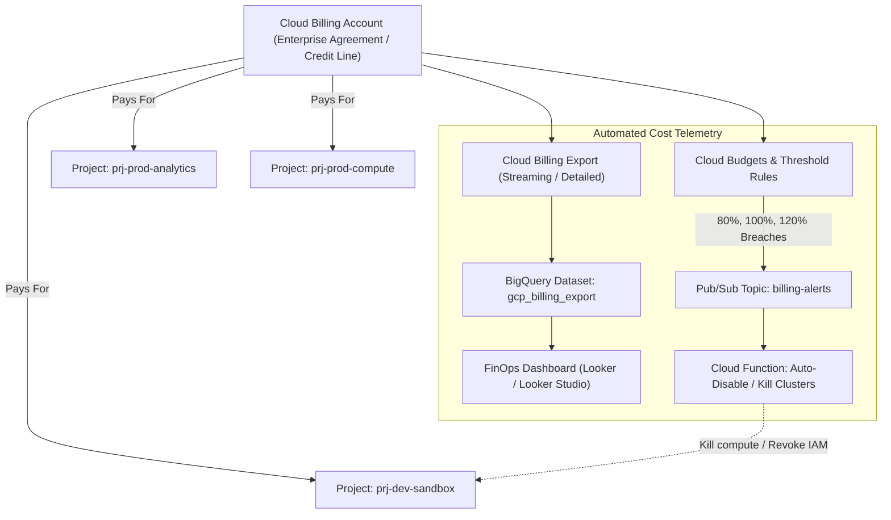
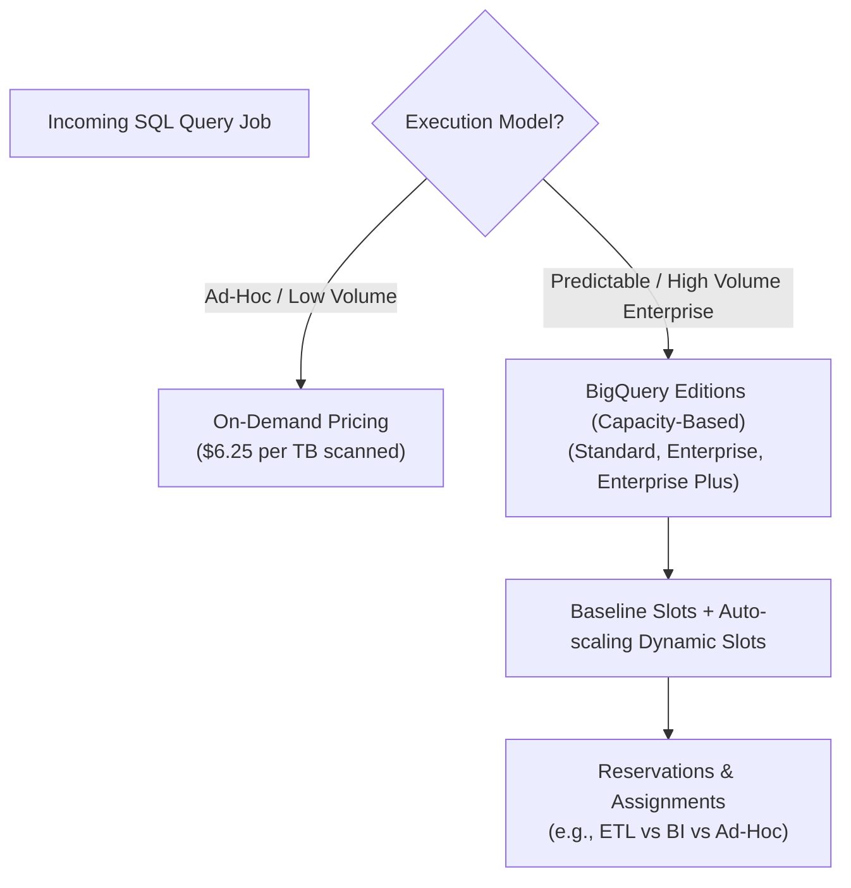

# Pricing, Quotas, Cost Controls & Resource Management

**Tag**: Required (Exam Objective 5.1: Optimizing Resources for Cost & Compute; Objective 5.4: Managing Budgets, Quotas, and Billing Issues)  
**Sources**: Official Google Cloud Documentation + PDE Exam Syllabus + Enterprise FinOps Best Practices

---

## 1. Cloud Billing Architecture

In Google Cloud, cost management is decoupled from operational resource creation. A **Cloud Billing Account** is an organizational entity linked to a payment profile that tracks financial liability across one or more projects.



### 1.1 Billing Export to BigQuery
The foundation of cloud financial operations (FinOps) in Google Cloud is the **BigQuery Billing Export**.
- **Standard Usage Cost**: Daily resource consumption by SKU and project.
- **Detailed Usage Cost**: Granular, continuous streaming records containing resource IDs, instance names, and user-defined labels.
- **Pricing Data Export**: Tracks list prices, negotiated contract discounts, and committed use discounts (CUDs).

### 1.2 Analyzing BigQuery Ingestion and Query Costs via SQL
Once detailed billing is exported to BigQuery, data architects can identify runaway queries and unoptimized pipeline executions using standard SQL:

```sql
-- Identify Top 10 Most Expensive BigQuery Tables and Jobs in the Past 30 Days
SELECT
  project.name AS project_name,
  service.description AS service_name,
  sku.description AS sku_description,
  labels.value AS pipeline_name,
  SUM(cost) AS total_cost_usd,
  SUM(usage.amount) AS total_usage_units,
  usage.unit AS unit
FROM
  `prj-billing-export.billing_dataset.gcp_billing_export_resource_v1_012345_6789AB_CDEF01`,
  UNNEST(labels) AS labels
WHERE
  service.description = 'BigQuery'
  AND labels.key = 'data_pipeline_name'
  AND _PARTITIONDATE >= DATE_SUB(CURRENT_DATE(), INTERVAL 30 DAY)
GROUP BY
  project_name, service_name, sku_description, pipeline_name, unit
ORDER BY
  total_cost_usd DESC
LIMIT 10;
```

---

## 2. Quotas and Rate Limits: Preventing Pipeline Starvation

Google Cloud enforces two distinct types of quotas:
1. **Rate Quotas (API limits)**: E.g., BigQuery `jobs.query` requests per minute, Cloud Storage API read/write operations per second.
2. **Allocation Quotas (Resource limits)**: E.g., Total Compute Engine vCPUs per region, BigQuery slots per reservation, SSD persistent disk gigabytes per region.

### 2.1 Quota Failures in BigQuery & Dataproc
- **BigQuery `quotaExceeded`**: Occurs when running more concurrent queries or metadata operations than allowed by the project limit (e.g., maximum concurrent queries in interactive mode).
- **Dataproc vCPU Quota Exhaustion**: When an auto-scaling Dataproc cluster or a large transient Spark job attempts to spin up 200 `n2-standard-16` worker nodes (3,200 vCPUs), Compute Engine rejects the VM provisioning requests if the regional quota is capped at 500 vCPUs.

### 2.2 Proactive Quota Management
- Request regional quota increases well before migrating large Hadoop/Spark clusters to Dataproc.
- Implement **exponential backoff with jitter** in client code and batch ingestion loaders to handle transient `429 Too Many Requests` or `rateLimitExceeded` API errors.

---

## 3. BigQuery Pricing Models: On-Demand vs. Capacity (Editions)

BigQuery provides two radically different pricing mechanisms. Choosing the wrong model can lead to massive cost overruns or chronic pipeline latency.



### 3.1 On-Demand Pricing
- **Cost**: Based purely on the number of bytes scanned by the query (typically \$6.25 per TB).
- **Slot Bursting**: Queries share a multi-tenant pool that dynamically bursts up to 2,000 slots per project by default in on-demand mode (can be increased via quota request or bypassed entirely using BigQuery Editions reservations).
- **Risk**: A developer writing `SELECT * FROM unpartitioned_table` scanning 100 TB costs \$625 for a single query.
- **Cost Defense**: Use `maximum_bytes_billed` in query options to automatically fail queries that exceed a safety threshold.

```bash
# Enforce a maximum 100 GB scan limit on an ad-hoc query
bq query \
    --use_legacy_sql=false \
    --maximum_bytes_billed=107374182400 \
    'SELECT user_id, action FROM `prj-dw.events.clickstream` WHERE event_date = "2026-11-01"'
```

### 3.2 Capacity-Based Pricing: BigQuery Editions
Instead of paying per byte scanned, organizations purchase compute capacity measured in **Slots** (virtual CPUs used to execute SQL):

| BigQuery Edition | Targeted Workload | Key Capabilities & SLAs | Slot Pricing Mechanism |
| :--- | :--- | :--- | :--- |
| **Standard** | Basic ad-hoc SQL, low SLA | Best-effort auto-scaling, no reservation isolation | Pay-per-second auto-scaling slots |
| **Enterprise** | Core Enterprise DW, ML, BI | Reservations, Slot sharing, VPC-SC, Data masking, Column security | Baseline slots + Auto-scaling slots + 1-yr / 3-yr CUDs |
| **Enterprise Plus** | Mission-critical financial/healthcare | FedRAMP High, Disaster recovery, multi-region replication | Highest SLA, maximum performance hardware |

### 3.3 Reservations and Workload Isolation
With BigQuery Editions, slots are organized into **Reservations** and assigned to specific project workloads:

```bash
# Create an isolated reservation for production ETL pipelines
bq mk --project_id=prj-admin-billing \
    --location=US \
    --reservation \
    --target_job_concurrency=100 \
    --slots=500 \
    --autoscale_max_slots=1000 \
    prod_etl_reservation

# Assign all query jobs in the compute project to this reservation
bq mk --project_id=prj-admin-billing \
    --location=US \
    --reservation_assignment \
    --reservation_id=prj-admin-billing:US.prod_etl_reservation \
    --job_type=QUERY \
    --assignee_id=prj-prod-compute \
    --assignee_type=PROJECT
```

---

## 4. Cost Comparison: Google Cloud vs. Databricks

Engineers accustomed to Databricks cost models (DBUs + cloud infrastructure pass-through) must reframe their mental model for GCP serverless computing:

| Dimension | Databricks Cost Structure | Google Cloud Platform Cost Structure | Architectural Difference |
| :--- | :--- | :--- | :--- |
| **Compute Metric** | Databricks Units (DBUs) + Cloud VM / Disk costs | BigQuery Slots / Dataflow VCPU-hrs & Memory-hrs / Dataproc VM cost + Dataproc fee | BigQuery abstracts VMs completely; Databricks charges DBUs on top of underlying cloud VM usage. |
| **Serverless SQL** | Serverless SQL Warehouses (DBUs billed by uptime) | BigQuery On-Demand (per TB scanned) OR BigQuery Editions (slots auto-scaled per second) | BigQuery charges zero dollars when idle in on-demand mode; no cluster spin-up or warm-down lag. |
| **Storage Cost** | Object storage (S3/ADLS/GCS) standard pricing | GCS storage tiers + BigQuery Active/Long-term storage | BigQuery automatically discounts storage by 50% if a table/partition is not modified for 90 days. |
| **Shuffle Pricing** | Embedded in cluster VM memory and local NVMe EBS/PD disks | Dataflow Shuffle Service & BigQuery internal Shuffle tier | GCP offloads shuffle from pipeline worker VMs to high-speed managed shuffle infrastructure. |
| **Spot / Preemptible** | Spot Instances (AWS Spot / Azure Spot VMs) | Spot VMs (up to 91% discount on Compute Engine & Dataproc) | Dataproc supports Primary workers (Standard) + Secondary workers (Spot) for fault-tolerant batch ETL. |

---

## 5. Defensive FinOps Architecture for Data Pipelines

To prevent runaway billing in production, implement these four structural defenses:

1. **Table Partitioning & Clustering**: Enforce `require_partition_filter = true` on all massive BigQuery tables to block full-table scans.
2. **BigQuery Custom Quotas**: Set `Per-Query` and `Per-User-Per-Day` byte consumption limits at the project or user level in the Google Cloud Console.
3. **Automated Billing Alerts with Actionable Shutdown**:
   Configure a Cloud Budget with a Pub/Sub notification that triggers a Cloud Function to revoke `roles/bigquery.jobUser` from sandbox groups if daily spending exceeds 120% of target budget.
4. **Cloud Storage Lifecycle Management**: Automatically transition raw landing zone data from `Standard` to `Nearline` (after 30 days), `Coldline` (after 90 days), and `Archive` (after 365 days).

---

## 6. Exam Relevance & Strategic Decision Points (PDE Exam Guide)

### Key Exam Questions & Decision Matrix:
- **Scenario**: *An enterprise has variable batch workloads throughout the night and unpredictable analyst queries by day. Costs under BigQuery on-demand are escalating rapidly due to poorly written queries.*
  - **Correct Architecture**: Switch to **BigQuery Enterprise Edition**. Establish two reservations:
    1. `etl_reservation`: Allocated dedicated baseline slots with auto-scaling to guarantee nightly batch pipeline SLAs.
    2. `bi_analysts_reservation`: Allocated limited auto-scaling slots to prevent analyst queries from exhausting budget, paired with `maximum_bytes_billed` caps.
- **Scenario**: *A transient Spark job on Dataproc needs to minimize compute cost without failing when spot instances are terminated.*
  - **Correct Architecture**: Configure the Dataproc cluster with standard persistent VMs for the Master node and primary workers, and **Spot VMs (Secondary Workers)** for 70%+ of the cluster compute. If Spot VMs are reclaimed, Spark continues processing on primary workers without losing cluster state.

---

## 7. Primary Cost Drivers Across Core GCP Data Services

| Service | Primary Cost Drivers | How to Minimize Without Hurting Performance |
|---|---|---|
| **BigQuery** | Compute (bytes scanned on-demand OR slots in Editions); Storage (active vs long-term; logical vs physical compressed); Streaming insert API | Enforce table partitioning and clustering; require partition filters; purchase baseline slot commitments with autoscaling ceilings; convert raw tables to physical storage billing. |
| **Cloud Storage** | GB-months by class; API operations (Class A writes vs Class B reads); retrieval fees on cold classes; egress | Enable Autoclass; apply automated lifecycle rules (Standard $\to$ Nearline $\to$ Coldline); avoid storing millions of tiny $<1\text{MB}$ files. |
| **Cloud Dataflow** | Worker vCPU-seconds and Memory-seconds; Streaming Engine throughput; Shuffle data processed | Enable Streaming Engine (offloads state from VMs); right-size worker machine types; use Flex templates to avoid compiling overhead. |
| **Cloud Dataproc** | Compute Engine VM runtime + Dataproc license charge per vCPU-hr; attached PD storage | Use **ephemeral job-scoped clusters**; use Cloud Storage instead of persistent HDFS; use Spot VMs on secondary workers with graceful decommissioning. |
| **Cloud Pub/Sub** | Data volume published and delivered; message retention; cross-region network egress | Use message ordering keys only where strictly necessary; filter subscriptions on attributes; prune unused subscriptions. |
| **Cloud Composer** | Environment infrastructure (GKE nodes, Cloud SQL, web server, triggerers) running 24/7 | Select Composer 3 with small or medium auto-managed profiles; optimize DAG parsing frequencies; avoid using Composer as a data processing engine. |
| **Cloud Bigtable** | Provisioned nodes per cluster; SSD vs HDD storage; cross-cluster replication | Use automated node autoscaling based on CPU target (65%); purge old versions with compound GC policies. |
| **Cloud Spanner** | Provisioned Processing Units (100–900 PU) or Nodes; storage; multi-region replication | Scale processing units down during off-peak windows; interleave child tables to eliminate cross-split join overhead. |

### Critical Distinction: Budgets vs. Quotas
- **Budgets**: Financial monitoring tools that track spend against an alert threshold (e.g., 50%, 90%, 100%). **Budgets DO NOT stop spending or disable resources by default.** To stop spend, you must write custom automation (Pub/Sub $\to$ Cloud Function $\to$ disable billing).
- **Quotas**: Operational constraints enforced by Google to prevent accidental resource exhaustion or malicious abuse (e.g., default 2,000 BigQuery on-demand slots per project, 100 Compute Engine vCPUs per region). **Quotas cap resource quantity or rate, but do NOT track dollars.**

### BigQuery Job Execution: Interactive vs. Batch
- **Interactive Queries (Default)**: Executed immediately. Counted against concurrent query limits. Billed normally.
- **Batch Queries**: Queued by BigQuery and executed as soon as idle compute resources become available (usually within minutes). **Crucial Exam Rule**: Batch queries do NOT count against your project's concurrent rate limits. Use batch mode for non-interactive nightly reporting transformations.

---

## 8. Scenario-Based Knowledge Check

### Question 0.3 (Multi-Select: Choose TWO - FinOps Cost Attribution & Alerts)
ShopSphere's Chief Financial Officer (CFO) is alarmed by a sudden 40% surge in monthly cloud expenses. The CFO demands two immediate operational controls:
1. Automated email notifications when projected monthly spend crosses 50%, 80%, and 100% of the allocated department budget.
2. A SQL-queryable mechanism to accurately break down daily BigQuery and Cloud Storage expenses across individual engineering squads (`checkout-team`, `inventory-team`, `marketing-team`).

Which two actions must the Principal Data Architect implement?

- [ ] A. Create a Cloud Budget for the billing account with alert thresholds at 50%, 80%, and 100%, and configure email notifications to the finance team.
- [ ] B. Enable Cloud Billing Export to BigQuery, enforce a mandatory `team` resource label across all projects, buckets, and BigQuery datasets, and query the detailed billing export table using SQL.
- [ ] C. Create a Cloud Budget with a hard stop rule that automatically disables the billing account when spend reaches 100%.
- [ ] D. Create a separate Google Cloud Organization and separate billing account for every query job submitted by an engineering team.
- [ ] E. Instruct the teams to parse Cloud Logging records manually every week to calculate byte totals.

**Correct Answers**: **A and B**

#### Detailed Distractor Analysis:
- **Why A is Correct**: Cloud Budgets natively supports defining percentage thresholds (50%, 80%, 100%) against a monthly target and automatically sends alert notifications to Billing Account Administrators and custom email recipients.
- **Why B is Correct**: Cloud Billing Export streams detailed usage costs directly into a BigQuery dataset. Pairing this with a standardized resource label (`team: checkout-team`, etc.) allows SQL queries on `gcp_billing_export_resource_v1_*` to unnest labels and accurately attribute cost per department.
- **Why C is Incorrect**: Cloud Budgets do NOT have a built-in checkbox to "disable the billing account at 100%". Furthermore, automatically disabling billing in production terminates all services, drops external IPs, and causes an immediate business outage.
- **Why D is Incorrect**: Organizations and billing accounts are high-level enterprise entities; creating them per query job is preposterous and unworkable.
- **Why E is Incorrect**: Cloud Logging is for application and audit telemetry, not financial reconciliation. It does not reflect negotiated contract pricing, CUD discounts, or SKU pricing models.

*Underlying Concept*: Cloud Budgets vs Hard Caps; FinOps Labeling & BigQuery Billing Export.  
*Official Documentation Reference*: [Cloud Billing Export to BigQuery](https://cloud.google.com/billing/docs/how-to/export-data-bigquery) and [Setting Budgets and Alerts](https://cloud.google.com/billing/docs/how-to/budgets).
