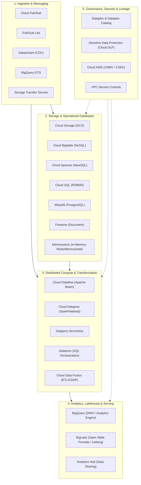

# Enterprise Data Architecture Product Taxonomy & Master Index

## 1. Google Cloud Data Platform Taxonomy Overview

The Google Cloud Data Platform provides a unified, decoupled ecosystem designed for hyperscale data engineering, streaming analytics, machine learning, and federated governance. 

Unlike traditional platforms that bundle compute clusters directly with storage nodes or require managing complex distributed infrastructure, Google Cloud relies on **disaggregated compute and storage** interconnected by petabit-scale internal networking fabrics.



---

## 2. Taxonomy Classification Matrix

The Google Cloud data ecosystem is classified into **11 core functional domains**:

| Domain # | Functional Domain | Primary GCP Products & Technologies | Primary Architectural Responsibility | Databricks Equivalent / Analogue |
| :--- | :--- | :--- | :--- | :--- |
| **01** | **Core Infrastructure & Fabric** | Borg, Colossus, Jupiter, Andromeda | Distributed cluster orchestration, petabyte filesystem, network fabric | Kubernetes, AWS Nitro, Databricks Fleet Engine |
| **02** | **Object & Unstructured Storage** | Cloud Storage (GCS), GCS Dual-Region | Raw landing lake, immutable blob storage, staging, backups | AWS S3, Azure Data Lake Storage (ADLS) Gen2 |
| **03** | **Analytical Warehousing & Lakehouse** | BigQuery, BigLake, BigQuery Omni | Serverless petabyte SQL engine, columnar storage (Capacitor), federated queries | Databricks SQL Warehouses, Delta Lake, Photon Engine |
| **04** | **NoSQL & Low-Latency Operational Data** | Cloud Bigtable, Firestore, Memorystore | High-throughput sub-10ms key-value/wide-column, mobile doc store, distributed cache | Apache Cassandra, Apache HBase, DynamoDB, Redis |
| **05** | **Relational & Distributed SQL Databases** | Cloud Spanner, Cloud SQL, AlloyDB | Globally distributed ACID RDBMS, managed PostgreSQL/MySQL/SQL Server | AWS Aurora, CockroachDB, Azure Cosmos DB |
| **06** | **Streaming Messaging & Event Ingestion** | Cloud Pub/Sub, Pub/Sub Lite | Global event ingestion, publisher/subscriber decoupling, event streaming | Apache Kafka, AWS Kinesis, Azure Event Hubs |
| **07** | **Batch Ingestion & CDC Replication** | Datastream, BigQuery DTS, Storage Transfer Service | Serverless log-based CDC replication, scheduled SaaS ingestion, object migration | Databricks Lakeflow Connect, Debezium, Fivetran |
| **08** | **Distributed Compute & Pipeline Processing** | Cloud Dataflow, Cloud Dataproc, Dataform, Data Fusion | Unified streaming/batch (Beam), managed Spark/Hadoop, SQL transform (ELT) | Apache Spark, Databricks Jobs, Delta Live Tables (DLT) |
| **09** | **Orchestration & Workflow Scheduling** | Cloud Composer, Cloud Workflows | Managed Apache Airflow DAG orchestration, serverless micro-workflow dispatch | Databricks Workflows, Apache Airflow, AWS Step Functions |
| **10** | **Governance, Cataloging & Data Sharing** | Dataplex, Dataplex Catalog, Analytics Hub | Federated data mesh, automated discovery, metadata catalog, zero-copy data exchange | Unity Catalog, Databricks Clean Rooms, Apache Atlas |
| **11** | **Security, Encryption & Perimeter Defense** | Cloud KMS (CMEK), Sensitive Data Protection (DLP), VPC-SC, IAM | Envelope encryption, automated PII de-identification/masking, API exfiltration boundary | AWS KMS, Databricks Table ACLs, Privacera, Immuta |

---

## 3. Product Selection Decision Tree (Macro Level)

```mermaid
graph TD
    DataEntry["New Data Ingestion / Processing Workload"]
    
    DataEntry --> IngestType{"Workload Type?"}
    
    IngestType -->|Real-Time Event Stream| StreamingChoice{"Need global auto-scaling or partition management?"}
    StreamingChoice -->|Global, Zero-Ops, Auto-partitioning| PubSub["Use Cloud Pub/Sub"]
    StreamingChoice -->|Kafka-like partition control & low cost| PubSubLite["Use Pub/Sub Lite"]

    IngestType -->|Relational Database CDC| DatastreamChoice["Use Datastream (Serverless Log-Based CDC)"]

    IngestType -->|Distributed Compute Engine| ComputeChoice{"Framework Preference?"}
    ComputeChoice -->|Apache Beam (Unified Batch+Stream, Exactly-Once)| Dataflow["Use Cloud Dataflow"]
    ComputeChoice -->|Existing Spark/Hadoop codebase| Dataproc["Use Cloud Dataproc / Dataproc Serverless"]
    ComputeChoice -->|SQL-first ELT inside Warehouse| Dataform["Use Dataform"]

    IngestType -->|Analytical Serving & Querying| QueryChoice{"Format & Latency SLA?"}
    QueryChoice -->|SQL on Columnar / Lakehouse (<1s to minutes)| BigQuery["Use BigQuery + BigLake"]
    QueryChoice -->|Sub-10ms Key-Value / Time-Series (TB-PB scale)| Bigtable["Use Cloud Bigtable"]
    QueryChoice -->|Global Multi-Region ACID Relational Transactions| Spanner["Use Cloud Spanner"]
    QueryChoice -->|Enterprise Operational OLTP (PostgreSQL compatibility)| AlloyDB["Use AlloyDB / Cloud SQL"]
```

---

## 4. Phase 1 Document Guide

To examine deep technical specifications, architectural designs, trade-offs, and exam notes, proceed to the domain deep-dive chapters:
- [01. Cloud & Infrastructure Architecture](./01_cloud_and_infrastructure.md): Borg, Colossus, Jupiter, Andromeda, Ephemeral Compute.
- [02. Storage & Operational Databases](./02_storage_and_databases.md): Complete specifications for GCS, BigQuery, BigLake, Bigtable, Spanner, Cloud SQL, AlloyDB, Firestore, Memorystore.
- [03. Ingestion, Messaging & Streaming](./03_ingestion_and_streaming.md): Pub/Sub, Pub/Sub Lite, Datastream, BigQuery DTS, Storage Transfer Service.
- [04. Processing, Compute & Transformation](./04_processing_and_compute.md): Cloud Dataflow (Beam), Cloud Dataproc (Spark), Cloud Data Fusion, Dataform.
- [05. Governance, Cataloging & Data Sharing](./05_governance_and_metadata.md): Dataplex, Dataplex Catalog, Analytics Hub, Lineage, Quality.
- [06. Security, Encryption & Compliance](./06_security_and_compliance.md): Cloud KMS (CMEK/CSEK), Sensitive Data Protection (DLP), VPC Service Controls, Zero Trust.
