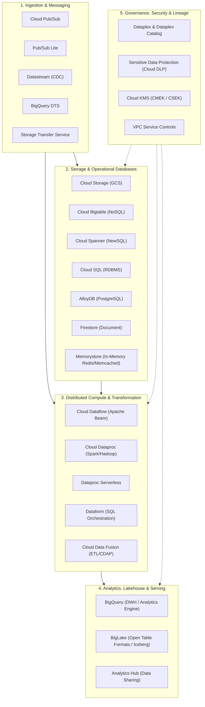
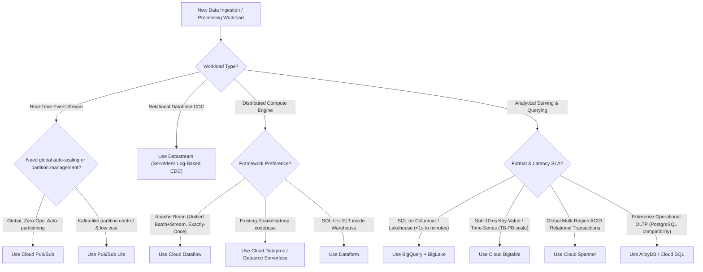

# Enterprise Data Architecture Product Taxonomy & Master Index

## 1. Google Cloud Data Platform Taxonomy Overview

The Google Cloud Data Platform provides a unified, decoupled ecosystem designed for hyperscale data engineering, streaming analytics, machine learning, and federated governance. 

Unlike traditional platforms that bundle compute clusters directly with storage nodes or require managing complex distributed infrastructure, Google Cloud relies on **disaggregated compute and storage** interconnected by petabit-scale internal networking fabrics.

---

## 2. Taxonomy Classification Matrix

The Google Cloud data ecosystem is classified into **11 core functional domains**:

| Domain # | Functional Domain | Primary GCP Products & Technologies | Primary Architectural Responsibility | Databricks Equivalent / Analogue |
| :--- | :--- | :--- | :--- | :--- |
| **01** | **Core Infrastructure & Fabric** | Borg, Colossus, Jupiter, Andromeda | Distributed cluster orchestration, petabyte filesystem, network fabric | Kubernetes, AWS Nitro, Databricks Fleet Engine |
| **02** | **Object & Unstructured Storage** | Cloud Storage (GCS), GCS Dual-Region | Raw landing lake, immutable blob storage, staging, backups | AWS S3, Azure Data Lake Storage (ADLS) Gen2 |
| **03** | **Analytical Warehousing & Lakehouse** | BigQuery, BigLake, BigQuery Omni | Serverless petabyte SQL engine, columnar storage (Capacitor), federated queries | Databricks SQL Warehouses, Delta Lake, Photon Engine |
| **04** | **NoSQL & Low-Latency Operational Data** | Cloud Bigtable, Firestore, Memorystore | High-throughput sub-10ms key-value/wide-column, mobile doc store, distributed cache | Apache Cassandra, Apache HBase, DynamoDB, Redis |
| **05** | **Relational & Distributed SQL Databases** | Cloud Spanner, Cloud SQL, AlloyDB | Globally distributed ACID RDBMS, managed PostgreSQL/MySQL/SQL Server | AWS Aurora, CockroachDB, Azure Cosmos DB |
| **06** | **Streaming Messaging & Event Ingestion** | Cloud Pub/Sub, Pub/Sub Lite | Global event ingestion, publisher/subscriber decoupling, event streaming | Apache Kafka, AWS Kinesis, Azure Event Hubs |
| **07** | **Batch Ingestion & CDC Replication** | Datastream, BigQuery DTS, Storage Transfer Service | Serverless log-based CDC replication, scheduled SaaS ingestion, object migration | Databricks Lakeflow Connect, Debezium, Fivetran |
| **08** | **Distributed Compute & Pipeline Processing** | Cloud Dataflow, Cloud Dataproc, Dataform, Data Fusion | Unified streaming/batch (Beam), managed Spark/Hadoop, SQL transform (ELT) | Apache Spark, Databricks Jobs, Delta Live Tables (DLT) |
| **09** | **Orchestration & Workflow Scheduling** | Cloud Composer, Cloud Workflows | Managed Apache Airflow DAG orchestration, serverless micro-workflow dispatch | Databricks Workflows, Apache Airflow, AWS Step Functions |
| **10** | **Governance, Cataloging & Data Sharing** | Dataplex, Dataplex Catalog, Analytics Hub | Federated data mesh, automated discovery, metadata catalog, zero-copy data exchange | Unity Catalog, Databricks Clean Rooms, Apache Atlas |
| **11** | **Security, Encryption & Perimeter Defense** | Cloud KMS (CMEK), Sensitive Data Protection (DLP), VPC-SC, IAM | Envelope encryption, automated PII de-identification/masking, API exfiltration boundary | AWS KMS, Databricks Table ACLs, Privacera, Immuta |

---

## 3. Product Selection Decision Tree (Macro Level)

---

---

## 4. Renamed, Retired & Overloaded Product Names (Exam Watchlist)

Google Cloud services frequently evolve, but certification questions occasionally use older terminology or test your awareness of modern replacements:

| Historical / Older Name | Current Product Name | Critical Architectural Context |
|---|---|---|
| **Cloud Data Loss Prevention (Cloud DLP)** | **Sensitive Data Protection** | The exam guide frequently still uses "Cloud DLP". It inspects, masks, and tokenizes PII. |
| **Data Catalog** | **Dataplex Catalog** | Data Catalog has been unified into Dataplex as the enterprise metadata catalog and policy taxonomy engine. |
| **Data Studio** | **Looker Studio** | Web-based visualization tool (Looker Studio Pro adds enterprise management). |
| **Flat-Rate BigQuery Pricing** | **BigQuery Editions (Standard, Enterprise, Enterprise Plus)** | Flat-rate has been replaced by autoscaling and committed slot capacity tiers. |
| **AI Platform** | **Vertex AI** | Unified machine learning platform (Feature Store, Vector Search, Workbench). |
| **`gsutil` CLI** | **`gcloud storage`** | Modern, high-performance CLI for Cloud Storage (up to 9x faster parallel multi-thread transfers). |
| **Stackdriver** | **Cloud Monitoring & Cloud Logging** | Observability, metric alerting, and log sinks. |
| **Cloud Datastore** | **Firestore (in Datastore Mode)** | Document NoSQL store for web and mobile backends. |
| **Dataproc Serverless** | **Serverless Spark on Dataproc** | Clusterless batch execution of PySpark and Spark SQL without GCE cluster provisioning. |

---

## 5. Phase 1 Multi-Product Knowledge Checks

These scenario-based checks deliberately combine multiple services to test architectural reasoning across the taxonomy.

### Check 1.1 (Single-Select: Ingestion Guarantees & Idempotency)
ShopSphere's streaming pipeline reads orders from Cloud Pub/Sub and streams them into BigQuery via Dataflow. Financial auditors discover that certain high-volume promotional order events are recorded twice in downstream tables. What is the root architectural cause, and what is the proper engineering defense?

- [ ] A. Pub/Sub delivers messages with **at-least-once delivery by default** due to publisher retries or subscriber ack timeouts. The downstream pipeline must deduplicate records using an immutable `event_id` or perform an idempotent `MERGE` into curated BigQuery tables.
- [ ] B. Pub/Sub guarantees exactly-once delivery in all configurations; the bug is caused by BigQuery streaming buffer corruption.
- [ ] C. Cloud Pub/Sub should be replaced with Cloud Storage CSV drops.
- [ ] D. Increase the number of Cloud Dataflow worker machines to eliminate backpressure.

**Correct Answer**: **A**  
*Explanation*: Distributed messaging systems like Pub/Sub achieve high throughput and resilience via at-least-once semantics. Retries caused by transient network timeouts can cause duplicate deliveries. Pipelines must be designed defensively using unique idempotency keys (`event_id`) and deduplication transforms.  
*Docs*: [Pub/Sub Overview](https://cloud.google.com/pubsub/docs/overview).

---

### Check 1.2 (Single-Select: CDC Replication vs Event Streaming)
ShopSphere needs continuous, near-real-time replication of its production Cloud SQL PostgreSQL transaction database into BigQuery for inventory dashboards with minimal engineering overhead and zero custom code. Which service should you recommend?

- [ ] A. **Datastream**.
- [ ] B. Write custom microservice code to publish every database insert/update to Cloud Pub/Sub.
- [ ] C. A nightly Apache Spark job on Cloud Dataproc.
- [ ] D. Cloud Composer Airflow DAG polling the database table every 30 seconds.

**Correct Answer**: **A**  
*Explanation*: Datastream is Google Cloud's serverless Change Data Capture (CDC) service. It reads directly from database transaction logs (PostgreSQL WAL via `pgoutput`) without impacting OLTP query performance and streams changes directly into BigQuery.  
*Docs*: [Datastream Overview](https://cloud.google.com/datastream/docs/overview).

---

### Check 1.3 (Multi-Select: Choose TWO - Matching Products to Workloads)
Which two statements accurately reflect Google Cloud architectural best practices?

- [ ] A. **Dataform** runs SQL transformations directly inside BigQuery and uses declarative assertions for automated data quality gates.
- [ ] B. **Cloud Composer** is the optimal engine for executing heavy, distributed data transformations directly inside its Airflow workers.
- [ ] C. **Cloud Bigtable** is the recommended store for running complex ad-hoc analytical SQL joins across multi-terabyte tables.
- [ ] D. **Cloud Dataproc** is the natural choice for migrating legacy on-premise Apache Spark and Hadoop workloads with minimal code rewrites.
- [ ] E. **Cloud Storage** allows updating individual rows in-place inside an existing Parquet object.

**Correct Answers**: **A and D**  
*Explanation*: Dataform provides Git-managed, in-warehouse ELT for BigQuery. Dataproc is the managed open-source platform designed to lift-and-shift Spark/Hadoop code. Cloud Composer orchestrates pipelines but should NEVER execute data processing on Airflow worker nodes. Bigtable does not support native SQL joins (that is BigQuery's role). Cloud Storage objects are immutable; updating a single row requires overwriting the entire object.  
*Docs*: [Dataform Overview](https://cloud.google.com/dataform/docs/overview) and [Dataproc Overview](https://cloud.google.com/dataproc/docs/concepts/overview).

---

### Check 1.4 (Single-Select: Operational Serving vs Analytical Warehousing)
ShopSphere's real-time checkout recommendation engine requires sub-10ms key-value lookups of customer profile feature vectors at 50,000 requests per second. Concurrently, data scientists require full SQL aggregation and window function queries over the same historical features. Which architecture satisfies both requirements?

- [ ] A. Serve real-time lookups from **Cloud Bigtable**, and stream historical records into **BigQuery** for analytical SQL.
- [ ] B. Store all features solely in **BigQuery** and have the real-time checkout service query BigQuery directly via SQL.
- [ ] C. Store all features solely in a single **Cloud SQL for PostgreSQL** instance.
- [ ] D. Write features to Cloud Storage and launch a transient Dataproc cluster on every customer checkout.

**Correct Answer**: **A**  
*Explanation*: Bigtable delivers single-digit millisecond point lookups at massive horizontal scale for operational serving. BigQuery is optimized for multi-second complex columnar analytical aggregations. Combining them leverages each system for its intended design.  
*Docs*: [Bigtable Overview](https://cloud.google.com/bigtable/docs/overview).

---

### Check 1.5 (Single-Select: Cost Optimization of Batch Processing)
A nightly 2-hour PySpark ETL pipeline runs on a long-running, 10-node Cloud Dataproc cluster that remains active 24/7. Finance reports that cluster infrastructure costs are exorbitant. What is the most cost-effective architectural change?

- [ ] A. Automate the pipeline using Cloud Composer to provision an **ephemeral Dataproc cluster** (or Dataproc Serverless batch) with data stored in Cloud Storage, and automatically tear down the cluster upon job completion.
- [ ] B. Upgrade the cluster to larger VM machine types so the job finishes in 1 hour.
- [ ] C. Migrate the PySpark workload to run on Cloud SQL.
- [ ] D. Disable autoscaling on the cluster and keep the 10 nodes running continuously.

**Correct Answer**: **A**  
*Explanation*: Ephemeral (job-scoped) Dataproc clusters decouple compute from storage by reading from and writing to Cloud Storage (`gs://`). You pay for VM compute only while the 2-hour job is actively running, eliminating 22 hours of idle infrastructure billing per day.  
*Docs*: [Dataproc Ephemeral Clusters](https://cloud.google.com/dataproc/docs/concepts/overview).

---

## 6. Phase 1 Document Guide

To examine deep technical specifications, architectural designs, trade-offs, and exam notes, proceed to the domain deep-dive chapters:
- [01. Cloud & Infrastructure Architecture](./01_cloud_and_infrastructure.md): Borg, Colossus, Jupiter, Andromeda, Ephemeral Compute.
- [02. Storage & Operational Databases](./02_storage_and_databases.md): Complete specifications for GCS, BigQuery, BigLake, Bigtable, Spanner, Cloud SQL, AlloyDB, Firestore, Memorystore.
- [03. Ingestion, Messaging & Streaming](./03_ingestion_and_streaming.md): Pub/Sub, Pub/Sub Lite, Datastream, BigQuery DTS, Storage Transfer Service.
- [04. Processing, Compute & Transformation](./04_processing_and_compute.md): Cloud Dataflow (Beam), Cloud Dataproc (Spark), Cloud Data Fusion, Dataform.
- [05. Governance, Cataloging & Data Sharing](./05_governance_and_metadata.md): Dataplex, Dataplex Catalog, Analytics Hub, Lineage, Quality.
- [06. Security, Encryption & Compliance](./06_security_and_compliance.md): Cloud KMS (CMEK/CSEK), Sensitive Data Protection (DLP), VPC Service Controls, Zero Trust.
