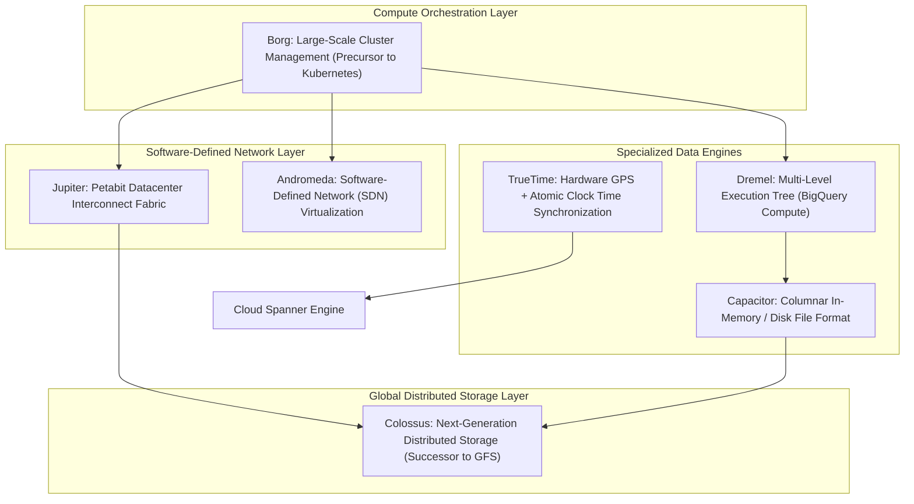
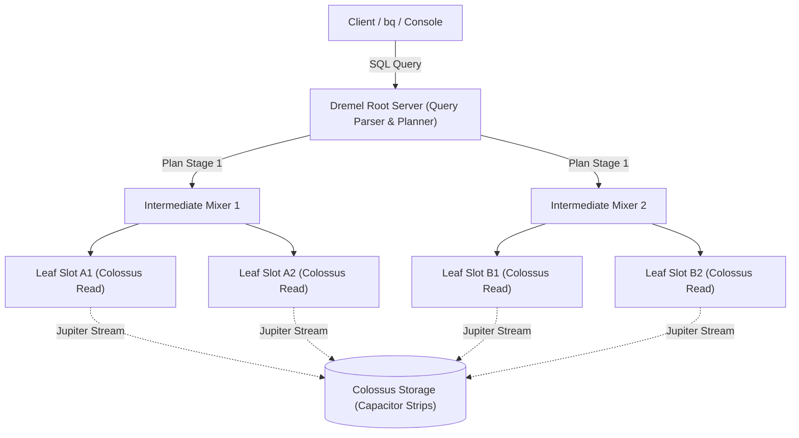

# Cloud & Infrastructure Distributed Systems Architecture

## 1. Google's Proprietary Infrastructure Stack

Every enterprise service in Google Cloud—from BigQuery to Cloud Dataflow—is built on a proprietary foundation of planet-scale distributed systems pioneered by Google over two decades. Understanding these systems is essential for diagnosing performance bottlenecks, understanding query execution plans, and excelling on the Professional Data Engineer exam.

---

## 2. Deep Dive: Core Distributed Infrastructure Technologies

### 2.1 Colossus (Next-Generation Google File System)
- **What It Is**: Google's planet-scale cluster file system, replacing the original Google File System (GFS).
- **Architecture**:
  - Eliminates the single Master bottleneck of GFS by distributing metadata management across thousands of distributed Curator nodes.
  - Storage nodes (D-servers) manage disk writes with automated Reed-Solomon erasure coding ($8+4$ or $9+3$ striping) rather than traditional 3x replication, reducing storage overhead while guaranteeing resilience against simultaneous storage chassis failures.
- **Data Engineering Relevance**:
  - GCS buckets, BigQuery tables, Cloud Spanner tablets, and Bigtable SSTables all write their underlying data blocks directly to Colossus.
  - Decouples storage capacity from compute instances. When an analyst runs a BigQuery query or a Dataflow job, no data is copied to local VM disks; compute workers stream data chunks directly from Colossus via the Jupiter fabric.

### 2.2 Borg (Google Cluster Management System)
- **What It Is**: Google’s internal cluster manager and container orchestrator that served as the architectural prototype for open-source Kubernetes.
- **How It Works**:
  - Coordinates hundreds of thousands of machines across data centers.
  - Executes jobs as Linux cgroup-isolated tasks.
  - Dynamically schedules high-priority production services alongside low-priority, preemptible batch workloads on the same physical bare-metal hardware.
- **Data Engineering Relevance**:
  - BigQuery slots, Dataflow workers, and Dataproc Serverless workloads execute as containerized Borg tasks.
  - Enables near-instantaneous scaling: BigQuery can allocate 2,000 to 10,000 slots across multiple Borg cells within seconds to process a massive SQL query.

### 2.3 Jupiter (Datacenter Network Fabric)
- **What It Is**: Google’s custom-designed, Clos-topology software-defined datacenter network fabric.
- **Scale**: Delivers over **1 Petabit per second** of bisection bandwidth within a datacenter.
- **Architectural Impact**:
  - Traditional Hadoop architectures required "data locality"—scheduling compute on the exact physical server containing the hard drive holding the HDFS data block.
  - Jupiter completely destroys the data locality requirement: a compute node in a Borg container can read an arbitrary 100 GB block from Colossus across the datacenter with read latencies and throughput matching a local NVMe drive.
  - Powers BigQuery's instantaneous parallel scans and Dataflow's managed remote shuffle service.

### 2.4 Andromeda (Network Virtualization / SDN)
- **What It Is**: Google’s software-defined networking (SDN) substrate that powers Virtual Private Cloud (VPC) routing, firewalls, and load balancing.
- **Mechanism**:
  - Operates at the hypervisor and Open vSwitch layer without introducing middlebox network appliances.
  - Enables line-rate packet processing and sub-millisecond inter-zone latency.
- **Data Engineering Relevance**:
  - Private Google Access (PGA), Shared VPC routing, and VPC Service Controls enforcement points are executed directly inside Andromeda.

### 2.5 Dremel (Interactive Analysis Execution Engine)
- **What It Is**: The distributed query execution engine that drives BigQuery SQL processing.
- **Architecture**:
  - Uses a **multi-level serving tree**:
    - **Root Server**: Receives SQL query from client, parses SQL, checks authorization, generates physical query plan, and breaks query into stages.
    - **Intermediate Servers (Mixers)**: Aggregate intermediate results, manage shuffles, and dynamically rebalance data partitions.
    - **Leaf Nodes (Execution Slots)**: Read columnar Capacitor chunks from Colossus, execute parallel projection, filtering, and aggregation expressions.
  - Employs runtime dynamic code generation (C++ LLVM compilation) for vectorized expression evaluation.

### 2.6 Capacitor (BigQuery Columnar Format)
- **What It Is**: BigQuery’s proprietary, highly compressed columnar storage format (Google's counterpart to Apache Parquet and ORC).
- **Capabilities**:
  - Encodes nested, repeated records (Protobuf-style schemas) efficiently without flattening.
  - Implements dictionary encoding, run-length encoding (RLE), bit-packing, and frame-of-reference integer compression.
  - Maintains rich column-level metadata (min/max values, dictionary cardinality, null counts) per row group (strip), enabling Dremel leaf slots to prune entire data blocks without reading them into memory.

### 2.7 TrueTime API (Cloud Spanner Synchronization)
- **What It Is**: Google’s globally synchronized hardware time tracking system consisting of synchronized atomic clocks and GPS receivers deployed across all Google data centers.
- **The TrueTime Guarantee**:
  - Provides a bounded uncertainty window $\epsilon$ (typically $< 7\text{ ms}$).
  - API method: `TrueTime.now()` returns an interval $[t.earliest, t.latest]$ such that the absolute global time $t_{absolute} \in [t.earliest, t.latest]$.
- **Why It Matters for Data Engineering**:
  - Allows **Cloud Spanner** to achieve external consistency (strict serializability) and distributed ACID transactions across continents without heavy two-phase locking (2PC) or distributed read locks.
  - Enables BigQuery and Spanner to perform globally consistent multi-table snapshots at any historical timestamp.

---

## 3. Disaggregated Compute & Storage vs. Traditional Lakehouses

| Architectural Dimension | Traditional Hadoop / Databricks on VMs | Google Cloud Native (BigQuery / Dataflow / Colossus) |
| :--- | :--- | :--- |
| **Compute-Storage Coupling** | Spark Driver/Workers attach to local EBS/EFS or EC2 instances with cached data. | Zero local state. Compute slots (Borg) stream data from remote Colossus via Jupiter. |
| **Cluster Lifecycle** | Clusters run continuously or take 3–7 minutes to spin up / auto-scale. | Serverless. Compute slots are scheduled within hundreds of milliseconds per query stage. |
| **Shuffle Architecture** | Shuffle data spills to local worker NVMe disks; worker failures corrupt shuffle stages. | Remote Shuffle Service. Shuffle partitions are written directly to high-speed shared memory/Colossus tiers. |
| **Scaling Dynamics** | Compute and storage scale step-wise (adding worker VMs adds disk and vCPUs simultaneously). | Completely orthogonal. Storage can grow to petabytes with zero compute cost; compute can scale to 10,000 cores for 30 seconds. |

---

## 4. Ephemeral Compute & Spot VMs in Data Engineering

### 4.1 Spot Virtual Machines (Compute Engine & Dataproc)
- **Cost Reduction**: 60% to 91% discount compared to on-demand Compute Engine VM pricing.
- **Preemption Mechanics**:
  - Google Cloud can reclaim Spot VMs at any time when capacity is needed elsewhere.
  - The VM receives a **30-second ACPI shutdown notice**.
- **Data Engineering Design Pattern for Dataproc**:
  - **Master Node**: Must always be a **Standard (Non-preemptible) VM**.
  - **Primary Workers**: 2 to 4 Standard VMs to run HDFS NameNode/ResourceManager metadata and host non-reclaimable state.
  - **Secondary Workers**: 10 to 1,000 **Spot VMs**.
  - If Spot VMs are preempted, Spark simply reschedules the affected task partitions onto surviving workers without failing the overarching pipeline.

---

## 5. Exam Relevance & Core Takeaways (PDE Exam Guide)

1. **How BigQuery Achieves Petabyte Scans in Seconds**:
   - Answer: Combination of Dremel multi-level execution tree, Capacitor columnar block pruning, and Jupiter network streaming chunks from Colossus.
2. **Dataproc Spot VM Best Practice**:
   - Master node and minimal primary worker count must be standard VMs; secondary workers should be Spot VMs to minimize cost while retaining fault tolerance.
3. **TrueTime Relevance**:
   - Cloud Spanner uses TrueTime to guarantee global external consistency (ACID) at multi-region scale without distributed lock storms.
