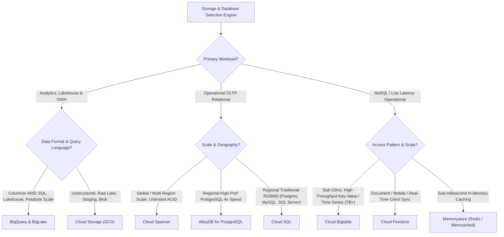
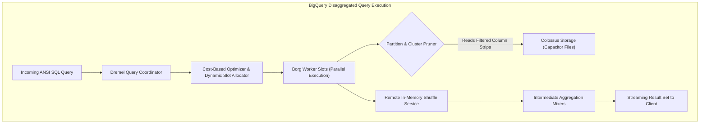
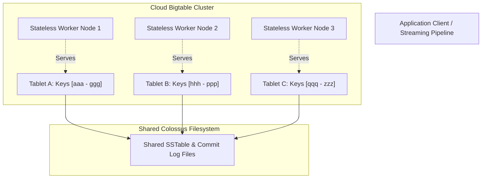

# Storage, Analytical Warehousing & Operational Databases

## 1. Storage & Database Taxonomy Overview

Google Cloud offers a specialized suite of storage and database technologies. In modern data architecture, selecting the optimal database engine depends on workload characteristics: read/write patterns, latency thresholds (sub-millisecond vs. sub-second vs. batch), transactional consistency requirements (ACID vs. eventual), schema flexibility, and query interface (ANSI SQL vs. Key-Value vs. Document).

---

## 2. Product 1: Google Cloud Storage (GCS)

### 2.1 Identification & Category
- **Product Name**: Cloud Storage (GCS)
- **Category**: Object Storage / Data Lake Staging & Raw Storage Layer

### 2.2 What It Is
A globally distributed, highly durable (99.999999999% / 11 9's), RESTful object store capable of storing arbitrary binary data (Parquet, ORC, Avro, JSON, CSV, images, video) at exabyte scale.

### 2.3 Why It Exists
To provide a virtually limitless, cost-effective, disaggregated storage foundation for cloud-native applications and analytical data lakes without requiring pre-provisioned disk capacity.

### 2.4 When to Use
- As the raw landing zone (Bronze tier) for batch and streaming pipelines.
- As the storage substrate for open-format lakehouses (Apache Iceberg, Delta Lake, Apache Hudi) via BigLake.
- Staging artifacts, code binaries, checkpoints, and temporary shuffle buckets for Dataproc and Dataflow.
- Long-term archival and compliance retention.

### 2.5 When NOT to Use
- As a transactional OLTP database (GCS has no row-level updates or SQL indexing).
- Workloads requiring sub-millisecond read/write latency.
- High-frequency file append operations (GCS objects are immutable; an update requires re-uploading the entire object).

### 2.6 How It Works
- **Immutability**: Once written, an object's contents cannot be modified in place. Versioning tracks object overwrites and deletions.
- **Strong Consistency**: Provides **strong global read-after-write consistency** for all upload, overwrite, and delete operations.
- **Storage Classes**:
  - `Standard`: Frequently accessed data, active data lake staging.
  - `Nearline`: Accessed less than once a month (30-day minimum storage commitment).
  - `Coldline`: Accessed less than once a quarter (90-day minimum storage commitment).
  - `Archive`: Accessed less than once a year (365-day minimum storage commitment, lowest storage cost, higher retrieval fee).
- **Security & Organization**: Supports Uniform Bucket-Level Access (UBLA), Customer-Managed Encryption Keys (CMEK), Object Lifecycle Management (OLM), and Retention Policies (Bucket Lock for WORM compliance).

### 2.7 Integrations
- Cloud Storage connector natively embedded in Hadoop/Spark on Dataproc (`gs://` URI scheme).
- BigQuery external tables and BigLake connectors.
- Pub/Sub GCS notifications (Cloud Storage Pub/Sub triggers).

### 2.8 Pricing Model
- Storage cost per GB-month (scaled by storage class).
- Network egress (cross-region or external internet).
- Class A operations (uploads, list calls) vs. Class B operations (reads, metadata get).

### 2.9 Databricks Comparison
- **AWS S3 / Azure ADLS Gen2 equivalent**: GCS acts as the primary cloud object lakehouse storage layer.
- Unlike S3's historical eventual consistency, GCS has always offered strong global consistency for object mutations.

### 2.10 Exam Relevance & Key Gotchas
- **Uniform Bucket-Level Access**: Disables per-object ACLs; enforces IAM governance across the bucket. Tested heavily in PDE exam security questions.
- **Bucket Naming**: Global namespace across all Google Cloud customers.
- **Changing Storage Classes**: Handled via Object Lifecycle Management (OLM) rules without moving files or breaking URIs.

---

## 3. Product 2: BigQuery

### 3.1 Identification & Category
- **Product Name**: BigQuery
- **Category**: Serverless Enterprise Data Warehouse & Cloud Lakehouse Engine

### 3.2 What It Is
A fully managed, petabyte-scale, distributed analytical data warehouse capable of scanning billions of rows in seconds using ANSI SQL. BigQuery features native machine learning (BigQuery ML), geospatial analysis (BigQuery GIS), and streaming ingestion.

### 3.3 Why It Exists
To eliminate database administration (no indexes to build, no vacuuming, no cluster provisioning, no node resizing) while providing near-infinite query scaling across Google's Borg and Colossus infrastructure.

### 3.4 When to Use
- Central Enterprise Data Warehouse (Gold & Silver dimensional data models).
- Interactive ad-hoc business intelligence and dashboarding.
- Scalable ML model training directly inside the warehouse via SQL (`CREATE MODEL ...`).
- High-throughput streaming data ingestion and real-time dashboarding.

### 3.5 When NOT to Use
- High-concurrency, single-record operational transactions (OLTP).
- Sub-10ms key-value lookups (use Cloud Bigtable).
- Highly sequential pointer-chasing graph queries.

### 3.6 How It Works
- **Disaggregated Engine**: Decouples compute (Dremel execution tree) from storage (Capacitor columnar format on Colossus).
- **Physical Organization**:
  - **Partitioning**: Divides tables based on ingestion time, date/timestamp column, or integer range. Maximizes query performance and minimizes cost by skipping entire partitions during scans. Maximum 4,000 partitions per table.
  - **Clustering**: Co-locates related data within partitions based on up to 4 columns. Sorts and groups data blocks, allowing fine-grained block pruning.
- **Query Optimization**: Automatic columnar projection, dictionary decoding, and dynamic query plan optimization via the query coordinator.

### 3.7 Integrations
- Looker, Tableau, PowerBI, dbt, Apache Spark (BigQuery Connector), Apache Beam (Dataflow native I/O), Dataplex.

### 3.8 Pricing Model
- **Storage**: Active (\$0.020/GB/mo) vs. Long-term (\$0.010/GB/mo, automatically applied after 90 days of no modifications).
- **Analysis (Compute)**: On-Demand (\$6.25 per TB scanned) OR BigQuery Editions (Standard, Enterprise, Enterprise Plus billed per slot-hour).
- **Streaming Ingestion**: Billed per GB inserted via Storage Write API.

### 3.9 Databricks Comparison
- **Databricks SQL / Photon equivalent**: BigQuery is fully serverless with zero cluster spin-up time. Databricks SQL requires starting or warming a SQL Warehouse (compute cluster). BigQuery separates storage entirely; Databricks SQL typically operates over Delta Lake files on object storage.

### 3.10 Exam Relevance & Key Gotchas
- **Partitioning vs Clustering**: 
  - Partition on date/timestamp or low-cardinality integer.
  - Cluster on high-cardinality columns frequently used in `WHERE`, `JOIN`, or `GROUP BY` clauses.
  - Clustering always requires a partitioned table (or standalone unpartitioned clustered table).
- **Avoiding Anti-Patterns**: `SELECT *` is the #1 cause of cost overruns on on-demand pricing. `LIMIT 10` does **not** reduce scanned bytes on a full table scan.

---

## 4. Product 3: BigLake

### 4.1 Identification & Category
- **Product Name**: BigLake
- **Category**: Open Lakehouse Storage Engine & Storage Virtualization

### 4.2 What It Is
A storage engine that extends BigQuery’s fine-grained security, column-level masking, and query performance optimizations to open table formats (Apache Iceberg, Delta Lake, Apache Hudi, Parquet, ORC) stored directly on Cloud Storage, AWS S3, and Azure Data Lake Storage Gen2.

### 4.3 Why It Exists
Enterprises store massive data in open formats across multi-cloud environments. BigLake breaks down data silos by allowing BigQuery and open-source compute (Dataproc Spark) to query external open formats while enforcing centralized governance and access policies.

### 4.4 When to Use
- Modern lakehouse architectures storing data in Apache Iceberg or Parquet on GCS.
- Multi-cloud analytics querying data stored in AWS S3 or Azure Blob without data egress/migration.
- Enforcing row- and column-level security on raw object files queried by both BigQuery and Spark.

### 4.5 When NOT to Use
- Pure proprietary data warehousing where data is natively loaded into BigQuery Capacitor tables (native tables offer superior write latency and streaming compaction).

### 4.6 How It Works
- Uses **BigQuery Connections** (a delegated Google Cloud service agent) to access cloud storage.
- Translates open metadata (Iceberg metadata manifests) to prune files dynamically before issuing parallel object byte-range read requests.
- Caches file metadata to accelerate query planning.

### 4.7 Integrations
- Apache Spark via BigLake Spark Connector, BigQuery engine, Dataplex Catalog.

### 4.8 Pricing Model
- BigQuery query processing pricing (On-Demand or Editions slots) + underlying GCS/S3 storage and egress fees.

### 4.9 Databricks Comparison
- **Databricks Unity Catalog External Tables / Delta Lake**: BigLake provides the governance and acceleration layer over open files that Unity Catalog provides over Delta/Iceberg tables.

### 4.10 Exam Relevance & Key Gotchas
- BigLake tables allow enforcing **Row Access Policies** and **Policy Tags (Column Masking)** on files stored in Cloud Storage—a capability standard GCS external tables lack.

---

## 5. Product 4: Cloud Bigtable

### 5.1 Identification & Category
- **Product Name**: Cloud Bigtable
- **Category**: NoSQL Wide-Column Store / Ultra-Low-Latency Operational Database

### 5.2 What It Is
Google’s battle-tested, distributed, sparse, multidimensional sorted map database designed for massive write throughput and single-digit millisecond read/write latencies at terabyte-to-petabyte scale.

### 5.3 Why It Exists
To handle ultra-high-throughput operational workloads (millions of operations per second) that overwhelm traditional relational databases and require strict sub-10ms response times.

### 5.4 When to Use
- IoT telemetry, sensor streaming, financial tick data, time-series metrics.
- Ad-tech clickstream tracking, user impression logs.
- Real-time fraud detection feature stores (serving features to online ML models).
- Datasets exceeding 1 TB requiring low-latency random reads and sequential scans.

### 5.5 When NOT to Use
- Workloads requiring multi-table SQL joins or ACID transactions across multiple rows.
- Data volumes under 1 TB (cost-inefficient; use Cloud SQL or Firestore).
- Complex analytical aggregations across unstructured attributes (use BigQuery).

### 5.6 How It Works
- **Data Model**: Rows indexed by a single **Row Key**. Rows contain **Column Families**, which contain **Column Qualifiers**, which store timestamped versions of values.
- **Row Key Design is King**: Data is sorted lexicographically by row key. Bad row key design (e.g., sequential timestamps or auto-incrementing IDs) creates **Hotspotting**, where a single node handles 100% of the traffic while other nodes sit idle.
- **Recommended Row Key Patterns**: Salted hashes, reversed domain names, concatenated composite keys (`CustomerID#DeviceID#TimestampReversed`).
- **Cluster Architecture**: Compute nodes are stateless Borg containers; data is stored as SSTables on Colossus. Scaling nodes is fast and involves rebalancing tablet pointers without copying data files.

### 5.7 Integrations
- Apache HBase API compatibility, Cloud Dataflow (Beam BigtableIO), Dataproc Spark connector, BigQuery federated queries.

### 5.8 Pricing Model
- Hourly cost per provisioned node (or auto-scaling slot baseline).
- Storage cost per GB-month (HDD vs. SSD). SSD is strongly recommended for production low-latency SLAs.

### 5.9 Databricks Comparison
- **Apache Cassandra / Apache HBase / DynamoDB equivalent**: Databricks does not offer an operational NoSQL database. Pipelines built in Databricks typically sink high-throughput feature vectors into Cassandra or DynamoDB; in GCP, the target is Cloud Bigtable.

### 5.10 Exam Relevance & Key Gotchas
- **Row Key Design**: Sequential timestamps (e.g., `20261107-0001`) cause hotspotting. Reverse the timestamp (`Long.MAX_VALUE - timestamp`) or prefix with a hash.
- **Garbage Collection Policies**: Must define GC rules (keep max versions, keep max age) on column families, otherwise deleted or expired versions continue to consume storage.
- **Replication**: Multi-cluster routing provides active-active resilience and regional failover.

---

## 6. Product 5: Cloud Spanner

### 6.1 Identification & Category
- **Product Name**: Cloud Spanner
- **Category**: Globally Distributed Relational Database (NewSQL)

### 6.2 What It Is
The world’s first globally distributed, horizontally scalable, strongly consistent relational database service that provides external consistency (ACID) at planetary scale.

### 6.3 Why It Exists
To bridge the historic divide between traditional RDBMS (ACID transactions, relational schema, SQL) and NoSQL systems (horizontal scale, high availability, multi-region geographic distribution).

### 6.4 When to Use
- Mission-critical financial ledgers, banking systems, global inventory management.
- Applications requiring relational semantics with five-nines (99.999%) availability.
- Systems needing zero maintenance downtime, automatic multi-region failover, and global read-after-write consistency.

### 6.5 When NOT to Use
- Simple single-region relational applications with modest scale (use Cloud SQL for lower cost).
- Pure high-throughput append-only analytical logs (use Bigtable or BigQuery).
- Highly complex, unindexed analytical reporting queries across billions of rows (use BigQuery).

### 6.6 How It Works
- Uses **TrueTime API** (synchronized GPS and atomic clocks) to generate monotonically increasing transaction timestamps, enabling lock-free distributed reads.
- Synchronizes replicas across zones and regions using the **Paxos consensus protocol**.
- Tables can be **interleaved**: Child tables are physically co-located on disk alongside parent rows, eliminating network hops during parent-child SQL joins.

### 6.7 Integrations
- Standard ANSI SQL and PostgreSQL dialect support, Dataflow SpannerIO, BigQuery Spanner Federation.

### 6.8 Pricing Model
- Compute capacity billed in **Spanner Processing Units (PUs)** or Nodes (1,000 PUs = 1 Node).
- Storage billed per GB-month across replicas.

### 6.9 Databricks Comparison
- **AWS Aurora Multi-Master / CockroachDB equivalent**: Databricks is an analytical engine, whereas Spanner is a mission-critical OLTP engine. Data pipelines frequently extract CDC streams from Spanner into BigQuery for analytics.

### 6.10 Exam Relevance & Key Gotchas
- **Monotonically Increasing Primary Keys**: Like Bigtable, using sequential integer primary keys (e.g., `AUTO_INCREMENT`) will hotspot a single Paxos group. Always use UUID v4 or bit-reversed sequences.
- **Table Interleaving**: Use interleaving for 1-to-many parent-child relationships (`Customers -> Orders`) to guarantee physical co-location and maximize join performance.

---

## 7. Product 6: Cloud SQL

### 7.1 Identification & Category
- **Product Name**: Cloud SQL
- **Category**: Managed Relational Database (OLTP RDBMS)

### 7.2 What It Is
A fully managed relational database service supporting **PostgreSQL**, **MySQL**, and **Microsoft SQL Server**.

### 7.3 Why It Exists
To offload maintenance, automated backups, patch management, high availability (HA) failover, and replication for traditional enterprise relational databases.

### 7.4 When to Use
- Standard enterprise applications, web applications, CRM/ERP backends.
- Existing legacy workloads migrating to GCP with database sizes under 30 TB.
- Standard relational schemas with foreign keys, complex triggers, and ACID transactions.

### 7.5 When NOT to Use
- Workloads requiring planetary horizontal scale (use Cloud Spanner).
- Datasets exceeding 64 TB.
- High-throughput streaming analytics and large-scale OLAP (use BigQuery).

### 7.6 How It Works
- Runs on Google Compute Engine instances with attached Persistent Disks.
- **High Availability (HA)**: Configured using regional persistent disk replication across two zones (Primary and Standby). If the primary zone fails, failover to the standby instance completes within 60 seconds with identical IP preservation.

### 7.7 Integrations & Migration
- Cloud SQL Auth Proxy for secure, IAM-authorized connections without IP whitelisting.
- Datastream for continuous CDC replication into BigQuery.

### 7.8 Pricing Model
- Billed by instance vCPU, RAM, storage provisioned (PD SSD), and network egress.

### 7.9 Databricks Comparison
- **AWS RDS / Azure Database for PostgreSQL equivalent**: Cloud SQL acts as an operational source system from which data pipelines ingest relational tables.

### 7.10 Exam Relevance & Key Gotchas
- **High Availability**: HA failover is intra-region (cross-zone), **not** cross-region. Cross-region DR requires setting up an asynchronous read replica in a different region and promoting it manually.
- **Connecting Pipelines**: Dataflow pipelines connecting to Cloud SQL should connect via Private IP (Private Services Access) or use the Cloud SQL Connector to avoid exposing databases to the public internet.

---

## 8. Product 7: AlloyDB for PostgreSQL

### 8.1 Identification & Category
- **Product Name**: AlloyDB for PostgreSQL
- **Category**: High-Performance Cloud-Native Relational Database

### 8.2 What It Is
A fully managed, PostgreSQL-compatible, cloud-native database engine designed for demanding enterprise transactional and mixed HTAP (Hybrid Transactional and Analytical Processing) workloads.

### 8.3 Why It Exists
Provides up to **4x faster transactional throughput** than standard open-source PostgreSQL and up to **100x faster analytical queries**, eliminating the need to tune and scale standard Cloud SQL PostgreSQL for extreme workloads.

### 8.4 When to Use
- Heavy transactional workloads experiencing performance limits on Cloud SQL PostgreSQL.
- Hybrid workloads requiring low-latency operational queries alongside real-time analytical reporting.
- High-concurrency AI applications using `pgvector` for vector similarity search.

### 8.5 When NOT to Use
- Global multi-region write workloads requiring distributed consensus (use Spanner).
- MySQL or SQL Server workloads (AlloyDB is strictly PostgreSQL-compatible).

### 8.6 How It Works
- **Disaggregated Storage Engine**: Offloads write-ahead logging (WAL) processing to a distributed, multi-tenant storage tier.
- **AlloyDB Columnar Engine**: Automatically maintains an in-memory columnar representation of hot tables, allowing analytical vector operations and columnar scans without impacting transactional row-store performance.

### 8.7 Integrations & Pricing
- Fully compatible with PostgreSQL 14/15/16 drivers and extensions.
- Billed based on provisioned vCPU, RAM, and dynamic storage consumed.

### 8.8 Databricks Comparison
- **AWS Aurora PostgreSQL equivalent**: Modern high-throughput operational source for lakehouse ingestion.

### 8.9 Exam Relevance & Key Gotchas
- When the exam describes an existing PostgreSQL database hitting severe performance limits under heavy concurrent transactions, AlloyDB is the drop-in, zero-application-rewrite solution.

---

## 9. Product 8: Cloud Firestore

### 9.1 Identification & Category
- **Product Name**: Cloud Firestore
- **Category**: Serverless NoSQL Document Database

### 9.2 What It Is
A serverless, horizontally scalable, multi-region document database designed for mobile, web, and server development with real-time listeners and offline sync.

### 9.3 Why It Exists
To provide application developers with an agile, schemaless JSON document store with built-in client SDKs, security rules, and real-time data push capabilities.

### 9.4 When to Use
- User profiles, session states, mobile application state sync.
- Hierarchical JSON document collections with real-time push notification requirements.
- Applications requiring multi-region ACID transactions across documents.

### 9.5 When NOT to Use
- Large-scale analytical warehousing (use BigQuery).
- High-throughput streaming telemetry exceeding millions of writes per second (use Bigtable).

### 9.6 How It Works
- Data is stored in **Documents**, grouped into **Collections**.
- All document fields are indexed automatically by default.
- Offers Datastore Mode (legacy backward-compatible scale) and Native Mode (rich features, real-time sync).

### 9.7 Databricks Comparison
- **MongoDB Atlas / AWS DynamoDB Document equivalent**: Firestore serves frontend application state; data pipelines export Firestore snapshots to GCS and BigQuery for analytical modeling.

### 9.8 Exam Relevance & Key Gotchas
- **Modes**: Choose Native Mode for new mobile/web apps; choose Datastore Mode for high-throughput server backends requiring backwards compatibility with legacy App Engine Datastore.

---

## 10. Product 9: Memorystore

### 10.1 Identification & Category
- **Product Name**: Memorystore
- **Category**: In-Memory Data Store (Redis & Memcached)

### 10.2 What It Is
A fully managed, in-memory caching and key-value service compatible with open-source **Redis** and **Memcached**.

### 10.3 Why It Exists
To deliver sub-millisecond data access for caching layers, session stores, and real-time gaming leaderboards, reducing load on backend databases.

### 10.4 When to Use
- Application caching to protect Cloud SQL or Spanner from high-frequency identical reads.
- Session state caching and pub/sub message brokering.
- Geospatial querying and real-time leaderboards.

### 10.5 When NOT to Use
- Primary persistent storage for critical business data (in-memory data is volatile unless RDB/AOF persistence is explicitly enabled).
- Analytics across historical time horizons (use BigQuery).

### 10.6 How It Works & High Availability Architecture
- **Basic Tier (Non-HA)**: A single Redis instance residing in one zone. Zero replication, no failover. If the underlying VM or zone fails, cache data is lost and the endpoint is unavailable during recreation. Suitable only for development or disposable caches.
- **Standard Tier (High Availability & Failover)**: Provisions a cross-zone active-standby replica pair. 
  - Primary node in Zone A, replica node in Zone B with asynchronous replication.
  - Automatic cross-zone failover completes in under 30 seconds if the primary becomes unhealthy. Client applications reconnect to the same persistent internal IP address.
  - Read Replicas (up to 5 read replicas) allow scaling out read throughput.
- **Persistence Options**: Supports RDB (Redis Database snapshots taken periodically to Cloud Storage) and AOF (Append-Only File for minimal RPO recovery).
- **Cluster Mode**: Enables horizontal keyspace sharding across up to 250 shards for multi-terabyte caches delivering tens of millions of operations per second with microsecond latency.

### 10.7 Databricks Comparison
- **AWS ElastiCache equivalent**: Used in serving layers for sub-millisecond retrieval.

### 10.8 Exam Relevance & Key Gotchas
- Memorystore instances require private RFC 1918 IP addresses; they cannot be accessed over the public internet without an SSH bastion tunnel or load balancer.

---

## 11. Storage & Database Comparative Architecture Matrix

| Product | Data Model | Primary Scale Unit | Typical Latency | Consistency | Max Storage | Primary Use Case |
| :--- | :--- | :--- | :--- | :--- | :--- | :--- |
| **Cloud Storage** | Blob / Object | Buckets / Objects | 50–100ms | Strong | Practically Unlimited | Raw lake, staging, backups |
| **BigQuery** | Relational Columnar | Slots (Compute) / Datasets | <1s to minutes | Strong | Practically Unlimited | SQL Data Warehouse, BI, ML |
| **BigLake** | Open Formats (Iceberg/Parquet) | External Metastore / Slots | 1s to minutes | Strong (Format dependent) | Practically Unlimited | Multi-cloud governed lakehouse |
| **Cloud Bigtable** | Wide-Column NoSQL | Nodes (Stateless Borg) | <10ms (1–5ms) | Single-row Strong | Hundreds of PB | High-throughput time-series, IoT |
| **Cloud Spanner** | Relational (NewSQL) | Processing Units (PUs) / Nodes | 5–20ms | External Consistency (Global ACID) | Petabytes | Global mission-critical OLTP |
| **Cloud SQL** | Relational (Postgres/MySQL) | VM vCPU / RAM | 5–20ms | Strict ACID | 64 TB | Traditional departmental OLTP |
| **AlloyDB** | Relational (PostgreSQL) | vCPU / Disaggregated Storage | 2–10ms | Strict ACID | 128 TB | High-performance enterprise OLTP/HTAP |
| **Firestore** | Document (JSON) | Automatic Serverless | 10–50ms | Strong | Petabytes | Mobile/Web user profile state |
| **Memorystore** | In-Memory (Redis) | Memory Capacity (GB) | <1ms | Eventual / In-Memory | Terabytes | Sub-ms low-latency caching |
