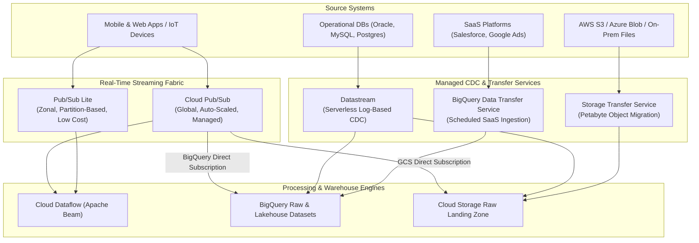
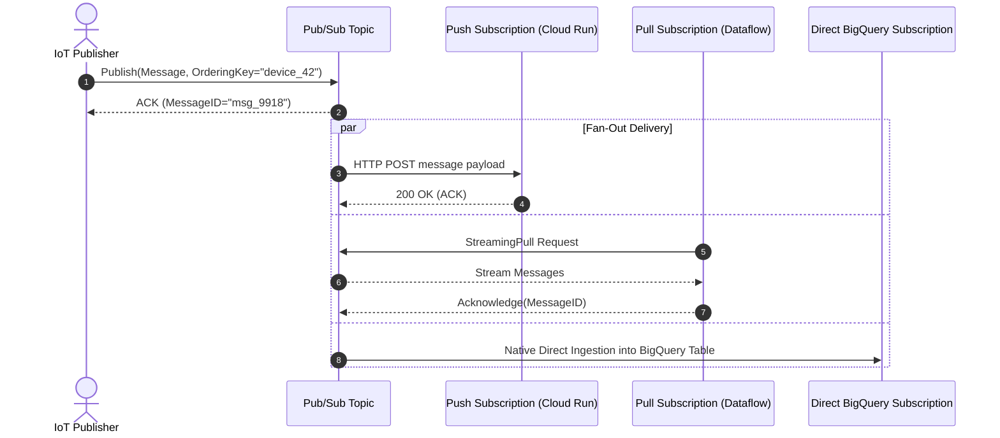
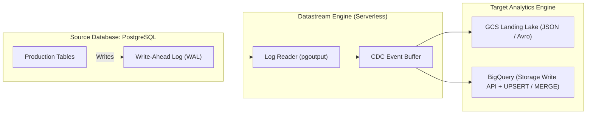

# Ingestion, Messaging & Event Streaming Architecture

## 1. Enterprise Ingestion Architecture Overview

Data ingestion is the entry door to the modern enterprise data platform. Google Cloud divides ingestion into two paradigms:
1. **Continuous Real-Time Streaming & Event Messaging**: Asynchronous event streams originating from microservices, IoT devices, telemetry sensors, and clickstream collectors.
2. **Batch & Change Data Capture (CDC) Replication**: Automated pipelines replicating external operational databases (PostgreSQL, MySQL, Oracle, SQL Server), SaaS platforms, and external cloud object stores into Cloud Storage and BigQuery.

---

## 2. Product 1: Cloud Pub/Sub

### 2.1 Identification & Category
- **Product Name**: Cloud Pub/Sub
- **Category**: Global Real-Time Event Messaging & Ingestion Service

### 2.2 What It Is
A fully managed, horizontally scalable, multi-tenant, asynchronous messaging service that decouples event producers from event consumers. Pub/Sub provides durable message storage and end-to-end latency in the tens of milliseconds across global regions.

### 2.3 Core Concepts & Architecture
- **Topics**: Named channels to which publishers send messages.
- **Subscriptions**: Named entities representing the stream of messages from a specific topic to be delivered to a subscribing application.
  - Multiple subscriptions attached to a single topic receive **independent copies** of each message (Fan-Out pattern).
- **Message Structure**:
  - `data`: Binary payload (JSON, Avro, Protobuf, or raw bytes) up to 10 MB.
  - `attributes`: Key-value string pairs used for filtering and routing.
  - `message_id`: Unique string assigned by the server.
  - `publish_time`: Timestamp assigned upon server receipt.
  - `ordering_key`: String identifying messages that must be delivered in sequential order.

### 2.4 Delivery Guarantees & Operational Semantics
1. **At-Least-Once Delivery**: 
   - By default, Pub/Sub guarantees every published message is delivered at least once to each subscription.
   - If a subscriber takes longer than `ack_deadline` (10 to 600 seconds) to process a message, Pub/Sub re-delivers it. Subscribers **must be idempotent**.
2. **Message Ordering (Ordering Keys)**:
   - When an `ordering_key` is assigned to messages, Pub/Sub guarantees sequential delivery of messages sharing that key, provided they are published in the same region.
   - If a message with an ordering key fails or is nack'd, subsequent messages for that ordering key are paused until the failed message is successfully acknowledged or dead-lettered.
3. **Dead Letter Queues (DLQ)**:
   - When a "poison pill" message cannot be parsed or causes consumer crashes, Pub/Sub tracks the delivery attempt count.
   - Upon reaching `max_delivery_attempts` (e.g., 5 attempts), Pub/Sub automatically routes the message to a designated **Dead Letter Topic**, unblocking the main pipeline.
4. **Subscription Types**:
   - **Pull / StreamingPull**: Subscribers actively request messages. Standard for high-throughput stream engines (Dataflow, Spark).
   - **Push**: Pub/Sub initiates an HTTP POST request to a webhook endpoint (Cloud Run, Cloud Functions).
   - **BigQuery Direct Subscription**: Ingests directly into BigQuery tables without compute intermediaries.
   - **Cloud Storage Direct Subscription**: Streams files directly into GCS buckets (e.g., dumping Parquet or Avro partitions).

### 2.5 Pub/Sub Schemas
Pub/Sub supports first-class schema validation using **Apache Avro** or **Protocol Buffers (Protobuf)**:
- Publishers attempting to write invalid payloads failing schema validation are rejected at the topic boundary with a 400 error.

### 2.6 Pricing Model
- Billed purely on throughput: Volume of data published, delivered, and stored (typically \$40 per TB).

---

## 3. Product 2: Pub/Sub Lite

### 3.1 Identification & Category
- **Product Name**: Pub/Sub Lite
- **Category**: Zonal, Partition-Based Low-Cost Messaging (Apache Kafka Analogue)

### 3.2 What It Is
A low-cost, partition-based messaging service engineered for predictable, high-volume workloads where developers are willing to manage partition capacity in exchange for up to **80% lower cost** than standard Cloud Pub/Sub.

### 3.3 Pub/Sub vs. Pub/Sub Lite Comparison Matrix

| Architectural Feature | Standard Cloud Pub/Sub | Cloud Pub/Sub Lite |
| :--- | :--- | :--- |
| **Availability / Scope** | **Global / Multi-Region** (automatic cross-region routing) | **Zonal or Regional** (tied to specific zones) |
| **Capacity Management** | Fully Serverless (instantaneous auto-scaling) | Pre-provisioned partition capacity (MB/s throughput per partition) |
| **Ordering** | Supported via `ordering_key` across dynamic slots | Strictly ordered **per partition** (Apache Kafka model) |
| **Message Retention** | Up to 31 days | Up to 7 days (or unlimited disk-based) |
| **Pricing** | Billed by data volume processed (\$40/TB) | Billed by provisioned partition capacity & disk storage (\$4–\$10/TB) |
| **Protocols & Connectors** | REST, gRPC, Native BigQuery/GCS Subscriptions | Kafka Shim, gRPC, Beam Dataflow Connector |

---

## 4. Product 3: Datastream

### 4.1 Identification & Category
- **Product Name**: Datastream
- **Category**: Serverless Change Data Capture (CDC) & Database Replication

### 4.2 What It Is
A serverless, low-latency Change Data Capture (CDC) service that streams real-time data changes (inserts, updates, deletes) from operational databases into Cloud Storage and BigQuery.

### 4.3 Why It Exists
Traditional batch ETL loads (running nightly SQL dumps like `SELECT * FROM orders WHERE updated_at > ...`) put heavy read locks on production OLTP databases, cannot capture intermediate updates or physical deletes, and introduce multi-hour latency into analytical reporting.

### 4.4 How It Works (Log-Based CDC)
- **Non-Invasive Log Reading**: Datastream reads the database's internal transaction log directly:
  - **Oracle**: LogMiner / Binary Log Reader.
  - **PostgreSQL**: Logical Decoding (`pgoutput` plugin) via replication slots.
  - **MySQL**: Binary Log (`binlog`).
  - **SQL Server**: CDC Capture Jobs and Change Tracking tables.
- **Zero Query Impact**: Reads transaction logs directly from disk or memory without executing SQL queries on application tables.
- **Schema Drift Handling**: Automatically captures schema changes (e.g., newly added columns) and propagates them seamlessly downstream.

### 4.5 CDC Replication Strategies: Log-Based vs. Query-Based

| Dimension | Log-Based CDC (Datastream) | Query-Based Batch Extraction |
| :--- | :--- | :--- |
| **Performance Impact on Source** | Extremely Low (reads transaction log files asynchronously) | High (executes heavy table scan queries, acquires locks) |
| **Delete Capture** | **Full Support**: Captures physical `DELETE` statements from log | **Fails**: Cannot detect physical row deletes without audit triggers |
| **Intermediate State Capture** | Captures every sequential mutation within a transaction | Only captures net-latest state at query execution time |
| **Latency** | Sub-second to few seconds | Hours or days (batch interval) |

---

## 5. Product 4: BigQuery Data Transfer Service (BQ DTS)

### 5.1 Identification & Category
- **Product Name**: BigQuery Data Transfer Service (BQ DTS)
- **Category**: Managed Scheduled SaaS & Data Warehouse Ingestion

### 5.2 What It Is
A fully managed scheduling and data movement service that automates data loading into BigQuery on a regular, scheduled basis from Google applications, SaaS platforms, and external cloud data warehouses.

### 5.3 Supported Sources
- **Google Applications**: Google Ads, Google Analytics 4 (GA4), YouTube Channel & Content Owner Reports, Google Merchant Center.
- **Cloud Storage**: Scheduled recurring batch loads from GCS into BigQuery tables.
- **External Data Warehouses (Migration)**: Amazon Redshift, Teradata, Snowflake (orchestrates metadata and data extraction into BigQuery).

### 5.4 Operational Rules
- BQ DTS is designed for **scheduled batch ingestion** (e.g., hourly, daily). It is **not** a real-time event streaming engine.
- Supports automated backfills to re-ingest historical reporting dates.

---

## 6. Product 5: Storage Transfer Service (STS)

### 6.1 Identification & Category
- **Product Name**: Storage Transfer Service (STS)
- **Category**: Large-Scale Batch Object & Data Lake Migration

### 6.2 What It Is
A high-throughput, managed service optimized for transferring petabytes of unstructured and semi-structured data into Cloud Storage from external cloud providers, on-premises storage systems, or across GCS buckets.

### 6.3 Supported Topologies
1. **Cloud-to-Cloud**: Amazon S3 $\to$ Cloud Storage, Azure Blob Storage $\to$ Cloud Storage.
2. **On-Premises to Cloud**: POSIX filesystems (NFS, SMB) $\to$ Cloud Storage via lightweight on-premises containerized agents.
3. **GCS to GCS**: Cross-region bucket synchronization and lifecycle archival.

### 6.4 Key Technical Capabilities
- **Bandwidth Optimization**: Fully saturates available 10Gbps–100Gbps network connections via parallel, multi-threaded streaming transfers.
- **Automatic Checksum Verification**: Verifies MD5/CRC32c checksums end-to-end to guarantee zero data corruption.
- **Periodic Sync**: Automatically copies only newly added or modified source files based on timestamp deltas.

---

## 7. Comparative Ingestion Technology Matrix

| Ingestion Technology | Data Pattern | Latency SLA | Protocol / Formats | Primary Destination | Databricks Analogue |
| :--- | :--- | :--- | :--- | :--- | :--- |
| **Cloud Pub/Sub** | Streaming Events | 10–100ms | REST, gRPC (Avro, Protobuf, JSON) | Dataflow, BigQuery, GCS | Apache Kafka / AWS Kinesis |
| **Pub/Sub Lite** | Streaming Partitions | 50–200ms | gRPC, Kafka API Shim | Dataflow, Compute VMs | Apache Kafka |
| **Datastream** | CDC Transaction Logs | 1–5 seconds | Database Replication Protocol | BigQuery, GCS | Debezium / Lakeflow Connect |
| **BigQuery DTS** | Scheduled Batch | Hourly / Daily | SaaS APIs, Cloud Storage CSV/Parquet | BigQuery Native Tables | Fivetran / Databricks Lakeflow |
| **Storage Transfer Service** | Bulk File / Lake Migration | Scheduled / Ad-hoc | S3 API, Azure Blob, POSIX NFS/SMB | Cloud Storage (GCS) | Databricks Auto Loader (File Ingestion) |

---

## 8. Exam Relevance & High-Probability Pitfalls (PDE Exam Guide)

1. **Pub/Sub Ordering Key Gotcha**:
   - Pub/Sub does **not** preserve global message order across a topic.
   - Ordering is guaranteed **only** for messages published with the **same ordering key** within the same region.
   - If an ordering key fails delivery, downstream messages for that key are blocked until resolved.
2. **Datastream vs. BigQuery DTS**:
   - If the exam specifies *continuous, sub-minute change capture from an operational PostgreSQL or MySQL database*, choose **Datastream**.
   - If the exam specifies *daily scheduled loads of Google Ads or Amazon Redshift tables into BigQuery*, choose **BigQuery Data Transfer Service**.
3. **Handling Poison Pill Messages in Streaming Pipelines**:
   - When streaming messages cause Dataflow workers or subscriber applications to crash repeatedly, configure a **Pub/Sub Dead Letter Queue (DLQ)** with a `max_delivery_attempts` threshold to divert bad payloads without pipeline stoppage.
