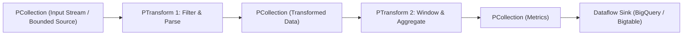
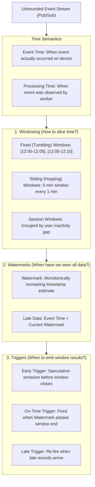

# Distributed Processing, Compute & Transformation Engines

## 1. Enterprise Compute Landscape in Google Cloud

Distributed processing in Google Cloud is designed around disaggregated compute and storage. Instead of maintaining long-running, monolithic virtual machine clusters that waste resources during idle hours, Google Cloud emphasizes **serverless streaming and batch execution**, **ephemeral compute clusters**, and **in-warehouse SQL transformations**.

```mermaid
graph TD
    PipelineRequirement["Data Processing & Compute Workload"]
    
    PipelineRequirement --> TechChoice{"Processing Paradigm & Engine?"}
    
    TechChoice -->|Unified Batch & Streaming / Complex Windowing / Beam| Dataflow["Cloud Dataflow (Apache Beam)"]
    TechChoice -->|Existing Spark / PySpark / Hadoop Ecosystem| DataprocChoice{"Cluster Management Preference?"}
    TechChoice -->|Visual, No-Code Pipeline Design (CDAP)| DataFusion["Cloud Data Fusion"]
    TechChoice -->|SQL-Based Transformation Inside BigQuery (ELT)| Dataform["Dataform (SQLX)"]

    DataprocChoice -->|Zero-Ops, Fully Serverless Spark| DataprocServerless["Dataproc Serverless (Batches)"]
    DataprocChoice -->|Managed Spark on GCE / Custom Spark Packages| DataprocGCE["Cloud Dataproc on Compute Engine"]
```

---

## 2. Product 1: Cloud Dataflow

### 2.1 Identification & Category
- **Product Name**: Cloud Dataflow
- **Category**: Fully Managed Unified Streaming & Batch Processing Engine (Apache Beam Runner)

### 2.2 What It Is
A fully managed, serverless execution service for executing large-scale data processing pipelines written in **Apache Beam** (Java, Python, Go). Dataflow handles resource provisioning, auto-scaling, dynamic work rebalancing, and stateful stream processing.

### 2.3 Core Apache Beam Programming Model Concepts

Apache Beam is an open-source, unified programming model that defines four foundational abstractions:



1. **Pipeline**: Encapsulates the entire data processing workflow, including reading data, transforming it, and writing it out.
2. **PCollection**: A distributed, immutable dataset representing bounded (batch) or unbounded (streaming) data.
3. **PTransform**: A data processing operation that takes one or more `PCollection`s as input and produces one or more `PCollection`s as output (e.g., `ParDo`, `GroupByKey`, `Combine`, `CoGroupByKey`).
4. **PipelineRunner**: Translates the Beam pipeline graph into the native API of the execution target. Cloud Dataflow is Google's managed, highly optimized Beam Runner.

### 2.4 Streaming Mechanics: Windowing, Watermarks, and Triggers

Handling unbounded out-of-order event streams requires three distinct dimensions of stream control:



- **Event Time vs. Processing Time**:
  - *Event Time*: The timestamp recorded at the edge device when the event was generated.
  - *Processing Time*: The timestamp of the physical worker VM processing the data record. Real-world networks experience latency, packet loss, and jitter; hence, event time always lags processing time.
- **Watermark**: A mathematical model representing the pipeline's confidence that all data with event timestamps prior to $t$ has been observed.
- **Windowing Strategies**:
  - *Fixed (Tumbling)*: Non-overlapping, contiguous time intervals (e.g., hourly metrics).
  - *Sliding (Hopping)*: Overlapping intervals (e.g., a 10-minute moving average evaluated every 1 minute).
  - *Session*: Dynamic windows defined by bursts of activity separated by periods of inactivity (e.g., user sessions with a 30-minute inactivity gap).
- **Triggers**: Determine exactly when the aggregated result of a window is emitted to downstream sinks:
  - *Default Trigger*: Emits once when the watermark passes the end of the window.
  - *Early Triggers*: Speculative results emitted before the watermark arrives to power real-time dashboards.
  - *Late Triggers*: Emitted when late-arriving data arrives after the watermark, updating historical totals.

### 2.5 Dataflow Advanced Operational Capabilities
1. **Dynamic Work Rebalancing**:
   - In batch pipelines, if one worker receives a disproportionately large split or experiences CPU throttling (a straggler), Dataflow dynamically slices the remaining unread records of that split and transfers them to idle workers without restarting the step.
2. **Dataflow Shuffle Service**:
   - Offloads `GroupByKey` shuffle operations from worker VM memory and local disks to a Google-managed remote multi-tenant shuffle tier. Worker VMs remain lightweight, and shuffle performance scales independently of VM disk size.
3. **Dataflow Streaming Engine**:
   - Offloads pipeline state storage and window buffering from worker VMs to a specialized backend streaming service, reducing worker CPU/RAM overhead and accelerating auto-scaling responsiveness.
4. **Flexible Resource Scheduling (FlexRS)**:
   - For non-time-critical batch jobs (e.g., nightly rollups), FlexRS reduces cost by mixing Preemptible/Spot VMs with standard VMs and deferring job execution up to 6 hours until capacity is cheapest.

---

## 3. Product 2: Cloud Dataproc

### 3.1 Identification & Category
- **Product Name**: Cloud Dataproc
- **Category**: Managed Apache Spark & Hadoop Cluster Infrastructure / Serverless Spark

### 3.2 What It Is
A fast, easy-to-use, fully managed cloud service for running **Apache Spark**, **Apache Hadoop**, **Presto/Trino**, **Hive**, and over 30 open-source data processing tools.

### 3.3 Why It Exists
Enterprises have millions of lines of legacy Spark, PySpark, Scala, and MapReduce code running on on-premises Hadoop clusters (Cloudera, Hortonworks) or AWS EMR. Dataproc allows organizations to lift-and-shift these workloads to GCP with minimal code changes.

### 3.4 Operational Flavors
1. **Dataproc on Compute Engine (Managed Clusters)**:
   - Dedicated Master and Worker VMs.
   - Spins up in **under 90 seconds** (compared to 10–20 minutes on legacy on-prem systems or older cloud offerings).
   - Ideal for long-running multi-tenant interactive Spark notebooks or scheduled batch workflows.
2. **Dataproc Serverless (Batches)**:
   - Zero infrastructure management. Submit a PySpark, Spark SQL, or Spark R script directly; Dataproc dynamically provisions compute containers, executes the workload, and terminates.
   - Billed strictly per second of Dataproc Compute Units (DCUs) consumed.
3. **Dataproc on Google Kubernetes Engine (GKE)**:
   - Executes Spark jobs inside containerized pods on shared enterprise GKE clusters.

### 3.5 Cloud Storage (GCS) Connector vs. HDFS
In on-premises Hadoop, data was stored in HDFS across local cluster hard drives. 
On Dataproc, **Cloud Storage replaces HDFS** via the native `gs://` Cloud Storage connector:
- Eliminates cluster storage costs when clusters are turned off.
- Enables **Ephemeral Clusters**: Provision a Dataproc cluster, run a 20-minute Spark transformation reading from `gs://` and writing to `gs://`, and delete the cluster immediately upon completion.

### 3.6 Cluster Initialization Actions
Custom shell scripts executed during cluster startup to install third-party Python packages, configure JDBC drivers, or customize OS parameters:

```bash
gcloud dataproc clusters create spark-ml-cluster \
    --region=us-central1 \
    --master-machine-type=n2-standard-4 \
    --worker-machine-type=n2-standard-8 \
    --num-workers=4 \
    --initialization-actions=gs://my-bucket/scripts/install-ml-libs.sh \
    --metadata='PIP_PACKAGES=scikit-learn pandas xgboost'
```

---

## 4. Product 3: Cloud Data Fusion

### 4.1 Identification & Category
- **Product Name**: Cloud Data Fusion
- **Category**: Managed Visual No-Code / Low-Code Data Integration (ETL/ELT)

### 4.2 What It Is
A fully managed, enterprise-grade, visual data integration platform powered by the open-source **CDAP (Cask Data Application Platform)** framework.

### 4.3 Why It Exists
Enables business analysts, ETL developers, and data integration teams to build complex, compliant data pipelines through a drag-and-drop graphical user interface without writing distributed code.

### 4.4 How It Works
- Provides a visual pipeline canvas (Wrangler) with over 150+ pre-configured source, transformation, and sink plugins.
- **Execution Substrate**: When a pipeline is triggered, Data Fusion generates an optimized Apache Spark or MapReduce program and executes it automatically on a transient, ephemeral Cloud Dataproc cluster.

---

## 5. Product 4: Dataform

### 5.1 Identification & Category
- **Product Name**: Dataform
- **Category**: In-Warehouse SQL Pipeline Transformation & Modeling (ELT Orchestration)

### 5.2 What It Is
A fully managed service integrated into BigQuery that enables data teams to develop, version control, test, document, and orchestrate SQL workflows using software engineering best practices (the Google Cloud counterpart to open-source **dbt**).

### 5.3 Why It Exists
As data warehousing shifted from ETL (transforming before loading) to ELT (loading raw data and transforming inside the warehouse via SQL), organizations needed tools to manage SQL dependencies, automated testing, and CI/CD version control.

### 5.4 How It Works (SQLX Abstraction)
Dataform uses **SQLX**, an extension of SQL that allows declaring table models, dependencies, and assertions:

```sql
-- definitions/gold_customer_lifetime_value.sqlx
config {
  type: "table",
  schema: "gold_analytics",
  description: "Customer lifetime value and churn risk scoring",
  assertions: {
    uniqueKey: ["customer_id"],
    nonNull: ["customer_id", "total_spend_usd"]
  }
}

SELECT
  o.customer_id,
  c.email,
  SUM(o.order_amount) AS total_spend_usd,
  COUNT(o.order_id) AS total_orders,
  MAX(o.order_timestamp) AS last_order_date
FROM
  ${ref("silver_orders")} AS o
JOIN
  ${ref("silver_customers")} AS c
ON
  o.customer_id = c.customer_id
GROUP BY
  customer_id, email
```

---

## 6. Distributed Compute Comparative Matrix

| Dimension | Cloud Dataflow | Cloud Dataproc | Dataproc Serverless | Dataform | Cloud Data Fusion |
| :--- | :--- | :--- | :--- | :--- | :--- |
| **Engine Paradigm** | Apache Beam (Native) | Apache Spark / Hadoop | Apache Spark (Serverless) | BigQuery SQL (ELT) | Visual CDAP / Spark |
| **Execution Model** | Serverless Batch & Stream | Provisioned / Ephemeral VMs | Serverless Batches | In-Warehouse BigQuery Engine | Visual canvas compiling to Dataproc |
| **Streaming Support** | Best-in-Class (Sub-second, Watermarks, Exactly-Once) | Spark Structured Streaming (Micro-batch / Continuous) | Batch Only (Streaming in preview) | Batch SQL Scheduled Refresh | Micro-batch Streaming |
| **Language Support** | Java, Python, Go, SQL | Scala, PySpark, Python, R, Java | PySpark, Spark SQL | SQLX, JavaScript | Visual GUI / Python |
| **Shuffle Architecture** | Remote Dataflow Shuffle Service | Local SSD / HDFS / Dynamic Allocation | Managed Serverless Shuffle | BigQuery In-Memory Shuffle | Spark Shuffle on Dataproc |
| **Databricks Analogue** | None (Delta Live Tables is closest) | Databricks Classic Clusters | Databricks Serverless Compute | dbt Core / Databricks SQL Alerts | None (Fivetran/Informatica) |

---

## 7. Exam Relevance & Strategic Decision Points (PDE Exam Guide)

### Core Scenarios Tested:
1. **Scenario: Existing Spark/Hadoop Migration with Custom Dependencies**:
   - *Requirement*: Migrate 500 TB on-premises Cloudera Spark jobs to GCP within 4 weeks with minimal code rewrites.
   - *Decision*: **Cloud Dataproc on Compute Engine**. Use initialization actions to install custom libraries, replace `hdfs://` with `gs://` across jobs, and utilize Ephemeral Clusters to minimize cost.
2. **Scenario: Real-Time Streaming Analytics with Out-of-Order IoT Telemetry**:
   - *Requirement*: Ingest clickstream events with network latency up to 2 hours late; require 5-minute sliding aggregates and exactly-once processing into BigQuery.
   - *Decision*: **Cloud Dataflow (Apache Beam)** with Sliding Windows, Watermarks, Allowed Lateness, and BigQuery Storage Write API sink.
3. **Scenario: Transforming SQL Data Inside BigQuery with CI/CD and Lineage**:
   - *Requirement*: Analysts want to build dimensional models in BigQuery with Git version control, dependency tracking, and automated data quality assertions without provisioning compute clusters.
   - *Decision*: **Dataform**.
