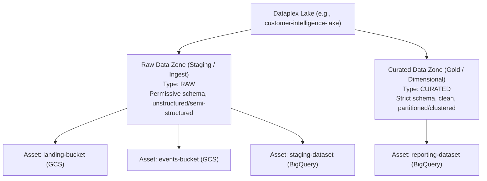
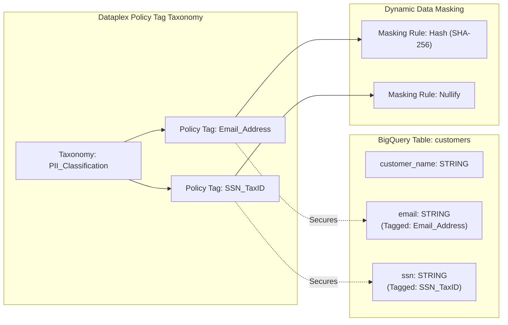

# Governance, Cataloging, Quality & Lineage Architecture

## 1. Enterprise Governance Landscape in Google Cloud

In modern data platform engineering, data governance cannot be treated as a manual post-hoc cataloging exercise. As organizations adopt decentralized organizational models such as **Data Mesh**, governance must be automated, policy-driven, and embedded directly into storage and compute pipelines.

Google Cloud provides an integrated governance stack headlined by **Dataplex** (unifying metadata, discovery, quality, and lifecycle governance across distributed lakes and warehouses) and **Analytics Hub** (enabling secure, zero-copy data exchange across corporate boundaries).

```mermaid
graph TD
    subgraph EnterpriseDataMesh["Enterprise Data Mesh Architecture"]
        subgraph DomainSales["Sales Domain Project"]
            SalesLake["Dataplex Lake: sales-lake"]
            SalesGCS["GCS Bucket: raw-sales-events"]
            SalesBQ["BigQuery Dataset: sales_marts"]
            SalesLake --> SalesGCS
            SalesLake --> SalesBQ
        end

        subgraph DomainFinance["Finance Domain Project"]
            FinLake["Dataplex Lake: finance-lake"]
            FinBQ["BigQuery Dataset: general_ledger"]
            FinLake --> FinBQ
        end
    end

    subgraph DataplexGovernance["Centralized Governance Plane (Dataplex)"]
        MetadataCatalog["Dataplex Catalog (Discovery & Search)"]
        AutoLineage["Automated Data Lineage (Dataflow & BigQuery)"]
        DataQuality["Dataplex Auto Data Quality Tasks"]
        AccessPolicies["Federated IAM & Zone Policy Propagation"]
    end

    subgraph ExternalSharing["Data Sharing & Clean Rooms"]
        AnalyticsHub["Analytics Hub (Exchanges & Listings)"]
    end

    DomainSales -.-> DataplexGovernance
    DomainFinance -.-> DataplexGovernance
    SalesBQ -->|Publish Listing| AnalyticsHub
    AnalyticsHub -->|Linked Dataset (Zero-Copy)| ExternalConsumer["External Partner / Vendor"]
```

---

## 2. Product 1: Dataplex

### 2.1 Identification & Category
- **Product Name**: Dataplex
- **Category**: Intelligent Data Fabric, Metadata Management & Federated Governance Engine

### 2.2 What It Is
An intelligent data fabric that helps organizations discover, manage, monitor, and govern data across Google Cloud Storage, BigQuery, and open-source formats without moving or duplicating data.

### 2.3 Core Organizational Hierarchy: Lakes, Zones, and Assets

Dataplex introduces a logical abstraction layer above physical GCP projects:



1. **Lake**: Represents a high-level business domain or organizational unit (e.g., `marketing-analytics`, `supply-chain`). A Lake can span multiple GCP projects.
2. **Zone**: A logical subdivision within a Lake representing the data maturity stage:
   - **Raw Zone**: Stores unvalidated, landing, or loosely typed data (e.g., raw JSON/CSV dumps). Does not require strict schema enforcement.
   - **Curated Zone**: Stores cleansed, validated, structured data (e.g., Parquet, Iceberg, partitioned BigQuery tables). Enforces strict schema validations and access controls.
3. **Asset**: Binds an underlying physical cloud storage resource to a Zone:
   - Cloud Storage buckets (or bucket prefixes).
   - BigQuery datasets.
   - Physical resources can reside in completely different GCP projects; Dataplex provides the unified governance overlay.

### 2.4 Automated Metadata Discovery & Schema Evolution
When a GCS bucket is registered as an Asset:
- Dataplex spawns automated background crawlers that scan the bucket, identify file formats (Parquet, Avro, ORC, CSV, JSON), extract schemas, detect partitions, and automatically register them as **external tables** in the BigQuery Metastore and Dataplex Catalog.
- When new partitions or columns appear in GCS, Dataplex updates the schema metadata automatically.

### 2.5 Automated Data Quality (Auto DQ)
Dataplex includes a native, serverless data quality engine that executes declarative quality checks against BigQuery tables and Cloud Storage assets without requiring third-party tools like Great Expectations:

```yaml
# dataplex-dq-rule.yaml
rules:
  - column: transaction_id
    dimension: Completeness
    rule:
      nonNullExpectation: {}
  - column: transaction_id
    dimension: Uniqueness
    rule:
      uniqueExpectation: {}
  - column: transaction_amount
    dimension: Validity
    rule:
      rangeExpectation:
        minValue: "0.01"
  - column: currency_code
    dimension: Consistency
    rule:
      setExpectation:
        values: ["USD", "EUR", "GBP", "JPY"]
```

Run via CLI:
```bash
gcloud dataplex datascans create data-quality sales-dq-scan \
    --location=us-central1 \
    --data-source-resource=//bigquery.googleapis.com/projects/prj-data-prod/datasets/sales_marts/tables/transactions \
    --data-quality-spec-file=dataplex-dq-rule.yaml
```

### 2.6 Automated Data Lineage
Dataplex tracks end-to-end data lineage out of the box:
- Automatically captures lineage events when SQL queries run in BigQuery (tracking source tables $\to$ intermediate tables $\to$ target views).
- Automatically tracks Cloud Dataflow pipeline transformations and Cloud Composer DAG executions.
- Renders an interactive lineage graph in the Google Cloud Console, enabling immediate impact analysis before dropping or altering upstream schemas.

---

## 3. Product 2: Dataplex Catalog (formerly Data Catalog)

### 3.1 Identification & Category
- **Product Name**: Dataplex Catalog
- **Category**: Enterprise Data Discovery & Unified Metadata Search

### 3.2 What It Is
A fully managed, scalable metadata catalog that enables data engineers, architects, and analysts to search, discover, and tag technical and business metadata across Google Cloud and third-party data systems.

### 3.3 Core Capabilities
- **Google-Style Search**: Search across millions of tables, columns, datasets, and buckets using natural language and semantic filters (e.g., `tag:PII=true type=table`).
- **Policy Tag Taxonomies**: Governs sensitive data classification (e.g., `Confidential`, `PII`, `SSN`) used by BigQuery to enforce dynamic **Column-Level Access Control** and **Data Masking**.



---

## 4. Product 3: Analytics Hub

### 4.1 Identification & Category
- **Product Name**: Analytics Hub
- **Category**: Managed Data Exchange & Zero-Copy Sharing Service

### 4.2 What It Is
A fully managed data sharing platform built on BigQuery that enables organizations to securely publish, discover, and consume data assets, ML models, and analytics across organizational and cloud boundaries without copying data.

### 4.3 Why It Exists
Traditional data sharing required complex SFTP transfers, scheduled ETL jobs, API downloads, or maintaining duplicated datasets across client accounts. Analytics Hub enables **zero-copy, in-place live data sharing**.

### 4.4 How It Works
1. **Data Exchange**: A curated collection of data listings published by an organization (can be Private within a company or Public across all GCP users).
2. **Listing**: A pointer to a shared BigQuery dataset or authorized view.
3. **Linked Dataset**: When a subscriber consumes a listing, BigQuery creates a read-only **Linked Dataset** in the subscriber's project:
   - Reads data directly from the publisher's Colossus storage blocks over the Jupiter network.
   - Subscriber pays for their own query execution slots/costs.
   - Zero storage replication costs; updates to publisher data appear instantaneously for subscribers.

---

## 5. Architectural Comparison: Dataplex & Analytics Hub vs. Databricks Unity Catalog

| Governance Capability | Databricks Unity Catalog | Google Cloud (Dataplex & Analytics Hub) | Architectural Nuance |
| :--- | :--- | :--- | :--- |
| **Architectural Model** | Centralized Relational Metastore (`catalog.schema.table`) | Logical Data Fabric / Mesh overlaying distributed projects | Dataplex does not require consolidating all projects into a single catalog; assets remain sovereign in their own projects. |
| **Zone Maturity Modeling** | Medallion Architecture (Bronze, Silver, Gold folders/schemas) | Dataplex Lakes & Zones (`RAW` and `CURATED` zone types) | Dataplex enforces distinct governance and security rules natively based on zone classification. |
| **Data Quality** | Delta Live Tables Expectations (`CONSTRAINT ... EXPECT ...`) | Dataplex Auto Data Quality Tasks (Declarative YAML rules) | Dataplex executes quality scans directly in BigQuery serverlessly without requiring DLT cluster runtimes. |
| **Data Lineage** | Unity Catalog System Lineage (`system.access.table_lineage`) | Dataplex Lineage API (Automatic for BigQuery, Dataflow, Composer) | Both capture automated lineage down to the column level. |
| **Data Sharing** | Delta Sharing / Databricks Clean Rooms | Analytics Hub (Data Exchanges, Listings, Linked Datasets) | Analytics Hub is natively integrated into BigQuery; Delta Sharing uses open REST protocols over Delta Lake. |

---

## 6. Exam Relevance & High-Yield Pitfalls (PDE Exam Guide)

1. **Dataplex Zones - Raw vs. Curated**:
   - Remember: Raw zones permit mixed formats and schema drift (CSV, JSON, unvalidated files); Curated zones enforce structured formats (Parquet, BigQuery tables) and schema stability.
2. **Enforcing Column-Level Security across 1,000 BigQuery Tables**:
   - Do **not** create 1,000 authorized views or manually alter SQL statements.
   - Correct Answer: Create a **Dataplex Policy Tag Taxonomy** (e.g., `PII`), attach policy tags to table schema definitions, and assign `roles/bigquery.maskedUser` or `roles/datacatalog.categoryFineGrainedReader` to approved identities.
3. **Zero-Copy Cross-Organization Data Sharing**:
   - If an exam scenario asks how to share a 50 TB dataset with 20 external partner organizations with real-time updates and zero storage replication costs, choose **Analytics Hub with Linked Datasets**.
