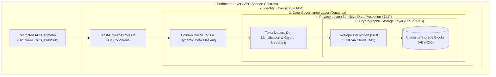
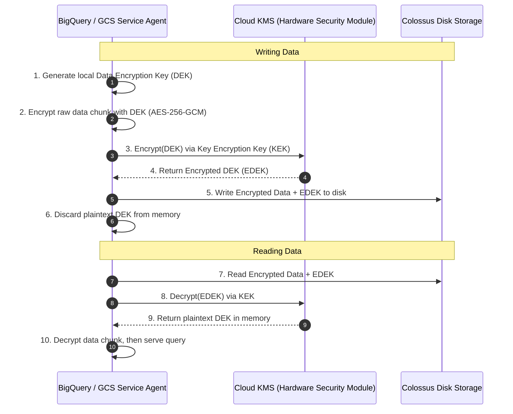
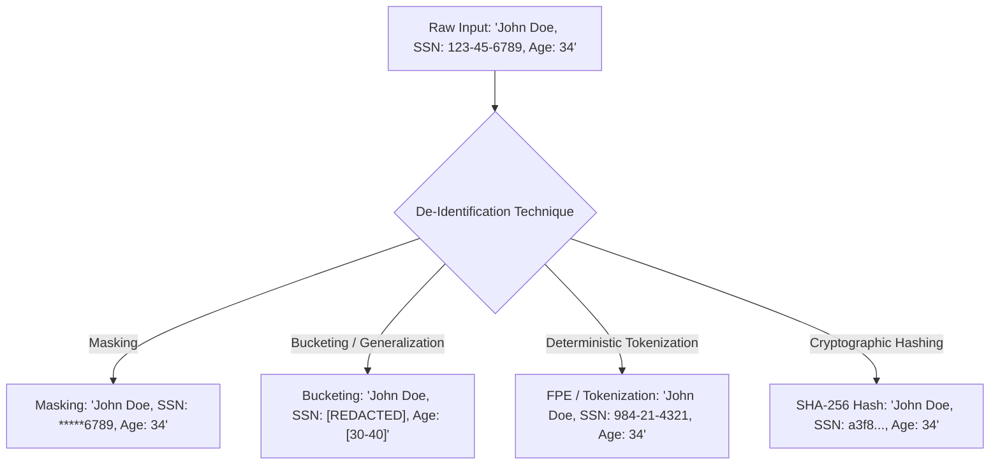

# Security, Encryption, Privacy & Perimeter Isolation

## 1. Google Cloud Security Architecture: Defense-in-Depth

Enterprise data security in Google Cloud follows a strict **defense-in-depth, zero-trust model**. Rather than relying solely on identity checks at the front door, security is enforced across five distinct layers:
1. **Identity & Authorization**: IAM, Service Accounts, and Attribute-Based Access Control.
2. **Network Perimeter**: VPC Service Controls (VPC-SC) preventing data exfiltration.
3. **Data Protection at Rest**: Hardware-level encryption, Customer-Managed Encryption Keys (CMEK), and Customer-Supplied Encryption Keys (CSEK).
4. **Data Protection in Transit**: Universal TLS 1.3 across Google fiber backbones (Jupiter).
5. **Data Privacy & Discovery**: Sensitive Data Protection (Cloud DLP) for automated PII discovery, tokenization, and crypto-shredding.



---

## 2. Product 1: Cloud Key Management Service (Cloud KMS)

### 2.1 Default Encryption vs. CMEK vs. CSEK
By default, **all data at rest in Google Cloud is encrypted** using Google-managed encryption keys with AES-256. However, regulatory frameworks (HIPAA, PCI-DSS, FedRAMP, GDPR) often mandate organizational control over key lifecycles.

| Encryption Tier | Key Custody | Key Rotation Control | Emergency Revocation | Exam Focus |
| :--- | :--- | :--- | :--- | :--- |
| **Google-Default** | Managed by Google internal services | Automated by Google | Not possible by customer | Default baseline for all GCP storage. |
| **Customer-Managed (CMEK)** | Managed by customer inside **Cloud KMS** | Configured by customer (automatic or on-demand) | **Instantaneous**: Revoke KMS key to disable access to all data | **Primary production enterprise requirement**. |
| **Customer-Supplied (CSEK)** | Stored exclusively on-premises; supplied with raw API call | Fully managed on-premises | Keys never hit GCP storage; losing key = permanent data loss | Used only when law prohibits storing keys in cloud. |
| **Cloud EKM (External)** | Stored in on-premises HSM (Thales, Fortanix) | Managed in on-prem HSM via EKM bridge | Physical pull of key from on-prem HSM | Financial/Defense compliance mandates. |

### 2.2 Envelope Encryption Mechanics
Google Cloud utilizes a two-tier key hierarchy known as **Envelope Encryption**:



- **Data Encryption Key (DEK)**: Fast, symmetric AES-256 key generated in memory to encrypt the actual data blocks. Rotated frequently.
- **Key Encryption Key (KEK)**: The master key stored securely inside Cloud KMS (or Cloud HSM). Encrypts and wraps the DEK. Never leaves Cloud KMS.

---

## 3. Product 2: Sensitive Data Protection (formerly Cloud DLP)

### 3.1 Identification & Category
- **Product Name**: Sensitive Data Protection (Cloud DLP API)
- **Category**: Automated PII Discovery, Classification, Masking & De-identification

### 3.2 What It Is
A fully managed service designed to automatically scan, inspect, classify, and sanitize sensitive information (PII, PHI, financial records, API keys) across Cloud Storage, BigQuery, Datastore, and streaming pipelines.

### 3.3 Core Capabilities
- **Predefined InfoTypes**: Over 150 built-in detectors (e.g., `CREDIT_CARD_NUMBER`, `US_SOCIAL_SECURITY_NUMBER`, `EMAIL_ADDRESS`, `PASSPORT_NUMBER`, `IP_ADDRESS`).
- **Custom InfoTypes**: Define custom detectors via regex, dictionary lookups, or context-aware rules.
- **Automated Profiling**: Continuously profiles BigQuery datasets across the organization, flagging sensitive data risk levels automatically.

### 3.4 De-identification Techniques for Data Pipelines



1. **Masking**: Replaces characters with a symbol (e.g., masking all but the last 4 digits of a credit card).
2. **Bucketing / Generalization**: Replaces discrete numbers with coarse ranges (e.g., transforming exact age `34` into `[30–40]`) to protect identity while preserving analytical utility.
3. **Format-Preserving Encryption (FPE)**:
   - Encrypts sensitive strings (e.g., credit card numbers) using a cryptographic key such that the encrypted output preserves the original format (16 digits) and passes Luhn check algorithms.
   - Allows legacy downstream analytics systems to process data without crashing due to schema validation failures.
4. **Deterministic Tokenization (Pseudonymization)**:
   - Replaces an identifier (e.g., `user_id_123`) with a consistent surrogate token (`tok_a98e...`).
   - Enables data science teams to perform joins across tables without ever exposing the underlying customer identity.
5. **Crypto-Shredding**:
   - A privacy design pattern where sensitive user data is encrypted with a unique per-user encryption key.
   - When a user exercises their GDPR "Right to be Forgotten", the data platform simply **destroys that user's specific cryptographic key**.
   - The encrypted data blocks remain on disk or tape backups, but become mathematically unrecoverable, satisfying legal deletion requirements without requiring expensive table rewrites.

---

## 4. Product 3: VPC Service Controls (VPC-SC) Deep Dive

### 4.1 Ingress & Egress Rules
Enterprise perimeters must permit secure data exchange with authorized external entities (such as an external partner's S3 bucket or an analytical team outside the perimeter).

```yaml
# vpc-sc-egress-rule.yaml
egressPolicies:
- egressFrom:
    identityType: ANY_IDENTITY
    identities:
      - serviceAccount:sa-dataflow-worker@prj-prod-compute.iam.gserviceaccount.com
  egressTo:
    operations:
      - serviceName: storage.googleapis.com
        methodSelectors:
          - method: "google.storage.objects.create"
    resources:
      - projects/102938475610  # Authorized External Project
```

### 4.2 Dry-Run Mode
Because a misconfigured VPC-SC perimeter can instantly break production pipelines across an entire company, Google Cloud provides **Dry-Run Mode**:
- Violations are logged to Cloud Logging with full audit context (`VPC_SERVICE_CONTROLS_PERIMETER_VIOLATION`), but the API requests are **not blocked**.
- Pipelines can run in Dry-Run mode for weeks to detect hidden service agent dependencies before enforcing the perimeter in production.

---

## 5. Security Architecture: Google Cloud vs. Databricks

| Security Domain | Databricks Platform | Google Cloud Platform | Architectural Implications |
| :--- | :--- | :--- | :--- |
| **Data Encryption at Rest** | Customer-Managed Keys (EBS / S3 bucket encryption) | Google-Default AES-256 + Cloud KMS (CMEK) | GCP enforces default encryption everywhere; CMEK binds natively to datasets and buckets. |
| **Data Exfiltration Control** | AWS VPC Peering + Security Groups + S3 Bucket Policies | VPC Service Controls (API Perimeters around managed services) | VPC-SC prevents stolen credentials from writing out to unauthorized external GCP projects. |
| **Dynamic Data Masking** | Dynamic SQL masks in Unity Catalog (`CREATE MASK ...`) | Dataplex Policy Tags + BigQuery Data Masking | GCP integrates tag taxonomies into the central metadata catalog; masks are evaluated in SQL. |
| **Automated PII Discovery** | Third-party integrations (Immuta, Privacera) | Sensitive Data Protection (Native Cloud DLP API) | Native serverless scanning of petabytes of BigQuery and GCS data. |
| **Anonymization & Privacy** | Custom PySpark UDFs for hashing / salt | Sensitive Data Protection De-identification templates | Built-in format-preserving encryption, bucketing, and tokenization without custom code. |

---

## 6. Exam Relevance & Defense Scenarios (PDE Exam Guide)

### Key Scenarios on the PDE Exam:
1. **Scenario: Immediate Cryptographic Revocation of Access**:
   - *Requirement*: A compliance auditor requires that access to all historical health insurance claims data must be instantly revocable in an emergency, rendering the data immediately unreadable.
   - *Solution*: Store the data in Cloud Storage / BigQuery encrypted with a **Customer-Managed Encryption Key (CMEK)** in Cloud KMS. In an emergency, **disable the KMS key version**. All read operations immediately fail across all users and services.
2. **Scenario: GDPR "Right to be Forgotten" in Big Data Tables**:
   - *Requirement*: Customer requests data erasure under GDPR. Updating billions of records across petabyte-scale historical append-only logs is technically unfeasible and cost-prohibitive.
   - *Solution*: Implement **Crypto-Shredding**. Encrypt each customer's PII using a unique per-customer key managed in a secure key store. Delete the customer's key to permanently shred their data.
3. **Scenario: Preventing Data Exfiltration by Privileged Admins**:
   - *Requirement*: How to ensure an engineer with `roles/storage.admin` cannot copy company data lake objects to a personal Cloud Storage bucket outside the company.
   - *Solution*: Configure a **VPC Service Controls (VPC-SC)** perimeter encompassing the data project. VPC-SC intercepts API calls and blocks any copy operation pointing to a target resource outside the perimeter, even if the user has full administrative IAM rights.
