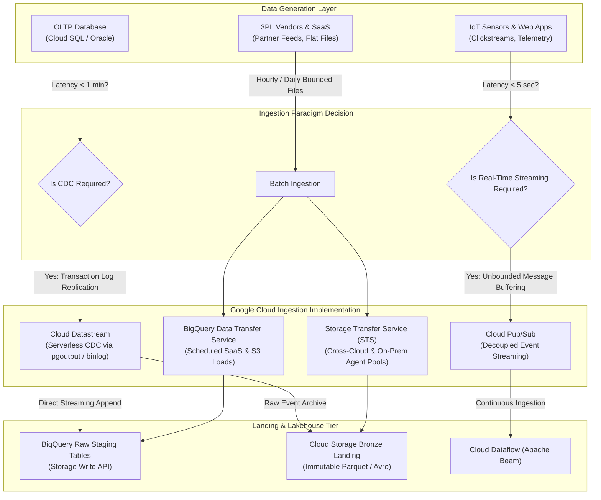
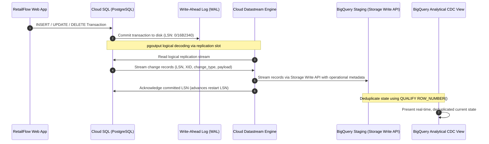
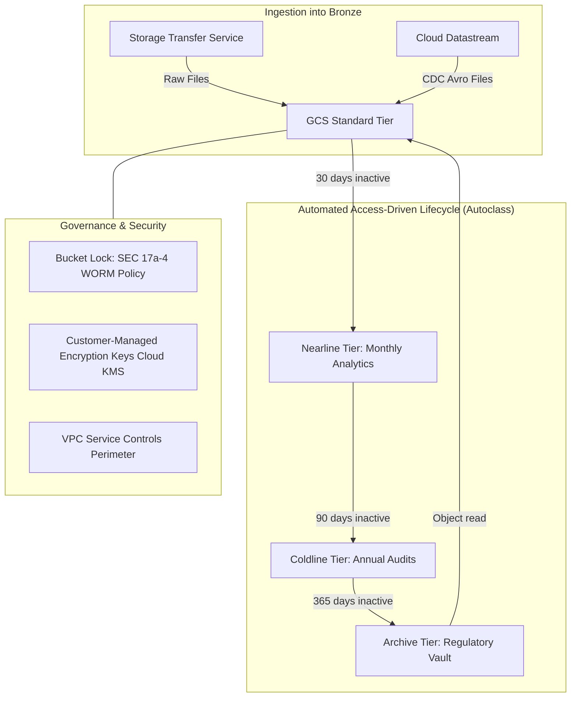
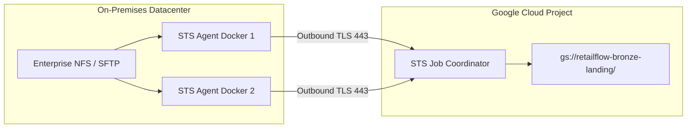
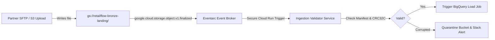

# 01. Source Acquisition & Batch Ingestion

---

## Learning Objectives
By the end of this module, a data engineer or architect will be able to:
1. **Understand** the distributed systems fundamentals of batch vs. streaming ingestion and log-based Change Data Capture (CDC).
2. **Translate** familiar Apache Spark, Databricks (Auto Loader, DBFS), and Apache Kafka (Kafka Connect, Debezium) ingestion patterns directly into Google Cloud native equivalents.
3. **Analyze** the operational mechanics, network topologies, and pricing models of Cloud Datastream, Storage Transfer Service (STS), and BigQuery Data Transfer Service (BQ DTS).
4. **Design** an immutable Cloud Storage Bronze landing zone incorporating dual-region replication, WORM compliance, and Autoclass lifecycle management.
5. **Evaluate** enterprise edge cases, such as replication slot WAL bloat, firewall perimeter isolation, and sidecar manifest data validation.
6. **Apply** security guardrails, including Customer-Managed Encryption Keys (CMEK), VPC Service Controls (VPC-SC), and Sensitive Data Protection (DLP).

---

## Databricks & Apache Spark to Google Cloud Ingestion Bridge

For data engineers transitioning from an Apache Spark / Databricks / Kafka ecosystem, the table below maps core ingestion concepts to Google Cloud native services:

| Apache / Databricks Concept | Google Cloud Native Equivalent | Architectural Parity & Key Nuances |
| :--- | :--- | :--- |
| **Kafka Connect / Debezium** | **Cloud Datastream** | Fully serverless CDC. Datastream consumes database transaction logs (PostgreSQL WAL, MySQL binlog, Oracle Redo) directly without managing Kafka brokers, Zookeeper/KRaft, or connect cluster worker nodes. |
| **AWS S3 / Azure ADLS Gen2** | **Cloud Storage (GCS)** | Object storage with **global strong consistency** for all read, write, list, and delete operations. Supports dual-region Turbo Replication (100% of objects replicated within 15 minutes) and automated tiering via Autoclass. |
| **Databricks Auto Loader (`cloudFiles`)** | **Eventarc + Cloud Functions / Workflows + BigQuery Storage Write API** | Automated file discovery. Instead of polling directories with Spark streaming, Cloud Storage emits object-finalized events via Eventarc to trigger serverless micro-batches or direct loads into BigQuery. |
| **AWS DataSync / Apache DistCp** | **Storage Transfer Service (STS)** | Managed, highly parallel multi-threaded data transfer. Supports cloud-to-cloud (S3/Azure to GCS) without intermediate VMs, and on-premises POSIX/NFS transfers via containerized STS Agent Pools over outbound HTTPS (port 443). |
| **Spark Batch Ingestion (`spark.read`)** | **BigQuery Data Transfer Service (BQ DTS) / BigQuery Native Load** | Automated, zero-compute-management ingestion. For scheduled loads from SaaS (Salesforce, Google Ads) or cloud storage, BQ DTS schedules loads directly into tables without spinning up Spark clusters. |

---

## 1. Architectural Foundation: The Batch vs. Streaming Continuum

Before adopting specific Google Cloud products, an enterprise data architect must first evaluate where a data source lands along the **latency vs. throughput vs. operational cost continuum**.

Distributed data ingestion spans two fundamental models:
- **Batch Processing**: Data is accumulated over time into discrete, bounded intervals (e.g., hourly files, daily dumps, nightly database exports). Processing engines optimize for **maximum throughput and resource saturation** at the expense of currency (data is hours or days old).
- **Streaming Processing**: Data is treated as an unbounded, continuous sequence of individual events or micro-batches. Ingestion engines optimize for **minimal latency and continuous processing** at the expense of higher operational complexity and per-event processing overhead.



---

## 2. Enterprise Scenario: RetailFlow Omnichannel Platform

**RetailFlow** (formerly GlobalRetailX) is a Tier-1 omnichannel retail enterprise processing **50 million transactions per day** across 850 physical retail stores, an e-commerce mobile/web platform, and a third-party seller marketplace.

```
                                  RETAILFLOW INGESTION TOPOLOGY
                                  
+-------------------------+      +--------------------------+      +--------------------------+
|  Operational RDBMS      |      |  3PL & Supplier Feeds    |      |  External Ad & SaaS      |
|  - Cloud SQL (Postgres) |      |  - AWS S3 (Inventory)    |      |  - Salesforce CRM        |
|  - On-Prem Oracle ERP   |      |  - On-Prem SFTP (Logist) |      |  - Google Ads / Search360|
+------------+------------+      +------------+-------------+      +------------+-------------+
             |                                |                                 |
             | CDC (WAL / Redo Logs)          | Scheduled / Event-Driven Push   | Scheduled Extraction
             v                                v                                 v
+-------------------------+      +--------------------------+      +--------------------------+
|    Cloud Datastream     |      | Storage Transfer Service |      | BigQuery Data Transfer   |
| (Private Service Connect|      | (STS On-Prem Agent Pool) |      |       Service (DTS)      |
+------------+------------+      +------------+-------------+      +------------+-------------+
             |                                |                                 |
             | Direct / Micro-batch           | Multi-part Sync                 | Native BigQuery Load
             +--------------------+           |                                 |
                                  |           |                                 |
                                  v           v                                 |
                    +------------------------------------+                      |
                    | Cloud Storage: Bronze Landing Zone |                      |
                    |  - Immutable Partitioning Hive-style|                      |
                    |  - Eventarc Object Finalized Trigger|                      |
                    |  - Sensitive Data Protection (DLP) |                      |
                    +------------------+-----------------+                      |
                                       |                                        |
                                       | Validated Micro-batches                |
                                       v                                        v
                    +-------------------------------------------------------------------+
                    |                   BigQuery Raw Ingestion Layer                    |
                    |               (Append-Only CDC & Staging Tables)                  |
                    +-------------------------------------------------------------------+
```

### Ingestion Workload Profile & Data Characteristics
* **OLTP Database CDC (Orders, Payments, Inventory Reservations)**: Continuous Change Data Capture (CDC) sourced from Cloud SQL for PostgreSQL (e-commerce core) and on-premises Oracle Exadata (legacy ERP). Peak throughput: 12,000 changes/second.
* **Batch Partner Feeds (3PL Logistics, Supplier Catalogs)**: Hourly and daily flat files (CSV, Parquet, JSON) delivered into AWS S3 buckets and partner on-prem SFTP servers.
* **Customer Profile & Marketing SaaS**: BigQuery Data Transfer Service pulling customer engagement, Google Ads, and CRM attributes on recurring 24-hour cadences.
* **Compliance & Security Constraints**: Strict PCI-DSS for payment tokens and GDPR/CCPA compliance for customer PII (email, shipping address, phone). Data must be encrypted in transit, at rest via Customer-Managed Encryption Keys (CMEK), and isolated using VPC Service Controls (VPC-SC).

---

## 3. Standardized Service Deep Dive: Cloud Datastream

### 1. The Problem
Transactional databases (PostgreSQL, MySQL, Oracle, SQL Server) run mission-critical e-commerce operations. Traditional batch ingestion relies on periodic polling queries:
```sql
SELECT * FROM orders WHERE updated_at > :last_sync_timestamp;
```
This naive polling approach introduces critical architectural flaws:
1. **Database Degradation**: Full-table indexing or sequential scans consume significant CPU and buffer pool memory on primary OLTP instances during peak hours.
2. **Missing Deletes**: A hard `DELETE` operation leaves no row to query, meaning downstream analytical systems retain phantom records.
3. **High Latency**: Polling intervals (e.g., every 15–60 minutes) prevent real-time inventory updates and fraud detection.

### 2. Understand the Concept
**Log-Based Change Data Capture (CDC)** solves this by reading the database's internal transaction log (Write-Ahead Log in PostgreSQL, Binary Log in MySQL, Redo Log in Oracle). Every `INSERT`, `UPDATE`, and `DELETE` is written sequentially to disk before being committed to table storage. CDC tails this log non-intrusively, translating low-level binary log sequence numbers into a continuous, ordered stream of row mutations without querying the SQL query engine.

*Databricks / Kafka Translation*: In the Kafka ecosystem, engineers deploy Kafka Connect running the Debezium connector, which pipes CDC records to a Kafka topic, followed by Spark Structured Streaming jobs writing to Delta Lake. Cloud Datastream consolidates the connector runtime, Kafka brokers, and ingestion pipelines into a fully managed, serverless GCP service.

### 3. Google Cloud Implementation
Google Cloud implements CDC through **Cloud Datastream**: a serverless, horizontally scalable replication engine. Datastream extracts change events from relational sources and writes them directly into BigQuery (via the BigQuery Storage Write API) or Cloud Storage (as Avro or JSON files) with minimal latency (<60 seconds).

### 4. How It Works (Components & Workflow)
Datastream operates through three core resources:
1. **Connection Profiles**: Authenticated, network-secured endpoints defining source databases (Cloud SQL, bare-metal Oracle, Amazon RDS) and destinations (BigQuery, Cloud Storage).
2. **Private Connectivity**: Establishes secure network paths using **Private Service Connect (PSC)** or VPC Peering, ensuring database traffic never traverses the public internet.
3. **Streams**: Configures tables to replicate, backfill behaviors, and destination table mappings.

Datastream processes data in two distinct phases:
- **Historical Backfill Phase**: Takes a point-in-time snapshot of historical table data using database snapshot isolation (`SET TRANSACTION SNAPSHOT` in PostgreSQL) without table read locks.
- **Continuous CDC Phase**: Transitions seamlessly to reading WAL/binlog records starting from the exact Log Sequence Number (LSN) or Global Transaction Identifier (GTID) captured when the backfill initiated.



### 5. Practical Example (RetailFlow Omnichannel Orders)
Datastream extracts PostgreSQL orders and appends operational metadata columns to each record in BigQuery:

```json
{
  "_metadata_stream_name": "projects/retailflow-prod/locations/us-central1/streams/ecom-cdc-orders",
  "_metadata_timestamp": 1714562400,
  "_metadata_read_timestamp": 1714562401,
  "_metadata_source_type": "POSTGRESQL",
  "_metadata_schema": "public",
  "_metadata_table": "orders",
  "_metadata_change_type": "UPDATE",
  "_metadata_uuid": "f81d4fae-7dec-11d0-a765-00a0c91e6bf6",
  "order_id": "ORD-9842104",
  "customer_id": "CUST-44102",
  "order_status": "PROCESSING",
  "order_total": "129.50",
  "updated_at": "2026-05-01T11:20:00Z"
}
```

To reconstruct the current, consistent state of orders without running continuous heavy `MERGE` statements, RetailFlow deploys a BigQuery view utilizing analytical window functions:

```sql
CREATE OR REPLACE VIEW `retailflow-prod.lakehouse_silver.vw_current_orders` AS
SELECT
  order_id,
  customer_id,
  order_status,
  CAST(order_total AS NUMERIC) AS order_total,
  TIMESTAMP_MICROS(_metadata_timestamp) AS last_updated_at
FROM `retailflow-prod.lakehouse_raw.orders_cdc`
WHERE _metadata_change_type != 'DELETE'
QUALIFY ROW_NUMBER() OVER (
  PARTITION BY order_id 
  ORDER BY _metadata_timestamp DESC, _metadata_read_timestamp DESC
) = 1;
```

### 6. Architecture Integration
- **Upstream Sources**: Cloud SQL (PostgreSQL, MySQL), self-hosted MySQL/Postgres on GCE, AWS RDS, on-premises Oracle Exadata.
- **Connectivity**: Private Service Connect (PSC) forwarding rules targeting Internal Load Balancers (ILBs).
- **Downstream Sinks**:
  - Direct to **BigQuery**: Real-time replication using the BigQuery Storage Write API with automatic schema creation and continuous updates.
  - Direct to **Cloud Storage**: Micro-batches of Avro or JSON files partitioned Hive-style for downstream processing by Dataflow, Dataproc, or Spark.

### 7. When to Use It
- Low-latency (<1 minute) replication of transactional relational databases into BigQuery or GCS.
- Minimizing read load on production OLTP databases.
- Automated handling of table schema additions (schema drift) without pipeline downtime.

### 8. When Not to Use It
- Ingesting from NoSQL databases (MongoDB, Cassandra, DynamoDB) — use custom Beam pipelines or Kafka Connect.
- Unstructured or flat file ingestion (CSV, Parquet, JSON files) — use Storage Transfer Service.
- High-velocity telemetry or mobile clickstreams (>100,000 events/sec) — use Cloud Pub/Sub.
- Performing in-flight data cleansing, filtering, or aggregations — Datastream is strictly an EL (Extract-Load) service; perform transformations downstream in BigQuery (Dataform) or Dataflow.

### 9. Trade-offs (Performance, Cost, Complexity, Ops)
- **Performance**: Sub-minute replication latency; negligible CPU impact on the source database.
- **Cost**: Volume-tiered per-GB pricing (first 50 GB/month free, $2.00/GB up to 1 TB, scaling down to $0.50/GB >5 TB/month). Can become expensive for multi-terabyte bulk re-indexing.
- **Complexity**: Zero infrastructure to manage; configuration is fully declarative via UI, CLI, or Terraform.
- **Ops**: Automatic recovery and checkpointing; database administrator must monitor replication slot WAL usage to prevent database disk exhaustion.

### 10. Common Misconceptions
- *Misconception*: Datastream requires third-party logical decoding plugins like `wal2json`.  
  **Reality**: Datastream uses PostgreSQL's native `pgoutput` plugin (standard in PostgreSQL 10+). No custom C plugins or extensions are required.
- *Misconception*: Datastream replaces ETL tools like Dataform or Dataflow.  
  **Reality**: Datastream is strictly a replication service. It does not perform in-flight joins, data masking, or complex filtering.

### 11. PDE Exam Perspective
- **Exam Trigger Phrases**: *"Replicate Cloud SQL database to BigQuery with minimal latency and minimal impact on source OLTP"*, *"Change Data Capture (CDC) without managing compute infrastructure"*, *"Zero-code database replication"*.
- **Exam Traps**: Beware of answer choices suggesting periodic batch queries (`SELECT ... WHERE timestamp > ...`) or dumping database backups to GCS via cron; these introduce high latency and database load. Also beware of choices suggesting custom Debezium clusters on GCE when a serverless, managed solution is requested.

---

## 4. Standardized Service Deep Dive: Cloud Storage (GCS)

### 1. The Problem
Enterprises require an exabyte-scale, virtually unlimited, highly durable repository to land heterogeneous raw data (unstructured images, semi-structured JSON logs, batch Parquet files, vendor feeds) prior to parsing, transforming, or loading into analytical databases. Traditional SAN/NAS arrays or on-premises HDFS clusters require complex capacity planning, hardware maintenance, and lack global accessibility.

### 2. Understand the Concept
**Object Storage** decouples storage from compute entirely. Data is stored not in a hierarchical file tree on physical disk sectors, but as immutable blobs (objects) identified by unique keys within a flat namespace (buckets). Sliders and slashes (`/`) in object names simulate directories (prefixes) for convenience, but the underlying system treats them as flat keys.

*Databricks / Cloud Comparison*:
- AWS S3 / Azure ADLS Gen2: Cloud Storage provides comparable exabyte scale and REST APIs, but differs significantly in consistency: GCS provides **global strong consistency** for all operations without regional eventual consistency lag.
- Databricks DBFS: DBFS is a mount abstraction over object storage; GCS acts as the underlying storage primitive for Google Cloud lakehouses (BigLake, Dataproc, and Dataflow).

### 3. Google Cloud Implementation
Google Cloud Storage (GCS) offers four storage tiers within a unified API:
1. **Standard**: High-frequency active analytics and data pipelines.
2. **Nearline**: Infrequently accessed data (accessed $\le 1\times$ per month); 30-day minimum storage commitment.
3. **Coldline**: Rarely accessed disaster recovery data (accessed $\le 1\times$ per year); 90-day minimum storage commitment.
4. **Archive**: Long-term regulatory archival (accessed $< 1\times$ every few years); 365-day minimum storage commitment.

All storage classes offer identical millisecond read latencies and 99.999999999% (11 9's) annual durability.

> [!IMPORTANT]
> **Consistency Model Benchmark**:
> Cloud Storage guarantees **global strong consistency** for all metadata and data mutations (uploads, updates, deletes, and bucket listings) across all bucket locations (regional, dual-region, and multi-region). Once a mutation returns `HTTP 200 OK`, subsequent read or list operations globally are guaranteed to observe the mutation immediately. There is no eventual consistency lag across remote regions.

### 4. How It Works (Components & Workflow)
- **Bucket Geographies**:
  - *Regional*: Deployed within a single GCP region (e.g., `us-central1`). Lowest cost; optimal for co-locating data with Dataproc or BigQuery compute clusters.
  - *Dual-Region*: Synchronously replicated across two specific regional pairs (e.g., `us-central1` and `us-east4`). Provides 99.99% availability SLA.
  - *Turbo Replication*: An optional feature for dual-region buckets that contractually guarantees **100% of objects are replicated across regions within 15 minutes**, backed by a financial SLA.
- **Autoclass**: Automatically transitions individual objects between Standard, Nearline, Coldline, and Archive based on their access patterns, eliminating manual lifecycle policy rules and eliminating retrieval fees.
- **Bucket Lock (Retention Policies)**: Enforces Write Once, Read Many (WORM) regulatory compliance (SEC Rule 17a-4, FINRA). Once locked, objects cannot be deleted or overwritten by any user—including project owners and organization super-admins—until the retention period elapses.



### 5. Practical Example (RetailFlow Bronze Landing Zone)
RetailFlow organizes its Bronze landing bucket using Hive-compatible partitioning paths to allow seamless querying via BigLake external tables:

```
gs://retailflow-bronze-landing/
├── cdc_postgres_orders/
│   └── year=2026/month=05/day=01/hour=14/
│       ├── part-00001-f81d4fae.avro
│       └── part-00002-f81d4fae.avro
├── batch_sftp_inventory/
│   └── year=2026/month=05/day=01/hour=00/
│       ├── inventory_snapshot_20260501.csv
│       └── inventory_snapshot_20260501.csv.manifest
└── partner_s3_logistics/
    └── year=2026/month=05/day=01/hour=06/
        └── logistics_manifest_20260501.parquet
```

### 6. Architecture Integration
- **Upstream Providers**: Storage Transfer Service, Datastream, BigQuery Table Exports, IoT Edge Gateways, on-premises batch uploads.
- **Downstream Consumers**: BigQuery BigLake (direct SQL querying without data movement), Cloud Dataflow (Apache Beam ingestion), Cloud Dataproc (Spark analytics via `gs://` connector), Vertex AI (model training datasets).

### 7. When to Use It
- Raw data lake landing zones (Bronze layer).
- Disaster recovery backups and historical data archiving.
- Serving static assets, machine learning model weights, and container artifacts.
- Staging data for bulk loads into BigQuery.

### 8. When Not to Use It
- Real-time operational key-value lookups (<10ms point reads) — use Cloud Bigtable or Redis.
- Frequently modified transactional data requiring ACID row updates — use Cloud Spanner or Cloud SQL.
- File systems requiring POSIX filesystem locks, random file writes, and directory renames — use Filestore.

### 9. Trade-offs (Performance, Cost, Complexity, Ops)
- **Performance**: High aggregate throughput (scales to thousands of read/write requests per second); millisecond initial byte latency.
- **Cost**: Extremely low at-rest storage cost ($0.020/GB/month for Standard, $0.0012/GB/month for Archive). **Trade-off Trap**: Coldline and Archive impose retrieval fees ($0.02–$0.05/GB) and minimum storage duration penalties (90 and 365 days).
- **Complexity**: Minimal; simple bucket and object abstractions.
- **Ops**: Zero infrastructure management; lifecycle policies or Autoclass automate data tiering completely.

### 10. Common Misconceptions
- *Misconception*: GCS has eventual consistency when listing objects across regions.  
  **Reality**: GCS has provided global strong consistency for all read, write, list, and delete operations since late 2020.
- *Misconception*: Transitioning an object to Coldline and deleting it after 10 days saves money.  
  **Reality**: Deleting a Coldline object before its 90-day minimum duration incurs an early deletion penalty equal to the remaining 80 days of storage.

### 11. PDE Exam Perspective
- **Exam Trigger Phrases**: *"Immutable audit archive required by law (SEC 17a-4)"* $\to$ **Bucket Lock in Locked Mode (WORM)**.
- *"Replicate data between two regions with strict 15-minute RPO"* $\to$ **Dual-Region bucket with Turbo Replication**.
- *"Optimize storage costs across diverse access patterns without operational overhead"* $\to$ **Autoclass**.
- *"Avoid early deletion penalties for short-lived temporary files"* $\to$ Keep temporary files in **Standard class**; never route transient files to Coldline or Archive.

---

## 5. Batch Ingestion: Storage Transfer Service (STS) & BigQuery DTS

### 5.1 Storage Transfer Service (STS) Architecture

Storage Transfer Service manages large-scale, automated transfers into Cloud Storage from other cloud providers (AWS S3, Azure Blob) and on-premises storage systems (POSIX filesystems, SFTP, HDFS, NFS).



#### On-Premises Transfer with STS Agent Pools
- **Agent Architecture**: Dockerized STS agents run inside the customer’s on-premises DMZ or server fleet.
- **Agent Pools**: Agents are grouped into named pools for multi-tenancy and bandwidth isolation (e.g., `sftp-logistics-pool` vs `erp-backup-pool`).
- **Outbound-Only Connectivity**: Agents require **no open inbound firewall ports**. They initiate outbound HTTPS (port 443) connections to Google APIs, pull files locally via POSIX mounts, and stream data directly into Cloud Storage.

#### AWS S3 Cross-Cloud Synchronization
- **Credential-less Access via IAM Role Federation**: No static AWS Access Keys (`AKIA...`) are stored in GCP. GCP STS federates with AWS STS via an IAM Role trust policy using GCP’s unique Google Service Account identity.
- **Metadata Preservation**: STS preserves object timestamps, symlinks, POSIX attributes, and custom S3 user metadata tags (`x-amz-meta-*` maps to `x-goog-meta-*`).
- **Change Detection**: STS evaluates etag, MD5 checksum, and modification time before transferring, ensuring only net-new or mutated files cross clouds.

### 5.2 BigQuery Data Transfer Service (BQ DTS)

While STS lands files into Cloud Storage, BigQuery Data Transfer Service automates the scheduled, managed loading of structured data directly into BigQuery tables from:
- Google Cloud Storage (wildcard URI loads)
- Amazon S3
- Third-Party SaaS Applications: Salesforce, Google Ads, YouTube Channel Reports, Campaign Manager 360.

#### S3 to BigQuery DTS Configuration via CLI
```bash
bq mk --transfer_config \
  --project_id=retailflow-prod \
  --data_source=amazon_s3 \
  --display_name="Daily-Logistics-3PL-Feed" \
  --target_dataset=raw_logistics \
  --params='{
    "destination_table_name_template":"shipments_{run_date}",
    "data_path":"s3://retailflow-3pl-exchange/daily_shipments/*.parquet",
    "access_key_id":"ASIAEXAMPLEKEY",
    "secret_access_key":"wJalrXUtnFEMI/K7MDENG/bPxRfiCYEXAMPLEKEY",
    "file_data_type":"PARQUET",
    "auto_detect":"true"
  }' \
  --schedule="every 24 hours"
```

*Parameter Substitution*: The `{run_date}` token dynamically routes daily batch arrivals into ingestion-partitioned tables without manual pipeline orchestration.

---

## 6. Event-Driven Ingestion with Eventarc & Cloud Functions

When files arrive asynchronously in the Bronze bucket (e.g., 3PL shipping manifests), downstream validation and ingestion must trigger immediately without polling.



### The Manifest Sentinel (Sidecar) Pattern
To prevent race conditions where a pipeline starts reading a half-written file, RetailFlow enforces the **Manifest Sidecar Pattern**:
1. The uploading service uploads the data payload (`orders_20260501.parquet`).
2. After the payload is 100% complete, the uploader writes a tiny sentinel file (`orders_20260501.parquet.manifest`) containing row count, byte size, and CRC32C checksum.
3. Eventarc listens **exclusively** for `*.manifest` file finalizations, ensuring downstream processing never touches partially written objects.

---

## 7. Active Learning: Architecture Prediction & Troubleshooting

### Scenario A: Predict the Architecture
**Business Challenge**:  
RetailFlow is onboarding a major logistics partner that provides an hourly flat-file feed of parcel tracking scans (approx. 400 GB/day) hosted on an on-premises enterprise Isilon NFS array. The partner’s network security policy forbids:
1. Opening any inbound ports on the corporate perimeter firewall.
2. Storing persistent service account keys on local disk.
3. Consuming more than 2 Gbps of the dedicated 10 Gbps interconnect during business hours (08:00–18:00).

**Task**: Formulate the optimal Google Cloud ingestion architecture.

#### Architectural Solution & Reasoning:
1. **Engine Selection**: Deploy **Storage Transfer Service (STS) on-premises Agent Pools**. Dockerized agents run directly on VMs with local NFS mounts.
2. **Firewall Compliance**: STS agents establish strictly **outbound HTTPS (port 443)** connections to Google Cloud APIs. No inbound ports are opened.
3. **Authentication**: Use **Workload Identity Federation** or Google Cloud CLI authentication on the host VM to grant temporary short-lived credentials, eliminating static JSON service account keys.
4. **Bandwidth Throttling**: Configure an STS Bandwidth Limit rule setting maximum transfer throughput to 2 Gbps between 08:00 and 18:00, with uncapped bandwidth during off-peak hours.
5. **Destination**: Target a `us-central1` GCS Bronze landing bucket configured with Autoclass.

---

### Scenario B: Troubleshoot the Pipeline
**Production Incident**:  
At 02:15 AM during Black Friday sales, the database administrator for RetailFlow's primary Cloud SQL for PostgreSQL instance receives a critical PagerDuty alert: **Disk space utilization on `db-primary-orders` has spiked to 92% and is climbing by 1% every 5 minutes**. Automatic storage increase is nearing its configured instance ceiling. Datastream replication to BigQuery is enabled.

```
Log snippet from Cloud SQL:
[2026-11-27 02:14:22 UTC] [10421]: [3-1] LOG:  checkpoints are occurring too frequently (22 seconds apart)
[2026-11-27 02:14:45 UTC] [10421]: [4-1] WARNING:  WAL segments accumulating in pg_wal: 1,840 files (29.4 GB)
[2026-11-27 02:15:02 UTC] [10421]: [5-1] DETAIL:  Replication slot "datastream_orders_slot" active: false, restart_lsn: 0/14A2800, confirmed_flush_lsn: 0/14A2800
```

#### Diagnostic Walkthrough:
1. **Identify the Underlying Mechanism**: In PostgreSQL logical replication, the server retains all Write-Ahead Log (WAL) segments starting from the lowest unacknowledged `restart_lsn` across all replication slots. If a slot disconnects or stalls, PostgreSQL **cannot purge WAL files**, causing disk utilization to skyrocket.
2. **Root Cause Analysis**: The log indicates replication slot `datastream_orders_slot` has `active: false`. The Datastream stream was paused or failed (e.g., due to an expired network PSC certificate or BigQuery quota exhaustion), stopping WAL acknowledgment while Black Friday order writes continue at 12,000 transactions/sec.
3. **Emergency Remediation Protocol**:
   - *Step 1*: Check Datastream stream state in Cloud Console or CLI (`gcloud datastream streams describe`). Check for BigQuery Storage Write API rate limit or quota errors.
   - *Step 2*: If the stream can be resumed immediately, unpause it. Datastream will rapidly consume backlogged LSNs, allowing PostgreSQL to advance `restart_lsn` and reclaim disk space during the next checkpoint.
   - *Step 3 (Catastrophic Prevention)*: If disk utilization reaches 97% and Datastream cannot be fixed immediately, execute `SELECT pg_drop_replication_slot('datastream_orders_slot');` on PostgreSQL. This drops the hold on WAL logs, allowing PostgreSQL to immediately delete old WAL files and save the database from crashing. (Note: Datastream will require a historical backfill when re-enabled).

---

## 8. Professional Data Engineer (PDE) Knowledge Check

#### Question 1
RetailFlow is replicating a mission-critical Cloud SQL for PostgreSQL database to BigQuery for near-real-time fraud detection using Datastream. During peak retail sales, the database administrator reports that the Cloud SQL instance is running dangerously low on disk space, and WAL log files are accumulating without being recycled. What is the root cause, and what architectural remedy should you implement immediately?

- A. Cloud SQL automatic storage increase is disabled; execute an `ALTER DATABASE` command to allocate more storage.
- B. The Datastream replication slot is lagging or stalled, preventing PostgreSQL from advancing its restart LSN and truncating old WAL segments. You must inspect the replication lag, verify network throughput on the private connection, or temporarily drop the slot if disk exhaustion is imminent.
- C. Datastream does not support continuous streaming from PostgreSQL without batching; switch the ingestion mechanism to an hourly Cloud Function pulling records.
- D. BigQuery write quotas have been exceeded, causing Datastream to issue `ROLLBACK` commands to the PostgreSQL transaction manager.

**Answer: B**  
*Detailed Answer Analysis*:
* **Correct Answer: B**. In PostgreSQL logical replication, the database cannot recycle WAL logs beyond the lowest unacknowledged Log Sequence Number (LSN) held by an active replication slot. If Datastream disconnects, stalls, or faces downstream latency, WAL segments accumulate locally until disk space is exhausted.
* *Distractor Analysis*:
  * **A** is incorrect because expanding storage is a reactive temporary measure that fails to address why WAL files are being retained and will eventually exhaust the new disk space as well.
  * **C** is incorrect because Datastream natively supports continuous streaming CDC without batching or custom Cloud Functions.
  * **D** is incorrect because Datastream is a read-only consumer of PostgreSQL WAL logs and cannot issue `ROLLBACK` commands to the source database transaction manager.

---

#### Question 2
Your enterprise needs to ingest 5 TB of daily inventory files from an on-premises NetApp NFS storage array into Cloud Storage Bronze Landing. Your enterprise security policy mandates that **no inbound ports** may be opened in the on-premises firewall, and transfers must saturate available 10 Gbps Direct Interconnect bandwidth without overloading the source NFS. How should you design the ingestion architecture?

- A. Write a custom Python script using the Google Cloud Storage SDK on a single on-premises VM and run parallel multi-threaded uploads over port 22.
- B. Install Storage Transfer Service (STS) multi-agent software across multiple on-premises VMs assigned to a dedicated Agent Pool. Configure bandwidth limits in the STS console and direct uploads to GCS via outbound HTTPS.
- C. Use `gsutil -m rsync` executed via cron on the NFS storage controller.
- D. Provision a BigQuery Data Transfer Service instance with a Direct Interconnect tunnel pointing to the NFS mount point.

**Answer: B**  
*Detailed Answer Analysis*:
* **Correct Answer: B**. Google Cloud Storage Transfer Service on-premises agents are specifically engineered for this requirement. Agents run inside Docker containers on local VMs, initiate **outbound-only** HTTPS (port 443) connections to GCP, and coordinate distributed multi-threaded chunked transfers. Agent pools allow administrators to set granular bandwidth caps to avoid saturating corporate links.
* *Distractor Analysis*:
  * **A** and **C** are incorrect because custom Python scripts and cron-based `gsutil` scripts lack enterprise-grade agent orchestration, fault-tolerant retries, and distributed multi-node load balancing; port 22 also violates outbound HTTPS transport standards.
  * **D** is incorrect because BigQuery Data Transfer Service (BQ DTS) is designed for cloud-to-cloud SaaS and Cloud Storage transfers; it cannot mount or access on-premises NFS file systems.

---

#### Question 3
An external logistics vendor drops millions of CSV tracking updates into your GCS Bronze landing bucket every 15 minutes. Downstream Dataform SQL models frequently fail with syntax and schema parsing errors because files are occasionally incomplete or corrupted during upload. You need to ensure only complete, byte-verified files are processed by downstream pipelines while minimizing operational overhead. What should you do?

- A. Have the vendor write data directly to BigQuery using the streaming insert API (`tabledata().insertAll()`).
- B. Implement the Manifest Sidecar pattern: Require the vendor to upload the payload file first, followed by a `.manifest` sentinel file containing the expected file size, row count, and CRC32c checksum. Trigger downstream ingestion exclusively via Eventarc upon creation of the `.manifest` file, and validate the payload before processing.
- C. Schedule a Cloud Composer DAG to poll the bucket every 60 seconds and process all files whose modification timestamp is older than 5 minutes.
- D. Enable GCS Object Versioning and set a lifecycle rule to delete files smaller than 1 MB.

**Answer: B**  
*Detailed Answer Analysis*:
* **Correct Answer: B**. The Manifest Sidecar pattern is the industry standard for asynchronous batch file landing validation. Eventarc triggers downstream workflows only when the `.manifest` file lands, ensuring that the payload is completely written and cryptographically verified against the CRC32c checksum before downstream processing begins.
* *Distractor Analysis*:
  * **A** is incorrect because pushing vendor writes directly to BigQuery via legacy streaming inserts lacks schema isolation, creates vendor lock-in, and bypasses Bronze landing immutability.
  * **C** is incorrect because time-based polling heuristics are subject to race conditions if large files take longer than 5 minutes to transfer.
  * **D** is incorrect because arbitrary size-based deletion rules risk deleting valid small files and do not verify file integrity or completion.

---

## Module Key Takeaways & Exam Traps

| Category | Golden Rule | Exam Trap to Avoid |
| :--- | :--- | :--- |
| **Cloud Datastream** | Serverless CDC directly from database transaction logs (PostgreSQL `pgoutput`, MySQL binlog, Oracle Redo). | Never suggest polling SQL queries (`SELECT WHERE updated_at > ...`) or dumping nightly database backups for real-time replication. |
| **Cloud Storage Consistency** | GCS offers **global strong consistency** for all operations (read, write, delete, list) across all locations. | Never choose an answer claiming GCS has "eventual consistency" across remote regions; that limitation was retired in 2020. |
| **GCS Lifecycle vs Autoclass** | Use Autoclass when access patterns are unpredictable to eliminate retrieval fees and manual rule management. | Remember that transitioning to Coldline (<90 days) or Archive (<365 days) prematurely incurs severe early deletion penalty fees. |
| **Dual-Region Replication** | Turbo Replication guarantees 100% of objects replicate to the paired region within 15 minutes. | Default dual-region replication has a 99.9% replication SLA over hours; Turbo Replication is required when RPO $\le 15\text{ minutes}$. |
| **Storage Transfer Service** | STS Agent Pools use **outbound-only HTTPS (port 443)**, making them ideal for strict firewalls. | Never open inbound firewall ports or use insecure FTP/SFTP cron scripts when STS can automate transfers natively. |
