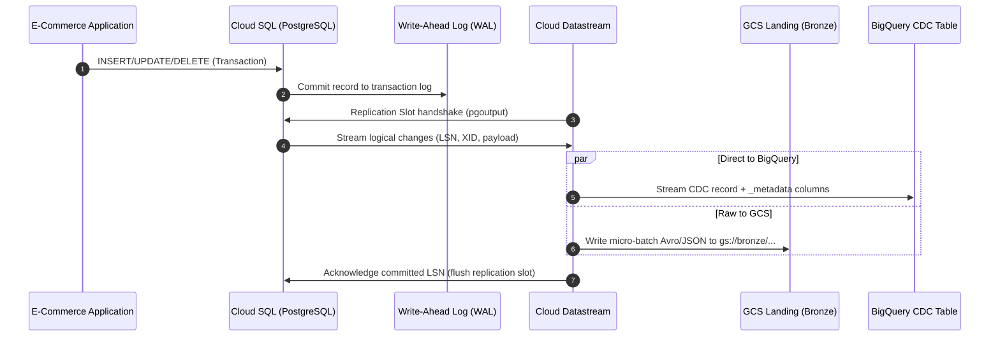
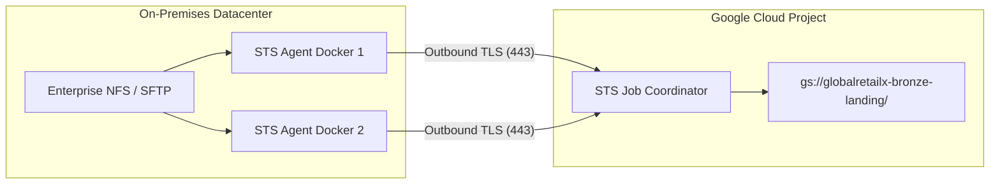
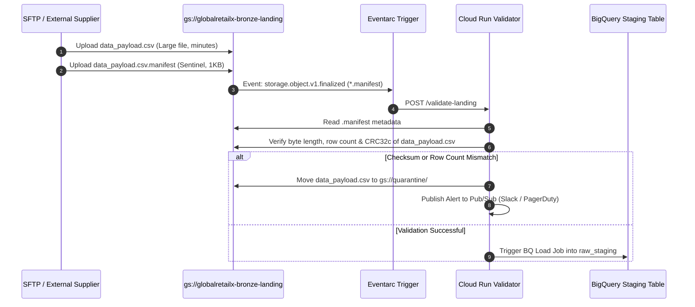

# 01. Source Acquisition & Batch Ingestion

## 1. Enterprise Scenario: GlobalRetailX Omnichannel Platform

GlobalRetailX is a Tier-1 omnichannel retail enterprise processing **50 million transactions per day** across 850 physical retail stores, an e-commerce mobile/web platform, and a third-party seller marketplace. 

```
                                  GLOBALRETAILX INGESTION TOPOLOGY
                                  
+-------------------------+      +--------------------------+      +--------------------------+
|  Operational RDBMS      |      |  3PL & Supplier Feeds    |      |  External Ad & SaaS      |
|  - Cloud SQL (Postgres) |      |  - AWS S3 (Inventory)    |      |  - Salesforce CRM        |
|  - On-Prem Oracle ERP   |      |  - On-Prem SFTP (Logist) |      |  - Google Ads / Search360|
+------------+------------+      +------------+-------------+      +------------+-------------+
             |                                |                                 |
             | CDC (WAL / Redo Logs)          | Scheduled / Event-Driven Push   | Scheduled Extraction
             v                                v                                 v
+-------------------------+      +--------------------------+      +--------------------------+
|    Cloud Datastream     |      | Storage Transfer Service |      | BigQuery Data Transfer   |
| (Private Service Connect|      | (STS On-Prem Agent Pool) |      |       Service (DTS)      |
+------------+------------+      +------------+-------------+      +------------+-------------+
             |                                |                                 |
             | Direct / Micro-batch           | Multi-part Sync                 | Native BigQuery Load
             +--------------------+           |                                 |
                                  |           |                                 |
                                  v           v                                 |
                    +------------------------------------+                      |
                    | Cloud Storage: Bronze Landing Zone |                      |
                    |  - Immutable Partitioning Hive-style|                      |
                    |  - Eventarc Object Finalized Trigger|                      |
                    |  - Sensitive Data Protection (DLP) |                      |
                    +------------------+-----------------+                      |
                                       |                                        |
                                       | Validated Micro-batches                |
                                       v                                        v
                    +-------------------------------------------------------------------+
                    |                   BigQuery Raw Ingestion Layer                    |
                    |               (Append-Only CDC & Staging Tables)                  |
                    +-------------------------------------------------------------------+
```

### Ingestion Workload Profile & Data Characteristics
* **OLTP Database CDC (Orders, Payments, Inventory Reservations)**: Continuous Change Data Capture (CDC) sourced from Cloud SQL for PostgreSQL (e-commerce core) and on-premises Oracle Exadata (legacy ERP). Peak throughput: 12,000 changes/second.
* **Batch Partner Feeds (3PL Logistics, Supplier Catalogs)**: Hourly and daily flat files (CSV, Parquet, JSON) delivered into AWS S3 buckets and partner on-prem SFTP servers.
* **Customer Profile & Marketing SaaS**: BigQuery Data Transfer Service pulling customer engagement, Google Ads, and CRM attributes on recurring 24-hour cadences.
* **Compliance & Security Constraints**: Strict PCI-DSS for payment tokens and GDPR/CCPA compliance for customer PII (email, shipping address, phone). Data must be encrypted in transit, at rest via Customer-Managed Encryption Keys (CMEK), and isolated using VPC Service Controls (VPC-SC).

---

## 2. RDBMS Source Acquisition via Cloud Datastream (CDC)

Datastream is a serverless, auto-scaling Change Data Capture (CDC) and replication service that enables low-latency data integration from relational engines (PostgreSQL, MySQL, Oracle, SQL Server) to Google Cloud targets (Cloud Storage, BigQuery).

### 2.1 Logical Replication Under the Hood

Unlike batch pollers that execute intrusive queries (`SELECT * FROM table WHERE updated_at > :last_sync`), Datastream operates non-intrusively by tapping directly into database transaction logs:

| Source Engine | Underlying Replication Mechanism | Prerequisites & Parameter Config |
| :--- | :--- | :--- |
| **Cloud SQL / Self-Hosted PostgreSQL** | Logical decoding via `pgoutput` plugin over replication slots. | `wal_level = logical`<br>`max_replication_slots >= 5`<br>`max_wal_senders >= 5`<br>Database user must possess `REPLICATION` privilege. |
| **MySQL / Cloud SQL for MySQL** | Binary Log (binlog) consumer using row-based logging format. | `binlog_format = ROW`<br>`binlog_row_image = FULL`<br>`gtid_mode = ON`<br>`enforce_gtid_consistency = ON` |
| **Oracle (On-Prem / Bare Metal)** | Oracle LogMiner or Oracle Continuous Mine reading Online/Archived Redo Logs. | Supplemental logging enabled at database and table levels:<br>`ALTER DATABASE ADD SUPPLEMENTAL LOG DATA;`<br>`ALTER TABLE schema.table ADD SUPPLEMENTAL LOG DATA (ALL) COLUMNS;` |



### 2.2 Network Topology & Secure Connectivity

Datastream requires unimpeded, secure access to the source database. In enterprise environments where public IPs are strictly prohibited by security policies, network connectivity is architected using one of three patterns:

1. **Private Service Connect (PSC)**: The recommended enterprise pattern. A Datastream private connectivity configuration is peered with a PSC forwarding rule targeting the database's internal load balancer (ILB), preventing CIDR overlap issues entirely.
2. **Reverse SSH Tunnel / Forwarding Proxy**: Used for on-premise networks with restricted ingress firewalls. A bastion host in a DMZ establishes an outbound connection to a Cloud Compute instance acting as a reverse proxy.
3. **Dedicated Interconnect / Cloud VPN**: Traffic routes over an established Cloud Router and Cloud Interconnect attachment into the on-prem network using RFC 1918 private IPs.

```
+--------------------------------------------------------------------------------------------------------+
|                                  VPC Network: prod-analytics-vpc                                       |
|                                                                                                        |
|  +-----------------------------+       +------------------------+      +----------------------------+  |
|  | Datastream Managed Project  |       | Private Connectivity   |      | Private Service Connect    |  |
|  | +-------------------------+ |       | Configuration          |      | (PSC) Service Attachment   |  |
|  | | Datastream Stream Agent |=====>===| (Allocated Subnet)     |===>==| Target: Cloud SQL ILB      |  |
|  | +-------------------------+ |  PSC  +------------------------+      +--------------+-------------+  |
|  +-----------------------------+                                                      |                |
+---------------------------------------------------------------------------------------|----------------+
                                                                                        v
                                                                         +--------------+-------------+
                                                                         | Cloud SQL PostgreSQL Core  |
                                                                         | (Private IP Only: no 0.0.0.0)
                                                                         +----------------------------+
```

### 2.3 Datastream Stream Phases & Execution Mechanics

Datastream processes ingestion through two distinct phases:
1. **Backfill Phase (Historical Snapshot)**: Performs an initial dump of all selected tables without table-level read locks. In PostgreSQL, it leverages snapshot isolation (`SET TRANSACTION SNAPSHOT`) to dump consistent state while transaction logs continue buffering.
2. **CDC Phase (Continuous Replication)**: Transitions smoothly to tailing the WAL/binlog from the exact Log Sequence Number (LSN) or Global Transaction Identifier (GTID) captured when the backfill snapshot initiated.

#### Datastream Target Metadata Schema
When writing to Cloud Storage or BigQuery, Datastream appends operational metadata columns essential for downstream deduplication and state reconstruction:

```json
{
  "_metadata_stream_name": "projects/globalretailx-prod/locations/us-central1/streams/ecom-cdc-orders",
  "_metadata_timestamp": 1714562400,
  "_metadata_read_timestamp": 1714562401,
  "_metadata_source_type": "POSTGRESQL",
  "_metadata_schema": "public",
  "_metadata_table": "orders",
  "_metadata_change_type": "UPDATE",
  "_metadata_uuid": "f81d4fae-7dec-11d0-a765-00a0c91e6bf6",
  "order_id": "ORD-9842104",
  "customer_id": "CUST-44102",
  "order_status": "PROCESSING",
  "order_total": "129.50",
  "updated_at": "2026-05-01T11:20:00Z"
}
```

* `_metadata_change_type`: Represents `INSERT`, `UPDATE`, `DELETE`, or `BACKFILL`.
* `_metadata_timestamp`: The exact commit timestamp recorded in the source transaction log.
* `_metadata_read_timestamp`: The epoch timestamp when the Datastream extractor parsed the log.

---

## 3. Batch Ingestion from On-Premises SFTP & Cloud S3

### 3.1 Storage Transfer Service (STS) Architecture

Storage Transfer Service manages large-scale, automated transfers into Cloud Storage from other clouds (AWS S3, Azure Blob) and on-premises storage systems (POSIX filesystems, SFTP, HDFS, NFS).

#### On-Premises Transfer with STS Agent Pools
For on-premises SFTP and POSIX endpoints:
* **Agent Architecture**: Dockerized STS agents run inside the customer’s on-premise DMZ.
* **Agent Pools**: Agents are grouped into named pools for multi-tenancy and bandwidth isolation (e.g., `sftp-logistics-pool` vs `erp-backup-pool`).
* **Outbound-Only Connectivity**: Agents require no open inbound firewall ports. They poll Google Cloud APIs via HTTPS (port 443) using gRPC/REST, pull files locally via POSIX/SFTP mount, and stream data directly into Cloud Storage.



#### AWS S3 Cross-Cloud Synchronization
For syncing third-party supplier catalogs residing in Amazon S3:
* **Credential-less Access via IAM Role Federation**: No static AWS Access Keys (`AKIA...`) are stored in GCP. GCP STS federates with AWS STS via an IAM Role trust policy using GCP’s unique Google Service Account identity.
* **Metadata Preservation**: STS preserves object timestamps, symlinks, POSIX attributes, and custom S3 user metadata tags (`x-amz-meta-*` maps to `x-goog-meta-*`).
* **Change Detection**: STS evaluates etag, MD5 checksum, and modification time before transferring, ensuring only net-new or mutated files cross clouds.

### 3.2 BigQuery Data Transfer Service (BQ DTS)

While STS lands files into Cloud Storage, BigQuery Data Transfer Service automates the scheduled, managed loading of structured data directly into BigQuery tables from:
* Google Cloud Storage (wildcard URI loads)
* Amazon S3
* Third-Party SaaS Applications: Salesforce, Google Ads, YouTube Channel Reports, Campaign Manager 360.

#### S3 to BigQuery DTS Configuration via CLI
```bash
bq mk --transfer_config \
  --project_id=globalretailx-prod \
  --data_source=amazon_s3 \
  --display_name="Daily-Logistics-3PL-Feed" \
  --target_dataset=raw_logistics \
  --params='{
    "destination_table_name_template":"shipments_{run_date}",
    "data_path":"s3://globalretailx-3pl-exchange/daily_shipments/*.parquet",
    "access_key_id":"ASIAEXAMPLEKEY",
    "secret_access_key":"wJalrXUtnFEMI/K7MDENG/bPxRfiCYEXAMPLEKEY",
    "file_data_type":"PARQUET",
    "auto_detect":"true"
  }' \
  --schedule="every 24 hours"
```

*Parameter Substitution*: The `{run_date}` token dynamically routes daily batch arrivals into ingestion-partitioned tables without manual pipeline orchestration.

---

## 4. Cloud Storage Landing Zone (Bronze) Architecture

The Landing Zone is the immutable perimeter boundary for all raw enterprise ingestion. Once a file lands in Bronze, it is never modified in place.

```
gs://globalretailx-bronze-landing/
├── cdc_postgres_orders/
│   └── year=2026/month=05/day=01/hour=14/
│       ├── part-00001-f81d4fae.avro
│       └── part-00002-f81d4fae.avro
├── batch_sftp_inventory/
│   └── year=2026/month=05/day=01/hour=00/
│       ├── inventory_snapshot_20260501.csv
│       └── inventory_snapshot_20260501.csv.manifest
└── partner_s3_logistics/
    └── year=2026/month=05/day=01/hour=06/
        └── logistics_manifest_20260501.parquet
```

### 4.1 Bucket Topologies & Storage Class Lifecycles

* **Dual-Region Deployment**: Configured as `dual-region` (`us-central1`, `us-east4`) to deliver cross-region high availability with a 99.99% availability SLA and continuous Turbo Replication (guaranteeing 100% of objects replicated within 15 minutes).
* **Immutable Object Versioning & Retention**: Object Versioning is enabled combined with a Cloud Storage Bucket Retention Policy in Locked Mode (WORM - Write Once, Read Many) to enforce SEC 17a-4 compliance for audit logs.
* **Autoclass & Lifecycle Policies**:

```json
{
  "rule": [
    {
      "action": {"type": "SetStorageClass", "storageClass": "NEARLINE"},
      "condition": {"age": 30, "matchesPrefix": ["cdc_postgres_orders/"]}
    },
    {
      "action": {"type": "SetStorageClass", "storageClass": "COLDLINE"},
      "condition": {"age": 90}
    },
    {
      "action": {"type": "SetStorageClass", "storageClass": "ARCHIVE"},
      "condition": {"age": 365}
    },
    {
      "action": {"type": "Delete"},
      "condition": {"age": 730, "isLive": false}
    }
  ]
}
```

### 4.2 Hive-Style Directory Partitioning Standards

Files are partitioned explicitly using the Hive format:
`gs://<bucket>/<source_domain>/<entity>/year=YYYY/month=MM/day=DD/hour=HH/`

**Why Hive-Style Partitioning in GCS?**
1. **BigLake External Table Pushdown**: When BigQuery or Serverless Spark creates an external table over `gs://.../year=*/month=*/day=*`, the execution engine translates SQL predicates (`WHERE year = '2026' AND month = '05'`) into file listing exclusions, pruning up to 99% of cloud storage I/O prior to scan.
2. **Deterministic Backfilling**: Reprocessing a specific historical slice requires simply passing the directory URI prefix to an execution pipeline.

---

## 5. Landing Validation, Integrity Checks & Deduplication

Ingesting raw batch files without cryptographic checksum verification and manifest reconciliation risks silent data corruption and duplicate down-stream allocations.

### 5.1 Cryptographic Integrity & Checksum Verification

Cloud Storage supports two checksum mechanisms:
1. **CRC32c (Castagnoli)**: 32-bit cyclical redundancy check computed natively by all GCP SDKs and `gcloud storage`. CRC32c validation occurs automatically on all multi-part and streaming uploads.
2. **MD5 Hash**: Standard 128-bit hash. Note: Composite objects (files uploaded via parallel composite uploads) do not have full-object MD5 hashes; they have a CRC32c hash and an MD5 ending with `-N` (representing chunks).

#### Production Checksum Validation in Python
```python
import base64
import crcmod
import google.auth
from google.cloud import storage

def verify_gcs_file_integrity(bucket_name: str, blob_name: str, expected_crc32c_hex: str) -> bool:
    """
    Validates that a landing object matches the exact CRC32c checksum generated at the source.
    """
    client = storage.Client()
    bucket = client.bucket(bucket_name)
    blob = bucket.get_blob(blob_name)

    if not blob:
        raise FileNotFoundError(f"Object gs://{bucket_name}/{blob_name} does not exist.")

    # GCS stores crc32c as base64-encoded big-endian integer
    gcs_crc32c_b64 = blob.crc32c
    crc32c_bytes = base64.b64decode(gcs_crc32c_b64)
    gcs_crc32c_hex = crc32c_bytes.hex().upper()

    expected_clean_hex = expected_crc32c_hex.strip().upper().zfill(8)

    if gcs_crc32c_hex != expected_clean_hex:
        raise ValueError(
            f"Integrity check failed for {blob_name}! "
            f"GCS Checksum: {gcs_crc32c_hex}, Expected: {expected_clean_hex}"
        )
    
    return True
```

### 5.2 Manifest Sidecar Pattern & Eventarc Orchestration

When third-party batch files land via SFTP, files may arrive out of order or mid-write. The **Manifest Sidecar Pattern** guards the ingestion boundary:

1. The data producer writes `data_feed_20260501.csv`.
2. Upon complete local transmission, the producer writes a sentinel file `data_feed_20260501.csv.manifest` containing the row count, byte size, and CRC32c hash.
3. An **Eventarc** trigger listens strictly for the `.manifest` creation event and launches a lightweight Cloud Run validation service.



---

## 6. Security, PII De-Identification & Governance at Ingestion Boundary

GlobalRetailX ingests customer contact and payment details that must never exist in plaintext within the analytics lakehouse.

### 6.1 Cloud Data Loss Prevention (Cloud DLP / Sensitive Data Protection)

Cloud DLP executes automated inspection and de-identification pipelines as data streams across the Bronze landing perimeter.

#### De-Identification Mechanisms
* **Pseudonymization via Deterministic Encryption (CryptoDeterministicConfig)**: Replaces sensitive values (e.g., credit card number, tax ID) with a ciphertext generated using an AES-SIV key stored in Cloud KMS. Preserves referential integrity across analytical joins without exposing the raw value.
* **Format-Preserving Encryption (FPE)**: Ensures a 16-digit credit card number transforms into another 16-digit surrogate, preventing schema validation failures in downstream systems.
* **Bucketing / Generalization**: Transforms exact age into 10-year age bands or trims zip codes to 3-digit prefixes.

```json
{
  "deidentifyConfig": {
    "infoTypeTransformations": {
      "transformations": [
        {
          "infoTypes": [{"name": "EMAIL_ADDRESS"}],
          "primitiveTransformation": {
            "cryptoDeterministicConfig": {
              "cryptoKey": {
                "kmsWrapped": {
                  "wrappedKey": "CiQA...EXAMPLE",
                  "cryptoKeyName": "projects/globalretailx-prod/locations/global/keyRings/lakehouse-ring/cryptoKeys/pii-dek"
                }
              },
              "surrogateInfoType": {"name": "PSEUDO_EMAIL"}
            }
          }
        },
        {
          "infoTypes": [{"name": "PHONE_NUMBER"}],
          "primitiveTransformation": {
            "maskConfig": {
              "maskingCharacter": "*",
              "numberToMask": 6,
              "reverseOrder": true
            }
          }
        }
      ]
    }
  }
}
```

---

## 7. Failure Modes, Edge Cases & Retry Semantics

| Failure Scenario | Root Cause | Impact | Mitigation & Production Recovery Pattern |
| :--- | :--- | :--- | :--- |
| **Replication Slot Starvation** | Network partition between Datastream and Cloud SQL; long-running transaction blocks vacuum. | PostgreSQL transaction logs (WAL) cannot be recycled. Disk utilization climbs to 100%, causing the database to crash. | 1. Configure Cloud Monitoring alert on `cloudsql.googleapis.com/database/disk/utilization` > 80%.<br>2. Set `wal_keep_size` or `max_slot_wal_keep_size` to prevent unbounded WAL expansion.<br>3. Failover: Drop stalled replication slot, allocate larger disk, re-trigger backfill. |
| **Schema Drift / Incompatible DDL** | Producer runs `ALTER TABLE orders DROP COLUMN customer_notes` or changes `int4` to `varchar`. | Downstream micro-batch writer fails on type mismatch; pipeline halts. | Datastream supports transparent schema evolution: new columns are automatically detected and appended to the target. For breaking changes (type changes, dropped columns), Datastream writes unknown formats to a dead-letter bucket and continues streaming valid records. |
| **Silent SFTP Data Corruption** | Upstream partner closes SFTP upload prematurely due to timeout; partial file lands. | Truncated records, syntax errors, and missing transactions in downstream analytics. | Mandatory **Manifest Sidecar Pattern**. Refuse ingestion processing until `.manifest` sentinel confirms exact expected row count and CRC32c hash. Move invalid payloads to `gs://quarantine/`. |
| **STS Rate Limiting / 429 Too Many Requests** | Exceeded Cloud Storage API rate limits due to millions of micro-files in a single prefix. | Transfers stall; API throttling delays critical inventory updates. | 1. Leverage Storage Transfer Service agent pools with automatic exponential backoff.<br>2. Batch micro-files into larger archives (tar/gzip) at source or enforce minimum object sizing (target 128MB–1GB).<br>3. Distribute object prefixes using hash prefixes if writing thousands of QPS to GCS. |

---

## 8. Definitive Implementation: Datastream & Storage Transfer Service

### 8.1 Provisioning Datastream via Google Cloud CLI

```bash
# Step 1: Create a Datastream Private Connectivity Configuration for VPC Isolation
gcloud datastream private-connections create psc-ecom-cdc \
    --location=us-central1 \
    --display-name="PSC E-Commerce CDC Private Connection" \
    --vpc=projects/globalretailx-prod/global/networks/prod-analytics-vpc \
    --subnet=10.128.0.0/24

# Step 2: Create Source Connection Profile (Cloud SQL PostgreSQL)
gcloud datastream connection-profiles create cp-postgres-orders \
    --location=us-central1 \
    --display-name="Production Cloud SQL PostgreSQL Orders" \
    --type=postgresql \
    --postgresql-hostname=10.128.0.45 \
    --postgresql-port=5432 \
    --postgresql-username=datastream_cdc_user \
    --postgresql-password=EncryptedVaultSecret123! \
    --postgresql-database=globalretailx_core

# Step 3: Create Destination Connection Profile (Direct BigQuery Sink)
gcloud datastream connection-profiles create cp-bq-raw-staging \
    --location=us-central1 \
    --display-name="BigQuery Bronze Staging Layer" \
    --type=bigquery \
    --bigquery-dataset=raw_cdc_staging

# Step 4: Provision Continuous Replication Stream with Backfill
gcloud datastream streams create stream-orders-cdc \
    --location=us-central1 \
    --display-name="Orders & Inventory Real-Time CDC" \
    --source=cp-postgres-orders \
    --destination=cp-bq-raw-staging \
    --backfill-all \
    --postgresql-config='{
        "publication": "datastream_pub",
        "replicationSlot": "datastream_slot"
    }'
```

### 8.2 Production Storage Transfer Service (S3 to GCS) via Terraform

```hcl
resource "google_storage_transfer_job" "s3_supplier_catalog_sync" {
  description = "Hourly sync of third-party supplier catalog from AWS S3 to GCS Bronze"
  project     = "globalretailx-prod"

  transfer_spec {
    transfer_options {
      delete_objects_unique_in_sink = false
      overwrite_objects_already_existing_in_sink = true
    }

    aws_s3_data_source {
      bucket_name = "supplier-globalretailx-feeds"
      role_arn    = "arn:aws:iam::123456789012:role/GcpStorageTransferServiceRole"
    }

    gcs_data_sink {
      bucket_name = "globalretailx-bronze-landing"
      path        = "batch_supplier_catalog/"
    }

    object_conditions {
      max_time_elapsed_since_last_modification = "3600s" # 1 hour delta
    }
  }

  schedule {
    schedule_start_date {
      year  = 2026
      month = 5
      day   = 1
    }
    start_time_of_day {
      hours   = 0
      minutes = 0
      seconds = 0
      nanos   = 0
    }
    repeat_interval = "3600s" # Runs every hour
  }
}
```

---

## 9. Professional Data Engineer (PDE) Knowledge Check

#### Question 1
GlobalRetailX is replicating a mission-critical Cloud SQL for PostgreSQL database to BigQuery for near-real-time fraud detection using Datastream. During peak retail sales, the database administrator reports that the Cloud SQL instance is running dangerously low on disk space, and WAL log files are accumulating without being recycled. What is the root cause, and what architectural remedy should you implement immediately?

- A. Cloud SQL automatic storage increase is disabled; execute an `ALTER DATABASE` command to allocate more storage.
- B. The Datastream replication slot is lagging or stalled, preventing PostgreSQL from advancing its restart LSN and truncating old WAL segments. You must inspect the replication lag, verify network throughput on the private connection, or temporarily drop the slot if disk exhaustion is imminent.
- C. Datastream does not support continuous streaming from PostgreSQL without batching; switch the ingestion mechanism to an hourly Cloud Function pulling records.
- D. BigQuery write quotas have been exceeded, causing Datastream to issue `ROLLBACK` commands to the PostgreSQL transaction manager.

**Answer: B**
*Explanation*: In PostgreSQL logical replication, the database cannot recycle WAL logs beyond the lowest unacknowledged Log Sequence Number (LSN) held by an active replication slot. If Datastream disconnects, stalls, or faces downstream latency, WAL segments accumulate locally until disk space is exhausted. A is a reactive temporary band-aid that does not address why WAL is held. C is factually false; Datastream natively supports continuous CDC. D is incorrect because Datastream is a read-only consumer and can never issue `ROLLBACK` to the source transaction manager.

---

#### Question 2
Your enterprise needs to ingest 5 TB of daily inventory files from an on-premises NetApp NFS storage array into Cloud Storage Bronze Landing. Your enterprise security policy mandates that **no inbound ports** may be opened in the on-premises firewall, and transfers must saturate available 10 Gbps Direct Interconnect bandwidth without overloading the source NFS. How should you design the ingestion architecture?

- A. Write a custom Python script using the Google Cloud Storage SDK on a single on-premises VM and run parallel multi-threaded uploads over port 22.
- B. Install Storage Transfer Service (STS) multi-agent software across multiple on-premises VMs assigned to a dedicated Agent Pool. Configure bandwidth limits in the STS console and direct uploads to GCS via outbound HTTPS.
- C. Use `gsutil -m rsync` executed via cron on the NFS storage controller.
- D. Provision a BigQuery Data Transfer Service instance with a Direct Interconnect tunnel pointing to the NFS mount point.

**Answer: B**
*Explanation*: Google Cloud Storage Transfer Service on-premises agents are specifically engineered for this requirement. Agents run inside Docker containers on local VMs, initiate **outbound-only** HTTPS (port 443) connections to GCP, and coordinate distributed multi-threaded chunked transfers. Agent pools allow administrators to set granular bandwidth caps to avoid saturating corporate links. A and C fail to provide enterprise coordination, fault-tolerant retries, and distributed load balancing. D is invalid because BQ DTS cannot mount on-premises NFS file systems.

---

#### Question 3
An external logistics vendor drops millions of CSV tracking updates into your GCS Bronze landing bucket every 15 minutes. Downstream Dataform SQL models frequently fail with syntax and schema parsing errors because files are occasionally incomplete or corrupted during upload. You need to ensure only complete, byte-verified files are processed by downstream pipelines while minimizing operational overhead. What should you do?

- A. Have the vendor write data directly to BigQuery using the streaming insert API (`tabledata().insertAll()`).
- B. Implement the Manifest Sidecar pattern: Require the vendor to upload the payload file first, followed by a `.manifest` sentinel file containing the expected file size, row count, and CRC32c checksum. Trigger downstream ingestion exclusively via Eventarc upon creation of the `.manifest` file, and validate the payload before processing.
- C. Schedule a Cloud Composer DAG to poll the bucket every 60 seconds and process all files whose modification timestamp is older than 5 minutes.
- D. Enable GCS Object Versioning and set a lifecycle rule to delete files smaller than 1 MB.

**Answer: B**
*Explanation*: The Manifest Sidecar pattern is the industry standard for asynchronous batch file landing validation. Relying on time heuristics (Option C) is prone to race conditions if large files take longer than 5 minutes to transfer. Option A shifts complexity to an external vendor without schema isolation. Option D will delete legitimate small files and fails to validate file completeness. Eventarc combined with a `.manifest` sentinel guarantees end-to-end atomicity and cryptographic data integrity.
