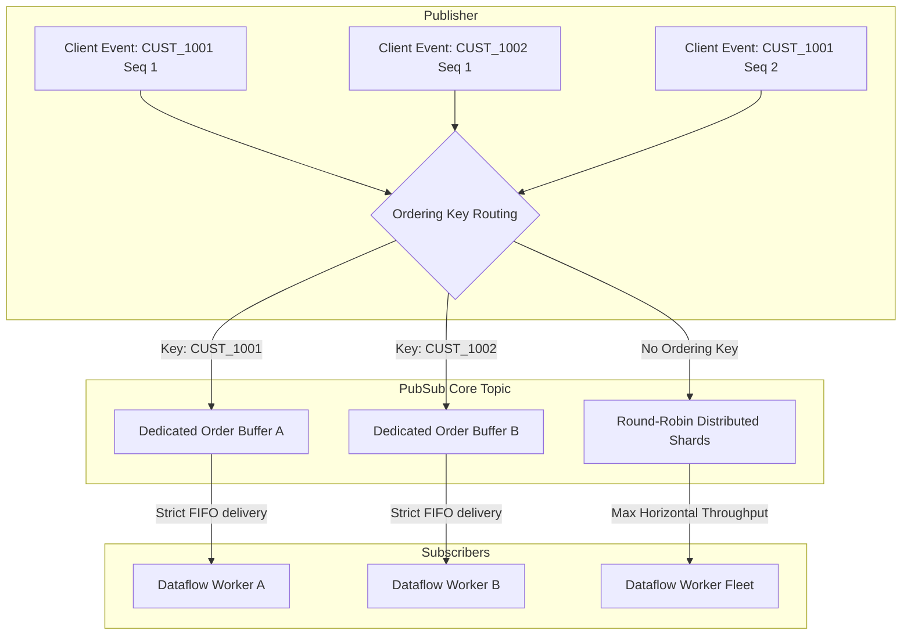
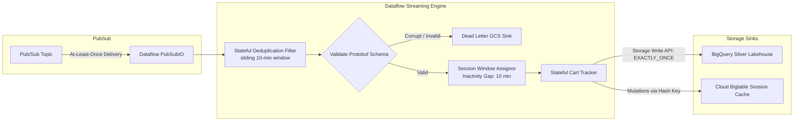

# 02. Streaming Ingestion, Event Watermarking & Validation

## 1. Enterprise Scenario: High-Velocity Omnichannel Clickstream

GlobalRetailX generates over **50 million clickstream and telemetry events daily**, peaking at **120,000 events/second** during flash sales and holiday shopping periods.

```
                              HIGH-VELOCITY STREAMING TOPOLOGY
                              
+--------------------------+     +--------------------------+     +--------------------------+
|  Mobile Apps (iOS/Andr)  |     |  Web E-Commerce Front    |     |  IoT In-Store Sensors    |
|  - AddToCart, ViewItem   |     |  - Checkout, Search      |     |  - Footfall, Smart Shelf |
+------------+-------------+     +------------+-------------+     +------------+-------------+
             |                                |                                |
             | HTTPS / gRPC Edge              | HTTPS / JSON Post              | MQTT / IoT Core Gateway
             v                                v                                v
+------------------------------------------------------------------------------------------------+
|                             API Gateway / Cloud Endpoints / Load Balancers                     |
+-----------------------------------------------+------------------------------------------------+
                                                |
                                                v
+------------------------------------------------------------------------------------------------+
|                                    Cloud Pub/Sub Messaging Layer                               |
|   Topic: projects/globalretailx-prod/topics/clickstream-events                                 |
|   - Ordering Key: customer_id (Strict FIFO per user session)                                   |
|   - Dead Letter Topic (DLT): clickstream-poison-pill-sub                                       |
+-----------------------------------------------+------------------------------------------------+
                                                |
                                                v
+------------------------------------------------------------------------------------------------+
|                       Apache Beam Pipeline on Cloud Dataflow (Streaming Engine)                |
|   - Schema Validation: Protobuf / Avro Deserialization                                         |
|   - Windowing: 10-minute Session Inactivity Gap + 5-minute Fixed Slugs                         |
|   - Watermark Heuristics: BoundedOutOfOrderness (Max 15 min lateness allowed)                  |
|   - State & Timers: Stateful DoFn Cart-Abandonment Tracker                                     |
+----------------------+------------------------+-----------------------+------------------------+
                       |                        |                       |
                       v                        v                       v
         +--------------------------+ +--------------------+ +---------------------+
         | Dead Letter Sink (Errors)| | Real-Time Cache    | | Lakehouse Staging   |
         | gs://dead-letter-events/ | | Cloud Bigtable     | | BigQuery Storage    |
         | - Corrupt Protobuf       | | - Sub-10ms Session | | Write API           |
         | - Schema Validation Fail | |   Profiles         | | - Exactly-Once      |
         +--------------------------+ +--------------------+ +---------------------+
```

### Event Characteristics & Service Level Objectives (SLOs)
* **Payload Types**: User navigation paths, search queries, product impression arrays, `AddToCart` triggers, checkout funnel progressions, and in-store RFID beacons.
* **Format**: Protocol Buffers (Protobuf v3) for native mobile SDKs to minimize cellular data overhead; JSON/Avro for web frontends.
* **Latency SLO**: End-to-end processing latency (event generation to analytical query availability) < **3 seconds**.
* **Integrity Guarantee**: **Strict Exactly-Once processing semantics**; duplicate financial transactions or lost `OrderConfirmed` events are unacceptable.

---

## 2. Cloud Pub/Sub: Architectural Ingestion Tier

Cloud Pub/Sub serves as the horizontally scalable, decoupled ingestion buffer capable of absorbing massive traffic spikes without dropping packets or propagating backpressure to web applications.

### 2.1 Ordering Keys vs. Partitionless Horizontal Scaling

In distributed streaming architectures, ordering and throughput exist in direct tension. Cloud Pub/Sub addresses this through **Ordering Keys**:



| Ingestion Paradigm | Throughput Ceiling | Delivery Semantics | Failure Handling Behavior | Best-Fit E-Commerce Use Case |
| :--- | :--- | :--- | :--- | :--- |
| **Partitionless (No Ordering Key)** | Unbounded horizontal scale. Hundreds of thousands of MB/s. | At-least-once, out-of-order delivery. | Any failed ACK allows the message to be redelivered to any active subscriber worker immediately. | Uncorrelated clickstream telemetry, anonymous impressions, scroll depth measurements. |
| **Ordering Keys Enabled** | 1 MB/s per unique ordering key (global platform can scale to millions of concurrent keys). | Strict FIFO per unique ordering key. | **Head-of-Line Blocking**: If a message with key `CUST_1001` fails to ACK, delivery of all subsequent messages for `CUST_1001` is halted until the blocker ACKs or expires. | Checkout state transitions (`Initiated` $\to$ `Paid` $\to$ `Shipped`), user session reconstructions. |

### 2.2 Subscription Mechanics & Dead Letter Topics (DLT)

When a consumer encounters an unparseable payload (a "poison pill"), failing to acknowledge (NACK) causes Pub/Sub to redeliver the message repeatedly, causing infinite crash loops and exhausting compute memory.

#### Dead Letter Topic Architecture
A Dead Letter Policy is configured directly on the Pub/Sub subscription:
1. `maxDeliveryAttempts`: Set between 5 and 10 attempts.
2. `deadLetterTopic`: Target topic where poison pills are routed automatically after max attempts fail.
3. **Dead Letter Forwarding Subscription**: A separate subscription monitoring the DLT triggers an alert and lands the payload into Cloud Storage for manual inspection and schema debugging.

```bash
# Provision Dead Letter Topic
gcloud pubsub topics create clickstream-poison-pills

# Provision Dead Letter Subscription for Error Analysis
gcloud pubsub subscriptions create clickstream-poison-pill-sub \
    --topic=clickstream-poison-pills \
    --message-retention-duration=7d

# Provision Main Processing Subscription with DLT Policy
gcloud pubsub subscriptions create clickstream-dataflow-sub \
    --topic=clickstream-events \
    --ack-deadline=60 \
    --enable-message-ordering \
    --dead-letter-topic=clickstream-poison-pills \
    --max-delivery-attempts=5
```

---

## 3. Real-Time Processing with Apache Beam on Cloud Dataflow

Cloud Dataflow is the fully managed, serverless execution environment for Apache Beam pipelines. In streaming mode, Dataflow operates on the **Streaming Engine**, decoupling compute workers from state storage to optimize autoscaling and reduce worker VM overhead.

### 3.1 Streaming Architecture & Exactly-Once Semantics

Dataflow guarantees **End-to-End Exactly-Once** processing when consuming from Pub/Sub and writing to BigQuery or Bigtable through:
1. **Deduplication via Record IDs**: Beam pipelines extract the Pub/Sub `message_id` or a custom business hash (`event_uuid`) and maintain a sliding 10-minute state bloom filter to identify and discard duplicates generated by at-least-once network delivery.
2. **Deterministic Checkpointing & State Snapshotting**: Streaming Engine periodically checkpoints worker in-flight state and watermarks to durable storage (Colossus).
3. **Idempotent / Transactional Sinks**: Writing to BigQuery via the **BigQuery Storage Write API** using `EXACTLY_ONCE` write streams.



---

## 4. Deep Dive: Windowing, Watermarks, Triggers & Panes

Understanding the four critical questions of stream processing is mandatory for the Professional Data Engineer:
1. **What is being computed?** (Defined by transformations: `Sum`, `Count`, `GroupByKey`).
2. **Where in event time is it computed?** (Defined by windowing).
3. **When in processing time are results materialized?** (Defined by watermarks and triggers).
4. **How do those results relate to earlier materializations?** (Defined by accumulating vs. retracting panes).

```
   Event Time vs Processing Time Axis
   
   Processing Time (Wall Clock)
   |                                            [Trigger Fires!]
   |                                                    |
   |                                   * Event E1       |
   |                         * Event E2        |        v
   |               * Event E3                  |   Pane 1 (On Time)
   |                     |                     v
   |-------+-------------+-------------+-------+-----------------> Event Time
          10:00         10:05         10:10   10:15
          [-------- 10-Minute Window --------]
                                               ^
                                               |
                                     Watermark reaches 10:10
```

### 4.1 Windowing Strategies

| Windowing Pattern | Mathematical Definition | E-Commerce Production Scenario |
| :--- | :--- | :--- |
| **Fixed (Tumbling) Windows** | Disjoint, non-overlapping intervals of duration $D$. $[N \cdot D, (N+1) \cdot D)$. | Tracking total store revenue in discrete 5-minute intervals for real-time executive dashboards. |
| **Sliding (Hopping) Windows** | Overlapping intervals of duration $D$, advancing every period $S$ (where $S < D$). | 1-hour moving average of product views recalculated every 60 seconds to detect sudden viral spikes. |
| **Session Windows** | Dynamic intervals defined by periods of user activity bounded by an **inactivity gap** $G$. | Grouping all clickstream clicks belonging to a single shopper session. If no click occurs for 15 minutes, the session closes. |

### 4.2 Watermarks and Late Data

* **Event Time ($t_e$)**: The timestamp when the user clicked the button on their mobile device (embedded in payload).
* **Processing Time ($t_p$)**: The wall-clock time when the Dataflow worker VM evaluates the event.
* **The Watermark**: The system's monotonic assertion of progress: "We believe no more data will arrive with $t_e \le W$."
* **Late Data**: Any record where $t_e < W$. Occurs when a shopper loses mobile signal in an underground subway, continues browsing locally, and reconnects 12 minutes later.

### 4.3 Triggers and Pane Accumulation Modes

When data arrives after the watermark has passed the window boundary, triggers dictate execution.

```python
# Production Trigger Configuration
trigger = AfterWatermark(
    early=AfterProcessingTime.pastFirstElementInPane().plusDelayOf(Duration(seconds=30)),
    late=AfterCount(1)
)
```

1. **Early (Speculative) Firing**: Outputs intermediate estimations every 30 seconds before the window closes, enabling near-instantaneous dashboard updates.
2. **On-Time Firing**: Outputs when the watermark officially crosses the end of the window.
3. **Late (Corrective) Firing**: Fires every time a delayed event arrives after the watermark, ensuring final accuracy.

#### Accumulation Modes
* **Accumulating Panes (`AccumulationMode.ACCUMULATING`)**: Every subsequent pane contains the full historical sum plus the new event. Downstream sinks must treat new records as an `UPSERT` using the window key.
* **Discarding / Retracting Panes (`AccumulationMode.DISCARDING`)**: Each pane contains strictly the *delta* since the previous pane. Preferred when downstream sinks perform incremental streaming additions.

---

## 5. Production Pipeline Implementation (Apache Beam Python)

The following complete, production-grade Apache Beam pipeline reads from Cloud Pub/Sub, validates schemas, enforces session windows, handles late data via dead-letter routing, and streams cleanly into BigQuery.

```python
import argparse
import json
import logging
from typing import Any, Dict, Tuple

import apache_beam as beam
from apache_beam.io.gcp.bigquery import BigQueryDisposition, WriteToBigQuery
from apache_beam.io.gcp.pubsub import ReadFromPubSub
from apache_beam.options.pipeline_options import PipelineOptions, StandardOptions, SetupOptions
from apache_beam.transforms.trigger import (
    AfterCount,
    AfterProcessingTime,
    AfterWatermark,
    AccumulationMode
)
from apache_beam.transforms.window import FixedWindows, TimestampedValue


# --- SCHEMA DEFINITION FOR BIGQUERY SINK ---
CLICKSTREAM_BQ_SCHEMA = {
    "fields": [
        {"name": "session_id", "type": "STRING", "mode": "REQUIRED"},
        {"name": "customer_id", "type": "STRING", "mode": "NULLABLE"},
        {"name": "window_start", "type": "TIMESTAMP", "mode": "REQUIRED"},
        {"name": "window_end", "type": "TIMESTAMP", "mode": "REQUIRED"},
        {"name": "total_events", "type": "INTEGER", "mode": "REQUIRED"},
        {"name": "unique_pages_visited", "type": "INTEGER", "mode": "REQUIRED"},
        {"name": "cart_total_value", "type": "FLOAT", "mode": "REQUIRED"},
        {"name": "is_late_record", "type": "BOOLEAN", "mode": "REQUIRED"}
    ]
}


class ValidateAndParseClickstreamDoFn(beam.DoFn):
    """
    Parses incoming raw JSON/Protobuf bytes, enforces strict schema rules,
    and splits payloads into Validated Events or Dead-Letter Poison Pills.
    """
    OUTPUT_TAG_VALID = "valid_events"
    OUTPUT_TAG_DEAD_LETTER = "dead_letter"

    def process(self, element: bytes, publish_time=beam.DoFn.TimestampParam):
        try:
            payload = json.loads(element.decode("utf-8"))
            
            # Enforce Required Fields
            required_fields = ["event_id", "session_id", "event_type", "event_timestamp"]
            for field in required_fields:
                if field not in payload or payload[field] is None:
                    raise ValueError(f"Missing mandatory field: {field}")

            event_time = float(payload["event_timestamp"])
            
            # Route to valid stream with explicit event timestamp
            yield beam.pvalue.TaggedOutput(
                self.OUTPUT_TAG_VALID,
                TimestampedValue(payload, event_time)
            )

        except Exception as err:
            logging.warning(f"Malformed clickstream payload discarded to DLQ: {err}")
            dead_letter_record = {
                "raw_payload": element.decode("utf-8", errors="replace"),
                "error_reason": str(err),
                "dropped_at": publish_time.to_rfc3339()
            }
            yield beam.pvalue.TaggedOutput(self.OUTPUT_TAG_DEAD_LETTER, dead_letter_record)


class AggregateSessionMetricsDoFn(beam.DoFn):
    """
    Stateful aggregation over windowed customer sessions.
    Evaluates pane timing to flag late-arriving updates.
    """
    def process(
        self,
        element: Tuple[str, Iterable[Dict[str, Any]]],
        window=beam.DoFn.WindowParam,
        pane_info=beam.DoFn.PaneInfoParam
    ):
        session_id, events = element
        events_list = list(events)
        
        total_events = len(events_list)
        unique_pages = len(set(e.get("page_url", "") for e in events_list))
        customer_id = next((e.get("customer_id") for e in events_list if e.get("customer_id")), "ANONYMOUS")
        cart_total = sum(float(e.get("item_price", 0.0)) for e in events_list if e.get("event_type") == "ADD_TO_CART")

        yield {
            "session_id": session_id,
            "customer_id": customer_id,
            "window_start": window.start.to_rfc3339(),
            "window_end": window.end.to_rfc3339(),
            "total_events": total_events,
            "unique_pages_visited": unique_pages,
            "cart_total_value": round(cart_total, 2),
            "is_late_record": pane_info.is_late
        }


def run_pipeline():
    pipeline_args = [
        "--runner=DataflowRunner",
        "--project=globalretailx-prod",
        "--region=us-central1",
        "--streaming",
        "--enable_streaming_engine",
        "--temp_location=gs://globalretailx-dataflow-temp/temp/",
        "--staging_location=gs://globalretailx-dataflow-temp/staging/",
        "--autoscaling_algorithm=THROUGHPUT_BASED",
        "--max_num_workers=50"
    ]

    pipeline_options = PipelineOptions(pipeline_args)
    pipeline_options.view_as(StandardOptions).streaming = True
    pipeline_options.view_as(SetupOptions).save_main_session = True

    subscription_path = "projects/globalretailx-prod/subscriptions/clickstream-dataflow-sub"
    dead_letter_table = "globalretailx-prod:lakehouse_raw.clickstream_poison_pills"
    output_bq_table = "globalretailx-prod:lakehouse_silver.aggregated_customer_sessions"

    with beam.Pipeline(options=pipeline_options) as p:
        # Step 1: Ingest bytes from Pub/Sub
        raw_stream = p | "ReadFromPubSub" >> ReadFromPubSub(subscription=subscription_path)

        # Step 2: Validate Schema and Split Dead Letter
        parsed_results = raw_stream | "ValidateSchema" >> beam.ParDo(
            ValidateAndParseClickstreamDoFn()
        ).with_outputs(
            ValidateAndParseClickstreamDoFn.OUTPUT_TAG_VALID,
            ValidateAndParseClickstreamDoFn.OUTPUT_TAG_DEAD_LETTER
        )

        valid_events = parsed_results[ValidateAndParseClickstreamDoFn.OUTPUT_TAG_VALID]
        dead_letter_events = parsed_results[ValidateAndParseClickstreamDoFn.OUTPUT_TAG_DEAD_LETTER]

        # Step 3: Route Dead-Letter to BQ Quarantine
        (
            dead_letter_events
            | "FormatDLQ" >> beam.Map(lambda x: {"payload": json.dumps(x)})
            | "WriteDLQToBQ" >> WriteToBigQuery(
                table=dead_letter_table,
                schema="payload:STRING",
                write_disposition=BigQueryDisposition.WRITE_APPEND,
                create_disposition=BigQueryDisposition.CREATE_IF_NEEDED
            )
        )

        # Step 4: Windowing with Fixed 5-Minute Windows and 15-Minute Allowed Lateness
        windowed_events = (
            valid_events
            | "ApplyWindowAndTriggers" >> beam.WindowInto(
                FixedWindows(size=300),  # 5-minute fixed windows
                trigger=AfterWatermark(
                    early=AfterProcessingTime.pastFirstElementInPane().plusDelayOf(beam.transforms.window.Duration(seconds=30)),
                    late=AfterCount(1)
                ),
                allowed_lateness=beam.transforms.window.Duration(seconds=900), # 15 minutes
                accumulation_mode=AccumulationMode.ACCUMULATING
            )
        )

        # Step 5: Key by session_id and Group
        aggregated_sessions = (
            windowed_events
            | "KeyBySession" >> beam.Map(lambda event: (event["session_id"], event))
            | "GroupPerSession" >> beam.GroupByKey()
            | "AggregateMetrics" >> beam.ParDo(AggregateSessionMetricsDoFn())
        )

        # Step 6: Write to BigQuery using Storage Write API (EXACTLY_ONCE)
        (
            aggregated_sessions
            | "StreamToBigQuery" >> WriteToBigQuery(
                table=output_bq_table,
                schema=CLICKSTREAM_BQ_SCHEMA,
                write_disposition=BigQueryDisposition.WRITE_APPEND,
                create_disposition=BigQueryDisposition.CREATE_IF_NEEDED,
                method=WriteToBigQuery.Method.STORAGE_WRITE_API_EXACTLY_ONCE
            )
        )


if __name__ == "__main__":
    run_pipeline()
```

---

## 6. Failure Modes, Backpressure & Scaling Defense

| Failure Scenario | Internal Mechanism | System Symptom | Automated Engineering Mitigation |
| :--- | :--- | :--- | :--- |
| **Worker Hotspotting (Unsalted Ordering Keys)** | A single celebrity promotion routes millions of events under one `customer_id` ordering key. | One Dataflow worker CPU hits 100%; CPU utilization on other workers remains below 10%. Pub/Sub backlog climbs. | Apply a **deterministic salt** to the key prior to publishing or inside Beam: `key = f"{customer_id}_{random.randint(0, 9)}"`. Process sub-partitions in parallel, followed by a global aggregation step. |
| **Watermark Stagnation** | A single upstream publisher in an offline warehouse stops sending data, but maintains an open TCP socket. | Beam Watermark ceases to advance. Windows refuse to close; memory buffers balloon across the Streaming Engine. | Configure `with_idle_time(Duration(minutes=5))` on source inputs. Beam automatically marks idle partitions as inactive, allowing watermarks to advance across active channels. |
| **BigQuery Storage Write Quota Exhaustion** | Flash sale generates 200,000 writes/sec, exceeding default regional BigQuery Storage Write API rate quotas. | Dataflow pipeline reports `429 RESOURCE_EXHAUSTED`. Worker backlog grows exponentially. | 1. Leverage Dataflow Streaming Engine to leverage internal micro-batching.<br>2. Switch write mode to `STORAGE_API_AT_LEAST_ONCE` for high-throughput append tables.<br>3. Request proactive quota increase for `bigquery.googleapis.com/write_api_bytes_per_sec`. |
| **Unbounded State Growth in Session Windows** | Malicious bot traffic sends a single ping every 9 minutes continuously, preventing session window closure. | Dataflow Streaming Engine persistent storage grows without bound; pipeline cost explodes. | Impose a hard ceiling on session durations by pairing `SessionWindows` with an overriding maximum duration timer (e.g., terminate and emit state after 12 hours regardless of ongoing activity). |

---

## 7. Professional Data Engineer (PDE) Knowledge Check

#### Question 1
GlobalRetailX is streaming clickstream records into an Apache Beam pipeline running on Dataflow. Upstream mobile devices frequently lose cellular connectivity in basements, resulting in batches of events arriving 30 to 45 minutes after they occurred in event time. The current pipeline uses a 10-minute Fixed Window with `allowed_lateness=Duration(minutes=15)`. What happens to events that arrive 35 minutes after their event timestamp?

- A. Dataflow automatically widens the window from 10 minutes to 45 minutes to accommodate the delayed records.
- B. The events are automatically dropped and discarded by the Beam framework because they arrived after the allowed lateness threshold past the watermark.
- C. The events trigger an immediate on-time firing and rewrite the original BigQuery partition.
- D. The pipeline halts execution and transitions into a `FAILED` state to prevent data loss.

**Answer: B**
*Explanation*: In Apache Beam, once the watermark passes the end of a window plus the specified `allowed_lateness`, the window is closed and purged from state storage. Any subsequently arriving data belonging to that window is considered droppable late data and discarded. To capture these records, engineers must either increase `allowed_lateness` or route dropped records via a dead-letter mechanism using side outputs.

---

#### Question 2
Your engineering team needs to ingest real-time checkout transactions from your e-commerce storefront. The downstream fraud engine requires that all events for a given `customer_id` must be processed in the exact order in which they were executed by the user. If an invalid credit card payload causes a transient downstream parsing error, what Cloud Pub/Sub configuration prevents the pipeline from delivering out-of-order records while isolating the poison pill?

- A. Publish without an ordering key and configure an ACK deadline of 600 seconds.
- B. Enable Pub/Sub Ordering Keys set to `customer_id`, configure a Dead Letter Topic (DLT) with `maxDeliveryAttempts=5`, and handle failed messages without manual subscriber halting.
- C. Use BigQuery Subscription with direct JSON parsing.
- D. Set Pub/Sub message retention to 10 minutes and disable Acknowledgements.

**Answer: B**
*Explanation*: Pub/Sub Ordering Keys guarantee strict FIFO delivery per key. However, if a message fails to ACK, Pub/Sub pauses delivery of all subsequent messages with that *same ordering key* to protect sequence integrity (Head-of-Line blocking). Combining ordering keys with a Dead Letter Topic ensures that after a fixed number of failures (e.g., 5 attempts), the poison pill is evicted to the DLT, allowing subsequent ordered events for that `customer_id` to resume processing.

---

#### Question 3
You are deploying a streaming Apache Beam pipeline on Dataflow that aggregates financial metrics across 1-hour tumbling windows. Executive dashboards require speculative updates every 60 seconds, but financial controllers require the final, absolute sum after all delayed events are accounted for. How should you construct your trigger and accumulation strategy?

- A. Use `AfterWatermark.pastEndOfWindow()` with `AccumulationMode.DISCARDING`.
- B. Use `AfterWatermark(early=AfterProcessingTime.pastFirstElementInPane().plusDelayOf(Duration(seconds=60)), late=AfterCount(1))` with `AccumulationMode.ACCUMULATING`.
- C. Use a Global Window with a count trigger firing every 100 elements.
- D. Use a sliding window with duration 60 seconds and slide 60 seconds.

**Answer: B**
*Explanation*: This trigger satisfies both requirements:
1. `early`: Speculatively fires every 60 seconds of processing time before the watermark passes the window, satisfying executive dashboards.
2. `late`: Fires upon each late-arriving event after the watermark passes.
3. `AccumulationMode.ACCUMULATING`: Each fired pane contains the running total rather than just the delta, allowing downstream consumers to cleanly overwrite (UPSERT) or display the most accurate cumulative figure.
