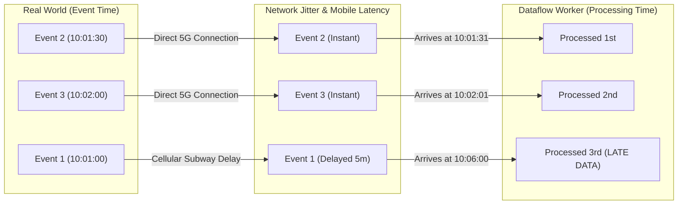
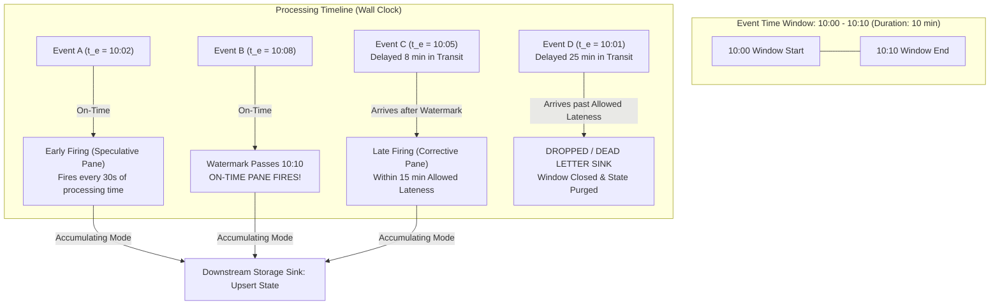

# 02. Streaming Ingestion, Event Watermarking & Validation

---

## Learning Objectives
By the end of this module, a data engineer or architect will be able to:
1. **Understand** the core theory of stream computing: decoupling message buffers, event time vs. processing time, watermark heuristics, and window triggers.
2. **Translate** familiar Apache Kafka, Spark Structured Streaming, and Delta Lake concepts directly into Google Cloud Pub/Sub and Cloud Dataflow architectures.
3. **Analyze** the internal mechanics of Cloud Pub/Sub, including Ordering Keys, subscription acknowledgement deadlines, and Dead Letter Topics (DLT).
4. **Evaluate** Cloud Dataflow Streaming Engine execution, Liquid Sharding (Dynamic Work Rebalancing), and end-to-end exactly-once delivery guarantees across different storage sinks.
5. **Design** complex stateful streaming pipelines handling out-of-order data, sessionization, and late-arriving events using Apache Beam Python.
6. **Troubleshoot** streaming failure modes, such as stuck watermarks, worker hotspotting on unsalted ordering keys, and poison pill crash loops.

---

## Databricks, Apache Spark & Kafka to Google Cloud Streaming Bridge

Engineers with deep roots in the Apache open-source and Databricks streaming ecosystems can map their mental models directly to Google Cloud services:

| Open-Source / Databricks Concept | Google Cloud Native Equivalent | Architectural Parity & Technical Distinctions |
| :--- | :--- | :--- |
| **Apache Kafka Topic / Partitions** | **Cloud Pub/Sub Topic & Ordering Keys** | Kafka partitions are physical log shards pinned to specific brokers; consumer concurrency is strictly bounded by partition count. Cloud Pub/Sub abstracts partition management, internally sharding messages across dynamic forwarders and routers. Ordering Keys enforce per-key FIFO ordering metadata without assigning fixed broker threads, allowing subscribers to autoscale independently of key count. |
| **Kafka Consumer Group** | **Cloud Pub/Sub Subscription** | Multiple subscribers can attach to a single Pub/Sub topic. Each subscription receives a copy of every message independently, functioning identically to distinct Kafka consumer groups with independent offset tracking. |
| **Kafka Offset Management (`committed_offset`)** | **Pub/Sub Ack Deadline & Leases** | Kafka consumers explicitly commit numeric offsets. Pub/Sub consumers receive ephemeral delivery tokens and must send an `ACK` before the **Ack Deadline** (10–600 seconds) expires; otherwise, Pub/Sub redelivers the message. |
| **Spark Structured Streaming** | **Cloud Dataflow (Apache Beam)** | Spark Structured Streaming defaults to executing micro-batches as fast as possible (`Trigger.ProcessingTime(0)`), with configurable processing-time triggers or experimental epoch-based Continuous Processing mode. Apache Beam on Cloud Dataflow provides a unified pipeline model over bounded and unbounded `PCollection`s, executing via Streaming Engine and bundles (micro-batches for throughput efficiency), achieving low end-to-end latency when bundle sizing, worker autotuning, and sink writes are appropriately tuned. |
| **Spark Stateful Streaming (`mapGroupsWithState`)** | **Apache Beam Stateful `DoFn` & Session Windows** | Both maintain persistent distributed state across events for a given key. Dataflow’s **Streaming Engine** offloads state management and window buffers from worker JVM memory to a specialized Google-managed storage backend. |
| **Delta Lake Streaming Sink** | **BigQuery Storage Write API (`EXACTLY_ONCE`)** | Delta Lake achieves streaming ACID transactions via an atomic commit log on object storage with optimistic concurrency control. BigQuery achieves end-to-end exactly-once streaming via the Storage Write API using pre-created committed streams with client-assigned monotonic stream offsets. |

---

## 1. Architectural Foundation: The Mechanics of Distributed Streaming

### The Problem Distributed Streaming Solves
Modern web and IoT applications do not produce data in neat, hourly batches. Data arrives as a continuous, erratic firehose. If backend microservices write directly to operational databases or batch data warehouses:
1. **Cascading Failures**: A sudden traffic surge (e.g., flash sales, news alerts) overwhelms database connection pools, crashing backend APIs.
2. **Tight Temporal Coupling**: If the analytical store undergoes maintenance, upstream applications must buffer records locally in memory or drop them.
3. **Unbounded Latency**: Traditional batch pipelines introduce multi-hour latency gaps between when an action occurs and when fraud is detected or inventory is adjusted.

A scalable distributed streaming architecture solves this by introducing two distinct layers:
- **An Asynchronous Messaging Buffer (Cloud Pub/Sub)**: Ingests, buffers, and persists events durably at massive scale, decoupling producers from consumers.
- **A Stream Processing Engine (Cloud Dataflow)**: Evaluates, enriches, aggregates, and windows unbounded data streams with millisecond event-time precision.

### The Fundamental Dilemma: Event Time vs. Processing Time
Distributed streaming systems exist in an asynchronous physical reality where time is split across two distinct dimensions:
- **Event Time ($t_e$)**: The exact wall-clock timestamp when an event actually occurred on the client device (e.g., when a user tapped `Checkout` on an iPhone in a subway station). This timestamp is embedded in the payload.
- **Processing Time ($t_p$)**: The wall-clock timestamp when the stream processing worker VM evaluates the event.

Because network latency, cellular disconnects, retries, and distributed client clocks are unpredictable, **events frequently arrive out of order relative to their actual event timestamps**.



### The Watermark: Measuring Progress Through Chaos
How does a stream processing engine know when all data for a specific time window has arrived so it can calculate an aggregate (e.g., total sales between 10:00 and 10:10)?

It cannot wait forever. The solution is **The Watermark ($W$)**: a monotonically advancing metric that represents the system's empirical assertion:  
$$\text{Watermark } W = t \implies \text{"The pipeline believes no more data with event timestamp } t_e < t \text{ will arrive."}$$

- If an event arrives with $t_e > W$, it is **On-Time**.
- If an event arrives with $t_e \le W$, it is **Late Data**.
- If an event arrives with $t_e \le W - \text{Allowed Lateness}$, it is **Dropped Late Data**.

---

## 2. Enterprise Scenario: RetailFlow High-Velocity Clickstream

RetailFlow generates over **50 million clickstream and telemetry events daily**, peaking at **120,000 events/second** during holiday flash sales.

```
                              RETAILFLOW HIGH-VELOCITY STREAMING TOPOLOGY
                              
+--------------------------+     +--------------------------+     +--------------------------+
|  Mobile Apps (iOS/Andr)  |     |  Web E-Commerce Front    |     |  IoT In-Store Sensors    |
|  - AddToCart, ViewItem   |     |  - Checkout, Search      |     |  - Footfall, Smart Shelf |
+------------+-------------+     +------------+-------------+     +------------+-------------+
             |                                |                                |
             | HTTPS / gRPC Edge              | HTTPS / JSON Post              | MQTT / IoT Core Gateway
             v                                v                                v
+------------------------------------------------------------------------------------------------+
|                             API Gateway / Cloud Endpoints / Load Balancers                     |
+-----------------------------------------------+------------------------------------------------+
                                                |
                                                v
+------------------------------------------------------------------------------------------------+
|                                    Cloud Pub/Sub Messaging Layer                               |
|   Topic: projects/retailflow-prod/topics/clickstream-events                                     |
|   - Subscription A (Dataflow): Unordered — Beam timestamps, windows, watermarks, and triggers handle out-of-order event-time computation                    |
|   - Subscription B (Microservice): Ordering Key: customer_id + DLT (best-effort forwarding)    |
+-----------------------------------------------+------------------------------------------------+
                                                |
                                                v
+------------------------------------------------------------------------------------------------+
|                       Apache Beam Pipeline on Cloud Dataflow (Streaming Engine)                |
|   - Schema Validation: Protobuf / Avro Deserialization                                         |
|   - Windowing: 10-minute Session Inactivity Gap + 5-minute Fixed Slugs                         |
|   - Watermark Heuristics: BoundedOutOfOrderness (Max 15 min lateness allowed)                  |
|   - State & Timers: Stateful DoFn Cart-Abandonment Tracker                                     |
+----------------------+------------------------+-----------------------+------------------------+
                       |                        |                       |
                       v                        v                       v
         +--------------------------+ +--------------------+ +---------------------+
         | Dead Letter Sink (Errors)| | Real-Time Cache    | | Lakehouse Staging   |
         | gs://dead-letter-events/ | | Cloud Bigtable     | | BigQuery Storage    |
         | - Corrupt Protobuf       | | - Sub-10ms Session | | Write API           |
         | - Schema Validation Fail | |   Profiles (Target)| | - Exactly-Once      |
         +--------------------------+ +--------------------+ +---------------------+
```

### Event Characteristics & Service Level Objectives (SLOs)
* **Payload Types**: User navigation paths, search queries, product impression arrays, `AddToCart` triggers, checkout funnel progressions, and in-store RFID beacons.
* **Format**: Protocol Buffers (Protobuf v3) for native mobile SDKs to minimize cellular data overhead; JSON/Avro for web frontends.
* **Latency SLO**: End-to-end processing latency (event generation to analytical query availability) < **3 seconds**.
* **Integrity Guarantee**: Dataflow provides exactly-once processing results for supported pipeline state and sinks; the BigQueryIO `STORAGE_WRITE_API` exactly-once mode uses the connector’s documented write coordination. Raw Storage Write API offset deduplication is scoped to an individual application-created committed stream, not across streams. Application-level idempotency (for example, a conformed `MERGE` on `order_id`) remains the final business-correctness layer.

---

## 3. Standardized Service Deep Dive: Cloud Pub/Sub

### 1. The Problem
High-scale web applications experience volatile traffic spikes. Direct point-to-point HTTP or database connections fail under burst conditions, leading to dropped customer transactions, cascading service outages, and tight coupling between microservices.

### 2. Understand the Concept
**Publish-Subscribe (Pub/Sub) Messaging** decouples systems that produce events (Publishers) from systems that process events (Subscribers). Publishers broadcast messages to a logical named channel (Topic) without knowing who will receive them. Subscribers create distinct listening queues (Subscriptions) attached to that topic.

> [!NOTE]
> **Concept Translation: Apache Kafka vs. Cloud Pub/Sub**
> - **Familiar Concept (Kafka)**: A topic is physically divided into $N$ pre-allocated partitions pinned to specific broker disks. Messages with the same partition key hash to the same physical partition log. Consumer parallelism within a consumer group is strictly constrained by the partition count ($N$ partitions can support at most $N$ active consumers).
> - **Google Cloud Implementation (Pub/Sub)**: Pub/Sub fundamentally abstracts partition management from users. Topics and subscriptions are logical, globally distributed entities. Internally, Pub/Sub shards messages across a dynamic two-tier mesh of message **routers** and **forwarders** that scale up or down automatically based on traffic volume. Ordering Keys enforce FIFO delivery per key without exposing physical partition boundaries.
> - **Where the Analogy Breaks**:
>   1. *Routing tag vs. physical partition log*: An ordering key is a sequencing and routing tag evaluated dynamically by Pub/Sub routers, not an immutable physical file pinned to a specific broker server.
>   2. *Consumer autoscaling decoupling*: In Kafka, consumer parallelism is hard-capped by partition count ($N$). In Pub/Sub, subscriber instances scale independently of the number of ordering keys; a subscriber pool can dynamically autoscale from 1 to hundreds of workers based on unacknowledged message backlog and latency, sharing work cooperatively without Kafka-style partition rebalance pauses.
>   3. *Head-of-Line (HoL) blocking*: When ordering keys are enabled on a subscription, if message sequence #4 for key `CUST_1001` fails to ACK, is nacked, or encounters an unhandled processing exception, Pub/Sub **halts delivery of all subsequent messages (#5, #6, #7) for `CUST_1001`** to preserve strict sequence order. Delivery for other ordering keys continues unaffected.
>   4. *Publishing throughput ceiling*: The **~1 MB/s limit applies specifically to publishing per ordering key in a region**, not to downstream subscriber consumption capacity. A topic can handle gigabytes per second globally as long as messages are distributed across thousands or millions of distinct ordering keys.
>   5. *Pub/Sub ordering with Dataflow (Not Recommended)*: Google Cloud officially advises **against enabling Pub/Sub message ordering on subscriptions consumed by Dataflow**. Dataflow pulls messages using concurrent multi-threaded streaming pull connections across distributed worker nodes and dynamic bundles. Dataflow's execution model does not preserve Pub/Sub message ordering across downstream transforms, shuffles, or window panes. Furthermore, if an ordering key encounters a delayed message, Pub/Sub pauses message delivery for that key to the subscriber, causing Dataflow worker starvation. In Dataflow, stream ordering is handled natively in Apache Beam using event-time timestamps, watermarks, triggers, or stateful processing. Pub/Sub subscription message ordering is intended for sequential consumers (such as single-threaded workers or Cloud Run microservices).

### 3. Google Cloud Implementation
Cloud Pub/Sub is a globally distributed, horizontally scalable message broker providing:
- **Durability**: Every message is synchronously written to multiple storage zones before returning an acknowledgement to the publisher.
- **Message Retention**: Configurable from **10 minutes up to 31 days** (default is 7 days). Messages can be retained even after being acknowledged to enable replay.
- **Subscriber Ack Deadline**: The duration (between **10 and 600 seconds**) a subscriber has to acknowledge receipt of a message before Pub/Sub attempts redelivery.
- **Subscription Types**: Pull (gRPC/REST), Push (HTTPS endpoint webhook), BigQuery subscription (direct write to BigQuery without intermediate compute), and Cloud Storage subscription (direct write to GCS buckets).

### 4. How It Works (Components & Workflow)

```mermaid
graph TD
    subgraph Publishers["Publishers Layer"]
        App1[Web Storefront] --> PubSubTopic
        App2[Mobile App SDK] --> PubSubTopic
    end

    subgraph PubSub_Core["Cloud Pub/Sub Architecture"]
        PubSubTopic[Topic: clickstream-events<br/>Retention: 10m to 31d]
        
        PubSubTopic --> SubA[Subscription 1: Dataflow Streaming Engine<br/>Ack Deadline: 60s<br/>(Unordered / Event-Time Handled in Beam)]
        PubSubTopic --> SubB[Subscription 2: BigQuery Direct Subscription<br/>Table: raw_clickstream]
        PubSubTopic --> SubC[Subscription 3: Microservice Sequential Worker<br/>Ack Deadline: 60s<br/>Ordering Key: customer_id]
        
        SubC -.Max 5 Retries (Best-Effort).-> DLT[Dead Letter Topic: poison-pill-topic]
    end

    subgraph Consumers["Downstream Processing"]
        SubA --> DataflowWorker[Dataflow Worker Fleet]
        SubB --> BQNative[BigQuery Storage Table]
        SubC --> Microservice[Sequential Order Processor]
        DLT --> ErrorGCS[GCS Error Quarantine Bucket]
    end
```

#### Ordering Keys vs. Dynamic Internal Sharding
In distributed messaging, ordering and throughput exist in natural tension:
1. **Dynamic Internal Sharding (No Ordering Key)**: Massive horizontal scale (hundreds of thousands of MB/s, subject to project quotas). Pub/Sub abstracts partition management by distributing incoming messages across thousands of dynamic internal message routers and forwarders. Delivery is at-least-once, out-of-order. Ideal for uncorrelated telemetry, IoT sensors, and high-volume clickstreams.
2. **Ordering Keys Enabled**: Strict FIFO delivery per unique ordering key (e.g., `customer_id`). Messages with the identical ordering key published to the same region are delivered to subscribers in publication order. **Publishing throughput is capped at ~1 MB/s per unique key in a region**, but the global topic can scale to millions of distinct keys concurrently without broker partition rebalances.

> [!WARNING]
> **Head-of-Line (HoL) Blocking & Best-Effort Dead Letter Topic (DLT) Forwarding**:
> When Ordering Keys are enabled on a subscription, if message sequence #4 for key `CUST_1001` fails to ACK, is nacked, or exceeds its acknowledgement deadline, Pub/Sub **halts delivery of all subsequent messages (#5, #6, #7) for `CUST_1001`** to preserve ordering. Delivery for all other distinct ordering keys proceeds uninterrupted.
> To prevent a poison pill from blocking an ordering key indefinitely, you can configure a **Dead Letter Topic (DLT)** with a `maxDeliveryAttempts` threshold (e.g., 5). However, keep two critical architectural realities in mind:
> 1. **Best-Effort Forwarding**: Dead-letter topic forwarding operates strictly on a **best-effort basis**. If forwarding fails due to transient backend errors or quota delays, Pub/Sub does **not** automatically resume delivery of subsequent messages for that ordering key—the head of line remains paused until the problematic message is successfully forwarded and acknowledged (or dropped).
> 2. **Out-of-Band Sequencing Gap**: Routing a failed message out of line to a DLT means the downstream consumer processes subsequent events with that key without the failed event. Downstream systems that require strict business-level stream sequencing must account for this gap or pause downstream processing for that entity.

### 5. Practical Example (RetailFlow Clickstream Provisioning)
```bash
# 1. Provision the primary topic with a 14-day retention duration
gcloud pubsub topics create clickstream-events \
    --project=retailflow-prod \
    --message-retention-duration=14d

# 2. Provision the Dead Letter Topic for unparseable poison pills
gcloud pubsub topics create clickstream-poison-pills \
    --project=retailflow-prod

# 3. Create a subscription attached to the DLT for error inspection
gcloud pubsub subscriptions create clickstream-poison-pill-sub \
    --project=retailflow-prod \
    --topic=clickstream-poison-pills \
    --message-retention-duration=31d

# 4. Provision the primary processing subscription for Dataflow (UNORDERED)
# NOTE: Do NOT use --enable-message-ordering on subscriptions consumed by Dataflow!
# Dataflow parallelizes processing and handles out-of-order streams natively via Beam watermarks.
gcloud pubsub subscriptions create clickstream-dataflow-sub \
    --project=retailflow-prod \
    --topic=clickstream-events \
    --ack-deadline=60

# 5. Provision a separate ordered subscription for sequential microservices (Cloud Run / GCE)
gcloud pubsub subscriptions create order-processing-sequential-sub \
    --project=retailflow-prod \
    --topic=clickstream-events \
    --ack-deadline=60 \
    --enable-message-ordering \
    --dead-letter-topic=clickstream-poison-pills \
    --max-delivery-attempts=5
```

### 6. Architecture Integration
- **Upstream Sources**: Mobile/Web apps via Cloud Endpoints / API Gateway, microservices via Pub/Sub SDKs, IoT devices via MQTT.
- **Downstream Sinks**: Cloud Dataflow (Apache Beam), Cloud Run services, Cloud Functions (Eventarc), BigQuery direct tables, Cloud Storage text dumps.

### 7. When to Use It
- Real-time ingestion of unbounded, high-velocity streaming data.
- Asynchronous microservice decoupling and task queuing.
- Fan-out messaging topologies where multiple independent consumers process identical event streams.

### 8. When Not to Use It
- Messages exceeding 10 MB (Pub/Sub maximum message size is 10 MB) — upload payload to Cloud Storage and pass the `gs://` URI in the Pub/Sub message.
- Traditional enterprise message queues requiring JMS transactions, AMQP routing exchanges, or broker-level message priority — use RabbitMQ or ActiveMQ.
- Long-term cold data archiving — use Cloud Storage Archive tier.

### 9. Trade-offs (Performance, Cost, Complexity, Ops)
- **Performance**: Millisecond publishing latency; automatic horizontal scaling.
- **Cost**: Billed per volume of data published, stored, and consumed ($40 per TB ingested). Free tier: first 10 GB/month.
- **Complexity**: Zero cluster provisioning; simple API model.
- **Ops**: No server maintenance, no partition rebalancing, automatic zone failover.

### 10. Common Misconceptions
- *Misconception*: Pub/Sub message retention is capped at 7 days.  
  **Reality**: Retention can be configured anywhere from **10 minutes to 31 days** (`--message-retention-duration=31d`).
- *Misconception*: Pub/Sub guarantees global FIFO ordering across all messages in a topic.  
  **Reality**: Pub/Sub is unordered by default. Ordering is strictly guaranteed *only within the same ordering key*.

### 11. PDE Exam Perspective
- **Exam Trigger Phrases**: *"Decouple ingestion from processing"*, *"Absorb massive unpredictable traffic spikes"*, *"Strict ordering per customer/entity"*, *"Isolate unparseable poison pills"*.
- **Exam Traps**: Watch out for questions asking to preserve order without ordering keys. If a question mentions out-of-order delivery breaking downstream logic, the answer almost always involves enabling **Pub/Sub Ordering Keys** or adding a **timestamp watermark window in Apache Beam**.

---

## 4. Standardized Service Deep Dive: Cloud Dataflow

### 1. The Problem
Processing high-throughput streaming data with complex transformations (sessionization, sliding aggregations, cross-stream joins) requires stateful distributed computing. Managing open-source clusters (Flink, Spark Streaming) involves immense operational overhead: manual node sizing, JVM garbage collection tuning, state checkpoint management, and straggler node failures.

### 2. Understand the Concept
**Unified Stream & Batch Processing** allows engineers to express data processing logic using a single programming model: the **Apache Beam SDK**. Regardless of whether data is bounded (historical batch files) or unbounded (continuous real-time streams), the developer constructs pipelines using identical core abstractions:
- **`Pipeline`**: Encapsulates the entire directed acyclic graph (DAG) of processing steps from sources to sinks.
- **`PCollection`**: Represents an immutable distributed dataset. A `PCollection` can be bounded (finite, fixed size) or unbounded (infinite stream of incoming events).
- **`PTransform`**: Encapsulates data processing operations (`beam.Map`, `beam.FlatMap`, `beam.Filter`, `beam.ParDo`, `beam.GroupByKey`, `beam.CombinePerKey`, `beam.WindowInto`).
- **Event Time, Windows & Triggers**: Decouples business processing time from wall-clock worker arrival time using watermark heuristics.

> [!NOTE]
> **Concept Translation: Spark Structured Streaming vs. Cloud Dataflow (Apache Beam)**
> - **Familiar Concept (Spark Structured Streaming)**:
>   - *Default Micro-batching*: If no trigger is specified, Spark executes micro-batches as fast as possible (equivalent to `Trigger.ProcessingTime(0)`). The next micro-batch begins immediately after the prior micro-batch completes.
>   - *Configured Processing-Time Triggers*: `Trigger.ProcessingTime("10 seconds")` executes micro-batches at fixed time intervals. If a batch takes longer than the interval, the next batch starts immediately without waiting for the next scheduled tick. `Trigger.AvailableNow()` processes all pending records in micro-batches and terminates.
>   - *Continuous Processing Mode*: Spark provides an experimental low-latency mode via `Trigger.Continuous("1 second")`. While it provides low-millisecond latency via epoch-based coordination and long-running tasks, it has historically strict limitations: it supports only map-like operations (projections, filters), does not support streaming aggregations or watermark-based operations, guarantees only at-least-once delivery, and supports a narrow set of sources and sinks.
> - **Google Cloud Implementation (Dataflow & Beam)**:
>   - Unified Beam model executed serverlessly on Google Cloud Dataflow.
> - **Where the Analogy Breaks**:
>   1. *Element vs. Bundle Execution*: While the Beam API conceptually defines transformations element-by-element, the Dataflow runner physically executes transforms over **bundles** (bounded chunks of elements processed together for CPU throughput, I/O efficiency, and amortized checkpointing).
>   2. *Latency Realities*: Dataflow is not universally "sub-second" out of the box. End-to-end pipeline latency depends directly on pipeline configuration: bundle sizing, worker autotuning latency, stateful processing serialization overhead, window trigger frequencies (early speculative vs on-time watermark triggers), and external sink commit latencies.
>   3. *State Offloading*: Spark keeps streaming state in JVM memory or local RocksDB instances on executor disks. Cloud Dataflow's **Streaming Engine** offloads state management, window buffers, and watermark tracking from worker VM memory to an autoscaling, Google-managed backend service.

### 3. Google Cloud Implementation
Cloud Dataflow is a fully managed, serverless runner for Apache Beam pipelines.
- **Streaming Engine**: Moves pipeline state storage and window buffering out of worker VM memory into a specialized, autoscaling Google-managed backend service. This drastically reduces worker VM memory pressure, eliminates GC pauses, and accelerates autoscaling.
- **Dynamic Work Rebalancing (Liquid Sharding)**: In batch mode, Dataflow dynamically detects slow workers or straggler partitions, re-slices the unprocessed data splits, and re-allocates them to idle workers without re-reading from source.
- **Flexible Resource Scheduling (FlexRS)**: A cost-optimization feature for non-time-critical batch jobs that mixes preemptible and standard VMs, reducing compute costs by up to 40%.

### 4. How It Works: Windowing & Watermark Mechanics



#### The Four Critical Streaming Questions Answered
1. **What is being computed?** Transformations (`beam.Map`, `beam.FlatMap`, `beam.CombinePerKey`).
2. **Where in event time is it computed?** Windowing strategies:
   - *Fixed (Tumbling) Windows*: Non-overlapping disjoint intervals (e.g., every 5 minutes).
   - *Sliding (Hopping) Windows*: Overlapping intervals (e.g., 1-hour moving average updated every 60 seconds).
   - *Session Windows*: Dynamic windows bounded by periods of user inactivity (e.g., close session if no clicks occur for 10 minutes).
3. **When in processing time are results materialized?** Triggers:
   - *Early Triggers*: Emit speculative results before the window closes.
   - *On-Time Triggers*: Emit results when the watermark passes the end of the window.
   - *Late Triggers*: Emit corrective updates when delayed records arrive before the allowed lateness expires.
4. **How do those results relate to earlier materializations?** Accumulation Modes:
   - *Accumulating Panes*: Each subsequent pane contains the full cumulative total. Downstream sinks must treat records as an `UPSERT`.
   - *Discarding Panes*: Each pane contains only the incremental delta since the previous pane.

### 5. Practical Example: Apache Beam Pipeline with BigQuery Storage Write API
Below is an illustrative Apache Beam Python pipeline for RetailFlow, incorporating schema validation, session windows, and early/late triggers. It configures the BigQueryIO Storage Write API exactly-once mode; the connector’s documented guarantees should not be generalized to arbitrary external side effects or other sinks:

```python
import argparse
import json
import logging
from typing import Any, Dict, Tuple

import apache_beam as beam
from apache_beam.io.gcp.bigquery import BigQueryDisposition, WriteToBigQuery
from apache_beam.io.gcp.pubsub import ReadFromPubSub
from apache_beam.options.pipeline_options import PipelineOptions, StandardOptions, SetupOptions
from apache_beam.transforms.trigger import (
    AfterCount,
    AfterProcessingTime,
    AfterWatermark,
    AccumulationMode
)
from apache_beam.transforms.window import SessionWindows, TimestampedValue

# --- SCHEMA DEFINITION FOR BIGQUERY SINK ---
CLICKSTREAM_BQ_SCHEMA = {
    "fields": [
        {"name": "session_id", "type": "STRING", "mode": "REQUIRED"},
        {"name": "customer_id", "type": "STRING", "mode": "NULLABLE"},
        {"name": "window_start", "type": "TIMESTAMP", "mode": "REQUIRED"},
        {"name": "window_end", "type": "TIMESTAMP", "mode": "REQUIRED"},
        {"name": "total_events", "type": "INT64", "mode": "REQUIRED"},
        {"name": "total_cart_value", "type": "NUMERIC", "mode": "REQUIRED"},
        {"name": "has_checkout", "type": "BOOLEAN", "mode": "REQUIRED"},
        {"name": "is_abandoned", "type": "BOOLEAN", "mode": "REQUIRED"}
    ]
}


class ValidateAndParseClickstreamDoFn(beam.DoFn):
    """Parses raw PubSub JSON, extracts event timestamp, routes errors to Dead Letter."""
    
    DEAD_LETTER_TAG = "dead_letter_corrupt_payload"

    def process(self, element: bytes):
        try:
            payload = json.loads(element.decode("utf-8"))
            
            # Enforce schema integrity
            if "session_id" not in payload or "timestamp" not in payload:
                raise ValueError("Missing mandatory fields: session_id or timestamp")
            
            event_timestamp = float(payload["timestamp"])
            
            # Emit parsed element with event-time timestamp metadata
            yield TimestampedValue(payload, event_timestamp)
            
        except Exception as error:
            error_record = {
                "raw_bytes": element.decode("utf-8", errors="replace"),
                "error_reason": str(error)
            }
            yield beam.pvalue.TaggedOutput(self.DEAD_LETTER_TAG, error_record)


class AggregateSessionMetricsDoFn(beam.DoFn):
    """Aggregates multi-event session state across dynamic Session Windows."""
    
    def process(self, element: Tuple[str, Any], window=beam.DoFn.WindowParam):
        session_id, events = element
        events_list = list(events)
        
        total_events = len(events_list)
        total_cart_value = 0.0
        has_checkout = False
        customer_id = None
        
        for event in events_list:
            if not customer_id and event.get("customer_id"):
                customer_id = event["customer_id"]
            if event.get("event_type") == "ADD_TO_CART":
                total_cart_value += float(event.get("item_price", 0.0))
            if event.get("event_type") == "CHECKOUT_COMPLETE":
                has_checkout = True
                
        is_abandoned = (total_cart_value > 0.0) and (not has_checkout)
        
        yield {
            "session_id": session_id,
            "customer_id": customer_id,
            "window_start": window.start.to_rfc3339(),
            "window_end": window.end.to_rfc3339(),
            "total_events": total_events,
            "total_cart_value": total_cart_value,
            "has_checkout": has_checkout,
            "is_abandoned": is_abandoned
        }


def run_pipeline():
    pipeline_options = PipelineOptions(
        streaming=True,
        save_main_session=True
    )
    
    with beam.Pipeline(options=pipeline_options) as pipeline:
        
        # Step 1: Read from PubSub
        raw_messages = (
            pipeline 
            | "ReadPubSub" >> ReadFromPubSub(
                subscription="projects/retailflow-prod/subscriptions/clickstream-dataflow-sub",
                with_attributes=False
            )
        )
        
        # Step 2: Validate, parse, and assign event timestamps
        parsed_results = (
            raw_messages 
            | "ValidateJSON" >> beam.ParDo(ValidateAndParseClickstreamDoFn()).with_outputs(
                ValidateAndParseClickstreamDoFn.DEAD_LETTER_TAG,
                main="valid_events"
            )
        )
        
        valid_events = parsed_results["valid_events"]
        corrupted_events = parsed_results[ValidateAndParseClickstreamDoFn.DEAD_LETTER_TAG]
        
        # Step 3: Route errors to Dead Letter Cloud Storage
        (
            corrupted_events
            | "FormatDLQ" >> beam.Map(json.dumps)
            | "WriteDLQToGCS" >> beam.io.WriteToText(
                "gs://retailflow-dlq/clickstream/corrupted_events",
                file_name_suffix=".json"
            )
        )
        
        # Step 4: Apply Session Windowing with Early & Late Triggers
        windowed_events = (
            valid_events
            | "SessionWindowing" >> beam.WindowInto(
                SessionWindows(gap_size=600), # 10-minute inactivity gap
                trigger=AfterWatermark(
                    early=AfterProcessingTime.pastFirstElementInPane().plusDelayOf(
                        beam.transforms.window.Duration(seconds=30)
                    ),
                    late=AfterCount(1)
                ),
                allowed_lateness=beam.transforms.window.Duration(seconds=900), # 15 minutes
                accumulation_mode=AccumulationMode.ACCUMULATING
            )
        )
        
        # Step 5: Key by session_id and Aggregate
        aggregated_sessions = (
            windowed_events
            | "KeyBySession" >> beam.Map(lambda event: (event["session_id"], event))
            | "GroupPerSession" >> beam.GroupByKey()
            | "AggregateMetrics" >> beam.ParDo(AggregateSessionMetricsDoFn())
        )
        
        # Step 6: Use BigQueryIO Storage Write API exactly-once mode (connector-managed)
        (
            aggregated_sessions
            | "StreamToBigQuery" >> WriteToBigQuery(
                table="retailflow-prod:lakehouse_silver.aggregated_customer_sessions",
                schema=CLICKSTREAM_BQ_SCHEMA,
                write_disposition=BigQueryDisposition.WRITE_APPEND,
                create_disposition=BigQueryDisposition.CREATE_IF_NEEDED,
                method=WriteToBigQuery.Method.STORAGE_WRITE_API_EXACTLY_ONCE
            )
        )


if __name__ == "__main__":
    run_pipeline()
```

### 6. Architecture Integration: Sink Mechanics & Exactly-Once Semantics
In distributed systems, "exactly-once" is not a single magic switch; it is an architectural contract maintained across four discrete layers:

```
+---------------------------------------------------------------------------------------------------+
| 1. Source Delivery Layer      | Pub/Sub at-least-once delivery with ephemeral lease tokens vs.    |
|                               | Kafka consumer group numeric offset commits.                      |
+-------------------------------+-------------------------------------------------------------------+
| 2. Processing Engine Layer    | Apache Beam deterministic state checkpointing & record            |
|                               | deduplication (processing results vs. transform re-execution).    |
+-------------------------------+-------------------------------------------------------------------+
| 3. Storage Sink Commit Layer  | BigQuery Storage Write API COMMITTED stream (ALREADY_EXISTS handling)|
|                               | vs. Delta Lake multi-writer OCC transaction log on object storage. |
+-------------------------------+-------------------------------------------------------------------+
| 4. Application Business Layer | Idempotent table mutations (MERGE), conformed primary keys, and   |
|                               | deterministic event-time timestamps handling upstream retries.    |
+-------------------------------+-------------------------------------------------------------------+
```

#### Detailed Breakdown of the Four Layers:
1. **Source Delivery Semantics**: Pub/Sub provides durable at-least-once delivery. When network or worker failures occur, Pub/Sub redelivers unacknowledged messages after the Ack Deadline expires.
2. **Pipeline Processing Semantics (Results vs. Transform Execution)**:
   - Dataflow guarantees **exactly-once processing results** on downstream `PCollection`s and managed state (aggregations, window panes, and accumulators), **NOT that user transforms execute only once**.
   - Because Dataflow workers can experience transient infrastructure failures, network partitions, or speculative re-execution of straggler tasks, user transforms (such as `ParDo` and `DoFn.process()`) **may execute multiple times for the exact same input element**.
   - Any **external side effects** performed inside a user transform (such as invoking an external REST API, publishing to a secondary third-party broker, or writing directly to a database without a supported two-phase commit sink) will execute on every attempt and are **not** protected by Dataflow's exactly-once deduplication. External side effects must be made strictly idempotent at the application layer, or deferred to dedicated, transactional Beam sinks.

3. **Storage Sink Write Semantics**:
   - **BigQuery (Storage Write API)**: Raw API offset-based exactly-once semantics apply **within one application-created committed write stream** using client-assigned offsets. In `COMMITTED` mode, each `AppendRows` request includes a monotonically increasing stream offset (`0, 1, 2, ...`). BigQuery tracks committed offsets per stream; a retry at an already-committed offset can return `ALREADY_EXISTS`. Managed writer implementations may interpret that response as evidence of a prior successful append; raw gRPC clients must handle the status explicitly.
     **Important scope limitations**: (a) Offsets do not deduplicate across multiple streams writing to the same table. Do not assume Dataflow checkpointing provides generic cross-stream or business-key deduplication. (b) The default write stream does not support client offsets and is at-least-once. (c) BigQueryIO’s `STORAGE_WRITE_API` exactly-once mode is a connector-level feature with its own documented coordination behavior; describe that mode separately from raw API offset semantics. For multiple pending streams, `BatchCommitWriteStreams` can atomically commit the streams included in that commit request, but this is not global deduplication across unrelated streams or pipelines.
   - **Delta Lake (Comparison)**: Delta Lake achieves transactional writes across concurrent writers (multiple jobs, clusters, or streaming queries) by appending atomic JSON commit log entries (`_delta_log/000000.json`) to object storage using Optimistic Concurrency Control (OCC). To achieve mutual exclusion on object storage without a centralized database lock, Delta Lake relies on cloud storage atomic put-if-absent capabilities (such as Google Cloud Storage generation-match preconditions `x-goog-if-generation-match: 0`, Azure ADLS Gen2 atomic directory operations, or DynamoDB commit coordinators on AWS S3). If two writers attempt to commit the same log version simultaneously, only one succeeds; the losing writer detects the version collision via OCC, re-reads the commit log to determine if its operation conflicts with the newly committed transaction, and if non-conflicting, retries its commit under the next version.
   - **Cloud Storage**: Cloud Storage uses a flat object namespace by default. In standard (flat-namespace) buckets, folders are simulated through object-name prefixes; renaming a folder therefore requires copy-and-delete operations over the affected objects and is not an atomic directory rename. **Hierarchical Namespace (HNS) buckets** support atomic, metadata-only folder renames. Do not assign a universal `O(1)` complexity or fixed duration to that operation; Google documents that rename duration can depend on the folder hierarchy.
     Apache Beam GCS file sinks use temporary output files and finalization/commit steps, but exact implementation details vary by sink, SDK version, and runner. A successful finalization publishes the output associated with a successful write attempt; retries and cleanup are part of the sink protocol. Do not infer a universal "each file exactly once" guarantee across all Beam sinks or versions. Also, per-object finalization does not imply an atomic all-or-nothing commit across every file in a window or pane; consumers may need a manifest, completion marker, or other application-level publication protocol when they require a complete output set.
   - **Cloud Bigtable**: Bigtable does **not** support two-phase commit transactions. Sink writes are inherently **at-least-once**. Pipelines must enforce idempotency at the application level by generating **deterministic row keys and explicit event-time cell timestamps**, ensuring retried mutations overwrite identical cells rather than creating unwanted new versions.
4. **Application-Level Business Correctness**: Even with an exactly-once pipeline, upstream mobile devices may transmit duplicate events over erratic networks (e.g., a user double-tapping a "Submit Order" button, generating two separate events with distinct IDs). Business idempotency requires downstream deduplication or conformed `MERGE` statements on business keys (`order_id`).

| Storage Sink | Delivery Guarantee | Underlying Protocol / Architectural Mechanism |
| :--- | :--- | :--- |
| **BigQuery (Storage Write API)** | **Exactly-Once (Scoped)** | Raw API offsets deduplicate retries within one application-created committed stream. BigQueryIO `STORAGE_WRITE_API` exactly-once mode has connector-managed semantics; neither statement implies global cross-stream or business-key deduplication. Use application-level `MERGE` or equivalent logic for business-key correctness. |
| **Cloud Storage** | **Sink-protocol dependent; no universal per-file guarantee** | Beam file sinks use temporary outputs and finalization/commit steps, with details depending on sink, SDK version, and runner. Publication of individual objects does not make a multi-file pane atomic. Flat-namespace folder renames are copy-and-delete operations; HNS supports atomic metadata-only folder renames, without a universal documented `O(1)` duration guarantee. |
| **Cloud Bigtable** | **At-Least-Once (Idempotent Required)** | Bigtable does **not** support two-phase commit transactions. Sinks are inherently at-least-once. Pipelines must enforce idempotency by generating **deterministic row keys and explicit event-time cell timestamps**, ensuring retried mutations overwrite identical cells rather than creating unwanted new versions. |

### 7. When to Use It
- Processing unbounded streaming data requiring event-time windowing, sessionization, and watermark handling.
- Complex stateful stream processing (e.g., cart abandonment detection, cross-stream enrichment).
- Heavy batch transformations that benefit from serverless autoscaling and Dynamic Work Rebalancing (Liquid Sharding).

### 8. When Not to Use It
- Simple SQL transformations on data already residing inside BigQuery — use Dataform or BigQuery scheduled queries (zero infrastructure cost).
- Direct database CDC replication — use Cloud Datastream (zero code).
- Ultra-low latency microsecond request-response processing — use Cloud Run or Go microservices.

### 9. Trade-offs (Performance, Cost, Complexity, Ops)
- **Performance**: Low processing latency (often hundreds of milliseconds to seconds depending on bundle sizes, stateful triggers, and sink commit latencies); Streaming Engine offloads memory and state to backend services.
- **Cost**: Billed per vCPU-hour, memory-hour, and Streaming Engine compute units. Flexible Resource Scheduling (FlexRS) reduces batch compute cost by 40%.
- **Complexity**: Requires software engineering expertise in Apache Beam SDK (Python, Java). Pipeline startup latency is 2 to 4 minutes.
- **Ops**: Zero VM patching, zero cluster capacity planning, automated dynamic autoscaling.

### 10. Common Misconceptions
- *Misconception*: Dataflow guarantees that DoFn code and external API calls execute exactly once.  
  **Reality**: Dataflow guarantees that processing **results** (state updates and output PCollections) are reflected exactly once. Individual transforms (`DoFn.process()`) can execute multiple times due to worker crashes, bundle retries, or straggler speculative execution. Any external side effect (e.g. REST API calls or arbitrary database mutations) inside a `DoFn` will execute on every retry and must be made idempotent independently.
- *Misconception*: Dataflow guarantees end-to-end exactly-once processing to all destinations.  
  **Reality**: Exactly-once is guaranteed end-to-end only for sinks supporting atomic commits (like BigQuery Storage Write API). For Cloud Bigtable, writes are at-least-once and require deterministic application idempotency.
- *Misconception*: Dataflow worker VMs must be sized with massive RAM to store stream session windows.  
  **Reality**: When **Streaming Engine** is enabled (default in modern Dataflow), in-flight state and window buffers are offloaded to an external Google-managed service, keeping worker VM memory utilization low.

### 11. PDE Exam Perspective
- **Exam Trigger Phrases**: *"Handle out-of-order records arriving from mobile devices"*, *"Sessionize user events with inactivity gap"*, *"Dynamic work rebalancing to eliminate stragglers"*, *"Serverless Apache Beam runner"*.
- **Exam Traps**: Beware of questions asking to fix straggler batch jobs by manually increasing partition counts; the Google Cloud architectural answer is enabling **Dataflow Dynamic Work Rebalancing (Liquid Sharding)**. For streaming jobs encountering high backlog, look for **Streaming Engine** enablement or checking for hot ordering keys.

---

## 5. Active Learning: Architecture Prediction & Troubleshooting

### Scenario A: Predict the Architecture
**Business Challenge**:  
RetailFlow is launching a real-time order fraud detection service. The service must evaluate checkout transactions emitted by the frontend shopping cart microservice. Requirements:
1. All checkout lifecycle events for a specific user (`Checkout_Started` $\to$ `Payment_Submitted` $\to$ `Order_Approved`) must be evaluated in the exact order they occurred.
2. If an invalid or malicious credit card token crashes the processing logic, the problematic event must not block other shoppers' checkouts indefinitely.
3. Cleansed transactions must be streamed into BigQuery with guaranteed **zero duplicate records** for financial auditing.

**Task**: Formulate the optimal Google Cloud ingestion and processing architecture.

#### Architectural Solution & Reasoning:
1. **Ingestion Tier**: Ingest events via **Cloud Pub/Sub**. Enable **Ordering Keys** set to `customer_id` to guarantee strict FIFO sequence delivery for each individual user's checkout session.
2. **Resilience & Poison Pill Isolation**: Attach a **Dead Letter Topic (DLT)** to the Pub/Sub subscription with `maxDeliveryAttempts = 5`. If an unparseable payment token repeatedly crashes the consumer worker, Pub/Sub isolates the blocker into the DLT, clearing the queue and preventing Head-of-Line blocking for that customer.
3. **Processing Tier**: Deploy an **Apache Beam pipeline on Cloud Dataflow** with `Streaming Engine` enabled.
4. **Storage Sink**: Write to BigQuery using the **Storage Write API in `EXACTLY_ONCE` committed mode**, guaranteeing zero duplicate records even across worker retries.

---

### Scenario B: Troubleshoot the Pipeline
**Production Incident**:  
During a nationwide Cyber Monday marketing promotion fronted by a celebrity influencer, RetailFlow’s real-time dashboard latency spikes from 2 seconds to 48 minutes. Cloud Monitoring shows:
- Pub/Sub subscription unacknowledged message backlog has climbed to 8.5 million records.
- In Cloud Dataflow, Worker VM #3 is pegged at 100% CPU utilization, while Workers #1, #2, #4, and #5 are sitting idle at 4% CPU.
- The pipeline watermark has stopped advancing, causing downstream session windows to stall.

```
Dataflow Monitoring Log Snippet:
[2026-11-30 18:22:10 UTC] WARN: Watermark stuck at 18:12:00 UTC (lag: 610s).
[2026-11-30 18:22:15 UTC] INFO: Worker-3 processing ordering key "PROMO_INFLUENCER_BLOWOUT" - throughput saturated (1.0 MB/s limit reached).
```

#### Diagnostic Walkthrough:
1. **Identify the Symptom**: Severe worker CPU skew (one worker at 100%, others idle) combined with a stagnant watermark.
2. **Root Cause Analysis**: Two architectural anti-patterns compounded the failure:
   - **Anti-Pattern 1 (Publisher Throttling)**: Upstream publishers tagged millions of clicks with a single static ordering key (`"PROMO_INFLUENCER_BLOWOUT"`). Because Pub/Sub limits **publishing throughput to ~1 MB/s per unique ordering key within a region**, the publisher encountered rate limiting and massive buffering backlog.
   - **Anti-Pattern 2 (Ordering Enabled on Dataflow Subscription)**: The subscription read by Dataflow had `--enable-message-ordering` erroneously enabled. Pub/Sub serialized delivery for `"PROMO_INFLUENCER_BLOWOUT"` to a single streaming pull stream pinned to Worker-3, starving the other 4 Dataflow workers and preventing Beam from parallelizing execution.
3. **Remediation Protocol**:
   - *Immediate Fix 1 (Dataflow Subscription)*: Re-provision or update the Dataflow subscription with `--enable-message-ordering` **disabled**. Dataflow handles out-of-order streams natively via Apache Beam watermarks, session windows, and triggers, allowing work to distribute across all 5 workers immediately.
   - *Immediate Fix 2 (Publisher)*: In the upstream publisher, remove ordering keys for anonymous promotional clickstream telemetry. Reserve ordering keys exclusively for sequential business transactions consumed by dedicated microservices.

---

## 6. Professional Data Engineer (PDE) Knowledge Check

#### Question 1
RetailFlow is streaming clickstream records into an Apache Beam pipeline running on Dataflow. Upstream mobile devices frequently lose cellular connectivity in basements, resulting in batches of events arriving 30 to 45 minutes after they occurred in event time. The current pipeline uses a 10-minute Fixed Window with `allowed_lateness=Duration(minutes=15)`. What happens to events that arrive 35 minutes after their event timestamp?

- A. Dataflow automatically widens the window from 10 minutes to 45 minutes to accommodate the delayed records.
- B. The events are automatically dropped and discarded by the Beam framework because they arrived after the allowed lateness threshold past the watermark.
- C. The events trigger an immediate on-time firing and rewrite the original BigQuery partition.
- D. The pipeline halts execution and transitions into a `FAILED` state to prevent data loss.

**Answer: B**  
*Detailed Answer Analysis*:
* **Correct Answer: B**. In Apache Beam, once the watermark passes the end of a window plus the specified `allowed_lateness`, the window is closed and permanently purged from state storage. Any subsequently arriving data belonging to that window is considered droppable late data and discarded. To capture these records, engineers must either increase `allowed_lateness` or route dropped records via a dead-letter mechanism using side outputs.
* *Distractor Analysis*:
  * **A** is incorrect because Dataflow/Beam does not dynamically stretch or resize fixed window boundaries to accommodate stragglers; window bounds are immutable in event time.
  * **C** is incorrect because records arriving after the watermark passes the window end cannot trigger on-time panes; once the watermark passes, any valid subsequent firings are late corrective panes, and past allowed lateness, data is discarded entirely.
  * **D** is incorrect because dropping late data is normal, expected stream lifecycle management to bound state memory; it does not trigger pipeline failures or crashes.

---

#### Question 2
Your engineering team needs to ingest real-time checkout transactions from your e-commerce storefront. The downstream fraud engine requires that all events for a given `customer_id` must be processed in the exact order in which they were executed by the user. If an invalid credit card payload causes a transient downstream parsing error, what Cloud Pub/Sub configuration prevents the pipeline from delivering out-of-order records while isolating the poison pill?

- A. Publish without an ordering key and configure an ACK deadline of 600 seconds.
- B. Enable Pub/Sub Ordering Keys set to `customer_id`, configure a Dead Letter Topic (DLT) with `maxDeliveryAttempts=5`, and handle failed messages without manual subscriber halting.
- C. Use BigQuery Subscription with direct JSON parsing.
- D. Set Pub/Sub message retention to 10 minutes and disable Acknowledgements.

**Answer: B**  
*Detailed Answer Analysis*:
* **Correct Answer: B**. Pub/Sub Ordering Keys guarantee strict FIFO delivery per key. If a message fails to ACK, Pub/Sub pauses delivery of all subsequent messages with that *same ordering key* to protect sequence integrity (Head-of-Line blocking). Configuring a Dead Letter Topic with `maxDeliveryAttempts` causes the poison pill to be forwarded to the DLT on a **best-effort basis** after the configured number of failures. Once forwarded, Pub/Sub resumes delivery for that ordering key. However, two caveats apply: (1) DLT forwarding is best-effort—if forwarding itself fails transiently, the ordering key remains blocked until the message is successfully forwarded or manually acknowledged; (2) the skipped message creates a sequence gap that downstream business logic must account for if strict sequential completeness is required.
* *Distractor Analysis*:
  * **A** is incorrect because publishing without ordering keys routes messages round-robin across dynamic internal shards, guaranteeing out-of-order delivery.
  * **C** is incorrect because BigQuery direct subscriptions ingest raw messages directly into BigQuery tables without passing through stream fraud evaluation logic or resolving sequence dependencies.
  * **D** is incorrect because disabling acknowledgements destroys delivery guarantees, and a 10-minute retention does not resolve Head-of-Line blocking or handle poison pill isolation.

---

#### Question 3
You are deploying a streaming Apache Beam pipeline on Dataflow that aggregates financial metrics across 1-hour tumbling windows. Executive dashboards require speculative updates every 60 seconds, but financial controllers require the final, absolute sum after all delayed events are accounted for. How should you construct your trigger and accumulation strategy?

- A. Use `AfterWatermark.pastEndOfWindow()` with `AccumulationMode.DISCARDING`.
- B. Use `AfterWatermark(early=AfterProcessingTime.pastFirstElementInPane().plusDelayOf(Duration(seconds=60)), late=AfterCount(1))` with `AccumulationMode.ACCUMULATING`.
- C. Use a Global Window with a count trigger firing every 100 elements.
- D. Use a sliding window with duration 60 seconds and slide 60 seconds.

**Answer: B**  
*Detailed Answer Analysis*:
* **Correct Answer: B**. This trigger satisfies all architectural constraints:
  1. `early`: Speculatively fires every 60 seconds of processing time before the watermark passes the window, satisfying executive dashboards.
  2. `late`: Fires upon each late-arriving event after the watermark passes the window end.
  3. `AccumulationMode.ACCUMULATING`: Each fired pane contains the running cumulative total rather than just the delta, allowing downstream consumers to cleanly overwrite (UPSERT) the latest accurate figure.
* *Distractor Analysis*:
  * **A** is incorrect because `AfterWatermark.pastEndOfWindow()` fires only once when the watermark passes the window end, completely failing to provide the requested 60-second speculative dashboard updates.
  * **C** is incorrect because a Global Window with count-based triggers ignores the 1-hour event-time window requirement, firing based on event velocity rather than temporal intervals.
  * **D** is incorrect because a sliding window with duration 60s and slide 60s computes aggregates strictly across 1-minute intervals rather than maintaining a cumulative 1-hour tumbling metric.

---

## Module Key Takeaways & Exam Traps

| Category | Golden Rule | Exam Trap to Avoid |
| :--- | :--- | :--- |
| **Pub/Sub Retention** | Message retention is configurable from **10 minutes up to 31 days** (default: 7 days). | Never assume retention is hardcoded to 7 days. |
| **Pub/Sub Ordering Keys** | Strict FIFO ordering is guaranteed *only per ordering key*, with a **~1 MB/s publishing throughput ceiling per key in a region**. | Do not enable Pub/Sub message ordering on Dataflow subscriptions as a substitute for sequential processing. Beam timestamps, windows, watermarks, and triggers manage out-of-order event-time computation; they do not physically reorder records or guarantee per-key sequential execution. |
| **Dead Letter Topics** | DLT forwarding operates on a **best-effort basis** to mitigate Head-of-Line blocking when ordering keys are used. | Do not assume DLT forwarding automatically guarantees seamless ordered resumption; downstream gaps must be handled. |
| **Dataflow Exactly-Once** | Guarantees **exactly-once processing results** on downstream state and supported sinks, **NOT that transforms execute once**. External side effects are not protected. | Never perform non-idempotent external side effects (e.g. REST calls) inside a `DoFn` without expecting retries. |
| **Sink Exactly-Once** | BigQuery Storage Write API provides per-stream offset deduplication (`ALREADY_EXISTS`); Dataflow coordinates cross-stream correctness via checkpointing. Bigtable writes are **at-least-once** requiring deterministic row keys and timestamps for idempotency. | Do not confuse per-stream offset dedup with global cross-pipeline dedup. Never claim Dataflow guarantees end-to-end exactly-once to Bigtable without application-level idempotent key design. |
| **Streaming Engine** | Offloads pipeline state and window buffers from worker memory to Google-managed backend storage. | Do not scale up worker VM memory sizes to solve window memory exhaustion; enable Dataflow Streaming Engine. |
| **Liquid Sharding** | Dynamic Work Rebalancing automatically resolves batch worker stragglers by re-splitting unprocessed work. | Never manually repartition datasets to fix stragglers when Dataflow Dynamic Work Rebalancing handles it natively. |
