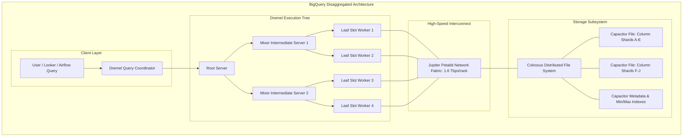

# 03. Storage Modeling & Lakehouse Topology

## 1. Enterprise Scenario: The Omnichannel Unified Lakehouse

GlobalRetailX maintains **15 Petabytes** of historical omnichannel commerce data across physical stores, digital channels, and supply chain logistics.

```
                         GLOBALRETAILX LAKEHOUSE STORAGE TOPOLOGY
                         
+--------------------------------------------------------------------------------------------------+
|                                    BRONZE LAYER (RAW / LANDING)                                  |
|   Cloud Storage: gs://globalretailx-bronze-landing/ (Dual-Region: us-central1 + us-east4)        |
|   - Formats: Raw Avro (Datastream CDC), Parquet (3PL S3), Raw JSON / CSV (SFTP)                  |
|   - Governance: Object Versioning, Autoclass (Standard -> Coldline -> Archive), WORM Retention   |
|   - Interface: BigLake External Tables (Object Tables, In-place SQL queries, Access Delegation)  |
+-------------------------------------------------+------------------------------------------------+
                                                  |
                                                  v ELT / Continuous Merge
+-------------------------------------------------+------------------------------------------------+
|                                  SILVER LAYER (CLEANSED / CONSOLIDATED)                          |
|   BigQuery Native Storage: dataset `lakehouse_silver`                                            |
|   - Deduplicated CDC state, type-coerced, validated against domain schemas                       |
|   - Storage Format: Capacitor Columnar on Colossus File System                                   |
|   - Optimization: Ingestion/Timestamp Partitioned (Daily) + Clustered (Up to 4 columns)          |
|   - Security: Column-level Policy Tags (PII Masking), Row-Level Security Filters                 |
+-------------------------------------------------+------------------------------------------------+
                         |                                                         |
                         v SQL Modeling (Dataform)                                 v Real-time Serving
+-------------------------------------------------+        +---------------------------------------+
|              GOLD LAYER (CURATED / MARTS)       |        |   OPERATIONAL STORE: CLOUD BIGTABLE   |
|   BigQuery Native Storage: dataset `marts_curated`|      |   Instance: `ecom-session-cache`      |
|   - Star / Snowflake Dimensional Schemas        |        |   - Sub-10ms Latency SLA              |
|   - Aggregated Customer 360, Inventory Snapshots|        |   - Schema: Single Column Family      |
|   - Serving: BI Engine Acceleration (Looker)    |        |   - Salted / Reverse-Key Architecture |
|   - Data Exchange: Analytics Hub Clean Rooms    |        |   - GC Policy: Max Age 30 Days        |
+-------------------------------------------------+        +---------------------------------------+
```

---

## 2. BigQuery Internal Architecture: Capacitor, Dremel & Jupiter

To optimize petabyte-scale queries, data engineers must understand BigQuery’s disaggregated compute-storage design. Compute and storage scale independently, interconnected by Google's multi-terabit bisection network.



### 2.1 The Four Architectural Pillars

1. **Storage: Colossus**: Google’s global cluster-level distributed file system. It provides immediate consistency, automatic triple-replication, data durability, and erasure coding across physical disks.
2. **Columnar Format: Capacitor**: BigQuery's proprietary columnar file format residing on Colossus. Capacitor:
   * Encodes columns with specialized compression algorithms (Run-length encoding, dictionary encoding, bit-packing).
   * Generates rich **embedded metadata** per block (min/max values, null counts, dictionary offsets) allowing execution workers to skip scanning unneeded byte ranges.
3. **Compute: Dremel Multi-Stage Execution Engine**: Dynamically allocates execution slots (virtual CPUs + RAM) arranged into a multi-tiered execution tree:
   * **Root Server**: Parses, rewrites, and optimizes SQL into directed acyclic graph (DAG) execution stages.
   * **Mixers (Intermediates)**: Coordinate aggregation steps, handle distributed sort/merge operations, and pass data between tiers.
   * **Leaf Nodes (Slots)**: Pull columnar shards from Colossus via the Jupiter fabric, execute local filters, projections, and hash joins, and stream partial aggregates back up the tree.
4. **Networking: Jupiter Network Fabric**: Google’s custom datacenter bisection network delivering over **1.6 Terabits/sec** of bidirectional bandwidth per rack. Because compute does not share local disks with storage, Jupiter makes scanning 10 TB across 1,000 slots take seconds rather than hours.

---

## 3. Implementing the Medallion Architecture on Google Cloud

### 3.1 Bronze Tier: Cloud Storage & BigLake Engine
The Bronze tier houses immutable raw dumps. With **BigLake**, Google Cloud eliminates the historical divide between object storage data lakes and data warehouses:
* **Object Tables**: Expose unparsed CSV, JSON, Avro, Parquet, and Iceberg files in GCS as first-class BigQuery tables without data movement.
* **Storage Delegation via Cloud Resource Connections**: Users query external files using BigQuery credentials without requiring direct IAM read permissions on the underlying GCS buckets.
* **Metadata Caching**: BigLake caches file footers and block layouts, accelerating SQL query performance over GCS external tables by up to 5x.

```sql
-- Provisioning a BigLake External Table over Hive-Partitioned Parquet
CREATE OR REPLACE EXTERNAL TABLE `globalretailx-prod.lakehouse_bronze.ext_logistics_manifest`
WITH CONNECTION `us-central1.gcs-biglake-connection`
OPTIONS (
  format = 'PARQUET',
  uris = ['gs://globalretailx-bronze-landing/partner_s3_logistics/*'],
  hive_partition_uri_prefix = 'gs://globalretailx-bronze-landing/partner_s3_logistics/',
  require_hive_partition_filter = true,
  metadata_cache_mode = 'AUTOMATIC'
);
```

### 3.2 Silver Tier: Cleansed BigQuery Native Storage
The Silver tier stores cleansed, conformant, and deduplicated enterprise entities (e.g., `orders`, `line_items`, `customers`).
* Enforces structural schemas with non-nullable constraints.
* Tracks operational metadata (`_source_file`, `_ingest_timestamp`, `_row_hash`).
* Governed with column-level security policy tags (Cloud DLP integration) for PII.

### 3.3 Gold Tier: Dimensional Modeling & Semantic Marts
The Gold tier hosts denormalized dimensional structures (Kimball Star and Snowflake schemas) tuned for self-service business intelligence, machine learning, and external data sharing:
* **Fact Tables**: `fact_order_transactions`, `fact_store_inventory_daily`.
* **Dimension Tables**: `dim_customers`, `dim_stores`, `dim_products`.
* **BI Engine Acceleration**: In-memory caching for sub-second Looker visualizations.

---

## 4. BigQuery Table Design: Partitioning & Clustering Mastery

Poor physical table layout is the primary driver of runaway query costs and query timeouts in BigQuery.

```
       TABLE LAYOUT: PARTITIONING VS. CLUSTERING
       
       PARTITIONING (Coarse-Grained Directory Split)
       e.g., PARTITION BY DATE(order_timestamp)
       
       +-----------------------+-----------------------+
       | Partition: 2026-05-01 | Partition: 2026-05-02 | ... (Up to 4,000 partitions)
       +-----------------------+-----------------------+
                   |
                   v
       CLUSTERING (Fine-Grained Colocated Sorting within Partitions)
       e.g., CLUSTER BY customer_region, store_id, order_status
       
       +-------------------------------------------------------+
       | Block 1: region='APAC', store_id='ST-001', status='COMP' |
       +-------------------------------------------------------+
       | Block 2: region='APAC', store_id='ST-002', status='OPEN' |
       +-------------------------------------------------------+
       | Block 3: region='EMEA', store_id='ST-080', status='COMP' |
       +-------------------------------------------------------+
```

### 4.1 Partitioning Deep Dive

Partitioning segments a large table into distinct storage units based on a key. BigQuery prunes whole partitions before reading Capacitor blocks from Colossus.

#### Partitioning Types
1. **Time-Unit Partitioning (Column-Based)**: `PARTITION BY DATE(transaction_timestamp)`. Can partition by `HOUR`, `DAY`, `MONTH`, or `YEAR`.
2. **Ingestion-Time Partitioning**: `PARTITION BY _PARTITIONDATE`. Automatically routes records into partitions corresponding to the date BigQuery loaded them.
3. **Integer-Range Partitioning**: `PARTITION BY RANGE_BUCKET(store_numeric_id, GENERATE_ARRAY(0, 1000, 10))`.

#### Critical Partitioning Rules and Limits
* **Maximum Partitions Per Table**: **4,000 partitions**. A daily-partitioned table can hold ~10.9 years of data. Hourly-partitioned tables exceed this limit in **166 days** (~5.5 months).
* **Partition Expiration**: Set `partition_expiration_days` on transient staging tables to automatically garbage-collect old slices without running expensive manual `DELETE` statements.
* **Mandatory Partition Filters**: Always specify `require_partition_filter = true` in production DDL. This forces analysts and Looker dashboards to specify a partition filter in the `WHERE` clause, preventing accidental full-table scans.

### 4.2 Clustering Deep Dive

Clustering co-locates rows with similar values in the underlying Capacitor storage blocks based on up to **4 columns**.

#### Clustering Mechanics
* Unlike traditional indexes, clustering has **no separate index storage overhead**.
* BigQuery tracks min/max statistics for clustered columns across each 256MB–1GB Capacitor block. When a query filters by a clustered column (`WHERE customer_region = 'EMEA'`), BigQuery skips reading non-matching blocks entirely (**Block Pruning**).
* **Automatic Re-clustering**: When new data is inserted or merged into a clustered table, BigQuery runs background re-clustering tasks without consuming your reserved query slots.

#### How to Sequence Clustering Columns
The order of columns in `CLUSTER BY` determines optimization efficiency:
1. **Rule 1: Priority by Filter Frequency**: The most frequently filtered or joined column must be placed **first**.
2. **Rule 2: Cardinality Ordering**: Place lower-cardinality grouping columns first (e.g., `store_country`), followed by higher-cardinality keys (e.g., `customer_id`).
3. **Limit**: Maximum of **4 columns** allowed.

### 4.3 Production BigQuery DDL

```sql
CREATE OR REPLACE TABLE `globalretailx-prod.lakehouse_silver.orders_fact`
(
  order_id STRING NOT NULL OPTIONS(description="Unique UUID transaction identifier"),
  order_timestamp TIMESTAMP NOT NULL OPTIONS(description="Transaction UTC timestamp"),
  customer_id STRING NOT NULL OPTIONS(description="Foreign key pointing to dim_customers"),
  store_id STRING NOT NULL OPTIONS(description="Store identifier or 'ONLINE'"),
  fulfillment_region STRING NOT NULL OPTIONS(description="Geographic region: APAC, EMEA, NA"),
  order_status STRING NOT NULL OPTIONS(description="PROCESSING, SHIPPED, DELIVERED, RETURNED"),
  gross_amount NUMERIC(10, 2) NOT NULL,
  tax_amount NUMERIC(10, 2) NOT NULL,
  net_amount NUMERIC(10, 2) NOT NULL,
  _source_cdc_lsn INT64 NOT NULL,
  _ingest_time TIMESTAMP DEFAULT CURRENT_TIMESTAMP()
)
PARTITION BY DATE(order_timestamp)
CLUSTER BY fulfillment_region, store_id, order_status, customer_id
OPTIONS(
  partition_expiration_days = 1825, -- Retain 5 years of daily partitions
  require_partition_filter = true,  -- Prevent runaway full-table scans
  description = "Production cleansed orders fact table partitioned by day and multi-clustered."
);
```

---

## 5. Cloud Bigtable: Low-Latency Operational Storage

While BigQuery excels at analytical aggregations over millions of rows, it cannot deliver sub-10ms point lookups required by checkout frontends. GlobalRetailX uses **Cloud Bigtable** for real-time customer session caches and store inventory counters.

### 5.1 Architecture & Storage Engine

* Cloud Bigtable is a sparsely populated, persistent, multi-dimensional sorted map.
* Data is indexed exclusively by a single **Row Key**.
* Within each row, values are grouped into **Column Families** and versioned by timestamp.
* Storage is decoupled from compute: nodes serve metadata pointers while tablets (shards) reside on Colossus.

```
       BIGTABLE ROW MODEL: `ecom-session-cache`
       
       Row Key: hash(cust_id)[:4] # cust_id # reverse_ts
       -------------------------------------------------------------------------
       Column Family: `session_metrics`
       +-----------------------+-----------------------+-----------------------+
       | Qualifier: cart_items | Qualifier: last_page  | Qualifier: ip_address |
       +-----------------------+-----------------------+-----------------------+
       | @t3: ["SKU-99", "A1"] | @t3: "/checkout/pay"  | @t3: "192.168.1.1"    |
       | @t2: ["SKU-99"]       | @t2: "/cart/view"     | @t2: "192.168.1.1"    |
       | @t1: []               | @t1: "/product/detail"| @t1: "192.168.1.1"    |
       +-----------------------+-----------------------+-----------------------+
```

### 5.2 Row Key Design & Hotspot Avoidance

Row keys are stored in strict lexicographical (byte-sorted) order. Tablets are split across Bigtable nodes based on key ranges.

#### Anti-Pattern: Monotonically Increasing Keys
If row keys begin with sequential timestamps (`2026-05-01 10:00:01#CUST_1001`), **100% of all incoming write traffic hits the single node holding the highest key range**. This creates an extreme CPU hotspot while all other cluster nodes sit idle.

#### Best-Practice Production Key Formats
1. **Reverse Domain / Salted Prefix**: Prefix the key with an MD5/SHA256 hash or deterministic integer salt of the natural entity ID to spread consecutive transactions across the entire tablet keyspace:
   `format: <md5_hash_prefix_4_chars>#<customer_id>#<reversed_timestamp>`
   `example: 4a2f#CUST-98402#9223372036854775807`
2. **Reverse Timestamp**: Subtract the current epoch timestamp from maximum integer (`Long.MAX_VALUE - epoch_time`). Because rows sort lexicographically, this forces the **newest events to appear first**, allowing point queries to retrieve the latest state with a single row read.

### 5.3 Garbage Collection (GC) Policies

Bigtable column values accumulate multiple versions if unconstrained, leading to unbounded storage costs. Production tables must enforce strict Garbage Collection policies at the Column Family level.

```bash
# Provision Bigtable Column Family with a Compound GC Rule:
# Retain at most 3 versions OR any version newer than 30 days.
cbt createfamily ecom-session-cache session_metrics "maxversions=3 or maxage=30d"
```

---

## 6. Lakehouse Failure Modes, Edge Cases & Recovery

| Failure Scenario | Architectural Cause | Manifestation | Resolution & Mitigation Pattern |
| :--- | :--- | :--- | :--- |
| **BigQuery Partition Limit Exceeded** | Schema configured with `PARTITION BY TIMESTAMP_TRUNC(event_time, HOUR)` on a table storing >6 months of data. | Ingestion pipelines fail with error: `Too many partitions produced by query. Max allowed is 4000`. | Redesign table partitioning to `DAY` or `MONTH`. Run a migration query using `CREATE OR REPLACE TABLE ... PARTITION BY DATE(event_time) AS SELECT * FROM old_table`. |
| **Bigtable Node Hotspotting** | Row keys prefixed with literal date strings (`YYYYMMDD#...`). | Node CPU metrics indicate one node at 98% CPU while others sit at 4%. Query latencies spike from 6ms to 850ms. | Refactor row key design: prepend a 4-character deterministic hash prefix (e.g., `substr(md5(cust_id), 1, 4)`). Run `cbt split` to manually force-divide tablets while re-indexing. |
| **BigLake Metadata Cache Staleness** | Files overwritten or appended in Cloud Storage landing bucket, but BigLake cache mode is `MANUAL`. | BigLake queries return stale results or report `File not found` errors during query scan. | Switch metadata cache mode to `AUTOMATIC` with appropriate staleness intervals: `ALTER TABLE ... SET OPTIONS (metadata_cache_mode = 'AUTOMATIC', max_staleness = INTERVAL 15 MINUTE)`. |
| **Unclustered Inverted Joins (Shuffling)** | Joining two 5-billion row tables on unclustered, randomly distributed string UUIDs. | Dremel execution slots hit memory exhaustion; query fails with `Resources exceeded during query execution: The query could not be executed in the allotted memory`. | Co-cluster both tables on the exact join key (`CLUSTER BY order_id`). Dremel replaces full-stage distributed memory shuffling with co-located block scans. |

---

## 7. Professional Data Engineer (PDE) Knowledge Check

#### Question 1
GlobalRetailX maintains a BigQuery table with 8 billion rows containing 4 years of retail transactions. Business users frequently run queries analyzing sales for specific `store_id` values within narrow date windows (e.g., the last 7 days). Currently, queries are slow and scan several hundred gigabytes per execution. How should you optimize the table to minimize scanned bytes and maximize query performance?

- A. Recreate the table partitioned by `store_id` and clustered by `transaction_date`.
- B. Recreate the table partitioned by `transaction_date` (Daily) and clustered by `store_id`.
- C. Build a materialized view over the entire table grouping by `store_id` and `transaction_date`.
- D. Split the table into 850 separate physical tables, one for each retail `store_id`.

**Answer: B**
*Explanation*: BigQuery allows partitioning by date/timestamp columns. Daily partitioning on `transaction_date` ensures queries filtering on narrow date ranges prune all unneeded historical dates from the scan. Clustering by `store_id` within each date partition co-locates rows for individual stores in the same Capacitor blocks, allowing BigQuery's leaf slots to skip blocks that do not match the requested store. Option A is invalid because partitioning by high-cardinality strings like `store_id` is unsupported (partitioning only supports time-units, ingestion time, or integer ranges). Option D is an anti-pattern that creates administrative overhead and prevents holistic cross-store analysis.

---

#### Question 2
You are designing an operational session cache on Cloud Bigtable for an e-commerce platform that experiences 100,000 writes/second. The application reads the single most recent session for a customer upon login. When load testing the system, Cloud Monitoring indicates that two Bigtable nodes are running at 100% CPU while six other nodes are virtually idle. Which row key strategy resolves this performance bottleneck?

- A. `timestamp_customer_id` (e.g., `1714562400#CUST_1001`)
- B. `customer_id#timestamp`
- C. `md5(customer_id)[0:4]#customer_id#(Long.MAX_VALUE - timestamp)`
- D. Auto-incrementing integer sequence generated by a database sequence generator.

**Answer: C**
*Explanation*: The symptom described is classic tablet hotspotting caused by monotonically increasing or poorly distributed keys. 
1. Prepending `md5(customer_id)[0:4]` uniformly distributes writes across the entire keyspace and all available Bigtable nodes.
2. Inverting the timestamp (`Long.MAX_VALUE - timestamp`) ensures that the latest record for that customer sorts to the very top of their key range, allowing the application to retrieve the single latest session using a forward scan limited to 1 row. Options A and D cause extreme write hotspotting on the last tablet. Option B distributes writes well, but sorts oldest records first, requiring a full scan of the customer's history.

---

#### Question 3
Your enterprise wants to query 20 TB of Apache Iceberg files stored in Cloud Storage Bronze Landing using BigQuery SQL, without moving the data or paying for double storage. You also need to enforce column-level security so that external data science contractors cannot see plaintext customer email addresses. Which architecture satisfies these constraints?

- A. Load the files into BigQuery native storage and delete the GCS bucket.
- B. Create a BigLake External Table over the Cloud Storage URI using a BigQuery Cloud Resource Connection, and apply Data Catalog / Dataplex Policy Tags to the schema definition.
- C. Use BigQuery Data Transfer Service to load the data hourly into temporary tables.
- D. Grant the data science contractors direct Cloud Storage Object Viewer IAM roles on the bucket.

**Answer: B**
*Explanation*: BigLake is specifically engineered for this requirement. It extends BigQuery's storage engine and governance model to object stores. By creating a BigLake External Table via a Cloud Resource Connection, data remains in GCS while BigQuery executes queries in place. BigLake enforces fine-grained access control (column-level policy tags and row-level security) at the query layer, abstracting direct GCS object permissions away from end users.
