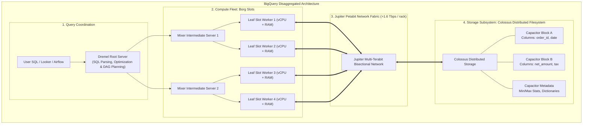
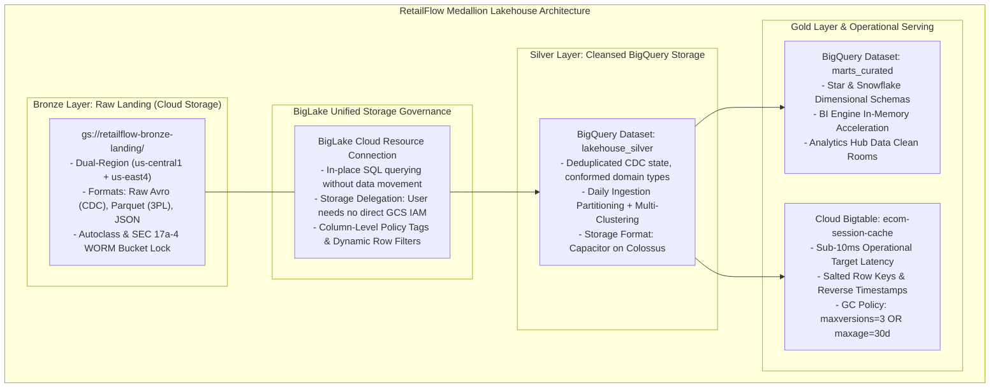

# 03. Storage Modeling & Lakehouse Topology

---

## Learning Objectives
By the end of this module, a data engineer or architect will be able to:
1. **Understand** the distributed storage foundations of disaggregated storage and compute, columnar storage physics, and sorted-map NoSQL architectures.
2. **Translate** familiar Databricks (Delta Lake, Unity Catalog, Photon Engine, Liquid Clustering) and Apache open-source (HBase, Cassandra, Parquet) patterns directly into BigQuery, BigLake, and Cloud Bigtable.
3. **Analyze** the deep physical mechanics of BigQuery’s storage engine (Capacitor columnar format, Colossus distributed filesystem, Borg leaf slots, and Jupiter network fabric).
4. **Design** optimized BigQuery physical table layouts utilizing time-unit partitioning (up to 4,000 partitions) and multi-column clustering (up to 4 columns).
5. **Architect** high-throughput operational storage on Cloud Bigtable using non-hotspotting row key strategies, Key Visualizer diagnostics, and Column Family Garbage Collection policies.
6. **Evaluate** open lakehouse architectures on Google Cloud using BigLake object tables and metastores over open formats (Parquet, Iceberg).

---

## Databricks & Delta Lake to Google Cloud Storage Bridge

Engineers transitioning from Databricks, Apache Spark, and open-source data lakes can map their storage mental models directly to Google Cloud services:

| Databricks / Open Source Concept | Google Cloud Native Equivalent | Architectural Parity & Technical Distinctions |
| :--- | :--- | :--- |
| **Delta Lake (Parquet + Transaction Log)** | **Capacitor on Colossus & BigLake** | Delta Lake stores Parquet files on object storage with JSON commit logs. BigQuery stores data natively in proprietary **Capacitor columnar files on Colossus**, offering zero file management and instant metadata pruning. **BigLake** extends BigQuery’s governance and query engine to external Parquet, Iceberg, and Delta Lake tables on GCS. |
| **Unity Catalog / Hive Metastore** | **Dataplex & BigLake Metastore** | Unity Catalog provides centralized governance across workspaces. Dataplex provides unified governance (Lakes, Zones, Assets), automated data discovery, and column-level policy tag access control across both Cloud Storage and BigQuery datasets. |
| **Databricks SQL Warehouses (Photon Engine)** | **BigQuery Query Engine (Dremel & Borg Slots)** | Photon is a C++ vectorized execution engine executing Spark SQL. BigQuery's **Dremel** engine compiles GoogleSQL (Google Cloud's dialect compliant with the ANSI/ISO SQL standard) into multi-stage execution DAGs executing across dynamically allocated Borg slot containers. |
| **Delta Liquid Clustering / Z-Order** | **BigQuery Partitioning & Clustering** | Delta Z-Ordering sorts data across multi-dimensional space curves. BigQuery combines **Coarse Partitioning** (prunes whole file directories by date/integer) with **Fine Clustering** (colocates rows within 256MB–1GB Capacitor blocks based on up to 4 sorted columns). |
| **Apache HBase / Cassandra / DynamoDB** | **Cloud Bigtable** | All are sparse, sorted multi-dimensional maps. Bigtable is the direct ancestor of HBase. Unlike Cassandra, compute nodes do not hold data locally on disk; tablet servers serve metadata pointers while immutable SSTables reside on Colossus. |

> [!NOTE]
> **Concept Translation: Delta Lake vs. BigQuery & BigLake**
> - **Familiar Concept (Delta Lake)**: Open table format layering ACID transactions (via an append-only JSON transaction log `_delta_log/`) and optimistic concurrency control (OCC) over Parquet files on object storage (S3/ADLS/GCS). Requires manual operational maintenance for file compaction (`OPTIMIZE`), deletion of expired snapshots (`VACUUM`), and multi-dimensional layout optimization (`Z-ORDER`).
> - **Google Cloud Implementation (BigQuery & BigLake)**: BigQuery provides fully managed, serverless storage where data is stored in proprietary Capacitor columnar format on Colossus, abstracting all file, compaction, and commit log management. BigLake extends BigQuery governance and metadata acceleration to open table formats (Parquet, Iceberg, Delta Lake) residing directly on Cloud Storage without copying data.
> - **Where the Analogy Breaks**:
>   1. *File and Compaction Management*: In Delta Lake, data engineers must schedule periodic maintenance jobs (`OPTIMIZE`, `VACUUM`) to prevent small-file performance degradation. In BigQuery native storage, background compaction, defragmentation, and clustering re-sorting are automated and transparent to users.
>   2. *Concurrency & Commit Coordination*: Delta Lake coordinates concurrent commits across multiple writers (jobs, clusters, or streaming queries) using Optimistic Concurrency Control (OCC), relying on object storage atomic put-if-absent operations (such as GCS generation-match preconditions `x-goog-if-generation-match: 0` or DynamoDB commit coordinators on S3) to resolve commit log version conflicts in `_delta_log/`. BigQuery manages mutations at the table and partition level using distributed transaction managers with snapshot isolation.
>   3. *Storage vs. Metadata Governance*: Delta Lake couples format and log directly to object storage directories; BigQuery decouples the declarative query engine from physical storage via high-throughput internal RPCs, BigLake metastore acceleration, and fine-grained Dataplex policy tags.

---

## 1. Architectural Foundation: Disaggregated Storage & Columnar Physics

### Why Decouple Compute from Storage?
In legacy Hadoop, Teradata, and on-premises appliances, compute (CPUs/RAM) and storage (disks) were colocated in the same physical servers. This created severe architectural inefficiencies:
- **Asymmetric Scaling**: If an enterprise needed 1 Petabyte of storage for audit logs but only queried it once a quarter, they were forced to purchase expensive compute nodes just to acquire disk slots.
- **Resource Starvation**: Massive batch ETL jobs saturated disk I/O channels, blocking interactive BI queries.
- **Cluster Sizing Dilemma**: Clusters had to be provisioned for peak Black Friday capacity, sitting 80% idle during normal business operations.

Google Cloud completely separates compute from storage:
- **Storage Tier (Colossus)**: Storage scales elastically to exabyte scale without manual capacity provisioning. Colossus is understood to use erasure coding techniques and distribute encoded chunks across multiple failure domains for high durability. However, Google does not publish a separate durability SLA specifically for BigQuery's storage layer or for Colossus as an infrastructure component. Google documents both Cloud Storage and BigQuery storage as designed for 99.999999999% (11 9s) annual durability. Treat this as a durability design target, not an availability SLA. BigQuery’s contractual service availability is described separately in the BigQuery SLA; do not attribute a separate contractual durability SLA to Colossus as an internal infrastructure component.
- **Compute Tier (Borg Slots)**: Multi-tenant containerized execution units (slots) dynamically allocated by BigQuery's scheduler to process query DAG stages, scaling dynamically to match query complexity and reservation quotas.
- **Interconnect (Jupiter Network Fabric)**: Google's datacenter network fabric providing bisection bandwidth on the scale of petabits per second across cluster pods, enabling Borg compute slots to stream Capacitor blocks from Colossus storage nodes without disk locality constraints.

> [!IMPORTANT]
> **Architectural Clarity: Underlying Infrastructure vs. Contractual Public API**
> Technologies such as **Capacitor** (columnar storage format), **Colossus** (distributed filesystem), **Borg** (container cluster manager), **Dremel** (distributed query execution tree), and **Jupiter** (datacenter network fabric) represent Google Cloud's **internal underlying technologies and architectural paradigms**.
> - They do **not** constitute a public contractual API, fixed hardware topology, or static sequence of steps that developers directly invoke.
> - Users interact with BigQuery exclusively through declarative **GoogleSQL** (Google Cloud's dialect compliant with the ANSI/ISO SQL standard with powerful analytical extensions), the BigQuery Jobs API, and the high-performance Storage Read and Storage Write APIs.
> - Google transparently evolves the internal execution engine (e.g., vectorized query execution, dynamic query plan re-optimization, runtime slot allocation) and physical storage formats over time without requiring any changes to user-facing SQL queries or pipelines.



### The Physics of Columnar Storage (Capacitor vs. Row-Oriented OLTP)
In an operational database (PostgreSQL, MySQL), data is stored **row-by-row**:
`[Row 1: ORD_1, 2026-05-01, $100], [Row 2: ORD_2, 2026-05-01, $250]`
To calculate total sales (`SELECT SUM(net_amount) FROM orders`), the disk head must read every customer ID, shipping address, and timestamp off the platter just to discard them, saturating disk I/O.

In **Capacitor (BigQuery's Columnar Format)**, data is stored **column-by-column**:
- `order_id:   [ORD_1, ORD_2, ORD_3, ...]`
- `order_date: [2026-05-01, 2026-05-01, ...]`
- `net_amount: [100.00, 250.00, 45.00, ...]`

This columnar orientation provides three decisive advantages:
1. **Projection Pruning**: If your query mentions only `net_amount`, BigQuery reads **strictly the byte blocks for that column**, ignoring all other columns completely.
2. **Extreme Compression**: Because every value in a column has the identical data type and similar domain values, Capacitor achieves high compression ratios ($3:1$ to $10:1$) using run-length encoding (RLE), dictionary encoding, and frame-of-reference bit packing.
3. **Embedded Block Metadata**: Every Capacitor file block embeds min/max values and dictionary offsets. If a query filters `WHERE order_date = '2026-05-01'`, the Dremel engine checks the block header. If `max_date < '2026-05-01'`, the block is skipped entirely without reading a single row (**Block-Level Pruning**).

---

## 2. Enterprise Scenario: RetailFlow Unified Lakehouse

RetailFlow maintains **15 Petabytes** of historical omnichannel commerce data across physical stores, digital channels, and supply chain logistics.



---

## 3. Standardized Service Deep Dive: BigQuery

### 1. The Problem
Enterprises require an analytical data warehouse capable of querying petabytes of structured and semi-structured data with SQL, without managing clusters, resizing disks, tuning index trees, or paying for idle infrastructure.

### 2. Understand the Concept
**Modern Cloud Data Warehousing** provides disaggregated storage and compute with serverless elasticity. Instead of dedicated master/worker nodes, the warehouse acts as a multi-tenant utility: queries draw from a massive global pool of compute slots, execute in parallel across distributed files, and release resources the millisecond the query completes.

*Databricks Comparison*: BigQuery provides functionality comparable to Databricks SQL Warehouses combined with Delta Lake, but with zero VM infrastructure management. SQL queries execute serverless via Dremel without provisioning cluster sizes (2X-Small to 4X-Large).

### 3. Google Cloud Implementation
BigQuery provides:
- **Compute Pricing Models**:
  - *On-Demand*: Billed strictly per byte scanned ($6.25 per TB scanned). The default soft concurrency ceiling is **2,000 slots per project**.
  - *BigQuery Editions (Standard, Enterprise, Enterprise Plus)*: Capacity-based reservations billed per slot-hour.
    - *Standard*: Pay-per-second autoscaling slots only (no baseline reservations, no cross-region replication).
    - *Enterprise*: Autoscaling + baseline slot commitments, idle slot sharing across reservations, data governance (VPC-SC, CMEK, column masking).
    - *Enterprise Plus*: Mission-critical tier with 99.99% SLA and exclusive **cross-region disaster recovery dataset replication**.
- **Storage Pricing Models**:
  - *Logical Storage*: Billed on uncompressed data ($0.020/GB active, $0.010/GB long-term).
  - *Physical Storage*: Billed on compressed bytes on disk after Capacitor compression ($0.040/GB active, $0.020/GB long-term). Ideal for high-compression datasets ($>2.5:1$).

### 4. How It Works: Partitioning & Clustering

```
TABLE LAYOUT: PARTITIONING VS. CLUSTERING

PARTITIONING (Coarse-Grained Directory Split)
e.g., PARTITION BY DATE(order_timestamp)

+-----------------------+-----------------------+
| Partition: 2026-05-01 | Partition: 2026-05-02 | ... (Up to 4,000 partitions)
+-----------------------+-----------------------+
            |
            v
CLUSTERING (Fine-Grained Colocated Sorting within Partitions)
e.g., CLUSTER BY fulfillment_region, store_id, order_status

+-------------------------------------------------------------+
| Block 1: region='APAC', store_id='ST-001', status='COMP'    |
+-------------------------------------------------------------+
| Block 2: region='APAC', store_id='ST-002', status='OPEN'    |
+-------------------------------------------------------------+
| Block 3: region='EMEA', store_id='ST-080', status='COMP'    |
+-------------------------------------------------------------+
```

#### 1. Partitioning Deep Dive
Partitioning divides a large table into distinct physical segments based on a key:
- **Time-Unit Partitioning**: `PARTITION BY DATE(timestamp_column)`. Supports `HOUR`, `DAY`, `MONTH`, or `YEAR`.
- **Ingestion-Time Partitioning**: `PARTITION BY _PARTITIONDATE`. BigQuery assigns records to slices based on the date they were loaded.
- **Integer-Range Partitioning**: `PARTITION BY RANGE_BUCKET(store_numeric_id, GENERATE_ARRAY(0, 1000, 10))`.
- **Hard Limit**: A BigQuery table supports a maximum of **4,000 partitions**.
  - *Daily partitioning* supports ~10.9 years of data.
  - *Hourly partitioning* breaches the 4,000 limit in **166 days** (~5.5 months).
- **Mandatory Filter Protection**: Always configure `OPTIONS(require_partition_filter = true)`. This blocks queries that lack a partition filter in their `WHERE` clause, preventing accidental full-table scans.

#### 2. Clustering Deep Dive
Clustering co-locates rows with similar values in the underlying Capacitor storage blocks based on up to **4 columns**:
- **Zero Storage Index Overhead**: Clustering creates no separate index files; it physically sorts data within each partition block.
- **Block Pruning**: BigQuery tracks min/max statistics for clustered columns across each 256MB–1GB block. When a query filters by a clustered column (`WHERE fulfillment_region = 'EMEA'`), BigQuery skips non-matching blocks entirely.
- **Automatic Re-clustering**: As new data is loaded, BigQuery runs background re-clustering tasks automatically without consuming your reserved query slots.
- **Column Ordering Rule**: Order columns in `CLUSTER BY` from lowest cardinality / highest filter priority to highest cardinality.

### 5. Practical Example: RetailFlow Production Silver DDL
```sql
CREATE OR REPLACE TABLE `retailflow-prod.lakehouse_silver.orders_fact`
(
  order_id STRING NOT NULL OPTIONS(description="Unique UUID transaction identifier"),
  order_timestamp TIMESTAMP NOT NULL OPTIONS(description="Transaction UTC timestamp"),
  customer_id STRING NOT NULL OPTIONS(description="Foreign key pointing to dim_customers"),
  store_id STRING NOT NULL OPTIONS(description="Store identifier or 'ONLINE'"),
  fulfillment_region STRING NOT NULL OPTIONS(description="Geographic region: APAC, EMEA, NA"),
  order_status STRING NOT NULL OPTIONS(description="PROCESSING, SHIPPED, DELIVERED, RETURNED"),
  gross_amount NUMERIC(10, 2) NOT NULL,
  tax_amount NUMERIC(10, 2) NOT NULL,
  net_amount NUMERIC(10, 2) NOT NULL,
  _source_cdc_lsn INT64 NOT NULL,
  _ingest_time TIMESTAMP DEFAULT CURRENT_TIMESTAMP()
)
PARTITION BY DATE(order_timestamp)
CLUSTER BY fulfillment_region, store_id, order_status, customer_id
OPTIONS(
  partition_expiration_days = 1825, -- Retain 5 years of daily partitions
  require_partition_filter = true,  -- Prevent runaway full-table scans
  description = "Cleansed orders fact table partitioned by day and multi-clustered."
);
```

### 6. Architecture Integration
- **Upstream Ingestion**: Cloud Datastream (CDC), Cloud Dataflow (Storage Write API), BigQuery Data Transfer Service, BigQuery Load Jobs (Parquet, Avro, CSV).
- **Lakehouse Virtualization**: BigLake external tables over GCS Parquet, ORC, and Iceberg.
- **Downstream Serving**: BigQuery BI Engine (in-memory acceleration for Looker/Tableau), Analytics Hub (data clean rooms), Vertex AI (direct feature querying and BQML).

### 7. When to Use It
- Analytical SQL queries, reporting marts, and enterprise data warehousing over gigabytes to petabytes.
- Large-scale aggregations, historical trend analysis, and cohort modeling.
- In-warehouse machine learning using BigQuery ML (BQML).
- Secure cross-organization data sharing without data copying via Analytics Hub.

### 8. When Not to Use It
- Operational low-latency point lookups (<10ms per row by primary key) — use Cloud Bigtable or Redis.
- High-frequency row-level transactional updates/deletes (OLTP) — use Cloud Spanner or Cloud SQL.
- Serving as a simple object file store — use Cloud Storage.

### 9. Trade-offs (Performance, Cost, Complexity, Ops)
- **Performance**: High analytical throughput; scans billions of rows in seconds. Poor for single-record lookups (minimum query latency ~500ms–1s).
- **Cost**: On-demand query costs can become volatile if partitioning/clustering is omitted. Switch to BigQuery Editions for predictable budget ceilings.
- **Complexity**: Zero infrastructure to manage; declarative GoogleSQL (compliant with the ANSI:2011 SQL standard with nested and repeated record support).
- **Ops**: Completely serverless; automatic storage optimization, defragmentation, and encryption.

### 10. Common Misconceptions
- *Misconception*: 2,000 slots is the absolute maximum query capacity in BigQuery.  
  **Reality**: 2,000 slots is merely the default concurrent ceiling for the On-Demand pricing tier. BigQuery Editions reservations scale dynamically to tens of thousands of slots.
- *Misconception*: Standard Edition supports baseline slot commitments.  
  **Reality**: Standard Edition supports strictly pay-per-second autoscaling slots. Baseline commitments begin at the Enterprise tier.
- *Misconception*: Cross-region disaster recovery replication is available in all editions.  
  **Reality**: Planned and unplanned cross-region dataset failover replication is exclusive to **Enterprise Plus Edition**.

### 11. PDE Exam Perspective
- **Exam Trigger Phrases**: *"Optimize analytical query performance while minimizing scanned bytes"* $\to$ **Partitioning on date/timestamp + Clustering on frequently filtered/joined columns**.
- *"Prevent queries from executing without a date predicate"* $\to$ `require_partition_filter = true`.
- *"High-compression dataset with repetitive strings"* $\to$ Switch from Logical Storage Billing to **Physical Storage Billing**.
- *"Cross-region failover disaster recovery for analytics"* $\to$ **BigQuery Enterprise Plus Edition**.

---

## 4. Standardized Service Deep Dive: Cloud Bigtable

### 1. The Problem
High-scale web applications, personalization engines, and IoT telemetry systems generate tens to hundreds of thousands of operations per second that demand **consistent sub-10ms read and write response times**. Analytical warehouses (BigQuery) introduce 1-second query overhead, while relational databases (PostgreSQL) cannot scale horizontally to multi-petabyte write workloads without complex manual sharding.

### 2. Understand the Concept
**A NoSQL Wide-Column Sorted Map** indexes data by a single **Row Key**. Rows are sorted lexicographically by byte order. Each row contains multiple **Column Families**, which contain dynamic column qualifiers, and each cell stores multiple timestamped versions of data.

*HBase / Cassandra Comparison*: Bigtable is the direct architectural parent of Apache HBase. Unlike Cassandra, Bigtable completely separates compute (stateless Borg nodes) from storage (Colossus SSTables). Sizing or resizing a Bigtable cluster takes minutes and involves zero data rebalancing across physical disks.

### 3. Google Cloud Implementation
Cloud Bigtable is Google’s enterprise NoSQL database:
- **Operational Performance Target**: Sub-10ms read and write latency under recommended operational design parameters: SSD storage, balanced row key distribution, and node CPU utilization below 65% (single cluster) or 70% (multi-cluster).
- **Availability SLA**: 99.9% for single cluster, 99.99% for multi-cluster instances with multi-cluster routing, and up to **99.999%** for multi-region 3+ cluster deployments.

> [!IMPORTANT]
> **Latency Target vs. Availability SLA**:
> Cloud Bigtable's formal Service Level Agreement guarantees **availability** (99.9% to 99.999%), not latency. Sub-10ms read/write latency is an **operational engineering target**, not a contractual SLA. Maintaining sub-10ms latency requires proper row key design (avoiding hotspotting), using SSD disks, and maintaining CPU utilization below 65%–70%.

### 4. How It Works: Row Keys & Key Visualizer

```
BIGTABLE ARCHITECTURE & LEXICOGRAPHICAL TABLET SHARDING

[Incoming Client Requests: Get / MutateRows]
                     |
                     v
   [Stateless Processing Nodes: Borg Fleet]
   +-------------------------------------------------------+
   | Node 1: Responsible for Key Range [A - G)             |
   | Node 2: Responsible for Key Range [G - P)             |
   | Node 3: Responsible for Key Range [P - Z)             |
   +-------------------------------------------------------+
                     | Metadata Pointers (Tablets)
                     v
   [Colossus Distributed Storage: SSTables on Disk]
   +-------------------------------------------------------+
   | Tablet 1: SSTables [A - G) on Colossus                |
   | Tablet 2: SSTables [G - P) on Colossus                |
   | Tablet 3: SSTables [P - Z) on Colossus                |
   +-------------------------------------------------------+
```

#### Row Key Design Principles
Because Bigtable indexes data exclusively by row key and sorts keys lexicographically (byte-by-byte):
1. **The Sequential Key Disaster (Anti-Pattern)**: If row keys begin with a sequential timestamp (`2026-05-01 10:00:01#CUST_101`), **100% of all incoming writes hit the single tablet server responsible for the highest key range**. The target node spikes to 100% CPU while all other nodes sit idle (**Hotspotting**).
2. **Deterministic Salted Prefix**: Prepend a 4-character deterministic hash of the natural ID:
   `format: <md5(customer_id)[0:4]>#<customer_id>#<reversed_timestamp>`
   This evenly distributes writes across all available tablet servers and cluster nodes.
3. **Reversed Timestamps for Latest-State Lookups**: Subtract the event epoch timestamp from maximum integer (`Long.MAX_VALUE - timestamp`). Because rows sort lexicographically, **the newest records sort to the very top of each customer's slice**, allowing applications to fetch the latest session with a single 1-row scan.

#### Column Family Garbage Collection (GC) Policies
Unconstrained Bigtable cells accumulate versions indefinitely. GC policies are applied at the Column Family level:
- **Max Versions**: Retain the latest $N$ versions (e.g., `maxversions=3`).
- **Max Age**: Purge cells older than duration $T$ (e.g., `maxage=30d`).
- **Compound Rules**:
  - `Union (OR)`: Retain cell if it satisfies *either* rule (conservative).
  - `Intersection (AND)`: Purge cell unless it satisfies *both* rules (aggressive).

#### Key Visualizer Diagnostics
Key Visualizer generates visual heatmaps representing throughput over time across the entire row key range:
- **Bright horizontal stripe**: Extreme hotspotting on a single contiguous row key range.
- **Bright diagonal line**: Sequential write pattern marching across tablets over time (sequential timestamp keys).
- **Evenly distributed faint pattern**: Healthy, balanced cluster utilization across all tablet splits.

### 5. Practical Example: RetailFlow E-Commerce Session Cache
```bash
# 1. Provision a production Bigtable instance with multi-cluster SSD replication
gcloud bigtable instances create retailflow-session-cache \
    --display-name="RetailFlow Real-Time Session Store" \
    --cluster-config=id=cluster-us-central1,zone=us-central1-b,nodes=3,storage-type=SSD \
    --cluster-config=id=cluster-us-east4,zone=us-east4-a,nodes=3,storage-type=SSD

# 2. Create the operational session table
cbt -instance=retailflow-session-cache createtable user_sessions

# 3. Provision the column family with compound GC policy
# Retain at most 3 versions OR any version newer than 30 days
cbt -instance=retailflow-session-cache createfamily user_sessions session_metrics "maxversions=3 or maxage=30d"
```

*Row Key Pattern*:
`md5(customer_id)[:4] # customer_id # (9223372036854775807 - epoch_millis)`  
*Example Key*: `4a2f#CUST-98402#9223370322292375807`

### 6. Architecture Integration
- **Upstream Pipelines**: Cloud Dataflow (streaming aggregations via Bigtable MutateRows IO).
- **Downstream Serving**: Retail storefront microservices, fraud scoring APIs, recommendation systems (<10ms point lookups).
- **Analytical Synchronization**: BigQuery external federation over Bigtable via BigLake connection for ad-hoc analytical audits.

### 7. When to Use It
- High-throughput operational workloads (>10,000 QPS) requiring sub-10ms read/write latency.
- Time-series data, sensor/IoT telemetry, user session profiles, and financial ledgers.
- Datasets exceeding 1 TB that scale horizontally without downtime.

### 8. When Not to Use It
- Complex multi-table SQL joins, grouping, and ad-hoc aggregations — use BigQuery.
- Multi-row ACID transactions and relational constraints — use Cloud Spanner.
- Datasets smaller than a few hundred gigabytes (running a Bigtable cluster for <300 GB is cost-inefficient; use Cloud Firestore or Cloud SQL).

### 9. Trade-offs (Performance, Cost, Complexity, Ops)
- **Performance**: Sub-10ms operational target; linear throughput scaling (~10,000 QPS per SSD node).
- **Cost**: Minimum footprint is 1 node per cluster (~$470/node/month for SSD multi-cluster). HDD is cheaper but cannot deliver sub-10ms latency.
- **Complexity**: Requires sophisticated row key design; zero secondary indexes.
- **Ops**: Zero disk rebalancing, zero cluster compaction downtime; cluster resizing takes under 5 minutes.

### 10. Common Misconceptions
- *Misconception*: Bigtable provides a financially backed sub-10ms latency SLA.  
  **Reality**: The SLA is strictly for **system availability** (99.9% to 99.999%). Latency is an operational target that requires disciplined engineering.
- *Misconception*: Bigtable supports secondary indexes out of the box.  
  **Reality**: Bigtable indexes strictly by row key. If secondary indexing is required, engineers must build index tables, use row-key composition, or adopt Cloud Spanner.

### 11. PDE Exam Perspective
- **Exam Trigger Phrases**: *"Consistent sub-10ms read/write latency"*, *"Millions of operations per second"*, *"Key Visualizer shows a horizontal bright stripe"* $\to$ **Tablet hotspotting; salt the row key**.
- *"Retrieve the single most recent record for an entity efficiently"* $\to$ **Reverse timestamp in row key** (`Long.MAX_VALUE - timestamp`).
- *"Bigtable cluster CPU is high after sudden promotion"* $\to$ Add nodes to the cluster (resizes dynamically in minutes without downtime).

---

## 5. Active Learning: Architecture Prediction & Troubleshooting

### Scenario A: Predict the Architecture
**Business Challenge**:  
RetailFlow is designing a personalized product recommendation service. The architecture must satisfy two conflicting operational profiles:
1. **Storefront Personalization Engine**: When a customer lands on the mobile app, the recommendation API must retrieve their real-time feature vector (last 10 items viewed, cart abandonment score, loyalty tier) in **under 8 milliseconds at 85,000 queries/second**.
2. **Data Science Model Training**: The machine learning team needs to execute monthly SQL queries over the entire 4-year history of customer impressions and transactions (approx. 45 Terabytes) to train deep learning ranking models.

**Task**: Formulate the optimal dual-store architecture and justify the design.

#### Architectural Solution & Reasoning:
1. **Operational Serving Store**: Deploy **Cloud Bigtable**.
   - *Row Key*: `hash(customer_id)[:4]#customer_id#(Long.MAX_VALUE - event_timestamp)`.
   - *Hardware*: Multi-cluster SSD deployment sized to maintain $<65\%$ CPU utilization, guaranteeing the sub-10ms latency operational target at 85,000 QPS.
2. **Analytical & Training Store**: Deploy **BigQuery**.
   - *Table Layout*: Partitioned by `DATE(event_timestamp)` and clustered by `customer_id, event_type`.
   - *Compute*: BigQuery Editions reservation for cost-controlled data science model feature extraction.
3. **Integration Bridge**: An Apache Beam streaming pipeline on **Cloud Dataflow** reads raw interaction events from Cloud Pub/Sub, writes operational feature vectors to Bigtable in real time, and streams historical event records into BigQuery via the Storage Write API.

---

### Scenario B: Troubleshoot the Pipeline
**Production Incident**:  
During a peak evening shopping rush, RetailFlow’s checkout latency alerts fire. Storefront checkout API response times have degraded from 15ms to 1,200ms. The backend engineer investigates Cloud Monitoring and discovers:
- The Cloud Bigtable cluster `retailflow-session-cache` has an average CPU utilization of 35% across its 8 nodes.
- However, Node #2 is pinned at **99% CPU utilization**, while Nodes #1, #3–#8 sit idle at 12% CPU.
- Opening Key Visualizer reveals a blinding **horizontal bright stripe** across a single key range.

```
Key Visualizer Heatmap Diagnostic:
Row Key Range: "STORE_ONLINE_20261107_*"
Read/Write Ops: 65,000 ops/sec on Key Range 0x53544F5245...
Tablet Server: Node-2 (us-central1-b)
Status: Hotspotting detected
```

#### Diagnostic Walkthrough:
1. **Identify the Underlying Mechanism**: Bigtable routes row keys lexicographically to specific tablet servers. If row keys share a common sequential prefix, all traffic routes to the single tablet server hosting that key slice.
2. **Root Cause Analysis**: An application update introduced a flawed row key pattern: `store_id#date#customer_id` (e.g., `STORE_ONLINE_20261107#CUST_1001`). Because all online transactions share the exact prefix `STORE_ONLINE_20261107`, **100% of all online checkout traffic was routed to Node #2**, overwhelming its tablet split while the rest of the cluster sat idle.
3. **Remediation Protocol**:
   - *Immediate Mitigation*: In Cloud Console or CLI, execute manual tablet splits: `cbt split user_sessions STORE_ONLINE_20261107_M` to force Bigtable to break the hot tablet across multiple nodes.
   - *Permanent Code Fix*: Refactor the row key to eliminate monotonic and fixed-prefix hotspotting. Prepend a 4-character deterministic hash of the customer ID:
     ```python
     row_key = f"{md5(customer_id)[:4]}#{store_id}#{customer_id}#{Long.MAX_VALUE - timestamp}"
     ```
     This spreads consecutive online checkouts uniformly across all 8 nodes, restoring sub-10ms response times.

---

## 6. Professional Data Engineer (PDE) Knowledge Check

#### Question 1
RetailFlow maintains a BigQuery table with 8 billion rows containing 4 years of retail transactions. Business users frequently run queries analyzing sales for specific `store_id` values within narrow date windows (e.g., the last 7 days). Currently, queries are slow and scan several hundred gigabytes per execution. How should you optimize the table to minimize scanned bytes and maximize query performance?

- A. Recreate the table partitioned by `store_id` and clustered by `transaction_date`.
- B. Recreate the table partitioned by `transaction_date` (Daily) and clustered by `store_id`.
- C. Build a materialized view over the entire table grouping by `store_id` and `transaction_date`.
- D. Split the table into 850 separate physical tables, one for each retail `store_id`.

**Answer: B**  
*Detailed Answer Analysis*:
* **Correct Answer: B**. BigQuery allows partitioning by date/timestamp columns. Daily partitioning on `transaction_date` ensures queries filtering on narrow date ranges prune all unneeded historical dates from the scan. Clustering by `store_id` within each date partition co-locates rows for individual stores in the same Capacitor blocks, allowing BigQuery's leaf slots to skip blocks that do not match the requested store.
* *Distractor Analysis*:
  * **A** is incorrect because partitioning by high-cardinality strings like `store_id` is unsupported in BigQuery (partitioning supports only time-units, ingestion time, or integer ranges).
  * **C** is incorrect because building a materialized view over 8 billion rows incurs continuous refresh costs and additional storage overhead, while failing to fix the root physical layout problem of the base table.
  * **D** is incorrect because sharding into 850 separate physical tables is an anti-pattern that creates severe administrative overhead, table quota exhaustion, and prevents holistic cross-store analysis.

---

#### Question 2
You are designing an operational session cache on Cloud Bigtable for an e-commerce platform that experiences 100,000 writes/second. The application reads the single most recent session for a customer upon login. When load testing the system, Cloud Monitoring indicates that two Bigtable nodes are running at 100% CPU while six other nodes are virtually idle. Which row key strategy resolves this performance bottleneck?

- A. `timestamp_customer_id` (e.g., `1714562400#CUST_1001`)
- B. `customer_id#timestamp`
- C. `md5(customer_id)[0:4]#customer_id#(Long.MAX_VALUE - timestamp)`
- D. Auto-incrementing integer sequence generated by a database sequence generator.

**Answer: C**  
*Detailed Answer Analysis*:
* **Correct Answer: C**. The symptom described is classic tablet hotspotting caused by monotonically increasing or poorly distributed keys. 
  1. Prepending `md5(customer_id)[0:4]` uniformly distributes writes across the entire keyspace and all available Bigtable nodes.
  2. Inverting the timestamp (`Long.MAX_VALUE - timestamp`) ensures that the latest record for that customer sorts to the very top of their key range, allowing the application to retrieve the single latest session using a forward scan limited to 1 row.
* *Distractor Analysis*:
  * **A** and **D** are incorrect because monotonically increasing keys (timestamps or sequential integers) cause all writes occurring at that moment to hammer the single rightmost tablet server split, pegging that node's CPU while others sit idle.
  * **B** is incorrect because while `customer_id#timestamp` distributes writes across customers, it orders timestamps chronologically (oldest first), requiring a scan through all of a customer's history to find their most recent session.

---

#### Question 3
Your enterprise wants to query 20 TB of Apache Iceberg files stored in Cloud Storage Bronze Landing using BigQuery SQL, without moving the data or paying for double storage. You also need to enforce column-level security so that external data science contractors cannot see plaintext customer email addresses. Which architecture satisfies these constraints?

- A. Load the files into BigQuery native storage and delete the GCS bucket.
- B. Create a BigLake External Table over the Cloud Storage URI using a BigQuery Cloud Resource Connection, and apply Data Catalog / Dataplex Policy Tags to the schema definition.
- C. Use BigQuery Data Transfer Service to load the data hourly into temporary tables.
- D. Grant the data science contractors direct Cloud Storage Object Viewer IAM roles on the bucket.

**Answer: B**  
*Detailed Answer Analysis*:
* **Correct Answer: B**. BigLake is specifically engineered for this requirement. It extends BigQuery's storage engine and governance model to object stores. By creating a BigLake External Table via a Cloud Resource Connection, data remains in GCS while BigQuery executes queries in place. BigLake enforces fine-grained access control (column-level policy tags and dynamic data masking) at the query layer, abstracting direct GCS object permissions away from end users.
* *Distractor Analysis*:
  * **A** is incorrect because loading 20 TB into BigQuery native storage violates the core constraint of querying data in-place without data duplication or migration.
  * **C** is incorrect because BQ DTS loads duplicate data into temporary tables on an hourly schedule, introducing multi-hour latency and doubling storage costs.
  * **D** is incorrect because granting direct GCS Object Viewer IAM permissions bypasses BigQuery column-level security and policy tags, allowing external contractors to read plaintext customer emails directly from the underlying Iceberg Parquet files.

---

## Module Key Takeaways & Exam Traps

| Category | Golden Rule | Exam Trap to Avoid |
| :--- | :--- | :--- |
| **BigQuery Partitioning** | Hard limit of **4,000 partitions per table**. Use daily partitioning for multi-year tables; hourly breaches 4,000 in ~5.5 months. | Do not partition by high-cardinality string IDs (e.g., `user_id`); partition by time-units, ingestion date, or integer ranges. |
| **BigQuery Clustering** | Up to 4 columns. Order columns from lowest-cardinality/highest filter frequency to highest cardinality. | Clustering does not have a separate storage index; it physically sorts data within Capacitor blocks. |
| **Bigtable Latency** | Sub-10ms latency is an **operational target**, not a contractual SLA. Requires SSD, proper key salting, and CPU $<65\%$. | Never state that Bigtable has a financially backed sub-10ms SLA. The SLA is strictly for Availability (99.9% to 99.999%). |
| **Bigtable Key Visualizer** | A horizontal bright stripe indicates key range hotspotting; a diagonal line indicates sequential timestamp keys. | Never prefix row keys with raw sequential timestamps or fixed store names; always prepend a deterministic hash salt. |
| **BigLake** | Enables in-place SQL querying over open formats (Parquet, Iceberg) in GCS with column-level policy tag masking. | Users query BigLake tables using BigQuery connection delegation without needing direct IAM read access to the raw GCS bucket. |
| **BigQuery Editions** | Standard supports autoscaling slots only. Enterprise adds baseline reservations. Enterprise Plus adds cross-region DR replication. | Never claim Standard edition supports baseline commitments or cross-region dataset disaster recovery failover. |
