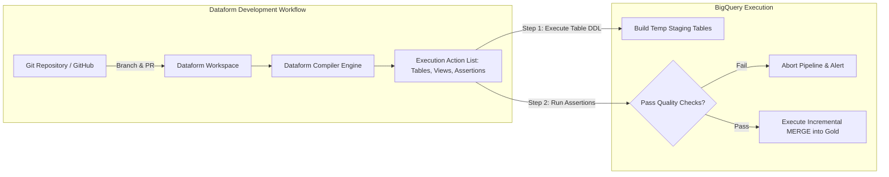

# 04. Distributed Transformation & SQL Processing

## 1. Enterprise Scenario: Omnichannel Data Transformation

GlobalRetailX requires a scalable transformation layer to convert raw CDC logs, logistics updates, and clickstream events into production-ready analytical assets.

```
                           GLOBALRETAILX TRANSFORMATION TOPOLOGY
                           
+----------------------------------------------------------------------------------------------------+
|                                    RAW / STAGING DATASETS                                          |
|  - `raw_cdc_staging.orders_cdc` (High-frequency append from Datastream)                            |
|  - `lakehouse_bronze.ext_logistics` (BigLake external parquet files)                               |
|  - `lakehouse_silver.aggregated_customer_sessions` (Streaming write from Dataflow)                |
+--------------------------------------------------+-------------------------------------------------+
                                                   |
                   +-------------------------------+-------------------------------+
                   |                                                               |
                   v SQL-First In-Warehouse ELT                                   v Large-Scale Spark / Heavy ETL
+--------------------------------------------------+       +-------------------------------------------------+
|              DATAFORM PIPELINE ENGINE            |       |           CLOUD DATAPROC / DATAFLOW             |
|  - Git-Integrated Workspace (GitHub Enterprise)  |       |  - Serverless Spark Batches                     |
|  - SQLX Transformations & Assertions             |       |  - Ephemeral Compute Clusters (Preemptible/Spot)|
|  - Incremental Merge Operations                  |       |  - Heavy ML Featurization & Graph Analytics     |
|  - Automated Dependency Graph Generation         |       |  - Spark SQL & PySpark Processing               |
+--------------------------------------------------+       +-------------------------------------------------+
                   |                                                               |
                   +-------------------------------+-------------------------------+
                                                   |
                                                   v Materialized Analytical Models
+----------------------------------------------------------------------------------------------------+
|                                      GOLD SERVING / MARTS LAYER                                    |
|  - `marts_curated.dim_customers_scd2` (Slowly Changing Dimensions Type 2)                         |
|  - `marts_curated.fact_daily_omnichannel_sales` (Daily store & online revenue reconciled)           |
|  - `marts_curated.inventory_velocity_predictions` (Input features for supply chain replenishment)   |
+----------------------------------------------------------------------------------------------------+
```

---

## 2. In-Warehouse ELT with Dataform

Dataform enables data engineering teams to develop, test, version control, and schedule complex SQL transformation workflows natively inside BigQuery.

### 2.1 Dataform Architecture & Core Concepts

Unlike legacy ETL tools that extract data to an external compute layer, Dataform compiles SQL and JavaScript into native BigQuery SQL execution graphs (DAGs).



* **SQLX**: An extension of standard SQL that incorporates declarative configuration blocks (`config {}`), pre- and post-processing operations, documentation, and data quality tests in a single file.
* **Dependency Graphs**: Dataform automatically constructs the execution DAG by parsing the `ref('table_name')` function across models.
* **Incremental Models**: Optimizes costs by executing partition-aware `MERGE` statements instead of rebuilding entire multi-terabyte tables on every run.

### 2.2 Production Dataform SQLX Implementation

Below is the production SQLX definition for `dim_customers_scd2`, implementing an incremental merge with data quality assertions.

```sql
-- File: definitions/marts/dim_customers_scd2.sqlx
config {
  type: "incremental",
  schema: "marts_curated",
  name: "dim_customers_scd2",
  description: "Slowly Changing Dimension Type 2 for Customer Profiles",
  uniqueKey: ["customer_id", "effective_from"],
  bigquery: {
    partitionBy: "DATE(effective_from)",
    clusterBy: ["customer_id", "loyalty_tier", "is_current"]
  },
  assertions: {
    uniqueKey: ["customer_id", "effective_from"],
    nonNull: ["customer_id", "email_hash", "effective_from"]
  },
  tags: ["daily_marts", "customer_360"]
}

pre_operations {
  -- Audit log start of execution
  INSERT INTO `globalretailx-prod.audit_logs.pipeline_events` (event_name, execution_time)
  VALUES ('dim_customers_scd2_started', CURRENT_TIMESTAMP());
}

WITH source_data AS (
  SELECT
    customer_id,
    TO_HEX(SHA256(LOWER(TRIM(email)))) AS email_hash,
    loyalty_tier,
    postal_code,
    updated_at AS change_timestamp,
    _metadata_deleted AS is_deleted
  FROM
    ${ref("stg_customers_cdc")}
  ${when(incremental(), `WHERE updated_at > (SELECT MAX(effective_from) FROM ${self()})`)}
),

ranked_updates AS (
  SELECT
    *,
    ROW_NUMBER() OVER (
      PARTITION BY customer_id 
      ORDER BY change_timestamp DESC
    ) AS row_num
  FROM
    source_data
)

SELECT
  customer_id,
  email_hash,
  loyalty_tier,
  postal_code,
  change_timestamp AS effective_from,
  LEAD(change_timestamp) OVER (
    PARTITION BY customer_id 
    ORDER BY change_timestamp ASC
  ) AS effective_to,
  CASE 
    WHEN LEAD(change_timestamp) OVER (PARTITION BY customer_id ORDER BY change_timestamp ASC) IS NULL 
    THEN TRUE 
    ELSE FALSE 
  END AS is_current
FROM
  ranked_updates
WHERE
  row_num = 1 AND is_deleted IS FALSE

post_operations {
  -- Assert that no records have invalid date sequences
  ASSERT NOT EXISTS (
    SELECT 1 FROM ${self()} 
    WHERE effective_to IS NOT NULL AND effective_to < effective_from
  ) AS "Validation Error: effective_to cannot precede effective_from";
}
```

---

## 3. Distributed Compute: Cloud Dataflow vs. Cloud Dataproc

When transformations involve complex graph traversals, heavy matrix operations, or legacy distributed libraries, pure SQL in BigQuery becomes impractical. Engineers must choose between **Cloud Dataflow** and **Cloud Dataproc**.

```
                        DISTRIBUTED COMPUTE DECISION MATRIX
                        
                                Workload Profile
                                       |
                +----------------------+----------------------+
                |                                             |
                v                                             v
        Unified Streaming & Batch                      Legacy Hadoop / Spark
        Java / Python / Go Pipelines                   Data Science / GraphX
        Serverless Operations Only                     Custom OS / Native Libs
                |                                             |
                v                                             v
        +---------------+                             +---------------+
        | Cloud Dataflow|                             | Cloud Dataproc|
        +---------------+                             +---------------+
                                                              |
                                               +--------------+--------------+
                                               |                             |
                                               v                             v
                                     Serverless Spark Batches        Ephemeral Compute Engine
                                     - No cluster management         - Fine-grained VM types
                                     - Rapid startup (<60s)          - Spot/Preemptible VMs
                                     - Pay strictly per job          - Custom initialization actions
```

### 3.1 Architectural Comparison

| Dimension | Cloud Dataflow | Cloud Dataproc (Compute Engine) | Dataproc Serverless |
| :--- | :--- | :--- | :--- |
| **Core Framework** | Apache Beam (Unified Model). | Apache Spark, Hadoop, Hive, Presto. | Apache Spark (2.x / 3.x). |
| **Operational Model** | Fully Serverless. Auto-tunes worker count and memory dynamically. | Customer manages VM instances, master/worker nodes, and disk configurations. | Fully Serverless. Submit PySpark/Scala jobs directly without managing clusters. |
| **Provisioning Time** | 2 to 4 minutes (VM spinning + container deploy). | 90 to 180 seconds for complete VM cluster initialization. | 30 to 60 seconds containerized startup. |
| **Cost Optimization** | Streaming Engine offloads memory; Flexible Resource Scheduling (FlexRS) for 40% discount on non-urgent batch. | **Secondary Workers using Spot (Preemptible) VMs**. Primary masters stay persistent; workers scale to 0. | Billed in Data Compute Units (DCUs) strictly for the duration of execution. |
| **Migration From Databricks**| High rewrite cost (must rewrite Spark pipelines into Apache Beam). | **Minimal rewrite**. Direct migration of PySpark and Spark SQL notebooks and scripts. | **Zero rewrite**. Submit existing PySpark scripts via `gcloud dataproc batches submit spark`. |

### 3.2 Dataproc Best Practices: Ephemeral Clusters & Spot VMs

For batch Spark workloads on Dataproc:
1. **Never Run Persistent Clusters for Batch**: Running a long-lived Dataproc cluster 24/7 wastes thousands of dollars in idle VM compute. Provision an **Ephemeral Cluster** via Cloud Composer, execute the Spark job, and immediately terminate the cluster.
2. **Graceful Decommissioning & Spot VMs**: Use a minimal master node (e.g., `n2-standard-4`), 2 standard worker nodes for HDFS quorum, and configure up to 50 **Secondary Workers using Spot VMs**. Spot VMs provide up to **60–91% savings**.
3. **Cloud Storage Connector**: Configure Spark to read and write directly to `gs://` buckets using the Cloud Storage Connector, completely decoupling storage from cluster lifetimes.

#### Production PySpark Batch Script on Dataproc Serverless
```python
# File: inventory_velocity_batch.py
from pyspark.sql import SparkSession
from pyspark.sql import functions as F
from pyspark.sql.window import Window

def main():
    spark = SparkSession.builder \
        .appName("GlobalRetailX-InventoryVelocity") \
        .config("spark.jars.packages", "com.google.cloud.spark:spark-bigquery-with-dependencies_2.12:0.32.0") \
        .getOrCreate()

    # Step 1: Read directly from BigQuery Silver Fact Table
    orders_df = spark.read.format("bigquery") \
        .option("table", "globalretailx-prod.lakehouse_silver.orders_fact") \
        .load()

    # Step 2: Compute Rolling 7-day Sales Velocity per Store and SKU
    window_spec = Window.partitionBy("store_id", "product_sku") \
        .orderBy(F.col("order_timestamp").cast("long")) \
        .rangeBetween(-7 * 86400, 0)

    velocity_df = orders_df \
        .filter(F.col("order_status") != "CANCELLED") \
        .withColumn("rolling_7d_quantity", F.sum("item_quantity").over(window_spec)) \
        .withColumn("rolling_7d_revenue", F.sum("net_amount").over(window_spec)) \
        .groupBy("store_id", "product_sku") \
        .agg(
            F.max("rolling_7d_quantity").alias("units_sold_last_7d"),
            F.max("rolling_7d_revenue").alias("revenue_last_7d")
        )

    # Step 3: Write results directly to GCS in optimized Parquet format
    output_gcs_uri = "gs://globalretailx-curated-marts/inventory_velocity/year=2026/month=05/"
    velocity_df.write.mode("overwrite").parquet(output_gcs_uri)

    spark.stop()

if __name__ == "__main__":
    main()
```

#### Submitting via Dataproc Serverless
```bash
gcloud dataproc batches submit pyspark inventory_velocity_batch.py \
    --project=globalretailx-prod \
    --region=us-central1 \
    --version=2.1 \
    --deps-bucket=gs://globalretailx-dataproc-temp/ \
    --service-account=dataproc-serverless-sa@globalretailx-prod.iam.gserviceaccount.com \
    --subnet=prod-analytics-subnet
```

---

## 4. BigQuery CDC MERGE & Deduplication Engine

When ingesting high-throughput relational data via Datastream CDC, BigQuery receives an append-only log of modifications containing multiple `INSERT`, `UPDATE`, and `DELETE` operations for the same primary key.

### 4.1 Staging to Target CDC MERGE Architecture

To reconstruct the accurate current state without locking production tables, an automated, two-step **Staging-and-Merge Pattern** is executed:

```mermaid
graph TD
    subgraph Staging Layer
        Datastream[Datastream CDC Stream] --> AppendOnlyTable[raw_cdc_staging.orders_cdc<br/>Contains Duplicates & Mutations]
    end

    subgraph Deduplication Query
        AppendOnlyTable --> WindowRank[ROW_NUMBER() OVER<br/>PARTITION BY order_id<br/>ORDER BY _metadata_timestamp DESC]
        WindowRank --> DedupView[Latest Valid Transaction State]
    end

    subgraph Production Silver Layer
        DedupView --> MergeEngine{BigQuery MERGE Engine}
        MergeEngine -->|Matched & is_deleted=TRUE| DeleteOp[DELETE row from Silver]
        MergeEngine -->|Matched & is_deleted=FALSE| UpdateOp[UPDATE attributes in Silver]
        MergeEngine -->|Not Matched & is_deleted=FALSE| InsertOp[INSERT new row into Silver]
        DeleteOp & UpdateOp & InsertOp --> TargetTable[(lakehouse_silver.orders_fact)]
    end
```

### 4.2 Production BigQuery CDC MERGE Statement

```sql
MERGE INTO `globalretailx-prod.lakehouse_silver.orders_fact` AS target
USING (
  WITH deduplicated_latest_cdc AS (
    SELECT
      order_id,
      customer_id,
      store_id,
      fulfillment_region,
      order_status,
      gross_amount,
      tax_amount,
      net_amount,
      _metadata_timestamp,
      _metadata_change_type,
      _metadata_deleted,
      ROW_NUMBER() OVER (
        PARTITION BY order_id 
        ORDER BY _metadata_timestamp DESC, _metadata_read_timestamp DESC
      ) AS rank_order
    FROM
      `globalretailx-prod.raw_cdc_staging.orders_cdc`
    WHERE
      -- Partition pruning: only read records landed in the last 24 hours
      _PARTITIONTIME >= TIMESTAMP_SUB(CURRENT_TIMESTAMP(), INTERVAL 24 HOUR)
  )
  SELECT
    order_id,
    customer_id,
    store_id,
    fulfillment_region,
    order_status,
    gross_amount,
    tax_amount,
    net_amount,
    _metadata_timestamp,
    _metadata_deleted
  FROM
    deduplicated_latest_cdc
  WHERE
    rank_order = 1
) AS source
ON target.order_id = source.order_id 
   AND target.fulfillment_region = source.fulfillment_region -- Clustering alignment

-- Condition 1: Record deleted at the source database
WHEN MATCHED AND source._metadata_deleted = TRUE THEN
  DELETE

-- Condition 2: Existing record updated with newer timestamp
WHEN MATCHED AND source._metadata_deleted = FALSE 
  AND source._metadata_timestamp > target._source_cdc_lsn THEN
  UPDATE SET
    target.customer_id = source.customer_id,
    target.store_id = source.store_id,
    target.order_status = source.order_status,
    target.gross_amount = source.gross_amount,
    target.tax_amount = source.tax_amount,
    target.net_amount = source.net_amount,
    target._source_cdc_lsn = source._metadata_timestamp,
    target._ingest_time = CURRENT_TIMESTAMP()

-- Condition 3: Brand new transaction record
WHEN NOT MATCHED AND source._metadata_deleted = FALSE THEN
  INSERT (
    order_id,
    order_timestamp,
    customer_id,
    store_id,
    fulfillment_region,
    order_status,
    gross_amount,
    tax_amount,
    net_amount,
    _source_cdc_lsn,
    _ingest_time
  )
  VALUES (
    source.order_id,
    TIMESTAMP_MICROS(source._metadata_timestamp),
    source.customer_id,
    source.store_id,
    source.fulfillment_region,
    source.order_status,
    source.gross_amount,
    source.tax_amount,
    source.net_amount,
    source._metadata_timestamp,
    CURRENT_TIMESTAMP()
  );
```

### 4.3 Handling Schema Drift and Type Coercion

Relational databases undergo routine schema evolution (e.g., adding `discount_code` or modifying numeric precision).
* **Safe Evolutions**: Datastream and BigQuery natively handle column additions (`ALTER TABLE ADD COLUMN`). BigQuery marks historical rows for the new column as `NULL`.
* **Breaking Evolutions**: Modifying column types (e.g., `INT32` to `STRING`) requires **Type Coercion Staging Views**:
  1. Staging tables ingest raw inputs as flexible types (e.g., `JSON` or `STRING`).
  2. A typed view explicitly applies `SAFE_CAST(column AS TARGET_TYPE)`. If coercion fails, `SAFE_CAST` returns `NULL` rather than failing the entire ELT job.
  3. Dataform assertions flag non-null violations, quarantining incompatible records.

---

## 5. Failure Modes, Resource Contention & Retry Semantics

| Failure Scenario | Underlying Mechanism | Operational Manifestation | Engineering Mitigation |
| :--- | :--- | :--- | :--- |
| **Concurrent MERGE Mutations** | Multiple pipelines or Datastream micro-batches execute concurrent `MERGE` statements on the same target partition. | Query fails with: `Transaction was aborted due to concurrent update against table...`. | 1. Ensure staging micro-batches are processed serially via Composer or Cloud Tasks.<br>2. Partition target table finely (daily); BigQuery acquires locks at the **partition level**, allowing concurrent merges into disjoint partitions. |
| **Spot VM Preemption Storm** | GCP reclaims Dataproc Spot VMs during a cluster-wide high-priority workload demand spike. | Spark driver reports lost executors; shuffle fetch failures; pipeline execution slows or fails. | 1. Never configure primary master nodes as Spot/Preemptible.<br>2. Restrict Spot VMs to Secondary Workers.<br>3. Enable Spark dynamic allocation and set `spark.blacklist.enabled=true` to isolate repeatedly preempted hosts. |
| **Dataform Assertion Failure** | A supplier feed uploads orders with null `customer_id` or duplicate `order_id` primary keys. | Dataform DAG execution terminates at step 2. Gold models are not refreshed. | Configure Dataform assertions with non-blocking warning thresholds (`threshold: 10`) for non-critical assertions, or route failing records into a quarantine table while allowing the core pipeline to proceed. |
| **Dremel Slot Starvation during ELT** | Massive unpartitioned joins consume all available reservation slots; Looker executive dashboards stall. | Query queued; slot wait time climbs from 0ms to >120,000ms. | 1. Separate ELT batch workloads from BI reporting workloads using **BigQuery Slot Reservations** and workload assignments (`default` vs `batch_pipeline`).<br>2. Enforce `require_partition_filter = true`. |

---

## 6. Professional Data Engineer (PDE) Knowledge Check

#### Question 1
GlobalRetailX ingests continuous Change Data Capture (CDC) events into an append-only BigQuery staging table. Every 15 minutes, a scheduled query runs a `MERGE` statement into the production fact table. Over time, the cost of the `MERGE` query has escalated significantly, and queries occasionally fail due to concurrent update conflicts. How should you optimize this architecture?

- A. Execute a full table replacement (`CREATE OR REPLACE TABLE`) instead of using `MERGE`.
- B. Ensure the target table is partitioned by date and clustered on the primary entity keys. In the `MERGE` statement, restrict the source and target scans to only the recent partitions (e.g., `_PARTITIONTIME >= TIMESTAMP_SUB(CURRENT_TIMESTAMP(), INTERVAL 24 HOUR)`), and co-align clustering keys in the join condition.
- C. Switch from BigQuery to Cloud SQL for analytical transformations.
- D. Disable clustering on the production table so writes do not perform block sorting.

**Answer: B**
*Explanation*: BigQuery `MERGE` statements can scan petabytes of data if left unconstrained. Restricting both the source CDC table and the target fact table to recent partitions (`_PARTITIONTIME >= ...`) ensures partition pruning, dramatically reducing scanned bytes and cost. Aligning clustering keys in the join predicate allows Dremel to skip irrelevant Capacitor blocks. Furthermore, BigQuery locks tables at the partition level during mutations; partition-bounded merges reduce concurrent transaction conflicts. Option A dramatically increases costs by rebuilding historical data. Option C degrades analytical scale. Option D worsens scan efficiency.

---

#### Question 2
Your team is migrating an existing, highly optimized Apache Spark graph-processing pipeline from an on-premises Hadoop cluster to Google Cloud. The pipeline runs once every 24 hours for 45 minutes, requiring custom C++ libraries compiled on the OS. You must optimize for operational simplicity and compute cost. Which compute architecture should you deploy?

- A. A permanent, 24/7 Cloud Dataproc cluster with persistent SSD persistent disks.
- B. Rewrite the entire C++ and Spark pipeline into Apache Beam on Cloud Dataflow.
- C. An ephemeral Cloud Dataproc cluster provisioned via Cloud Composer with an initialization action script to install the C++ libraries, using Spot VMs for secondary workers, and terminated immediately upon job completion.
- D. Cloud Run with maximum CPU allocation.

**Answer: C**
*Explanation*: Ephemeral Dataproc clusters are the gold standard for recurring batch Spark jobs. Provisioning the cluster on-demand and tearing it down after 45 minutes avoids paying for idle compute. Initialization actions cleanly automate OS-level C++ library dependencies. Using Spot (Preemptible) VMs for secondary workers achieves up to 91% compute cost reductions. Option A wastes money running idle VMs. Option B requires a costly, complex pipeline rewrite. Option D cannot scale to distributed multi-node Spark graph workloads.

---

#### Question 3
You are developing transformation models in Dataform. You have an incremental model `fact_sales` that processes daily transactions. During a historical audit, you discover that a data source bug corrupted transactions from two weeks ago. What is the standard Dataform procedure to reprocess those two weeks without dropping production tables or corrupting subsequent data?

- A. Delete the entire BigQuery table and run a full Dataform execution from the master branch.
- B. Trigger a manual execution in Dataform passing the `--full-refresh` flag for that specific action, or execute a targeted SQL backfill script updating the specific historical date partitions.
- C. Edit the SQLX config to `type: "table"`, deploy to production, and edit it back to `incremental`.
- D. Dataform does not support backfilling incremental models; you must export data to Cloud Storage and reload.

**Answer: B**
*Explanation*: Dataform provides the `--full-refresh` command-line / API option for incremental models, which instructs the compiler to ignore the incremental logic and rebuild the entire table. Alternatively, for surgical backfills of specific partitions, engineers execute a targeted backfill script filtering for the damaged partition range. Option A causes catastrophic downtime for downstream dashboards. Option C is error-prone, risky, and alters version-controlled code for a transient data repair.
