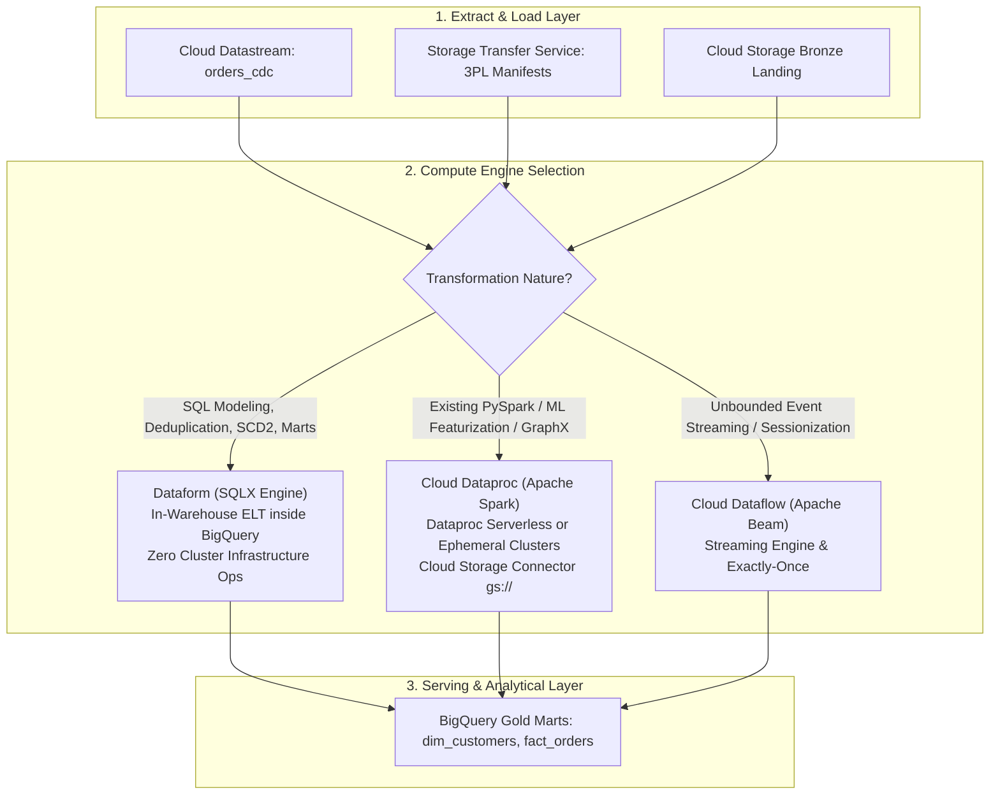
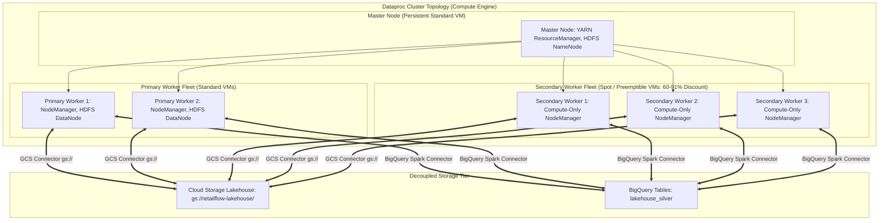

# 04. Distributed Transformation & SQL Processing

---

## Learning Objectives
By the end of this module, a data engineer or architect will be able to:
1. **Understand** the architectural paradigm shift from traditional procedural ETL to modern declarative in-warehouse ELT and distributed batch compute.
2. **Translate** familiar Databricks (Workspaces, Serverless Spark, DBFS), open-source Apache Spark/Hadoop, and dbt patterns directly into Cloud Dataproc, Dataproc Serverless, and Dataform.
3. **Analyze** the operational mechanics, cost structures, and failure modes of Cloud Dataproc on Compute Engine vs. Dataproc Serverless for Spark.
4. **Design** cost-optimized ephemeral Dataproc clusters leveraging Google Cloud Storage connectors, Spot (preemptible) secondary workers, and graceful decommissioning.
5. **Implement** production-grade declarative SQLX transformation pipelines in Dataform incorporating incremental `MERGE` models, automated dependency graphs, and data quality assertions.
6. **Troubleshoot** common distributed compute bottlenecks, including Spot VM preemption cascades, shuffle fetch failures, and concurrent BigQuery transaction locks.

---

## Databricks & Apache Spark to Google Cloud Compute Bridge

Engineers transitioning from Databricks, Apache Spark, and dbt can map their processing mental models directly to Google Cloud services:

| Databricks / Open Source Concept | Google Cloud Native Equivalent | Architectural Parity & Technical Distinctions |
| :--- | :--- | :--- |
| **Databricks Interactive / Automated Clusters** | **Cloud Dataproc on Compute Engine (GCE)** | Managed Apache Spark, Hadoop, Hive, and Presto clusters deployed on GCE VMs. Supports custom machine types, local NVMe SSDs, GPUs, and initialization actions. Ephemeral provisioning takes 90–180 seconds. |
| **Databricks Serverless for Spark** | **Dataproc Serverless for Spark** | Completely eliminates cluster and VM infrastructure management. PySpark, Spark SQL, or Scala Spark jobs are submitted directly via CLI or API. Billed in Data Compute Units (DCUs: 1 DCU = 4 vCPUs + 16 GB RAM) strictly for execution duration. |
| **dbt Core / dbt Cloud** | **Google Cloud Dataform (SQLX)** | Declarative, version-controlled SQL transformation framework native to BigQuery. Uses SQLX (SQL augmented with JS config blocks), compiles execution DAGs, manages incremental table merges, and runs data quality assertions without external compute servers. |
| **DBFS (Databricks File System) / S3A** | **Cloud Storage Connector (`gs://` URI)** | Replaces local HDFS disks with Cloud Storage. The Google Cloud Storage connector enables Spark jobs to read and write directly to `gs://` buckets with zero cluster-attached disk persistence, allowing clusters to be completely ephemeral. |
| **AWS Spot Instances / Azure Spot VMs** | **Google Cloud Spot (Preemptible) VMs** | Secondary workers in Dataproc run on Spot VMs at a **60% to 91% discount** compared to standard VM pricing. Dataproc secondary workers are compute-only (no HDFS DataNode daemons), ensuring zero data loss during preemption. |

---

## 1. Architectural Foundation: ETL vs. In-Warehouse ELT

### The Architectural Shift: Why ELT Outperforms ETL
For two decades, data engineering followed the traditional **ETL (Extract-Transform-Load)** paradigm:
1. Data was extracted from operational databases.
2. An external, dedicated compute engine (Informatica, Talend, Apache Spark) transformed and cleansed the records in memory.
3. Cleansed records were loaded into the data warehouse.

While effective in the on-premises era of constrained warehouse storage and compute, ETL introduces severe enterprise friction:
- **Data Movement Overhead**: Terabytes of raw data cross network perimeters twice (Source $\to$ Spark Cluster $\to$ Data Warehouse).
- **Cluster Management Burden**: Data engineers spend excessive hours tuning Spark memory fractions, YARN container sizes, and executor garbage collection.
- **Dual Security Governance**: Access control and data masking must be maintained separately in the compute cluster and the data warehouse.

Modern cloud data architecture defaults to **ELT (Extract-Load-Transform)**:
1. **Extract & Load**: Raw data is landed directly into Cloud Storage (Bronze) and loaded into BigQuery staging tables using zero-code serverless replication (Datastream, Storage Transfer Service).
2. **Transform in Place**: Analytical engineers write declarative ANSI SQL in **Dataform**. BigQuery compiles these queries into multi-stage execution trees, leveraging thousands of serverless Borg slots connected directly to Capacitor columnar storage over the Jupiter petabit network fabric.



---

## 2. Enterprise Scenario: RetailFlow Transformation Topology

RetailFlow transforms millions of daily transactions, logistics feeds, and clickstream sessions into conformed, dimensionally modeled analytical marts.

```
                           RETAILFLOW TRANSFORMATION TOPOLOGY
                           
+----------------------------------------------------------------------------------------------------+
|                                    RAW / STAGING DATASETS                                          |
|  - `raw_cdc_staging.orders_cdc` (High-frequency append from Datastream)                            |
|  - `lakehouse_bronze.ext_logistics` (BigLake external parquet files)                               |
|  - `lakehouse_silver.aggregated_customer_sessions` (Streaming write from Dataflow)                |
+--------------------------------------------------+-------------------------------------------------+
                                                   |
                   +-------------------------------+-------------------------------+
                   |                                                               |
                   v SQL-First In-Warehouse ELT                                   v Large-Scale Spark / Heavy ETL
+--------------------------------------------------+       +-------------------------------------------------+
|              DATAFORM PIPELINE ENGINE            |       |           CLOUD DATAPROC / DATAFLOW             |
|  - Git-Integrated Workspace (GitHub Enterprise)  |       |  - Serverless Spark Batches                     |
|  - SQLX Transformations & Assertions             |       |  - Ephemeral Compute Clusters (Preemptible/Spot)|
|  - Incremental Merge Operations                  |       |  - Heavy ML Featurization & Graph Analytics     |
|  - Automated Dependency Graph Generation         |       |  - Spark SQL & PySpark Processing               |
+--------------------------------------------------+       +-------------------------------------------------+
                   |                                                               |
                   +-------------------------------+-------------------------------+
                                                   |
                                                   v Materialized Analytical Models
+----------------------------------------------------------------------------------------------------+
|                                      GOLD SERVING / MARTS LAYER                                    |
|  - `marts_curated.dim_customers_scd2` (Slowly Changing Dimensions Type 2)                         |
|  - `marts_curated.fact_daily_omnichannel_sales` (Daily store & online revenue reconciled)           |
|  - `marts_curated.inventory_velocity_predictions` (Input features for supply chain replenishment)   |
+----------------------------------------------------------------------------------------------------+
```

---

## 3. Standardized Service Deep Dive: Cloud Dataproc

### 1. The Problem
Enterprises have massive existing investments in open-source data processing codebases: thousands of legacy Apache Spark jobs, PySpark ETL pipelines, Hive schemas, and custom machine learning libraries (GraphX, MLlib). Completely rewriting these workloads into Apache Beam or BigQuery SQL is prohibitively expensive, introduces business risk, and stalls migration timelines.

### 2. Understand the Concept
**Managed Open-Source Big Data Processing** provides automated provisioning, configuration, and management of open-source frameworks (Spark, Hadoop, Hive, Presto/Trino, Flink). Rather than maintaining physical bare-metal Hadoop racks or configuring complex VM topologies manually, cloud platforms automate cluster spin-up, scaling, and teardown via APIs.

*Databricks Translation*: Cloud Dataproc corresponds to Databricks clusters running Apache Spark. Like Databricks, Dataproc supports interactive exploration, job submission, autoscaling, and serverless options. Crucially, Dataproc replaces Hadoop's native Distributed File System (HDFS) with the Cloud Storage Connector (`gs://`), decoupling compute from persistent storage.

### 3. Google Cloud Implementation
Google Cloud provides two distinct deployment models for Dataproc:
1. **Dataproc on Compute Engine (GCE)**:
   - Customer-provisioned VM clusters consisting of 1 Master node and $N$ Primary and Secondary worker nodes.
   - **Ephemeral Cluster Pattern**: Clusters are provisioned on demand via Cloud Composer or CLI in 90 seconds, execute a batch Spark job, and are terminated immediately upon completion, eliminating idle infrastructure costs.
   - **Initialization Actions**: Shell scripts executed during node provisioning to install OS packages, custom C/C++ libraries, Python wheels, or proprietary JDBC drivers.
   - **Secondary Workers (Spot VMs)**: Secondary workers are compute-only nodes that do not run HDFS DataNode daemons. They run on Spot VMs at a **60% to 91% discount**, drastically reducing batch processing costs.
2. **Dataproc Serverless for Spark**:
   - Completely removes cluster management. Engineers submit PySpark scripts, Spark SQL, or Spark JARs directly to a Google Cloud region.
   - Dataproc Serverless provisions containerized Spark runtimes, executes the job, autoscales dynamically in **Data Compute Units (DCUs)**, and terminates upon job exit.



### 4. How It Works (Components & Workflow)
- **HDFS vs. Cloud Storage Connector**: In traditional Hadoop, jobs fail if worker VMs are terminated because data blocks reside on local HDFS disks. With the Cloud Storage Connector, Spark tasks read and write directly to `gs://` buckets. Persistent disks on Dataproc nodes are used strictly for local OS binaries and intermediate shuffle files.
- **Graceful Decommissioning**: When Dataproc scales down or when a Spot VM receives a preemption notice, YARN's Graceful Decommissioning feature ensures that any in-flight Spark shuffle data is safely transferred to surviving primary nodes before the VM shuts down, preventing lost-executor shuffle fetch failures.
- **BigQuery Spark Connector**: Allows Spark DataFrames to read directly from BigQuery tables using the BigQuery Storage Read API (delivering parallel, high-throughput gRPC columnar streams) and write back using the Storage Write API.

### 5. Practical Example: RetailFlow PySpark Batch Job
Below is the production PySpark batch script calculating rolling 7-day store inventory velocity, executed on Dataproc Serverless:

```python
# File: inventory_velocity_batch.py
from pyspark.sql import SparkSession
from pyspark.sql import functions as F
from pyspark.sql.window import Window

def main():
    spark = SparkSession.builder \
        .appName("RetailFlow-InventoryVelocity") \
        .config("spark.jars.packages", "com.google.cloud.spark:spark-bigquery-with-dependencies_2.12:0.32.0") \
        .getOrCreate()

    # Step 1: Read directly from BigQuery Silver Fact Table using Storage Read API
    orders_df = spark.read.format("bigquery") \
        .option("table", "retailflow-prod.lakehouse_silver.orders_fact") \
        .load()

    # Step 2: Compute Rolling 7-day Sales Velocity per Store and SKU
    window_spec = Window.partitionBy("store_id", "product_sku") \
        .orderBy(F.col("order_timestamp").cast("long")) \
        .rangeBetween(-7 * 86400, 0)

    velocity_df = orders_df \
        .filter(F.col("order_status") != "CANCELLED") \
        .withColumn("rolling_7d_quantity", F.sum("item_quantity").over(window_spec)) \
        .withColumn("rolling_7d_revenue", F.sum("net_amount").over(window_spec)) \
        .groupBy("store_id", "product_sku") \
        .agg(
            F.max("rolling_7d_quantity").alias("units_sold_last_7d"),
            F.max("rolling_7d_revenue").alias("revenue_last_7d")
        )

    # Step 3: Write results directly to GCS in optimized Parquet format
    output_gcs_uri = "gs://retailflow-curated-marts/inventory_velocity/year=2026/month=05/"
    velocity_df.write.mode("overwrite").parquet(output_gcs_uri)

    spark.stop()

if __name__ == "__main__":
    main()
```

#### Submitting via Dataproc Serverless CLI
```bash
gcloud dataproc batches submit pyspark inventory_velocity_batch.py \
    --project=retailflow-prod \
    --region=us-central1 \
    --version=2.1 \
    --deps-bucket=gs://retailflow-dataproc-temp/ \
    --service-account=dataproc-serverless-sa@retailflow-prod.iam.gserviceaccount.com \
    --subnet=prod-analytics-subnet \
    --properties="spark.executor.instances=10,spark.driver.cores=4"
```

### 6. Architecture Integration
- **Upstream Sources**: Cloud Storage Parquet/ORC/Avro, BigQuery native tables (via Storage Read API), Cloud Spanner, on-premises HDFS.
- **Orchestration**: Cloud Composer (Apache Airflow) using `DataprocCreateClusterOperator`, `DataprocSubmitJobOperator`, and `DataprocDeleteClusterOperator`.
- **Downstream Sinks**: BigQuery analytical marts, Cloud Storage curated lakehouse, Cloud Bigtable (via Bigtable Spark connector).

### 7. When to Use It
- Migrating existing Apache Spark, Hadoop, Hive, or Presto codebases to Google Cloud with minimal code rewrites.
- Machine learning featurization and distributed graph analytics requiring GraphX, Spark MLlib, or custom Scala JARs.
- Batch workloads requiring custom OS-level C/C++ libraries or non-standard Linux drivers via initialization actions.

### 8. When Not to Use It
- Pure ANSI SQL transformations on BigQuery tables — use Dataform (zero cluster management, faster execution).
- Low-latency real-time stream processing requiring event-time windowing, sessionization, and watermark handling — use Cloud Dataflow.
- Simple file-to-table batch loading — use BigQuery Load jobs or BigQuery Data Transfer Service.

### 9. Trade-offs (Performance, Cost, Complexity, Ops)
- **Performance**: High distributed batch throughput; cluster initialization overhead is 90–180 seconds (GCE) or 30–60 seconds (Serverless).
- **Cost**: Dataproc on GCE costs standard VM pricing plus a flat Dataproc fee of $0.01 per vCPU-hour. Using Spot VMs for secondary workers yields massive savings. Dataproc Serverless is billed per DCU-second.
- **Complexity**: Requires knowledge of Spark internals (memory fractions, partitions, shuffles).
- **Ops**: Ephemeral clusters eliminate long-term cluster maintenance. Dataproc Serverless eliminates VM management entirely.

### 10. Common Misconceptions
- *Misconception*: Dataproc clusters must be kept running 24/7 to retain data.  
  **Reality**: Best practice is the **Ephemeral Cluster Pattern**. Data is persisted in Cloud Storage (`gs://`), meaning clusters are spun up to run a job and terminated immediately after.
- *Misconception*: Secondary workers risk data loss if preempted by Google Cloud.  
  **Reality**: Secondary workers do not run HDFS DataNodes; they are compute-only. If a Spot secondary worker is preempted, YARN simply reschedules the affected task on another worker.

### 11. PDE Exam Perspective
- **Exam Trigger Phrases**: *"Lift and shift existing Apache Spark / Hadoop pipelines with minimal code changes"* $\to$ **Cloud Dataproc**.
- *"Optimize compute costs for recurring batch Spark jobs"* $\to$ **Ephemeral Dataproc cluster with Spot/Preemptible VMs for secondary workers**.
- *"Run PySpark jobs without managing VM clusters"* $\to$ **Dataproc Serverless for Spark**.
- *"Spark jobs failing due to HDFS disk exhaustion"* $\to$ Migrate storage from local HDFS to **Cloud Storage using the GCS connector**.

---

## 4. In-Warehouse ELT with Dataform

Dataform provides a unified developer workflow for developing, testing, version-controlling, and scheduling SQL transformations directly inside BigQuery.

### 4.1 Dataform Core Concepts
- **SQLX**: An extension of ANSI SQL incorporating declarative configuration blocks (`config {}`), JavaScript helper functions, and built-in data quality tests.
- **Automated DAG Generation**: Dataform parses `ref('table_name')` statements to dynamically construct the dependency graph across hundreds of models.
- **Incremental Models**: Optimizes costs by executing partition-bounded `MERGE` statements instead of rebuilding entire multi-terabyte tables on every execution.

### 4.2 Production Dataform SQLX Implementation
Below is the production SQLX definition for `dim_customers_scd2`, implementing an incremental Slowly Changing Dimension Type 2 model with data quality assertions:

```sql
-- File: definitions/marts/dim_customers_scd2.sqlx
config {
  type: "incremental",
  schema: "marts_curated",
  name: "dim_customers_scd2",
  description: "Slowly Changing Dimension Type 2 for Customer Profiles",
  uniqueKey: ["customer_id", "effective_from"],
  bigquery: {
    partitionBy: "DATE(effective_from)",
    clusterBy: ["customer_id", "loyalty_tier", "is_current"]
  },
  assertions: {
    uniqueKey: ["customer_id", "effective_from"],
    nonNull: ["customer_id", "email_hash", "effective_from"]
  },
  tags: ["daily_marts", "customer_360"]
}

pre_operations {
  -- Audit log start of execution
  INSERT INTO `retailflow-prod.audit_logs.pipeline_events` (event_name, execution_time)
  VALUES ('dim_customers_scd2_started', CURRENT_TIMESTAMP());
}

WITH source_data AS (
  SELECT
    customer_id,
    TO_HEX(SHA256(email)) AS email_hash,
    loyalty_tier,
    billing_country,
    account_status,
    TIMESTAMP_MICROS(_metadata_timestamp) AS effective_from
  FROM ${ref("customers_cdc")}
  ${when(incremental(), `WHERE _metadata_timestamp > (SELECT MAX(UNIX_MICROS(effective_from)) FROM ${self()})`)}
)

SELECT
  customer_id,
  email_hash,
  loyalty_tier,
  billing_country,
  account_status,
  effective_from,
  LEAD(effective_from) OVER (
    PARTITION BY customer_id 
    ORDER BY effective_from ASC
  ) AS effective_to,
  CASE 
    WHEN LEAD(effective_from) OVER (
      PARTITION BY customer_id 
      ORDER BY effective_from ASC
    ) IS NULL THEN TRUE 
    ELSE FALSE 
  END AS is_current
FROM source_data;
```

---

## 5. Active Learning: Architecture Prediction & Troubleshooting

### Scenario A: Predict the Architecture
**Business Challenge**:  
RetailFlow’s supply chain engineering group has three distinct data transformation workloads that must be scheduled daily:
1. **Workload 1 (SQL Marts)**: 45 analytical SQL queries that join staging tables to refresh sales reporting marts in BigQuery. The code is written in SQL and managed by analytics engineers.
2. **Workload 2 (Graph Optimization)**: A complex graph traversal algorithm that optimizes multi-hop fulfillment warehouse routes across 850 retail stores. The codebase is written in Scala using Apache Spark GraphX and relies on custom compiled C++ routing libraries. It runs once a day for 40 minutes.
3. **Workload 3 (PySpark Feature Engineering)**: A PySpark script that computes rolling 30-day customer affinity scores over 2 TB of Parquet files in Cloud Storage. The team wants zero cluster management overhead.

**Task**: Choose the optimal Google Cloud compute engine for each workload.

#### Architectural Solution & Reasoning:
1. **Workload 1 $\to$ Dataform**: Declarative SQLX in-warehouse ELT. Executes natively in BigQuery using slots, manages table dependencies automatically, and requires zero cluster operations.
2. **Workload 2 $\to$ Ephemeral Cloud Dataproc Cluster on Compute Engine**: GraphX requires full Apache Spark, and custom C++ libraries require an OS initialization action. Using an ephemeral cluster provisioned via Cloud Composer with Spot VMs for secondary workers ensures the cluster runs strictly for the 40-minute job and terminates immediately, minimizing cost.
3. **Workload 3 $\to$ Dataproc Serverless for Spark**: Standard PySpark batch job without complex OS dependencies. Submitting via Dataproc Serverless eliminates cluster provisioning and VM configuration completely.

---

### Scenario B: Troubleshoot the Pipeline
**Production Incident**:  
At 04:30 AM, RetailFlow’s nightly 3-hour batch Spark job running on a Dataproc cluster fails with the following stack trace:

```
Spark Exception Snippet:
org.apache.spark.shuffle.MetadataFetchFailedException: Missing an output location for shuffle 4
    at org.apache.spark.MapOutputTracker$$anonfun$convertMapStatuses$1.apply(MapOutputTracker.scala:890)
    ...
Caused by: org.apache.spark.shuffle.FetchFailedException: Failed to connect to worker-secondary-042:7337
    at org.apache.spark.storage.BlockManager.getRemoteBlock(BlockManager.scala:1120)
ExecutorLostFailure (executor 18 exited, exit code 137 - VM preemption signal received)
```

#### Diagnostic Walkthrough:
1. **Identify the Symptom**: The Spark driver reports `FetchFailedException` and `MetadataFetchFailedException` because worker `worker-secondary-042` disappeared, causing the entire job to fail.
2. **Root Cause Analysis**: The cluster was configured with 40 Secondary Workers running on **Spot (Preemptible) VMs**. During peak demand, Google Cloud reclaimed multiple Spot VMs simultaneously (a Preemption Storm). Because **Graceful Decommissioning** was not enabled on Dataproc, the preempted worker was shut down before its local shuffle files could be replicated to surviving primary workers, causing a fatal shuffle fetch failure.
3. **Remediation Protocol**:
   - *Fix 1 (Enable Graceful Decommissioning)*: Update cluster configuration to enable YARN graceful decommissioning with a timeout:
     ```bash
     --properties="yarn:yarn.resourcemanager.decommissioning-nodes-watcher.poll-interval-ms=1000,dataproc:dataproc.decommissioning.graceful.timeout=600s"
     ```
     This allows preempted workers up to 10 minutes to migrate in-flight shuffle outputs to surviving primary nodes.
   - *Fix 2 (Primary Worker Baseline)*: Ensure that at least 25% to 30% of cluster workers are configured as **Standard (Non-preemptible) Primary Workers** to maintain quorum and host critical HDFS/YARN tasks.
   - *Fix 3 (Spark Dynamic Allocation)*: Enable `spark.dynamicAllocation.enabled=true` and configure Spark node blacklisting: `spark.blacklist.enabled=true` so the driver temporarily avoids scheduling stages on unstable Spot VM hosts.

---

## 6. Professional Data Engineer (PDE) Knowledge Check

#### Question 1
RetailFlow ingests continuous Change Data Capture (CDC) events into an append-only BigQuery staging table. Every 15 minutes, a scheduled query runs a `MERGE` statement into the production fact table. Over time, the cost of the `MERGE` query has escalated significantly, and queries occasionally fail due to concurrent update conflicts. How should you optimize this architecture?

- A. Execute a full table replacement (`CREATE OR REPLACE TABLE`) instead of using `MERGE`.
- B. Ensure the target table is partitioned by date and clustered on the primary entity keys. In the `MERGE` statement, restrict the source and target scans to only the recent partitions (e.g., `_PARTITIONTIME >= TIMESTAMP_SUB(CURRENT_TIMESTAMP(), INTERVAL 24 HOUR)`), and co-align clustering keys in the join condition.
- C. Switch from BigQuery to Cloud SQL for analytical transformations.
- D. Disable clustering on the production table so writes do not perform block sorting.

**Answer: B**  
*Detailed Answer Analysis*:
* **Correct Answer: B**. BigQuery `MERGE` statements can scan petabytes of data if left unconstrained. Restricting both the source CDC table and the target fact table to recent partitions (`_PARTITIONTIME >= ...`) ensures partition pruning, dramatically reducing scanned bytes and cost. Aligning clustering keys in the join predicate allows Dremel to skip irrelevant Capacitor blocks. Furthermore, BigQuery locks tables at the partition level during mutations; partition-bounded merges reduce concurrent transaction conflicts.
* *Distractor Analysis*:
  * **A** is incorrect because rebuilding the entire table via `CREATE OR REPLACE TABLE` drastically inflates compute costs and disrupts concurrent read queries.
  * **C** is incorrect because Cloud SQL is an OLTP database that cannot scale to petabyte-scale analytical queries or high-volume CDC transformations.
  * **D** is incorrect because disabling clustering degrades scan performance and prevents Capacitor block-level pruning.

---

#### Question 2
Your team is migrating an existing, highly optimized Apache Spark graph-processing pipeline from an on-premises Hadoop cluster to Google Cloud. The pipeline runs once every 24 hours for 45 minutes, requiring custom C++ libraries compiled on the OS. You must optimize for operational simplicity and compute cost. Which compute architecture should you deploy?

- A. A permanent, 24/7 Cloud Dataproc cluster with persistent SSD persistent disks.
- B. Rewrite the entire C++ and Spark pipeline into Apache Beam on Cloud Dataflow.
- C. An ephemeral Cloud Dataproc cluster provisioned via Cloud Composer with an initialization action script to install the C++ libraries, using Spot VMs for secondary workers, and terminated immediately upon job completion.
- D. Cloud Run with maximum CPU allocation.

**Answer: C**  
*Detailed Answer Analysis*:
* **Correct Answer: C**. Ephemeral Dataproc clusters are the gold standard for recurring batch Spark jobs. Provisioning the cluster on-demand and tearing it down after 45 minutes avoids paying for idle compute. Initialization actions cleanly automate OS-level C++ library dependencies. Using Spot (Preemptible) VMs for secondary workers achieves up to 91% compute cost reductions without data loss risk.
* *Distractor Analysis*:
  * **A** is incorrect because running a permanent 24/7 cluster wastes substantial budget on 23+ hours of idle compute and persistent disk charges daily.
  * **B** is incorrect because rewriting complex Spark and C++ libraries into Apache Beam requires months of costly engineering effort when Dataproc runs native Spark out of the box.
  * **D** is incorrect because Cloud Run is a containerized microservice platform designed for HTTP/gRPC requests, not distributed multi-node Spark graph analytics.

---

#### Question 3
You are developing transformation models in Dataform. You have an incremental model `fact_sales` that processes daily transactions. During a historical audit, you discover that a data source bug corrupted transactions from two weeks ago. What is the standard Dataform procedure to reprocess those two weeks without dropping production tables or corrupting subsequent data?

- A. Delete the entire BigQuery table and run a full Dataform execution from the master branch.
- B. Trigger a manual execution in Dataform passing the `--full-refresh` flag for that specific action, or execute a targeted SQL backfill script updating the specific historical date partitions.
- C. Edit the SQLX config to `type: "table"`, deploy to production, and edit it back to `incremental`.
- D. Dataform does not support backfilling incremental models; you must export data to Cloud Storage and reload.

**Answer: B**  
*Detailed Answer Analysis*:
* **Correct Answer: B**. Dataform provides the `--full-refresh` command-line / API option for incremental models, which instructs the compiler to ignore the incremental logic and rebuild the entire table. Alternatively, for surgical backfills of specific partitions, engineers execute a targeted backfill script filtering for the damaged partition range without touching valid historical data.
* *Distractor Analysis*:
  * **A** is incorrect because deleting production tables causes severe downtime for downstream dashboards, drops metadata/IAM tags, and is unnecessarily destructive.
  * **C** is incorrect because temporarily editing production SQLX configs to `type: "table"` alters version-controlled definitions for an operational repair and is highly error-prone.
  * **D** is incorrect because Dataform natively supports full refreshes and partition-targeted executions; exporting to Cloud Storage is an unnecessary and slow workaround.

---

## Module Key Takeaways & Exam Traps

| Category | Golden Rule | Exam Trap to Avoid |
| :--- | :--- | :--- |
| **Dataproc Ephemeral Clusters** | Provision clusters on-demand for batch jobs and terminate immediately upon completion to avoid idle VM costs. | Never keep 24/7 Dataproc clusters running for recurring daily batch jobs. |
| **Dataproc Spot VMs** | Configure Secondary Workers as Spot VMs (60–91% savings). Secondary workers are compute-only and do not host HDFS DataNodes. | Master nodes and primary workers must never be Spot VMs to avoid losing cluster quorum. |
| **GCS Connector** | Replace local HDFS with the Cloud Storage connector (`gs://`) to decouple storage from cluster lifetimes. | Never persist production data on Dataproc local disks; local disks are strictly for OS and shuffle files. |
| **Dataproc Serverless** | Use Dataproc Serverless for standard PySpark/Spark SQL batch jobs where cluster management is unwanted. | If a workload requires custom OS packages, C++ dependencies, or non-Spark frameworks (Flink/Presto), use Dataproc on GCE. |
| **Dataform vs Compute Engines** | Use Dataform for in-warehouse SQL transformations in BigQuery; reserve Dataproc/Dataflow for non-SQL or complex ML/graph tasks. | Never extract BigQuery data out to external Spark clusters just to run simple SQL joins and aggregations. |
