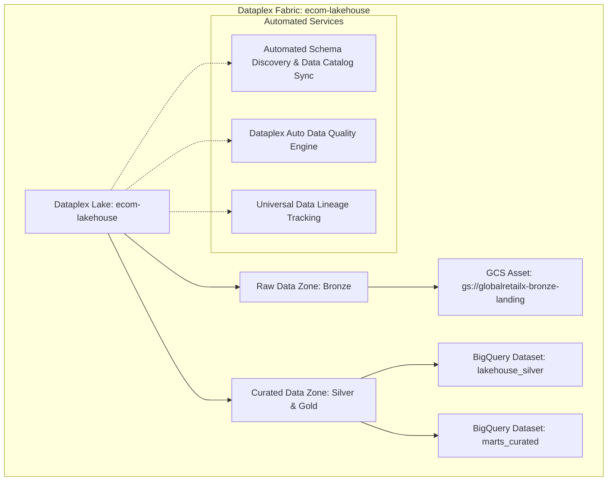
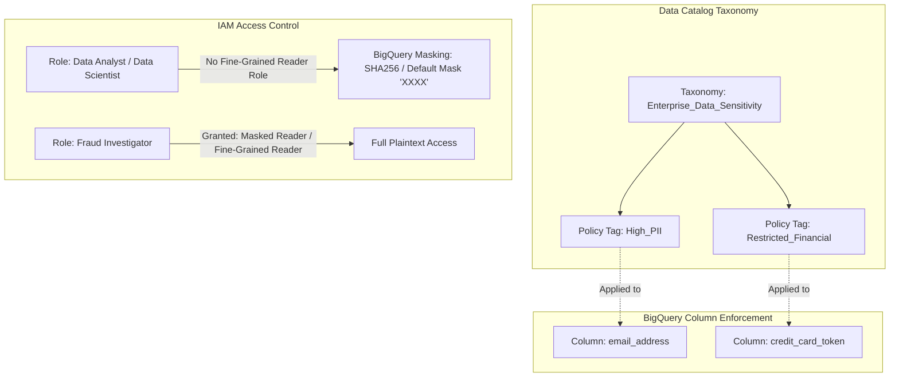

# 05. Orchestration, Governance & Serving Layer

## 1. Enterprise Scenario: Enterprise Delivery & Unified Governance

GlobalRetailX requires an enterprise orchestration engine, unified data cataloging, zero-trust data security, and high-performance serving architectures to deliver insights to **12,000 internal business users**, **500 corporate data analysts**, and **50 third-party supply chain partners**.

```
                         GLOBALRETAILX SERVING & GOVERNANCE TOPOLOGY
                         
+----------------------------------------------------------------------------------------------------+
|                                  ORCHESTRATION & SCHEDULING CONTROL                                |
|  - Cloud Composer 3 (Apache Airflow): Heavy cross-service dependencies, SLA sensors, batch DAGs   |
|  - Cloud Workflows: Low-latency, serverless event-driven execution (Eventarc -> Workflows)         |
+--------------------------------------------------+-------------------------------------------------+
                                                   |
                                                   v
+----------------------------------------------------------------------------------------------------+
|                               UNIFIED GOVERNANCE LAYER (DATAPLEX)                                  |
|  - Lake: `ecom-lakehouse`                                                                          |
|  - Raw Zone: Unstructured/semi-structured GCS landing assets                                       |
|  - Curated Zone: Conformed BigQuery native storage assets                                          |
|  - Auto Data Quality (AutoDQ): Declarative YAML quality assertions executed via serverless compute |
|  - Data Catalog & Lineage: End-to-end tracking from source RDBMS to Looker reports                 |
|  - Sensitive Data Protection: Column-level Policy Tags (PII Cryptographic Hash / Masking)          |
+--------------------------------------------------+-------------------------------------------------+
                                                   |
                                                   v
+----------------------------------------------------------------------------------------------------+
|                                      ANALYTICS & SERVING ENGINES                                   |
|  +---------------------------+   +----------------------------+   +-----------------------------+  |
|  |     BigQuery BI Engine    |   |     Analytics Hub          |   |  Vertex AI Feature Store    |  |
|  |  - In-memory acceleration |   |  - Data Clean Rooms        |   |  - Online Serving (Bigtable)|  |
|  |  - Sub-second Looker/Tab  |   |  - Authorized Datasets     |   |  - Offline Training (BQ)    |  |
|  |  - Zero dashboard latency |   |  - External Partner Exch.  |   |  - Zero Feature Skew        |  |
|  +---------------------------+   +----------------------------+   +-----------------------------+  |
+----------------------------------------------------------------------------------------------------+
```

---

## 2. Pipeline Orchestration: Cloud Composer vs. Cloud Workflows

Choosing the correct orchestration technology is a cornerstone requirement of the Google Cloud Professional Data Engineer exam.

```
                    ORCHESTRATION ARCHITECTURAL DECISION MATRIX
                    
                                Trigger Mechanism
                                        |
                 +----------------------+----------------------+
                 |                                             |
                 v Event-Driven (<100ms)                       v Scheduled / Complex DAGs
         HTTP / Eventarc / Webhook                     Complex Cross-System Dependencies
         Short-lived, low compute                      Dynamic Tasks, Python Operators
         Zero persistent infrastructure                Dataform, Dataproc, GCS Sensors
                 |                                             |
                 v                                             v
         +-----------------+                           +-----------------+
         | Cloud Workflows |                           | Cloud Composer  |
         |  (Serverless)   |                           | (Apache Airflow)|
         +-----------------+                           +-----------------+
```

### 2.1 Architectural Comparison

| Dimension | Cloud Composer 3 (Managed Apache Airflow) | Cloud Workflows (Serverless State Engine) |
| :--- | :--- | :--- |
| **Execution Paradigm** | Heavyweight DAG scheduling. Executes long-running multi-stage data pipelines. | Lightweight, HTTP-centric JSON/YAML workflow engine. Orchestrates serverless GCP services. |
| **Startup / Latency** | Task scheduling introduces 5 to 30 seconds of Airflow scheduler evaluation latency. | Sub-second execution latency (<50ms). Instant cold start. |
| **Underlying Compute** | Fully managed on Google Kubernetes Engine (GKE Autopilot in Composer 3). | Serverless, fully managed Google infrastructure (zero VM footprint). |
| **Cost Profile** | Continuous cost (~$300–$600+/month minimum baseline for environment, database, and workers). | Billed strictly per step executed (first 5,000 steps/month free, then fractions of a cent). |
| **Integration Strengths** | Native Airflow operators for BigQuery, Dataform, Dataproc, GCS, Slack, and Spark. | Native Google Cloud API connectors with automatic OAuth/OIDC credential injection. |

### 2.2 Airflow Production Engineering: Sensors, XComs & Deferrable Operators

In large-scale production environments, unoptimized Airflow DAGs frequently exhaust scheduler resources and trigger worker outages.

#### 1. The Sensor Slot Starvation Anti-Pattern
Standard Airflow sensors (e.g., `GCSObjectExistenceSensor`) operating in `mode="poke"` execute a blocking sleep loop, **occupying an entire worker task slot for the entire duration of the wait**. If 30 sensors are waiting for external 3PL files, all 30 worker slots become unavailable, causing downstream transformation pipelines to queue indefinitely.
* **The Solution**: 
  1. Use `mode="reschedule"`, which releases the worker slot between checks.
  2. Use **Deferrable (Async) Operators** based on Python `asyncio`. Deferrable operators hand the waiting state off to an asynchronous Triggerer process, consuming virtually zero worker resources.

#### 2. The XCom Anti-Pattern
Airflow's Cross-Communication (XCom) system persists messages in the Airflow metadata backend (Cloud SQL PostgreSQL). Passing large datasets, multi-megabyte JSON payloads, or dataframes via `xcom_push` will degrade metadata database performance and crash workers.
* **The Solution**: Pass only tiny primitives (e.g., partition dates, GCS URIs, row counts) via XCom. Large payloads must reside in GCS or BigQuery.

### 2.3 Production Cloud Composer DAG

Below is an enterprise DAG orchestrating an end-to-end data pipeline: checking GCS landing files with an async sensor, triggering Dataform compilation and execution, running Dataplex quality assertions, and refreshing BI Engine caches.

```python
# File: dags/ecom_omnichannel_orchestrator.py
from datetime import datetime, timedelta
from airflow import DAG
from airflow.providers.google.cloud.sensors.gcs import GCSObjectExistenceSensor
from airflow.providers.google.cloud.operators.dataform import (
    DataformCreateCompilationResultOperator,
    DataformCreateWorkflowInvocationOperator
)
from airflow.providers.google.cloud.operators.dataplex import DataplexRunDataQualityScanOperator
from airflow.providers.google.cloud.operators.bigquery import BigQueryInsertJobOperator

DEFAULT_ARGS = {
    "owner": "data-engineering",
    "depends_on_past": False,
    "email_on_failure": True,
    "email": ["data-alerts@globalretailx.com"],
    "retries": 3,
    "retry_delay": timedelta(minutes=5),
    "retry_exponential_backoff": True,
    "max_retry_delay": timedelta(minutes=30),
    "execution_timeout": timedelta(hours=2)
}

with DAG(
    dag_id="omnichannel_daily_curation_pipeline",
    default_args=DEFAULT_ARGS,
    description="End-to-end daily orchestration: Landing -> Dataform -> Dataplex -> BI Engine",
    schedule_interval="0 3 * * *",  # 03:00 AM UTC Daily
    start_date=datetime(2026, 1, 1),
    catchup=False,
    max_active_runs=1,
    tags=["production", "lakehouse", "omnichannel"]
) as dag:

    # Step 1: Deferrable GCS Sensor (Releases worker slot while waiting)
    wait_for_logistics_manifest = GCSObjectExistenceSensor(
        task_id="wait_for_logistics_manifest",
        bucket="globalretailx-bronze-landing",
        object="partner_s3_logistics/year={{ macros.ds_format(ds, '%Y-%m-%d', '%Y') }}/month={{ macros.ds_format(ds, '%Y-%m-%d', '%m') }}/day={{ macros.ds_format(ds, '%Y-%m-%d', '%d') }}/manifest.json",
        google_cloud_conn_id="google_cloud_default",
        mode="reschedule",      # Non-blocking slot release
        poke_interval=180,      # Check every 3 minutes
        timeout=3600,           # Fail after 1 hour if file hasn't landed
        deferrable=True         # Async execution on Triggerer
    )

    # Step 2: Compile Dataform Workspace (Targeting Production)
    compile_dataform = DataformCreateCompilationResultOperator(
        task_id="compile_dataform_code",
        project_id="globalretailx-prod",
        region="us-central1",
        repository_id="globalretailx-dataform-repo",
        compilation_result={
            "git_commitish": "main",
            "code_compilation_config": {
                "assertion_schema": "marts_curated_assertions",
                "vars": {"execution_date": "{{ ds }}"}
            }
        }
    )

    # Step 3: Execute Dataform Invocation (Run Transformations)
    execute_dataform = DataformCreateWorkflowInvocationOperator(
        task_id="execute_dataform_workflow",
        project_id="globalretailx-prod",
        region="us-central1",
        repository_id="globalretailx-dataform-repo",
        workflow_invocation={
            "compilation_result": "{{ task_instance.xcom_pull('compile_dataform_code')['name'] }}",
            "invocation_config": {
                "included_tags": ["daily_marts"],
                "transitive_dependencies_included": True
            }
        }
    )

    # Step 4: Run Dataplex Automated Data Quality Scan
    run_dataplex_quality_scan = DataplexRunDataQualityScanOperator(
        task_id="run_dataplex_quality_scan",
        project_id="globalretailx-prod",
        region="us-central1",
        data_quality_scan_id="scan-silver-orders-integrity"
    )

    # Step 5: Warm / Refresh BI Engine Acceleration Cache
    refresh_bi_engine_warmup = BigQueryInsertJobOperator(
        task_id="refresh_bi_engine_warmup",
        configuration={
            "query": {
                "query": """
                    SELECT fulfillment_region, store_id, SUM(net_amount)
                    FROM `globalretailx-prod.marts_curated.fact_daily_omnichannel_sales`
                    WHERE transaction_date >= DATE_SUB(CURRENT_DATE(), INTERVAL 30 DAY)
                    GROUP BY 1, 2;
                """,
                "useLegacySql": False
            }
        }
    )

    # Pipeline Dependency Graph
    wait_for_logistics_manifest >> compile_dataform >> execute_dataform >> run_dataplex_quality_scan >> refresh_bi_engine_warmup
```

---

## 3. Unified Governance with Google Cloud Dataplex

Dataplex provides an intelligent data fabric that unifies distributed data across Cloud Storage and BigQuery without requiring data movement, establishing consistent metadata management, data governance, and automated quality auditing.



### 3.1 Dataplex Resource Hierarchy
1. **Lake**: Logical container representing a primary data domain (e.g., `ecom-lakehouse`).
2. **Zones**: Sub-divisions within a lake to enforce maturity, security, or analytical readiness:
   * **Raw Zone**: Permissive, stores unstructured or raw formats (Cloud Storage buckets).
   * **Curated Zone**: Strict, stores conformed, schema-enforced data (BigQuery datasets).
3. **Assets**: Pointers mapping real cloud resources (GCS buckets, BigQuery datasets) into zones.

### 3.2 Automated Data Quality (Dataplex AutoDQ)

Dataplex AutoDQ replaces custom Python validation scripts with declarative, serverless YAML specifications evaluated directly inside BigQuery without maintaining compute clusters.

```yaml
# File: dataplex_rules/orders_quality_rules.yaml
metadata:
  version: "1.0"
rules:
  # Check 1: Mandatory Primary Key Completeness
  - column: order_id
    dimension: COMPLETENESS
    threshold: 1.0 # 100% Non-Null enforcement
    rule:
      nonNullExpectation: {}

  # Check 2: Uniqueness of Order Transactions
  - column: order_id
    dimension: UNIQUENESS
    threshold: 1.0 # 0% duplicates allowed
    rule:
      uniquenessExpectation: {}

  # Check 3: Valid Financial Bounds
  - column: net_amount
    dimension: VALIDITY
    threshold: 0.999 # 99.9% tolerance for negative refund records
    rule:
      rangeExpectation:
        minValue: "0.00"
        maxValue: "50000.00"

  # Check 4: Cross-Table Referential Integrity
  - column: customer_id
    dimension: INTEGRITY
    threshold: 1.0
    rule:
      sqlAssertion:
        sqlStatement: """
          SELECT customer_id FROM ${data()}
          WHERE customer_id NOT IN (
            SELECT customer_id FROM `globalretailx-prod.lakehouse_silver.dim_customers`
          )
        """
```

### 3.3 Sensitive Data Protection & Column-Level Policy Tags

Enterprise governance requires hiding customer PII from general analytics users while granting unmasked access to authorized fraud investigators.



#### Provisioning Policy Tags via DDL and IAM
```sql
-- Step 1: Create Taxonomy and Tags via Data Catalog
-- Policy Tag Resource: projects/globalretailx-prod/locations/us-central1/taxonomies/12345/policyTags/67890

-- Step 2: Apply Policy Tag to BigQuery Table Schema
ALTER TABLE `globalretailx-prod.lakehouse_silver.customers`
ALTER COLUMN email SET DATA POLICY `projects/globalretailx-prod/locations/us-central1/dataPolicies/mask-email-hash`;

-- Step 3: Grant Fine-Grained Reader to Authorized Security Group
GRANT `roles/datacatalog.categoryFineGrainedReader`
ON POLICY TAG `projects/globalretailx-prod/locations/us-central1/taxonomies/12345/policyTags/67890`
TO "group:security-compliance-team@globalretailx.com";
```

---

## 4. Serving Layer: High-Performance Delivery

Once curated and governed, data must be served to downstream consumers with zero-latency overhead.

```
                           SERVING ARCHITECTURE PATTERNS
                           
                               Downstream Consumer
                                        |
                 +----------------------+----------------------+
                 |                                             |
                 v Interactive BI / Dashboards                 v External B2B Data Sharing
         Looker / Tableau Executive Reports            3PL Logistics / Suppliers
         Sub-second response SLA (<1s)                 Zero Data Copy / Secure Exchange
                 |                                             |
                 v                                             v
       +--------------------+                        +--------------------+
       | BigQuery BI Engine |                        |   Analytics Hub    |
       | In-Memory Caching  |                        |  Data Clean Rooms  |
       +--------------------+                        +--------------------+
```

### 4.1 BigQuery BI Engine In-Memory Acceleration

BI Engine is an in-memory analysis service built directly into BigQuery. It accelerates SQL queries from Looker, Tableau, and Google Sheets by caching table columns into high-performance RAM, delivering **sub-second query response times** and eliminating slot contention.

* **Vectorized Processing Engine**: Queries execute natively in memory against compressed columnar fragments.
* **Smart Tuning / Zero Management**: Requires no manual index creation or ETL cache maintenance. BigQuery automatically invalidates the cache when the underlying partition is updated by an upstream pipeline.

#### Allocating BI Engine Capacity via CLI
```bash
# Reserve 50 GB of BI Engine RAM for the us-central1 analytics processing project
gcloud bi-engine capacities create \
    --project=globalretailx-prod \
    --location=us-central1 \
    --preferred-tables="globalretailx-prod.marts_curated.fact_daily_omnichannel_sales,globalretailx-prod.marts_curated.dim_customers_scd2" \
    --size-gb=50
```

### 4.2 Analytics Hub & Data Clean Rooms

When sharing retail sales and inventory velocity feeds with external suppliers (e.g., Procter & Gamble, Nike), legacy methods required insecure SFTP batch dumps. **Analytics Hub** provides decentralized data sharing without data duplication:

* **Publishers & Subscribers**: GlobalRetailX publishes a curated dataset as an **Analytics Hub Listing**. Suppliers subscribe to the listing, creating a linked, read-only dataset directly inside their own Google Cloud projects.
* **Data Clean Rooms**: Enables multi-party cryptographic analysis. GlobalRetailX and an ad platform (e.g., Google Ads) analyze customer overlap without either party exposing raw PII to the other.

---

## 5. Failure Modes, Orchestration Bottlenecks & Recovery

| Failure Scenario | Root Cause | Operational Impact | Engineering Solution |
| :--- | :--- | :--- | :--- |
| **Airflow Worker OOM (Out of Memory)** | An engineer executed `df = hook.get_pandas_df(huge_query)` inside a custom PythonOperator. | Worker GKE container exceeds memory limits; pod restarts (`OOMKilled`). Downstream tasks fail. | Prohibit dataframe operations on Composer workers. Offload all compute to BigQuery, Dataflow, or Dataproc. Workers must strictly dispatch API jobs and wait asynchronously. |
| **Airflow Scheduler Deadlock** | Excessive DAG files (>500) parsing every 30 seconds; slow disk I/O on GCS DAGs bucket. | DAG scheduling delays exceed 15 minutes; tasks remain queued indefinitely. | 1. Tune `dag_dir_list_interval` and `min_file_process_interval` in Airflow configs.<br>2. Remove top-level database connections or dynamic API calls in DAG global scope.<br>3. Upgrade to Cloud Composer 3 with dynamic scheduler autoscaling. |
| **Dataplex AutoDQ False Alarms** | A marketing flash sale generates legitimate $0.00 promotional orders, breaching a naive `net_amount > 0` validation rule. | Pipeline terminates; executive marts fail to refresh. | Refactor Dataplex AutoDQ rule with conditional filtering: `rangeExpectation` applied strictly to `WHERE is_promotional_item = FALSE`. Set non-zero failure thresholds (`threshold: 0.98`). |
| **BI Engine Cache Eviction Storm** | High-frequency streaming inserts update the underlying BigQuery fact table continuously every 10 seconds. | BI Engine constantly invalidates in-memory cache blocks; query times degrade to standard Dremel latency. | Decouple real-time append tables from reporting marts. Ingest real-time streams into an hourly staging table; use scheduled Dataform jobs to merge into the BI Engine-cached gold table at controlled intervals. |

---

## 6. Professional Data Engineer (PDE) Knowledge Check

#### Question 1
GlobalRetailX uses Cloud Composer 3 to orchestrate daily batch processing. Several tasks in the DAG use `GCSObjectExistenceSensor` to wait for external supplier files that arrive unpredictably between 01:00 AM and 05:00 AM. During this period, other high-priority transformation tasks fail to start and report that worker slots are saturated. What is the root cause, and how do you resolve it?

- A. The Airflow scheduler has crashed; scale up the Cloud SQL metadata backend instance.
- B. The sensors are running in the default `poke` mode, occupying worker slots continuously while sleeping. Modify the sensors to use `mode="reschedule"` or convert them to `deferrable=True` operators.
- C. Increase the size of the Composer Cloud Storage DAGs bucket.
- D. Cloud Composer does not support waiting for external files; replace the pipeline with an hourly cron job.

**Answer: B**
*Explanation*: In Apache Airflow, a sensor operating in `poke` mode holds a worker task slot for its entire execution duration, even while sleeping between pings. When multiple sensors wait simultaneously, they consume all available worker concurrency, starving other DAGs of execution capacity. Setting `mode="reschedule"` causes the sensor to release the worker slot between checks. Better yet, using `deferrable=True` hands off the execution to the Airflow Triggerer process, using zero worker task slots.

---

#### Question 2
Your compliance security officer mandates that corporate data analysts must not see customer credit card tokens in plaintext when querying BigQuery tables. However, a specialized Fraud Investigation service account must be able to view the full unmasked tokens. The solution must prevent data duplication and minimize administrative overhead. What should you do?

- A. Export the table to Cloud Storage, run a Python script to strip the credit card column, and load it into a separate dataset for analysts.
- B. Define a Data Catalog Taxonomy with a `Restricted_PCI` Policy Tag. Apply the policy tag to the credit card column in the table schema. Configure BigQuery Data Masking on the tag, and grant the `roles/datacatalog.categoryFineGrainedReader` role exclusively to the Fraud Investigation service account.
- C. Create an authorized view that drops the credit card column and revoke table permissions from analysts.
- D. Encrypt the column using a Python script and store the decryption key on a public GitHub repository.

**Answer: B**
*Explanation*: BigQuery Column-Level Security combined with Data Masking (via Data Catalog / Dataplex Policy Tags) is the sanctioned enterprise pattern. By attaching a policy tag to the specific column, users without the `roles/datacatalog.categoryFineGrainedReader` role automatically see masked data (e.g., hash, default string mask, or nulls), while authorized entities see plaintext. This prevents data duplication and scales across thousands of queries.

---

#### Question 3
An executive Looker dashboard querying a 500 GB BigQuery Gold Mart table takes 8 to 12 seconds to load during morning board meetings, causing dissatisfaction among C-suite executives. The underlying data is refreshed only once per night. The team demands sub-second dashboard interactions without migrating data out of BigQuery. How should you meet this requirement?

- A. Replicate the data into Cloud Spanner.
- B. Provision BigQuery BI Engine reservation capacity in the project region and add the Gold Mart table to the preferred tables configuration.
- C. Rewrite the dashboard queries to avoid SQL joins.
- D. Export the data to Google Sheets.

**Answer: B**
*Explanation*: BigQuery BI Engine is an in-memory analysis engine specifically engineered to accelerate interactive dashboard workloads. By provisioning BI Engine reservation capacity (RAM) and designating preferred tables, BigQuery loads the required columnar data into fast in-memory storage, delivering sub-second query response times for Looker, Tableau, and ad-hoc analysts without changing the SQL queries or moving the data.
