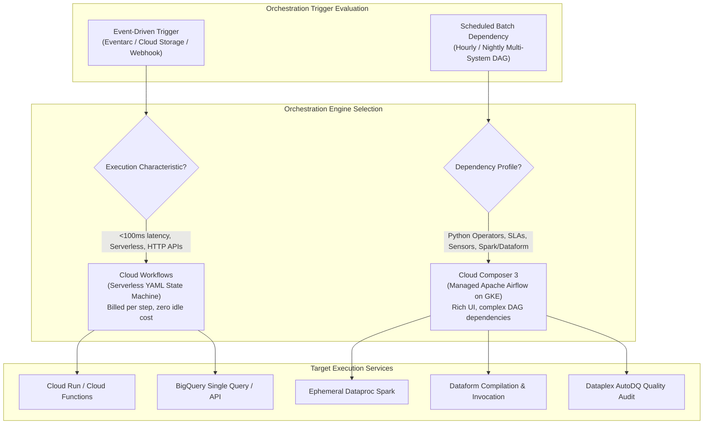
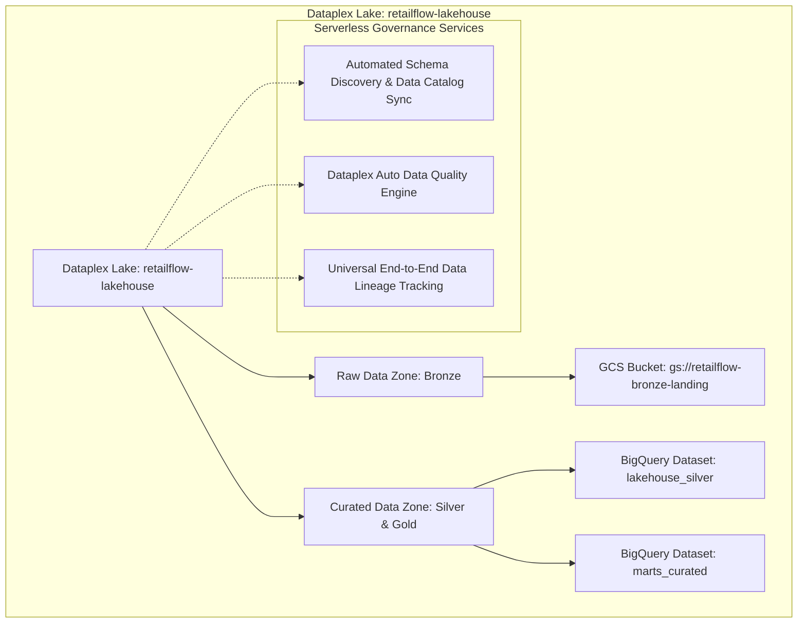
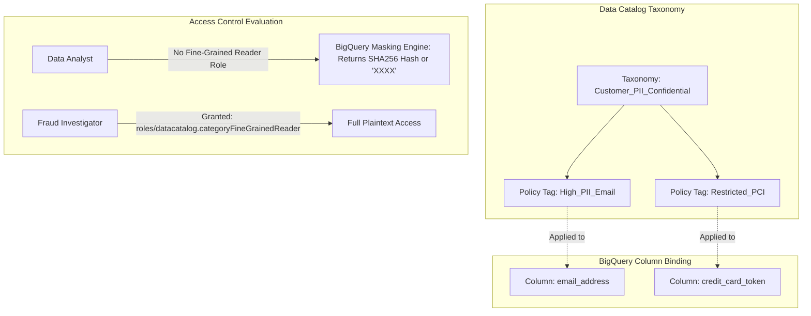

# 05. Orchestration, Governance & Serving Layer

---

## Learning Objectives
By the end of this module, a data engineer or architect will be able to:
1. **Understand** the structural differences between heavy batch DAG orchestrators (Cloud Composer / Apache Airflow) and serverless event-driven state machines (Cloud Workflows).
2. **Translate** familiar Databricks Workflows, Apache Airflow, Unity Catalog, and Tableau/PowerBI acceleration patterns directly into Google Cloud native services.
3. **Analyze** the operational mechanics, sensor slot starvation anti-patterns, and deferrable operator paradigms within Cloud Composer 3.
4. **Design** an enterprise data mesh and governance architecture using Dataplex (Lakes, Zones, Assets), Automated Data Quality (AutoDQ), and Column-Level Policy Tags with Dynamic Data Masking.
5. **Architect** sub-second serving layers using BigQuery BI Engine in-memory acceleration and external B2B data exchange using Analytics Hub Data Clean Rooms.
6. **Troubleshoot** orchestration bottlenecks, including Airflow worker pool exhaustion, scheduler parsing latency, and BI Engine cache invalidation loops.

---

## Databricks & Airflow to Google Cloud Orchestration Bridge

Engineers transitioning from Databricks, self-hosted Apache Airflow, and traditional governance tools can map their mental models directly to Google Cloud services:

| Databricks / Open Source Concept | Google Cloud Native Equivalent | Architectural Parity & Technical Distinctions |
| :--- | :--- | :--- |
| **Self-Hosted Airflow / Databricks Workflows** | **Cloud Composer 3 (Managed Airflow)** | Cloud Composer provides fully managed Apache Airflow running on Google Kubernetes Engine (GKE Autopilot). It automates environment creation, scheduler autoscaling, security patching, and metadata database maintenance, with native operators for all Google Cloud services. |
| **AWS Step Functions / Serverless Lambdas** | **Cloud Workflows** | A fully serverless, low-latency state machine orchestrator defined in YAML/JSON. Unlike Composer, Workflows has **zero persistent infrastructure footprint**, executes steps in <50ms, and costs fractions of a cent per execution. |
| **Unity Catalog Governance / AWS Lake Formation** | **Dataplex & Data Catalog** | Dataplex provides an intelligent data fabric that unifies data across Cloud Storage buckets and BigQuery datasets without moving data. Manages logical Lakes, Zones, and Assets, automated schema discovery, universal data lineage, and declarative AutoDQ rules. |
| **Unity Catalog Column Masking / Ranger** | **Data Catalog / Dataplex Policy Tags** | Fine-grained access control using hierarchical taxonomy tags. Attaching a policy tag to a BigQuery column automatically applies SHA256 hashing, default masking, or nulling to users without the `roles/datacatalog.categoryFineGrainedReader` role. |
| **Tableau Hyper Extracts / PowerBI In-Memory** | **BigQuery BI Engine** | Built-in in-memory analysis service. Caches BigQuery columnar fragments into high-speed memory to deliver **sub-second SQL response times** to Looker, Tableau, and ad-hoc analysts without data extracts or cache tuning. |
| **Snowflake Data Clean Rooms / Delta Sharing** | **Analytics Hub** | Enables secure multi-party data exchange without copying data. Publishers share live, read-only BigQuery datasets across projects and organizations, with built-in privacy protection and data clean rooms for cryptographic query matching. |

---

## 1. Architectural Foundation: Heavyweight DAGs vs. Lightweight Event Choreography

Enterprise data pipelines require two fundamentally different orchestration paradigms:
1. **Heavyweight Scheduled DAG Orchestration (Cloud Composer / Airflow)**:
   - Designed for complex, multi-system batch dependencies (e.g., "Wait for 3PL partner file in GCS, spin up Dataproc Spark cluster, trigger Dataform incremental merge in BigQuery, run Dataplex data quality assertions, refresh BI Engine cache, tear down Dataproc cluster").
   - Driven by calendar schedules (cron) or complex dependency sensors.
   - Features rich monitoring UIs, historical task run graphs, retry policies, and Python-native operators.
2. **Lightweight Serverless Event Choreography (Cloud Workflows)**:
   - Designed for rapid, event-driven microservice workflows (e.g., "Customer initiates refund request $\to$ Eventarc triggers Workflow $\to$ Verify fraud risk in Cloud Run $\to$ Update Cloud Spanner $\to$ Call Stripe API $\to$ Publish confirmation to Pub/Sub").
   - Millisecond execution latency (<50ms). Zero persistent infrastructure or standby cost.



---

## 2. Enterprise Scenario: RetailFlow Serving & Governance Topology

RetailFlow serves insights and data assets to **12,000 internal business users**, **500 corporate data analysts**, and **50 third-party supply chain partners**.

```
                         RETAILFLOW SERVING & GOVERNANCE TOPOLOGY
                         
+----------------------------------------------------------------------------------------------------+
|                                  ORCHESTRATION & SCHEDULING CONTROL                                |
|  - Cloud Composer 3 (Apache Airflow): Heavy cross-service dependencies, SLA sensors, batch DAGs   |
|  - Cloud Workflows: Low-latency, serverless event-driven execution (Eventarc -> Workflows)         |
+--------------------------------------------------+-------------------------------------------------+
                                                   |
                                                   v
+----------------------------------------------------------------------------------------------------+
|                               UNIFIED GOVERNANCE LAYER (DATAPLEX)                                  |
|  - Lake: `retailflow-lakehouse`                                                                    |
|  - Raw Zone: Unstructured/semi-structured GCS landing assets                                       |
|  - Curated Zone: Conformed BigQuery native storage assets                                          |
|  - Auto Data Quality (AutoDQ): Declarative YAML quality assertions executed via serverless compute |
|  - Data Catalog & Lineage: End-to-end tracking from source RDBMS to Looker reports                 |
|  - Sensitive Data Protection: Column-level Policy Tags (PII Cryptographic Hash / Masking)          |
+--------------------------------------------------+-------------------------------------------------+
                                                   |
                                                   v
+----------------------------------------------------------------------------------------------------+
|                                      ANALYTICS & SERVING ENGINES                                   |
|  +---------------------------+   +----------------------------+   +-----------------------------+  |
|  |     BigQuery BI Engine    |   |     Analytics Hub          |   |  Vertex AI Feature Store    |  |
|  |  - In-memory acceleration |   |  - Data Clean Rooms        |   |  - Online Serving (Bigtable)|  |
|  |  - Sub-second Looker/Tab  |   |  - Authorized Datasets     |   |  - Offline Training (BQ)    |  |
|  |  - Zero dashboard latency |   |  - External Partner Exch.  |   |  - Zero Feature Skew        |  |
|  +---------------------------+   +----------------------------+   +-----------------------------+  |
+----------------------------------------------------------------------------------------------------+
```

---

## 3. Standardized Service Deep Dive: Cloud Composer & Cloud Workflows

### 1. The Problem
Enterprise data pipelines involve heterogeneous systems: ingesting files from SFTP, validating formats, running Spark jobs, executing SQL transformations, running data quality checks, and notifying stakeholders. Writing custom shell scripts or cron jobs creates fragile pipelines that lack centralized logging, automated retries, error alerting, backfilling capabilities, and dependency management.

### 2. Understand the Concept
**Workflow Orchestration** structures complex pipelines into **Directed Acyclic Graphs (DAGs)**. Nodes represent distinct tasks (operators), and edges represent dependencies. The orchestrator guarantees that Task B executes only after Task A completes successfully, automatically handles retries with exponential backoff, and provides visual auditability.

*Databricks / Cloud Comparison*:
- Cloud Composer corresponds directly to self-hosted Apache Airflow or Databricks Workflows, providing the industry-standard Airflow Python API.
- Cloud Workflows corresponds to AWS Step Functions, providing serverless state-machine execution via declarative YAML.

### 3. Google Cloud Implementation
1. **Cloud Composer 3**: Built on **Google Kubernetes Engine (GKE) Autopilot**. The control plane (Airflow Webserver, Airflow Scheduler, Triggerer, and Cloud SQL metadata database) is fully managed. Workers scale dynamically based on workload concurrency without manual GKE cluster node sizing.
2. **Cloud Workflows**: A serverless, pay-per-step execution engine with built-in Google Cloud API connectors, automatic IAM token injection, and native JSON parsing.

### 4. How It Works (Components & Workflow)

```mermaid
graph TD
    subgraph Cloud_Composer_Architecture["Cloud Composer 3 Architecture (GKE Autopilot)"]
        Scheduler[Airflow Scheduler Fleet<br/>(Parses DAGs, Evaluates Dependencies)]
        Triggerer[Airflow Triggerer<br/>(Async Event Loop for Deferrable Sensors)]
        Workers[Dynamic GKE Worker Fleet<br/>(Dispatches Tasks & Operators)]
        MetadataDB[(Cloud SQL Postgres<br/>Airflow State Metadata)]
        DAG_Bucket[Cloud Storage DAGs Bucket<br/>gs://.../dags/]
    end

    DAG_Bucket -->|Sync Python DAGs| Scheduler
    Scheduler <--> MetadataDB
    Scheduler -->|Dispatch Active Tasks| Workers
    Workers -->|Hand off Async Wait| Triggerer
    Triggerer -->|Resume Task| Scheduler
```

#### Airflow Sensor Slot Starvation vs. Deferrable Operators
In high-throughput environments, unoptimized Airflow sensors cause critical outages:
- **The Poke Slot Starvation Anti-Pattern**: Standard sensors (`GCSObjectExistenceSensor(mode="poke")`) run in a continuous sleep loop on a worker thread. **They occupy an entire worker task slot for hours while doing nothing**. If 20 sensors wait for external supplier files, all 20 worker slots become saturated, preventing downstream ETL pipelines from starting.
- **The Reschedule Solution**: `mode="reschedule"` releases the worker slot between checks and schedules the sensor to wake up later.
- **The Gold Standard: Deferrable (Async) Operators**: Setting `deferrable=True` hands the waiting task off to the **Airflow Triggerer process** via Python `asyncio`. A single Triggerer can monitor thousands of waiting files or BigQuery jobs concurrently using virtually zero worker task slots.

### 5. Practical Example: RetailFlow End-to-End Orchestrator DAG
Below is the production Airflow DAG orchestrating an end-to-end data pipeline: checking GCS landing files with an async sensor, triggering Dataform compilation and execution, running Dataplex quality assertions, and refreshing BI Engine caches:

```python
# File: dags/retailflow_omnichannel_orchestrator.py
from datetime import datetime, timedelta
from airflow import DAG
from airflow.providers.google.cloud.sensors.gcs import GCSObjectExistenceSensor
from airflow.providers.google.cloud.operators.dataform import (
    DataformCreateCompilationResultOperator,
    DataformCreateWorkflowInvocationOperator
)
from airflow.providers.google.cloud.operators.dataplex import (
    DataplexRunDataQualityScanOperator
)
from airflow.providers.google.cloud.operators.bigquery import BigQueryInsertJobOperator

DEFAULT_ARGS = {
    "owner": "data-platform-team",
    "depends_on_past": False,
    "email_on_failure": True,
    "email": ["data-alerts@retailflow.com"],
    "retries": 2,
    "retry_delay": timedelta(minutes=5)
}

with DAG(
    dag_id="retailflow_daily_omnichannel_pipeline",
    default_args=DEFAULT_ARGS,
    description="Orchestrates landing validation, Dataform ELT, Dataplex AutoDQ, and BI Engine refresh",
    schedule_interval="0 3 * * *", # 03:00 AM UTC Daily
    start_date=datetime(2026, 1, 1),
    catchup=False,
    max_active_runs=1,
    tags=["production", "lakehouse", "retailflow"]
) as dag:

    # Step 1: Wait asynchronously for 3PL logistics manifest using Deferrable Sensor
    wait_for_logistics_manifest = GCSObjectExistenceSensor(
        task_id="wait_for_logistics_manifest",
        bucket="retailflow-bronze-landing",
        object="partner_s3_logistics/year={{ ds_nodash[:4] }}/month={{ ds_nodash[4:6] }}/day={{ ds_nodash[6:8] }}/manifest.sentinel",
        deferrable=True, # Releases worker slot completely!
        timeout=14400,   # 4 hours max wait
        poke_interval=60
    )

    # Step 2: Compile Dataform SQLX repository
    compile_dataform = DataformCreateCompilationResultOperator(
        task_id="compile_dataform_code",
        project_id="retailflow-prod",
        region="us-central1",
        repository_id="retailflow-lakehouse-dataform",
        compilation_result={
            "git_commitish": "main"
        }
    )

    # Step 3: Execute Dataform Invocation (Incremental Merge into Silver/Gold)
    execute_dataform = DataformCreateWorkflowInvocationOperator(
        task_id="execute_dataform_transformations",
        project_id="retailflow-prod",
        region="us-central1",
        repository_id="retailflow-lakehouse-dataform",
        workflow_invocation={
            "compilation_result": "{{ task_instance.xcom_pull('compile_dataform_code')['name'] }}"
        }
    )

    # Step 4: Run Dataplex AutoDQ Quality Scan
    run_quality_scan = DataplexRunDataQualityScanOperator(
        task_id="audit_gold_marts_quality",
        project_id="retailflow-prod",
        region="us-central1",
        data_scan_id="orders-gold-quality-scan"
    )

    # Step 5: Warm / Refresh BigQuery BI Engine In-Memory Cache
    warm_bi_engine_cache = BigQueryInsertJobOperator(
        task_id="warm_bi_engine_marts",
        configuration={
            "query": {
                "query": """
                  SELECT store_id, fulfillment_region, SUM(net_amount) 
                  FROM `retailflow-prod.marts_curated.fact_daily_omnichannel_sales`
                  WHERE order_timestamp >= TIMESTAMP_SUB(CURRENT_TIMESTAMP(), INTERVAL 30 DAY)
                  GROUP BY 1, 2;
                """,
                "useLegacySql": False
            }
        }
    )

    # Establish Dependency Graph
    wait_for_logistics_manifest >> compile_dataform >> execute_dataform >> run_quality_scan >> warm_bi_engine_cache
```

### 6. Architecture Integration
- **Upstream Events**: Eventarc, Cloud Storage object finalized triggers, Cloud Scheduler cron timers.
- **Orchestrated Runtimes**: Dataform (SQL transformations), Cloud Dataproc (Spark/Hadoop jobs), Cloud Dataflow (Beam batch jobs), Dataplex (Quality scans).
- **Downstream Notifications**: Slack webhooks, PagerDuty, SendGrid email alerts, Google Cloud Monitoring.

### 7. When to Use Which Service
| Architecture Requirement | Cloud Composer (Airflow) | Cloud Workflows |
| :--- | :--- | :--- |
| **Pipeline Nature** | Complex multi-stage batch data pipelines | Microservice and API orchestration |
| **Trigger Mechanism** | Scheduled (Cron) or complex dependencies | Event-driven (Eventarc, HTTP Post, Webhooks) |
| **Startup Latency** | 5 to 30 seconds scheduler lag | **Sub-second (<50ms)** instant start |
| **Task Concurrency** | Heavyweight; hundreds of parallel tasks | Lightweight; thousands of concurrent executions |
| **Cost Profile** | Continuous baseline (~$300–$600+/month) | **Zero baseline** (billed per execution step) |
| **Execution Duration**| Unbounded (tasks can run for hours/days) | Up to 1 year max execution time |

### 8. When Not to Use Them
- Never use Cloud Composer workers to execute in-memory Pandas dataframe manipulations or heavy data processing; workers exist strictly to dispatch API jobs to BigQuery, Dataproc, or Dataflow.
- Never use Cloud Workflows for heavy file transformations or multi-node Spark jobs; Workflows is strictly an HTTP orchestrator.

### 9. Trade-offs (Performance, Cost, Complexity, Ops)
- **Composer**: Full open-source ecosystem compatibility, rich UI; higher cost baseline, requires Airflow operator familiarity.
- **Workflows**: Ultra-low cost, serverless, instant startup; limited to JSON/YAML declarative definitions without custom Python operator libraries.

### 10. Common Misconceptions
- *Misconception*: Airflow workers should run Python data processing scripts using Pandas.  
  **Reality**: Executing data processing on Composer workers causes Worker Out-of-Memory (`OOMKilled`) failures. All compute must be offloaded to serverless engines (BigQuery, Dataflow, Dataproc).
- *Misconception*: Cloud Composer 3 requires manual Kubernetes node pool management.  
  **Reality**: Composer 3 runs on GKE Autopilot, automatically scaling worker pods up and down based on queue depth.

### 11. PDE Exam Perspective
- **Exam Trigger Phrases**: *"Complex cross-system dependencies, SLA alerts, dynamic task generation, Airflow DAGs"* $\to$ **Cloud Composer**.
- *"Serverless event-driven orchestration with zero standby cost and sub-second startup"* $\to$ **Cloud Workflows**.
- *"Airflow worker slots exhausted while waiting for external files"* $\to$ Switch sensor mode to `reschedule` or use **deferrable operators**.

---

## 4. Governance & Quality Fabric: Dataplex

Dataplex provides an intelligent data fabric that unifies distributed data across Cloud Storage and BigQuery without requiring data movement.



### 4.1 Dataplex Resource Hierarchy
1. **Lake**: Logical container representing a primary business data domain (e.g., `retailflow-lakehouse`).
2. **Zones**: Sub-divisions within a lake to enforce maturity, security, or analytical readiness:
   - *Raw Zone*: Permissive, stores unstructured or raw formats (Cloud Storage buckets).
   - *Curated Zone*: Strict, stores conformed, schema-enforced data (BigQuery datasets).
3. **Assets**: Pointers mapping real cloud resources (GCS buckets, BigQuery datasets) into zones without data replication.

### 4.2 Automated Data Quality (Dataplex AutoDQ)
Dataplex AutoDQ replaces custom validation scripts with declarative YAML specifications evaluated directly inside BigQuery using serverless compute:

```yaml
# File: dataplex_rules/orders_quality_rules.yaml
metadata:
  version: "1.0"
rules:
  # Check 1: Mandatory Primary Key Completeness
  - column: order_id
    dimension: COMPLETENESS
    threshold: 1.0 # 100% Non-Null enforcement
    rule:
      nonNullExpectation: {}

  # Check 2: Uniqueness of Order Transactions
  - column: order_id
    dimension: UNIQUENESS
    threshold: 1.0 # 0% duplicates allowed
    rule:
      uniquenessExpectation: {}

  # Check 3: Valid Financial Bounds
  - column: net_amount
    dimension: VALIDITY
    threshold: 0.999 # 99.9% tolerance for negative refund records
    rule:
      rangeExpectation:
        minValue: "0.00"
        maxValue: "50000.00"

  # Check 4: Cross-Table Referential Integrity
  - column: customer_id
    dimension: INTEGRITY
    threshold: 1.0
    rule:
      sqlAssertion:
        sqlStatement: """
          SELECT customer_id FROM ${data()}
          WHERE customer_id NOT IN (
            SELECT customer_id FROM `retailflow-prod.lakehouse_silver.dim_customers`
          )
        """
```

### 4.3 Column-Level Policy Tags & Dynamic Data Masking
Enterprise governance requires hiding customer PII from general analytics users while granting unmasked access to authorized fraud investigators.



---

## 5. Serving Layer: High-Performance Delivery

### 5.1 BigQuery BI Engine In-Memory Acceleration
BI Engine is an in-memory analysis service built natively into BigQuery. It accelerates SQL queries from Looker, Tableau, and Google Sheets by caching table columns into high-performance RAM, delivering **sub-second query response times** and eliminating slot contention.
- **Vectorized In-Memory Engine**: Queries execute natively against compressed in-memory columnar shards.
- **Smart Tuning / Zero Management**: Requires no manual index creation or ETL cache maintenance. BigQuery automatically invalidates the cache when the underlying partition is updated by an upstream pipeline.

```bash
# Reserve 50 GB of BI Engine RAM for the us-central1 analytics processing project
gcloud bi-engine capacities create \
    --project=retailflow-prod \
    --location=us-central1 \
    --preferred-tables="retailflow-prod.marts_curated.fact_daily_omnichannel_sales,retailflow-prod.marts_curated.dim_customers_scd2" \
    --size-gb=50
```

### 5.2 Analytics Hub & Data Clean Rooms
When sharing retail sales and inventory velocity feeds with external suppliers (e.g., Procter & Gamble, Nike), legacy methods required insecure SFTP batch dumps. **Analytics Hub** provides decentralized data sharing without data duplication:
- **Publishers & Subscribers**: RetailFlow publishes a curated dataset as an **Analytics Hub Listing**. Suppliers subscribe to the listing, creating a linked, read-only dataset directly inside their own Google Cloud projects.
- **Data Clean Rooms**: Enables multi-party cryptographic analysis. RetailFlow and an ad platform (e.g., Google Ads) analyze customer overlap without either party exposing raw PII to the other.

---

## 6. Active Learning: Architecture Prediction & Troubleshooting

### Scenario A: Predict the Architecture
**Business Challenge**:  
RetailFlow requires two distinct orchestration mechanisms:
1. **Pipeline A (Order Cancellation Webhook)**: When a customer clicks "Cancel Order" on the mobile storefront, an HTTP webhook must trigger an orchestration flow that verifies cancellation eligibility, updates Cloud SQL, notifies the warehouse via Pub/Sub, and initiates a refund via an external banking REST API. Total execution time must be under 300 milliseconds.
2. **Pipeline B (Nightly Financial Reconciliation)**: Every night at midnight, a workflow must verify that all 850 retail stores have uploaded their end-of-day register z-reports to GCS, execute a 45-minute Dataproc Spark reconciliation job, invoke Dataform models to refresh corporate financial marts, run Dataplex data quality audits, and email the CFO if quality assertions fail.

**Task**: Select and justify the orchestration engine for each pipeline.

#### Architectural Solution & Reasoning:
1. **Pipeline A $\to$ Cloud Workflows**: Requires sub-second startup (<50ms), serverless HTTP REST API integration, and zero idle cost. Cloud Composer is unsuited due to its 15–30 second scheduling evaluation latency.
2. **Pipeline B $\to$ Cloud Composer 3**: Involves complex multi-system batch dependencies, external file waiting sensors, long-running Dataproc and Dataform tasks, SLA alerting, and data quality conditionals. Airflow DAGs provide the necessary observability, retry semantics, and enterprise operators.

---

### Scenario B: Troubleshoot the Pipeline
**Production Incident**:  
At 03:30 AM, on-call engineers receive an alert that the primary daily analytics DAG in Cloud Composer has stalled. The Airflow Webserver UI shows:
- 35 task instances of `GCSObjectExistenceSensor` are in the `running` state, waiting for regional store register files.
- Downstream Dataform transformation tasks and BigQuery jobs are queued with status `None` or `scheduled`, unable to start.
- Cloud Monitoring indicates worker task slot utilization is at **100% capacity (40/40 slots busy)**, yet worker CPU utilization is hovering at **2%**.

#### Diagnostic Walkthrough:
1. **Identify the Symptom**: Worker task slots are 100% saturated while CPU utilization is near zero (2%).
2. **Root Cause Analysis**: The `GCSObjectExistenceSensor` tasks were configured with the default `mode="poke"`. In `poke` mode, each sensor **holds an entire worker task slot while sleeping between checks**. Because 35 store files had not yet arrived, 35 out of the 40 available worker slots were held by sleeping sensors, starving the remaining DAG tasks of execution capacity (**Sensor Slot Starvation**).
3. **Remediation Protocol**:
   - *Immediate Fix*: Add worker concurrency or scale up Composer worker limits to unblock pending jobs.
   - *Architectural Code Fix*: Refactor all sensors in the DAG codebase to use **Deferrable Operators**:
     ```python
     wait_for_store_file = GCSObjectExistenceSensor(
         task_id="wait_for_file",
         bucket="retailflow-store-reports",
         object="store_{{ params.store_id }}_report.csv",
         deferrable=True, # Releases worker slot to Airflow Triggerer!
         poke_interval=60
     )
     ```
     By setting `deferrable=True`, waiting state is offloaded to the asynchronous Airflow Triggerer process, releasing all 35 worker task slots immediately to run downstream Dataform and BigQuery compute jobs.

---

## 7. Professional Data Engineer (PDE) Knowledge Check

#### Question 1
RetailFlow uses Cloud Composer 3 to orchestrate daily batch processing. Several tasks in the DAG use `GCSObjectExistenceSensor` to wait for external supplier files that arrive unpredictably between 01:00 AM and 05:00 AM. During this period, other high-priority transformation tasks fail to start and report that worker slots are saturated. What is the root cause, and how do you resolve it?

- A. The Airflow scheduler has crashed; scale up the Cloud SQL metadata backend instance.
- B. The sensors are running in the default `poke` mode, occupying worker slots continuously while sleeping. Modify the sensors to use `mode="reschedule"` or convert them to `deferrable=True` operators.
- C. Increase the size of the Composer Cloud Storage DAGs bucket.
- D. Cloud Composer does not support waiting for external files; replace the pipeline with an hourly cron job.

**Answer: B**  
*Detailed Answer Analysis*:
* **Correct Answer: B**. In Apache Airflow, a sensor operating in default `poke` mode holds a worker task slot for its entire execution duration, even while sleeping between pings. When multiple sensors wait simultaneously, they consume all available worker concurrency, starving other DAGs of execution capacity. Setting `mode="reschedule"` causes the sensor to release the worker slot between checks. Better yet, using `deferrable=True` hands off the execution to the Airflow Triggerer process, using zero worker task slots.
* *Distractor Analysis*:
  * **A** is incorrect because worker slot saturation is caused by blocking sensor tasks, not a crash in the Airflow scheduler or Cloud SQL metadata instance.
  * **C** is incorrect because expanding the DAGs Cloud Storage bucket only affects disk capacity and has zero impact on Airflow worker task concurrency.
  * **D** is incorrect because Cloud Composer natively supports waiting for external files via sensors and Eventarc triggers; replacing it with cron does not solve external arrival timing.

---

#### Question 2
Your compliance security officer mandates that corporate data analysts must not see customer credit card tokens in plaintext when querying BigQuery tables. However, a specialized Fraud Investigation service account must be able to view the full unmasked tokens. The solution must prevent data duplication and minimize administrative overhead. What should you do?

- A. Export the table to Cloud Storage, run a Python script to strip the credit card column, and load it into a separate dataset for analysts.
- B. Define a Data Catalog Taxonomy with a `Restricted_PCI` Policy Tag. Apply the policy tag to the credit card column in the table schema. Configure BigQuery Data Masking on the tag, and grant the `roles/datacatalog.categoryFineGrainedReader` role exclusively to the Fraud Investigation service account.
- C. Create an authorized view that drops the credit card column and revoke table permissions from analysts.
- D. Encrypt the column using a Python script and store the decryption key on a public GitHub repository.

**Answer: B**  
*Detailed Answer Analysis*:
* **Correct Answer: B**. BigQuery Column-Level Security combined with Data Masking (via Data Catalog / Dataplex Policy Tags) is the sanctioned enterprise pattern. By attaching a policy tag to the specific column, users without the `roles/datacatalog.categoryFineGrainedReader` role automatically see masked data (e.g., hash, default string mask, or nulls), while authorized entities see plaintext. This prevents data duplication and scales across thousands of queries.
* *Distractor Analysis*:
  * **A** is incorrect because exporting data to GCS to create a stripped table copy duplicates storage, creates data drift, and fails to let authorized fraud investigators query the single source of truth.
  * **C** is incorrect because managing separate authorized views across dozens of analyst teams creates massive maintenance overhead compared to native column-level policy tags.
  * **D** is incorrect because storing decryption keys on a public GitHub repository is a critical security vulnerability that exposes sensitive PCI data.

---

#### Question 3
An executive Looker dashboard querying a 500 GB BigQuery Gold Mart table takes 8 to 12 seconds to load during morning board meetings, causing dissatisfaction among C-suite executives. The underlying data is refreshed only once per night. The team demands sub-second dashboard interactions without migrating data out of BigQuery. How should you meet this requirement?

- A. Replicate the data into Cloud Spanner.
- B. Provision BigQuery BI Engine reservation capacity in the project region and add the Gold Mart table to the preferred tables configuration.
- C. Rewrite the dashboard queries to avoid SQL joins.
- D. Export the data to Google Sheets.

**Answer: B**  
*Detailed Answer Analysis*:
* **Correct Answer: B**. BigQuery BI Engine is an in-memory analysis engine specifically engineered to accelerate interactive dashboard workloads. By provisioning BI Engine reservation capacity (RAM) and designating preferred tables, BigQuery loads the required columnar data into fast in-memory storage, delivering sub-second query response times for Looker, Tableau, and ad-hoc analysts without changing the SQL queries or moving the data.
* *Distractor Analysis*:
  * **A** is incorrect because Cloud Spanner is an operational OLTP database; migrating an analytical mart to Spanner degrades complex analytical aggregations and drastically increases cost.
  * **C** is incorrect because rewriting SQL queries does not eliminate the physical I/O latency of scanning a 500 GB table from Colossus storage during concurrent executive queries.
  * **D** is incorrect because Google Sheets has a hard ceiling of 10 million cells and cannot ingest or process a 500 GB enterprise mart table.

---

## Module Key Takeaways & Exam Traps

| Category | Golden Rule | Exam Trap to Avoid |
| :--- | :--- | :--- |
| **Cloud Composer vs Workflows** | Use Composer for scheduled, multi-tier batch DAGs with Python operators; use Workflows for serverless, low-latency (<50ms) event micro-orchestration. | Never choose Composer for low-latency webhooks or millisecond event handling; Airflow scheduler introduces 5–30s evaluation lag. |
| **Airflow Sensors** | Always use `deferrable=True` or `mode="reschedule"` to avoid Worker Slot Starvation. | Default `poke` mode holds worker slots while sleeping, blocking other tasks from running. |
| **Worker Dataframes** | Offload compute to BigQuery, Dataflow, or Dataproc; never process large Pandas dataframes inside Airflow workers. | Processing large dataframes inside Composer workers causes `OOMKilled` container crashes. |
| **Dataplex Fabric** | Logically groups distributed data (GCS buckets, BigQuery datasets) into Lakes and Zones without data copying. | Dataplex is a metadata and governance fabric; it does not replace underlying storage engines like GCS or BigQuery. |
| **Policy Tags & Masking** | Attach policy tags to table columns to enforce dynamic data masking (hash, null, default) without duplicating tables. | Users lacking `roles/datacatalog.categoryFineGrainedReader` see masked data, while authorized users see plaintext. |
| **BI Engine Acceleration** | In-memory execution tier built into BigQuery delivering sub-second queries for BI dashboards (Looker/Tableau). | Do not build manual ETL caching pipelines or extract data to external BI servers when BI Engine provides sub-second queries in-place. |
