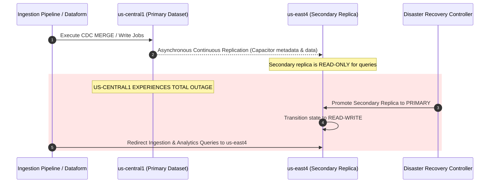
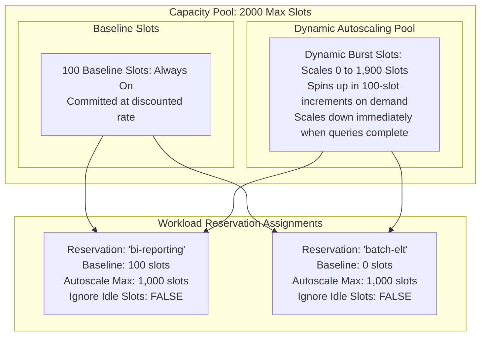
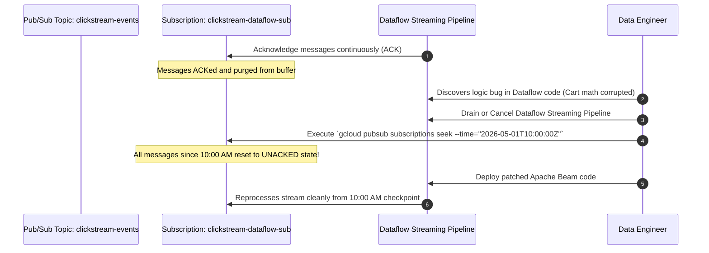

# 06. Disaster Recovery, Resilience & Cost Defense

## 1. Enterprise Scenario: Zero Data-Loss Resilience & Cost Optimization

GlobalRetailX operates across three continents with continuous transaction processing. The enterprise mandates strict Business Continuity (BC) and Disaster Recovery (DR) Service Level Agreements (SLAs), alongside proactive cost governance to control monthly cloud expenditure:

```
                            DISASTER RECOVERY & RESILIENCE TOPOLOGY
                            
             PRIMARY REGION: us-central1 (Iowa)           SECONDARY REGION: us-east4 (N. Virginia)
             +----------------------------------+          +--------------------------------------+
             | BigQuery Production Datasets     |          | BigQuery Cross-Region Replica        |
             | - Edition: Enterprise (Autoscaling)=========> - Read-Only Active Replica           |
             | - Time Travel: 7 Days            | Async    | - Promotion Target in Disaster       |
             | - Fail-safe: 7 Days (Colossus)   | Repl.    |                                      |
             +-----------------+----------------+          +--------------------------------------+
                               |
                               | Turbo Replication (<15 min SLA)
                               v
             +------------------------------------------------------------------------------------+
             | Dual-Region Storage: `gs://globalretailx-bronze-landing` (us-central1 + us-east4)   |
             | - Object Versioning & Lifecycle Management                                         |
             | - Cross-Region Continuous Integrity Verification                                  |
             +------------------------------------------------------------------------------------+
                               |
                               | Replayable Message Stream (7 Days Retention)
                               v
             +------------------------------------------------------------------------------------+
             | Cloud Pub/Sub: `clickstream-events`                                                |
             | - Snapshot & Seek API (Instant Rollback to Timestamp)                              |
             +------------------------------------------------------------------------------------+
```

### Enterprise Continuity & Governance Metrics
* **Recovery Point Objective (RPO)**: The maximum acceptable period of data loss measured in time. Target for Financial Transactions: **$\text{RPO} \le 15 \text{ minutes}$**; Target for Clickstream Analytics: **$\text{RPO} \le 1 \text{ hour}$**.
* **Recovery Time Objective (RTO)**: The maximum acceptable duration of system downtime to restore operations following a regional catastrophe. Target: **$\text{RTO} \le 30 \text{ minutes}$**.
* **Financial Governance Target**: Zero unbudgeted slot spills; strict reservation guardrails preventing runaway ad-hoc query charges.

---

## 2. Disaster Recovery: Storage & Warehousing Geographies

Selecting the correct geographic deployment strategy represents the primary architectural lever determining RPO, RTO, and data egress costs.

```mermaid
graph TD
    subgraph Bucket & Dataset Topologies
        Reg[Regional: us-central1<br/>Lowest Latency, Lowest Cost<br/>Zero Regional Redundancy]
        Dual[Dual-Region: us-central1 + us-east4<br/>Turbo Replication: 15-min SLA<br/>Automated Geo-Failover]
        Multi[Multi-Region: US or EU<br/>Geo-Distributed across continental data centers<br/>Eventual Replication]
    end

    subgraph Disaster Event: us-central1 Outage
        Reg -->|Result| Outage1[Data Unavailable until Region Restores<br/>RTO = Hours / Days]
        Dual -->|Result| Outage2[Zero RPO Loss (<15 min Turbo)<br/>RTO < 5 minutes via bucket endpoint]
        Multi -->|Result| Outage3[Data Available in Sibling Zones<br/>RTO < 15 minutes]
    end
```

### 2.1 Cloud Storage Dual-Region & Turbo Replication

* **Standard Cross-Region Replication**: In a standard multi-region or dual-region bucket, Cloud Storage replicates objects asynchronously across paired regions. Standard replication does not provide a contractual time SLA, though 99.9% of objects replicate within 1 hour.
* **Turbo Replication**: Designed explicitly for enterprise DR. Turbo Replication provides a contractual Google Cloud SLA guaranteeing that **100% of all newly written objects are replicated to the secondary region within 15 minutes**, regardless of object size or volume.

```bash
# Enable Turbo Replication on Dual-Region Production Landing Bucket
gcloud storage buckets update gs://globalretailx-bronze-landing \
    --recovery-point-objective=ASYNC_TURBO
```

### 2.2 BigQuery Cross-Region Dataset Replication

BigQuery supports cross-region dataset replication, establishing a live, continuous replica of a primary dataset in a secondary region.

> [!IMPORTANT]
> **Edition Requirement**: Cross-region disaster recovery replication (including promotion and failover) is available exclusively in **BigQuery Enterprise Plus Edition**. Standard and Enterprise editions do not support cross-region disaster recovery replication.



#### Provisioning & Promoting Cross-Region Replicas via SQL
```sql
-- Step 1: Create a Secondary Replica in us-east4
ALTER SCHEMA `globalretailx-prod.lakehouse_silver`
ADD REPLICA `us-east4`
OPTIONS(location='us-east4');

-- Step 2: Disaster Declaration - Promote Secondary Replica to Primary
-- (Executed during an actual regional disaster scenario)
ALTER SCHEMA `globalretailx-prod.lakehouse_silver`
SET OPTIONS(primary_replica='us-east4');
```

---

## 3. RPO and RTO Calculations: Architectural Tradeoffs

Understanding how to calculate and defend RPO and RTO is heavily tested on the Professional Data Engineer exam.

$$\text{RPO} = \text{Timestamp of Disaster Event} - \text{Timestamp of Last Recovered Transaction}$$

$$\text{RTO} = \text{Timestamp when Full Production Traffic Resumes} - \text{Timestamp of Disaster Event}$$

| Storage Tier / Architecture | RPO Guarantee | RTO Guarantee | Cost Factor | Tradeoff Profile |
| :--- | :--- | :--- | :--- | :--- |
| **Regional Bucket / Dataset** (`us-central1`) | $\text{RPO} = \infty$ (until region restores). If hardware destroyed, complete data loss. | $\text{RTO} = \text{Hours to Days}$ | $1.0\times$ (Baseline) | Low cost, zero protection against regional catastrophic events. Strictly for dev/test. |
| **Dual-Region Bucket + Turbo Replication** | $\text{RPO} \le 15 \text{ minutes}$ | $\text{RTO} \le 5 \text{ minutes}$ (Automatic DNS failover) | $2.0\times$ storage + replication fee | Optimal for high-throughput Bronze landing files. High durability, low latency. |
| **BigQuery Cross-Region Active-Passive Replication** | $\text{RPO} \le 15\text{--}30 \text{ minutes}$ | $\text{RTO} \le 15 \text{ minutes}$ (Single `ALTER SCHEMA` command) | $2.0\times$ active storage + cross-region replication bandwidth | Instant read-scalability in DR region; rapid failover for mission-critical marts. |
| **Nightly Snapshots to Coldline GCS** | $\text{RPO} = 24 \text{ hours}$ | $\text{RTO} = 6\text{--}12 \text{ hours}$ (Time required to restore multi-TB datasets) | $0.2\times$ | Low cost, unacceptable for Tier-1 financial and transaction platforms. |

---

## 4. BigQuery Cost Defense: Editions vs. On-Demand

Google Cloud BigQuery offers two fundamental billing models: **On-Demand** (per-terabyte scanned) and **Capacity-Based Editions** (per-slot-hour utilized).

```
                        BIGQUERY COMPUTE BILLING TOPOLOGY
                        
                                Workload Pattern
                                       |
                +----------------------+----------------------+
                |                                             |
                v Unpredictable, Spiky, Low-Usage              v Predictable, High-Volume, Steady
          Ad-hoc exploratory data science             Enterprise ETL, Scheduled Marts, Looker
          Total monthly scans < 15 TB                 Millions of queries / month
                |                                             |
                v                                             v
        +---------------+                             +---------------+
        |   On-Demand   |                             |   Editions    |
        | ($6.25 / TB)  |                             | (Slot-Hours)  |
        +---------------+                             +---------------+
                                                              |
                               +------------------------------+------------------------------+
                               |                              |                              |
                               v                              v                              v
                          Standard                       Enterprise                   Enterprise Plus
                   Low-cost batch & dev           Full governance, Auto-tuning    Maximum security, FedRAMP
                   No autoscaling reservations    Autoscaling & baseline slots    Cross-region DR replication
```

### 4.1 BigQuery Editions Breakdown

1. **Standard Edition**:
   * Targeted for small-to-medium batch workloads.
   * Basic slot allocations without advanced governance (no column-level masking, no customer-managed encryption keys, no multi-region replication).
2. **Enterprise Edition**:
   * The enterprise standard for analytics and data engineering.
   * Supports **Autoscaling Reservations**, Dataplex integration, Column-level security / policy tags, BigLake external access, and BI Engine.
3. **Enterprise Plus Edition**:
   * Targeted for mission-critical financial, banking, and government applications.
   * Includes 99.99% availability SLA, cross-region continuous DR replication, customer-managed soft failover, and hardware-isolated multi-tenant security.

### 4.2 Autoscaling Slots, Baseline Reservations & Fair-Share Scheduling

Under BigQuery Editions, organizations no longer purchase static, rigid slot blocks. Instead, they configure **Slot Reservations**:



#### Production Reservation Mechanics
* **Baseline Slots**: The minimum committed allocation running 24/7. Highly discounted when bound to a 1-year or 3-year commitment.
* **Autoscaling Slots**: Compute capacity that spins up in units of 100 slots when query queues experience pressure, automatically scaling down to 0 when queues empty.
* **Idle Slot Sharing (Fair-Share Scheduler)**: If the `bi-reporting` reservation is idle during the night, the `batch-elt` reservation automatically "borrows" those idle slots without additional cost. When morning arrives and executive dashboards begin executing, BigQuery immediately preempts the batch queries and returns slots to `bi-reporting` within milliseconds.

#### Terraform Configuration for BigQuery Reservations
```hcl
resource "google_bigquery_reservation" "production_enterprise_reservation" {
  name              = "prod-analytics-reservation"
  project           = "globalretailx-prod"
  location          = "us-central1"
  slot_capacity     = 100 # Baseline slots
  edition           = "ENTERPRISE"
  ignore_idle_slots = false

  autoscale {
    max_slots = 2000 # Scale dynamically up to 2,000 slots
  }
}

resource "google_bigquery_reservation_assignment" "elt_assignment" {
  project     = "globalretailx-prod"
  reservation = google_bigquery_reservation.production_enterprise_reservation.id
  job_type    = "PIPELINE" # Assigns Dataform and batch jobs
  assignee    = "projects/globalretailx-prod"
}
```

---

## 5. Failure Recovery: Time Travel, Fail-Safe & Pub/Sub Seek

When human error, logic bugs, or pipeline regressions corrupt production data, engineers must execute rapid state recovery.

```
                         BIGQUERY RECOVERY HORIZONS
                         
   Transaction Time
   |
   |---- [Day 0]: Corruption Event Occurs (Accidental DROP / Overwrite)
   |
   |==== [Day 0 to 7]: TIME TRAVEL WINDOW ==============================> (User-Recoverable via SQL)
   |     - Full SELECT and RESTORE capability via `FOR SYSTEM_TIME AS OF`
   |     - Configurable from 2 days up to 7 days to optimize storage cost
   |
   +==== [Day 8 to 14]: FAIL-SAFE PERIOD ==============================> (Google Support Only)
   |     - 7 Days immutable emergency recovery retained on Colossus
   |     - Unconfigurable, non-billable for queries
   |     - Requires Google Cloud Support ticket to extract
   |
   +---- [Day 15+]: Permanent Eviction / Erasure
```

### 5.1 BigQuery Time Travel Recovery

BigQuery automatically preserves historical versions of table data and metadata for up to **7 days** (configurable between 2 and 7 days at the dataset level).

#### Scenario: An engineer accidentally executes `DROP TABLE orders_fact` or runs an unconstrained `UPDATE` that sets all amounts to 0.

#### Step 1: Query the historical snapshot using `FOR SYSTEM_TIME AS OF`
```sql
SELECT 
  COUNT(*) AS historical_row_count,
  SUM(net_amount) AS historical_revenue
FROM 
  `globalretailx-prod.lakehouse_silver.orders_fact`
  FOR SYSTEM_TIME AS OF TIMESTAMP_SUB(CURRENT_TIMESTAMP(), INTERVAL 3 HOUR);
```

#### Step 2: Instant Restoration via Copy Job
```bash
# Instant zero-cost restore of corrupted table using the bq CLI:
bq cp \
  'globalretailx-prod:lakehouse_silver.orders_fact@-10800000' \
  'globalretailx-prod:lakehouse_silver.orders_fact_restored'
```
*(Note: `-10800000` represents an offset of 3 hours in milliseconds).*

### 5.2 BigQuery Fail-Safe

* Following the expiration of the Time Travel window, BigQuery transitions data into the **Fail-safe period for an additional 7 days**.
* Fail-safe data is stored internally by Google Colossus to guarantee recovery against catastrophic software bugs.
* **Access**: Data in Fail-safe *cannot* be queried directly with SQL. Restoration requires raising an emergency P1 Support ticket with Google Cloud Support.

### 5.3 Pub/Sub Replay via Snapshots & Seek

When a streaming Dataflow job fails or publishes corrupted state to downstream consumers, restarting the pipeline requires **rewinding the message stream**.



#### Executing Pub/Sub Seek via CLI
```bash
# Step 1: Seek subscription back to an absolute historical timestamp
gcloud pubsub subscriptions seek clickstream-dataflow-sub \
    --time="2026-05-01T10:00:00Z"

# Alternative: Create a named snapshot before deploying new pipeline versions
gcloud pubsub snapshots create pre-deploy-snapshot-20260501 \
    --subscription=clickstream-dataflow-sub

# Seek back to the saved snapshot if deployment exhibits regression
gcloud pubsub subscriptions seek clickstream-dataflow-sub \
    --snapshot=pre-deploy-snapshot-20260501
```

---

## 6. Disaster Recovery Failure Modes & Defensive Playbook

| Failure Scenario | Root Cause | Impact | Automated / Tactical Defense |
| :--- | :--- | :--- | :--- |
| **Total Cloud Region Outage** | Physical fiber cut or power failure across all zones in `us-central1`. | BigQuery queries and GCS writes fail immediately. | 1. Failover landing GCS traffic via dual-region bucket DNS endpoints.<br>2. Execute `ALTER SCHEMA ... SET OPTIONS(primary_replica='us-east4')`.<br>3. Redirect Cloud Composer and Dataform pipelines to run against `us-east4` reservations. |
| **Runaway Ad-Hoc Query Billing** | An analyst runs `SELECT *` over an unpartitioned 200 TB external table on On-Demand billing. | Single query costs $1,250.00 instantly. | 1. Apply **Maximum Bytes Billed** limits per user/project (`--maximum_bytes_billed=100000000000` = 100 GB cap).<br>2. Migrate analytical projects to **BigQuery Editions Reservations**, converting compute to predictable slot-hours. |
| **Pub/Sub Retention Expiry During Outage** | Downstream Dataflow pipeline is stalled for 8 days due to an unhandled crash loop. | Pub/Sub default 7-day retention expires; unprocessed events are permanently purged from the topic. | Configure Pub/Sub message retention to the maximum of **31 days**. Configure Cloud Monitoring alerts when `subscription/oldest_unacked_message_age` exceeds 24 hours. |
| **Time Travel Expiration on Dropped Dataset** | An administrator deletes an entire dataset; error is discovered 10 days later. | Dataset has passed the 7-day Time Travel window; cannot be restored with SQL. | Open immediate P1 Google Cloud Support ticket to request **Fail-safe recovery** before the 14-day absolute boundary expires. |

---

## 7. Professional Data Engineer (PDE) Knowledge Check

#### Question 1
RetailFlow maintains a mission-critical BigQuery dataset in `us-central1` that drives real-time retail store replenishment. Enterprise risk policy mandates an RTO < 30 minutes and RPO < 15 minutes in the event of a total regional disaster. The architecture must allow automated cross-region replication while allowing local reporting teams to query data in the secondary region without impacting production write workloads. How should you configure BigQuery?

- A. Export the tables to Cloud Storage nightly and run a Storage Transfer Service job to `us-east4`.
- B. Enroll in BigQuery Enterprise Plus Edition. Create a cross-region dataset replica in `us-east4`. In the event of a regional outage in `us-central1`, issue an `ALTER SCHEMA` command promoting the `us-east4` replica to primary.
- C. Use Cloud Composer to run a federated query every 10 minutes copying data from `us-central1` to `us-east4`.
- D. BigQuery natively handles cross-region failover across all regions automatically with zero configuration.

**Answer: B**
*Detailed Answer Analysis*:
* **Correct Answer: B**. BigQuery cross-region dataset disaster recovery replication (available exclusively in **Enterprise Plus Edition**) continuously replicates data and metadata asynchronously to a secondary region. The secondary replica is immediately readable for local analytical queries. In a disaster event where the primary region becomes unavailable, promoting the secondary replica via `ALTER SCHEMA ... SET OPTIONS(primary_replica='...')` accomplishes failover with an RTO of minutes and an RPO within the asynchronous replication window (<15 minutes).
* *Distractor Analysis*:
  * **A** is incorrect because nightly exports and transfers produce an RPO of up to 24 hours, completely violating the strict 15-minute RPO requirement.
  * **C** is incorrect because scheduled federated queries incur massive cross-region egress costs, query compute slot contention, and lack transactional failover management.
  * **D** is incorrect because BigQuery does not automatically fail over datasets cross-region without configuring Enterprise Plus cross-region dataset replication.

---

#### Question 2
At 02:00 PM, a data engineer accidentally deploys an untested Dataform script that executes an invalid `MERGE` statement, updating 10 million rows in the production `lakehouse_silver.orders_fact` table with corrupted currency codes. The mistake is discovered at 03:30 PM. What is the fastest, most cost-effective method to restore the corrupted rows to their exact state as of 01:59 PM?

- A. Restore the table from the nightly Cloud Storage backup and re-execute all ingestion pipelines from midnight.
- B. Submit an emergency ticket to Google Cloud Support requesting Fail-safe data recovery.
- C. Query the table using BigQuery Time Travel with `FOR SYSTEM_TIME AS OF TIMESTAMP('2026-05-01 13:59:00 UTC')` and overwrite the corrupted rows or copy the table state to a restored table using `bq cp`.
- D. Run an `UNDO UPDATE` SQL command.

**Answer: C**
*Detailed Answer Analysis*:
* **Correct Answer: C**. BigQuery Time Travel preserves historical row states for up to 7 days. Because the corruption was identified 1.5 hours after the incident, the original data is easily accessible using the `FOR SYSTEM_TIME AS OF` clause or the `bq cp` CLI command with a timestamp decorator. This operation completes in seconds without restoring from external backups or replaying pipelines.
* *Distractor Analysis*:
  * **A** is incorrect because restoring from nightly backups requires hours of pipeline replay, introduces data loss for valid mid-day transactions, and incurs unnecessary compute spend.
  * **B** is incorrect because Fail-safe recovery is a Google Cloud Support mechanism used only after the 7-day Time Travel window has expired.
  * **D** is incorrect because SQL has no `UNDO UPDATE` command in BigQuery.

---

#### Question 3
Your organization is migrating to BigQuery Editions to gain predictable billing. Executive dashboards running on Looker require guaranteed compute resources between 08:00 AM and 05:00 PM, while large batch ELT pipelines run between 01:00 AM and 06:00 AM. You want to avoid paying for peak capacity 24/7 while ensuring neither workload starves the other during unexpected overlaps. What should you configure?

- A. Purchase 2,000 baseline committed slots for Looker and 2,000 baseline committed slots for ELT.
- B. Set up two separate reservations (`bi-reporting` and `batch-elt`) under an Enterprise Edition reservation pool. Configure minimal baseline slots, enable slot autoscaling with appropriate max slot bounds, and set `ignore_idle_slots = false` on both reservations.
- C. Place all users and pipelines on On-Demand billing.
- D. Configure Cloud Composer to delete and recreate BigQuery projects twice daily.

**Answer: B**
*Detailed Answer Analysis*:
* **Correct Answer: B**. BigQuery Enterprise Edition slot reservations with autoscaling provide optimal elasticity and cost governance. Setting `ignore_idle_slots = false` enables the BigQuery Fair-Share scheduler: when the BI reservation is inactive at night, the batch ELT reservation can automatically consume its idle slots for free. During the day, if the BI reservation requires capacity, BigQuery instantly reclaims those slots. Autoscaling ensures burst capacity is provisioned only when queued query pressure demands it, scaling back down to baseline during quiet hours.
* *Distractor Analysis*:
  * **A** is incorrect because purchasing 4,000 baseline committed slots forces the enterprise to pay for 4,000 slots 24/7, even during off-peak hours when utilization is near zero.
  * **C** is incorrect because On-Demand billing charges per TB scanned ($6.25/TB) with a default concurrency cap of 2,000 slots, providing zero cost predictability for unpredictable batch scans.
  * **D** is incorrect because deleting and recreating projects is an operational anti-pattern that destroys IAM bindings, audit logs, and table configurations.
