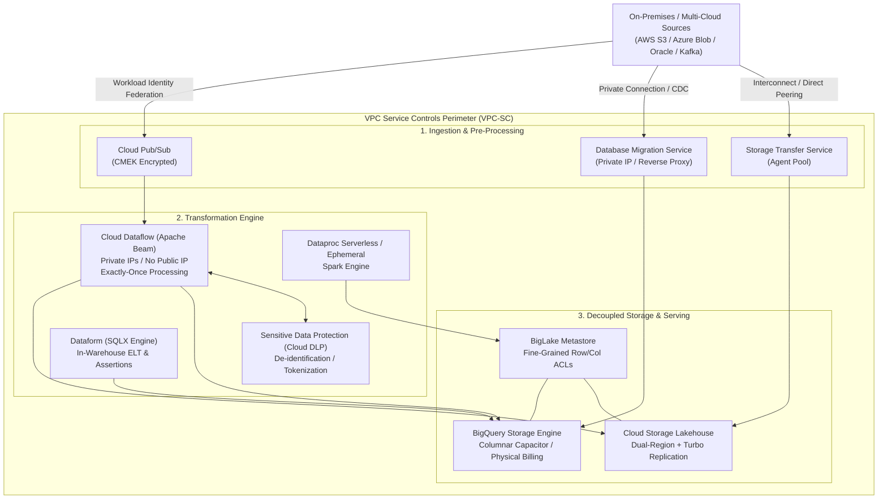
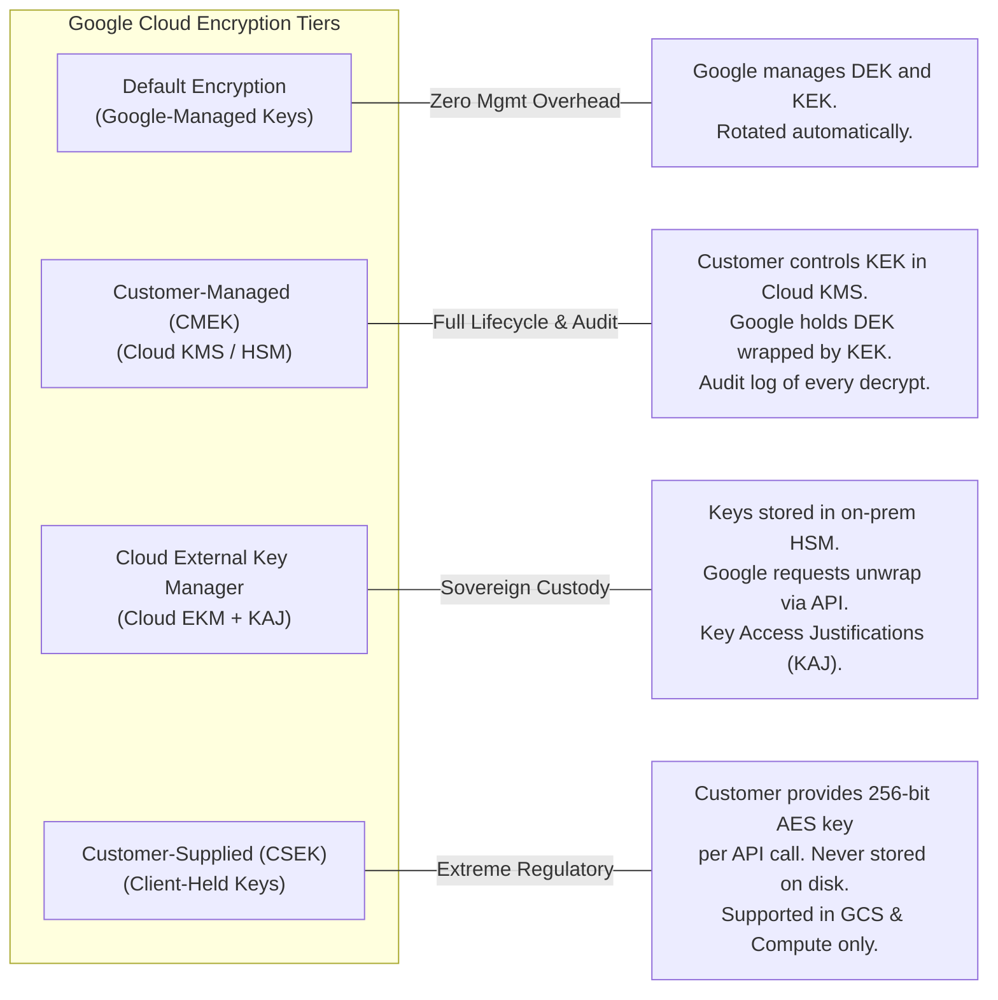
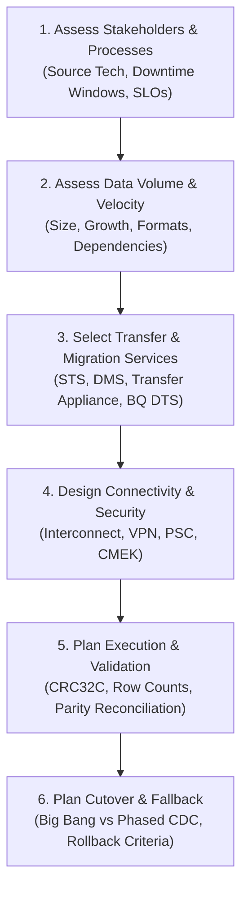
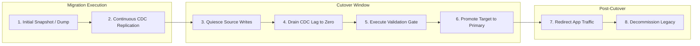

# Domain 1: Designing Data Processing Systems

**Official Exam Guide Weight: ~22%**

---

## Executive Architectural Overview

Designing enterprise data processing systems on Google Cloud requires decoupling compute from storage, enforcing zero-trust security perimeters, establishing deterministic disaster recovery (DR) boundaries, enabling workload flexibility across multi-cloud topologies, and executing rigorous, zero-data-loss migration strategies.



---

## Section 1.1: Designing for Security and Compliance

### 1. Identity and Access Management (IAM) Deep Dive
Google Cloud IAM operates on a declarative policy framework evaluated at request time:
$$\text{Access Granted} \iff (\text{Identity} \times \text{Role} \times \text{Conditions}) \cap \text{Org Policy Constraints} \cap \text{VPC-SC Perimeter}$$

#### Predefined vs. Custom Roles
*   **Predefined Roles**: Curated by Google. Examples:
    *   `roles/bigquery.dataViewer`: Read dataset metadata and table data.
    *   `roles/bigquery.dataEditor`: Read/write/modify tables, cannot delete datasets.
    *   `roles/bigquery.jobUser`: Run queries, load data, export data.
    *   `roles/bigquery.user`: Run queries, create datasets (charges billed to project).
*   **Custom Roles**: Tailored least-privilege combinations of distinct permissions (e.g., `bigquery.tables.getData`, `bigquery.jobs.create`). **Exam Rule**: Use Predefined roles unless compliance mandates least-privilege isolation that predefined roles exceed.
*   **IAM Conditions**: Restrict role binding using Common Expression Language (CEL):
    *   Temporal access: `request.time < timestamp("2026-12-31T23:59:59Z")`
    *   Resource tagging: `resource.matchTag('123456789/environment', 'production')`
    *   Network location/IP attributes.

#### Service Account Impersonation vs. Service Account Keys
*   **The Anti-Pattern**: Exporting Service Account JSON keys (`*.json`) to local developer machines, GitHub Actions, or on-premises servers. Keys introduce credential exfiltration vectors, do not expire automatically, and circumvent perimeter boundaries.
*   **The Gold Standard Architecture**:
    1.  **Workload Identity Federation (WIF)**: Allows external workloads (AWS EC2, Azure VMs, GitHub Actions, Kubernetes on-premises) to exchange OIDC/SAML tokens for short-lived Google Cloud STS credentials.
    2.  **Service Account Impersonation**: Developers or orchestrators obtain the role `roles/iam.serviceAccountTokenCreator` on the target Service Account and generate short-lived tokens using `gcloud` or the IAM Credentials API.

```bash
# Grant Impersonation privilege to a data engineering group
gcloud iam service-accounts add-iam-policy-binding \
    data-pipeline-prod@my-data-project.iam.gserviceaccount.com \
    --member="group:data-engineers@company.com" \
    --role="roles/iam.serviceAccountTokenCreator"

# Run BQ CLI commands securely via impersonation without local keys
bq query \
    --use_legacy_sql=false \
    --impersonate_service_account=data-pipeline-prod@my-data-project.iam.gserviceaccount.com \
    'SELECT count(*) FROM `my-data-project.analytics.fact_orders`'
```

---

### 2. Organization Policies
Organization policies establish guardrails across the entire resource hierarchy:
*   `constraints/gcp.resourceLocations`: Restricts the physical data center locations in which resources (Cloud Storage buckets, BigQuery datasets, Cloud Spanner instances) can be provisioned (e.g., `in:eu-locations` for GDPR).
*   `constraints/gcp.restrictCmekCryptoKeyProjects`: Restricts which Cloud KMS projects can provide keys for customer-managed encryption.
*   `constraints/iam.disableServiceAccountKeyCreation`: Completely blocks developers from generating downloadable service account keys.
*   `constraints/compute.restrictVpcPeering`: Enforces centrally governed hub-and-spoke interconnects.

---

### 3. Encryption Hierarchy: Default vs. CMEK vs. CSEK vs. Cloud EKM



#### Envelope Encryption Mechanics
1.  **DEK (Data Encryption Key)**: Fast symmetric key (AES-256) generated locally right next to the data. Used to encrypt the raw payload chunks.
2.  **KEK (Key Encryption Key)**: Key stored securely inside **Cloud KMS** (software or Cloud HSM FIPS 140-2 Level 3). KEK encrypts (wraps) the DEK.
3.  **Storage**: The encrypted data chunk and the wrapped DEK are stored together. The plaintext DEK is immediately discarded from memory.
4.  **Decryption**: Cloud KMS unwraps the DEK using the KEK upon authorized API call, enabling local data block decryption.

#### Key Rotation and Revocation
*   **Key Rotation**: Automatically creates a new key version in KMS (e.g., every 90 days). *Crucial Exam Fact*: Existing data is **not** re-encrypted automatically upon rotation. New writes use the primary version. Existing data uses historical versions to decrypt until explicitly rewritten.
*   **Key Destruction**: Instantaneous cryptographic erasure. Setting a KEK version to `Destroyed` renders all datasets, GCS objects, and BigQuery tables wrapped by that key permanently unreadable.
*   **Cloud EKM & Key Access Justifications (KAJ)**: Required when strict financial, defense, or jurisdictional sovereignty mandates that keys **never reside inside Google's cloud boundary**. Cloud EKM integrates with external HSMs (e.g., Thales, Fortanix). KAJ emits a justification code with every unwrap request, allowing programmatic automated blocking of decryption requests from Google infrastructure.

```bash
# Assign KMS Encrypter/Decrypter role to BigQuery Service Agent
BQ_SA=$(gcloud beta services identity create --service=bigquery.googleapis.com --project=my-data-project)

gcloud kms keys add-iam-policy-binding lake-storage-cmek \
    --location=us-central1 \
    --keyring=data-lakehouse-kr \
    --member="serviceAccount:${BQ_SA}" \
    --role="roles/cloudkms.cryptoKeyEncrypterDecrypter"
```

---

### 4. PII Anonymization, Pseudonymization & Tokenization with Sensitive Data Protection (Cloud DLP / SDP)

Sensitive Data Protection (SDP) inspects and transforms structured and unstructured streams and stores.

| De-Identification Method | Transformation Mechanism | Reversibility | Analytical Utility | Primary Exam Use Case |
| :--- | :--- | :--- | :--- | :--- |
| **Masking / Redaction** | Replaces characters with fixed string (e.g., `XXXX-XXXX-1234`) | Irreversible | Very Low | PCI-DSS Card display, Log scrubbing |
| **Bucketing / Generalization** | Replaces discrete values with ranges (e.g., Age 34 $\to$ `[30-40]`) | Irreversible | Moderate | Preserving cohorts for ML demographic bias audits |
| **Crypto Deterministic Hash** | HMAC-SHA256 hash with cryptographic key/salt | Irreversible | High | Joins across disparate tables without revealing raw ID |
| **Deterministic Tokenization (FPE)** | Format-Preserving Encryption using AES-SIV with KMS wrapped key | **Reversible** with cryptographic key | **Highest** | Reversible analytics: Token acts as SSN/Card with exact regex format preserved |

---

### 5. Data Sovereignty, Regional Compliance & Assured Workloads

*   **Assured Workloads**: Provides automated, programmatic compliance boundaries for sensitive and regulated workloads:
    *   **Regulatory Frameworks**: FedRAMP Moderate/High, DoD IL4/IL5, CJIS, HIPAA, EU Regions and Support with Sovereignty Controls.
    *   **Automated Guardrails**: Enforces `constraints/gcp.resourceLocations` so personnel cannot provision buckets or datasets outside compliant geography.
    *   **Personnel Restrictions**: Guarantees that Google support personnel who interact with your infrastructure are prescreened local citizens (e.g., US Persons for FedRAMP, EU residents for EU sovereign clouds).
*   **VPC Service Controls (VPC-SC)**: Establishes a perimeter around Google-managed multi-tenant PaaS services (BigQuery, GCS, Dataflow, Cloud Spanner, Vertex AI). Prevents unauthorized API requests from leaving or entering the perimeter, neutralizing internal malicious actors or compromised service credentials attempting data exfiltration.

---

### 6. Project, Dataset, and Table Architecture for Data Governance

To prevent compute jobs from starving analytics quotas or exposing raw data through permissive project-level IAM, enterprise governance requires separating workloads into distinct architectural tiers:

```mermaid
flowchart TD
    subgraph Multi_Project_Environment["Enterprise Multi-Project Separation"]
        direction TB
        subgraph Ingestion_Project["1. Ingestion Project: prj-prod-ingest"]
            GCS_Raw["Landing GCS Buckets"]
            PS_Topic["Cloud Pub/Sub Topics"]
        end

        subgraph Compute_Project["2. Compute Project: prj-prod-compute"]
            DF_Jobs["Cloud Dataflow Pipelines"]
            DP_Jobs["Dataproc Ephemeral Clusters"]
        end

        subgraph Warehouse_Project["3. Storage Project: prj-prod-warehouse"]
            DS_Bronze["Bronze Dataset (Raw Landing)"]
            DS_Silver["Silver Dataset (Curated / Cleaned)"]
            DS_Gold["Gold Dataset (Aggregated Marts)"]
        end

        subgraph Consumption_Project["4. Consumption Project: prj-prod-analytics"]
            BI_Slots["Dedicated BI Reservations"]
            Looker["Looker / Tableau / Analysts"]
        end
    end

    Ingestion_Project -->|Pipeline Reads| Compute_Project
    Compute_Project -->|Pipeline Writes| Warehouse_Project
    Consumption_Project -.->|Query Execution (Billed to Analytics)| Warehouse_Project
```

*   **Separation of Compute and Storage Billing**: Queries submitted by analysts in `prj-prod-analytics` are billed to `prj-prod-analytics` (using their own reservation or on-demand budget), while storage costs remain in `prj-prod-warehouse`.
*   **Cross-Project IAM Least Privilege**: Grant analysts `roles/bigquery.jobUser` on the consumption project (`prj-prod-analytics`) to run queries, and `roles/bigquery.dataViewer` on specific datasets in the storage project (`prj-prod-warehouse`).
*   **Dataset Location Locking**: Datasets cannot change geographical locations after creation. If a BigQuery query joins tables, **all joined tables must reside in the exact same region or multi-region**.

---

## Section 1.2: Designing for Reliability and Fidelity

### 1. Disaster Recovery (DR): RPO, RTO, and Storage Topologies

*   **RPO (Recovery Point Objective)**: Maximum acceptable duration of data loss measured in time (e.g., RPO = 15 minutes implies at most 15 minutes of transactional updates may be lost).
*   **RTO (Recovery Time Objective)**: Maximum allowable downtime to restore full operational service (e.g., RTO = 2 hours implies services must be back online within 2 hours of failure).

#### Cloud Storage Replication Topologies

| Topology | SLA Availability | RPO | Disaster Blast Radius | Cost / Overhead |
| :--- | :--- | :--- | :--- | :--- |
| **Single Region** | 99.9% (Standard) | 0 within region (3 zones) | Total regional outage halts read/write | Baseline |
| **Dual-Region (Standard)** | 99.95% | Up to 1–2 hours asynchronous | Immune to single-region loss; metadata failover | $\approx 2\times$ storage cost |
| **Dual-Region + Turbo Replication** | 99.95% | **$\le$ 15 minutes (backed by SLA: $\ge 99.9\%$ monthly volume, $\ge 99.0\%$ monthly time conformance)** | Extreme resilience for strict RPO regulatory mandates | Premium per replication GB |
| **Multi-Region** | 99.95% | Geographically dispersed across continental borders | Geo-redundant read availability | Lowest $/GB$ for geo-distributed users |

---

### 2. ACID Compliance and Availability Across Persistence Engines

Data fidelity requires matching workload transactional guarantees to the engine's consistency model:

| Persistence Service | Consistency Model | Transaction Support (ACID) | High Availability & Consensus | Best Fit for Fidelity |
| :--- | :--- | :--- | :--- | :--- |
| **Cloud Spanner** | **External Consistency** (Strict Serializability) | Multi-table, multi-row, multi-region distributed transactions | Multi-zone/Multi-region Paxos consensus with TrueTime commit wait | Mission-critical financial ledgers, global inventory |
| **Cloud SQL** | Strong consistency on Primary | Full ACID (InnoDB / PostgreSQL WAL / SQL Server) | Regional synchronous HA persistent disk failover (<60s) | Enterprise departmental OLTP |
| **AlloyDB for PostgreSQL** | Strong consistency on Primary | Full ACID + analytical columnar engine | Disaggregated compute/storage, automated cross-zone failover | Demanding enterprise Postgres OLTP/HTAP |
| **Cloud Bigtable** | Strong consistency within single cluster; eventual across clusters | Single-row atomicity (mutations, read-modify-write); **No multi-row transactions** | Multi-cluster replication (2–8 zones/regions) | High-throughput time-series, IoT streaming |
| **Cloud Firestore** | Strong consistency for document reads/writes | Multi-document ACID transactions | Multi-region Paxos replication (99.999% SLA) | Mobile application state, user profiles |
| **BigQuery** | Strong consistency for DDL/DML; snapshot isolation | Multi-statement transactions with `BEGIN TRANSACTION ... COMMIT` | Regional / Multi-region Colossus disaggregated storage | Enterprise warehousing, analytical reporting |
| **Cloud Storage** | **Global Strong Consistency** for all read/write/list/delete | Atomic single-object PUT/DELETE; optimistic concurrency via generation match | Dual-Region / Multi-Region replication | Raw lakehouse landing, immutable files |

---

### 3. Data Preparation and Cleaning Tooling Selection

| Tool | Processing Paradigm | Developer Persona | Execution Engine | Best Exam Scenario |
| :--- | :--- | :--- | :--- | :--- |
| **Dataform** | In-warehouse ELT | SQL / Analytics Engineer | BigQuery SQLX engine | Transforming data already loaded into BigQuery; building curated dimensional models with assertions |
| **Cloud Dataflow** | Stream & Batch distributed processing | Software / Data Engineer | Apache Beam on managed workers | Millisecond streaming from Pub/Sub, complex windowing, custom DoFn transformations, exactly-once sinks |
| **Cloud Data Fusion** | Code-free / Low-code Visual ETL | ETL Developer / Business Analyst | CDAP executing on ephemeral Dataproc Spark | Drag-and-drop integration pipelines with 150+ pre-built enterprise connectors |
| **BigQuery Studio + Gemini** | LLM-assisted SQL generation | Analyst / Data Scientist | BigQuery GoogleSQL + Vertex AI foundation models | Natural language to SQL query generation, automated query explanation, and schema exploration |

#### 3.1 Prompting LLMs for Query Generation (Gemini in BigQuery Studio)
Under the official PDE Exam Guide (v4.2), data engineers must understand how to leverage foundation models (Gemini) within BigQuery Studio for assisted data preparation and query engineering:
- **Natural Language to SQL**: Gemini in BigQuery Studio translates natural language task descriptions directly into GoogleSQL queries, automatically incorporating referenced table schemas, column types, and partition keys.
- **Context-Aware Prompt Engineering**: Effective prompt engineering for query generation requires providing explicit domain constraints, target partition filters, and expected aggregation levels in the prompt (e.g., `Generate a query calculating 7-day rolling average revenue grouped by store_id, filtering on _PARTITIONDATE >= DATE_SUB(CURRENT_DATE(), INTERVAL 30 DAY)`).
- **Code Explanation & Performance Tuning**: Gemini inspects complex multi-join SQL and identifies redundant full-table scans, missing clustering filters, or Cartesian products, suggesting optimized rewrites.
- **Automated Validation Assertions**: Data engineers can prompt Gemini to generate Dataform SQLX assertion blocks or SQL data quality checks (e.g., verifying that `order_total > 0` and `customer_id IS NOT NULL`).

---

### 4. Data Validation and Reconciliation Architecture

Production ingestion systems must never fail silently or drop malformed data:
*   **Beam Dead-Letter Architecture**: Malformed records failing schema parsing or business logic checks are routed using `TaggedOutput` to a dead-letter Pub/Sub topic or GCS bucket for quarantine and inspection without breaking stream execution.
*   **Dataplex Automated Data Quality (AutoDQ)**: Runs declarative YAML data quality rules (uniqueness, null checks, range evaluation, regex conformity) directly against BigQuery tables and GCS BigLake external tables.
*   **Reconciliation & Hash Verification**: Cryptographic validation comparing source records to sink tables using SHA-256 row fingerprints and aggregate checksums.

---

## Section 1.3: Designing for Flexibility and Portability

### 1. Mapping Business Needs to Decoupled Architectures
*   **Decoupled Compute and Storage**: Decoupling allows compute engines (BigQuery, Dataproc, Dataflow) to scale to zero independently of petabytes stored in Cloud Storage or BigQuery managed storage.
*   **Avoiding Vendor Lock-in with Open Formats**: Storing raw and curated lakehouse assets in open columnar formats (Apache Parquet, Apache ORC, **Apache Iceberg**) ensures workloads can be queried by BigQuery via BigLake, processed by Spark on Dataproc, or queried by external cloud engines without proprietary data migration.

---

### 2. Hybrid and Multi-Cloud Analytics with BigQuery Omni

BigQuery Omni extends the BigQuery analytics engine to data stored directly in **Amazon Web Services (AWS) S3** and **Microsoft Azure Blob Storage**.

```mermaid
flowchart LR
    subgraph Google_Cloud["Google Cloud Control Plane"]
        BQ_Console["BigQuery Studio / BI Tools"]
        Query_Coordinator["Query Planner & Coordinator"]
    end

    subgraph AWS_Cloud["Amazon Web Services (AWS)"]
        AWS_Anthos["BigQuery Omni Compute Clusters<br/>(Managed by Google on AWS)"]
        S3_Buckets["S3 Buckets<br/>(Parquet, ORC, CSV)"]
    end

    BQ_Console -->|1. Submit SQL| Query_Coordinator
    Query_Coordinator -->|2. Send Query Execution Graph| AWS_Anthos
    AWS_Anthos <-->|3. Scan & Process In-Region| S3_Buckets
    AWS_Anthos -->|4. Return Final Aggregation (Few KB/MB)| Query_Coordinator
    Query_Coordinator -->|5. Deliver Result| BQ_Console
```

*   **Zero Egress for Raw Scans**: Petabytes of raw data in AWS S3 or Azure Blob are scanned in-situ by local Google-managed compute clusters.
*   **Cross-Cloud Joins**: BigQuery Omni processes raw scans locally in the source cloud, and transfers only summarized intermediate join tables across cloud boundaries, drastically slashing cross-cloud data egress fees.

---

### 3. Open Data Formats & Unified Lakehouse via BigLake

BigLake breaks down silos between data lakes (object stores) and data warehouses:
1.  **Format Agnosticism**: Query support for open-source columnar and lakehouse formats: Apache Parquet, ORC, Avro, and **Apache Iceberg**.
2.  **Fine-Grained Access Control**: Bridges Cloud Storage with BigQuery governance. Users without direct GCS bucket read permissions can query tables through BigLake while BigLake enforces **Column-Level Security**, **Row-Level Security**, and **Dynamic Data Masking** on raw files.
3.  **Storage Engine Optimizations**: BigLake leverages BigQuery's Capacitor acceleration, metadata caching, and vectorized Parquet parsing on GCS objects.

---

### 4. Data Staging, Cataloging, Profiling, and Discovery with Dataplex

*   **Staging Layers (Medallion Lakehouse)**:
    *   **Bronze / Raw Zone**: Immutable landing zone in Cloud Storage receiving raw files from STS, Datastream, or batch loads.
    *   **Silver / Curated Zone**: Validated, schema-enforced, deduplicated tables formatted in Parquet/Iceberg or BigQuery native storage.
    *   **Gold / Mart Zone**: Domain-aggregated data marts optimized for business intelligence, Looker dashboards, and feature stores.
*   **Dataplex Profiling & Discovery**:
    *   **Automated Metadata Discovery**: Crawls GCS buckets and BigQuery datasets on scheduled intervals, automatically parsing schema, partition structure, and file formats.
    *   **Data Profiling**: Generates statistical metrics across columns (null ratio, distinct values, min/max/mean distributions) without moving data out of the lakehouse.

---

## Section 1.4: Designing Data Migrations

The Professional Data Engineer exam rigorously tests end-to-end data migration planning across six distinct phases:



---

### Phase 1: Assess Stakeholders, Users, Business Processes, and Source Technologies
Before selecting tooling, document constraints:
*   **Source Technologies**: Relational OLTP (Oracle, PostgreSQL, MySQL, SQL Server), Enterprise Data Warehouses (Teradata, Netezza, Amazon Redshift, Snowflake), NoSQL (Cassandra, MongoDB, HBase), or POSIX/NFS file arrays.
*   **Business Downtime Tolerance**: Can the business afford a 12-hour offline maintenance window (Big Bang), or does the application require 24/7 uptime with sub-second replication (Continuous CDC / Phased cutover)?
*   **Downstream Consumer Dependencies**: Upstream ETL writers, analytical dashboards, operational reports, and regulatory audit cycles.

---

### Phase 2: Assess Data Volume, Velocity, Formats, and Migration Constraints
Evaluate bandwidth feasibility using measured network throughput rather than theoretical pipe capacity:

$$\text{Transfer Time (Hours)} = \frac{\text{Total Data Volume in Bits}}{\text{Available Bandwidth (bps)} \times \text{Network Efficiency Factor } (0.70\text{–}0.80)} \div 3600$$

> [!IMPORTANT]
> **Transfer Appliance Selection Guideline**: Do not rely on a fixed volume threshold (e.g. "always use Transfer Appliance for >100 TB"). Transfer Appliance is chosen when:
> 1. Calculated network transfer time exceeds the business deadline or maintenance window.
> 2. Available network bandwidth is constrained or saturated by production operations.
> 3. Dedicated Interconnect cannot be provisioned in time.
> 4. Physical data center logistics permit appliance shipping and rack installation.

---

### Phase 3: Service Selection Matrix for Migration & Transfer

| Source Technology | Target Destination | Migration Service | Migration Pattern | Operational Nuances & Supported Scenarios |
| :--- | :--- | :--- | :--- | :--- |
| **Homogeneous MySQL** (On-prem, AWS RDS, GCE) | **Cloud SQL for MySQL** | **Database Migration Service (DMS)** | Serverless log-based CDC | Minimal downtime; initial data dump + binlog replication; supports public IP allowlisting, forward SSH tunnel, or private IP connectivity (VPC peering / PSC). |
| **Homogeneous PostgreSQL** (On-prem, AWS RDS, GCE) | **Cloud SQL for PostgreSQL / AlloyDB for PostgreSQL** | **Database Migration Service (DMS)** | Serverless log-based CDC | Minimal downtime; logical replication (`pgoutput`); supports public IP allowlisting, forward SSH tunnel, or private IP. |
| **Heterogeneous Oracle** (On-prem, AWS RDS, self-hosted) | **Cloud SQL for PostgreSQL / AlloyDB for PostgreSQL** | **Database Migration Service (DMS)** | Schema conversion + CDC | Minimal downtime; integrated Ora2Pg schema/code conversion + LogMiner CDC. *(Note: DMS does not support homogeneous Oracle-to-Oracle or Oracle-to-MySQL).* |
| **Homogeneous SQL Server** (On-prem, AWS RDS, GCE) | **Cloud SQL for SQL Server** | **Database Migration Service (DMS)** | Backup/Restore + CDC | Minimal downtime; uses native transaction log backups for continuous synchronization. |
| **Relational DB** (MySQL, Postgres, Oracle, SQL Server) | **BigQuery / Cloud Storage** | **Cloud Datastream** | Serverless log-based CDC | Sub-second replication into BigQuery staging tables using Storage Write API; appends transaction metadata. |
| **POSIX Storage, NFS, AWS S3, Azure Blob** | **Cloud Storage (GCS)** | **Storage Transfer Service (STS)** | Scalable managed data transfer | Cloud-to-cloud requires zero agents; On-prem requires Docker agent pool; MD5/CRC32C incremental sync. |
| **Exabyte-Scale On-Prem / Offline Data** | **Cloud Storage (GCS)** | **Transfer Appliance** | Ruggedized physical storage rack | Shipped to customer DC; AES-256 encrypted; shipped back to Google; ingested into target GCS bucket. |
| **External DW / SaaS** (Teradata, Redshift, Google Ads) | **BigQuery** | **BigQuery Data Transfer Service (BQ DTS)** | Scheduled batch ingestion | Managed migration pipelines; extracts, stages in GCS, and executes parallel load into BigQuery tables. |

---

### Phase 4: Connectivity, Security, and Encryption Design
Select the network path and connectivity method based on the specific migration scenario and security policy:
*   **Network Transport**:
    *   **Dedicated Interconnect (10G/100G)**: Low latency, predictable SLA-backed enterprise bandwidth for petabyte migrations.
    *   **Partner Interconnect**: Supported when data center lacks direct colocation facilities.
    *   **Cloud VPN (HA-VPN)**: Encrypted IPsec tunnels over public internet; throughput limited to 3 Gbps per tunnel pair (can be scaled with multiple tunnels via ECMP).
*   **DMS & Datastream Connectivity Methods**:
    *   **Static IP Allowlisting**: Easiest connectivity when the source database is publicly accessible and protected by SSL/TLS; customer allows Google Cloud's static outbound IP ranges on their source firewall.
    *   **Forward-SSH Tunnel**: Used when the source database resides behind a corporate firewall without a dedicated VPN/Interconnect; connects via an intermediate customer-managed bastion host.
    *   **Private Connectivity via VPC Peering or PSC**: Enterprise standard for databases that must not expose public IPs; connects the Google-managed tenant project directly into the customer VPC or through Private Service Connect.
    *   **Reverse Proxy**: Deployed on Compute Engine when direct peering between tenant projects and source networks is restricted by non-transitive routing constraints.
*   **In-Flight & At-Rest Encryption**: All Google Cloud transfer services enforce TLS in transit and write to CMEK-wrapped Cloud Storage buckets or BigQuery tables.

---

### Phase 5: Execution, Data Validation, and Reconciliation Strategies
A migration is incomplete without provable fidelity verification:
1.  **Integrity Checksums (CRC32C vs. Cryptographic Hashes)**:
    *   **CRC32C (Cyclic Redundancy Check)**: Fast, non-cryptographic checksum supported natively by Cloud Storage. Used during transfer to verify that network packets or disk blocks were not corrupted in transit.
    *   **Cryptographic Hashes (SHA-256)**: Used for forensic data fidelity verification. Compute SHA-256 column hashes or concatenated row fingerprints on source and target systems to verify zero byte modification.
    *   *Security Note*: **MD5 is cryptographically broken and vulnerable to collisions**; do not recommend MD5 as a security hash, although it remains available in legacy object metadata for legacy compatibility.
2.  **Row Count and Granular Aggregations**:
    *   Compare total row counts between source and target tables.
    *   Execute matching aggregate queries (`SUM(transaction_amount)`, `COUNT(DISTINCT customer_id)`, `MIN(order_date)`, `MAX(order_date)`) across source and target datasets.
3.  **Schema Parity Checks**:
    *   Validate data types, precision, nullability, character set encoding (UTF-8), and timezone offsets.
4.  **Shadow / Parallel Run Reconciliation**:
    *   Run production applications dual-writing or streaming to both legacy and Google Cloud environments.
    *   Compare analytical query results across both systems over multiple business cycles before cutover.

---

### Phase 6: Cutover, Rollback, and Post-Migration Verification



*   **Big Bang Cutover**: Application is taken offline; data is migrated; validation runs; traffic points to new system. High risk; only viable when data volume is small or extended downtime is acceptable.
*   **Phased / Parallel CDC Cutover (The Enterprise Standard for Minimal Downtime)**:
    1.  Perform initial baseline data load while production database remains live.
    2.  Start continuous CDC replication (DMS or Datastream) to capture all in-flight transactions.
    3.  During scheduled cutover window: Quiesce write traffic on legacy database.
    4.  Allow CDC stream to drain until target replication lag reaches **zero**.
    5.  Run automated reconciliation scripts (row count + checksum verification).
    6.  Promote Google Cloud database to Primary and redirect application connection strings.
    *   *Operational Reality*: **Actual cutover downtime is minimal rather than absolute zero**. Downtime duration depends directly on current CDC replication lag, the time needed to drain uncommitted transactions, execution of pre-cutover validation gates, and DNS / connection string propagation across client tiers.
*   **Rollback Protocol**: If post-cutover validation fails or application errors spike beyond threshold:
    *   Maintain **reverse replication** from Google Cloud back to legacy source during initial hours, or retain legacy source intact so traffic can be instantly swung back without data loss.

---

## Common Exam Traps & Distractors

> [!WARNING]
> 1. **Service Account Key Export Trap**: Any exam answer suggesting *"download service account JSON keys to an on-premises worker or GitHub CI/CD"* is **always wrong**. The correct answer is **Workload Identity Federation** or **Service Account Impersonation**.
> 2. **CMEK Key Rotation Trap**: Questions frequently ask if rotating a Cloud KMS key re-encrypts historical BigQuery tables or GCS files. **It does not**. Existing data remains encrypted under the old key version until explicitly rewritten.
> 3. **CSEK with BigQuery Trap**: Customer-Supplied Encryption Keys (CSEK) are **not supported** natively for BigQuery tables. CSEK is only supported on Cloud Storage and Compute Engine persistent disks. If BigQuery requires custom encryption keys, the answer is **CMEK (Cloud KMS)**.
> 4. **Multi-Region vs. Dual-Region RPO Trap**: Multi-Region GCS provides geographic resilience, but **does not** provide an SLA-backed RPO window for inter-region replication. If the scenario demands a guaranteed **$\le$ 15-minute RPO**, the only correct answer is **Dual-Region with Turbo Replication**.
> 5. **Transfer Appliance Universal Threshold Trap**: Distractor options claim *"always use Transfer Appliance for datasets > 50 TB"*. This is false. If a dedicated 10 Gbps Interconnect is available and idle, 100 TB can transfer over the network in under 28 hours, making Transfer Appliance logistically unnecessary. Always evaluate network bandwidth feasibility against the business deadline.
> 6. **MD5 for Security Validation Trap**: Exam answers recommending MD5 for cryptographic security verification are distractors. MD5 is vulnerable to collision attacks; use **SHA-256** for cryptographic verification and **CRC32C** for data-transfer integrity checks.

---

## Scenario-Based Knowledge Checks

### Scenario 1: Financial Transaction Masking and Cross-Account Governance
**Context**: A multinational fintech bank processes global credit card transactions through an on-premises transaction broker. They are streaming transaction payloads into Google Cloud. Compliance mandates (PCI-DSS and GDPR) dictate:
1. Primary Account Numbers (PAN) must be reversibly tokenized before storage in BigQuery so financial forensic auditors with specific cryptographic clearance can de-tokenize when subpoenaed.
2. Analytics engineers must perform user behavior analytics using deterministic joins across datasets without ever seeing raw PANs.
3. No static credentials or service account keys may be stored on on-premises brokers.

**Question**: Which end-to-end architecture satisfies all security and compliance requirements while minimizing operational overhead?
*   **A)** Export a service account key to the on-prem broker. Use Cloud Dataflow with the SHA-256 hash function to mask the PAN. Store data in BigQuery and use BigQuery column-level security.
*   **B)** Configure Workload Identity Federation on the on-prem broker to assume a GCP service account. Stream data to Pub/Sub, process via Cloud Dataflow invoking Cloud DLP with Format-Preserving Encryption (Crypto-Deterministic Tokenization with a KMS-wrapped key), and write to BigQuery. Grant auditors `roles/dlp.deidentifyTemplatesReader` and KMS unwrap permissions.
*   **C)** Use an IPsec VPN to connect the on-prem broker directly to Cloud SQL. Write raw transactions into Postgres. Use standard database views with MD5 hashing for analysts.
*   **D)** Configure Workload Identity Federation. Write raw data to GCS. Run a nightly Dataproc Spark job using an open-source hashing library with a static salt to tokenize the PAN, then load to BigQuery.

**Detailed Answer Analysis**:
*   **Correct Answer: B**. Workload Identity Federation avoids dangerous long-lived JSON keys. Format-Preserving Encryption (FPE / Crypto-Deterministic Tokenization) via Cloud DLP satisfies both requirements: it produces deterministic tokens (allowing analysts to perform joins across tables) and is mathematically reversible by authorized auditors holding access to the Cloud KMS wrap key.
*   *Distractor Analysis*:
    *   **A** fails because downloading service account keys violates enterprise security policies, and SHA-256 is an irreversible one-way hash (cannot be de-tokenized by forensic auditors).
    *   **C** introduces a single database bottleneck, bypasses modern analytical scaling, and MD5 is cryptographically broken and irreversible.
    *   **D** leaves raw unmasked PII sitting in Cloud Storage un-tokenized until the nightly batch runs, violating PCI-DSS data-at-rest ingestion requirements.

---

### Scenario 2: Minimal-Egress Multi-Cloud In-Place Analytics & Migration
**Context**: An enterprise retail corporation stores 850 TB of historical telemetry data in Amazon S3 (US-East-1) formatted as Apache Parquet. They want to execute real-time BigQuery analytics on this data immediately without paying millions of dollars in cross-cloud internet data egress costs or waiting weeks for full data transfer. Concurrently, data scientists in Google Cloud must run training queries combining this S3 data with existing BigQuery customer tables in `us-east4`.

**Question**: What is the most cost-effective and immediate architectural pattern?
*   **A)** Use Storage Transfer Service to immediately migrate all 850 TB of Parquet data from S3 to a GCS bucket in `us-east4`. Once completed, build external BigQuery tables.
*   **B)** Configure BigQuery Omni on AWS `aws-us-east-1` with an S3 connection. Query and aggregate the Parquet data in-situ on AWS. Use BigQuery cross-cloud transfer or federated query to ship only aggregated intermediate results to Google Cloud.
*   **C)** Order two Google Cloud Transfer Appliances, connect them to AWS data centers via Direct Connect, export the S3 data to the appliances, and ship them to Google.
*   **D)** Mount the S3 bucket to Compute Engine VMs using `s3fs`, run a custom Python script to stream records to BigQuery using the Legacy Streaming API.

**Detailed Answer Analysis**:
*   **Correct Answer: B**. BigQuery Omni allows the company to query S3 data in-place immediately. Google runs the BigQuery query engine inside AWS infrastructure. Zero cross-cloud egress fees are incurred for scanning the 850 TB of raw Parquet. Only the final aggregated results (or filtered join rows) are egressed to Google Cloud.
*   *Distractor Analysis*:
    *   **A** incurs massive upfront AWS egress fees ($0.09/GB on 850 TB $\approx$ \$76,000+) and requires significant transfer time before queries can begin.
    *   **C** is nonsensical; Transfer Appliances cannot be physically installed in AWS third-party data centers.
    *   **D** is an anti-pattern: `s3fs` is fragile and non-scalable, uses obsolete legacy streaming APIs, and still pays maximum cross-cloud egress.

---

### Scenario 3: Minimal-Downtime Mission-Critical Database Migration
**Context**: An enterprise e-commerce platform runs its core transactional catalog on an on-premises 12 TB PostgreSQL database. The business mandates:
1. Maximum allowable downtime during cutover is **under 10 minutes**.
2. Migration must be continuously synchronized with zero data loss.
3. Database credentials and network traffic must not traverse the public internet.
4. Target system must be fully managed PostgreSQL with horizontal read scaling and automated high availability.

**Question**: Which migration path satisfies all requirements?
*   **A)** Provision AlloyDB for PostgreSQL. Establish a Dedicated Interconnect with private IP connectivity. Configure Database Migration Service (DMS) for continuous CDC replication from on-premises PostgreSQL. Once replication lag reaches near-zero, stop application traffic, verify row counts, promote AlloyDB, and point applications to the AlloyDB primary endpoint.
*   **B)** Take a `pg_dump` of the 12 TB database, copy to Cloud Storage via `gsutil`, and restore to Cloud SQL for PostgreSQL during a scheduled weekend maintenance window.
*   **C)** Order a Transfer Appliance, copy the PostgreSQL data directory to the appliance, ship to Google, and mount the files to Compute Engine running self-managed PostgreSQL.
*   **D)** Use BigQuery Data Transfer Service to replicate PostgreSQL tables directly into BigQuery, then export BigQuery tables to Cloud SQL.

**Detailed Answer Analysis**:
*   **Correct Answer: A**. Database Migration Service (DMS) provides serverless, log-based CDC replication specifically engineered for minimal downtime migrations to Cloud SQL and AlloyDB. Continuous replication keeps the target continuously synchronized, reducing final application cutover to a minimal downtime window. Dedicated Interconnect provides secure, private network transit. During the short cutover window, stopping traffic and draining the final CDC lag takes minutes, easily satisfying the 10-minute downtime constraint.
*   *Distractor Analysis*:
*   **B** fails the 10-minute downtime requirement; dumping, uploading, and restoring 12 TB takes 20+ hours of full application downtime.
*   **C** requires shipping logistics taking days or weeks, cannot capture in-flight CDC updates, and results in self-managed VMs rather than fully managed databases.
*   **D** BQ DTS is designed for analytical warehousing ingestion, not transactional database engine migration.
