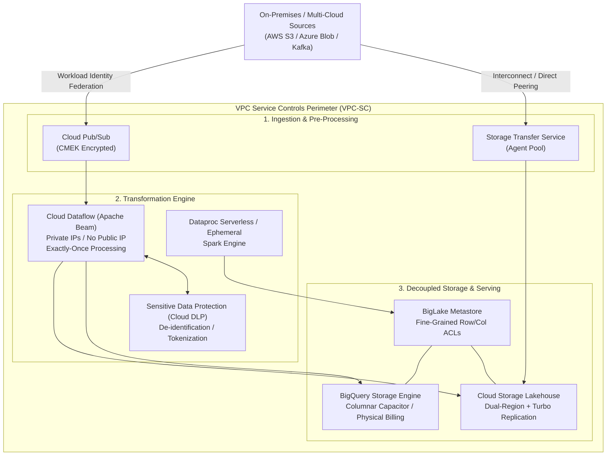
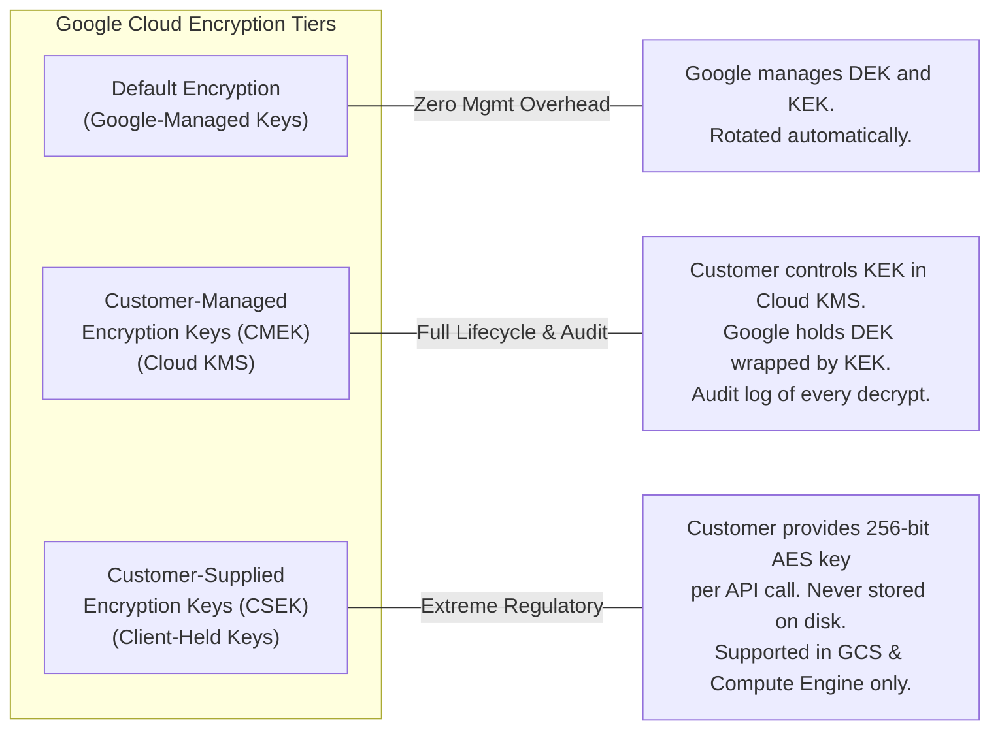
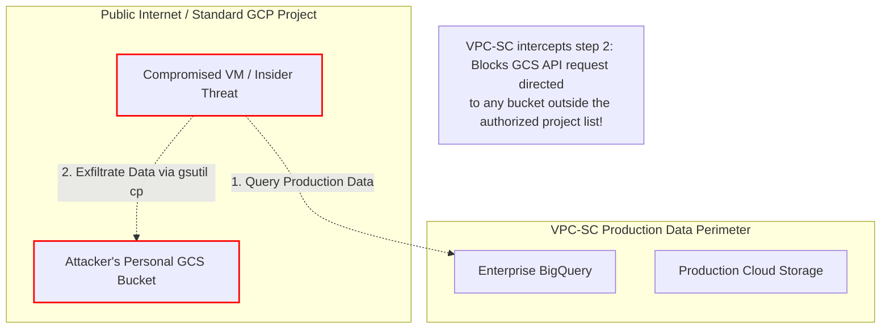
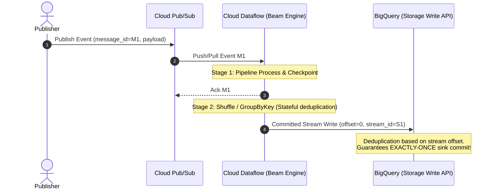
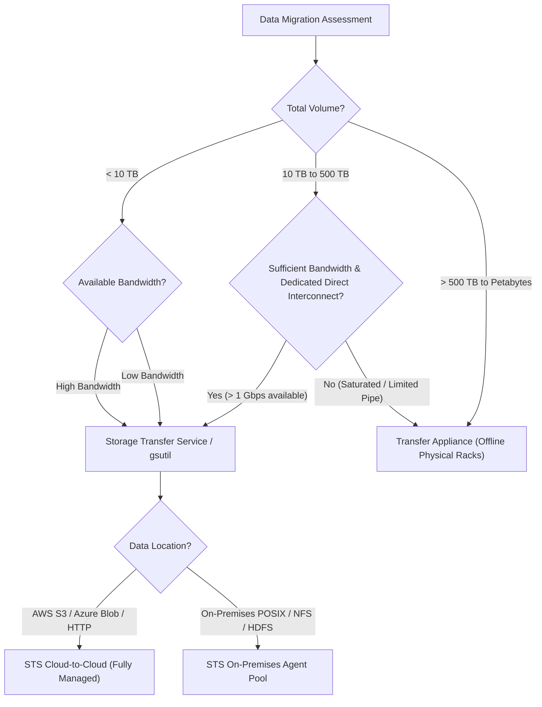

# Domain 1: Designing Data Processing Systems

**Official Exam Guide Weight: ~22%**

---

## Executive Architectural Overview

Designing enterprise data processing systems on Google Cloud requires decoupling compute from storage, enforcing zero-trust security perimeters, establishing deterministic disaster recovery (DR) boundaries, and enabling workload flexibility across multi-cloud topologies. 



---

## Section 1.1: Designing for Security and Compliance

### 1. Identity and Access Management (IAM) Deep Dive
Google Cloud IAM operates on a declarative policy framework evaluated at request time:
$$\text{Access Granted} \iff (\text{Identity} \times \text{Role} \times \text{Conditions}) \cap \text{Org Policy Constraints} \cap \text{VPC-SC Perimeter}$$

#### Predefined vs. Custom Roles
*   **Predefined Roles**: Curated by Google. Examples:
    *   `roles/bigquery.dataViewer`: Read dataset metadata and table data.
    *   `roles/bigquery.dataEditor`: Read/write/modify tables, cannot delete datasets.
    *   `roles/bigquery.jobUser`: Run queries, load data, export data.
    *   `roles/bigquery.user`: Run queries, create datasets (charges billed to project).
*   **Custom Roles**: Tailored least-privilege combinations of distinct permissions (e.g., `bigquery.tables.getData`, `bigquery.jobs.create`). **Exam Rule**: Use Predefined roles unless compliance mandates least-privilege isolation that predefined roles exceed.
*   **IAM Conditions**: Restrict role binding using Common Expression Language (CEL):
    *   Temporal access: `request.time < timestamp("2026-12-31T23:59:59Z")`
    *   Resource tagging: `resource.matchTag('123456789/environment', 'production')`
    *   Network location/IP attributes.

#### Service Account Impersonation vs. Service Account Keys
*   **The Anti-Pattern**: Exporting Service Account JSON keys (`*.json`) to local developer machines, GitHub Actions, or on-premises servers. Keys introduce credential exfiltration vectors, do not expire automatically, and circumvent perimeter boundaries.
*   **The Gold Standard Architecture**:
    1.  **Workload Identity Federation**: Allows external workloads (AWS EC2, Azure VMs, GitHub Actions, Kubernetes on-premises) to exchange OIDC/SAML tokens for short-lived Google Cloud STS credentials.
    2.  **Service Account Impersonation**: Developers or orchestrators obtain the role `roles/iam.serviceAccountTokenCreator` on the target Service Account and generate short-lived tokens using `gcloud` or the IAM Credentials API.

```bash
# Grant Impersonation privilege to a data engineering group
gcloud iam service-accounts add-iam-policy-binding \
    data-pipeline-prod@my-data-project.iam.gserviceaccount.com \
    --member="group:data-engineers@company.com" \
    --role="roles/iam.serviceAccountTokenCreator"

# Run BQ CLI commands securely via impersonation without local keys
bq query \
    --use_legacy_sql=false \
    --impersonate_service_account=data-pipeline-prod@my-data-project.iam.gserviceaccount.com \
    'SELECT count(*) FROM `my-data-project.analytics.fact_orders`'
```

---

### 2. Organization Policies
Organization policies establish guardrails across the entire resource hierarchy:
*   `constraints/gcp.resourceLocations`: Restricts the physical data center locations in which resources (Cloud Storage buckets, BigQuery datasets, Cloud Spanner instances) can be provisioned (e.g., `in:eu-locations` for GDPR).
*   `constraints/gcp.restrictCmekCryptoKeyProjects`: Restricts which Cloud KMS projects can provide keys for customer-managed encryption.
*   `constraints/iam.disableServiceAccountKeyCreation`: Completely blocks developers from generating downloadable service account keys.
*   `constraints/compute.restrictVpcPeering`: Enforces centrally governed hub-and-spoke interconnects.

---

### 3. Encryption Hierarchy: Default vs. CMEK vs. CSEK



#### Envelope Encryption Mechanics
1.  **DEK (Data Encryption Key)**: Fast symmetric key (AES-256) generated locally right next to the data. Used to encrypt the raw payload chunks.
2.  **KEK (Key Encryption Key)**: Key stored securely inside **Cloud KMS** (software or Cloud HSM FIPS 140-2 Level 3). KEK encrypts (wraps) the DEK.
3.  **Storage**: The encrypted data chunk and the wrapped DEK are stored together. The plaintext DEK is immediately discarded from memory.
4.  **Decryption**: Cloud KMS unwraps the DEK using the KEK upon authorized API call, enabling local data block decryption.

#### Key Rotation and Revocation
*   **Key Rotation**: Automatically creates a new key version in KMS (e.g., every 90 days). *Crucial Exam Fact*: Existing data is **not** re-encrypted automatically upon rotation. New writes use the primary version. Existing data uses historical versions to decrypt until explicitly rewritten.
*   **Key Destruction**: Instantaneous cryptographic erasure. Setting a KEK version to `Destroyed` renders all datasets, GCS objects, and BigQuery tables wrapped by that key permanently unreadable.

```bash
# Create KeyRing and CMEK Key in Cloud KMS
gcloud kms keyrings create data-lakehouse-kr \
    --location=us-central1

gcloud kms keys create lake-storage-cmek \
    --location=us-central1 \
    --keyring=data-lakehouse-kr \
    --purpose=encryption \
    --rotation-period=90d \
    --next-rotation-time="2026-12-01T00:00:00Z"

# Assign KMS Encrypter/Decrypter role to BigQuery Service Agent
BQ_SA=$(gcloud beta services identity create --service=bigquery.googleapis.com --project=my-data-project)

gcloud kms keys add-iam-policy-binding lake-storage-cmek \
    --location=us-central1 \
    --keyring=data-lakehouse-kr \
    --member="serviceAccount:${BQ_SA}" \
    --role="roles/cloudkms.cryptoKeyEncrypterDecrypter"
```

---

### 4. PII Anonymization, Pseudonymization & Tokenization with Sensitive Data Protection (Cloud DLP / SDP)

Sensitive Data Protection (SDP) inspects and transforms structured and unstructured streams and stores.

| De-Identification Method | Transformation Mechanism | Reversibility | Analytical Utility | Primary Exam Use Case |
| :--- | :--- | :--- | :--- | :--- |
| **Masking / Redaction** | Replaces characters with fixed string (e.g., `XXXX-XXXX-1234`) | Irreversible | Very Low | PCI-DSS Card display, Log scrubbing |
| **Bucketing / Generalization** | Replaces discrete values with ranges (e.g., Age 34 $\to$ `[30-40]`) | Irreversible | Moderate | Preserving cohorts for ML demographic bias audits |
| **Crypto Deterministic Hash** | SHA-256 hash with optional salt (surrogate key) | Irreversible | High | Joins across disparate tables without revealing raw ID |
| **Deterministic Tokenization (FPE)** | Format-Preserving Encryption using AES-SIV with KMS wrapped key | **Reversible** with cryptographic key | **Highest** | Reversible analytics: Token acts as SSN/Card with exact regex format preserved |

#### De-Identification Streaming Architecture in Cloud Dataflow
In modern streaming pipelines, sensitive data is intercepted prior to BigQuery insertion:

```python
# Apache Beam snippet executing Cloud DLP de-identification
import apache_beam as beam
from google.cloud import dlp_v2

class MaskPIIDoFn(beam.DoFn):
    def __init__(self, project_id, deidentify_template_name):
        self.project_id = project_id
        self.template_name = deidentify_template_name
        self.dlp_client = None

    def setup(self):
        self.dlp_client = dlp_v2.DlpServiceClient()

    def process(self, element):
        # element is a dictionary of customer records
        item = {"table": {
            "headers": [{"name": k} for k in element.keys()],
            "rows": [{"values": [{"string_value": str(v)} for v in element.values()]}]
        }}
        
        response = self.dlp_client.deidentify_content(
            request={
                "parent": f"projects/{self.project_id}/locations/global",
                "deidentify_template_name": self.template_name,
                "item": item
            }
        )
        transformed_row = {
            header.name: row_val.string_value
            for header, row_val in zip(
                response.item.table.headers, 
                response.item.table.rows[0].values
            )
        }
        yield transformed_row
```

---

### 5. Data Residency, Sovereignty, and VPC Service Controls (VPC-SC)

#### VPC Service Controls (VPC-SC)
VPC-SC establishes a secure logical security perimeter around Google-managed multi-tenant PaaS services (BigQuery, GCS, Dataflow, Cloud Spanner, Vertex AI).
*   **Mechanics**: Prevents unauthorized API requests from leaving or entering the perimeter, neutralizing internal malicious actors or compromised service credentials attempting data exfiltration.
*   **Service Perimeter Ingress/Egress Rules**: Explicit bidirectional rules controlling which IAM identities, VPC networks, and projects outside the perimeter can cross the perimeter.
*   **Access Context Manager**: Evaluates perimeter ingress based on IP addresses, device operating system policies, and client certificates.
*   **Dry-Run Mode**: Enables engineering teams to test perimeter policies in logging mode without blocking live production pipelines.



---

## Section 1.2: Designing for Reliability and Fidelity

### 1. Disaster Recovery (DR): RPO, RTO, and Storage Topologies

*   **RPO (Recovery Point Objective)**: Maximum acceptable duration of data loss measured in time (e.g., RPO = 15 minutes implies at most 15 minutes of transactional updates may be lost).
*   **RTO (Recovery Time Objective)**: Maximum allowable downtime to restore full operational service (e.g., RTO = 2 hours implies services must be back online within 2 hours of failure).

#### Cloud Storage Replication Topologies

| Topology | SLA Availability | RPO | Disaster Blast Radius | Cost / Overhead |
| :--- | :--- | :--- | :--- | :--- |
| **Single Region** | 99.9% (Standard) | 0 within region (3 zones) | Total regional outage halts read/write | Baseline |
| **Dual-Region (Standard)** | 99.95% | Up to 1–2 hours asynchronous | Immune to single-region loss; metadata failover | $\approx 2\times$ storage cost |
| **Dual-Region + Turbo Replication** | 99.95% | **$\le$ 15 minutes (100% of data replication backed by SLA)** | Extreme resilience for strict RPO regulatory mandates | Premium per replication GB |
| **Multi-Region** | 99.95% | Geographically dispersed across continental borders | Geo-redundant read availability | Lowest $/GB$ for geo-distributed users |

---

### 2. Delivery Semantics: At-Least-Once vs. Exactly-Once

Understanding data processing semantics across distributed pipelines is vital for ensuring fidelity:



#### Achieving End-to-End Exactly-Once Processing
1.  **Ingestion Layer (Pub/Sub)**: Guarantees **at-least-once** delivery. Pub/Sub retains messages until acknowledged. Network hiccups or delayed ACKs result in duplicate deliveries.
2.  **Processing Layer (Cloud Dataflow)**:
    *   Implements the **MillWheel** checkpointing engine.
    *   Tracks input message IDs and Bloom filters inside persistent state.
    *   Deduplicates messages over an internal rolling window.
    *   Stateful operations (`GroupByKey`, sliding windows) ensure intermediate shuffles are deterministic.
3.  **Sink Layer (BigQuery Storage Write API)**:
    *   Uses **Committed Streams** or **Pending Streams** with explicit stream offsets.
    *   If a Dataflow worker crashes and retries writing offset `450`, BigQuery recognizes the offset has already been written and safely drops the duplicated record.

---

### 3. Data Validation and Dead-Letter Architecture

Production ingestion systems must never fail silently or drop malformed data:

```python
import apache_beam as beam
from apache_beam.pvalue import TaggedOutput

class ValidateAndParseRecord(beam.DoFn):
    OUTPUT_VALID = "valid_records"
    OUTPUT_DEADLETTER = "dead_letter_records"

    def process(self, element):
        try:
            # Enforce schema validation & business constraints
            import json
            record = json.loads(element)
            if "order_id" not in record or float(record.get("amount", -1)) < 0:
                raise ValueError("Missing order_id or negative amount")
            
            yield TaggedOutput(self.OUTPUT_VALID, record)
        except Exception as err:
            error_payload = {
                "raw_record": str(element),
                "error_message": str(err),
                "timestamp": beam.utils.timestamp.Timestamp.now().to_rfc3339()
            }
            yield TaggedOutput(self.OUTPUT_DEADLETTER, error_payload)

# Pipeline usage:
# results = raw_stream | beam.ParDo(ValidateAndParseRecord()).with_outputs(
#     ValidateAndParseRecord.OUTPUT_VALID,
#     ValidateAndParseRecord.OUTPUT_DEADLETTER
# )
# results[ValidateAndParseRecord.OUTPUT_VALID] | "WriteToBQ" >> beam.io.WriteToBigQuery(...)
# results[ValidateAndParseRecord.OUTPUT_DEADLETTER] | "WriteDeadLetter" >> beam.io.WriteToPubSub(...)
```

---

## Section 1.3: Designing for Flexibility and Portability

### 1. Data Migration Strategies: Decision Matrix



*   **BigQuery Data Transfer Service (BQ DTS)**: Optimized for scheduled batch ingestion from external SaaS platforms (Google Ads, Salesforce, YouTube Analytics, Teradata, Amazon Redshift).
*   **Database Migration Service (DMS)**: Minimal downtime serverless migration for operational databases (MySQL, PostgreSQL, Oracle to Cloud SQL/AlloyDB).

---

### 2. Hybrid and Multi-Cloud Analytics with BigQuery Omni

BigQuery Omni extends the BigQuery analytics engine to data stored directly in **Amazon Web Services (AWS) S3** and **Microsoft Azure Blob Storage**.

```mermaid
flowchart LR
    subgraph Google_Cloud["Google Cloud Control Plane"]
        BQ_Console["BigQuery Studio / BI Tools"]
        Query_Coordinator["Query Planner & Coordinator"]
    end

    subgraph AWS_Cloud["Amazon Web Services (AWS)"]
        AWS_Anthos["BigQuery Omni Compute Clusters<br/>(Managed by Google on AWS)"]
        S3_Buckets["S3 Buckets<br/>(Parquet, ORC, CSV)"]
    end

    BQ_Console -->|1. Submit SQL| Query_Coordinator
    Query_Coordinator -->|2. Send Query Execution Graph| AWS_Anthos
    AWS_Anthos <-->|3. Scan & Process In-Region| S3_Buckets
    AWS_Anthos -->|4. Return Final Aggregation (Few KB/MB)| Query_Coordinator
    Query_Coordinator -->|5. Deliver Result| BQ_Console
```

*   **Zero Egress for Raw Scans**: Petabytes of raw data in AWS S3 or Azure Blob are scanned in-situ by local Google-managed compute clusters.
*   **Cross-Cloud Joins**: BigQuery Omni supports cross-cloud queries. However, raw scans are processed locally, and only the summarized intermediate join tables are transferred across clouds, drastically slashing cross-cloud data egress fees.

```sql
-- Create an external connection to AWS S3 in BigQuery
-- (Requires AWS IAM Role with sts:AssumeRoleWithWebIdentity)
SELECT 
    customer_id,
    COUNT(order_id) AS total_orders,
    SUM(order_total) AS total_spend
FROM 
    `aws-data-us-east-1.sales_aws_connection.customer_orders_s3`
WHERE 
    order_date >= '2026-01-01'
GROUP BY 
    customer_id;
```

---

### 3. Open Data Formats & Unified Lakehouse via BigLake

BigLake breaks down silos between data lakes (object stores) and data warehouses:
1.  **Format Agnosticism**: Deep query execution support for open-source columnar and lakehouse formats: Apache Parquet, ORC, Avro, and **Apache Iceberg**.
2.  **Fine-Grained Access Control**: Bridges Cloud Storage with BigQuery governance. Users without direct GCS bucket read permissions can query tables through BigLake while BigLake enforces **Column-Level Security**, **Row-Level Security**, and **Dynamic Data Masking** on raw files.
3.  **Storage Engine Optimizations**: BigLake leverages BigQuery's Capacitor acceleration, metadata caching, and vectorized Parquet parsing on GCS objects.

```sql
-- Creating an Apache Iceberg BigLake Table on GCS
CREATE EXTERNAL TABLE `analytics_lake.customer_telemetry_iceberg`
WITH CONNECTION `us-central1.lakehouse-connection`
OPTIONS (
    format = 'ICEBERG',
    uris = ['gs://corp-data-lake-prod/iceberg/telemetry/metadata/v1.metadata.json']
);

-- Querying the Iceberg table with identical SQL syntax and column security
SELECT 
    device_id, 
    AVG(battery_level) AS avg_battery
FROM 
    `analytics_lake.customer_telemetry_iceberg`
WHERE 
    DATE(_PARTITIONDATE) = CURRENT_DATE()
GROUP BY 
    device_id;
```

---

## Common Exam Traps & Distractors

> [!WARNING]
> 1. **Service Account Key Export Trap**: Any exam answer suggesting *"download service account JSON keys to an on-premises worker or GitHub CI/CD"* is **always wrong**. The correct answer is **Workload Identity Federation** or **Service Account Impersonation**.
> 2. **CMEK Key Rotation Trap**: Questions frequently ask if rotating a Cloud KMS key re-encrypts historical BigQuery tables or GCS files. **It does not**. Existing data remains encrypted under the old key version until explicitly rewritten.
> 3. **CSEK with BigQuery Trap**: Customer-Supplied Encryption Keys (CSEK) are **not supported** natively for BigQuery tables. CSEK is only supported on Cloud Storage and Compute Engine persistent disks. If BigQuery requires custom encryption keys, the answer is **CMEK (Cloud KMS)**.
> 4. **Multi-Region vs. Dual-Region RPO Trap**: Multi-Region GCS provides geographic resilience, but **does not** provide an SLA-backed RPO window for inter-region replication. If the scenario demands a guaranteed **$\le$ 15-minute RPO**, the only correct answer is **Dual-Region with Turbo Replication**.
> 5. **BigQuery Omni Egress Trap**: Distractor options claim BigQuery Omni downloads all raw files from AWS S3 to Google Cloud BigQuery storage before querying. This is false. Compute runs inside AWS, and only final query results cross cloud boundaries.

---

## Scenario-Based Knowledge Checks

### Scenario 1: Financial Transaction Masking and Cross-Account Governance
**Context**: A multinational fintech bank processes global credit card transactions through an on-premises transaction broker. They are streaming transaction payloads into Google Cloud. Compliance mandates (PCI-DSS and GDPR) dictate:
1. Primary Account Numbers (PAN) must be reversibly tokenized before storage in BigQuery so financial forensic auditors with specific cryptographic clearance can de-tokenize when subpoenaed.
2. Analytics engineers must perform user behavior analytics using deterministic joins across datasets without ever seeing raw PANs.
3. No static credentials or service account keys may be stored on on-premises brokers.

**Question**: Which end-to-end architecture satisfies all security and compliance requirements while minimizing operational overhead?
*   **A)** Export a service account key to the on-prem broker. Use Cloud Dataflow with the SHA-256 hash function to mask the PAN. Store data in BigQuery and use BigQuery column-level security.
*   **B)** Configure Workload Identity Federation on the on-prem broker to assume a GCP service account. Stream data to Pub/Sub, process via Cloud Dataflow invoking Cloud DLP with Format-Preserving Encryption (Crypto-Deterministic Tokenization with a KMS-wrapped key), and write to BigQuery. Grant auditors `roles/dlp.deidentifyTemplatesReader` and KMS unwrap permissions.
*   **C)** Use an IPsec VPN to connect the on-prem broker directly to Cloud SQL. Write raw transactions into Postgres. Use standard database views with MD5 hashing for analysts.
*   **D)** Configure Workload Identity Federation. Write raw data to GCS. Run a nightly Dataproc Spark job using an open-source hashing library with a static salt to tokenize the PAN, then load to BigQuery.

**Detailed Answer Analysis**:
*   **Correct Answer: B**. Workload Identity Federation avoids dangerous long-lived JSON keys. Format-Preserving Encryption (FPE / Crypto-Deterministic Tokenization) via Cloud DLP satisfies both requirements: it produces deterministic tokens (allowing analysts to perform joins across tables) and is mathematically reversible by authorized auditors holding access to the Cloud KMS wrap key.
*   *Distractor Analysis*:
    *   **A** fails because downloading service account keys violates enterprise security policies, and SHA-256 is an irreversible one-way hash (cannot be de-tokenized by forensic auditors).
    *   **C** introduces a single database bottleneck, bypasses modern analytical scaling, and MD5 is cryptographically broken and irreversible.
    *   **D** leaves raw unmasked PII sitting in Cloud Storage un-tokenized until the nightly batch runs, violating PCI-DSS data-at-rest ingestion requirements.

---

### Scenario 2: Zero-Downtime Multi-Cloud Data Lake Migration
**Context**: An enterprise retail corporation stores 850 TB of historical telemetry data in Amazon S3 (US-East-1) formatted as Apache Parquet. They want to execute real-time BigQuery analytics on this data immediately without paying millions of dollars in cross-cloud internet data egress costs or waiting weeks for full data transfer. Concurrently, data scientists in Google Cloud must run training queries combining this S3 data with existing BigQuery customer tables in `us-east4`.

**Question**: What is the most cost-effective and immediate architectural pattern?
*   **A)** Use Storage Transfer Service to immediately migrate all 850 TB of Parquet data from S3 to a GCS bucket in `us-east4`. Once completed, build external BigQuery tables.
*   **B)** Configure BigQuery Omni on AWS `aws-us-east-1` with an S3 connection. Query and aggregate the Parquet data in-situ on AWS. Use BigQuery cross-cloud transfer or federated query to ship only aggregated intermediate results to Google Cloud.
*   **C)** Order two Google Cloud Transfer Appliances, connect them to AWS data centers via Direct Connect, export the S3 data to the appliances, and ship them to Google.
*   **D)** Mount the S3 bucket to Compute Engine VMs using `s3fs`, run a custom Python script to stream records to BigQuery using the Legacy Streaming API.

**Detailed Answer Analysis**:
*   **Correct Answer: B**. BigQuery Omni allows the company to query S3 data in-place immediately. Google runs the BigQuery query engine inside AWS infrastructure. Zero cross-cloud egress fees are incurred for scanning the 850 TB of raw Parquet. Only the final aggregated results (or filtered join rows) are egressed to Google Cloud.
*   *Distractor Analysis*:
    *   **A** incurs massive upfront AWS egress fees ($0.09/GB on 850 TB $\approx$ \$76,000+) and requires significant transfer time before queries can begin.
    *   **C** is nonsensical; Transfer Appliances cannot be physically installed in AWS third-party data centers.
    *   **D** is an anti-pattern: `s3fs` is fragile and non-scalable, uses obsolete legacy streaming APIs, and still pays maximum cross-cloud egress.

---

### Scenario 3: High-Fidelity Streaming with Strict Financial RPO
**Context**: A digital payment platform handles real-time stock settlements. The regulatory authority mandates:
1. RPO must not exceed 15 minutes under any catastrophic regional power grid or telecommunication failure.
2. Ingestion pipeline must guarantee zero message loss and exactly-once transactional deduplication into the data warehouse.
3. Analytics queries must query fresh records within 30 seconds of issuance.

**Question**: Which Google Cloud data processing architecture strictly satisfies these requirements?
*   **A)** Stream events to Cloud Pub/Sub. Process events using Cloud Dataflow with streaming engine enabled, utilizing MillWheel checkpointing and writing to BigQuery using the Storage Write API in Committed Stream mode. Store raw backup archives in a Cloud Storage Dual-Region bucket configured with Turbo Replication.
*   **B)** Ingest events directly into Cloud Bigtable with a single cluster in `us-central1-a`. Replicate asynchronously to `us-central1-b`.
*   **C)** Stream events to Pub/Sub Lite. Process via Cloud Functions and write using BigQuery batch insert jobs every 15 minutes.
*   **D)** Write transactions directly to Cloud Storage Multi-Region. Trigger an Eventarc notification to load data into BigQuery using `bq load`.

**Detailed Answer Analysis**:
*   **Correct Answer: A**. Cloud Storage Dual-Region with **Turbo Replication** is the only GCP storage solution backed by a financial SLA guaranteeing replication across regions in $\le$ 15 minutes (satisfying the 15-minute RPO). Dataflow streaming checkpointing combined with BigQuery Storage Write API in **Committed Stream** mode ensures exactly-once semantics with sub-second write latencies, satisfying the 30-second analytical freshness window.
*   *Distractor Analysis*:
    *   **B** provides zonal failover, but a regional catastrophic event knocks out the entire region, failing the DR boundary.
    *   **C** Pub/Sub Lite provides zonal durability (not regional/dual-region) and batch insert jobs run at the 15-minute boundary, failing the 30-second data freshness requirement.
    *   **D** Multi-Region GCS does not carry a 15-minute replication SLA, and batch loading via Eventarc introduces high latency and potential file-write race conditions.
