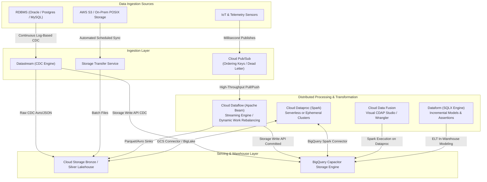
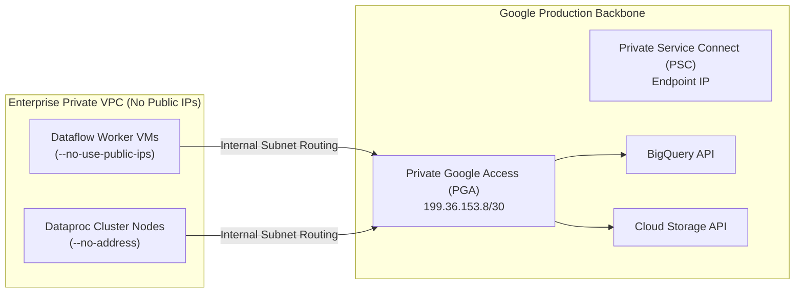
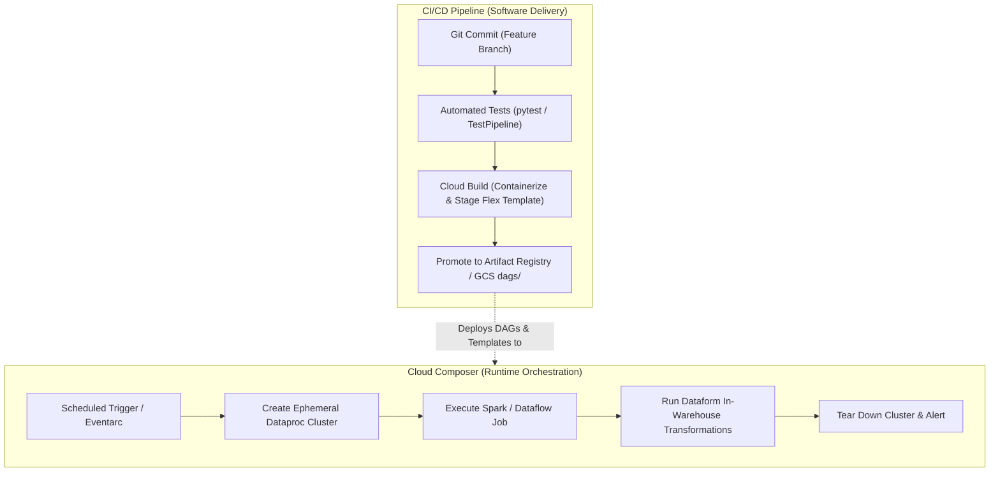
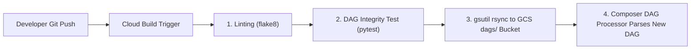

# Domain 2: Ingesting and Processing Data

**Official Exam Guide Weight: ~25%**

---

## Executive Architectural Overview

Data ingestion and processing forms the central nervous system of Google Cloud data engineering. This domain evaluates your mastery of architecting batch and streaming pipelines, enforcing network security and private connectivity, building distributed stateful processing graphs with Apache Beam (Dataflow) and Apache Spark (Dataproc), executing in-warehouse SQL transformations with Dataform, orchestrating workflows with Cloud Composer and Cloud Workflows, and automating deployments through enterprise CI/CD pipelines.



---

## Section 2.1: Planning the Data Pipelines

Successful pipeline engineering starts with architectural planning: defining inputs and outputs, designing transformation topologies, securing network boundaries, and enforcing encryption.

### 1. Defining Data Sources and Sinks
*   **Source Categorization**:
    *   *Unbounded / Streaming*: Continuous event streams with low-latency delivery requirements (IoT telemetry, application clickstreams, financial ticks). Primary GCP entry point: **Cloud Pub/Sub**.
    *   *Log-Based Change Data*: Transactional database redo/WAL logs. Primary GCP entry point: **Cloud Datastream**.
    *   *Bounded / Batch*: Scheduled file drops, database snapshots, or external exports. Primary GCP entry point: **Cloud Storage (GCS)** or **Storage Transfer Service (STS)**.
*   **Sink Alignment**:
    *   *Analytical Warehouse*: **BigQuery** via Storage Write API.
    *   *Operational Time-Series / Wide-Column*: **Cloud Bigtable** via direct mutation API.
    *   *Immutable Data Lake*: **Cloud Storage** via Parquet/Iceberg FileIO.
    *   *Downstream Event Broker*: **Cloud Pub/Sub** topics.

---

### 2. Batch vs. Streaming Processing Continuum
Selecting the processing paradigm dictates cost, operational complexity, and latency:

| Dimension | Batch Processing | Streaming Processing |
| :--- | :--- | :--- |
| **Data Scope** | Bounded dataset (fixed size known at start) | Unbounded dataset (infinite, arriving continuously) |
| **Execution Trigger** | Scheduled (cron), event-driven (file upload via Eventarc), or manual | Continuous daemon (24/7 workers) or micro-batch trigger |
| **Latency Expectation** | Minutes to hours | Sub-second to seconds |
| **State Management** | Ephemeral; state discarded when job finishes | Persistent state across windows with watermarks and checkpointing |
| **Cost Profile** | Ephemeral compute; scales to zero between runs | Ongoing worker vCPU/RAM costs or autoscaling streaming engine units |
| **Recommended Engines** | BigQuery SQL, Dataform, Dataproc Serverless, Dataflow Batch | Cloud Dataflow (Beam Streaming), Pub/Sub Direct Subscriptions |

---

### 3. Ingestion Networking Fundamentals & Private Connectivity
Data pipelines frequently traverse hybrid, multi-cloud, or multi-VPC networks. Security best practices mandate eliminating public IP addresses.

*(For foundational network topology, Custom VPCs, and Shared VPC design, refer to [01_phase0_gcp_fundamentals/03_networking_vpc_firewalls_and_psc.md](file:///e:/gcp_pde_revamp/01_phase0_gcp_fundamentals/03_networking_vpc_firewalls_and_psc.md)).*



*   **Private Google Access (PGA)**: Mandatory for Dataflow workers (`--no-use-public-ips`) and Dataproc nodes provisioned without public IP addresses. PGA allows VMs with internal RFC 1918 IPs to reach Google APIs (`*.googleapis.com`) over Google's internal network fabric without traversing an external gateway.
*   **Private Service Connect (PSC)**: Enables private, consumer-oriented IP endpoints inside your VPC to connect directly to managed services (Datastream, Cloud Data Fusion, Cloud SQL) or third-party partner services without VPC peering limits or route conflicts.
*   **Datastream Private Connectivity**: Connects Datastream to on-premises or peered databases using PSC or a dedicated reverse-proxy VM, ensuring database credentials and replication streams never touch the public internet.
*   **Cloud Data Fusion Private IP Instances**: Data Fusion control plane is provisioned in a Google-managed tenant VPC, communicating with customer VPCs via VPC Network Peering and Cloud SQL proxies.

---

### 4. In-Flight and At-Rest Pipeline Encryption
*   **Transport Layer Security (TLS)**: All Google Cloud API endpoints and inter-service communications enforce TLS 1.3 encryption in transit by default.
*   **Customer-Managed Encryption Keys (CMEK) Across the Pipeline**:
    *   *Pub/Sub Topic CMEK*: Encrypts incoming messages before writing to persistent buffer disks.
    *   *Dataflow Pipeline CMEK*: Passed via pipeline option `--kmsKeyName=projects/.../cryptoKeys/...`. Encrypts worker persistent disks, shuffle buckets, and intermediate pipeline state.
    *   *Storage / BigQuery CMEK*: Guarantees that final sinks are wrapped with the organization's Cloud KMS key.

---

## Section 2.2: Building the Pipelines

### 1. Cloud Pub/Sub Streaming Ingestion Architecture

```mermaid
flowchart LR
    Pub["Publishers<br/>(Microservices / IoT)"] -->|Publish (Ordering Key = customer_id)| Topic["Pub/Sub Topic"]
    Topic --> Sub1["Pull Subscription<br/>(Dataflow Processing)"]
    Topic --> Sub2["BigQuery Direct Ingestion<br/>(No Compute Sink)"]
    Topic --> Sub3["Cloud Storage Direct Ingestion<br/>(Raw Parquet Lake)"]
    Sub1 -->|Un-ackable Malformed msgs| DLQ["Dead-Letter Topic"]
```

#### Core Operational Levers
*   **Ordering Keys**: When a publisher sets an `ordering_key` on a message, Pub/Sub delivers messages with the same key in the exact order received.
    *   *Exam Architectural Rule*: **Do not enable `--enable-message-ordering` on subscriptions consumed by Cloud Dataflow**. Dataflow pulls messages using multi-threaded streaming pull and distributes work across parallel bundles; downstream stages do not preserve Pub/Sub message ordering. If an ordering key stalls, worker starvation occurs. Stream ordering must be handled natively in Apache Beam using event-time timestamps, watermarks, and windowing.
*   **Dead-Letter Topics (DLQ)**: Configures a `max_delivery_attempts` threshold (5–100). If a consumer fails to acknowledge a message after $N$ attempts, the message is automatically forwarded to a dead-letter topic on a best-effort basis for inspection.
*   **Seek and Snapshot**: Allows you to rewind a subscription back in time (up to 31 days, matching the configured message retention duration) to replay unacknowledged or acknowledged messages after a downstream bug fix is deployed.
*   **BigQuery Direct Ingestion Subscriptions**: Streams data directly into BigQuery tables without launching a Cloud Dataflow worker cluster or Cloud Function, supporting JSON, Text, and Avro payloads.

---

### 2. Cloud Pub/Sub Standard vs. Pub/Sub Lite

| Dimension | Cloud Pub/Sub Standard | Cloud Pub/Sub Lite |
| :--- | :--- | :--- |
| **Architecture** | Global, serverless, automated horizontal scaling | Zonal or Regional, pre-provisioned partitions |
| **Capacity Management** | Zero provisioning; scales from 0 to millions of msg/sec | Manual reservation of partition capacity ($X$ MiB/s write, $Y$ MiB/s read) |
| **Availability / Durability** | Multi-zone regional/global durability | Zonal durability (replicated within one zone) or Regional |
| **Ordering** | Supported via `ordering_key` across partitions | Guaranteed per individual partition |
| **Pricing Model** | Pay per gigabyte processed ($40/TB) | Pay for provisioned partition bandwidth and storage capacity ($10/TB) |
| **Exam Selection Heuristic** | Mission-critical, zero ops, dynamic bursty workloads, multi-region | Predictable continuous workloads, high-volume log aggregation, budget-constrained |

---

### 3. Datastream (Change Data Capture - CDC)
Datastream is a serverless, log-based CDC service replicating changes from Oracle, PostgreSQL, MySQL, and SQL Server into BigQuery and Cloud Storage with sub-second latencies:
*   **Log-Based CDC vs. Polling**: Tails transaction redo/write-ahead logs (Oracle LogMiner, Postgres `pgoutput`, MySQL binlog) without locks or table scans, capturing intermediate updates and hard `DELETE` operations.
*   **Direct BigQuery CDC Upsert**: Writes directly into BigQuery using the Storage Write API, where BigQuery automatically merges updates, inserts, and deletions using source metadata columns (`_metadata_change_type`, `_metadata_timestamp`, `_metadata_deleted`, `_metadata_scn`).

---

### 4. BigQuery Storage Write API
The Storage Write API replaces the deprecated Legacy Streaming API (`tabledata.insertAll`):
*   **Committed Stream**: Records are committed immediately to the table. Provides **exactly-once semantics** via sequential client offsets. If a network timeout occurs and the client retries an already-committed offset, BigQuery returns `StorageError.ALREADY_EXISTS`, which the client handles cleanly as success without duplicating data.
*   **Pending Stream**: Records are buffered in a pending state until the client issues an explicit `CommitWriteStreams` call. Enables atomic multi-stream commits across distributed workers.
*   **Default Stream**: At-least-once streaming mode with shared connection pooling; suitable for high-throughput log ingestion where minor duplication is acceptable.

---

### 5. Apache Beam on Cloud Dataflow

Cloud Dataflow is the fully managed, serverless execution engine for Apache Beam pipelines.

#### Windowing Strategies
*   **Fixed (Tumbling) Windows**: Discrete, non-overlapping time intervals (e.g., every 5 minutes). Every element belongs to exactly one window.
*   **Sliding (Hopping) Windows**: Overlapping time intervals defined by duration and period (e.g., 10-minute window every 2 minutes). Elements belong to multiple concurrent windows.
*   **Session Windows**: Dynamic windows demarcated by periods of inactivity (gap duration). Windows expand as long as events arrive within the gap threshold.
*   **Global Windows**: Single infinite window containing all elements in the pipeline. Requires custom triggers to emit aggregations.

#### Watermarks, Late Data, and Triggers
*   **Event Time**: The timestamp when the event occurred on the client/sensor device.
*   **Processing Time**: The timestamp when the event is processed by a Dataflow worker node.
*   **Watermark**: Dataflow's notion of completeness in event time. A watermark at timestamp $T$ asserts: *"The pipeline assumes no further data with event timestamp $t < T$ will arrive."*
*   **Watermark Skew**: The delta between processing time and event time watermark. High skew indicates processing lag, worker stragglers, or massive input backlogs.
*   **Allowed Lateness**: Time interval beyond the watermark during which late-arriving events are accepted into their historical window rather than discarded.
*   **Triggers**: Dictate *when* window panes are emitted (Early speculative panes, On-time panes, Late panes).
*   **Accumulation Modes**: `ACCUMULATING` (retains state and emits running totals) vs. `DISCARDING` (emits incremental deltas).

```python
# Enterprise Production Apache Beam Streaming Pipeline
import apache_beam as beam
from apache_beam.transforms.trigger import (
    AfterWatermark, AfterProcessingTime, AfterCount, 
    AccumulationMode, Repeatedly
)
from apache_beam.options.pipeline_options import PipelineOptions, StandardOptions

options = PipelineOptions([
    "--project=enterprise-prod-data",
    "--runner=DataflowRunner",
    "--streaming",
    "--enable_streaming_engine",
    "--no_use_public_ips",
    "--subnetwork=https://www.googleapis.com/compute/v1/projects/enterprise-prod-data/regions/us-central1/subnetworks/data-subnet",
    "--region=us-central1"
])
options.view_as(StandardOptions).streaming = True

def parse_telemetry(msg):
    import json
    data = json.loads(msg.decode("utf-8"))
    return (data["device_id"], float(data["temperature"]))

with beam.Pipeline(options=options) as p:
    (
        p 
        | "ReadPubSub" >> beam.io.ReadFromPubSub(topic="projects/enterprise-prod-data/topics/iot-telemetry")
        | "ParseJSON" >> beam.Map(parse_telemetry)
        | "ApplyWindowAndTriggers" >> beam.WindowInto(
            beam.window.FixedWindows(60), # 1-minute fixed event-time window
            trigger=Repeatedly(
                AfterWatermark(
                    early=AfterProcessingTime(10), # Speculative early pane every 10s
                    late=AfterCount(1)             # Fire immediately on every late event
                )
            ),
            allowed_lateness=86400, # Accept late data up to 24 hours
            accumulation_mode=AccumulationMode.ACCUMULATING
        )
        | "MeanPerDevice" >> beam.CombinePerKey(beam.combiners.MeanCombineFn())
        | "WriteToBigQuery" >> beam.io.WriteToBigQuery(
            table="enterprise-prod-data:iot_analytics.device_temps_1m",
            schema="device_id:STRING, temperature:FLOAT",
            write_disposition=beam.io.BigQueryDisposition.WRITE_APPEND,
            method=beam.io.WriteToBigQuery.Method.STORAGE_WRITE_API
        )
    )
```

#### In-Pipeline AI Data Enrichment (Beam RunInference)
Instead of invoking external REST endpoints inside a `DoFn` (which creates latency bottlenecks and violates rate limits), production Beam pipelines use the **`RunInference`** transform:
*   Loads models locally into worker GPU/CPU memory (TensorFlow, PyTorch, ONNX, Vertex AI endpoints).
*   Performs vectorized batch inference directly on pipeline bundles with automatic worker-side batching and zero per-row REST overhead.

---

### 6. Apache Spark on Cloud Dataproc
*   **Dataproc Ephemeral Clusters**: Created by orchestrators (Cloud Composer), executes Spark/PySpark batch scripts against data stored in GCS/BigLake, and terminates immediately upon completion (`trigger_rule="all_done"`).
*   **Dataproc Serverless for Spark**: Fully serverless Spark execution. Eliminates cluster provisioning, tuning, and VM maintenance. Workloads are submitted via `gcloud dataproc batches submit pyspark`.
*   **Dataproc Autoscaling & Graceful Decommissioning**: Scales worker nodes dynamically based on YARN memory metrics. When downscaling, `gracefulDecommissionTimeout` waits for active Spark executors to finish shuffle block transfers before terminating VMs, preventing `MetadataFetchFailedException` shuffle crashes.
*   **Spot VM Secondary Workers**: Secondary workers are stateless (do not store HDFS blocks). Configuring secondary workers as Spot VMs slashes compute costs by up to 80% without risking cluster failure.

---

### 7. Hadoop & Kafka Integration Patterns
*   **Dataproc Metastore (DPMS)**: Fully managed, serverless Apache Hive metastore. Decouples metadata catalogs from Dataproc clusters, allowing multiple ephemeral Spark/Hive clusters to share a persistent metastore.
*   **HDFS to GCS Migration**: Use Hadoop `distcp` to migrate petabytes of HDFS data to Cloud Storage buckets using Google's Cloud Storage Connector for Hadoop.
*   **Apache Kafka to GCP**:
    *   *Kafka Connect Google Cloud Pub/Sub Connector*: Streams topics from on-prem Kafka into Pub/Sub topics.
    *   *MirrorMaker 2*: Replicates Kafka clusters to GCP Compute Engine Kafka clusters during phased migrations.

---

### 8. Cloud Data Fusion (Visual CDAP Integration)
*   **What It Is**: Fully managed visual ETL/ELT service built on open-source CDAP (Cask Data Application Platform).
*   **Wrangler**: Interactive graphical interface for data cleansing, schema transformation, and filtering with 150+ pre-built source and sink plugins.
*   **Execution**: When executed, Data Fusion compiles the visual pipeline into an optimized Apache Spark program and runs it on a transient, ephemeral Cloud Dataproc cluster.
*   **Selection Heuristic**: Choose Cloud Data Fusion when the organization mandates a code-free graphical interface for ETL developers and business analysts; choose Dataflow when custom Apache Beam code, extreme throughput, sub-second latency, or custom stateful logic is required.

---

### 9. SQL Transformations in Dataform
Dataform provides version-controlled, declarative SQL modeling natively inside BigQuery:
*   `definitions/*.sqlx`: Combines SQL queries with declarative `config {}` blocks.
*   `ref('table_name')`: Automatically parses dependencies and builds the execution DAG across hundreds of models.
*   `assertions {}`: Enforces data quality gates (unique keys, non-null values, row conditions) before publishing models to downstream production schemas.
*   `type: "incremental"`: Updates destination tables using partition-bounded `MERGE` statements instead of full table re-scans.

---

## Section 2.3: Deploying and Operationalizing the Pipelines

A pipeline built in development must be automated, tested, containerized, and promoted across environments using production CI/CD practices.

### 1. Distinction: Pipeline Orchestration vs. Pipeline CI/CD



*   **Pipeline CI/CD**: Governs the software development lifecycle of the pipeline code: linting, unit testing, building Docker container images, staging templates, and promoting code across dev $\to$ stage $\to$ prod.
*   **Pipeline Orchestration (Cloud Composer / Workflows)**: Governs the **runtime execution schedule** and data dependencies of deployed pipelines: triggering jobs at 02:00 AM, monitoring task progress, retrying transient network blips, and executing downstream aggregations.

---

### 2. Apache Beam & Cloud Dataflow CI/CD

#### Unit Testing with `TestPipeline`
Before packaging a pipeline, transforms must be verified locally without spinning up cloud workers:

```python
# test_pipeline.py - Apache Beam Unit Testing
import pytest
import apache_beam as beam
from apache_beam.testing.test_pipeline import TestPipeline
from apache_beam.testing.util import assert_that, equal_to

class CleanCustomerRecord(beam.DoFn):
    def process(self, element):
        email = element.get("email", "").strip().lower()
        if "@" in email:
            yield {"customer_id": element["customer_id"], "email": email}

def test_clean_customer_record():
    input_records = [
        {"customer_id": "C101", "email": " ALICE@Example.COM "},
        {"customer_id": "C102", "email": "invalid-email"},
        {"customer_id": "C103", "email": "bob@company.org"}
    ]
    expected_output = [
        {"customer_id": "C101", "email": "alice@example.com"},
        {"customer_id": "C103", "email": "bob@company.org"}
    ]

    with TestPipeline() as p:
        output = (
            p 
            | beam.Create(input_records)
            | beam.ParDo(CleanCustomerRecord())
        )
        assert_that(output, equal_to(expected_output))
```

#### Dataflow Flex Templates
Flex Templates package pipeline code and dependencies into a Docker container stored in **Artifact Registry**. This allows non-technical users or Airflow DAGs to execute pipelines with custom runtime parameters without requiring local development environments or Python dependencies.

```dockerfile
# Dockerfile for Dataflow Flex Template
FROM gcr.io/dataflow-templates-base/python311-template-launcher-base:latest

ENV FLEX_TEMPLATE_PYTHON_REQUIREMENTS_FILE="/template/requirements.txt"
ENV FLEX_TEMPLATE_PYTHON_PY_FILE="/template/main.py"

COPY . /template
RUN pip install --no-cache-dir -r $FLEX_TEMPLATE_PYTHON_REQUIREMENTS_FILE
```

```bash
# 1. Build and push container to Artifact Registry
gcloud builds submit --tag=us-central1-docker.pkg.dev/my-project/dataflow-repo/streaming-telemetry:v1 .

# 2. Build the Flex Template specification file in Cloud Storage
gcloud dataflow flex-template build gs://my-project-templates/streaming-telemetry.json \
    --image="us-central1-docker.pkg.dev/my-project/dataflow-repo/streaming-telemetry:v1" \
    --sdk-language="PYTHON" \
    --metadata-file="metadata.json"

# 3. Run the Flex Template in production
gcloud dataflow flex-template run "telemetry-pipeline-prod" \
    --template-file-gcs-location="gs://my-project-templates/streaming-telemetry.json" \
    --region="us-central1" \
    --parameters=input_topic="projects/my-project/topics/iot",output_table="my-project:dw.telemetry"
```

---

### 3. Cloud Composer CI/CD Deployment



#### DAG Structural Integrity Testing (`test_dag_integrity.py`)
Ensures no Python syntax errors, circular dependencies, or illegal operators reach production:

```python
# tests/test_dag_integrity.py
import pytest
from airflow.models import DagBag

def test_dag_integrity():
    dagbag = DagBag(dag_folder="dags/", include_examples=False)
    assert len(dagbag.import_errors) == 0, f"DAG import errors: {dagbag.import_errors}"
    
    for dag_id, dag in dagbag.dags.items():
        assert len(dag.tasks) > 0, f"DAG {dag_id} contains no tasks"
        # Verify retries are explicitly set for resilience
        for task in dag.tasks:
            assert task.retries >= 1, f"Task {task.task_id} in {dag_id} has no retries"
```

---

### 4. Dataform CI/CD & Release Configurations
*   **Git Integration**: Dataform connects to GitHub, GitLab, or Cloud Source Repositories. Developers build transformations in private **Development Workspaces**.
*   **Release Configurations**: Defines compilation environments (e.g., `staging`, `production`) with specific schema/table prefixes and GoogleSQL compile-time variables.
*   **Workflow Configurations**: Dictates execution schedules, tags (e.g., run only `daily_marts`), and dependency management.

---

### 5. End-to-End Enterprise CI/CD Pipeline (`cloudbuild.yaml`)

```yaml
# cloudbuild.yaml - Production Data Pipeline Deployment
steps:
  # Step 1: Run Unit Tests for Apache Beam and Cloud Composer
  - name: 'python:3.11-slim'
    id: 'unit-tests'
    entrypoint: 'bash'
    args:
      - '-c'
      - |
        pip install --no-cache-dir -r requirements-test.txt
        pytest tests/

  # Step 2: Build & Push Dataflow Flex Template Container Image
  - name: 'gcr.io/cloud-builders/docker'
    id: 'build-dataflow-image'
    args:
      - 'build'
      - '-t'
      - 'us-central1-docker.pkg.dev/$PROJECT_ID/pipeline-containers/beam-ingest:$SHORT_SHA'
      - '-f'
      - 'Dockerfile'
      - '.'

  - name: 'gcr.io/cloud-builders/docker'
    id: 'push-dataflow-image'
    args:
      - 'push'
      - 'us-central1-docker.pkg.dev/$PROJECT_ID/pipeline-containers/beam-ingest:$SHORT_SHA'

  # Step 3: Build Flex Template JSON Specification in GCS
  - name: 'gcr.io/google.com/cloudsdktool/cloud-sdk'
    id: 'build-template-spec'
    entrypoint: 'gcloud'
    args:
      - 'dataflow'
      - 'flex-template'
      - 'build'
      - 'gs://$PROJECT_ID-templates/beam-ingest-$SHORT_SHA.json'
      - '--image=us-central1-docker.pkg.dev/$PROJECT_ID/pipeline-containers/beam-ingest:$SHORT_SHA'
      - '--sdk-language=PYTHON'

  # Step 4: Deploy Airflow DAGs to Cloud Composer Environment Bucket
  - name: 'gcr.io/google.com/cloudsdktool/cloud-sdk'
    id: 'deploy-composer-dags'
    entrypoint: 'bash'
    args:
      - '-c'
      - |
        gsutil -m rsync -r -d -x '.*\.pyc$|__pycache__/' dags/ gs://${_COMPOSER_BUCKET}/dags/

substitutions:
  _COMPOSER_BUCKET: 'us-central1-my-composer-env-bucket'

options:
  logging: CLOUD_LOGGING_ONLY
```

---

## Common Exam Traps & Distractors

> [!WARNING]
> 1. **Composer Cluster Lifecycle Anti-Pattern**: In Cloud Composer DAGs, failing to set `trigger_rule="all_done"` on cluster deletion operators leaves expensive multi-node Dataproc clusters running indefinitely when upstream jobs throw errors.
> 2. **Pub/Sub Ordering with Dataflow Trap**: Enabling `--enable-message-ordering` on Pub/Sub subscriptions read by Dataflow causes worker bottlenecks and thread starvation. Stream ordering in Dataflow must be handled natively in Apache Beam using event-time timestamps, windows, and watermarks.
> 3. **Dataflow Watermark vs. Processing Time**: Questions involving streaming aggregations that omit data or compute incorrect sliding averages usually stem from windowing on *processing time* rather than *event time*. Always align windowing with original event timestamps.
> 4. **Storage Write API Mode Selection**: Recommending the *Default Stream* when the scenario strictly demands financial transactional deduplication is incorrect. Default Stream provides at-least-once semantics. Exactly-once commits require **Committed Streams** or **Pending Streams** with sequential offsets.
> 5. **Spark Preemption Failure Trap**: Running Dataproc with Spot VMs on the Primary Master or Primary Worker nodes causes job aborts when nodes are preempted. Only **Secondary Workers** should use Spot/Preemptible instances.
> 6. **Composer vs CI/CD Trap**: Distractor options suggest using Cloud Composer to deploy new Dataflow container images or run pytest unit tests. Composer is a runtime workflow orchestrator; code building, testing, and artifact deployment belong in **Cloud Build**.

---

## Scenario-Based Knowledge Checks

### Scenario 1: Unifying CDC Streaming from Legacy Oracle into BigQuery
**Context**: A global logistics enterprise operates an on-premises Oracle database executing 15,000 inventory updates per second. The analytics team requires these updates to be queryable inside BigQuery within 5 seconds of source commit. The database administrator warns that heavy `SELECT` queries across transactional tables will crash the legacy Oracle instance. Furthermore, the downstream BigQuery table must accurately represent updates, row insertions, and deleted inventory records.

**Question**: Which architecture delivers the required replication latency with the lowest administrative overhead and zero impact on database query performance?
*   **A)** Deploy a Cloud Composer DAG running every 60 seconds that executes a JDBC query using `Sqoop` on the Oracle DB, writing to GCS, and loading to BigQuery using `bq load`.
*   **B)** Configure Google Cloud Datastream to connect to Oracle via LogMiner. Stream change events directly into BigQuery using continuous CDC replication. BigQuery automatically merges updates, inserts, and deletions using source metadata columns.
*   **C)** Write a Python daemon running on a Compute Engine VM that queries Oracle table system views, serializes rows to CSV, and uploads them to Pub/Sub Lite.
*   **D)** Configure an Oracle GoldenGate agent on-premises to write JSON files to an NFS mount, run Storage Transfer Service every 5 minutes to GCS, and run an hourly Dataflow batch job.

**Detailed Answer Analysis**:
*   **Correct Answer: B**. Datastream uses log-based CDC (Oracle LogMiner), which reads transaction redo logs directly without issuing lock-inducing SQL queries against database tables. Datastream streams directly into BigQuery via the Storage Write API, where BigQuery automatically applies CDC upserts/deletions natively with sub-second latencies.
*   *Distractor Analysis*:
    *   **A** fails because running periodic polling queries impacts DB performance, misses hard deletes, and cannot meet the 5-second freshness SLA.
    *   **C** is fragile, requires custom software maintenance, queries table views (degrading DB performance), and Pub/Sub Lite lacks multi-zone resilience.
    *   **D** introduces unacceptable 5-minute to 1-hour delays, failing the 5-second freshness SLA.

---

### Scenario 2: Handling High-Skew Stateful Event Streaming in Dataflow
**Context**: A multiplayer mobile gaming company streams millions of telemetry events per second into Cloud Pub/Sub. A Cloud Dataflow streaming pipeline calculates rolling 10-minute player statistics. A tiny fraction of players (streamers and bot accounts) generate $1000\times$ more telemetry events than average users. During global tournament broadcasts, the Dataflow job encounters extreme lag, worker memory exhaustion, and failing steps on `GroupByKey`.

**Question**: What architectural modifications inside the Apache Beam pipeline resolve this bottleneck?
*   **A)** Switch the pipeline to use Pub/Sub Lite and double the number of workers.
*   **B)** Apply Combiner Lifting with `CombinePerKey` or implement Hot Key salting/fan-out on the skewed user IDs before grouping.
*   **C)** Disable Streaming Engine and scale worker disk sizes to 2 TB.
*   **D)** Switch the pipeline from Fixed Windows to Global Windows with Discarding triggers.

**Detailed Answer Analysis**:
*   **Correct Answer: B**. The scenario describes a classic distributed computing **Hot Key** problem: a single key (popular streamer or bot) routes excessive data to a single worker running `GroupByKey`, exhausting memory and causing pipeline lag. Apache Beam mitigates hot keys via **Combiner Lifting** (performing partial pre-aggregations on worker nodes prior to shuffle) or by applying **Salting** (appending random prefixes `key_1`, `key_2` to distribute the load across multiple workers, followed by a secondary global merge).
*   *Distractor Analysis*:
    *   **A** does not fix the hot key issue: adding more workers does not prevent a single key's data from being routed to one worker during a shuffle.
    *   **C** disabling Streaming Engine shifts shuffle operations back to worker disks, drastically worsening shuffle bottlenecks and increasing costs.
    *   **D** changing windowing semantics fundamentally alters business metrics without solving the underlying key partition skew.

---

### Scenario 3: Automated and Zero-Downtime Dataflow Pipeline Deployments
**Context**: An enterprise data engineering team maintains 25 Apache Beam streaming pipelines running on Cloud Dataflow. Currently, engineers manually compile Python scripts on their laptops and submit jobs directly using the DataflowRunner CLI. Recently, an engineer accidentally deployed code with an unpinned dependency that crashed the production fraud detection pipeline during peak hours.

**Question**: What deployment pattern prevents dependency drift and automates pipeline testing and promotion across environments?
*   **A)** Set up Cloud Composer to run `gcloud dataflow jobs run` commands every morning.
*   **B)** Package each Apache Beam pipeline into a Dataflow Flex Template using a standard `Dockerfile`. Implement a Cloud Build CI/CD trigger that runs `pytest` unit tests with `TestPipeline`, builds the container image in Artifact Registry, stages the template JSON in Cloud Storage, and promotes the template across staging and production environments.
*   **C)** Export service account JSON keys to GitHub Actions and have GitHub Actions execute the Python script directly on a self-hosted runner.
*   **D)** Convert all Apache Beam pipelines into Cloud Functions triggered by Pub/Sub messages.

**Detailed Answer Analysis**:
*   **Correct Answer: B**. Dataflow Flex Templates package pipeline code, Python runtimes, and exact dependencies into Docker containers in Artifact Registry, eliminating dependency drift and environment mismatch. Cloud Build automates unit testing with `TestPipeline` before building the container, ensuring broken code is caught before production staging.
*   *Distractor Analysis*:
    *   **A** Cloud Composer orchestrates job execution, but does not solve container packaging, dependency pinning, or unit testing.
    *   **C** Exporting service account JSON keys violates Google Cloud security best practices (vulnerable to credential theft), and self-hosted runners do not solve template standardization.
    *   **D** Cloud Functions cannot execute stateful, windowed Apache Beam pipelines or handle high-throughput distributed shuffles.
