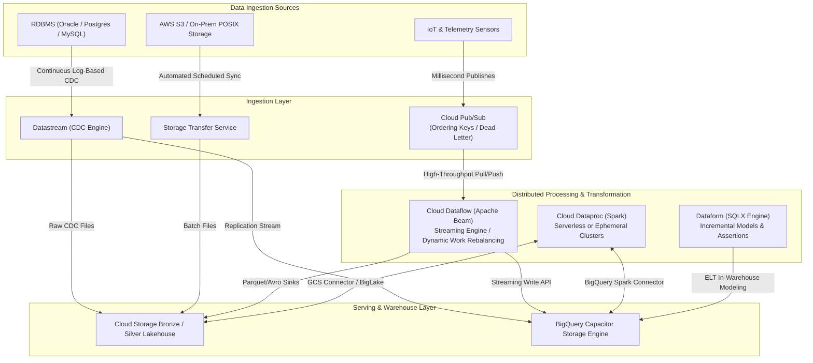
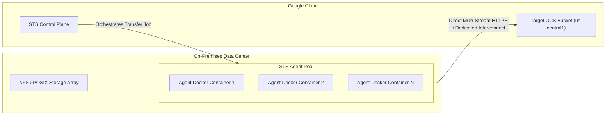
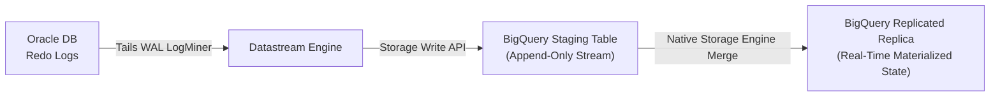
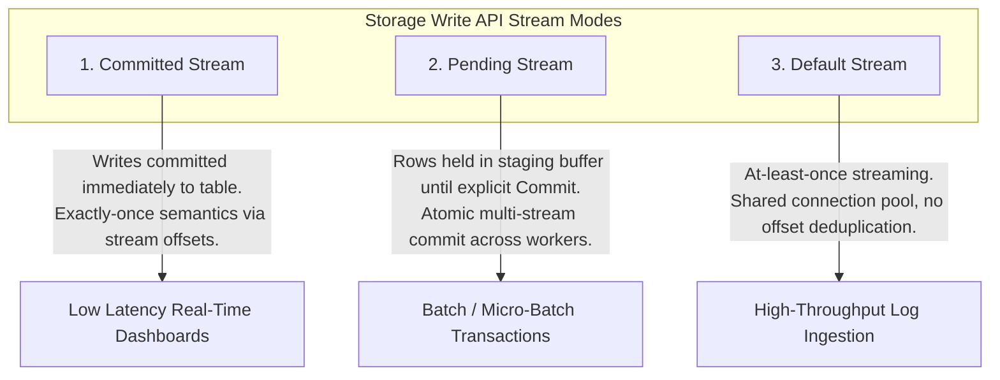
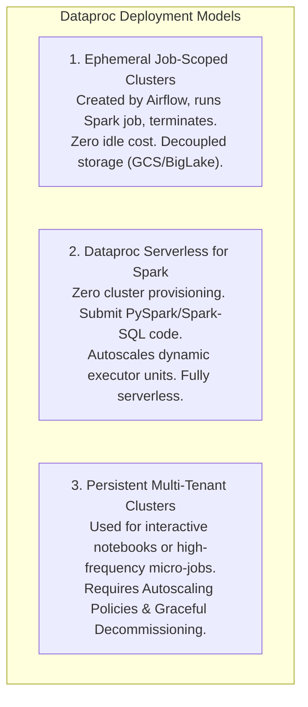

# Domain 2: Ingesting and Processing Data

**Official Exam Guide Weight: ~25%**

---

## Executive Architectural Overview

Data ingestion and processing forms the central nervous system of Google Cloud data engineering. This domain evaluates your mastery of architecting batch pipelines, ultra-low-latency event streaming, distributed stateful processing with Apache Beam (Dataflow) and Apache Spark (Dataproc), SQL transformation DAGs with Dataform, and orchestration with Cloud Composer and Cloud Workflows.



---

## Section 2.1: Planning, Creating, and Executing Batch Data Ingestion

### 1. Storage Transfer Service (STS)
Storage Transfer Service automates scalable data transfers from external clouds, POSIX file systems, and Cloud Storage buckets without managing intermediate VMs.



#### Key Capabilities & Architecture Rules
*   **Agent Pools**: Groups of Docker containers running on on-premises infrastructure. You scale throughput linearly by adding agent containers to the pool.
*   **Bandwidth Throttling**: Restrict transfer speed during peak business hours (e.g., limit to 500 MB/s from 08:00 to 18:00, uncapped at night).
*   **Incremental Sync & Hash Verification**: STS compares MD5 / CRC32C hashes and timestamps. It transfers *only* new or modified objects.
*   **Cloud-to-Cloud Transfers**: Transfers directly from Amazon S3 or Microsoft Azure Blob Storage to GCS via Google's private global fiber backbone without installing any agents.

```bash
# Provision an on-premises agent pool and register an agent
gcloud transfer agent-pools create enterprise-corp-pool \
    --display-name="Main DC Storage Pool" \
    --bandwidth-limit=1000

# Run the Docker container locally with GCP authentication
docker run --ulimit memlock=64000000 -d --rm \
    -v /etc/google/auth/key.json:/tmp/key.json \
    -e GOOGLE_APPLICATION_CREDENTIALS=/tmp/key.json \
    -v /mnt/san_lakehouse:/data:ro \
    gcr.io/cloud-ingest/agent:latest \
    --agent-pool=enterprise-corp-pool
```

---

### 2. BigQuery Data Transfer Service (BQ DTS)
BQ DTS automates scheduled, managed data movement directly into BigQuery:
*   **SaaS Connectors**: Native connectors for Google Ads, Campaign Manager, YouTube Channel Reports, Salesforce, Teradata, and Amazon Redshift.
*   **Cloud Storage / Amazon S3 Transfers**: Ingests files matching URI wildcards (`gs://my-bucket/logs/*.parquet`) on scheduled cron intervals.
*   **Schema Appending vs. Overwriting**: Supports table overwrite, table append, or partitioned date partition loading.

---

### 3. Datastream (Change Data Capture - CDC)
Datastream is a serverless, log-based CDC service for replicating data from relational databases (Oracle, PostgreSQL, MySQL, SQL Server) into BigQuery and Cloud Storage with sub-second latencies.

#### Log-Based vs. Query-Based CDC
*   **Query-Based (Polling)**: Runs periodic `SELECT * FROM table WHERE updated_at > :last_time`. Introduces severe database performance degradation, locks tables, and completely misses hard `DELETE` operations.
*   **Log-Based CDC (Datastream)**: Tails the transaction redo/write-ahead logs (Oracle LogMiner, Postgres `pgoutput` logical decoding, MySQL Binary Logs). Zero query overhead on transaction tables, zero locks, captures all intermediate updates, and captures `DELETE` operations.

#### Datastream-to-BigQuery Direct Replication Architecture
Datastream writes directly into BigQuery using the BigQuery Storage Write API and continuously applies changes using BigQuery CDC upsert logic:



#### Datastream Metadata Schema Injections
When replicating into Cloud Storage or BigQuery, Datastream appends rich transaction metadata columns:
*   `_metadata_change_type`: Operation type (`INSERT`, `UPDATE-OLD`, `UPDATE-NEW`, `DELETE`).
*   `_metadata_timestamp`: Commit timestamp from the source database transaction log.
*   `_metadata_deleted`: Boolean indicating if the row was removed in the source system.
*   `_metadata_scn` / `_metadata_lsn`: System Change Number or Log Sequence Number to resolve out-of-order delivery.

---

## Section 2.2: Planning, Creating, and Executing Streaming Data Ingestion

### 1. Cloud Pub/Sub Architecture

```mermaid
flowchart LR
    Pub["Publishers<br/>(Microservices / IoT)"] -->|Publish (Ordering Key = customer_id)| Topic["Pub/Sub Topic"]
    Topic --> Sub1["Pull Subscription<br/>(Dataflow Processing)"]
    Topic --> Sub2["BigQuery Direct Ingestion<br/>(No Compute Sink)"]
    Topic --> Sub3["Cloud Storage Direct Ingestion<br/>(Raw Parquet Lake)"]
    Sub1 -->|Un-ackable Malformed msgs| DLQ["Dead-Letter Topic"]
```

#### Core Operational Levers
*   **Ordering Keys**: When a publisher sets an `ordering_key` on a message, Pub/Sub guarantees that messages with the same key are delivered to subscribers in the exact order they were received by the service.
    *   *Exam Crucial Rule*: If an unacknowledged ordered message is blocked, all subsequent messages with that same ordering key are withheld until the head-of-line message is acknowledged or purged.
*   **Dead-Letter Topics (DLQ)**: Configures a `max_delivery_attempts` threshold (5–100). If a consumer fails to acknowledge a message after $N$ attempts, the message is automatically forwarded to a dead-letter topic for inspection.
*   **Seek and Snapshot**: Allows you to rewind a subscription back in time (up to 7 days, or matching the retention duration) to replay unacknowledged or acknowledged messages after a downstream bug fix is deployed.
*   **BigQuery Direct Ingestion Subscriptions**: Subscriptions that stream data straight into BigQuery tables without launching or paying for a Cloud Dataflow worker cluster or Cloud Function. Supports JSON, Text, and Avro payloads.

---

### 2. Cloud Pub/Sub Standard vs. Pub/Sub Lite

| Dimension | Cloud Pub/Sub Standard | Cloud Pub/Sub Lite |
| :--- | :--- | :--- |
| **Architecture** | Global, serverless, automated horizontal scaling | Zonal or Regional, pre-provisioned partitions |
| **Capacity Management** | Zero provisioning; scales from 0 to millions of msg/sec | Manual reservation of partition capacity ($X$ MiB/s write, $Y$ MiB/s read) |
| **Availability / Durability** | Multi-zone regional/global durability | Zonal durability (replicated within one zone) or Regional |
| **Ordering** | Supported via `ordering_key` across partitions | Guaranteed per individual partition |
| **Pricing Model** | Pay per gigabyte processed ($40/TB) | Pay for provisioned partition bandwidth and storage capacity ($10/TB) |
| **Exam Selection Heuristic** | Mission-critical, zero ops, dynamic bursty workloads, multi-region | Predictable continuous workloads, high-volume log aggregation, budget-constrained |

---

### 3. Direct BigQuery Storage Write API

The Storage Write API replaces the deprecated Legacy Streaming API (`tabledata.insertAll`).



#### Why Storage Write API Dominates
1.  **Cost Reduction**: Substantially lower cost per GB written compared to legacy `insertAll`.
2.  **Exactly-Once Processing**: Employs client-side stream offsets (`offset=0, 1, 2...`). If a client retries writing a stream chunk, BigQuery detects the collision and ignores duplicates.
3.  **Dynamic Schema Updates**: Supports schema updates (adding new nullable columns) on the fly without halting active write streams.

---

## Section 2.3: Planning, Creating, and Executing Data Processing Pipelines

### 1. Apache Beam on Cloud Dataflow

Cloud Dataflow is the fully managed, serverless execution engine for Apache Beam pipelines.

#### Windowing Strategies
*   **Fixed (Tumbling) Windows**: Discrete, non-overlapping time intervals (e.g., every 5 minutes). Every element belongs to exactly one window.
*   **Sliding (Hopping) Windows**: Overlapping time intervals defined by duration and period (e.g., 10-minute window every 2 minutes). Elements belong to multiple concurrent windows.
*   **Session Windows**: Dynamic windows demarcated by periods of inactivity (gap duration). Windows expand as long as events arrive within the gap threshold (e.g., user web session terminates after 30 minutes of idle time).
*   **Global Windows**: Single infinite window containing all elements in the pipeline. Requires custom triggers to emit aggregations.

#### Watermarks, Late Data, and Triggers
*   **Event Time**: The timestamp when the event actually occurred on the client/sensor device.
*   **Processing Time**: The timestamp when the event is processed by a specific Dataflow worker node.
*   **Watermark**: Dataflow's notion of completeness in event time. A watermark at timestamp $T$ asserts: *"The pipeline assumes no further data with event timestamp $t < T$ will arrive."*
*   **Watermark Skew**: The delta between processing time and event time watermark. High skew indicates processing lag, network backpressure, or massive backlogs.
*   **Allowed Lateness**: Time interval beyond the watermark during which late-arriving events are accepted into their historical window rather than discarded.
*   **Triggers**: Dictate *when* window panes are emitted:
    *   *Early triggers*: Speculative output before the watermark passes.
    *   *On-time triggers*: Fires precisely when the watermark passes the window boundary.
    *   *Late triggers*: Fires whenever late data arrives within the allowed lateness window.
    *   *Accumulating vs. Discarding*: Accumulating retains previous pane state and emits running totals; Discarding emits deltas.

```python
# Enterprise Production Apache Beam Streaming Pipeline
import apache_beam as beam
from apache_beam.transforms.trigger import (
    AfterWatermark, AfterProcessingTime, AfterCount, 
    AccumulationMode, Repeatedly
)
from apache_beam.options.pipeline_options import PipelineOptions, StandardOptions

options = PipelineOptions([
    "--project=enterprise-prod-data",
    "--runner=DataflowRunner",
    "--streaming",
    "--enable_streaming_engine",
    "--region=us-central1"
])
options.view_as(StandardOptions).streaming = True

def parse_telemetry(msg):
    import json
    data = json.loads(msg.decode("utf-8"))
    return (data["device_id"], float(data["temperature"]))

with beam.Pipeline(options=options) as p:
    (
        p 
        | "ReadPubSub" >> beam.io.ReadFromPubSub(topic="projects/enterprise-prod-data/topics/iot-telemetry")
        | "ParseJSON" >> beam.Map(parse_telemetry)
        | "ApplyWindowAndTriggers" >> beam.WindowInto(
            beam.window.FixedWindows(60), # 1-minute fixed event-time window
            trigger=Repeatedly(
                AfterWatermark(
                    early=AfterProcessingTime(10), # Speculative early pane every 10s
                    late=AfterCount(1)             # Fire immediately on every late event
                )
            ),
            allowed_lateness=86400, # Accept late data up to 24 hours
            accumulation_mode=AccumulationMode.ACCUMULATING
        )
        | "MeanPerDevice" >> beam.CombinePerKey(beam.combiners.MeanCombineFn())
        | "WriteToBigQuery" >> beam.io.WriteToBigQuery(
            table="enterprise-prod-data:iot_analytics.device_temps_1m",
            schema="device_id:STRING, temperature:FLOAT",
            write_disposition=beam.io.BigQueryDisposition.WRITE_APPEND,
            method=beam.io.WriteToBigQuery.Method.STORAGE_WRITE_API
        )
    )
```

#### Stateful DoFns: State and Timers
When pipelines require complex event tracking (e.g., fraud pattern matching across sequential user clicks), Beam uses persistent state and timers:
*   `ValueState`: Single scalar value persisted per key (e.g., last known transaction amount).
*   `BagState`: Append-only list of items accumulated per key without loading all items into memory.
*   `Timer`: Event-time or processing-time callback invoked automatically when the pipeline reaches a specified clock time.

---

### 2. Apache Spark on Cloud Dataproc

Cloud Dataproc is the managed enterprise environment for Hadoop, Spark, Hive, and Presto.



#### Dataproc Autoscaling Policies & Graceful Decommissioning
Dataproc autoscales worker nodes based on **YARN memory and vCPU demand**:
*   `yarn:yarn.resourcemanager.monitor.capacity.allocated-mb`
*   `yarn:yarn.resourcemanager.monitor.capacity.available-mb`
*   **Graceful Decommissioning**: When downscaling, Dataproc waits for running Spark executors and YARN containers to finish transferring shuffle data before terminating VMs (timeout configured via `gracefulDecommissionTimeout`). This prevents Spark shuffle read failures (`MetadataFetchFailedException`).
*   **Primary vs. Secondary (Spot) Workers**:
    *   *Primary Workers*: Standard persistent compute VMs holding HDFS NameNode/DataNode blocks. Cannot be preemptible.
    *   *Secondary Workers*: Compute-only workers (no HDFS storage). Ideal for **Spot VMs (Preemptibles)**. If preempted, only compute tasks fail and are rescheduled by the Spark driver.

```yaml
# dataproc-autoscaling-policy.yaml
basicAlgorithm:
  yarnConfig:
    scaleUpFactor: 0.05
    scaleDownFactor: 1.0
    scaleUpMinWorkerFraction: 0.0
    scaleDownMinWorkerFraction: 0.0
    gracefulDecommissionTimeout: 300s
workerConfig:
  minInstances: 2
  maxInstances: 10
secondaryWorkerConfig:
  minInstances: 0
  maxInstances: 50 # Spot VMs absorb dynamic burst loads
```

---

### 3. SQL Transformations in Dataform

Dataform provides Git-integrated, declarative SQL modeling natively inside BigQuery (the Google Cloud equivalent of dbt).

#### Core Dataform Primitives
*   `definitions/*.sqlx`: Contains SQL transformation logic combined with configuration blocks.
*   `type`: `table`, `view`, `incremental`, or `assertion`.
*   **Incremental Tables**: Updates existing tables by processing only newly arrived records using the `incremental()` predicate and a unique merge key:

```sql
-- definitions/fact_sales_incremental.sqlx
config {
  type: "incremental",
  schema: "analytics_dw",
  uniqueKey: ["order_id"],
  assertions: {
    uniqueKey: ["order_id"],
    nonNull: ["order_id", "customer_id", "order_amount"]
  },
  bigquery: {
    partitionBy: "DATE(order_timestamp)",
    clusterBy: ["customer_id", "store_id"]
  }
}

SELECT
  order_id,
  customer_id,
  store_id,
  order_amount,
  order_timestamp
FROM
  ${ref("stg_raw_orders")}

${when(incremental(), `
  WHERE order_timestamp > (SELECT MAX(order_timestamp) FROM ${self()})
`)}
```

---

## Section 2.4: Planning, Creating, and Executing Pipeline Deployment and Automation

### 1. Cloud Composer (Managed Apache Airflow)

Cloud Composer is a fully managed Apache Airflow service running on top of Google Kubernetes Engine (GKE).

#### Cloud Composer Architecture
*   **Composer 2 / 3**: Leverages GKE Autopilot. The control plane automatically scales Airflow Workers and Celery/Kubernetes Pods dynamically based on queued task demand.
*   **Metadata DB**: Managed Cloud SQL PostgreSQL storing DAG definitions, run history, and XCom payloads.
*   **GCS Environment Bucket**: Contains the `/dags`, `/plugins`, and `/data` folders. Modifying files in the GCS `/dags` directory triggers Airflow DAG parsing via the DAG Processor.

```python
# Production Airflow Orchestration DAG
from datetime import datetime, timedelta
from airflow import DAG
from airflow.providers.google.cloud.operators.dataproc import (
    DataprocCreateClusterOperator,
    DataprocSubmitJobOperator,
    DataprocDeleteClusterOperator
)
from airflow.providers.google.cloud.operators.bigquery import BigQueryInsertJobOperator

default_args = {
    "owner": "data-platform",
    "depends_on_past": False,
    "email_on_failure": True,
    "email": ["data-alerts@enterprise.com"],
    "retries": 3,
    "retry_delay": timedelta(minutes=5),
}

CLUSTER_CONFIG = {
    "master_config": {"num_instances": 1, "machine_type_uri": "n2-standard-4"},
    "worker_config": {"num_instances": 2, "machine_type_uri": "n2-standard-8"},
    "secondary_worker_config": {
        "num_instances": 10,
        "is_preemptible": True
    },
    "software_config": {"image_version": "2.1-debian11"}
}

with DAG(
    dag_id="daily_telemetry_aggregation_pipeline",
    default_args=default_args,
    schedule_interval="0 2 * * *", # Daily at 02:00 AM UTC
    start_date=datetime(2026, 1, 1),
    catchup=False,
    max_active_runs=1,
) as dag:

    create_cluster = DataprocCreateClusterOperator(
        task_id="create_ephemeral_dataproc_cluster",
        project_id="enterprise-prod-data",
        region="us-central1",
        cluster_name="ephemeral-spark-{{ ds_nodash }}",
        cluster_config=CLUSTER_CONFIG
    )

    run_spark_aggregation = DataprocSubmitJobOperator(
        task_id="run_spark_pyspark_job",
        project_id="enterprise-prod-data",
        region="us-central1",
        job={
            "reference": {"project_id": "enterprise-prod-data"},
            "placement": {"cluster_name": "ephemeral-spark-{{ ds_nodash }}"},
            "pyspark_job": {
                "main_python_file_uri": "gs://enterprise-prod-artifacts/scripts/aggregate_telemetry.py",
                "args": ["--execution_date={{ ds }}"]
            }
        }
    )

    delete_cluster = DataprocDeleteClusterOperator(
        task_id="delete_ephemeral_dataproc_cluster",
        project_id="enterprise-prod-data",
        region="us-central1",
        cluster_name="ephemeral-spark-{{ ds_nodash }}",
        trigger_rule="all_done" # Guarantees cluster teardown even if Spark job crashes
    )

    create_cluster >> run_spark_aggregation >> delete_cluster
```

---

### 2. Cloud Workflows: Lightweight Serverless Orchestration

For lightweight event-driven workflows, Cloud Composer is often over-engineered and costly. **Cloud Workflows** executes low-cost, serverless HTTP/API orchestrations with sub-millisecond cold starts and zero idle maintenance costs.

```yaml
# workflow-ingest-trigger.yaml
main:
  params: [event]
  steps:
    - init:
        assign:
          - projectId: ${sys.get_env("GOOGLE_CLOUD_PROJECT_ID")}
          - datasetId: "raw_landing_lake"
          - tableId: "daily_events"
    - runBigQueryLoad:
        call: googleapis.bigquery.v2.jobs.insert
        args:
          projectId: ${projectId}
          body:
            configuration:
              load:
                sourceUris:
                  - ${"gs://" + event.data.bucket + "/" + event.data.name}
                destinationTable:
                  projectId: ${projectId}
                  datasetId: ${datasetId}
                  tableId: ${tableId}
                sourceFormat: "PARQUET"
                writeDisposition: "WRITE_APPEND"
        result: loadJob
    - returnResult:
        return: ${loadJob.status.state}
```

---

## Common Exam Traps & Distractors

> [!WARNING]
> 1. **Composer Cluster Lifecycle Anti-Pattern**: In Cloud Composer DAGs, failing to set `trigger_rule="all_done"` on cluster deletion operators leaves expensive multi-node Dataproc clusters running indefinitely when upstream jobs throw errors.
> 2. **Pub/Sub Lite for Dynamic Bursty Workloads**: Recommending Pub/Sub Lite for unpredictable, globally distributed, bursty microservice traffic is a trap. Pub/Sub Lite requires explicit partition scaling; it fails or drops traffic if throughput exceeds pre-allocated bandwidth. Use **Cloud Pub/Sub Standard**.
> 3. **Dataflow Watermark vs. Processing Time**: Questions involving streaming aggregations that omit data or compute incorrect sliding averages usually stem from windowing on *processing time* rather than *event time*. Always align windowing with original event timestamps.
> 4. **Storage Write API Mode Selection**: Recommending the *Default Stream* when the scenario strictly demands financial transactional deduplication is incorrect. Default Stream provides at-least-once semantics. Exactly-once commits require **Committed Streams** or **Pending Streams** with sequential offsets.
> 5. **Spark Preemption Failure Trap**: Running Dataproc with Spot VMs on the Primary Master or Primary Worker nodes causes job aborts when nodes are preempted. Only **Secondary Workers** should use Spot/Preemptible instances.

---

## Scenario-Based Knowledge Checks

### Scenario 1: Unifying CDC Streaming from Legacy Oracle into BigQuery
**Context**: A global logistics enterprise operates an on-premises Oracle database executing 15,000 inventory updates per second. The analytics team requires these updates to be queryable inside BigQuery within 5 seconds of source commit. The database administrator warns that heavy `SELECT` queries across transactional tables will crash the legacy Oracle instance. Furthermore, the downstream BigQuery table must accurately represent updates, row insertions, and deleted inventory records.

**Question**: Which architecture delivers the required replication latency with the lowest administrative overhead and zero impact on database query performance?
*   **A)** Deploy a Cloud Composer DAG running every 60 seconds that executes a JDBC query using `Sqoop` on the Oracle DB, writing to GCS, and loading to BigQuery using `bq load`.
*   **B)** Configure Google Cloud Datastream to connect to Oracle via LogMiner. Stream change events directly into BigQuery using continuous CDC replication. BigQuery automatically merges updates, inserts, and deletions using source metadata columns.
*   **C)** Write a Python daemon running on a Compute Engine VM that queries Oracle table system views, serializes rows to CSV, and uploads them to Pub/Sub Lite.
*   **D)** Configure an Oracle GoldenGate agent on-premises to write JSON files to an NFS mount, run Storage Transfer Service every 5 minutes to GCS, and run an hourly Dataflow batch job.

**Detailed Answer Analysis**:
*   **Correct Answer: B**. Datastream uses log-based CDC (Oracle LogMiner), which reads transaction redo logs directly without issuing lock-inducing SQL queries against database tables. Datastream streams directly into BigQuery via the Storage Write API, where BigQuery automatically applies CDC upserts/deletions natively with sub-second latencies.
*   *Distractor Analysis*:
    *   **A** fails because running periodic polling queries impacts DB performance, misses hard deletes, and cannot meet the 5-second freshness SLA.
    *   **C** is fragile, requires custom software maintenance, queries table views (degrading DB performance), and Pub/Sub Lite lacks multi-zone resilience.
    *   **D** introduces unacceptable 5-minute to 1-hour delays, failing the 5-second freshness SLA.

---

### Scenario 2: Handling High-Skew Stateful Event Streaming in Dataflow
**Context**: A multiplayer mobile gaming company streams millions of telemetry events per second into Cloud Pub/Sub. A Cloud Dataflow streaming pipeline calculates rolling 10-minute player statistics. A tiny fraction of players (streamers and bot accounts) generate $1000\times$ more telemetry events than average users. During global tournament broadcasts, the Dataflow job encounters extreme lag, worker memory exhaustion, and failing steps on `GroupByKey`.

**Question**: What architectural modifications inside the Apache Beam pipeline resolve this bottleneck?
*   **A)** Switch the pipeline to use Pub/Sub Lite and double the number of workers.
*   **B)** Apply Combiner Lifting with `CombinePerKey` or implement Hot Key salting/fan-out on the skewed user IDs before grouping.
*   **C)** Disable Streaming Engine and scale worker disk sizes to 2 TB.
*   **D)** Switch the pipeline from Fixed Windows to Global Windows with Discarding triggers.

**Detailed Answer Analysis**:
*   **Correct Answer: B**. The scenario describes a classic distributed computing **Hot Key** problem: a single key (popular streamer or bot) routes excessive data to a single worker running `GroupByKey`, exhausting memory and causing pipeline lag. Apache Beam mitigates hot keys via **Combiner Lifting** (performing partial pre-aggregations on worker nodes prior to shuffle) or by applying **Salting** (appending random prefixes `key_1`, `key_2` to distribute the load across multiple workers, followed by a secondary global merge).
*   *Distractor Analysis*:
    *   **A** does not fix the hot key issue: adding more workers does not prevent a single key's data from being routed to one worker during a shuffle.
    *   **C** disabling Streaming Engine shifts shuffle operations back to worker disks, drastically worsening shuffle bottlenecks and increasing costs.
    *   **D** changing windowing semantics fundamentally alters business metrics without solving the underlying key partition skew.

---

### Scenario 3: Minimizing Cost on Daily Large-Scale Spark Analytics
**Context**: An e-commerce company runs an intensive Apache Spark ML feature extraction pipeline every morning at 03:00 AM UTC. The job takes 45 minutes to execute over 12 TB of data stored in Cloud Storage. The company currently keeps a 40-node Dataproc cluster running 24/7 to support this job, resulting in thousands of dollars in wasted idle compute charges each month.

**Question**: How should the data engineer redesign this pipeline to minimize infrastructure costs while guaranteeing high reliability?
*   **A)** Migrate the cluster to Google Kubernetes Engine (GKE) and manage Spark on K8s manually.
*   **B)** Keep the persistent cluster running, but downscale it to 2 nodes during the day and manually scale it to 40 nodes at 02:55 AM.
*   **C)** Orchestrate the pipeline using Cloud Composer to create an ephemeral Dataproc cluster consisting of a standard master node, 2 primary standard worker nodes, and 38 secondary Spot (preemptible) worker nodes. Submit the Spark job, and execute a deletion operator configured with `trigger_rule="all_done"`.
*   **D)** Convert the Spark job into Cloud Functions triggered by Cloud Storage object creation events.

**Detailed Answer Analysis**:
*   **Correct Answer: C**. Ephemeral clusters eliminate 100% of idle infrastructure costs by provisioning VMs solely for the 45-minute job duration. Using **Secondary Spot Workers** delivers up to an 80% discount on compute nodes. Because secondary workers do not store HDFS metadata or blocks, Spot preemptions do not crash the job. The `all_done` trigger rule guarantees the cluster is deleted even if the Spark job encounters an application error.
*   *Distractor Analysis*:
    *   **A** introduces massive operational overhead: managing self-hosted Spark on GKE requires configuring operators, log aggregators, and custom autoscaling.
    *   **B** still pays continuous idle costs for 2 nodes 24/7 and relies on brittle, error-prone manual intervention.
    *   **D** Cloud Functions has a 9-minute execution timeout and cannot process 12 TB distributed ML feature extractions.
