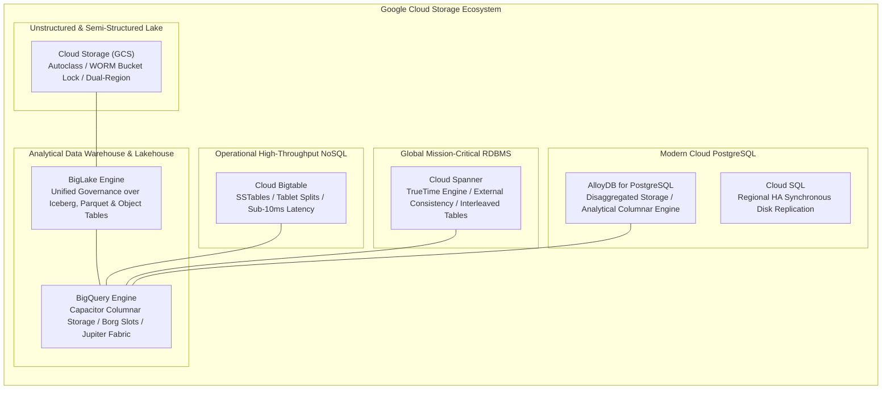
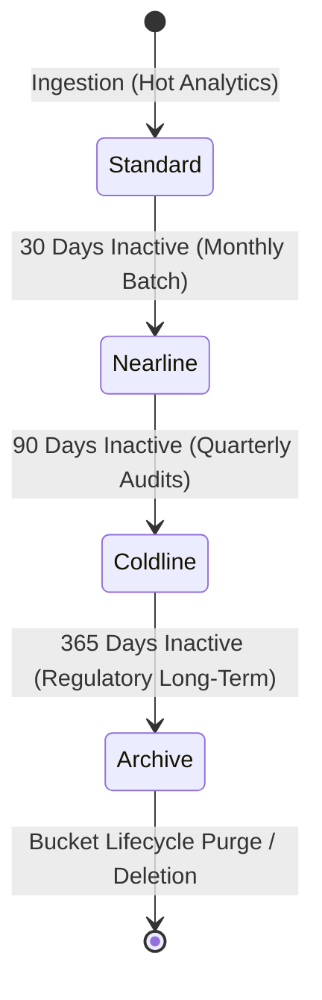
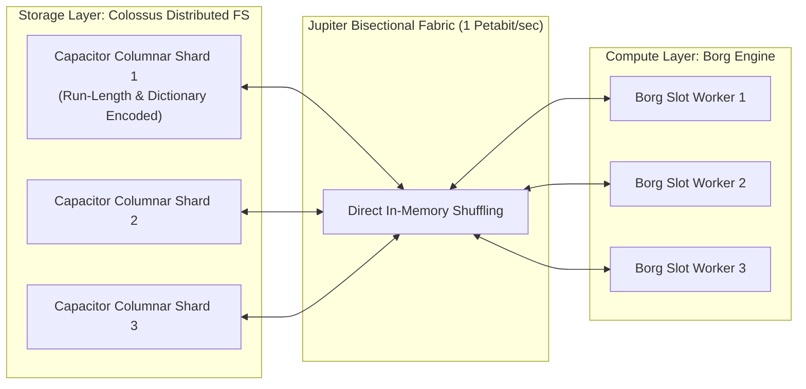
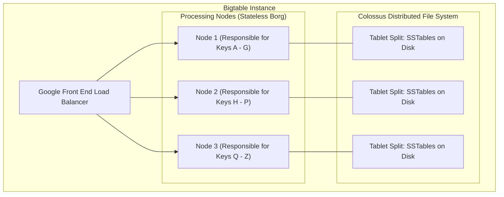
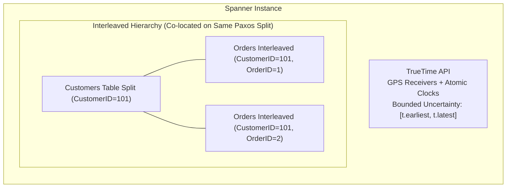
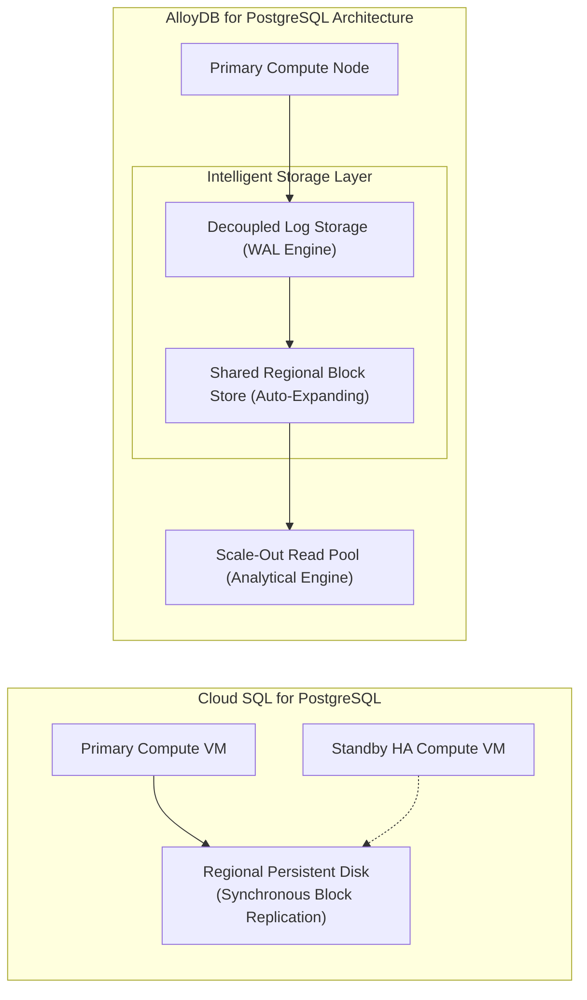
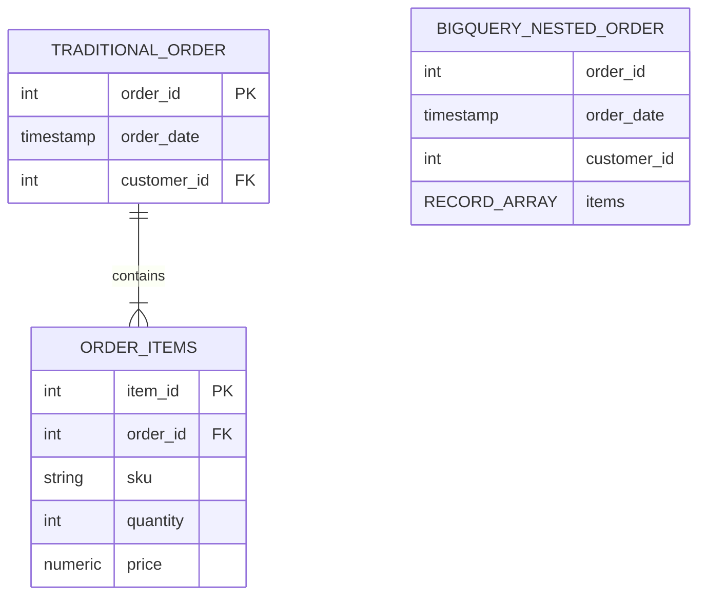
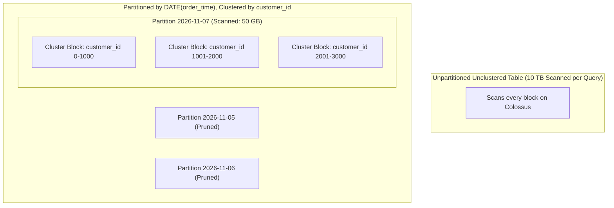
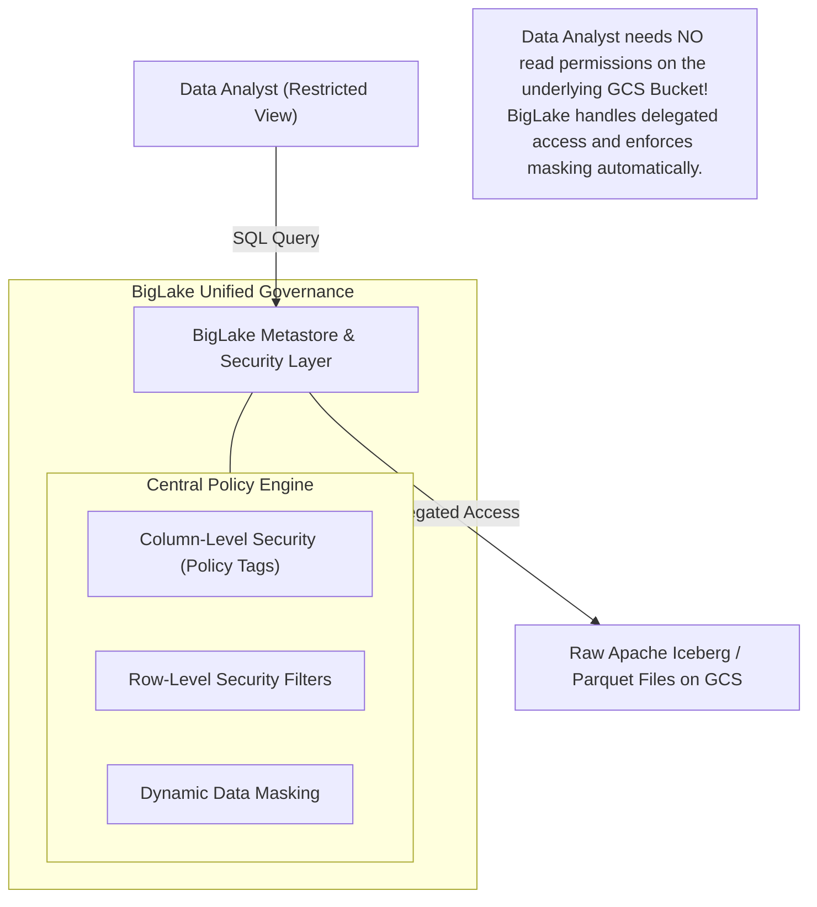
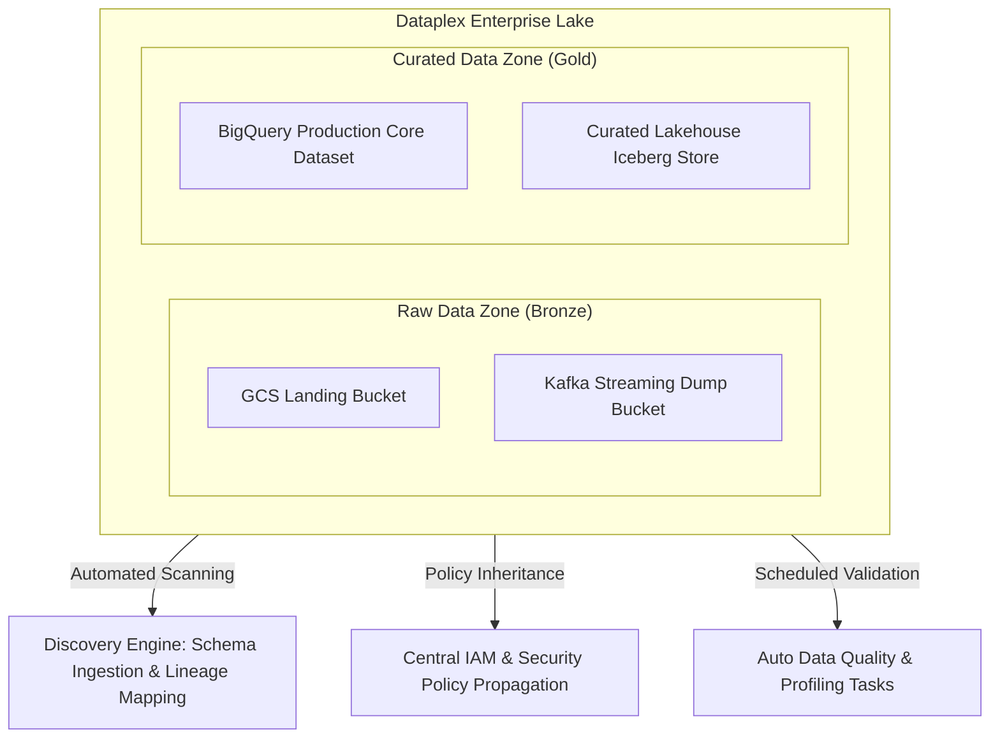

# Domain 3: Storing Data

**Official Exam Guide Weight: ~20%**

---

## Executive Architectural Overview

Selecting, designing, and optimizing storage engines is foundational to passing the Professional Data Engineer exam. This domain focuses on the deep physical mechanics of Google Cloud storage systems: Cloud Storage lifecycle automation, BigQuery's decoupled Capacitor/Colossus architecture and storage billing tiers, Cloud Bigtable high-throughput row key design and Key Visualizer diagnostics, Cloud Spanner's TrueTime distributed consensus and interleaved schema modeling, and modern Lakehouse governance via BigLake and Dataplex Data Mesh.



---

## Section 3.1: Planning, Implementing, and Managing Storage Architectures

### 1. Cloud Storage (GCS) Deep Dive

Cloud Storage is the exabyte-scale foundation for data lakes.



#### Storage Classes & Financial Penalties

| Storage Class | Minimum Storage Duration | Retrieval Fee per GB | Target Latency | Ideal Workload |
| :--- | :--- | :--- | :--- | :--- |
| **Standard** | None | None | Milliseconds | Hot data lakes, active Dataflow/Spark pipelines |
| **Nearline** | 30 days | Low ($\approx \$0.01$) | Milliseconds | Monthly reports, data accessed $\le 1\times$ per month |
| **Coldline** | 90 days | Moderate ($\approx \$0.02$) | Milliseconds | Disaster recovery backups, accessed $\le 1\times$ per year |
| **Archive** | 365 days | High ($\approx \$0.05$) | Milliseconds | Compliance archives (HIPAA/FINRA), rarely accessed |

> [!WARNING]
> **Minimum Storage Duration Trap**: If an object stored in Coldline is deleted or transitioned to Archive after only 20 days, you are billed for the remaining 70 days of Coldline storage as an early deletion penalty.

#### Lifecycle Rules vs. Autoclass
*   **Object Lifecycle Management (OLM)**: Declarative JSON/XML rules based on conditions:
    *   `age`: Number of days since object creation.
    *   `createdBefore`: Specific date threshold.
    *   `matchesStorageClass`: Only acts on specified classes.
    *   `isLive`: Distinguishes active objects from historical versions (when Object Versioning is active).
*   **Autoclass**: Completely automates transitions between Standard, Nearline, Coldline, and Archive based on individual object access patterns without configuring custom lifecycle policies or paying retrieval fees.

#### Data Protection & WORM Compliance
*   **Object Versioning**: Preserves historical copies of overwritten or deleted objects. Protects against accidental developer deletion or corrupted pipeline runs.
*   **Bucket Lock (Retention Policies)**: Enforces Write Once, Read Many (WORM) regulatory compliance (SEC Rule 17a-4, FINRA). Once a retention policy is locked, nobody—not even the Google Cloud Project Owner or Organization Super Admin—can delete objects or shorten the retention duration until the period expires.

---

### 2. BigQuery Internal Architecture & Storage Billing

BigQuery decouples compute from storage completely, linked by the petabit Jupiter bisectional network fabric:



#### Physical (Compressed) vs. Logical (Uncompressed) Storage Billing
BigQuery allows datasets to be billed under two distinct pricing models:
1.  **Logical Storage**: Billed on uncompressed data size.
    *   Active Logical: Data modified within the last 90 days ($\approx \$0.020$/GB).
    *   Long-term Logical: Data untouched for 90 days ($\approx \$0.010$/GB).
2.  **Physical Storage**: Billed on compressed bytes on disk after Capacitor compression algorithms run ($\approx \$0.040$/GB for active, $\approx \$0.020$/GB for long-term).
    *   *Includes Time Travel and Fail-safe storage*.
    *   **Decision Rule**: If your data compresses at a ratio higher than $2.5:1$ to $4:1$ (common with repetitive text, JSON logs, or telemetry strings), **Physical Storage** slashes overall storage costs significantly.

#### Time Travel and Fail-Safe Windows
*   **Time Travel**: Query historical table snapshots from $X$ days ago using the `FOR SYSTEM_TIME AS OF` SQL clause. Default is 7 days; can be reduced to 2 days to minimize physical storage costs on high-churn tables.
*   **Fail-Safe**: A non-configurable 7-day period *after* the Time Travel window closes. Data can only be recovered by contacting Google Cloud Customer Support in a disaster scenario.

---

### 3. Cloud Bigtable: Schema and Row Key Architecture

Cloud Bigtable is Google's NoSQL wide-column store offering consistent sub-10ms latency at millions of operations per second.



#### Row Key Design Rules
Bigtable stores data lexicographically sorted by a single row key. Queries that scan contiguous ranges of row keys are exceptionally fast.

| Design Strategy | Example Row Key Pattern | Evaluation & Use Case |
| :--- | :--- | :--- |
| **Monotonically Increasing ID (Anti-Pattern)** | `2026-11-07-0001`<br/>`2026-11-07-0002` | **FATAL**: Hotspots a single node. All sequential writes hit the same tablet split while other nodes sit idle. |
| **Field Promotion (Composite Key)** | `customer_id#device_type#timestamp` | **Excellent**: Groups all data for a specific customer together; enables range scans for a user. |
| **Hashed Prefix / Salting** | `hash(device_id)[0:4]#device_id#timestamp` | **Optimal for High-Write Ingestion**: Distributes high-frequency sensor writes evenly across all cluster nodes. |
| **Reversed Timestamps** | `device_id#9999999999999-timestamp` | **Optimal for Most-Recent Lookups**: Ensures the latest readings appear first in a scan rather than scanning the entire historical range. |

#### Key Visualizer Diagnostics
Key Visualizer generates heatmaps representing Bigtable read/write throughput over time:
*   **Bright horizontal stripe**: Hotspotting on a single contiguous row key range.
*   **Bright diagonal line**: Sequential write pattern (monotonically increasing row keys marching across tablets).
*   **Evenly distributed faint pattern**: Healthy, balanced cluster utilization across all tablet splits.

#### Garbage Collection Policies
Applied at the column-family level:
*   *Max Versions*: Keep only the most recent $N$ cell versions (e.g., retain last 3 updates).
*   *Max Age*: Drop cells older than duration $T$ (e.g., purge data older than 30 days).
*   *Intersection vs. Union*:
    *   **Union** (`OR`): Retains cell if it matches *either* policy (conservative).
    *   **Intersection** (`AND`): Purges cell unless it satisfies *both* policies (aggressive).

---

### 4. Cloud Spanner: TrueTime, Interleaved Tables & High Availability

Cloud Spanner is a globally distributed, ACID-compliant relational database providing external consistency without locking global transactions.



#### The TrueTime Mechanism
*   TrueTime represents time as an interval $[t_{earliest}, t_{latest}]$ with bounded uncertainty $\epsilon$ (typically $< 7$ ms).
*   When committing a transaction, Spanner assigns an absolute commit timestamp $t$. If necessary, the leader node waits out the uncertainty ($\ge 2\epsilon$) before releasing locks.
*   **Result**: Guarantees strict **External Consistency** (serializability) across globally distributed clusters without cross-region two-phase lock negotiation.

#### Schema Design: Avoiding Monotonic Primary Keys
Like Bigtable, Spanner splits tables across nodes lexicographically by primary key:
*   *Anti-Pattern*: Auto-incrementing sequences or timestamp primary keys (`INT64 AUTO_INCREMENT`). Concentrates writes on a single split.
*   *Correct Patterns*:
    *   Universally Unique Identifiers (UUID v4 converted to string or bytes).
    *   Bit-reversed sequential integers (scatters sequential IDs uniformly across the entire 64-bit integer space).
    *   Hash prefixes.

#### Table Interleaving for High-Performance Joins
Table interleaving physically co-locates child rows alongside parent rows on the same storage splits:

```sql
-- Parent Table
CREATE TABLE Customers (
    CustomerID INT64,
    CustomerName STRING(100),
    Email STRING(100)
) PRIMARY KEY (CustomerID);

-- Interleaved Child Table
CREATE TABLE Orders (
    CustomerID INT64,
    OrderID INT64,
    OrderDate DATE,
    TotalAmount NUMERIC
) PRIMARY KEY (CustomerID, OrderID),
  INTERLEAVE IN PARENT Customers ON DELETE CASCADE;
```
*   **Performance Impact**: Joins between `Customers` and `Orders` on `CustomerID` execute entirely in local memory on the same physical server with zero network shuffle!

---

### 5. Cloud SQL vs. AlloyDB for PostgreSQL



*   **Cloud SQL**: Best for standard transactional web apps ($< 64$ vCPUs, $< 64$ TB storage). Regional HA uses synchronous replication across two zones.
*   **AlloyDB for PostgreSQL**: Designed for high-end enterprise workloads ($4\times$ transactional throughput of standard PostgreSQL, $100\times$ analytical acceleration via its in-memory vectorized columnar engine). Storage is completely disaggregated from compute, enabling sub-second read-pool scaling and instant crash recovery without replaying WAL on compute nodes.

---

## Section 3.2: Planning, Implementing, and Managing Data Warehouses and Data Lakes

### 1. Data Modeling: Star Schema vs. Denormalized Nested & Repeated Fields

In traditional RDBMS and early data warehouses (Teradata, Oracle), normal forms (3NF) or Star Schemas (Facts surrounded by Dimensions) are mandatory to minimize data redundancy.

In BigQuery, **Denormalization via Nested and Repeated Fields (`RECORD` and `ARRAY`)** is the gold standard design pattern:



#### Why Nested and Repeated Fields Outperform Star Schemas
1.  **Zero-Shuffle Joins**: In a Star Schema, joining a 10-billion-row Fact table with a 500-million-row Dimension table requires Borg slot workers to broadcast or re-hash records across the Jupiter network, consuming massive slot time.
2.  **Preserved Relational Integrity**: Nested repeated records represent 1-to-many relationships within a single Capacitor columnar storage chunk, reading parent and child fields together in a single localized sequential disk scan.
3.  **Storage Efficiency**: Capacitor compresses repeated records column-by-column; repeated keys achieve extreme compression ratios.

```sql
-- Querying Nested and Repeated Fields using UNNEST
SELECT
    order_id,
    order_date,
    item.sku,
    item.price * item.quantity AS item_total
FROM
    `enterprise_analytics.orders`,
    UNNEST(items) AS item
WHERE
    item.price > 100.00;
```

---

### 2. BigQuery Partitioning and Clustering

Partitioning and clustering are the two primary mechanisms for minimizing bytes scanned and maximizing query performance:



#### Partitioning Rules
*   Partitions a table into physical segments based on:
    *   **Time-unit column**: `TIMESTAMP`, `DATE`, or `DATETIME` column (Daily, Hourly, Monthly, or Yearly).
    *   **Ingestion time**: `_PARTITIONTIME` or `_PARTITIONDATE`.
    *   **Integer range**: Partitioned by an integer column with defined `start`, `end`, and `interval`.
*   **Limit**: Maximum **4,000 partitions** per table.
*   **Mandatory Partition Filter**: Enforce `require_partition_filter=true` to prevent users from accidentally executing accidental full-table scans.

#### Clustering Rules
*   Sorts and co-locates data within each partition based on up to **4 columns**.
*   **Order Matters**: The sequence of clustered columns dictates sorting priority. Place high-cardinality columns commonly used in equality and range filters first (e.g., `clusterBy: ["customer_id", "status"]`).
*   **Unlike Partitioning**: No 4,000 limit; works seamlessly with high cardinality fields (e.g., user IDs, UUIDs).

```sql
-- Creating an Enterprise Partitioned and Clustered BigQuery Table
CREATE TABLE `enterprise_analytics.fact_transactions` (
    transaction_id STRING NOT NULL,
    customer_id INT64 NOT NULL,
    transaction_time TIMESTAMP NOT NULL,
    merchant_id STRING,
    amount NUMERIC,
    items ARRAY<STRUCT<sku STRING, quantity INT64, price NUMERIC>>
)
PARTITION BY DATE(transaction_time)
CLUSTER BY customer_id, merchant_id
OPTIONS (
    description = "Enterprise transactions partitioned daily, clustered by customer and merchant",
    require_partition_filter = true
);
```

---

### 3. BigLake and Unified Lakehouse Architecture

BigLake extends BigQuery's Capacitor storage management, fine-grained access control, and metadata acceleration to external object stores (GCS, AWS S3, Azure Blob).



*   **Object Tables**: External tables over unstructured data in Cloud Storage (PDFs, images, audio). Enables SQL queries over metadata and executes Vertex AI multimodal embeddings directly on raw files stored in GCS.

---

### 4. Dataplex: Enterprise Data Mesh Architecture

Dataplex automates discovery, governance, and data quality across decentralized analytical ecosystems:



*   **Lakes & Zones**: Logical groupings. A *Lake* represents a business domain (e.g., `Sales_Domain`). *Zones* categorize maturity (`Raw` vs. `Curated`).
*   **Assets**: Physical storage systems (GCS buckets or BigQuery datasets) attached to zones.
*   **Security Policy Inheritance**: Applying an IAM role or security classification at the Lake or Zone level automatically cascades permissions across all attached physical BigQuery and GCS assets.

---

## Common Exam Traps & Distractors

> [!WARNING]
> 1. **Bigtable Sequential Key Trap**: Any proposal using sequential integers, auto-incrementing counters, or raw un-hashed timestamps as the Bigtable row key is an **anti-pattern** that causes immediate cluster hotspotting.
> 2. **Spanner Sequential Primary Key Trap**: Using sequential IDs or auto-incrementing primary keys in Cloud Spanner causes identical write hotspots on a single split. Use UUID v4 or bit-reversed integers.
> 3. **BigQuery Star Schema Joins Trap**: Recommending traditional 3NF normalization or multi-table Star Schema joins over denormalized nested and repeated fields in BigQuery is a classic distractor. BigQuery is optimized for **denormalized nested (`RECORD`) and repeated (`ARRAY`) structures**.
> 4. **Partition Limit Overrun**: Creating an integer-range or hourly partition table that exceeds the **4,000 partition maximum** causes write jobs to fail. For ultra-high granularity beyond 4,000 buckets, combine coarse partitioning (e.g., Month or Year) with **Clustering**.
> 5. **Coldline / Archive Early Deletion Fee**: Deleting or transitioning an object from Coldline before its mandatory 90-day window incurs pro-rated early deletion charges.

---

## Scenario-Based Knowledge Checks

### Scenario 1: Mitigating Write Hotspots in a Global IoT Fleet
**Context**: An electric vehicle manufacturer collects telemetry from 500,000 vehicles worldwide. Each vehicle transmits battery status, GPS coordinates, and motor temperature every second. The ingestion architecture uses Cloud Bigtable. The data engineering team designed the row key as: `YYYYMMDDHHMMSS#VIN` (e.g., `20261107083000#1HGCR2F83HA000000`). During peak driving hours, engineers observe massive write latency spikes ($> 800$ ms), and Key Visualizer displays a single bright, diagonal burning band across the tablet spectrum.

**Question**: How must the row key be redesigned to eliminate write latency and distribute write throughput evenly across all Bigtable nodes?
*   **A)** Add more Bigtable nodes to the cluster and scale CPU allocation to 90%.
*   **B)** Redesign the row key to promote the vehicle VIN with a hash prefix: `hash(VIN)[0:4]#VIN#timestamp_reversed`.
*   **C)** Switch the storage engine from Cloud Bigtable to Cloud SQL with read replicas.
*   **D)** Change the row key to `timestamp#hash(VIN)`.

**Detailed Answer Analysis**:
*   **Correct Answer: B**. The bright diagonal line in Key Visualizer indicates a sequential timestamp pattern that continuously writes to a single tablet split. Prepending a hash of the VIN (or salting) guarantees that incoming writes from different vehicles are uniformly scattered across all available Bigtable nodes and tablet splits. Appending the reversed timestamp ensures that queries for a specific vehicle read the most recent telemetry readings first.
*   *Distractor Analysis*:
    *   **A** fails because adding nodes does not eliminate write hotspotting: all sequential writes will still be directed to whichever single node owns the active timestamp split.
    *   **C** Cloud SQL cannot handle 500,000 writes per second; it would fail catastrophically.
    *   **D** still begins with a timestamp, meaning all writes occurring at that exact second will continue to hammer the same tablet split.

---

### Scenario 2: High-Performance Global Order Processing with Zero Network Shuffle
**Context**: A global e-commerce enterprise is deploying a mission-critical transactional order platform on Cloud Spanner. The database contains two primary tables: `Customers` and `Orders`. The analytical reporting team frequently runs transactions that join `Customers` with their corresponding `Orders`. Because data is distributed across multiple continents, cross-node network shuffles during SQL joins are introducing high latency.

**Question**: How should the database architect structure the Cloud Spanner schema to ensure parent customer records and child order records are physically stored on the exact same Paxos storage split?
*   **A)** Create a secondary index on `Orders(CustomerID)`.
*   **B)** Interleave the `Orders` table within the `Customers` parent table by defining `INTERLEAVE IN PARENT Customers ON DELETE CASCADE`.
*   **C)** Store all order records inside Cloud Bigtable and query `Customers` in Spanner via federated queries.
*   **D)** Denormalize all customer and order fields into a single flat CSV file stored in Cloud Storage Multi-Region.

**Detailed Answer Analysis**:
*   **Correct Answer: B**. Table interleaving in Cloud Spanner physically co-locates child rows (`Orders`) on the exact same physical storage split as the parent row (`Customers`). When queries join parent and child rows on the primary key, Spanner executes the join locally in memory without any cross-node or cross-network data transfer.
*   *Distractor Analysis*:
    *   **A** secondary indexes help search lookups, but do not physically co-locate child records alongside the parent table split.
    *   **C** introduces extreme distributed network complexity, destroys ACID transactions, and increases query latency.
    *   **D** abandons relational transactional guarantees, indexing, and Spanner's sub-10ms performance.

---

### Scenario 3: Slashing Query Costs and Eliminating Full Scans in BigQuery
**Context**: A media streaming platform stores 80 TB of user playback events in a BigQuery table. Data analysts frequently query the table to analyze user engagement for specific video titles across recent dates (e.g., `WHERE playback_date BETWEEN '2026-11-01' AND '2026-11-05' AND video_id = 'vid_88291'`). Currently, every query scans the entire 80 TB dataset, costing over \$500 per query.

**Question**: What table design provides the highest query speed and lowest cost for this analytical access pattern?
*   **A)** Shard the table into daily tables using date suffixes (e.g., `playback_events_20261101`).
*   **B)** Partition the table by `playback_date` and cluster by `video_id`. Set `require_partition_filter=true`.
*   **C)** Create a BigQuery view with a `LIMIT 100` clause.
*   **D)** Export the data to Cloud Storage and use an external CSV table.

**Detailed Answer Analysis**:
*   **Correct Answer: B**. Partitioning by `playback_date` prunes entire daily partitions outside the requested date range, reducing scanned data by 95%+. Clustering by `video_id` sorts and co-locates blocks with the same `video_id` inside each daily partition, further reducing the scanned bytes to only the blocks containing that specific title. Enforcing `require_partition_filter=true` prevents analysts from accidentally running un-partitioned queries.
*   *Distractor Analysis*:
    *   **A** Date-sharded tables (`table_YYYYMMDD`) are an obsolete anti-pattern on Google Cloud. They create excessive metadata overhead, perform poorly, and complicate SQL queries compared to native partitioned tables.
    *   **C** A SQL `LIMIT` clause in BigQuery **does not** reduce the number of bytes scanned or the cost of the query.
    *   **D** External CSV tables scan slower, do not support native Capacitor clustering, and cost significantly more in query compute time.
