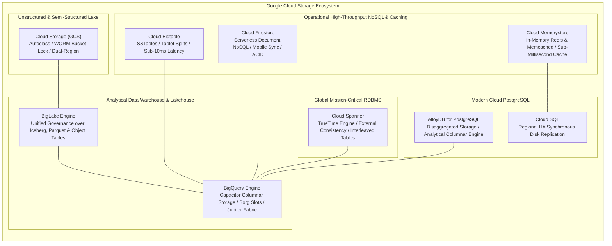
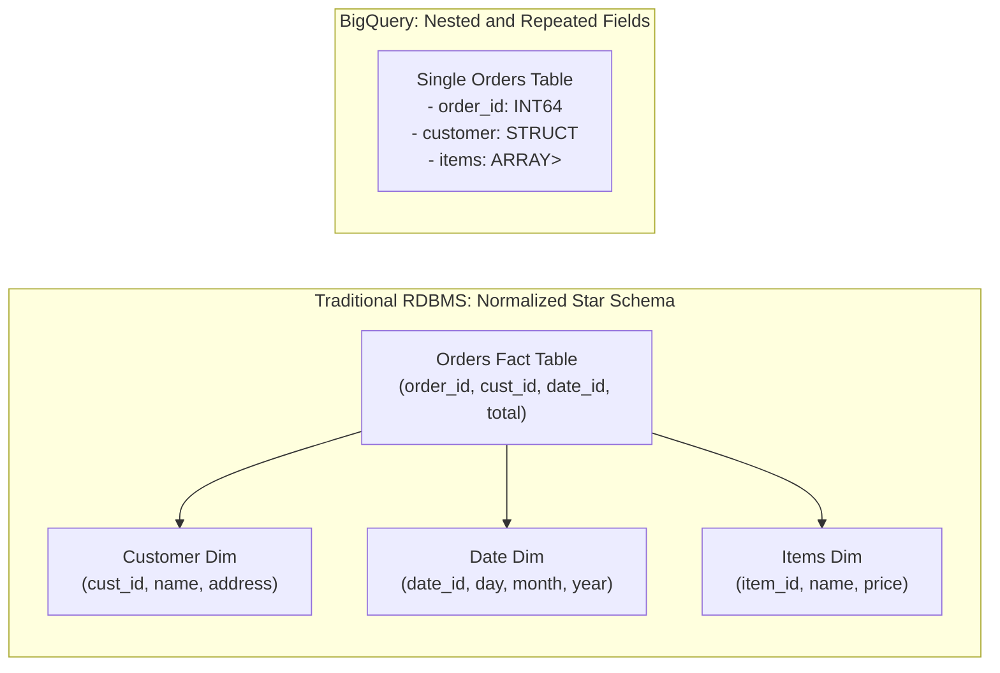
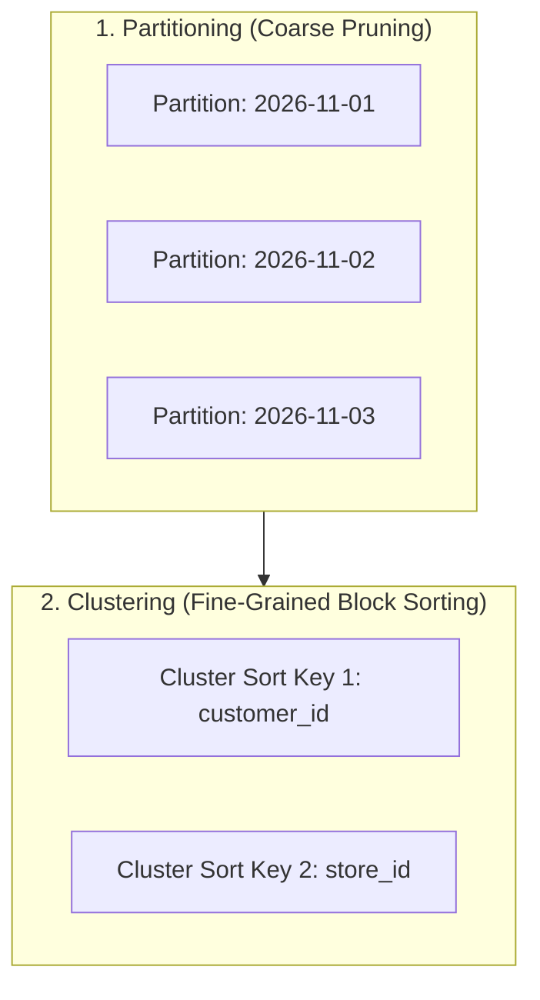
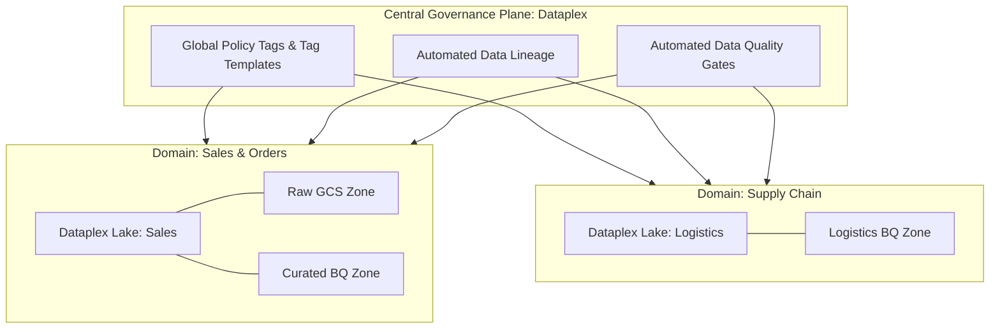

# Domain 3: Storing Data

**Official Exam Guide Weight: ~20%**

---

## Learning Objectives
By the end of this exam domain module, a data engineer or architect will be able to:
1. **Evaluate** and select across Google Cloud's nine persistence engines (BigQuery, BigLake, AlloyDB, Cloud Bigtable, Cloud Spanner, Cloud SQL, Cloud Storage, Firestore, Memorystore) based on access patterns, latency, throughput, consistency, and cost.
2. **Design** high-performance database schemas: Spanner interleaved hierarchies, Bigtable salted composite row keys, and BigQuery partitioned and clustered physical tables.
3. **Architect** an enterprise Data Lakehouse on Cloud Storage and BigLake, optimizing storage classes, lifecycle rules, Autoclass, and WORM retention locks.
4. **Govern** distributed enterprise data using Dataplex and Knowledge Catalog (metadata discovery, data quality assertions, lineage, and federated tag templates).
5. **Troubleshoot** storage anomalies: Spanner primary key hotspotting, Bigtable Key Visualizer heat stripes, and GCS cold storage early-deletion financial penalties.

---

## Executive Architectural Overview

Selecting, designing, and optimizing storage engines is foundational to passing the Professional Data Engineer exam. This domain focuses on the deep physical mechanics of Google Cloud storage systems: Cloud Storage lifecycle automation, BigQuery's decoupled Capacitor/Colossus architecture and storage billing tiers, Cloud Bigtable high-throughput row key design and Key Visualizer diagnostics, Cloud Spanner's TrueTime distributed consensus and interleaved schema modeling, modern Lakehouse governance via BigLake, and enterprise Data Mesh management via Dataplex and Knowledge Catalog.



---

## Section 3.1: Selecting Storage Systems

### 1. Consolidated 9-Service Storage Decision Framework

Choosing the correct storage service requires mapping workload access patterns to engine characteristics:

| Persistence Service | Storage Paradigm | Latency Profile | Scale & Throughput | Consistency Model | Transaction Support (ACID) | Key Exam Indicators |
| :--- | :--- | :--- | :--- | :--- | :--- | :--- |
| **BigQuery** | Columnar (Capacitor) distributed analytical store (OLAP) | Hundreds of ms to seconds | Petabytes to Exabytes; millions rows/sec ingest | Strong consistency for DDL/DML | Multi-statement transactions (`BEGIN ... COMMIT`) | Enterprise DW, SQL analytics, BI dashboards, petabytes of historical logs |
| **BigLake** | Virtualized lakehouse layer over GCS, AWS S3, Azure Blob | Seconds (analytical) | Petabytes across open formats (Parquet, Iceberg) | Strong consistency (inherits object store) | Format-dependent (Iceberg ACID snapshots) | Open data lakehouse, fine-grained access control on object files, multi-cloud |
| **Cloud Spanner** | Horizontally distributed relational database (NewSQL) | Single-digit to tens of ms | Tens of thousands to millions QPS; Petabytes | **External Consistency** (Strict Serializability) | Full distributed ACID across tables, rows, and regions | Global transactional scale, five-nines (99.999%) SLA, relational consistency |
| **Cloud Bigtable** | Wide-column NoSQL (SSTable on Colossus) | **Sub-10ms** (1–6ms reads/writes) | Millions of QPS; linear scaling per node; Petabytes | Strong consistency within cluster; eventual across clusters | Single-row atomicity; **No multi-row transactions** | Time-series, IoT telemetry, fraud detection, >1 TB scale, single-key lookup |
| **Cloud SQL** | Managed traditional RDBMS (MySQL, Postgres, SQL Server) | Single-digit ms (1–10ms) | Up to 64 TB storage; bounded by single-node IOPS | Strong on Primary; eventual on read replicas | Full ACID within instance | Traditional relational DB, lift-and-shift, departmental apps, <64 TB |
| **AlloyDB for PostgreSQL** | Disaggregated compute/storage relational engine (HTAP) | Sub-millisecond to low single-digit ms | Up to 64 TB storage; up to 20 read pool replicas | Strong on Primary; ultra-low replica lag | Full PostgreSQL ACID + analytical columnar engine | High-throughput enterprise PostgreSQL, heavy transactional writes + real-time analytics |
| **Cloud Firestore** | Serverless NoSQL document database | Tens of milliseconds (15–30ms) | Millions of concurrent clients; petabytes scale | Strong consistency for document operations | Multi-document ACID transactions | Mobile/Web apps, user profiles, real-time sync, offline client mode, JSON |
| **Cloud Memorystore** | Managed in-memory key-value data store (Redis/Memcached) | **Sub-millisecond** (<1ms) | Tens of millions QPS (Cluster); multi-terabyte cache | In-memory key-value (AOF/RDB persistence) | Redis single-command atomicity / Multi-Exec | Sub-millisecond caching, session state, leaderboards, protecting SQL databases |
| **Cloud Storage (GCS)** | Distributed object store (flat namespace + buckets) | Tens to hundreds of ms (TTFB ~30–100ms) | Virtually infinite; petabytes to exabytes per bucket | **Global Strong Consistency** for all operations | Atomic single-object PUT/DELETE; generation-match preconditions | Unstructured media, raw landing lake, backup archives, big data staging |

---

### 2. Seven Core Storage Decision Scenarios
1.  **Relational Departmental OLTP ($\le 64\text{ TB}$)**: Choose **Cloud SQL** (or **AlloyDB** if transactional throughput exceeds standard PostgreSQL limits or requires in-memory analytical columnar caching).
2.  **Globally Distributed Relational ($>64\text{ TB}$, Multi-Region ACID)**: Choose **Cloud Spanner** to achieve horizontal scale without sharding, backed by TrueTime and 99.999% availability.
3.  **High-Throughput Streaming & Time-Series ($>1\text{ TB}$, Sub-10ms)**: Choose **Cloud Bigtable**. Point queries and sequential key scans execute in 1–6ms across petabytes.
4.  **Mobile & Web Hierarchical Document Store**: Choose **Cloud Firestore** for real-time listeners, offline data synchronization, and flexible JSON document schemas.
5.  **Sub-Millisecond Caching & Session Management**: Choose **Cloud Memorystore (for Redis)** to cache high-frequency database reads and manage ephemeral user sessions.
6.  **Petabyte Enterprise Analytics & Machine Learning**: Choose **BigQuery** for serverless, decoupled SQL analytics, materialized views, and in-database ML.
7.  **Unstructured Media & Raw Lakehouse Ingestion**: Choose **Cloud Storage** with **BigLake** to query open formats (Parquet, Iceberg) with centralized governance.

---

### 3. Cloud Spanner Deep Dive: TrueTime & Table Interleaving

#### The TrueTime Commit Wait Protocol
Cloud Spanner solves the fundamental clock synchronization dilemma in distributed systems using Google's **TrueTime API**, supported by redundant GPS receivers and atomic clocks in every Google datacenter:
*   TrueTime represents time as an interval $[t.earliest, t.latest]$, where clock uncertainty $\epsilon$ is typically $\le 4\text{ms}$.
*   **Commit Wait**: When a transaction writes, Spanner picks a commit timestamp $s = t.latest$ and deliberately delays releasing locks until $t.earliest > s$. This mathematically guarantees **External Consistency (Linearizability)**: if transaction $T_2$ starts after $T_1$ commits, $T_2$'s commit timestamp is strictly greater than $T_1$'s, without requiring cross-region read locks.

#### Table Interleaving for High-Performance Joins
Spanner physically collocates child rows alongside parent rows in storage splits:

```sql
-- Parent Table: Customers
CREATE TABLE Customers (
    CustomerId INT64 NOT NULL,
    CustomerName STRING(100),
    Email STRING(100),
) PRIMARY KEY (CustomerId);

-- Child Table: Interleaved Orders
CREATE TABLE Orders (
    CustomerId INT64 NOT NULL,
    OrderId INT64 NOT NULL,
    OrderDate DATE,
    OrderTotal NUMERIC,
) PRIMARY KEY (CustomerId, OrderId),
INTERLEAVE IN PARENT Customers ON DELETE CASCADE;
```

*   **Zero Network Shuffle**: When querying a customer and all their orders, Spanner reads contiguous storage blocks on the same server split, completely eliminating distributed network shuffles.
*   **Anti-Pattern (Monotonically Increasing Primary Keys)**: Using sequential auto-incrementing IDs (`1, 2, 3...`) or sequential timestamps as the root primary key forces all concurrent writes onto a single tablet split, causing server split hotspotting. **Exam Rule**: Use UUIDv4, Bit-reversed sequential IDs, or salted hashed keys.

---

### 4. Cloud Bigtable: Row Key Design & Diagnostics
*   **Decoupled Compute and Storage**: Nodes are stateless Borg workers holding pointers to SSTables stored on Colossus. Node scaling and rebalancing takes seconds with zero data movement.
*   **Row Key Best Practices**:
    *   *Field Promotion*: Composite keys (`store_id#dept_id#timestamp`).
    *   *Reversed Timestamps*: `device_id#(MAX_INT64 - timestamp)` enables descending scans to retrieve the most recent telemetry readings first.
    *   *Hashed Prefix*: `hash(customer_id)[0:4]#customer_id` distributes writes across tablets.
*   **Key Visualizer Diagnostics**:
    *   *Bright horizontal line*: Single row key hotspot.
    *   *Bright diagonal line*: Sequential keys marching across tablet splits.
    *   *Even diffuse pattern*: Healthy load distribution.

---

### 5. Cloud Firestore vs. Cloud Memorystore

#### Cloud Firestore
*   **Native Mode**: For new mobile and web applications requiring real-time updates, client SDKs, offline sync, and collection/document hierarchies.
*   **Datastore Mode**: For legacy App Engine backends or high-throughput server-side batch operations requiring high write scalability without real-time listeners.

#### Cloud Memorystore
*   **Memorystore for Redis (Instance-Based Standalone)**:
    *   *Basic Tier*: Single-zone, non-HA, zero replication. Cache is completely lost if the host fails or during maintenance. Does not support automated persistence (AOF/RDB) or read replicas. Suitable only for development or disposable compute caches.
    *   *Standard Tier (High Availability)*: Cross-zone primary and replica pair with automatic failover in $<30$ seconds and connection IP preservation. Optionally supports up to 5 read replicas to offload read queries. Supports persistence via RDB periodic snapshots (to Cloud Storage) and AOF (Append-Only File) logging. Bounded by a maximum single-instance capacity of 300 GB (no keyspace sharding).
*   **Memorystore for Redis Cluster (Horizontally Scalable)**:
    *   *Architecture*: Separate, horizontally partitioned offering compliant with the open-source Redis Cluster protocol. Shards keyspace across 16,384 hash slots, scaling from tens of gigabytes to multiple terabytes with tens of millions of QPS.
    *   *Sharding & Quota Limits*: Governed by a total node ceiling of 250 nodes per cluster. Maximum shard count depends directly on the replica configuration per shard:
        *   **0 replicas per shard**: Up to 250 primary shards.
        *   **1 replica per shard (HA default)**: Up to 125 shards (125 primaries + 125 replicas = 250 nodes).
        *   **2 replicas per shard**: Up to 83 shards (83 primaries + 166 replicas = 249 nodes).
    *   *High Availability & Persistence*: Independent automated failover per shard; supports automated daily RDB backups to Cloud Storage and AOF persistence. Requires cluster-aware Redis clients.
*   **Memorystore for Memcached**: Multi-threaded, simple in-memory key-value caching without advanced Redis data structures, cluster partitioning, or persistence.

---

## Section 3.2: Planning for Using a Data Warehouse

### 1. Data Modeling: Star Schema vs. Denormalized Nested & Repeated Fields



#### Why Nested & Repeated Fields Outperform Star Schemas in BigQuery
1.  **Eliminates Distributed Network Shuffles**: Joining multi-million row fact and dimension tables requires shuffling data across slot memory via the Jupiter network fabric. By embedding items as a repeated `RECORD` (`ARRAY<STRUCT<...>>`), all order line items reside physically on the same Colossus storage blocks.
2.  **Capacitor Columnar Storage Preservation**: BigQuery's underlying Capacitor format compresses nested fields independently. Selecting `orders.customer.name` scans only that specific sub-column, achieving high analytical scan efficiency without paying for unused nested attributes.
3.  **When Star Schemas Are Still Appropriate**: When dimension tables mutate frequently (e.g., Slowly Changing Dimensions Type 2), keeping them in separate tables avoids rewriting multi-terabyte fact tables on every dimension update. BigQuery executes small lookup table joins efficiently via **Broadcast Joins**.

---

### 2. BigQuery Partitioning and Clustering



*   **Partitioning Mechanics (Coarse-Grained)**: Segregates table data into physical file segments based on a date/timestamp column, ingestion time (`_PARTITIONDATE`), or integer range.
    *   *Pruning Benefit*: Queries filtering with `WHERE order_date = '2026-11-01'` completely skip scanning other partition blocks, slashing bytes billed to near-zero.
    *   *Limit*: Maximum **10,000 partitions** per table.
*   **Clustering Mechanics (Fine-Grained)**: Sorts data within each partition based on up to **4 clustering columns**.
    *   *Order Matters*: Clustering order dictates pruning efficiency (e.g., `CLUSTER BY customer_id, store_id` optimizes queries filtering by `customer_id`, or `customer_id` AND `store_id`).
    *   *Pruning Benefit*: BigQuery skips entire Capacitor blocks by reading metadata min/max indexes.
*   **Physical Storage Billing vs. Logical Storage Billing**:
    *   *Logical Storage*: Uncompressed data size ($0.020/GB active, $0.010/GB long-term).
    *   *Physical Storage*: Compressed bytes on disk ($0.040/GB active, $0.020/GB long-term). If data compression ratio exceeds $2.5:1$, Physical storage billing substantially slashes monthly costs. Includes Time Travel and Fail-safe storage.

---

## Section 3.3: Using a Data Lake

### 1. Cloud Storage Lakehouse Architecture
Cloud Storage provides a flat namespace with **Global Strong Consistency** for all read, write, list, and delete operations.

### 2. Storage Classes, Durations, and Early Deletion Penalties

| Storage Class | Minimum Storage Duration | Retrieval Fee per GB | Ideal Workload |
| :--- | :--- | :--- | :--- |
| **Standard** | None | None | Hot lakehouse data, active pipeline landing |
| **Nearline** | **30 days** | Low ($\approx \$0.01$) | Monthly batch reports, data accessed $\le 1\times$ per month |
| **Coldline** | **90 days** | Moderate ($\approx \$0.02$) | Disaster recovery backups, data accessed $\le 1\times$ per year |
| **Archive** | **365 days** | High ($\approx \$0.05$) | Long-term regulatory compliance archives, rarely accessed |

> [!WARNING]
> **Early Deletion Financial Penalty Trap**: If an object stored in Coldline is deleted, rewritten, or transitioned to Archive after only 25 days, Google Cloud bills you for the remaining **65 days** of Coldline storage as an early deletion penalty.

### 3. Object Lifecycle Management vs. Autoclass
*   **Object Lifecycle Management (OLM)**: Declarative rules defined on buckets (e.g., transition to Nearline after 30 days of inactivity, delete after 365 days). Requires predicting access patterns. Subject to early deletion penalties if objects are deleted or modified prior to minimum duration thresholds.
*   **Autoclass**: Completely automates transitions between Standard, Nearline, Coldline, and Archive based on individual object access patterns.
    *   *Fee Structure*:
        *   **Applicable One-Time Enablement Charge**: Incurred when enabling Autoclass on an existing bucket containing objects (billed per 100,000 existing objects evaluated). Enabling Autoclass on a newly created empty bucket incurs zero enablement fee.
        *   **Ongoing Monthly Management Fee**: Billed per 100,000 stored objects under management.
        *   **Zero Retrieval & Early-Deletion Charges**: Objects transitioned across classes by Autoclass **never incur data retrieval charges or early-deletion penalties**, insulating the architecture from unexpected financial spikes when cold data is accessed.

### 4. Data Lake Access Controls & WORM Compliance
*   **Uniform Bucket-Level Access (UBLA)**: Enforces unified IAM permissions across all objects in a bucket, disabling legacy object ACLs for audit compliance.
*   **Bucket Lock (Retention Policies)**: Enforces Write Once, Read Many (WORM) compliance (SEC Rule 17a-4, FINRA). Once locked, retention periods cannot be shortened and objects cannot be deleted by anyone until the expiration window elapses.

### 5. BigLake Unified Lakehouse Processing
BigLake allows BigQuery, Dataproc Spark, and Dataflow to query open formats (Parquet, ORC, Avro, Iceberg) stored in Cloud Storage with fine-grained access control:
*   Enforces Column-Level Security (CLS), Row-Level Security (RLS), and Dynamic Data Masking on raw files without copying data into BigQuery.

---

## Section 3.4: Designing for a Data Platform

### 1. Enterprise Data Mesh Architecture
Modern enterprise platforms shift away from centralized monolithic data lakes to a decentralized, domain-driven **Data Mesh**:
*   Lines of business (e.g., Retail Sales, Supply Chain, Marketing) manage their data as discrete, consumable **Data Products**.
*   Central governance defines security guardrails, auditing, and global taxonomy templates, while domain teams manage their own schemas, transformations, and datasets.



---

### 2. Dataplex & Knowledge Catalog Capabilities

*   **Current Product Naming**: **Knowledge Catalog** is Google Cloud's modern, unified data governance and cataloging service within the Dataplex umbrella.
    *   *Legacy Terminology Mapping*: Dataplex integrates and expands upon capabilities previously branded under **Data Catalog** (such as tag templates and taxonomy policy tags) and legacy Dataplex lakes/zones.
    *   *APIs & IAM*: Governed via `dataplex.googleapis.com` and `datacatalog.googleapis.com`. Roles include `roles/dataplex.catalogEditor` and `roles/datacatalog.tagTemplateUser`.
*   **Entry Groups & Custom Entries**: Organizes metadata entries for Google Cloud resources (BigQuery tables, GCS buckets) and external assets (Snowflake, Oracle, on-prem databases).
*   **Tag Templates**: Schemas of metadata applied to catalog entries:
    *   *Public Tags*: Visible to all users with metadata read access.
    *   *Private Tags*: Restricted by IAM permissions to sensitive compliance teams (e.g., Data Privacy Officer).
*   **Business Glossaries**: Standardized corporate business terms mapped directly to physical columns across tables and datasets.
*   **Automated Data Quality (AutoDQ)**: Defines declarative YAML quality rules (uniqueness, range, null checks) executed automatically against BigQuery and BigLake tables without custom pipeline code.
*   **Automated Data Lineage**: Tracks data transformations across BigQuery jobs, Cloud Dataflow pipelines, and Dataproc Spark jobs, visualizing how columns flow from raw landing through final reporting tables.

---

## Common Exam Traps & Distractors

> [!WARNING]
> 1. **Bigtable Key Hotspotting Trap**: Any row key design beginning with a timestamp or sequential ID (`2026-11-07-001`) is a catastrophic anti-pattern in Bigtable. The correct answer requires hashing, salting, or field promotion.
> 2. **Spanner Monotonic Key Trap**: Auto-incrementing primary keys in Cloud Spanner cause write hotspotting across tablet splits. Always use UUIDv4 or bit-reversed keys.
> 3. **Cold Storage Early Deletion Penalty**: Moving frequently modified or transient files to Coldline or Archive to "save money" is a financial trap. Deleting or rewriting objects before the minimum duration (Nearline 30d, Coldline 90d, Archive 365d) incurs full duration penalty fees.
> 4. **Firestore Native vs Datastore Mode**: Firestore Native mode is required for mobile/web real-time sync; Datastore mode is required for backward-compatible App Engine scale without real-time listeners. You cannot change modes after database creation.
> 5. **BigQuery Star Schema vs Nested Records**: On the PDE exam, denormalizing using **Nested and Repeated fields** (`ARRAY` of `STRUCT`) is almost always the correct answer over multi-table star schemas for analytical workloads, because it eliminates expensive distributed network shuffles.

---

## Scenario-Based Knowledge Checks

### Scenario 1: Mitigating Write Hotspots in a Global IoT Fleet
**Context**: A global shipping company tracks 500,000 maritime cargo containers. Sensors stream GPS coordinates, ambient temperature, and humidity into Cloud Bigtable every 5 seconds ($100,000\text{ writes/sec}$). The initial table design uses the row key: `TIMESTAMP#CONTAINER_ID`. During peak transit hours, write latencies spike from 3ms to 1,500ms, and Key Visualizer displays a bright, solid diagonal stripe across the entire keyspace.

**Question**: What row key redesign immediately resolves this write hotspotting while maintaining efficient retrieval of the most recent readings for a specific container?
*   **A)** Change the row key to `CONTAINER_ID#(MAX_INT64 - TIMESTAMP)`.
*   **B)** Increase the Bigtable cluster size from 10 nodes to 50 nodes.
*   **C)** Switch the underlying storage from SSD to HDD to absorb burst throughput.
*   **D)** Change the row key to `CONTAINER_ID#TIMESTAMP` and enable multi-cluster routing.

**Detailed Answer Analysis**:
*   **Correct Answer: A**. The original row key (`TIMESTAMP#CONTAINER_ID`) is a classic anti-pattern: sequential timestamps write to the same tablet split, creating a diagonal hotspot stripe. Promoting `CONTAINER_ID` to the prefix hashes writes evenly across all cluster nodes. Subtracting the timestamp from `MAX_INT64` reverses the chronological order, ensuring the most recent sensor telemetry is read first during a range scan.
*   *Distractor Analysis*:
    *   **B** adding nodes does not solve hotspotting; all sequential writes still hit the single node holding the current timestamp tablet.
    *   **C** HDD storage has significantly lower IOPS and worsens write latency.
    *   **D** standard timestamps append data to the end of the container range, requiring scanning the entire historical dataset to find the latest reading.

---

### Scenario 2: High-Performance Global Order Processing with Zero Network Shuffle
**Context**: An international banking corporation processes credit card transactions across North America, Europe, and Asia. Requirements dictate:
1. Strict relational schema with foreign key constraints and multi-row transactional consistency (ACID).
2. Financial regulators mandate strict serializability (external consistency) across all continents with zero stale reads.
3. Total database availability must be backed by a 99.999% SLA.
4. Reads querying a customer and their associated transactions must execute with minimal latency and zero distributed cross-node shuffles.

**Question**: What database architecture strictly satisfies all requirements?
*   **A)** Cloud SQL for PostgreSQL configured with cross-region read replicas.
*   **B)** Cloud Bigtable with multi-cluster replication across three continents.
*   **C)** Cloud Spanner configured as a Multi-Region instance, with the `Transactions` table interleaved inside the `Customers` table.
*   **D)** CockroachDB deployed self-managed on Google Kubernetes Engine across three regions.

**Detailed Answer Analysis**:
*   **Correct Answer: C**. Cloud Spanner is the only Google Cloud service providing true External Consistency (strict serializability) across planetary distances, backed by TrueTime atomic clocks and a 99.999% availability SLA. Interleaving `Transactions` inside `Customers` physically collocates child transaction rows on the same storage split as the parent customer row, eliminating distributed network shuffles during analytical customer queries.
*   *Distractor Analysis*:
    *   **A** Cloud SQL cross-region replicas use asynchronous replication (eventual consistency, potential data loss during failover) and carries only a 99.95% regional SLA.
    *   **B** Bigtable is NoSQL, lacks multi-row ACID transactions, and provides only eventual consistency across multi-region clusters.
    *   **D** Self-managed K8s introduces massive operational overhead and does not provide an official Google Cloud contractual SLA.

---

### Scenario 3: Slashing Query Costs and Eliminating Full Scans in BigQuery
**Context**: An analytical query log in BigQuery reveals that an unpartitioned 80 TB table (`fact_web_traffic`) is queried hundreds of times daily by Looker dashboards. The table grows by 100 GB daily. Analysts frequently filter queries by `event_date` (e.g., `WHERE event_date BETWEEN '2026-11-01' AND '2026-11-07'`) and aggregate metrics by `user_country` and `campaign_id`. Currently, every dashboard query executes a full 80 TB scan, costing $500 per execution.

**Question**: How should the data architect redesign this table to minimize query scan costs and maximize execution performance?
*   **A)** Recreate the table partitioned by `event_date` and clustered by `user_country, campaign_id`.
*   **B)** Export the table to Cloud Storage Nearline and query it using BigQuery external tables.
*   **C)** Create a standard SQL view with `WHERE event_date >= '2026-01-01'`.
*   **D)** Increase the project's BigQuery reservation by 2,000 slots.

**Detailed Answer Analysis**:
*   **Correct Answer: A**. Partitioning by `event_date` limits queries filtering on date to scanning only the relevant daily partitions (pruning the remaining 79+ TB from the scan). Clustering by `user_country` and `campaign_id` further sorts data within each partition, allowing BigQuery to skip scanning irrelevant Capacitor columnar blocks via block metadata pruning. This reduces query scan size from 80 TB to a few gigabytes.
*   *Distractor Analysis*:
    *   **B** external tables on GCS are significantly slower than native BigQuery storage, and Nearline incurs high retrieval fees.
    *   **C** standard views do not store physical data; running queries against the view still scans the underlying 80 TB base table.
    *   **D** adding slots increases compute cost without solving the fundamental unpartitioned full-scan storage anti-pattern.
