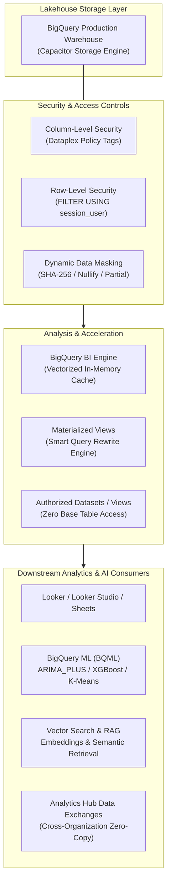
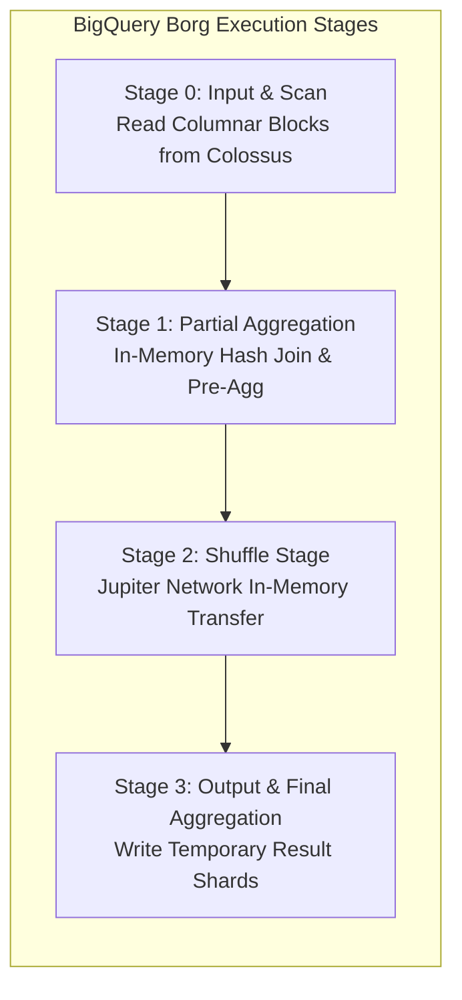
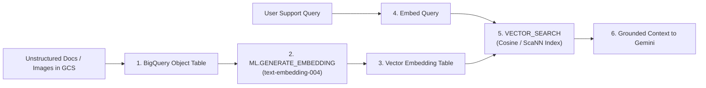

# Domain 4: Preparing and Using Data for Analysis

**Official Exam Guide Weight: ~15%**

---

## Executive Architectural Overview

Preparing and serving enterprise data requires transforming raw telemetry and transactions into performant, secure, and AI-ready assets. This domain explores BigQuery performance engineering, visualization tool connectivity (Looker, Looker Studio, Connected Sheets), in-memory acceleration with BI Engine, fine-grained access control (Row-Level Security, Column-Level Security, Dynamic Data Masking), in-database machine learning with BigQuery ML (BQML), Vector Search and RAG pipeline architectures, and multi-tenant data sharing via Analytics Hub and Data Clean Rooms.



---

## Section 4.1: Preparing Data for Visualization

### 1. Connecting Visualization Tools to Google Cloud Data
Business Intelligence tools query BigQuery and Cloud Storage through distinct integration patterns:
*   **Looker**: Enterprise semantic modeling platform. LookML abstracts database schemas, enforces centralized business metrics, caches query results, and pushes SQL execution down into BigQuery slots.
*   **Looker Studio (formerly Data Studio)**:
    *   *Direct BigQuery Connection*: Live query connection; each dashboard interaction executes SQL against BigQuery slots or on-demand quotas.
    *   *BI Engine Acceleration*: Transparently caches frequently queried dashboard dimensions and measures in memory for sub-second dashboard rendering.
    *   *Data Extract Mode*: Takes scheduled snapshots into memory (up to 100 MB) for simple, low-cost reports.
*   **Connected Sheets**: Connects Google Sheets directly to BigQuery datasets, allowing spreadsheet users to analyze billions of rows of live warehouse data without exporting CSVs or writing SQL.
*   **Third-Party Tools (Tableau, Power BI)**: Connect via BigQuery high-throughput ODBC/JDBC drivers or the BigQuery Storage Read API.

---

### 2. Precalculating Fields and Temporal Granularity
*   **Pre-Aggregation Rollups**: Raw clickstreams or IoT telemetry arriving at millisecond frequencies should not be queried directly by operational dashboards. Pre-aggregating data into hourly, daily, or monthly summary tables or Materialized Views drastically slashes bytes scanned and dashboard latency.
*   **Determining Temporal Granularity**:
    *   *Real-Time Operational Monitoring*: Hourly partitioned tables with 1-minute fixed windows.
    *   *Executive / Trend Dashboards*: Daily partitioned tables clustered by business dimensions (e.g., `store_id`, `product_category`).

---

### 3. BigQuery Query Performance Tuning & Execution Mechanics

When a query is submitted to BigQuery, the Query Coordinator translates the SQL into an optimized Directed Acyclic Graph (DAG) executed across hundreds or thousands of Borg **Slots**.



#### Diagnostic Indicators in Query Execution Plans
*   **Slot Contention**: If `Average slot time` is exceptionally high and `Wait time ms` shows tasks sitting queued, the query is slot-starved. Solution: Allocate a dedicated reservation or baseline slots.
*   **Data Spilling to Disk**: Indicates an in-memory shuffle or join operation exceeded worker RAM, spilling intermediate partitions to persistent Colossus storage. Solution: Filter earlier, join on clustered keys, or avoid joining large skewed tables.
*   **Data Skew**: One parallel stage worker takes $50\times$ longer than all others. Indicates an uneven partition or non-uniform distribution on join keys.

#### Query Optimization Rules for the Exam

| Anti-Pattern | Performance Consequence | Architecturally Sound Fix |
| :--- | :--- | :--- |
| `SELECT *` | Triggers a full columnar scan of all attributes on Colossus; destroys memory cache. | Explicitly project only mandatory columns (`SELECT customer_id, amount`). |
| Joining large un-clustered tables | Triggers massive cross-network shuffle over Jupiter fabric. | Cluster both tables on the join keys; place the largest table first. |
| Self-joins to calculate window deltas | Doubles the data scan and executes expensive Cartesians. | Use analytical window functions (`LEAD()`, `LAG()`, `OVER (PARTITION BY ...)`). |
| Exact `COUNT(DISTINCT id)` on billions of rows | Forces all discrete values to shuffle to a single slot worker. | Use HyperLogLog approximation: `APPROX_COUNT_DISTINCT()`. |
| Filtering downstream in the `WHERE` clause after aggregations | Scans millions of unnecessary rows during early pipeline stages. | Push filters into the earliest subquery or Common Table Expression (CTE). |

---

### 4. BigQuery BI Engine
BigQuery BI Engine is an in-memory execution service that accelerates SQL queries from BI tools (Looker, Looker Studio, Tableau) to sub-second latencies:
*   **Vectorized Memory Storage**: Stores compressed columnar data in RAM, executing analytical aggregations directly on encoded vectors without decompressing.
*   **Zero Architectural Overhead**: Transparently intercepts queries sent to BigQuery. Requires no ETL pipelines, no cube definitions, and no periodic data extraction tasks.
*   **Reservation Sizing**: Configured by reserving memory (GB) in the target GCP region.

---

### 5. Materialized Views vs. Scheduled Queries vs. Standard Views

| Capability | Standard BigQuery View | Materialized View (MV) | Scheduled Query |
| :--- | :--- | :--- | :--- |
| **Physical Storage** | None (Logical query definition) | **Yes** (Persisted physical pre-aggregated table) | **Yes** (Batch writes output into destination table) |
| **Refresh Cadence** | Evaluated on every query | Automated incremental background maintenance | Cron-based batch execution (e.g., hourly/daily) |
| **Smart Tuning / Query Rewrite** | No | **Yes (Game Changer)**: If an analyst queries the base table, BigQuery automatically rewrites the query to use the MV! | No |
| **Data Freshness** | Always 100% real-time | Always 100% real-time (Merges base delta on the fly) | Stale until the next scheduled batch execution |
| **Query Restrictions** | Supports any valid SQL syntax | Must use deterministic functions; no outer joins, no `UNION ALL` | Supports any valid SQL syntax |

```sql
-- Creating a Materialized View with Smart Query Rewrite
CREATE MATERIALIZED VIEW `enterprise_dw.mv_daily_store_revenue`
OPTIONS (
    enable_refresh = true,
    refresh_interval_minutes = 30
) AS
SELECT
    store_id,
    DATE(transaction_time) AS sales_date,
    SUM(order_amount) AS total_revenue,
    COUNT(order_id) AS total_transactions
FROM
    `enterprise_dw.fact_sales`
GROUP BY
    store_id, sales_date;
```

---

### 6. Fine-Grained Security: CLS, RLS, and Dynamic Data Masking

#### Column-Level Security (CLS) via Dataplex Taxonomy Policy Tags
*   Attach taxonomy policy tags (e.g., `PII_High`, `Financial_Confidential`) to table column definitions.
*   Users must hold the role `roles/datacatalog.categoryFineGrainedReader` on the specific tag to query the column; otherwise, the query fails with an `Access Denied` permission error.

#### Dynamic Data Masking
Allows unauthorized users to query tables containing sensitive columns without seeing raw data:
*   *Default Masking*: Returns `""` (empty string) for strings, `0` for numbers.
*   *Email Masking*: Transforms `alice@example.com` $\to$ `a***e@example.com`.
*   *Hash (SHA-256)*: Replaces column with SHA-256 hexadecimal string, allowing joins across tables without exposing raw IDs.

#### Row-Level Security (RLS)
Filters records dynamically at query runtime using the `SESSION_USER()` predicate:

```sql
CREATE ROW ACCESS POLICY region_filter_us
ON `enterprise_dw.fact_sales`
GRANT TO ("group:us-sales-team@company.com")
FILTER USING (region = 'US');
```

---

## Section 4.2: Preparing Data for AI and ML

### 1. In-Database Machine Learning with BigQuery ML (BQML)
BigQuery ML enables data engineers and analysts to train, evaluate, and serve ML models directly inside BigQuery using standard GoogleSQL, avoiding data export pipelines.

#### Feature Engineering with the `TRANSFORM` Clause
The `TRANSFORM` clause embeds feature preprocessing directly into the model definition, guaranteeing that the exact same transformations apply during both training and production `ML.PREDICT` inference:

```sql
CREATE OR REPLACE MODEL `ml_models.customer_churn_model`
TRANSFORM(
    ML.STANDARD_SCALER(tenure_months) OVER() AS scaled_tenure,
    ML.ONE_HOT_ENCODER(contract_type) OVER() AS encoded_contract,
    ML.BUCKETIZE(total_spend, [100, 500, 1000, 5000]) AS spend_bucket,
    ML.FEATURE_CROSS(STRUCT(contract_type, payment_method)) AS contract_x_payment,
    churn_label
)
OPTIONS(
    model_type = 'LOGISTIC_REG',
    input_label_cols = ['churn_label'],
    auto_class_weights = true
) AS
SELECT * FROM `enterprise_dw.customer_features`;
```

#### Common BQML Model Types & Selection

| Model Type | Algorithm | Primary Exam Use Case |
| :--- | :--- | :--- |
| `LINEAR_REG` | Ordinary Least Squares | Continuous numerical prediction (housing prices, revenue) |
| `LOGISTIC_REG` | Logistic Regression | Binary or multi-class classification (fraud detection, churn) |
| `BOOSTED_TREE_CLASSIFIER` | XGBoost | High-accuracy tabular classification with non-linear boundaries |
| `KMEANS` | K-Means Clustering | Customer segmentation, anomaly detection, cohort discovery |
| `ARIMA_PLUS` | Auto-ARIMA with seasonality | Time-series forecasting (inventory demand, daily sales) |
| `TENSORFLOW` / `ONNX` | Imported External Model | Running inference on custom models trained in Vertex AI |

---

### 2. BigQuery Vector Search and RAG Preparation Pipelines
Modern Generative AI pipelines ground Large Language Models (LLMs) using Retrieval-Augmented Generation (RAG) directly in BigQuery:



1.  **BigQuery Object Tables**: External tables pointing to unstructured files (PDFs, audio, images) stored in Cloud Storage. Object tables expose file metadata, GCS URIs, and generation numbers to SQL queries.
2.  **Generating Embeddings at Scale**:
    ```sql
    CREATE OR REPLACE TABLE `knowledge_lake.kb_embeddings` AS
    SELECT * FROM ML.GENERATE_EMBEDDING(
        MODEL `ml_models.text_embedding_model`,
        (SELECT doc_id, content FROM `knowledge_lake.kb_articles`),
        STRUCT(TRUE AS flatten_json_output)
    );
    ```
3.  **Ultra-Fast Retrieval with `VECTOR_SEARCH`**:
    Queries the vector table using cosine distance or European distance, accelerated by Google's proprietary **ScaNN (Scalable Nearest Neighbors)** index:
    ```sql
    SELECT query.query_id, base.doc_id, distance
    FROM VECTOR_SEARCH(
        TABLE `knowledge_lake.kb_embeddings`,
        'ml_generate_embedding_result',
        (SELECT ml_generate_embedding_result, query_id FROM query_embeddings),
        top_k => 5,
        distance_type => 'COSINE'
    );
    ```

---

### 3. Vertex AI Feature Store
*   **Online Store**: Built on Cloud Bigtable or optimized caching engines. Serves features in $<10\text{ms}$ for real-time model scoring (fraud checks).
*   **Offline Store**: Built on BigQuery. Stores historical feature snapshots for model training and point-in-time time-travel lookups without data leakage.

---

### 4. In-Pipeline AI Data Enrichment: Apache Beam `RunInference`
For streaming pipelines, invoking external REST APIs for every row exhausts quotas and adds hundreds of milliseconds of latency. The Apache Beam **`RunInference`** transform:
*   Loads models directly into Dataflow worker memory (PyTorch, TensorFlow, TensorRT, Vertex AI endpoints).
*   Performs automated dynamic batching across elements in memory, maximizing GPU/CPU efficiency and delivering high-throughput inference inside the streaming DAG.

---

### 5. BigQuery Studio & Gemini Integration
BigQuery Studio integrates Gemini foundation models:
*   Natural language SQL query generation and automated code completion.
*   Automated query performance analysis and SQL optimization recommendations.
*   Interactive Python notebooks running directly within the BigQuery managed console.

---

## Section 4.3: Sharing Data

### 1. BigQuery Analytics Hub
Analytics Hub enables secure, zero-copy data sharing within an organization or across distinct Google Cloud organizations without managing data pipelines or paying egress fees:

```mermaid
flowchart LR
    subgraph Publisher_Project["Data Publisher: corp-sales-prod"]
        Ex["Analytics Hub Exchange"]
        Listing["Listing: Daily Regional Sales"]
        SharedDS["Source Dataset: sales_curated"]
        SharedDS --> Listing
        Listing --> Ex
    end

    subgraph Subscriber_Project["Data Subscriber: partner-analytics"]
        SubDS["Linked Dataset: sales_curated_ro"]
        Ex -->|Subscribe (Zero Data Copy)| SubDS
        QueryEngine["Subscriber BigQuery Engine"]
        QueryEngine --> SubDS
    end
```

#### Core Mechanics of Analytics Hub
*   **Zero-Copy Linked Datasets**: When a subscriber subscribes to a listing, Analytics Hub provisions a read-only **Linked Dataset** in the subscriber's project. The data physically remains in the publisher's storage; subscribers query it in-place using their own compute slots.
*   **Zero Egress Fees**: Eliminates cross-organization FTP/ETL scripts and network transfer costs.
*   **Dynamic Access Revocation**: If the publisher removes a listing or revokes permissions, all subscriber access halts immediately.

---

### 2. BigQuery Data Clean Rooms
Data Clean Rooms enable multiple organizations (e.g., retailers and consumer brands) to match and analyze joint datasets without revealing underlying raw PII:
*   **Privacy-Preserving Joins**: Organizations join tables on hashed customer keys.
*   **Aggregation Constraints**: Prevents users from querying individual row-level records; queries must meet minimum aggregation thresholds (e.g., `COUNT(*) >= 50`).
*   **Differential Privacy**: Injects calibrated mathematical noise into query outputs to protect individual user privacy while preserving macro statistical validity.

---

### 3. Authorized Views and Authorized Datasets
*   **Authorized Views**: Allows users to query an aggregated or filtered view without granting them read permissions on the underlying base tables.
*   **Authorized Datasets**: Authorizes an entire dataset to access data in another dataset. All views created in the authorized dataset inherit access to the source dataset automatically.

---

## Common Exam Traps & Distractors

> [!WARNING]
> 1. **Data Exfiltration via Direct Table Sharing**: Granting external partners `roles/bigquery.dataViewer` directly on your production tables introduces security risks and billing contention. The correct exam pattern is publishing a private listing in **Analytics Hub** or creating an **Authorized View**.
> 2. **BI Engine Cache Eviction Trap**: BI Engine only caches supported SQL operations. If an analyst dashboard uses un-supported SQL functions or exceeds the configured GB capacity, queries transparently spill over to standard BigQuery slot execution, incurring regular slot costs.
> 3. **Streaming In-Pipeline Model Inference Trap**: Any exam answer suggesting *"call the Vertex AI REST API inside an Apache Beam DoFn for every incoming message"* is **wrong**. It causes API quota throttling and extreme latency. The correct pattern is the **Beam `RunInference` transform**.
> 4. **Materialized View Refresh Cost Trap**: Creating Materialized Views on tables that receive millions of streaming inserts per second via legacy streaming can cause high slot consumption due to continuous background refresh. Ensure `refresh_interval_minutes` is tuned appropriately.

---

## Scenario-Based Knowledge Checks

### Scenario 1: Preventing Data Exfiltration While Providing Global Analytical Access
**Context**: A retail corporation operates a central BigQuery warehouse containing 500 million customer records. The company wants to allow external marketing partners to query aggregated campaign performance metrics. The security team mandates:
1. Partners must never see raw customer PII (names, phone numbers, email addresses).
2. Partners must pay for their own query compute and slot capacity.
3. No data may be duplicated or exported to GCS buckets.
4. If a partner's contract ends, their access must be revokable instantaneously.

**Question**: Which Google Cloud architecture satisfies all criteria?
*   **A)** Export aggregated CSV files to an external Cloud Storage bucket and grant partners read permissions.
*   **B)** Create a BigQuery Analytics Hub private data exchange. Publish a listing containing an Authorized View that pre-aggregates campaign metrics and hides PII. Have partners subscribe to the listing as a linked dataset in their own GCP projects.
*   **C)** Grant the marketing partners `roles/bigquery.admin` on the production project and use IAM Conditions to limit their queries.
*   **D)** Schedule a nightly Cloud Composer DAG to `MERGE` data into a public BigQuery dataset.

**Detailed Answer Analysis**:
*   **Correct Answer: B**. Analytics Hub allows zero-copy sharing where subscribers query data in-place using their own compute slots (satisfying requirement 2). Publishing an Authorized View ensures raw PII is never exposed (requirement 1). Linked datasets eliminate data copying (requirement 3), and publisher revocation terminates access instantly (requirement 4).
*   *Distractor Analysis*:
    *   **A** duplicates data and incurs ongoing egress fees.
    *   **C** granting admin roles is a catastrophic least-privilege security failure.
    *   **D** public datasets expose sensitive corporate data to the entire world.

---

### Scenario 2: Eliminating Dashboard Lag and Query Spikes in Looker
**Context**: An executive Looker dashboard connects to an unclustered 15 TB BigQuery table. Every Monday morning, 50 executives open the dashboard concurrently, generating identical queries that scan 15 TB each, exhausting the company's 2,000 BigQuery slot reservation and causing query timeouts.

**Question**: What solution eliminates the dashboard query lag with the lowest implementation overhead?
*   **A)** Migrate the entire 15 TB table into Cloud Bigtable.
*   **B)** Allocate 200 GB of memory to BigQuery BI Engine in the dashboard dataset's region, and create a Materialized View summarizing the dashboard's core metrics.
*   **C)** Instruct executives to stagger their dashboard logins across Monday morning.
*   **D)** Rewrite the Looker dashboard to execute Python scripts using the BigQuery Storage API.

**Detailed Answer Analysis**:
*   **Correct Answer: B**. BigQuery BI Engine provides sub-second in-memory query acceleration for concurrent BI queries without requiring pipeline changes. Creating a Materialized View pre-aggregates the data, and BigQuery's Smart Query Rewrite engine automatically directs dashboard queries to the lightweight MV, eliminating the 15 TB full table scan.
*   *Distractor Analysis*:
    *   **A** Bigtable lacks native SQL, joins, and Looker semantic modeling integrations.
    *   **C** is not a technical architectural solution.
    *   **D** requires rebuilding the entire reporting interface and does not fix the underlying slot exhaustion.

---

### Scenario 3: Real-Time Vector Grounding for Enterprise Customer Support AI
**Context**: A digital bank is deploying a customer service generative AI chatbot powered by Gemini. When a user asks a question, the application must:
1. Generate an embedding of the user's question.
2. Search across 10 million banking policy paragraphs stored in BigQuery in under 200 milliseconds.
3. Retrieve the top 3 most semantically relevant paragraphs to pass as grounded context to Gemini.
4. Ensure all policy documents remain strictly within the bank's VPC Service Controls perimeter.

**Question**: Which architecture delivers this RAG workflow natively inside Google Cloud?
*   **A)** Export policy documents to an on-premises Elasticsearch cluster, execute search, and return results via public internet.
*   **B)** Store policy documents in BigQuery. Use `ML.GENERATE_EMBEDDING` with text-embedding models to populate vector columns, build a `VECTOR_SEARCH` index (ScaNN), and execute vector searches directly via GoogleSQL within the VPC-SC perimeter.
*   **C)** Convert policy documents into Cloud Firestore documents and execute standard string wildcard queries.
*   **D)** Run a Dataflow batch job every 5 minutes to calculate Cosine similarity across all 10 million documents in memory.

**Detailed Answer Analysis**:
*   **Correct Answer: B**. BigQuery natively supports embedding generation (`ML.GENERATE_EMBEDDING`) and sub-second vector search (`VECTOR_SEARCH`) accelerated by ScaNN. Because compute and storage remain within BigQuery, the entire pipeline operates natively inside the VPC Service Controls perimeter, satisfying security and latency requirements.
*   *Distractor Analysis*:
    *   **A** egresses data outside the cloud perimeter, violating VPC-SC.
    *   **C** Firestore string wildcards perform lexical matching, not semantic vector similarity.
    *   **D** a 5-minute batch job cannot provide the sub-200ms real-time response required for interactive chatbot conversations.
