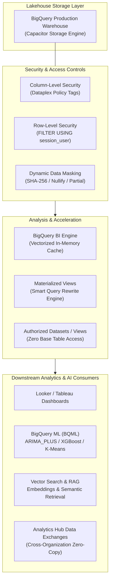
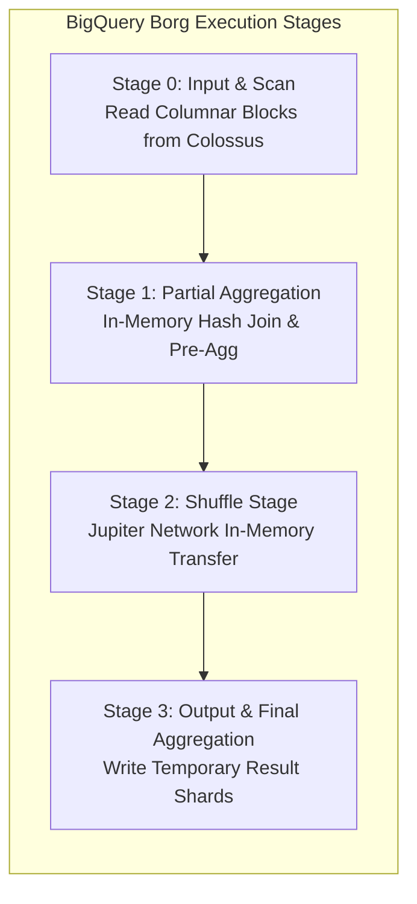
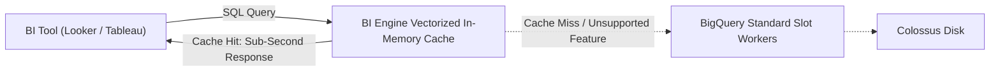
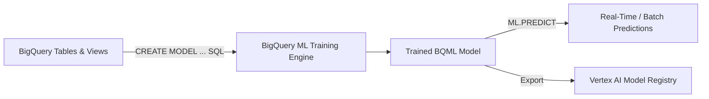
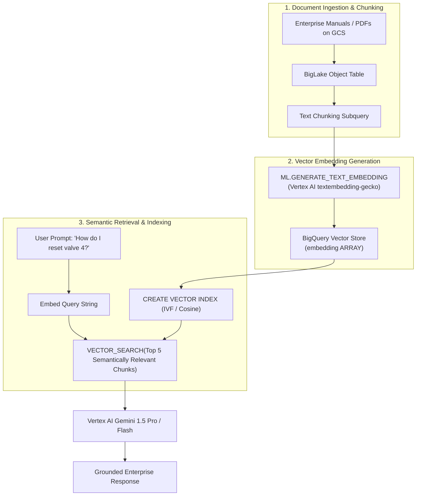

# Domain 4: Preparing and Using Data for Analysis

**Official Exam Guide Weight: ~18%**

---

## Executive Architectural Overview

Preparing and serving enterprise data requires transforming raw telemetry and transactions into performant, secure, and AI-ready assets. This domain explores BigQuery performance engineering, in-memory acceleration with BI Engine, fine-grained access control (Row-Level Security, Column-Level Security, Dynamic Data Masking), in-database machine learning with BigQuery ML (BQML), Vector Search and RAG pipeline architectures, and multi-tenant data sharing via Analytics Hub.



---

## Section 4.1: Optimizing Data for Analysis and Business Intelligence

### 1. BigQuery Query Performance Tuning & Execution Mechanics

When a query is submitted to BigQuery, the Query Coordinator translates the SQL into an optimized Directed Acyclic Graph (DAG) executed across hundreds or thousands of Borg **Slots**.



#### Diagnostic Indicators in Query Execution Plans
*   **Slot Contention**: If `Average slot time` is exceptionally high and `Wait time ms` shows tasks sitting queued, the query is slot-starved.
*   **Data Spilling to Disk**: Indicates an in-memory shuffle or join operation exceeded worker RAM, spilling intermediate partitions to persistent Colossus storage. Solution: Filter earlier or cluster by join keys.
*   **Data Skew**: One parallel stage worker takes $50\times$ longer than all others. Indicates an uneven partition or non-uniform distribution on join keys.

#### Query Optimization Rules for the Exam

| Anti-Pattern | Performance Consequence | Architecturally Sound Fix |
| :--- | :--- | :--- |
| `SELECT *` | Triggers a full columnar scan of all attributes on Colossus; destroys memory cache. | Explicitly project only mandatory columns (`SELECT customer_id, amount`). |
| Joining large un-clustered tables | Triggers massive cross-network shuffle over Jupiter fabric. | Cluster both tables on the join keys; place the largest table first. |
| Self-joins to calculate window deltas | Doubles the data scan and executes expensive Cartesians. | Use analytical window functions (`LEAD()`, `LAG()`, `OVER (PARTITION BY ...)`). |
| Exact `COUNT(DISTINCT id)` on billions of rows | Forces all discrete values to shuffle to a single slot worker. | Use HyperLogLog approximation: `APPROX_COUNT_DISTINCT()`. |
| Filtering downstream in the `WHERE` clause after aggregations | Scans millions of unnecessary rows during early pipeline stages. | Push filters into the earliest subquery or Common Table Expression (CTE). |

---

### 2. BigQuery BI Engine

BigQuery BI Engine is an in-memory execution service that accelerates SQL queries from BI tools (Looker, Google Data Studio, Tableau, Power BI) to sub-second latencies.



*   **Vectorized Memory Storage**: Stores compressed columnar data in RAM, executing analytical aggregations directly on encoded vectors without decompressing.
*   **Zero Architectural Overhead**: Transparently intercepts queries sent to BigQuery. Requires no ETL pipelines, no cube definitions, and no periodic data extraction tasks.
*   **Reservation Sizing**: Configured by reserving memory (GB) in the target GCP region.

---

### 3. Materialized Views vs. Scheduled Queries vs. Standard Views

| Capability | Standard BigQuery View | Materialized View (MV) | Scheduled Query |
| :--- | :--- | :--- | :--- |
| **Physical Storage** | None (Logical query definition) | **Yes** (Persisted physical pre-aggregated table) | **Yes** (Batch writes output into destination table) |
| **Refresh Cadence** | Evaluated on every query | Automated incremental background maintenance | Cron-based batch execution (e.g., hourly/daily) |
| **Smart Tuning / Query Rewrite** | No | **Yes (Game Changer)**: If an analyst queries the base table, BigQuery automatically rewrites the query to use the MV! | No |
| **Data Freshness** | Always 100% real-time | Always 100% real-time (Merges base delta on the fly) | Stale until the next scheduled batch execution |
| **Query Restrictions** | Supports any valid SQL syntax | Must use deterministic functions; no outer joins, no `UNION ALL` | Supports any valid SQL syntax |

```sql
-- Creating a Materialized View with Smart Query Rewrite
CREATE MATERIALIZED VIEW `enterprise_dw.mv_daily_store_revenue`
OPTIONS (
    enable_refresh = true,
    refresh_interval_minutes = 30
) AS
SELECT
    store_id,
    DATE(transaction_time) AS sales_date,
    SUM(order_amount) AS total_revenue,
    COUNT(order_id) AS total_transactions
FROM
    `enterprise_dw.fact_sales`
GROUP BY
    store_id,
    sales_date;
```

---

### 4. Fine-Grained Security: CLS, RLS, and Dynamic Data Masking

#### Column-Level Security (CLS) via Dataplex Taxonomy Policy Tags
1.  Define a Taxonomy in Dataplex (e.g., `Confidential_PII`).
2.  Create Policy Tags (e.g., `Social_Security_Number`).
3.  Bind the Policy Tag to specific table columns in BigQuery.
4.  Assign the `roles/datacatalog.categoryFineGrainedReader` role only to authorized identities. Unauthorized users attempting to select the column receive an `Access Denied` error.

#### Dynamic Data Masking
Rather than blocking queries outright with an error, Dynamic Data Masking allows unauthorized users to run queries, but automatically scrambles sensitive columns based on masking rules:
*   **Nullify**: Returns `NULL`.
*   **Default Masking Value**: Returns empty string `""` or `0`.
*   **Hash (SHA-256)**: Replaces value with SHA-256 hash (allows joins on masked IDs).
*   **Partial Mask (Regex)**: Exposes only first/last characters (e.g., displays `XXXX-XXXX-9821`).

#### Row-Level Security (RLS)
Restricts which rows are visible to a user based on session identity or group membership:

```sql
-- Implementing Row-Level Security for Regional Sales Reps
CREATE OR REPLACE ROW ACCESS POLICY apac_sales_filter
ON `enterprise_dw.fact_sales`
GRANT TO ('group:apac-sales-team@company.com')
FILTER USING (region = 'APAC');

-- Corporate Directors see all rows
CREATE OR REPLACE ROW ACCESS POLICY global_exec_filter
ON `enterprise_dw.fact_sales`
GRANT TO ('group:executives@company.com')
FILTER USING (true);
```

---

## Section 4.2: Preparing Data for Machine Learning and AI

### 1. In-Database Machine Learning with BigQuery ML (BQML)

BigQuery ML enables data engineers to train, evaluate, and operationalize enterprise ML models directly inside BigQuery using standard SQL—eliminating the need to export data to external Python notebooks or compute clusters.



#### Common BQML Model Types
*   **Supervised Learning**:
    *   `LINEAR_REG`: Forecasting continuous numerical values (e.g., future revenue).
    *   `LOGISTIC_REG`: Binary or multi-class classification (e.g., churn prediction).
    *   `BOOSTED_TREE_CLASSIFIER` / `BOOSTED_TREE_REGRESSOR`: High-performance gradient boosted trees (XGBoost).
*   **Unsupervised Learning**:
    *   `KMEANS`: Customer segmentation and anomaly cluster detection.
*   **Time-Series Forecasting**:
    *   `ARIMA_PLUS`: Automates anomaly detection, holiday effects, trend analysis, and seasonal decomposition across thousands of time series simultaneously.

```sql
-- Training an ARIMA_PLUS Time Series Forecasting Model in BQML
CREATE OR REPLACE MODEL `retail_analytics.daily_store_demand_model`
OPTIONS (
    model_type = 'ARIMA_PLUS',
    time_series_timestamp_col = 'order_date',
    time_series_data_col = 'total_units_sold',
    time_series_id_col = 'store_id',
    holiday_region = 'US',
    auto_arima = true,
    data_frequency = 'DAILY'
) AS
SELECT
    order_date,
    store_id,
    SUM(quantity) AS total_units_sold
FROM
    `retail_analytics.fact_orders`
WHERE
    order_date >= '2024-01-01'
GROUP BY
    order_date,
    store_id;

-- Generating Future 30-Day Forecasts
SELECT
    *
FROM
    ML.FORECAST(MODEL `retail_analytics.daily_store_demand_model`,
                STRUCT(30 AS horizon, 0.95 AS confidence_level));
```

---

### 2. Vertex AI Feature Store

Vertex AI Feature Store provides a centralized repository for storing, serving, and monitoring features used in production machine learning models:
*   **Online Serving (Low Latency)**: Backed by Cloud Bigtable; delivers sub-10ms feature lookups for real-time inference microservices (e.g., fraud scoring at card swipe).
*   **Offline Serving (High Throughput Batch)**: Backed by BigQuery; extracts historical point-in-time feature snapshots for model training.
*   **Point-in-Time Correctness (Time Travel)**: Prevents **data leakage** by fetching feature values exactly as they existed at the historical event timestamp, avoiding training skew.
*   **Drift and Skew Monitoring**: Alerts data engineers when production inference data distributions diverge from original training distributions.

---

### 3. BigQuery Vector Search and RAG Preparation Pipelines

Retrieval-Augmented Generation (RAG) pipelines ground large language models (LLMs) with enterprise knowledge. BigQuery natively generates embeddings and executes vector similarity searches at scale.



```sql
-- Generating Text Embeddings Directly inside BigQuery
CREATE OR REPLACE TABLE `enterprise_knowledge.kb_article_embeddings` AS
SELECT
    article_id,
    chunk_text,
    ml_generate_text_embedding_result AS text_embedding
FROM
    ML.GENERATE_TEXT_EMBEDDING(
        MODEL `enterprise_knowledge.embedding_model`,
        TABLE `enterprise_knowledge.kb_article_chunks`,
        STRUCT(TRUE AS flatten_json_output)
    );

-- Creating a Vector Index for High-Speed Approximate Search
CREATE VECTOR INDEX kb_vector_idx
ON `enterprise_knowledge.kb_article_embeddings`(text_embedding)
OPTIONS(
    index_type = 'IVF',
    distance_type = 'COSINE'
);

-- Performing Vector Search to Retrieve Grounding Context for an LLM
SELECT
    base.article_id,
    base.chunk_text,
    distance
FROM
    VECTOR_SEARCH(
        TABLE `enterprise_knowledge.kb_article_embeddings`,
        'text_embedding',
        (
            SELECT ml_generate_text_embedding_result AS query_vector
            FROM ML.GENERATE_TEXT_EMBEDDING(
                MODEL `enterprise_knowledge.embedding_model`,
                (SELECT 'Troubleshoot cooling pump pressure' AS content),
                STRUCT(TRUE AS flatten_json_output)
            )
        ),
        top_k => 5,
        distance_type => 'COSINE'
    );
```

---

### 4. In-Pipeline AI Data Enrichment: Apache Beam RunInference Transform

In high-throughput streaming pipelines (e.g., fraud classification on 50,000 credit card swipes/second), calling an external REST model endpoint (such as a Vertex AI endpoint via HTTP) from inside an Apache Beam DoFn is a **severe architectural anti-pattern**. 

#### The Problem with External REST Calls in Pipelines:
- **Network Latency Overhead**: HTTP round-trip latency (10-50ms per call) destroys streaming pipeline throughput.
- **Connection Starvation & Throttling**: Vertex AI endpoint QPS limits trigger HTTP 429 rate limit exceptions, causing worker backpressure.
- **Cost**: Millions of individual HTTP REST calls inflate cloud API invocation charges.

#### The Production Solution: RunInference
Apache Beam provides the native RunInference transform:
- **Local Model In-Memory Execution**: Loads trained model weights (TensorFlow, PyTorch, ONNX, or TensorRT) directly into the Dataflow worker VM's memory.
- **Automatic Micro-Batching**: Automatically groups streaming elements into optimal micro-batches for vector SIMD / GPU processing on worker hardware.
- **Zero Network Hops**: Predictions run locally at memory bus speeds, maintaining single-digit millisecond pipeline SLAs.

`python
# Production Beam Pipeline using RunInference for Local Model Serving
import apache_beam as beam
from apache_beam.ml.inference.base import RunInference
from apache_beam.ml.inference.pytorch_inference import PytorchModelHandlerTensor

class FormatFraudFeatures(beam.DoFn):
    def process(self, element):
        # Convert dictionary features into numerical tensor
        yield parse_to_tensor(element)

model_handler = PytorchModelHandlerTensor(
    state_dict_path='gs://shopsphere-ml-models/fraud_detection_v3.pt',
    model_class=FraudDetectionNetwork,
    model_params={'input_dim': 32, 'hidden_dim': 64}
)

with beam.Pipeline(options=pipeline_options) as p:
    predictions = (
        p 
        | 'ReadTransactions' >> beam.io.ReadFromPubSub(subscription=sub_path)
        | 'FormatFeatures' >> beam.ParDo(FormatFraudFeatures())
        | 'LocalModelInference' >> RunInference(model_handler)
        | 'RouteFraudAlerts' >> beam.ParDo(FilterSuspiciousTransactions())
        | 'WriteToBigQuery' >> beam.io.WriteToBigQuery(table_spec)
    )
`

---

### 5. Prompting LLMs for Query Generation (BigQuery Studio & Gemini Integration)

Modern data engineering workflows incorporate Large Language Models directly into the analytical lifecycle:
1. **Natural Language to SQL Generation**: Using Gemini in BigQuery to generate syntactically valid, schema-aware SQL from business prompts (e.g., *'Find top 10 customers by revenue who returned items in Frankfurt during Q3'*).
2. **Generative Query Optimization**: Prompting LLMs to rewrite inefficient correlated subqueries or unnested cross-joins into partitioned and clustered window functions.
3. **Automated Documentation & Semantic Cataloging**: Using ML.GENERATE_TEXT with Gemini 1.5 Flash to automatically generate business descriptions, data dictionary entries, and column annotations across raw legacy datasets in Dataplex Catalog.

---

## Section 4.3: Sharing and Publishing Data

### 1. Analytics Hub

Analytics Hub is a fully managed data-sharing service built on BigQuery that enables organizations to publish and subscribe to curated datasets across organizational and project boundaries with zero data duplication.

```mermaid
flowchart LR
    subgraph Publisher_Organization["Publisher Organization"]
        BaseData["Enterprise Master Data Warehouse"]
        Ex["Analytics Hub Data Exchange"]
        Listing["Curated Listing: 'Daily Market Rates'"]
        BaseData --- Listing
        Listing --- Ex
    end

    subgraph Subscriber_Organization["Subscriber Organization"]
        LinkedDS["Linked Dataset (Read-Only)"]
        Analyst["Subscriber Query Engineers"]
        LinkedDS --- Analyst
    end

    Ex -->|Subscribe (Zero-Copy Linking)| LinkedDS
```

#### Core Mechanics
*   **Zero-Copy Architecture**: Subscribers do not copy data. The linked dataset references the publisher's live Capacitor storage blocks.
*   **Automated Updates**: Any update, insert, or partition added by the publisher is immediately visible to subscribers.
*   **Cost Allocation**:
    *   *Storage Costs*: Paid entirely by the publisher.
    *   *Query Compute Costs*: Paid entirely by the subscriber running queries in their own project.
*   **Privacy-Centric Exchanges**: Supports clean-room environments and differential privacy aggregations.

---

### 2. Authorized Views and Authorized Datasets

Authorized Views and Authorized Datasets allow data owners to grant users access to aggregated or filtered data without giving them direct access to the sensitive underlying tables.

```mermaid
flowchart LR
    subgraph Restricted_Project["Restricted Source Project"]
        BaseTable["fact_financial_transactions<br/>(Highly Sensitive Base Table)"]
    end

    subgraph Shared_Project["Public Analytics Project"]
        AuthView["view_aggregated_store_sales<br/>(Authorized View)"]
    end

    User["External Business Analyst"] -->|Can Query View| AuthView
    AuthView -->|Reads Base Data Privately| BaseTable
    User -.->|Direct Query BLOCKED (Access Denied)| BaseTable
```

*   **Mechanics**: The View is explicitly authorized inside the dataset containing the base table. When an analyst queries the view, BigQuery uses the view's authorized credentials to read the base table behind the scenes.
*   **Authorized Datasets**: Authorizes an entire dataset containing multiple views in a single operation, eliminating the need to authorize each view individually.

---

## Common Exam Traps & Distractors

> [!WARNING]
> 1. **`SELECT *` and `LIMIT` Trap**: Exam candidates often believe adding `LIMIT 10` to a `SELECT *` query reduces the bytes scanned and lowers query costs. **It does not**. In BigQuery's columnar architecture, every projected column is scanned across all rows regardless of the `LIMIT` clause.
> 2. **Materialized Views with Non-Deterministic Logic**: Recommending an MV that contains `CURRENT_TIMESTAMP()`, `RAND()`, or outer joins will fail compilation. BigQuery MVs require deterministic functions to maintain incremental consistency.
> 3. **Exporting Data for Basic ML Trap**: An exam question describes data engineers moving terabytes of BigQuery data to GCS to train a linear regression model in a Compute Engine Python VM. This is an **anti-pattern**. The recommended GCP solution is **BigQuery ML (BQML)**, training in-place with zero data movement.
> 4. **Feature Store Time Travel Trap**: When building historical training datasets, fetching the *current* feature values rather than the value *at the time the transaction occurred* causes **data leakage / training-serving skew**. Vertex AI Feature Store solves this via Point-in-Time Lookups.
> 5. **Analytics Hub Cross-Cloud Ingestion**: Analytics Hub enables zero-copy sharing within BigQuery across projects and organizations. It is not an ETL replication tool to push data to on-premises relational databases.

---

## Scenario-Based Knowledge Checks

### Scenario 1: Preventing Data Exfiltration While Providing Global Analytical Access
**Context**: A healthcare conglomerate maintains a 50 TB BigQuery table containing clinical trial results and patient health information (PHI). Data scientists need to run statistical correlation queries across medical symptoms and treatment outcomes. However, HIPAA regulations strictly forbid data scientists from viewing patient names, Social Security Numbers, or raw dates of birth. The security team also requires that analysts from different research partner organizations must only see patient records corresponding to their assigned hospital IDs.

**Question**: Which integrated security architecture enforces these compliance mandates without duplicating datasets?
*   **A)** Write an hourly Python script to export sanitized CSV files to separate regional GCS buckets for each research partner.
*   **B)** Implement Dataplex Column-Level Security policy tags with Dynamic Data Masking (SHA-256 for SSN and Nullify for patient names) on sensitive columns, combined with BigQuery Row-Level Security (RLS) policies filtering by `SESSION_USER()` hospital affiliation.
*   **C)** Create hundreds of separate sharded tables for each hospital and assign IAM table permissions individually.
*   **D)** Give data scientists full BigQuery Admin access, but require them to sign a legally binding Non-Disclosure Agreement (NDA).

**Detailed Answer Analysis**:
*   **Correct Answer: B**. This is the quintessential Google Cloud zero-trust analytical pattern. Dataplex Policy Tags enforce **Dynamic Data Masking** so data scientists can run analytical aggregations on patient cohorts without ever exposing raw PII. Concurrently, **Row-Level Security (RLS)** restricts row visibility dynamically based on user identity (`SESSION_USER()`), isolating hospital records within a single unified table.
*   *Distractor Analysis*:
    *   **A** introduces fragile ETL scripts, creates data duplication, and leaves raw un-governed CSV files in GCS.
    *   **C** causes severe table-sharding administrative sprawl, maintenance nightmares, and high metadata overhead.
    *   **D** violates regulatory compliance frameworks (HIPAA requires technical enforcement, not administrative trust).

---

### Scenario 2: Eliminating Dashboard Lag and Query Spikes in Looker
**Context**: An enterprise executive dashboard in Looker is powered by BigQuery. Every Monday morning at 09:00 AM, 500 sales directors simultaneously open the dashboard, querying daily sales aggregations across 5 years of historical data. The sudden surge causes severe BigQuery slot contention, dashboard load times exceed 45 seconds, and concurrent query costs spike drastically. The underlying sales data only updates once per day at midnight.

**Question**: What architectural enhancement eliminates dashboard latency and reduces query costs with the least development effort?
*   **A)** Migrate the data from BigQuery to Cloud SQL and provision 10 read replicas.
*   **B)** Configure BigQuery BI Engine with memory reservation for the sales dataset, and create a BigQuery Materialized View aggregating sales by day and store.
*   **C)** Instruct Looker users to stagger their logins across a 3-hour window.
*   **D)** Switch the BigQuery billing model to On-Demand and set the maximum billing tier to 100.

**Detailed Answer Analysis**:
*   **Correct Answer: B**. **BigQuery BI Engine** caches frequently queried columns in vectorized in-memory storage, delivering sub-second response times for hundreds of concurrent BI users with zero infrastructure management. Combining this with a **Materialized View** allows BigQuery to pre-aggregate historical data incrementally, drastically reducing slot utilization and eliminating query latency during Monday morning spikes.
*   *Distractor Analysis*:
    *   **A** Cloud SQL is not an analytical data warehouse; it cannot efficiently query 5 years of enterprise historical sales aggregations.
    *   **C** is an unacceptable user-experience compromise.
    *   **D** increases financial costs dramatically without solving the fundamental query latency and aggregation bottlenecks.

---

### Scenario 3: Real-Time Vector Grounding for Enterprise Customer Support AI
**Context**: A telecommunications provider is deploying an AI customer service agent using a Large Language Model (LLM). When a customer asks a technical question, the agent must search through 200,000 internal network troubleshooting technical manuals stored in Cloud Storage, retrieve the top 3 most relevant paragraphs, and pass them as context to the LLM within 2 seconds. The knowledge base updates continuously with new engineering bulletins.

**Question**: Which pipeline architecture provides high-fidelity, scalable retrieval-augmented generation (RAG) with minimal custom infrastructure?
*   **A)** Use a BigLake Object Table over the Cloud Storage bucket, generate text embeddings natively using BigQuery ML (`ML.GENERATE_TEXT_EMBEDDING`), build an `IVF` Vector Index in BigQuery, and execute `VECTOR_SEARCH` to retrieve grounding context.
*   **B)** Download all PDFs to a Compute Engine VM, run a Python script using local scikit-learn cosine similarity, and write the output to a text file.
*   **C)** Ingest all PDF text into Cloud Bigtable and perform a prefix scan using the customer query string as the row key.
*   **D)** Load the PDFs into a Cloud Spanner database and execute full-text SQL `LIKE '%word%'` queries across all columns.

**Detailed Answer Analysis**:
*   **Correct Answer: A**. BigQuery natively supports modern RAG architectures at enterprise scale: **BigLake Object Tables** expose GCS files to SQL; **BigQuery ML** generates text embeddings using pre-trained Vertex AI foundation models; and BigQuery's built-in **Vector Index** and **`VECTOR_SEARCH`** execute sub-second approximate nearest neighbor (ANN) searches to ground LLMs with authoritative enterprise context.
*   *Distractor Analysis*:
    *   **B** is a non-scalable single-node toy architecture with high latency and manual overhead.
    *   **C** Bigtable prefix scans match literal string keys, not high-dimensional semantic vector embeddings.
    *   **D** Spanner SQL `LIKE` queries perform slow, brute-force substring searches; they cannot perform semantic conceptual matching required for RAG.
