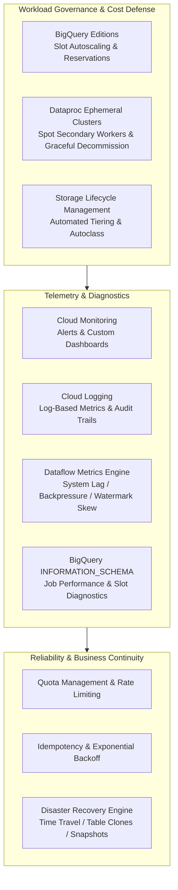
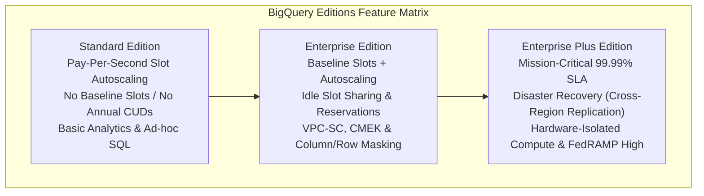
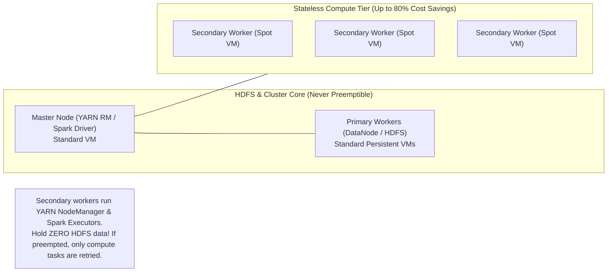
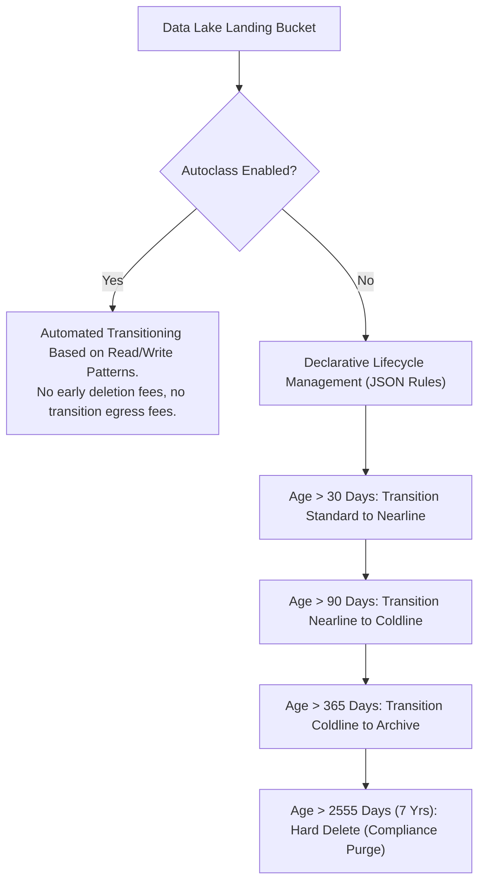
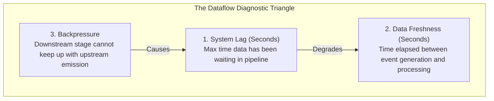
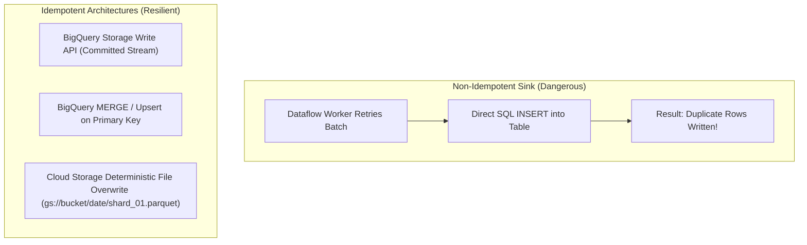
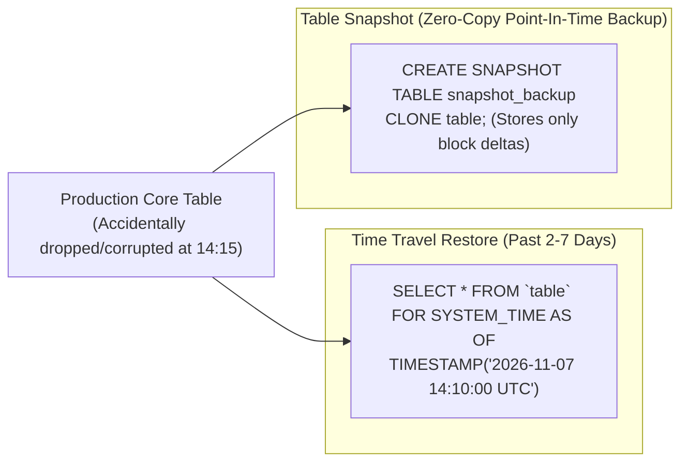

# Domain 5: Maintaining and Automating Data Workloads

**Official Exam Guide Weight: ~15%**

---

## Executive Architectural Overview

Maintaining enterprise data workloads requires proactive cost defense, rigorous telemetry monitoring, idempotent disaster recovery architectures, and intelligent resource governance. This domain focuses on BigQuery Editions (Standard, Enterprise, Enterprise Plus) and slot autoscaling, Dataproc cost reduction with Spot VMs and graceful decommissioning, real-time pipeline observability (Dataflow system lag, backpressure, data freshness), performance debugging via `INFORMATION_SCHEMA`, and disaster recovery failover with Time Travel and table snapshots.



---

## Section 5.1: Optimizing Resources for Cost and Compute

### 1. BigQuery Editions & Workload Management

Google Cloud organizes BigQuery compute into **Editions** (Standard, Enterprise, Enterprise Plus) paired with **Slot Autoscaling**, replacing legacy fixed flat-rate slots.



> [!IMPORTANT]
> **Edition Feature Boundaries (Critical Exam Gotchas)**:
> 1. **Baseline Slots**: Available **only** in **Enterprise** and **Enterprise Plus**. Standard Edition supports autoscaling slots only.
> 2. **Cross-Region Disaster Recovery Replication**: Available **exclusively** in **Enterprise Plus Edition**. Standard and Enterprise editions do not support dataset replication failover.
> 3. **Materialized Views & BI Engine**: Core SQL capabilities that work across **all** pricing tiers (including On-Demand and Standard Edition). They are not exclusive to Enterprise editions.

#### Capacity Management: Baseline Slots vs. Autoscaling Slots
*   **Baseline Slots**: Minimum dedicated slots always provisioned and warm. Prevents cold-start delays for critical reporting.
*   **Max Reservation Slots**: Ceiling limit for dynamic autoscaling. BigQuery scales slots in blocks of 100 based on active query demand, scaling back down to baseline (or zero) when idle.
*   **Reservations & Assignments**: Divide slot pools into logical buckets for business units:
    *   `prod-bi-reservation`: 500 baseline, 2000 max. Assigned to `QUERY` workloads for executive dashboards.
    *   `batch-etl-reservation`: 0 baseline, 1000 max. Assigned to `PIPELINE` workloads for overnight Dataform transformations.
    *   `ad-hoc-analysts`: Assigned to lower priority slots to avoid impacting production SLAs.

```bash
# Create an Enterprise Edition Reservation with Autoscaling
bq mk --project_id=enterprise-prod-data \
    --location=us-central1 \
    --reservation \
    --edition=ENTERPRISE \
    --slots=200 \
    --autoscale_max_slots=1000 \
    prod_bi_reservation

# Assign production BI queries to this reservation
bq mk --project_id=enterprise-prod-data \
    --location=us-central1 \
    --reservation_assignment \
    --reservation_id=enterprise-prod-data:us-central1.prod_bi_reservation \
    --job_type=QUERY \
    --assignee_id=enterprise-bi-project \
    --assignee_type=PROJECT
```

---

### 2. The BigQuery Administration Panel & Query Execution Priorities

#### The BigQuery Admin Panel (Console Observability)
The BigQuery Administration panel in the Google Cloud Console provides native operational telemetry without needing external logging queries:
- **Real-Time Slot Utilization**: Visualizes active slot consumption across all reservations, showing baseline commitments, autoscaled burst slots, and **idle slot borrowing** (where idle slots allocated to ETL are borrowed by BI queries).
- **Job Concurrency & Execution Waterfalls**: Displays active queries, queued queries waiting for slots, and stage-by-stage execution timelines (input read -> shuffle -> compute -> write).
- **Reservation Assignments**: Manages workload routing where projects or folders are assigned to reservations based on `job_type`:
  - `QUERY`: Interactive and scheduled SQL queries.
  - `PIPELINE`: Continuous streaming writes and loads.
  - `ML_EXTERNAL`: BigQuery ML remote model calls.

#### Interactive vs. Batch Query Priorities
When submitting queries via CLI, API, or Composer, engineers configure query priority:

| Parameter | Execution Mechanics | Concurrency Limit Impact | Best Production Use Case |
|---|---|---|---|
| **`priority='INTERACTIVE'` (Default)** | Query is submitted immediately to available slots. If slots are saturated, query experiences slot contention. | **Counts against** the project concurrent query limit (typically 100 concurrent queries). | User-facing dashboards, ad-hoc analyst exploration, critical low-latency APIs. |
| **`priority='BATCH'`** | Query is queued by Google Cloud and executed as soon as idle capacity becomes available (usually within minutes). | **DOES NOT count** against the project concurrent query quota! | Nightly ELT transformations, heavy historical backfills, automated weekly financial reconciliations. |

```bash
# Submitting a Heavy Nightly Backfill Query in Batch Mode
bq query \
    --use_legacy_sql=false \
    --batch=true \
    --destination_table=shopsphere_warehouse:curated.historical_orders_backfill \
    "SELECT * FROM shopsphere_warehouse.raw.orders WHERE order_date <= '2025-01-01'"
```

---

### 3. Dataproc Cost Optimization Strategies

Running large Spark or Hadoop workloads continuously on persistent clusters creates massive financial waste.



#### The Mechanics of Graceful Decommissioning
When Dataproc autoscaling scales down a cluster, or when Google Cloud reclaims a Spot VM:
1.  **Standard Termination (Destructive)**: Instantly kills the VM. Running Spark tasks fail, shuffle blocks stored on local SSDs are lost, and upstream tasks must be completely recomputed, causing cascading stage failures.
2.  **Graceful Decommissioning**: YARN stops assigning new containers to the node, waits for running tasks to finish, and allows other nodes to replicate or transfer shuffle data before the VM is shut down.
    *   Configured via `gracefulDecommissionTimeout` (e.g., `300s` to `600s`).

---

### 4. Cloud Storage Lifecycle Optimization & Autoclass



---

## Section 5.2: Monitoring, Logging, and Troubleshooting

### 1. Dataflow Pipeline Metrics Diagnostics

Troubleshooting streaming pipeline performance on Cloud Dataflow requires diagnosing three core metrics in Cloud Monitoring:



#### Diagnostic Scenarios
1.  **System Lag Increasing, CPU Utilization Low (< 20%)**:
    *   *Root Cause*: **Worker Stragglers / Hot Key**. A single hot key routes all data to one worker while other workers sit idle. Autoscaling cannot resolve this because CPU across the cluster remains low.
    *   *Solution*: Implement salting on the hot key or use Combiner Lifting (`CombinePerKey`).
2.  **Backpressure High, CPU Utilization High (> 90%)**:
    *   *Root Cause*: **Sink Throttling or Compute Starvation**. Dataflow workers are saturated performing heavy transforms, or the destination sink (BigQuery/Bigtable) is throttling writes.
    *   *Solution*: Increase maximum autoscaling worker limit, enable Streaming Engine, or scale destination sink capacity.
3.  **Watermark Paused**:
    *   *Root Cause*: Upstream publisher stopped sending data, or custom unbounded source failed to advance its event-time watermark.

---

### 2. BigQuery Performance Diagnostics via `INFORMATION_SCHEMA`

BigQuery's `INFORMATION_SCHEMA` views provide system-level telemetry to inspect query costs, slot consumption, and performance bottlenecks.

```sql
-- Finding Top Slot-Consuming and Spilling Queries in the Last 24 Hours
SELECT
    project_id,
    job_id,
    user_email,
    total_slot_ms,
    ROUND(total_slot_ms / (1000 * 60 * 60), 2) AS slot_hours,
    total_bytes_billed / (1024 * 1024 * 1024) AS gbs_billed,
    -- Detect if intermediate shuffle spilled data to Colossus disk
    (SELECT SUM(stage.shuffle_output_bytes_spilled) 
     FROM UNNEST(job_stages) AS stage) AS total_bytes_spilled_to_disk,
    query
FROM
    `region-us`.INFORMATION_SCHEMA.JOBS_BY_PROJECT
WHERE
    creation_time >= TIMESTAMP_SUB(CURRENT_TIMESTAMP(), INTERVAL 24 HOUR)
    AND job_type = 'QUERY'
    AND end_time IS NOT NULL
ORDER BY
    total_slot_ms DESC
LIMIT 10;
```

```sql
-- Pinpoint Queries Scanning Full Tables Due to Partition Pruning Failures
SELECT
    job_id,
    user_email,
    query,
    total_bytes_billed / (1024 * 1024 * 1024 * 1024) AS tbs_billed,
    error_result.message AS error_message
FROM
    `region-us`.INFORMATION_SCHEMA.JOBS_BY_ORGANIZATION
WHERE
    creation_time >= TIMESTAMP_SUB(CURRENT_TIMESTAMP(), INTERVAL 7 DAY)
    AND total_bytes_billed > 10 * 1024 * 1024 * 1024 * 1024 -- Queries scanning > 10 TB
ORDER BY
    total_bytes_billed DESC;
```

---

## Section 5.3: Maintaining Workload Automation and Reliability

### 1. Quotas, Limit Management & Exponential Backoff

*   **API Rate Limits**: Enforced per-second or per-minute (e.g., BigQuery `tabledata.insertAll` requests per second per project).
*   **Resource Quotas**: Hard resource limits (e.g., maximum Dataproc vCPUs per region, maximum BigQuery reservation slots).
*   **Exponential Backoff with Full Jitter**: Mandatory design pattern for client applications communicating with Google Cloud APIs:
$$T_{\text{wait}} = \text{random}(0, \min(T_{\text{max}}, T_{\text{base}} \times 2^{\text{attempt}}))$$
Adding jitter prevents the "thundering herd" problem where hundreds of worker nodes retry simultaneously at exact exponential intervals, repeatedly crashing the API gateway.

---

### 2. Idempotency Across Data Sinks

In distributed systems, failures, timeouts, and network retries guarantee that **duplicate requests will occur**. Pipelines must be designed to be strictly **idempotent** (re-executing the operation produces the exact same final state without side effects):



---

### 3. Disaster Recovery: Time Travel, Clones, and Snapshot Restores

BigQuery provides instant point-in-time recovery capabilities:



```sql
-- Restoring a Table Corrupted by an Accidental DELETE or UPDATE
CREATE OR REPLACE TABLE `enterprise_dw.fact_orders_restored` AS
SELECT
    *
FROM
    `enterprise_dw.fact_orders`
    FOR SYSTEM_TIME AS OF TIMESTAMP_SUB(CURRENT_TIMESTAMP(), INTERVAL 1 HOUR);

-- Creating a Zero-Copy Table Clone for Safe Development Testing
CREATE TABLE `enterprise_dw.fact_orders_dev_clone`
CLONE `enterprise_dw.fact_orders`;
```
*   **Table Clones**: Zero initial storage cost. The clone references the identical physical Capacitor storage blocks as the base table. Storage charges apply *only* to rows modified or added inside the clone.

---

## Common Exam Traps & Distractors

> [!WARNING]
> 1. **Dataflow Lag vs. Adding Workers Trap**: If a Dataflow pipeline is lagging due to an upstream **Hot Key**, scaling the number of workers does **not** resolve the issue. The entire key partition will continue routing to a single worker. The fix is code-level **salting** or **combiner lifting**.
> 2. **Spot VM Primary Workers Trap**: Configuring Dataproc Primary Workers or Master Nodes as Preemptible/Spot VMs causes cluster destruction. Only **Secondary Workers** can be configured as Spot/Preemptible instances.
> 3. **Time Travel vs. Fail-Safe Trap**: Candidates often believe they can query the Fail-Safe window using SQL. **They cannot**. Only the Time Travel window (up to 7 days) is directly queryable via `FOR SYSTEM_TIME AS OF`. Fail-Safe recovery requires opening a ticket with Google Cloud Customer Support.
> 4. **Table Clone Storage Cost Trap**: Distractor options claim creating a Table Clone of a 100 TB BigQuery table immediately doubles your storage bill. This is false. Table clones leverage copy-on-write; initial storage cost is **zero**.
> 5. **Exponential Backoff Without Jitter**: Implementing exponential backoff without random jitter results in synchronized retry waves that continue overwhelming failing services.

---

## Scenario-Based Knowledge Checks

### Scenario 1: BigQuery Budget Optimization and Slot Starvation
**Context**: An enterprise data platform operates across 40 business units on BigQuery using on-demand query pricing. Last month, data analysts ran un-partitioned Cartesian queries that caused monthly billing to skyrocket by 400%. Simultaneously, automated production reporting dashboards failed because concurrent queries were throttled. Management mandates:
1. Production reporting queries must always have guaranteed compute capacity.
2. Ad-hoc exploratory queries from data analysts must be budget-capped and never starve production dashboards.
3. Eliminate runaway on-demand query billing spikes.

**Question**: How should the principal data architect configure BigQuery capacity?
*   **A)** Keep On-Demand billing, but create a Cloud Function that checks billing alerts and deletes users who spend over \$500.
*   **B)** Transition to BigQuery Enterprise Edition. Create a `prod_reservation` with dedicated baseline slots and autoscaling for the reporting project. Create a separate `analytics_reservation` with a strict max slot ceiling and 0 baseline slots for ad-hoc users. Assign jobs via BigQuery Reservation Assignments.
*   **C)** Move the reporting dashboard to Cloud SQL to bypass BigQuery slots entirely.
*   **D)** Increase the project-level on-demand query quota to 500 concurrent queries.

**Detailed Answer Analysis**:
*   **Correct Answer: B**. BigQuery Editions (Enterprise Edition) with **Reservations and Assignments** provides strict workload isolation and predictable cost governance. Provisioning baseline slots with autoscaling for production reporting guarantees business SLAs. Setting an isolated reservation with a fixed slot ceiling for exploratory ad-hoc analysts prevents runaway costs and guarantees that ad-hoc queries can never consume slots reserved for production reporting.
*   *Distractor Analysis*:
    *   **A** is a fragile, reactive hack that disrupts user accounts after runaway costs have already been incurred.
    *   **C** Cloud SQL cannot scale to handle enterprise-wide analytical queries across terabytes of data.
    *   **D** Increasing concurrent on-demand quotas worsens cost spikes and accelerates slot contention.

---

### Scenario 2: Diagnosing Dataflow Streaming Bottlenecks Under Bursty Traffic
**Context**: A real-time IoT pipeline processes connected vehicle sensor data via Cloud Pub/Sub and Cloud Dataflow. During morning rush hour, Cloud Monitoring triggers an alert: **System Lag** has surged from 5 seconds to 45 minutes, and **Data Freshness** has dropped severely. The engineer inspects Cloud Monitoring and notes:
*   Cluster CPU utilization across all workers is only 18%.
*   Worker memory utilization is low.
*   Worker node count is stuck at the minimum autoscaling threshold.
*   The pipeline step `GroupByKeyAndWindow` shows one worker processing 98% of all elements.

**Question**: What is the root cause of this performance collapse, and how should it be remediated?
*   **A)** The Pub/Sub subscription has reached its message throughput limit; recreate the subscription.
*   **B)** Dataflow autoscaling is broken; manually set worker count to 100 via the CLI.
*   **C)** The pipeline is suffering from a Hot Key bottleneck caused by skewed sensor keys; update the Apache Beam code to salt keys or apply Combiner Lifting with `CombinePerKey`.
*   **D)** Disk throughput on the workers is saturated; migrate worker boot disks to Extreme SSDs.

**Detailed Answer Analysis**:
*   **Correct Answer: C**. The diagnostic pattern is unmistakable: low overall CPU utilization combined with a single worker handling almost 100% of the workload at `GroupByKey` is the classic signature of a **Hot Key**. Because average cluster CPU is low, Dataflow's autoscaler sees no reason to add more workers. Even if 100 workers were added, the hot key would still route exclusively to one worker. The solution is code-level mitigation: adding random salts to keys or performing partial pre-shuffling aggregations using **Combiner Lifting**.
*   *Distractor Analysis*:
    *   **A** Pub/Sub scales automatically to millions of messages per second and does not throttle based on pipeline key distributions.
    *   **B** Forcing 100 workers will not resolve a single-key bottleneck and will waste money.
    *   **D** Disk throughput is not the constraint; the bottleneck is an algorithmic key imbalance inside the distributed shuffle.

---

### Scenario 3: Accidental Production Table Overwrite Disaster Recovery
**Context**: At 11:30 AM, a junior engineer deploys a Dataform pipeline with a misconfigured `writeDisposition` set to `WRITE_TRUNCATE` instead of `WRITE_APPEND`. The pipeline runs and wipes out a 20 TB production table `enterprise_dw.customer_360` containing 8 years of historical records. The company's RTO is 30 minutes, and the RPO must be zero data loss prior to the 11:30 AM truncation.

**Question**: How can the data engineer recover the wiped table within minutes without paying massive data restoration fees?
*   **A)** Contact Google Cloud Customer Support and request a restoration from the 7-day Fail-Safe window.
*   **B)** Restore the table immediately using BigQuery Time Travel SQL: `CREATE OR REPLACE TABLE enterprise_dw.customer_360 AS SELECT * FROM enterprise_dw.customer_360 FOR SYSTEM_TIME AS OF TIMESTAMP('2026-11-07 11:29:00 UTC')`.
*   **C)** Re-run all ETL pipelines from the original source transactional systems from 8 years ago.
*   **D)** Check out the GCS archive bucket and run a Dataproc Spark batch job to parse historical Parquet files.

**Detailed Answer Analysis**:
*   **Correct Answer: B**. BigQuery **Time Travel** is specifically engineered for instantaneous self-service disaster recovery. It retains historical snapshots of all modified, deleted, or truncated tables for up to 7 days. By querying the table `FOR SYSTEM_TIME AS OF` 11:29:00 UTC (1 minute prior to the accidental truncation), the complete 20 TB table can be restored in a single SQL statement in under 60 seconds, easily satisfying the 30-minute RTO.
*   *Distractor Analysis*:
    *   **A** Fail-Safe recovery requires opening a enterprise support case, taking hours or days to fulfill, completely breaching the 30-minute RTO.
    *   **C** Re-running 8 years of source ETL pipelines would take days or weeks.
    *   **D** Ingesting historical Parquet files from scratch is slow, labor-intensive, and fails the 30-minute RTO requirement.
