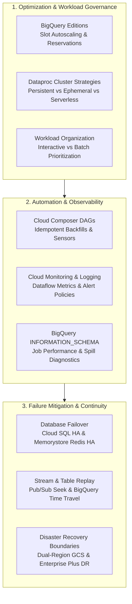
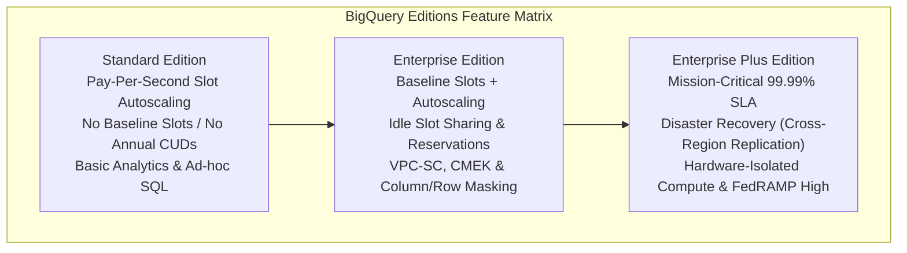
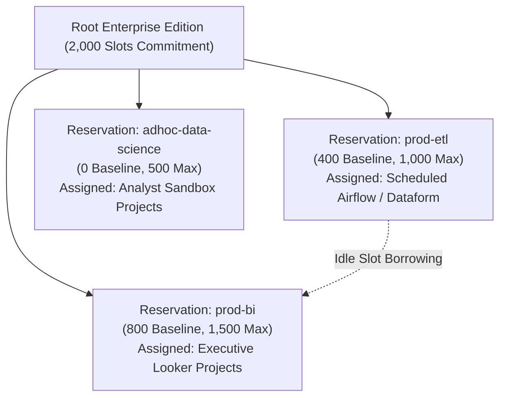
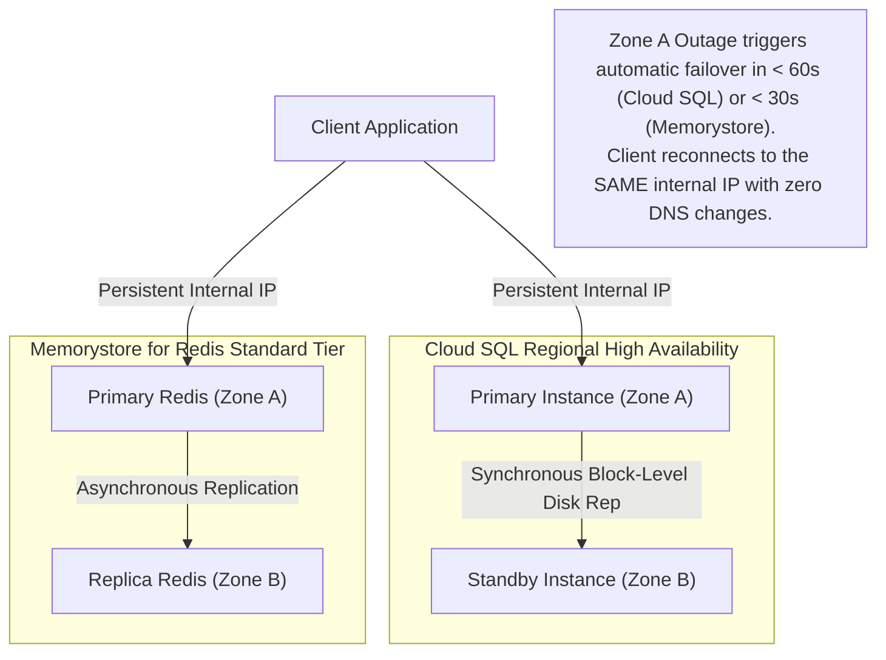

# Domain 5: Maintaining and Automating Data Workloads

**Official Exam Guide Weight: ~18%**

---

## Executive Architectural Overview

Maintaining enterprise data workloads requires proactive cost defense, workflow automation and repeatability, capacity allocation aligned to business priority, continuous telemetry monitoring, and comprehensive failure mitigation. This domain focuses on BigQuery Editions slot economics, persistent versus ephemeral compute selection, production Airflow DAG automation and backfill idempotency, capacity isolation, `INFORMATION_SCHEMA` diagnostics, and end-to-end disaster recovery failover spanning databases, streaming engines, and analytical warehouses.



---

## Section 5.1: Optimizing Resources

### 1. BigQuery Editions & Slot Capacity Economics
Google Cloud organizes BigQuery compute into **Editions** (Standard, Enterprise, Enterprise Plus) paired with **Slot Autoscaling**, replacing legacy flat-rate slots.



> [!IMPORTANT]
> **Edition Feature Boundaries (Critical Exam Gotchas)**:
> 1. **Baseline Slots**: Available **only** in **Enterprise** and **Enterprise Plus**. Standard Edition supports autoscaling slots only.
> 2. **Cross-Region Disaster Recovery Replication**: Available **exclusively** in **Enterprise Plus Edition**. Standard and Enterprise editions do not support dataset replication failover.
> 3. **Materialized Views & BI Engine**: Core SQL capabilities that work across **all** pricing tiers (including On-Demand and Standard Edition).

#### Slot Capacity Management: Baseline Slots vs. Autoscaling Slots
*   **Baseline Slots**: Minimum dedicated slots always provisioned, warm, and paid for on a commitment basis. Prevents cold-start delays for mission-critical queries.
*   **Autoscaling Slots**: Elastic capacity added automatically in increments of 100 slots to absorb transient query spikes, scaling back down to baseline (or zero) when queries complete.

---

### 2. Dataproc Cluster Selection: Persistent vs. Ephemeral vs. Serverless

| Dimension | Persistent Cluster | Ephemeral (Job-Scoped) Cluster | Dataproc Serverless for Spark |
| :--- | :--- | :--- | :--- |
| **Lifecycle** | Runs 24/7 continuously | Created by orchestrator, runs job, terminates | Zero cluster lifecycle; job-scoped container |
| **Cost Profile** | High idle waste unless fully utilized | Compute billed only for active job duration | Pay strictly for Dynamic Compute Units (DCUs) per second |
| **Ideal Workloads** | Interactive data science notebooks, ad-hoc queries, high-frequency micro-jobs | Scheduled multi-hour batch ETL, nightly aggregation pipelines | Single PySpark/Spark-SQL jobs, event-driven processing |
| **Storage Architecture** | Often co-located HDFS | Fully decoupled (GCS / BigLake) | Fully decoupled (GCS / BigLake) |
| **Spot VM Utilization** | Risky on master/primary; can use on secondary | **Optimal**: Master/Primary standard, Secondary 80% Spot | Handled automatically by Google infrastructure |

#### Graceful Decommissioning Mechanics
When Dataproc autoscales down worker nodes:
*   **Standard Termination**: Kills VMs immediately, causing lost shuffle blocks and cascading task failures (`MetadataFetchFailedException`).
*   **Graceful Decommissioning**: YARN stops scheduling new containers on retiring nodes, waiting for active Spark executors to finish transferring shuffle data before VM termination (timeout set via `gracefulDecommissionTimeout`).

---

### 3. Cloud Storage Lifecycle Optimization & Autoclass
*   **Object Lifecycle Management (OLM)**: Declarative rules defined on buckets (e.g., transition to Nearline after 30 days of inactivity, delete after 365 days).
*   **Autoclass**: Automatically moves objects between Standard, Nearline, Coldline, and Archive based on individual access patterns. Eliminates early deletion penalties and retrieval charges in exchange for a small monthly management fee per 1,000 objects.

---

## Section 5.2: Designing Automation and Repeatability

### 1. Cloud Composer (Managed Apache Airflow) DAG Design
Cloud Composer coordinates complex multi-service workflows across Google Cloud:

```python
# Production Airflow DAG Demonstrating Repeatability & Sensor Efficiency
from datetime import datetime, timedelta
from airflow import DAG
from airflow.providers.google.cloud.sensors.gcs import GCSObjectExistenceSensor
from airflow.providers.google.cloud.operators.bigquery import BigQueryInsertJobOperator

default_args = {
    "owner": "data-platform",
    "depends_on_past": False,
    "retries": 3,
    "retry_delay": timedelta(minutes=5),
    "retry_exponential_backoff": True,
}

with DAG(
    dag_id="daily_orders_curation_pipeline",
    default_args=default_args,
    schedule_interval="0 2 * * *", # Daily at 02:00 AM UTC
    start_date=datetime(2026, 1, 1),
    catchup=False,                  # Prevents accidental flood of historical backfills
    max_active_runs=1,
) as dag:

    # Efficient Sensor: mode='reschedule' frees Airflow worker slots while waiting
    wait_for_landing_file = GCSObjectExistenceSensor(
        task_id="wait_for_daily_orders_file",
        bucket="enterprise-landing-lake",
        object="orders/{{ ds_nodash }}/orders.parquet",
        mode="reschedule",          # CRUCIAL: Releases worker slot between pings
        poke_interval=300,          # Check every 5 minutes
        timeout=7200,               # 2-hour timeout
    )

    # Idempotent Atomic Merge
    merge_orders_to_silver = BigQueryInsertJobOperator(
        task_id="merge_orders_atomic",
        configuration={
            "query": {
                "query": """
                    MERGE `enterprise_dw.silver_orders` T
                    USING (
                        SELECT * FROM `enterprise_dw.stg_orders`
                        WHERE order_date = '{{ ds }}'
                    ) S
                    ON T.order_id = S.order_id
                    WHEN MATCHED THEN
                        UPDATE SET amount = S.amount, status = S.status, updated_at = S.updated_at
                    WHEN NOT MATCHED THEN
                        INSERT (order_id, customer_id, amount, status, order_date, updated_at)
                        VALUES (S.order_id, S.customer_id, S.amount, S.status, S.order_date, S.updated_at);
                """,
                "useLegacySql": False,
            }
        }
    )

    wait_for_landing_file >> merge_orders_to_silver
```

#### Airflow Sensor Slot Starvation vs. `mode='reschedule'`
*   **Anti-Pattern (`mode='poke'`)**: The sensor holds an Airflow worker slot continuously while waiting for upstream files, starving other DAGs of worker concurrency.
*   **Best Practice (`mode='reschedule'`)**: The sensor polls the bucket, releases the worker slot immediately, and reschedules itself for a future check, allowing workers to execute other production tasks.

---

### 2. Idempotency and Historical Backfill Patterns
Pipelines must be **idempotent**: re-running a job for the same logical date must produce the exact same target state without duplicate rows.
*   **Atomic Partition Overwrite**: When writing batch outputs, use `WRITE_TRUNCATE` targeted to a specific partition (`table$YYYYMMDD`) rather than appending.
*   **Atomic SQL MERGE**: Merges updates and inserts based on a business primary key (`order_id`), ensuring reruns do not create duplicates.
*   **Airflow Logical Date vs. Execution Date**: Parameterize queries using Airflow Jinja macros (`{{ ds }}`, `{{ data_interval_start }}`) instead of non-deterministic functions like `CURRENT_DATE()` or `NOW()`.

---

## Section 5.3: Organizing Workloads Based on Business Requirements

### 1. Capacity Management: BigQuery Reservations & Assignments
Multi-tenant enterprises prevent resource contention by partitioning slot capacity into logical **Reservations**:



*   **Idle Slot Sharing**: If the ETL reservation is idle during the business day, the BI reservation can automatically borrow its unused baseline slots. When ETL batch runs start, BigQuery pre-empts borrowed capacity and restores slots to ETL.
*   **Assignments**: Map Google Cloud resources (`ORGANIZATION`, `FOLDER`, or `PROJECT`) and `job_type` (`QUERY`, `PIPELINE`, `ML_EXTERNAL`) to specific reservations.

---

### 2. Interactive vs. Batch Query Priorities
*   **`priority='INTERACTIVE'` (Default)**: Executes immediately on available slots. Counts against the concurrent query quota (typically 100 concurrent queries). Used for user-facing dashboards.
*   **`priority='BATCH'`**: Queued by Google Cloud and executed as soon as idle capacity becomes available (usually within minutes). **Does NOT count against concurrent query quotas**. Ideal for overnight historical backfills and large transformations.

---

## Section 5.4: Monitoring and Troubleshooting Processes

### 1. Dataflow Streaming Pipeline Diagnostics
*   **System Lag**: Maximum duration in seconds that an item has been waiting unprocessed in the pipeline. Sustained increases indicate processing bottlenecks.
*   **Data Freshness**: Delta between processing time and current event-time watermark.
*   **Diagnosing Hot Keys & Worker Stragglers**: If System Lag rises while CPU utilization across the cluster remains low ($<20\%$), a single key is routing excessive traffic to one worker. Solution: Implement key salting or Combiner Lifting.

---

### 2. BigQuery Performance Diagnostics via `INFORMATION_SCHEMA`

```sql
-- Finding Top Queries Spilling Intermediate Shuffle Partitions to Colossus Disk
SELECT
    project_id,
    job_id,
    user_email,
    total_slot_ms,
    ROUND(total_slot_ms / (1000 * 60 * 60), 2) AS slot_hours,
    total_bytes_billed / (1024 * 1024 * 1024) AS gbs_billed,
    (SELECT SUM(stage.shuffle_output_bytes_spilled) 
     FROM UNNEST(job_stages) AS stage) AS total_bytes_spilled_to_disk,
    query
FROM
    `region-us`.INFORMATION_SCHEMA.JOBS_BY_PROJECT
WHERE
    creation_time >= TIMESTAMP_SUB(CURRENT_TIMESTAMP(), INTERVAL 24 HOUR)
    AND job_type = 'QUERY'
    AND end_time IS NOT NULL
ORDER BY
    total_slot_ms DESC
LIMIT 10;
```

---

### 3. Quota Management & Exponential Backoff
*   **API Rate Limit Throttling (`HTTP 429 / RESOURCE_EXHAUSTED`)**: Client applications must implement **Exponential Backoff with Full Jitter**:
    $$\text{Sleep Time} = \text{random}(0, \min(M, B \times 2^{\text{attempt}}))$$
*   Prevents the "thundering herd" problem when upstream workers retry simultaneously against rate-limited Google Cloud APIs.

---

## Section 5.5: Maintaining Awareness of Failures and Mitigating Impact

System design must incorporate deterministic disaster recovery, cross-zone/cross-region failovers, and data reconstruction strategies.

### 1. Database High Availability & Failover Mechanics



#### Cloud SQL HA vs. Cross-Region Read Replicas
*   **Regional High Availability**: Synchronous persistent disk replication between Zone A (Primary) and Zone B (Standby). If Zone A experiences hardware failure, Cloud SQL executes automated failover in $<60$ seconds. Zero data loss ($\text{RPO} = 0$).
*   **Cross-Region Read Replicas**: Asynchronous replication across regions. If the primary region experiences catastrophic failure, cross-region replicas must be **manually promoted** to primary. Because replication is asynchronous, failover carries potential data loss ($\text{RPO} > 0$).

#### Memorystore for Redis Replication and Failover
*   **Basic Tier**: Single zone, no replica. If the underlying host fails, cache data is permanently lost.
*   **Standard Tier**: Cross-zone replication (Zone A to Zone B). Automatic failover completes in under 30 seconds with persistent IP address preservation.
*   **Persistence Options**: Supports RDB (periodic snapshot dumps to Cloud Storage) and AOF (Append-Only File for minimal RPO recovery).

---

### 2. Stream & Pipeline Recovery Strategies
*   **Pub/Sub Seek & Replay**: When downstream code defects cause incorrect processing, deploy the bug fix, create a Pub/Sub Snapshot, and issue a `seek` API call to rewind the subscription to a timestamp before the bug occurred (up to 31 days).
*   **Dataflow Streaming Job Restarts**:
    *   *Drain*: Stops reading new input messages, finishes in-flight window processing, and terminates cleanly.
    *   *Cancel*: Immediately kills workers; in-flight non-checkpointed data is abandoned.
    *   *Snapshot Resumption*: Creates an execution snapshot of the pipeline state and resumes a new pipeline version from that snapshot state.

---

### 3. Data Warehouse Disaster Recovery & Accidental Overwrite Recovery
*   **BigQuery Time Travel (`FOR SYSTEM_TIME AS OF`)**: Query historical versions of tables up to 7 days in the past:
    ```sql
    -- Instant Table Restoration After Accidental DROP/TRUNCATE
    CREATE OR REPLACE TABLE `enterprise_dw.fact_orders` AS
    SELECT * FROM `enterprise_dw.fact_orders`
    FOR SYSTEM_TIME AS OF TIMESTAMP_SUB(CURRENT_TIMESTAMP(), INTERVAL 1 HOUR);
    ```
*   **Table Clones**: Instant, zero-copy writable clones of production tables at a specific historical timestamp.
*   **BigQuery Cross-Region Dataset Replication (Enterprise Plus Exclusive)**: Synchronizes datasets across primary and secondary regions, enabling planned or disaster failover.

---

### 4. End-to-End Pipeline Recovery Coordination

| Failure Domain | Primary Failure Mode | Detection Signal | Correct Remediation Mechanism | Target Operational Outcome |
| :--- | :--- | :--- | :--- | :--- |
| **Operational DB** | Primary VM hardware crash | Cloud Monitoring heartbeat loss | Automatic Cloud SQL HA failover to standby disk in Zone B | Failover completes in $<60$s; zero data loss |
| **Streaming Buffer** | Pipeline processing bug | Downstream bad data alerted | Deploy fixed Beam code; execute Pub/Sub `seek` to rewind subscription | Replays uncorrupted messages from buffer |
| **Processing Engine** | Worker memory leak / crash | Dataflow worker unhealthy restarts | Restart with Streaming Engine and right-sized memory | Resumes processing from MillWheel checkpoint |
| **Analytical DW** | Accidental table `DROP` or `TRUNCATE` | Data team alert | Restore table snapshot via `FOR SYSTEM_TIME AS OF` query | Table restored in minutes without backup restores |
| **Regional Storage** | Entire datacenter region destroyed | Regional SLA outage declaration | Failover to dual-region GCS bucket with Turbo Replication | $\le 15$-minute RPO backed by financial SLA |

---

## Common Exam Traps & Distractors

> [!WARNING]
> 1. **Batch Query Priority Trap**: When executing heavy overnight ETL transformations that fail due to concurrent query quota exhaustion, the solution is setting `priority='BATCH'`. Batch queries do not count against concurrent query limits.
> 2. **Composer Sensor Slot Starvation**: Setting Airflow sensors to `mode='poke'` causes sensors to monopolize worker execution slots while waiting for upstream files, blocking all other pipelines. Always use `mode='reschedule'`.
> 3. **Time Travel vs Fail-Safe Trap**: Time Travel is self-service via SQL for up to 7 days. Fail-Safe covers the subsequent 7 days, but **cannot be queried via SQL**; recovery requires opening a ticket with Google Cloud Support.
> 4. **Cloud SQL Cross-Region Failover Trap**: Cloud SQL High Availability provides automatic failover **within a region across zones**. Failover to a cross-region read replica is **never automatic**; it requires manual promotion.
> 5. **BigQuery Cross-Region DR Tier Trap**: Cross-region dataset replication for disaster recovery failover is an **Enterprise Plus Edition exclusive feature**. It is not available in Standard or Enterprise editions.

---

## Scenario-Based Knowledge Checks

### Scenario 1: BigQuery Budget Optimization and Slot Starvation
**Context**: A retail company operates a central BigQuery warehouse. At 09:00 AM every morning, analysts run ad-hoc queries while the marketing team refreshes Looker dashboards. Concurrently, a critical customer loyalty ingestion pipeline writes streaming batches. During this window, analysts experience 45-second query delays, and the loyalty pipeline throws slot timeout errors. The CFO prohibits increasing the overall BigQuery budget.

**Question**: How should the data architect resolve this contention without increasing cloud spend?
*   **A)** Migrate all analytics to Cloud Bigtable.
*   **B)** Under BigQuery Enterprise Edition, create two reservations: a 300-slot baseline reservation assigned to the loyalty pipeline (`job_type=PIPELINE`), and a 700-slot reservation assigned to user queries (`job_type=QUERY`), enabling idle slot sharing.
*   **C)** Instruct analysts to only run queries between 12:00 PM and 05:00 PM.
*   **D)** Convert all tables to unpartitioned tables to reduce metadata overhead.

**Detailed Answer Analysis**:
*   **Correct Answer: B**. BigQuery Editions reservations isolate workloads into dedicated capacity pools. Assigning baseline slots to the critical loyalty pipeline guarantees it has dedicated compute that cannot be starved by user queries. Enabling idle slot sharing allows queries to borrow unused slots during non-peak windows without increasing total slot commitments.
*   *Distractor Analysis*:
    *   **A** Bigtable does not support SQL analytics or Looker semantic modeling.
    *   **C** is an operational policy, not an architectural solution.
    *   **D** removing partitioning dramatically increases query costs and worsens performance.

---

### Scenario 2: Diagnosing Dataflow Streaming Bottlenecks Under Bursty Traffic
**Context**: An IoT fleet streaming pipeline runs on Cloud Dataflow. During morning commute hours, sensor telemetry spikes by $500\%$. Cloud Monitoring alerts trigger: `system_lag` climbs from 2 seconds to 450 seconds. However, the Dataflow autoscaling panel shows the cluster has scaled to 20 workers, and average worker CPU utilization is only $18\%$.

**Question**: What is the root cause of this pipeline degradation, and how is it remediated?
*   **A)** CPU starvation; increase the worker machine type to `n2-highcpu-64`.
*   **B)** Hot Key bottleneck; skewed keys are routing excessive data to a single worker running a stateful operation or `GroupByKey`. Apply Combiner Lifting with `CombinePerKey` or implement salting on the keys.
*   **C)** Pub/Sub quota exhaustion; request an API quota increase.
*   **D)** Network firewall rules are blocking Dataflow worker communication.

**Detailed Answer Analysis**:
*   **Correct Answer: B**. High system lag paired with low overall CPU utilization is the classic symptom of a **Hot Key** partition bottleneck. A single key routes most traffic to one worker, overwhelming its thread while remaining workers sit idle. Adding more workers or increasing CPU size does not fix the issue because the skewed key is still pinned to one worker. Applying `CombinePerKey` (Combiner Lifting) or salting distributes the aggregation across multiple workers.
*   *Distractor Analysis*:
    *   **A** increasing CPU does not resolve single-key partition skew.
    *   **C** Pub/Sub quota issues cause publishing rejections, not Dataflow worker lag with low CPU.
    *   **D** if firewall rules blocked workers, the pipeline would completely fail to initialize.

---

### Scenario 3: Accidental Production Table Overwrite Disaster Recovery
**Context**: At 14:15 UTC, a junior engineer accidentally runs a script that executes `TRUNCATE TABLE production_warehouse.orders_fact`. Downstream executive dashboards immediately display zero data. The last complete export backup in Cloud Storage was taken at 00:00 UTC (14 hours ago). The business SLA mandates an RPO of under 1 hour for operational recovery.

**Question**: What is the fastest and most complete recovery action?
*   **A)** Restore the table from the midnight Cloud Storage backup.
*   **B)** Open a critical Severity-1 support ticket with Google Cloud Customer Support to request Fail-Safe recovery.
*   **C)** Restore the table immediately using BigQuery Time Travel via `CREATE OR REPLACE TABLE production_warehouse.orders_fact AS SELECT * FROM production_warehouse.orders_fact FOR SYSTEM_TIME AS OF TIMESTAMP('2026-11-07 14:10:00 UTC')`.
*   **D)** Re-run all daily ingestion pipelines from source transactional databases.

**Detailed Answer Analysis**:
*   **Correct Answer: C**. BigQuery Time Travel retains historical table states for up to 7 days by default. Executing a query with the `FOR SYSTEM_TIME AS OF` clause pointing to 14:10 UTC (5 minutes before the accidental truncation) restores 100% of the data up to the moment before truncation within seconds, fully satisfying the 1-hour RPO.
*   *Distractor Analysis*:
    *   **A** restoring from the midnight backup loses 14 hours of data, violating the 1-hour RPO.
    *   **B** Fail-Safe is reserved for data beyond the 7-day Time Travel window; contacting support takes hours and is unnecessary when Time Travel is available.
    *   **D** re-running all upstream pipelines is error-prone, takes hours, and may cause duplicate data issues.
