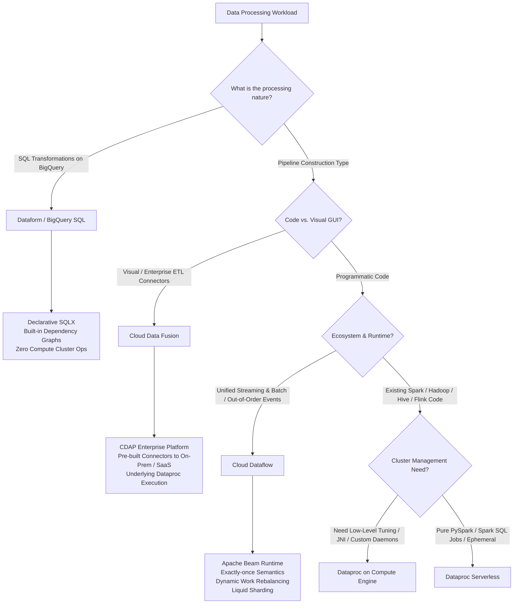
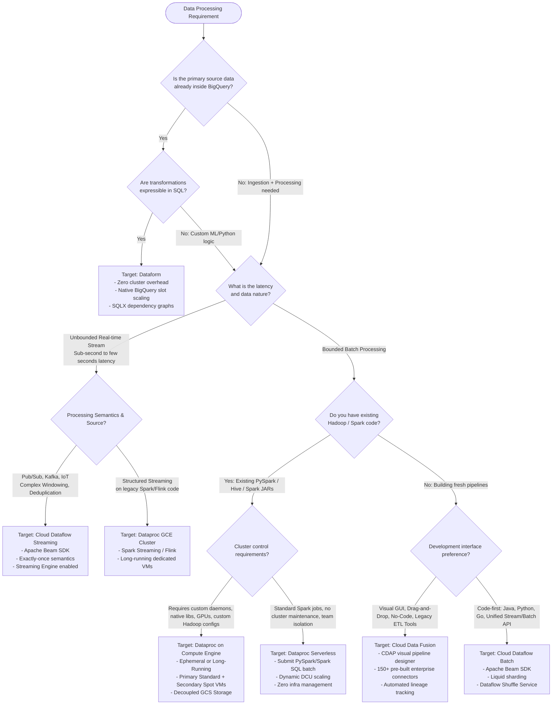

# Distributed Compute: Dataflow vs. Dataproc vs. Cloud Data Fusion vs. Dataform

As an enterprise data architect designing big data solutions on Google Cloud, selecting the proper compute engine is the single most consequential architectural decision regarding operational expenditure, engineering velocity, and operational stability. In Google Cloud's data ecosystem, compute is strictly decoupled from storage, enabling you to target specialized runtimes against centralized data layers (Cloud Storage, BigQuery, Bigtable).

This guide provides an exhaustive comparative framework across Google Cloud’s primary processing engines:
1. **Cloud Dataflow** (Apache Beam unified stream/batch runner)
2. **Cloud Dataproc** (Managed Hadoop/Spark/Flink ecosystem, covering both Compute Engine clusters and Dataproc Serverless)
3. **Cloud Data Fusion** (Managed CDAP, low-code/no-code enterprise visual integration)
4. **Dataform** (SQLX orchestration and transformation layer native to BigQuery)

---

## 1. Architectural Paradigms & Runtime Engines



### Cloud Dataflow (Apache Beam)
- **Runtime**: Managed execution engine for Apache Beam (Java, Python, Go, and SQL).
- **Core Model**: The unified Beam model (`PCollection`, `PTransform`, `Window`, `Trigger`, `Watermark`). Seamless transition between bounded (batch) and unbounded (streaming) datasets.
- **Compute Architecture**: Fully managed workers deployed as Compute Engine instances behind a managed control plane. Storage is offloaded to Persistent Disks and Google Cloud Storage; shuffle operations in batch run on the Google-managed Dataflow Shuffle Service (external to worker VMs). Streaming pipelines leverage Streaming Engine, moving state storage and window management out of worker memory into a dedicated, autoscaling backend service.
- **Dynamic Work Rebalancing (Liquid Sharding)**: Dataflow dynamically re-splits unread splits of data on the fly across workers based on processing lag, mitigating stragglers without manual repartitioning.

### Cloud Dataproc (Compute Engine vs. Serverless)
- **Runtime**: Open-source Apache Big Data Ecosystem (Spark, Hadoop, Hive, Presto/Trino, Flink, Pig, Zookeeper).
- **Compute Architecture**:
  - **Dataproc on GCE**: Provisioned clusters consisting of 1 Master node and $N$ Primary/Secondary worker nodes. Supports initialization actions, custom machine types, GPUs, local SSDs, and Spot/Preemptible VMs. Secondary workers are compute-only (no HDFS DataNode daemon), allowing aggressive autoscaling without risk of HDFS data loss.
  - **Dataproc Serverless for Spark**: Completely removes cluster infrastructure management. Workloads are submitted as batch workloads (Python, Java, Scala Spark) into serverless compute runtimes that autoscale dynamically in Data Compute Units (DCUs: 1 DCU = 4 vCPUs + 16 GB RAM).
- **Storage Decoupling**: Standard Google Cloud architecture replaces HDFS with the Cloud Storage Connector (`gs://` URI), allowing clusters to be completely ephemeral.

### Cloud Data Fusion (CDAP)
- **Runtime**: Managed open-source CDAP (Cask Data Application Platform).
- **Compute Architecture**: A managed control plane exposes an interactive GUI for building ETL/ELT pipelines, managing data lineage, and configuring 150+ pre-built connectors. Pipeline execution is delegated under the hood to transient **Cloud Dataproc clusters** provisioned automatically during pipeline startup and torn down upon completion.
- **Target Audience**: Data analysts, enterprise integration teams, and ETL developers transitioning from tools like Informatica, Talend, or SSIS who require drag-and-drop workflow authoring, visual schema transformations (Wrangler), and enterprise metadata cataloging.

### Dataform (SQLX)
- **Runtime**: Serverless BigQuery transformation framework acquired and integrated natively into GCP.
- **Compute Architecture**: Zero dedicated servers or VM instances. Executes entirely within BigQuery’s query engine using BigQuery slots. Dataform acts as the declarative orchestration compiler: it parses SQLX files (SQL augmented with JavaScript and declarative dependencies), constructs a Directed Acyclic Graph (DAG), and executes standard BigQuery jobs via API calls.
- **Target Audience**: Analytics engineers following the ELT paradigm (Extract-Load-Transform).

---

## 2. Deep Decision Matrix Across 10 Technical Dimensions

| Dimension | Cloud Dataflow | Dataproc (GCE Managed) | Dataproc Serverless | Cloud Data Fusion | Dataform |
| :--- | :--- | :--- | :--- | :--- | :--- |
| **1. Primary Paradigm** | Unified Apache Beam (Pipelines, transforms, event-time semantics) | Apache Spark, Hadoop, Hive, Flink, Presto (RDD, DataFrame, GraphX) | Spark Batch Jobs (PySpark, Spark SQL, Spark Scala) | CDAP Visual Micro-services / Node-based ETL Pipelines | Declarative SQLX (SQL + JS, DAG-based DDL/DML compilation) |
| **2. Ingestion Model** | Native Streaming & Batch (Unified API, milli-second event streaming) | Batch primary; Spark Streaming (micro-batch) or Flink (continuous) | Batch only (streaming workloads currently run on GCE clusters) | Batch & Real-time (micro-batching via Spark Streaming on Dataproc) | Batch ELT only (triggered on schedule, webhook, or via Airflow) |
| **3. Autoscaling Mechanics** | Fast & Dynamic: Liquid sharding, worker pool autoscaling + Streaming Engine | Slower: Yarn-based autoscaling metrics (Memory/vCPU allocation, pending containers) | Fast: Autoscales seamlessly per stage based on Spark dynamic allocation & DCUs | Dependent on ephemeral Dataproc cluster spin-up time (~90-180s) | Instant: Leverages native BigQuery slot autoscaling (on-demand or reservations) |
| **4. State Management** | Externalized via Streaming Engine; RocksDB local cache; Watermarks & Triggers | In-memory RDD/DataFrame lineage; HDFS/GCS checkpointing; Spark StateStore | Ephemeral state written to Cloud Storage; driver-managed state | State persisted across pipeline stages via CDAP checkpointing on GCS | In-storage state inside BigQuery tables, views, and materializations |
| **5. Operational Overhead** | **Near-Zero (NoOps)**: No OS patching, no cluster configuration, no tuning | **High**: Linux OS patching, Hadoop configuration tuning, YARN sizing, Daemons | **Zero**: Fully serverless, no cluster configuration, automatic runtime tuning | **Low-Medium**: Managed instance GUI, but Dataproc cluster profiles require tuning | **Zero**: Built directly into BigQuery console and Git repositories |
| **6. Migration Path** | High friction from legacy Spark/Hadoop; native destination for Beam/Flink | Zero friction: Lift-and-shift existing MapReduce/Spark JARs and scripts | Low friction for standard Spark jobs; requires removal of cluster-specific hooks | High fit for legacy Informatica, Talend, SSIS, and visual ETL tools | High fit for dbt users, SQL data modelers, and legacy stored procedure migrations |
| **7. Developer Skillset** | Senior Software Engineers (Java, Python, Go, Beam SDK internals) | Data Engineers & Data Scientists (PySpark, Scala, HiveQL, Shell scripting) | Data Engineers (PySpark, Spark SQL, Scala JARs) | ETL Developers, Business Analysts, Citizen Integrators (GUI, Wrangler) | Analytics Engineers, SQL Developers, BI Engineers (ANSI SQL, JS modules) |
| **8. Cost Predictability** | Resource-based (vCPU-sec, Memory-sec, Shuffle GB, Streaming Engine units) | Static or autoscaling VM pricing + Dataproc fee per vCPU-hour ($0.01/vCPU/hr) | Usage-based: DCU-hours ($0.05 per DCU-hour billed to the second) | Basic/Enterprise instance fee (~$0.27 - $1.80/hr) + underlying Dataproc VMs | BigQuery Slot-ms or on-demand TB processed; zero licensing cost for Dataform |
| **9. Failure Recovery** | Exactly-once built-in via checkpointing, liquid sharding, and deduplication | Worker restart, YARN container retry, Spot VM loss handled if Graceful Decom. enabled | Automatic task retry, resilient driver orchestration, zero VM risk | Pipeline restart, stage-level checkpoint resume via CDAP recovery | Transactional DDL/DML inside BigQuery; idempotent table recreation |
| **10. Exam Clues & Triggers** | *"Unbounded stream"*, *"Out-of-order events"*, *"Liquid sharding"*, *"NoOps"* | *"Migrate legacy Spark/Hadoop"*, *"Custom Hive UDFs"*, *"Sub-minute cluster jobs"* | *"Ephemeral Spark"*, *"No cluster management"*, *"Serverless PySpark"* | *"Visual ETL pipeline"*, *"No-code"*, *"Data lineage GUI"*, *"100+ SaaS connectors"* | *"Transform in BigQuery"*, *"SQL dependencies"*, *"Git-controlled SQL"*, *"Replace stored procs"* |

---

## 3. Deep-Dive Architectural Trade-Offs

### Dataflow: Liquid Sharding & Externalized State
In legacy systems like MapReduce and Apache Spark, data is partitioned up front into static splits ($N$ partitions). If a single partition encounters skewed keys (e.g., a "hot customer ID"), that worker tasks takes $10\times$ longer than others, creating the classic distributed computing **straggler problem**.

Dataflow resolves this via **Dynamic Work Rebalancing (Liquid Sharding)**:
1. As a worker processes a split, it continually reports its progress and estimated time to completion to the Dataflow service.
2. If another worker finishes early, Dataflow identifies the remaining unprocessed split on the busy worker.
3. The remaining range is dynamically sliced and transferred to the idle worker without re-reading from source.

```mermaid
sequenceDiagram
    participant Source as PubSub / Cloud Storage
    participant Worker1 as Dataflow Worker 1 (Slow/Hot Key)
    participant Master as Dataflow Control Plane
    participant Worker2 as Dataflow Worker 2 (Idle)

    Worker1->>Master: Heartbeat: Remaining split [50% - 100%] (Lagging)
    Worker2->>Master: Heartbeat: Split finished (Idle)
    Master->>Worker1: Abort processing at 75%; yield range [75% - 100%]
    Worker1-->>Master: Range [75% - 100%] relinquished
    Master->>Worker2: Assign Dynamic Split [75% - 100%]
    Worker2->>Source: Read and process relinquished split
```

#### Streaming Engine vs. In-Worker Processing
- **Legacy In-Worker**: State (e.g., sliding window aggregations, deduplication tables) and shuffle operations are stored in memory and local worker disks. Autoscaling requires state shuffling across VMs, causing massive pipeline latency spikes.
- **Streaming Engine**: Offloads window state and intermediate aggregations to a specialized Google-managed distributed storage service. Compute workers become essentially stateless execution nodes. As a result, autoscaling can add or remove workers in seconds without reshuffling pipeline state.

---

### Dataproc: Cost Optimization & Resilience
Dataproc on Compute Engine is the most cost-effective mechanism for running Spark at petabyte scale on GCP if configured correctly:

1. **Decoupled Architecture with Cloud Storage Connector**:
   By replacing `hdfs://` with `gs://`, data persists independently of the cluster. Clusters can be treated as disposable cattle rather than pets.
   
2. **Primary vs. Secondary Workers (Preemptible/Spot Instances)**:
   - **Primary Workers**: Run HDFS DataNode (if HDFS is used), YARN NodeManager, and participate in cluster consensus. Must be standard Compute Engine instances.
   - **Secondary Workers**: Run **only** YARN NodeManager (pure compute). If a Spot/Preemptible secondary worker is reclaimed by Google with 30-second notice:
     - No HDFS blocks are lost.
     - YARN reschedules the failed tasks onto other workers.
     - With **Graceful Decommissioning** enabled, Dataproc removes nodes cleanly, waiting for running tasks to conclude or offload shuffle data.
   - **Recommended PDE Exam Architecture**: 1 Master (Standard), 2 Primary Workers (Standard), and $10 - 100$ Secondary Workers (Spot/Preemptible) with autoscaling policies.

3. **Dataproc Serverless**:
   Eliminates YARN tuning completely. Ideal when distinct development teams submit unpredictable PySpark batch jobs. Rather than running a massive multi-tenant cluster with complex YARN resource queues (FairScheduler/CapacityScheduler), each team executes in isolated serverless compute perimeters, billed strictly for DCU-seconds consumed.

---

### Cloud Data Fusion: Enterprise Hub vs. Operational Trade-Off
- **Strengths**: Accelerated delivery for legacy IT teams. Delivers enterprise governance, visual pipeline design, field-level data lineage tracking, and pre-packaged connectors (SAP, Salesforce, Oracle, Teradata, Kafka).
- **Architectural Reality**: Cloud Data Fusion does not execute data processing inside its own instance. It compiles the graphical CDAP pipeline into a Spark or MapReduce program and spins up an ephemeral Dataproc cluster in the customer or tenant VPC.
- **Anti-Pattern**: Using Data Fusion for high-frequency, sub-second streaming pipelines. The cluster provisioning overhead and micro-batch model introduce minimum latencies of tens of seconds to minutes.

---

### Dataform: ELT in the Modern Data Lakehouse
- **Paradigm Shift**: Traditional ETL pulls data out of storage, transforms it in a compute cluster (Spark/Dataflow), and pushes it to a warehouse. In modern cloud architectures, compute engines like BigQuery natively scale to thousands of slots.
- **Mechanism**: Dataform compiles SQLX files containing assertions (`assert`), dependencies (`ref('table_name')`), and data documentation into raw BigQuery execution plans.
- **Architectural Sweet Spot**: Star-schema dimension modeling, Medallion Architecture (Bronze $\to$ Silver $\to$ Gold) inside BigQuery, and enterprise data modeling where the source data already lands in BigQuery via Datastream or BigQuery Storage Write API.

---

## 4. End-to-End Architectural Decision Tree



---

## 5. Exam Trap Clues & Recognition Keywords

| Scenario Keyword in Exam Question | Incorrect Selection | Correct Architecture | Architectural Defense |
| :--- | :--- | :--- | :--- |
| *"Company has existing Spark and Hive scripts and needs to minimize migration engineering time"* | Cloud Dataflow | **Cloud Dataproc** | Rewriting Spark/Hive to Apache Beam takes significant engineering effort. Dataproc executes Spark natively with zero code changes. |
| *"Batch pipeline suffers from extreme data skew (stragglers) on key groupings"* | Dataproc with larger VMs | **Cloud Dataflow (Batch)** | Spark cannot split an individual overloaded partition across workers dynamically. Dataflow's **Liquid Sharding (Dynamic Work Rebalancing)** splits unprocessed work on lagging workers on the fly. |
| *"Streaming pipeline requiring exactly-once processing with out-of-order event timestamps"* | Spark Streaming on Dataproc | **Cloud Dataflow (Streaming)** | Spark micro-batching processes by ingestion time unless complex state management is coded. Apache Beam on Dataflow natively supports event-time watermarking, allowed lateness, and exactly-once processing. |
| *"Minimize operational overhead for ad-hoc, intermittent daily PySpark workloads"* | Dataproc on GCE cluster running 24/7 | **Dataproc Serverless** | Running a permanent cluster wastes idle compute. Ephemeral GCE clusters incur VM spin-up latency. Dataproc Serverless runs on demand without cluster overhead. |
| *"Business analysts need to build ETL pipelines and inspect data lineage without writing Java/Python"* | Cloud Dataflow | **Cloud Data Fusion** | Dataflow is code-first. Data Fusion provides a visual UI (Wrangler and Pipeline Studio) with built-in audit and field-level lineage. |
| *"Cost-effectively process petabyte-scale nightly batch jobs on Dataproc"* | 100% Standard GCE Workers | **Primary Standard + Secondary Spot/Preemptible Workers** | Primary workers maintain HDFS metadata and YARN consensus. Secondary workers execute pure compute; Spot VMs cut compute costs by up to 60-91% safely. |
