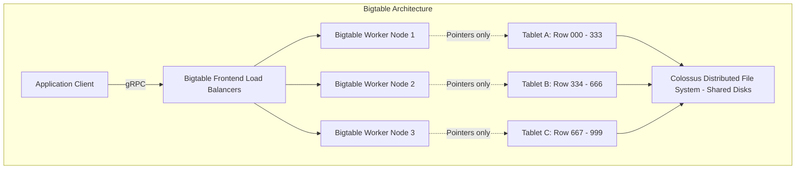
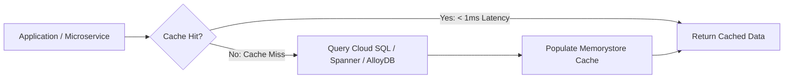
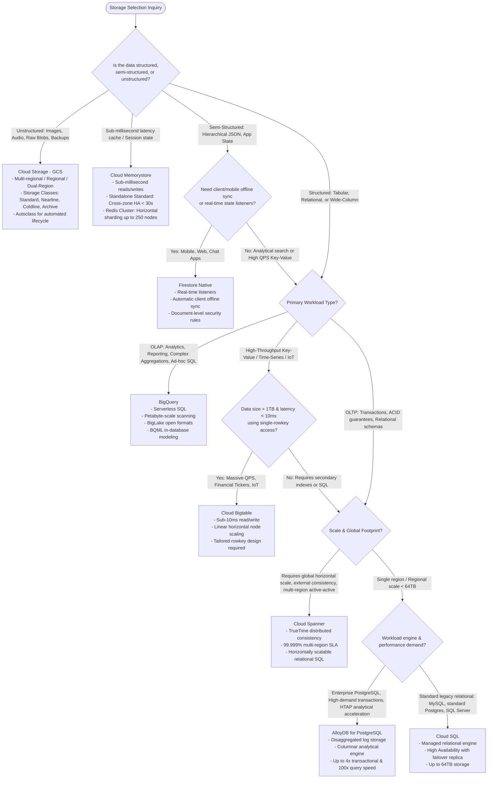

# Storage & Databases: BigQuery vs. Bigtable vs. Spanner vs. Cloud SQL vs. AlloyDB vs. Firestore vs. Memorystore vs. Cloud Storage

Selecting the correct storage and persistence engine is foundational to data engineering on Google Cloud. Each system is engineered to solve a specific quadrant of the CAP theorem and the OLTP-versus-OLAP spectrum. Choosing incorrectly leads to latency bottlenecks, query cost explosions, or architectural dead ends.

This guide provides a comprehensive architectural evaluation of Google Cloud’s eight core persistence services:
1. **BigQuery** (Serverless enterprise cloud data warehouse & analytical lakehouse)
2. **Cloud Bigtable** (Low-latency, high-throughput wide-column NoSQL database)
3. **Cloud Spanner** (Globally distributed, horizontally scalable, strongly consistent relational database)
4. **Cloud SQL** (Managed MySQL, PostgreSQL, and SQL Server for traditional relational workloads)
5. **AlloyDB for PostgreSQL** (Modernized disaggregated-storage relational database for demanding enterprise transactional/HTAP workloads)
6. **Firestore** (Serverless NoSQL document database for hierarchical application data and mobile sync)
7. **Cloud Memorystore** (Fully managed in-memory Redis and Memcached caching for sub-millisecond retrieval)
8. **Cloud Storage (GCS)** (Scalable, unified object store for unstructured and semi-structured assets)

---

## 1. Deep Comparative Analysis Across Core Dimensions

| Dimension | BigQuery | Cloud Bigtable | Cloud Spanner | Cloud SQL | AlloyDB for PostgreSQL | Firestore (Native) | Cloud Memorystore (Redis) | Cloud Storage (GCS) |
| :--- | :--- | :--- | :--- | :--- | :--- | :--- | :--- | :--- |
| **Storage Paradigm** | Columnar (Capacitor format) distributed analytical store (OLAP) | Wide-column (SSTable/LSM-tree) NoSQL | Horizontally partitioned distributed Relational (OLTP / HTAP) | Monolithic Relational (InnoDB / Heap) on persistent disk | Disaggregated Relational engine + Log-Processing Storage (HTAP) | Document NoSQL (Collections & JSON documents) | In-Memory Key-Value / Data Structure Store (Redis / Memcached) | Distributed Blob / Object Store (Flat namespace + Buckets) |
| **Latency Profile** | Hundreds of ms to seconds (Analytical batch / federated) | **Sub-10ms** (1-6ms single-digit reads/writes) | **Single-digit to tens of ms** (p99 <10ms regional, <50ms multi-region) | Single-digit ms (1-10ms depending on IOPS and caching) | **Sub-millisecond to low single-digit ms** (4x faster than Cloud SQL pg) | Tens of milliseconds (15-30ms) | **Sub-millisecond** (<1ms reads/writes) | Tens to hundreds of ms (TTFB ~30-100ms) |
| **Throughput / Scale** | Multi-Petabyte to Exabyte scans; millions of rows/sec ingest | Millions of QPS; linear scaling (10k QPS per SSD node); Petabytes | Tens of thousands to millions of QPS; linear horizontal scale; Petabytes | Up to 64 TB per instance; bounded by single-node IOPS/vCPUs | Up to 64 TB storage; highly scaled read pools (up to 20 read replicas) | Millions of concurrent clients; petabytes scale across collections | Millions to tens of millions QPS (Cluster mode); multi-terabyte RAM | Virtually infinite; petabytes to exabytes per bucket |
| **Consistency Model** | Strong consistency for DML/DDL; ACID compliant within table ops | **Strong consistency** within a single cluster; eventual across multi-cluster | **External Consistency (Strict Serializability)** via TrueTime API | Strong consistency on Primary; Eventual on Read Replicas (async rep) | Strong consistency on Primary; near-zero replica lag (log streaming) | **Strong consistency** for all document reads/writes | In-memory strong consistency on primary; async replication to standby | **Strong consistency** (immediate read-after-write, update, and delete) |
| **Query Model** | Full ANSI:2011 SQL, complex multi-way JOINs, analytic window funcs | Point lookups & Rowkey range scans; **No SQL, No Secondary Indexes** | Full ANSI SQL, ACID transactions across tables/regions, secondary indexes | Full SQL (Dialects: MySQL, Postgres, T-SQL); full JOINs and procedures | Full PostgreSQL 14/15/16 SQL + columnar analytical engine extensions | Document lookups, compound queries, indexed filters; **No JOINs** | Key-value lookups, Hashes, Sets, Sorted Sets, Pub/Sub; **No SQL** | REST API (GET, PUT, LIST, DELETE); no SQL (queryable via BigQuery BigLake) |
| **Scaling Mechanics** | Autonomous slot allocation; completely decoupled serverless compute | Horizontal scaling by adding/removing nodes (zero downtime rebalancing) | Horizontal scaling by adding/removing nodes or Processing Units (PUs) | Vertical scaling (CPU/RAM); read scale-out via read replicas | Vertical primary scale; elastic horizontal read pools with auto-scaling | Autonomous serverless autoscaling down to zero and up to massive QPS | Vertical instance sizing; horizontal sharding via Cluster Mode (up to 250 shards) | Transparent autoscaling; auto-shards under high-request prefix volumes |
| **High Availability & Disaster Recovery** | Standard: 99.9%; Enterprise & Enterprise Plus: 99.99% SLA (Regional / Multi-regional); cross-region replication (Enterprise Plus) | Single-cluster: 99.9%; Multi-cluster routing across 2+ clusters: 99.99% (99.999% across 3+ regions), requiring Multi-Cluster Routing App Profile | Regional (99.99%) or Multi-Regional (99.999% "five nines" SLA) | Enterprise HA: 99.95% SLA; Enterprise Plus HA: 99.99% SLA (with synchronous standby) | Multi-zone regional HA with automatic failover (<60s RTO, 99.99% SLA) | Multi-region deployment (99.999% availability SLA) | Standard Tier cross-zone automated failover (<30s RTO, 99.9% SLA); RDB/AOF | Standard: Regional 99.9%, Dual/Multi-Region 99.95%; Nearline/Coldline/Archive: Regional 99.0%, Dual/Multi-Region 99.9% SLA |
| **Cost Drivers** | Analyzed data volume ($6.25/TB) or Capacity (Slots/hour) + Storage ($/GB) | Provisioned Node-hours ($/node/hr) + Storage type (SSD vs. HDD $/GB) | Provisioned Node-hours or Processing Units (100 PUs = 0.1 node) + Storage | Allocated vCPU/RAM hours + provisioned SSD/HDD storage + egress | Allocated vCPU/RAM hours + provisioned storage + backup storage | Document Reads, Writes, Deletes + Storage GB + egress network | Provisioned Memory capacity ($/GB/hr) based on tier (Basic vs Standard vs Cluster) | Storage class (Standard, Nearline, Coldline, Archive) + Class A/B Ops |
| **Exam Keywords** | *"Data warehouse"*, *"Ad-hoc analytical queries"*, *"Petabytes of historical logs"* | *"Sub-10ms latency"*, *"Time-series"*, *"IoT sensors"*, *"Rowkey design"*, *">1 TB"* | *"Horizontal scale"*, *"Global transactions"*, *"ACID across regions"*, *"Relational scale"* | *"Traditional relational"*, *"Existing MySQL/Postgres"*, *"Database size < 64 TB"* | *"Enterprise PostgreSQL"*, *"Analytical acceleration on transactional DB"*, *"HTAP"* | *"Mobile/Web sync"*, *"Hierarchical JSON"*, *"Real-time listeners"*, *"Offline sync"* | *"Sub-millisecond latency"*, *"Caching layer"*, *"Session state"*, *"Leaderboard"*, *"Redis"* | *"Unstructured data"*, *"Images/Videos"*, *"Data lake raw landing"*, *"Cost-effective archive"* |

---

## 2. In-Depth Operational & Architectural Trade-Offs

### Bigtable: The Physics of Wide-Column NoSQL
Cloud Bigtable is Google's internal storage engine (built on SSTables and Chubby) exposed as a managed HBase-compatible API.

#### Key Architecture Nuances:
1. **Decoupled Compute and Storage**: Bigtable nodes **do not store data locally**. Nodes hold pointers to "Tablets" stored on Colossus (Google's cluster filesystem). When a node fails or nodes are added/removed, zero data copying occurs—only tablet metadata pointers are reassigned. Node rebalancing takes seconds.
2. **Rowkey Design Dictates Performance**:
   - Queries can only filter by:
     - Exact rowkey match (point lookup).
     - Rowkey prefix or rowkey range (start key to end key).
   - **Anti-Pattern (Hotspotting)**: Sequential keys (e.g., `timestamp_deviceid`) route all sequential writes to a single tablet/node, causing massive latency spikes.
   - **Best Practice (Salting/Field Reversal)**: Reverse domain names (`com.google.cloud`), reverse timestamps (`MAX_INT - timestamp` for most-recent-first reads), or hashed prefixes (`hash(device_id)_timestamp`).
3. **Minimum Scale Threshold**: Bigtable is not engineered for small datasets. For datasets under **1 TB**, per-node overhead makes it cost-inefficient, and query latency can be erratic. Use Cloud SQL or Firestore for <1 TB datasets.

---

### Cloud Spanner: Achieving External Consistency (CP System with 99.999% Practical Availability)
Cloud Spanner provides strict ACID transactions and relational schemas at horizontal, planetary scale.

#### The TrueTime Mechanism:
- TrueTime API leverages GPS and atomic clocks to bound clock uncertainty ($\epsilon \le 4\text{ms}$).
- Uses a **Commit Wait** algorithm: the leader delays releasing write locks until the TrueTime window has elapsed ($t.earliest > s$).
- Guarantees **External Consistency (Strict Serializability)**: if transaction $T_2$ starts after transaction $T_1$ commits, $T_2$ is guaranteed to receive a timestamp strictly greater than $T_1$.

#### Operational Best Practices:
1. **Avoid Monotonically Increasing Primary Keys**: Auto-incrementing sequences or timestamp primary keys force all concurrent writes to a single split leader, causing severe hotspotting. Use UUIDv4 or bit-reversed sequential numbers.
2. **Table Interleaving**: Physically collocates child rows alongside parent rows on the same storage split, eliminating distributed network shuffles during parent-child `JOIN` queries.

---

### Cloud Memorystore: Sub-Millisecond In-Memory Caching Architecture
Cloud Memorystore provides fully managed Redis and Memcached instances:

#### Memorystore Offerings & Architectural Selection:
*   **Memorystore for Redis (Standalone Instance)**:
    *   *Basic Tier (Non-HA)*: A single Redis node residing in one zone. Zero replication, no automated failover. If the host fails or maintenance occurs, all cache data is lost. Does not support automated persistence (AOF/RDB) or read replicas. Suitable strictly for ephemeral development caches or disposable compute caches.
    *   *Standard Tier (High Availability)*: Cross-zone active-standby replica pair. Automatic cross-zone failover completes in $<30$ seconds with persistent internal IP address preservation. Supports up to 5 read replicas to offload read traffic. Maximum capacity is 300 GB (no keyspace sharding). Supports persistence via RDB periodic snapshots (to Cloud Storage) and AOF logging.
*   **Memorystore for Redis Cluster (Horizontally Scalable)**:
    *   *Architecture*: Separate, horizontally partitioned offering compliant with the open-source Redis Cluster protocol. Shards keyspace across 16,384 hash slots, scaling from tens of gigabytes to multiple terabytes with tens of millions of QPS.
    *   *Capacity & Node Limits*: Governed by a total node ceiling of 250 nodes per cluster. Maximum shard count depends directly on the replica configuration per shard:
        *   **0 replicas per shard**: Up to 250 primary shards.
        *   **1 replica per shard (HA default)**: Up to 125 shards (125 primaries + 125 replicas = 250 nodes).
        *   **2 replicas per shard**: Up to 83 shards (83 primaries + 166 replicas = 249 nodes).
    *   *Failover & Persistence*: Independent automated failover per shard. Supports automated daily RDB backups to Cloud Storage and AOF persistence. Requires cluster-aware Redis clients.
*   **Memorystore for Memcached**: Multi-threaded in-memory key-value caching without advanced Redis data structures, cluster partitioning, or persistence.

---

### Cloud SQL vs. AlloyDB: Traditional vs. Cloud-Native Relational
*   **Cloud SQL**: Best for general-purpose relational workloads (<64 TB) migrating from existing MySQL, PostgreSQL, or SQL Server instances. Regional HA provides automatic failover in approximately 60 seconds (duration is environment-dependent based on transaction volume and crash recovery) using synchronous disk replication.
*   **AlloyDB for PostgreSQL**: Re-architects PostgreSQL with a disaggregated compute/storage engine and an analytical columnar engine. Delivers up to $4\times$ transactional write throughput and up to $100\times$ faster analytical queries compared to standard PostgreSQL, making it the premier choice for demanding HTAP workloads.

---

## 3. End-to-End Database Selection Decision Tree

---

## 4. Exam Scenario Recognition Matrix

| Scenario Presented in Exam Question | Trap Choice | Correct Architecture | Technical Reason |
| :--- | :--- | :--- | :--- |
| *"High-frequency e-commerce web application where identical product catalog lookups cause database read bottlenecks on Cloud SQL."* | Add larger read replicas to Cloud SQL | **Cloud Memorystore for Redis (Standard Tier)** | Memorystore delivers sub-millisecond in-memory caching to absorb repetitive read spikes, directly protecting backend transactional databases. Standard Tier provides automatic cross-zone failover. |
| *"Globally distributed financial application requires ACID transactions across North America, Europe, and Asia with 99.999% availability."* | Cloud SQL with cross-region read replicas | **Cloud Spanner (Multi-region)** | Cloud SQL read replicas are asynchronous and read-only. Only Spanner provides multi-region distributed write transactions with TrueTime external consistency. |
| *"IoT telemetry ingesting 500,000 writes/second from smart meters requiring sub-10ms lookup by device and timestamp."* | BigQuery Streaming Insert | **Cloud Bigtable** | BigQuery has query latency of seconds and is designed for analytical aggregation, not sub-10ms operational key lookups. |
| *"Enterprise PostgreSQL database suffering from high read/write latency during end-of-quarter analytics reporting; cannot rewrite application."* | Migrate to BigQuery | **AlloyDB for PostgreSQL** | Rewriting applications to BigQuery breaks transactional logic. AlloyDB’s Columnar Engine accelerates analytical queries in-place without code changes. |
| *"High-volume real-time chat application requires client synchronization when offline and instant push notification on state update."* | Cloud Spanner | **Firestore (Native Mode)** | Firestore includes native mobile SDKs supporting offline local caching and live snapshot listeners. |
| *"Need to store multi-petabyte historical archive of regulatory PDF documents accessed once every 5 years with immediate millisecond retrieval."* | Cloud Storage Archive with Coldline lifecycle | **Cloud Storage Archive Class** | Archive class provides lowest storage cost ($0.0012/GB/mo) while retaining instant millisecond access time (unlike AWS Glacier which requires hours to unfreeze). |
| *"Bigtable cluster read latency spiking to 150ms on new date partition writes."* | Upgrade cluster node count | **Redesign Bigtable Rowkey** | The latency is caused by hotspotting due to sequential timestamp prefixes. Adding nodes will not fix tablet hotspotting; salting or reversing keys distributes load evenly. |
