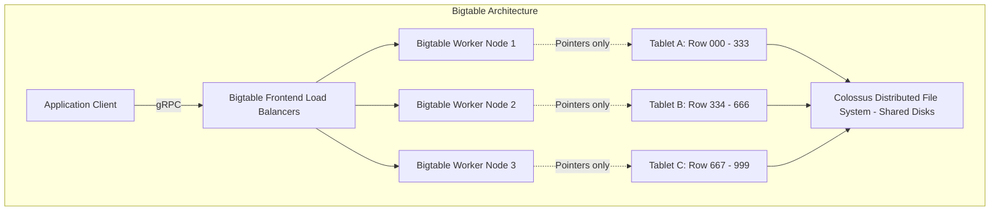
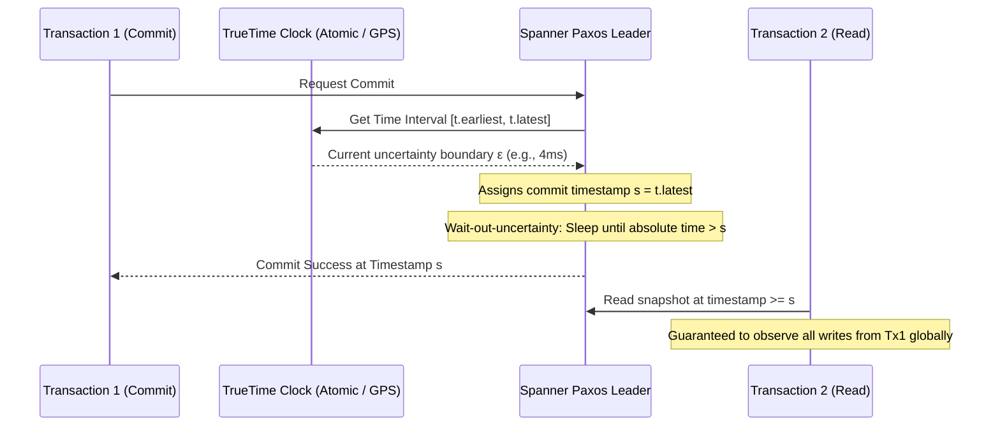
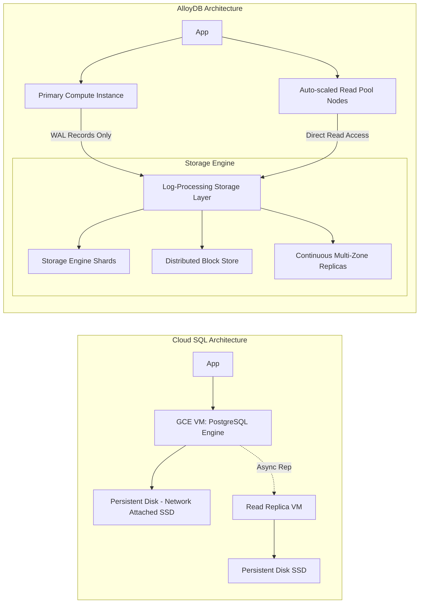
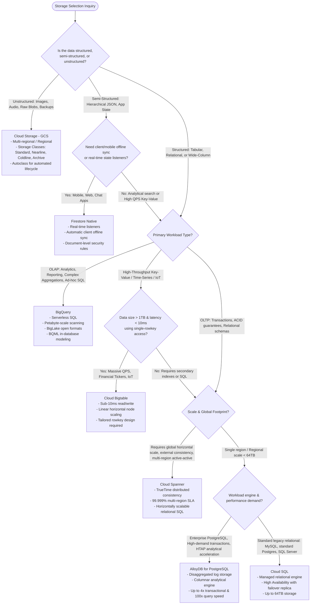

# Storage & Databases: BigQuery vs. Bigtable vs. Spanner vs. Cloud SQL vs. AlloyDB vs. Firestore vs. Cloud Storage

Selecting the correct storage and persistence engine is foundational to data engineering on Google Cloud. Each system is engineered to solve a specific quadrant of the CAP theorem and the OLTP-versus-OLAP spectrum. Choosing incorrectly leads to latency bottlenecks, query cost explosions, or architectural dead ends.

This guide provides a comprehensive architectural evaluation of Google Cloud’s seven core persistence services:
1. **BigQuery** (Serverless enterprise cloud data warehouse & analytical lakehouse)
2. **Cloud Bigtable** (Low-latency, high-throughput wide-column NoSQL database)
3. **Cloud Spanner** (Globally distributed, horizontally scalable, strongly consistent relational database)
4. **Cloud SQL** (Managed MySQL, PostgreSQL, and SQL Server for traditional relational workloads)
5. **AlloyDB for PostgreSQL** (Modernized disaggregated-storage relational database for demanding enterprise transactional/HTAP workloads)
6. **Firestore** (Serverless NoSQL document database for hierarchical application data and mobile sync)
7. **Cloud Storage (GCS)** (Scalable, unified object store for unstructured and semi-structured assets)

---

## 1. Deep Comparative Analysis Across Core Dimensions

| Dimension | BigQuery | Cloud Bigtable | Cloud Spanner | Cloud SQL | AlloyDB for PostgreSQL | Firestore (Native) | Cloud Storage (GCS) |
| :--- | :--- | :--- | :--- | :--- | :--- | :--- | :--- |
| **Storage Paradigm** | Columnar (Capacitor format) distributed analytical store (OLAP) | Wide-column (SSTable/Log-Structured Merge-tree) NoSQL | Horizontally partitioned distributed Relational (OLTP / HTAP) | Monolithic Relational (InnoDB / Heap) on persistent disk | Disaggregated Relational engine + Log-Processing Storage (HTAP) | Document NoSQL (Collections & JSON-like documents) | Distributed Blob / Object Store (Flat namespace + Buckets) |
| **Latency Profile** | Hundreds of ms to seconds (Analytical batch / federated) | **Sub-10ms** (1-6ms single-digit reads/writes) | **Single-digit to tens of ms** (p99 <10ms regional, <50ms multi-region) | Single-digit ms (1-10ms depending on IOPS and caching) | **Sub-millisecond to low single-digit ms** (4x faster than Cloud SQL pg) | Tens of milliseconds (15-30ms) | Tens to hundreds of ms (TTFB ~30-100ms) |
| **Throughput / Scale** | Multi-Petabyte to Exabyte scans; millions of rows/sec ingest | Millions of QPS; linear scaling (10k QPS per SSD node); Petabytes | Tens of thousands to millions of QPS; linear horizontal scale; Petabytes | Up to 64 TB per instance; bounded by single-node IOPS/vCPUs | Up to 64 TB storage; highly scaled read pools (up to 20 read replicas) | Millions of concurrent clients; petabytes scale across collections | Virtually infinite; petabytes to exabytes per bucket |
| **Consistency Model** | Strong consistency for DML/DDL; ACID compliant within table ops | **Strong consistency** within a single cluster; eventual across multi-cluster | **External Consistency (Strict Serializability)** via TrueTime API | Strong consistency on Primary; Eventual on Read Replicas (async rep) | Strong consistency on Primary; near-zero replica lag (log streaming) | **Strong consistency** for all document reads/writes | **Strong consistency** (immediate read-after-write, update, and delete) |
| **Query Model** | Full ANSI:2011 SQL, complex multi-way JOINs, analytic window funcs | Point lookups & Rowkey range scans; **No SQL, No Secondary Indexes** | Full ANSI SQL, ACID transactions across tables/regions, secondary indexes | Full SQL (Dialects: MySQL, Postgres, T-SQL); full JOINs and procedures | Full PostgreSQL 14/15/16 SQL + columnar analytical engine extensions | Document lookups, compound queries, indexed filters; **No JOINs** | REST API (GET, PUT, LIST, DELETE); no SQL (queryable via BigQuery BigLake) |
| **Scaling Mechanics** | Autonomous slot allocation; completely decoupled serverless compute | Horizontal scaling by adding/removing nodes (zero downtime rebalancing) | Horizontal scaling by adding/removing nodes or Processing Units (PUs) | Vertical scaling (CPU/RAM); read scale-out via read replicas | Vertical primary scale; elastic horizontal read pools with auto-scaling | Autonomous serverless autoscaling down to zero and up to massive QPS | Transparent autoscaling; auto-shards under high-request prefix volumes |
| **High Availability & Disaster Recovery** | Regional / Multi-regional (99.99% SLA); cross-region replication | Multi-cluster replication (up to 8 regions/zones); 99.9% to 99.999% SLA | Regional (99.99%) or Multi-Regional (99.999% "five nines" SLA) | Regional HA with synchronous standby instance (99.95% SLA) | Multi-zone regional HA with automatic failover (<60s RTO, 99.99% SLA) | Multi-region deployment (99.999% availability SLA) | Regional, Dual-Region, Multi-Region (99.9% to 99.95% SLA) |
| **Cost Drivers** | Analyzed data volume ($6.25/TB) or Capacity (Slots/hour) + Storage ($/GB) | Provisioned Node-hours ($/node/hr) + Storage type (SSD vs. HDD $/GB) | Provisioned Node-hours or Processing Units (100 PUs = 0.1 node) + Storage | Allocated vCPU/RAM hours + provisioned SSD/HDD storage + egress | Allocated vCPU/RAM hours + provisioned storage + backup storage | Document Reads, Writes, Deletes + Storage GB + egress network | Storage class (Standard, Nearline, Coldline, Archive) + Class A/B Ops |
| **Exam Keywords** | *"Data warehouse"*, *"Ad-hoc analytical queries"*, *"Petabytes of historical logs"* | *"Sub-10ms latency"*, *"Time-series"*, *"IoT sensors"*, *"Rowkey design"*, *">1 TB"* | *"Horizontal scale"*, *"Global transactions"*, *"ACID across regions"*, *"Relational scale"* | *"Traditional relational"*, *"Existing MySQL/Postgres"*, *"Database size < 64 TB"* | *"Enterprise PostgreSQL"*, *"Analytical acceleration on transactional DB"*, *"HTAP"* | *"Mobile/Web sync"*, *"Hierarchical JSON"*, *"Real-time listeners"*, *"Offline sync"* | *"Unstructured data"*, *"Images/Videos"*, *"Data lake raw landing"*, *"Cost-effective archive"* |

---

## 2. In-Depth Operational & Architectural Trade-Offs

### Bigtable: The Physics of Wide-Column NoSQL
Cloud Bigtable is Google's internal storage engine (built on SSTables and Chubby) exposed as a managed HBase-compatible API.

#### Key Architecture Nuances:
1. **Decoupled Compute and Storage**: Bigtable nodes **do not store data locally**. Nodes hold pointers to "Tablets" stored on Colossus (Google's cluster filesystem). When a node fails or nodes are added/removed, zero data copying occurs—only tablet metadata pointers are reassigned. Node rebalancing takes seconds.
2. **Rowkey Design Dictates Performance**:
   - Queries can only filter by:
     - Exact rowkey match (point lookup).
     - Rowkey prefix or rowkey range (start key to end key).
   - **Anti-Pattern (Hotspotting)**: Sequential keys (e.g., `timestamp_deviceid`) route all sequential writes to a single tablet/node, causing massive latency spikes.
   - **Best Practice (Salting/Field Reversal)**: Reverse domain names (`com.google.cloud`), reverse timestamps (`MAX_INT - timestamp` for most-recent-first reads), or hashed prefixes (`hash(device_id)_timestamp`).
3. **Minimum Scale Threshold**: Bigtable is not engineered for small datasets. For datasets under **1 TB**, per-node overhead makes it cost-inefficient, and query latency can be erratic. Use Cloud SQL or Firestore for <1 TB datasets.

---

### Cloud Spanner: Breaking the CAP Theorem via TrueTime
Cloud Spanner provides strict ACID transactions and relational schemas at horizontal, planetary scale without sacrificing consistency.

#### The TrueTime Mechanism:
Traditional distributed databases cannot achieve serializability across distributed nodes without heavy lock contention or two-phase commit overhead because hardware clocks drift (NTP can drift by hundreds of milliseconds).

Spanner solves this via the **TrueTime API**:
- TrueTime uses synchronized atomic clocks and GPS receivers deployed in Google data centers.
- TrueTime represents current time not as a point, but as a deterministic bounded interval:
  $$\text{Time} = [t_{\text{earliest}}, t_{\text{latest}}] \quad \text{where} \quad \epsilon = \frac{t_{\text{latest}} - t_{\text{earliest}}}{2} \le 7\text{ms}$$
- When a transaction commits, Spanner waits out the clock uncertainty ($\epsilon$). This guarantees that transaction $T_2$ executed after $T_1$ will always receive a timestamp $t_2 > t_1$. This is **External Consistency (Strict Serializability)**.

#### Operational Best Practices:
- **Primary Key Design**: Avoid monotonically increasing primary keys (e.g., auto-incrementing `INT64` or sequence timestamps). They cause hotspotting on the root split of the database. Use **universally unique identifiers (UUIDv4)** or bit-reversed sequential values.
- **Interleaved Tables**: Spanner allows child tables to be physically co-located on disk with parent rows (e.g., interleaving `OrderLines` within `Orders`). This transforms expensive distributed network JOINs into ultra-fast local disk seeks.

---

### Cloud SQL vs. AlloyDB: Traditional vs. Cloud-Native Relational

#### Cloud SQL:
- Packaged software running inside a managed Compute Engine VM attached to Network Persistent Disk.
- **Scale Limits**: Maximum 64 TB storage, 96 vCPUs, 624 GB RAM.
- **Failover**: Regional HA uses a standby VM in a secondary zone with synchronous disk replication. RTO is typically 60 to 120 seconds.
- **Use Case**: Lift-and-shift of enterprise web applications, departmental ERP systems, and standard relational workloads that do not exceed 64 TB or require horizontal scale.

#### AlloyDB for PostgreSQL:
- Completely re-architected storage engine built natively for the cloud, separating compute from log processing.
- **High-Throughput Write Path**: Instead of writing dirty database buffer pages over the network to disk, compute nodes send **only WAL (Write-Ahead Log) records** to the intelligent storage layer. The storage layer processes WAL records into block storage asynchronously, freeing up compute CPU.
- **AlloyDB Columnar Engine**: Keeps an in-memory columnar representation of analytical query working sets, dynamically populated using machine learning. Delivers up to **100x faster analytical/OLAP queries** on a live transactional system without extracting data to BigQuery.
- **Use Case**: Mission-critical enterprise PostgreSQL workloads needing higher throughput than Cloud SQL, extreme transactional scale, and sub-minute failovers.

---

### BigQuery: Storage Architecture & Lakehouse Virtualization
BigQuery separates compute (Slots) from storage (Colossus) via Google’s petabit Jupiter network fabric:

1. **Capacitor Columnar Format**:
   - Stores data column-by-column with run-length encoding, dictionary encoding, and vector execution.
   - Evaluates filter predicates (`WHERE category = 'electronics'`) directly against encoded column dictionaries without decompressing the full dataset.
2. **BigLake & Storage Virtualization**:
   - Unifies data warehouses and data lakes. Allows querying external data stored in Cloud Storage, AWS S3, and Azure ADLS in open formats (Parquet, ORC, Avro, Iceberg) while enforcing BigQuery fine-grained access control (row-level and column-level security).
3. **Partitioning and Clustering**:
   - **Partitioning**: Slices data by ingestion time, timestamp/date column, or integer range. Dramatically reduces data scanned (prunes whole partitions).
   - **Clustering**: Sorts data within partitions based on up to 4 columns. Colocates related data to minimize disk seeks and byte scans. Always cluster by high-cardinality query filter columns (e.g., `user_id`, `transaction_id`).

---

## 3. End-to-End Database Selection Decision Tree

---

## 4. Exam Scenario Recognition Matrix

| Scenario Presented in Exam Question | Trap Choice | Correct Architecture | Technical Reason |
| :--- | :--- | :--- | :--- |
| *"Globally distributed financial application requires ACID transactions across North America, Europe, and Asia with 99.999% availability."* | Cloud SQL with cross-region read replicas | **Cloud Spanner (Multi-region)** | Cloud SQL read replicas are asynchronous and read-only. Only Spanner provides multi-region distributed write transactions with TrueTime external consistency. |
| *"IoT telemetry ingesting 500,000 writes/second from smart meters requiring sub-10ms lookup by device and timestamp."* | BigQuery Streaming Insert | **Cloud Bigtable** | BigQuery has query latency of seconds and is designed for analytical aggregation, not sub-10ms operational key lookups. |
| *"Enterprise PostgreSQL database suffering from high read/write latency during end-of-quarter analytics reporting; cannot rewrite application."* | Migrate to BigQuery | **AlloyDB for PostgreSQL** | Rewriting applications to BigQuery breaks transactional logic. AlloyDB’s Columnar Engine accelerates analytical queries in-place without code changes. |
| *"High-volume real-time chat application requires client synchronization when offline and instant push notification on state update."* | Cloud Spanner | **Firestore (Native Mode)** | Firestore includes native mobile SDKs supporting offline local caching and live snapshot listeners. |
| *"Need to store multi-petabyte historical archive of regulatory PDF documents accessed once every 5 years with immediate millisecond retrieval."* | Cloud Storage Archive with Coldline lifecycle | **Cloud Storage Archive Class** | Archive class provides lowest storage cost ($0.0012/GB/mo) while retaining instant millisecond access time (unlike AWS Glacier which requires hours to unfreeze). |
| *"Bigtable cluster read latency spiking to 150ms on new date partition writes."* | Upgrade cluster node count | **Redesign Bigtable Rowkey** | The latency is caused by hotspotting due to sequential timestamp prefixes. Adding nodes will not fix tablet hotspotting; salting or reversing keys distributes load evenly. |
