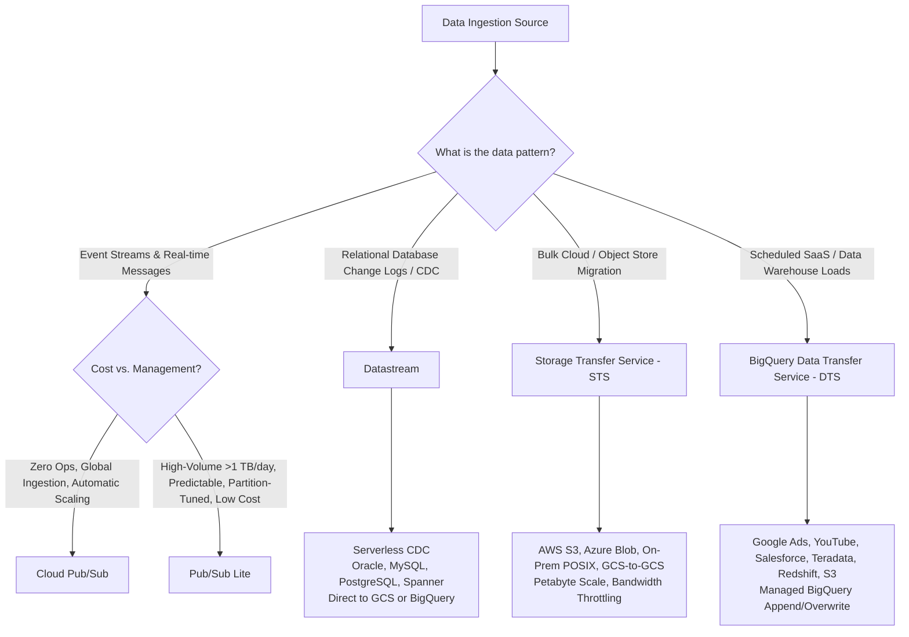
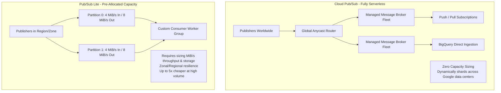
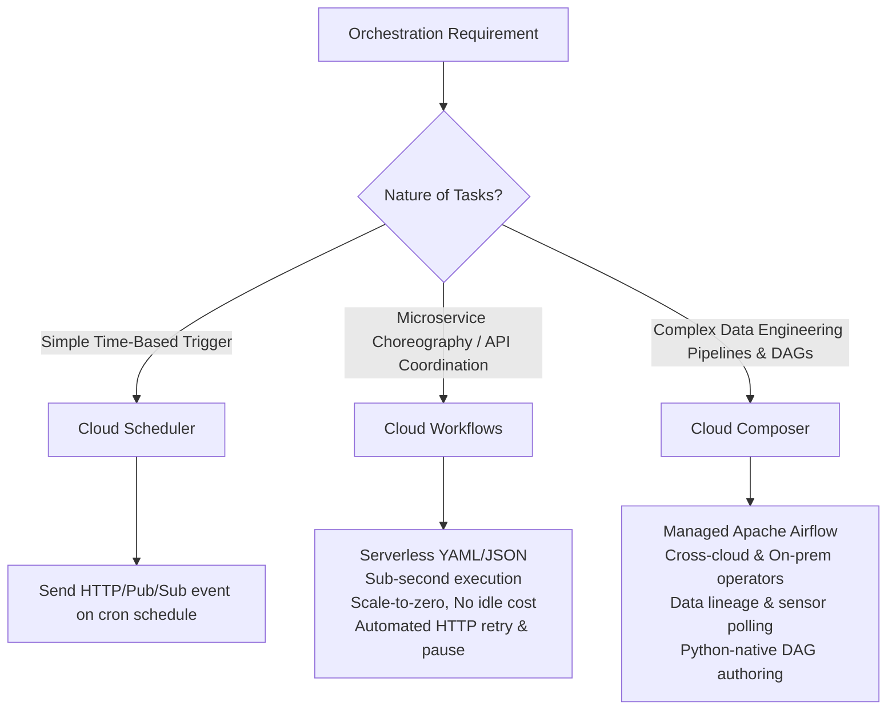
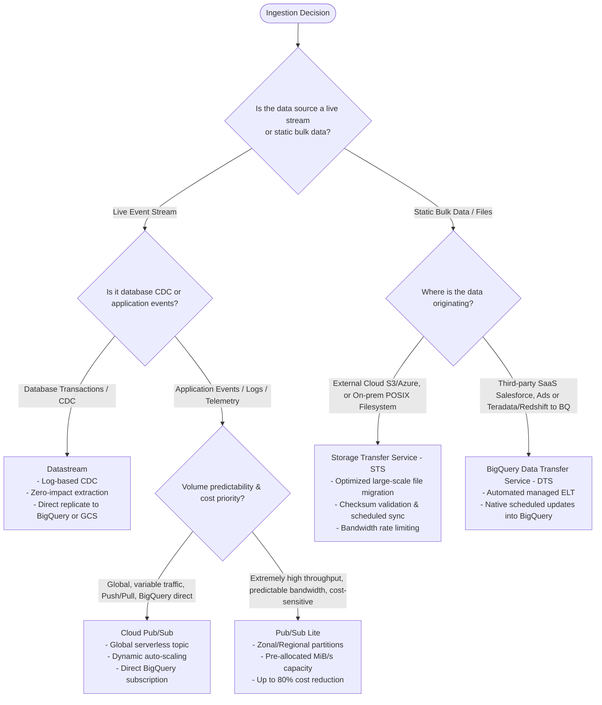
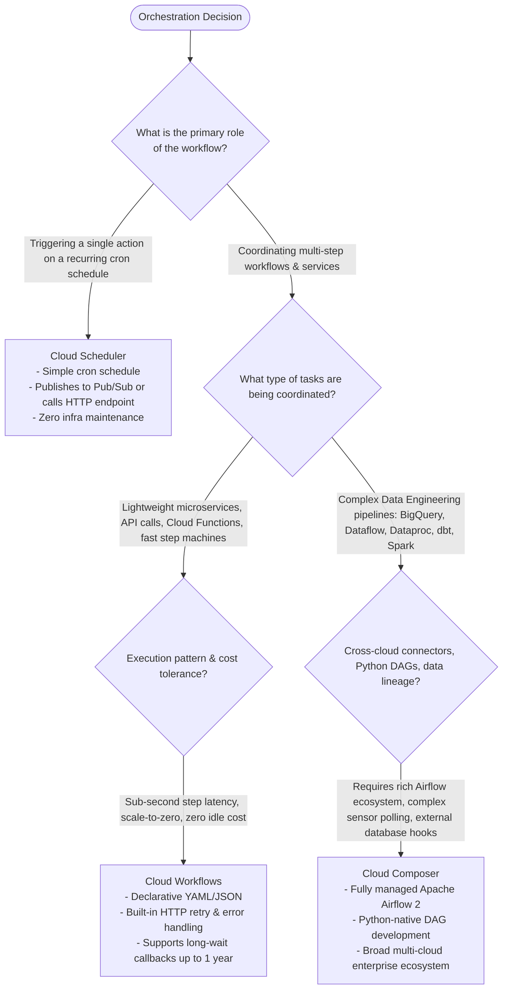

# Ingestion & Orchestration: Pub/Sub vs. Datastream vs. DTS vs. STS & Composer vs. Workflows vs. Scheduler

Moving data into Google Cloud and coordinating multi-step processing graphs are critical responsibilities of a data engineer. Selecting the wrong ingestion pipe introduces data latency, ordering corruption, or budget overruns. Similarly, choosing an inappropriate orchestration mechanism leads to excessive idle infrastructure costs or insufficient pipeline observability.

This guide provides an exhaustive architectural comparison of Google Cloud’s ingestion technologies and workflow orchestration engines.

---

# Part 1: Ingestion & Messaging Systems

Google Cloud offers five distinct services for ingesting data:
1. **Cloud Pub/Sub** (Globally distributed, serverless asynchronous messaging)
2. **Pub/Sub Lite** (Zonal, partitioned, high-volume, low-cost stream messaging)
3. **Datastream** (Serverless, low-latency Change Data Capture [CDC])
4. **BigQuery Data Transfer Service (DTS)** (Automated scheduled bulk loads from SaaS and databases)
5. **Storage Transfer Service (STS)** (High-throughput, scheduled or event-driven object and filesystem migration)

---

## 1. Deep Ingestion Comparison Matrix

| Dimension | Cloud Pub/Sub | Pub/Sub Lite | Datastream | BigQuery DTS | Storage Transfer Service (STS) |
| :--- | :--- | :--- | :--- | :--- | :--- |
| **Primary Ingestion Pattern** | Asynchronous streaming events (Push / Pull) | Partitioned streaming events (Pull-only via gRPC) | Serverless Change Data Capture (CDC log stream) | Scheduled batch ELT / ingestion | High-throughput batch / event-driven object sync |
| **Source Ecosystem** | Applications, microservices, IoT, Cloud Logging, Eventarc | High-throughput stream apps, Kafka workloads | Oracle (LogMiner), MySQL (binlog), Postgres (pgoutput replication), Spanner | SaaS (Salesforce, Google Ads), S3, Redshift, Teradata | S3, Azure Blob, Cloud Storage, POSIX filesystems |
| **Destination Target** | Dataflow, Cloud Run, Cloud Functions, BigQuery (Direct Subscription) | Dataflow, Dataproc, GCE/GKE worker instances | Cloud Storage (JSON/Avro), BigQuery (Direct CDC replication) | BigQuery datasets and native tables | Cloud Storage buckets |
| **Ordering Guarantees** | Global out-of-order by default; **Strict ordering per Ordering Key** | **Strict partition-level ordering** (identical to Apache Kafka) | **Transactionally consistent** stream with commit sequence numbers | Append / Overwrite snapshots (No streaming ordering) | File-level consistency; checksum verification |
| **Partitioning & Scaling** | Autonomous serverless autoscaling (billions of messages/sec) | Manual partition provisioning (Capacity measured in MiB/s) | Serverless autoscaling based on source CDC transaction volume | Managed serverless scheduled execution | Highly parallelized agents (scale to petabytes/day) |
| **Latency Profile** | Single-digit to tens of milliseconds (10-50ms) | Low tens of milliseconds (15-60ms) | Sub-second to low seconds (1-5s replication lag) | Minutes to hours (Scheduled batch intervals) | Minutes to hours depending on data volume transferred |
| **Cost Model** | Volume ingested/read ($40/TB) + Message retention storage | Provisioned Capacity: Throughput ($/MiB/s) + Storage ($/GiB) (Up to **80% cheaper** than Pub/Sub) | Volume processed ($2.00/GB for first 50 GB/mo, tiered down to $0.05/GB) | Free service; pay only for BigQuery data storage and query processing | Free for GCS-to-GCS; small volume fee for S3/Azure/POSIX egress |
| **Exam Trigger Keywords** | *"Decoupled microservices"*, *"Global scale"*, *"At-least-once"*, *"Ordering key"* | *"Cost-effective Kafka alternative"*, *"Pre-allocated throughput"*, *"Zonal stream"* | *"CDC"*, *"Replicate Oracle/MySQL with minimal lag"*, *"Transaction log mining"* | *"Automate Google Ads/Salesforce reports into BigQuery"*, *"Scheduled ingestion"* | *"Migrate petabytes from AWS S3 to GCS"*, *"On-premises NAS to GCS"*, *"Checksum integrity"* |

---

## 2. Ingestion Architectural Deep Dives

### Pub/Sub vs. Pub/Sub Lite: The Economics of Stream Partitioning
While both services provide asynchronous publish-subscribe semantics, their internal operational architectures diverge significantly:

- **Cloud Pub/Sub**: Ideal for event-driven microservices, systems with unpredictable traffic spikes, and multi-region ingest. Offers **BigQuery Direct Subscriptions**, completely bypassing Dataflow for simple streaming inserts into BigQuery tables.
- **Pub/Sub Lite**: Engineered for high-volume, continuous streams where traffic volume is predictable (e.g., millions of events per second from IoT or telemetry) and teams want to optimize costs. Unlike Pub/Sub, you must manually configure the number of partitions and allocated publish/subscribe bandwidth.

### Datastream: Serverless Change Data Capture (CDC)
- Datastream connects directly to operational databases without intrusive agents:
  - **Oracle**: Uses LogMiner or Oracle GoldenGate extracts.
  - **MySQL**: Connects as a replication replica reading binary logs (`binlog`).
  - **PostgreSQL**: Leverages logical replication slots using the native `pgoutput` plugin (standard in PostgreSQL 10+; third-party plugins like `wal2json` are not required).
- **Destination: BigQuery Direct CDC**:
  Historically, CDC required Datastream to write Avro files to GCS, followed by a Dataflow pipeline or scheduled BigQuery `MERGE` query. Today, Datastream supports **direct replication to BigQuery**, automatically applying inserts, updates, and deletes directly into BigQuery storage using the BigQuery Storage Write API with continuous transactional consistency.

---

# Part 2: Workflow Orchestration & Scheduling

Google Cloud provides three workflow coordinators:
1. **Cloud Composer** (Fully managed Apache Airflow 2.x environment)
2. **Cloud Workflows** (Serverless, low-latency, stateful JSON/YAML orchestration)
3. **Cloud Scheduler** (Fully managed enterprise cron job scheduler)

---

## 3. Deep Orchestration Comparison Matrix

| Dimension | Cloud Composer (Airflow) | Cloud Workflows | Cloud Scheduler |
| :--- | :--- | :--- | :--- |
| **Underlying Architecture** | Managed Apache Airflow running on Google Kubernetes Engine (GKE) | Serverless, multi-tenant state machine engine (Google-managed) | Fully managed distributed cron service |
| **Pipeline Definition** | Python code (`.py` DAG files defining operators and dependencies) | Declarative YAML or JSON state machine workflows | Cron syntax (`* * * * *`) with HTTP/S, Pub/Sub, or App Engine target |
| **Latency & Execution Speed** | Minutes to hours; high task scheduling overhead (seconds per task) | **Sub-second to milliseconds**; near-instantaneous transitions | Minute-level granularity (standard cron frequency) |
| **Execution Duration** | Long-running data pipelines (hours to days); handles long tasks | Up to **1 year** per execution using workflow callbacks | Instant trigger (delivers message and exits; max HTTP timeout 30m) |
| **Idle Infrastructure Cost** | **Substantial**: Fixed baseline cost for GKE nodes, Cloud SQL, and Celery workers | **Zero**: Completely serverless; billed per step ($0.00001 / step); scales to zero | Free tier up to 3 jobs; $0.10/job/month thereafter |
| **Ecosystem Connectors** | **Extensive**: 1000+ Apache Airflow providers (GCP, AWS, Azure, Snowflake, dbt, Spark) | GCP REST APIs, arbitrary HTTP endpoints, Cloud Functions, Cloud Run | Invokes HTTP/HTTPS, Cloud Pub/Sub, or Cloud Tasks |
| **Monitoring & UI** | Rich Airflow Web UI with Gantt charts, Task Graph, Grid views, Task Logs | Google Cloud Console execution graph, step history, and error traces | Execution logs in Cloud Logging |
| **Exam Trigger Keywords** | *"Complex data dependencies"*, *"Multi-cloud ETL orchestration"*, *"Airflow DAG"*, *"Sensors"* | *"Microservices choreography"*, *"Serverless state machine"*, *"Zero idle cost"*, *"Rapid HTTP retry"* | *"Trigger on cron schedule"*, *"Publish message every Monday at 8 AM"* |

---

## 4. End-to-End Ingestion & Orchestration Decision Trees

### Comprehensive Ingestion Decision Tree

### Comprehensive Orchestration Decision Tree

---

## 5. Exam Scenario Recognition Matrix

| Scenario Presented in Exam Question | Trap Choice | Correct Architecture | Technical Reason |
| :--- | :--- | :--- | :--- |
| *"Financial ledger database in PostgreSQL requires near-real-time synchronization to BigQuery without impacting transaction throughput."* | Custom Python script polling Postgres periodically | **Datastream (Direct to BigQuery)** | Polling operational databases degrades OLTP performance. Datastream reads the write-ahead log (`WAL`) asynchronously with near-zero overhead. |
| *"Ingesting 50 TB of telemetry logs daily from a fixed fleet of 10,000 factory sensors on a tight budget."* | Cloud Pub/Sub | **Pub/Sub Lite** | Cloud Pub/Sub charges \$40/TB, which would equal \$2,000/day. Pub/Sub Lite with pre-provisioned throughput costs a fraction of standard Pub/Sub for predictable, high-volume workloads. |
| *"Orchestrate a pipeline that spins up a Dataproc cluster, runs a Spark job, loads output to BigQuery, and triggers a Dataform model."* | Cloud Workflows | **Cloud Composer (Apache Airflow)** | Cloud Composer provides native, rich Airflow operators for Dataproc cluster lifecycle, BigQuery jobs, and Dataform invocation with visual DAG dependencies. |
| *"Trigger a Cloud Function every night at 2:00 AM UTC to archive old log files."* | Cloud Composer DAG with `schedule_interval='0 2 * * *'` | **Cloud Scheduler + Cloud Functions** | Running a Cloud Composer environment costs hundreds of dollars a month. Cloud Scheduler costs pennies for simple cron invocations. |
| *"Order processing microservice must invoke credit check, inventory reservation, and shipping APIs with automatic retries and scale-to-zero pricing."* | Cloud Composer | **Cloud Workflows** | Cloud Composer is engineered for long-running batch data pipelines with minute-level scheduling latency. Workflows executes in milliseconds with zero idle infrastructure cost. |
| *"Migrate 250 TB of image files from AWS S3 to Cloud Storage with bandwidth throttling during business hours."* | Custom script running `gsutil rsync` or `gcloud storage cp` | **Storage Transfer Service (STS)** | STS is fully managed, serverless, handles multi-part checksum verification, auto-retries failed objects, and supports scheduled bandwidth throttling natively. |
