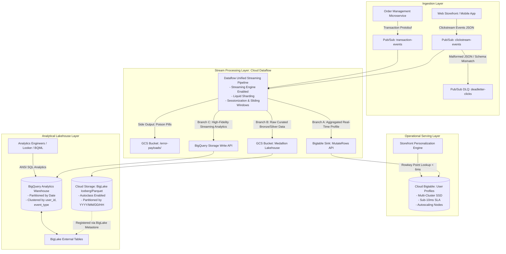
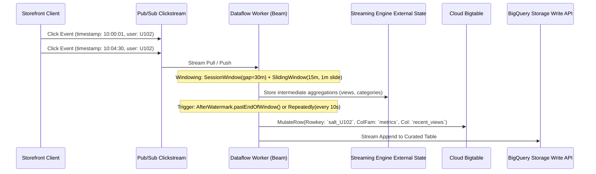
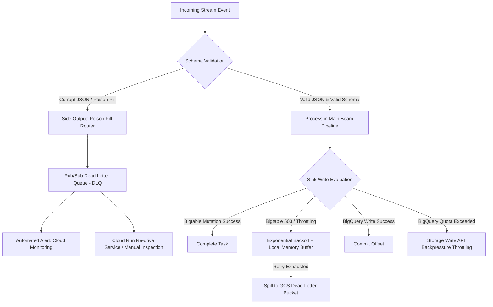

# Case Study 01: Real-Time E-Commerce Lakehouse & Sub-10ms User Profiling

## 1. Executive Summary & Business Scenario
A global tier-1 e-commerce enterprise processes **150,000 clickstream events/second** across web and mobile applications, alongside a stream of **10,000 order transactions/minute**. The business faces two critical engineering requirements:
1. **Low-Latency Operational Personalization**: Web and mobile storefronts require sub-10ms point lookups of real-time aggregate user profiles (recent category affinity, items viewed in the last 15 minutes, cart totals, and churn risk) to serve personalized recommendations before checkout.
2. **Unified Enterprise Lakehouse Analytics**: Data science and marketing teams require ad-hoc analytical querying, session-attribution modeling, and historical multi-year trend analysis without data duplication, using open lakehouse formats (Parquet/Iceberg on Cloud Storage) queryable alongside warehouse tables in BigQuery.

---

## 2. End-to-End System Architecture

---

## 3. Streaming Ingestion, Windowing & Sessionization

### Apache Beam Pipeline Architecture on Dataflow
The streaming pipeline uses **Apache Beam on Cloud Dataflow** with **Streaming Engine** enabled.

#### Windowing Strategies:
1. **Session Windows with 30-Minute Gap**:
   Groups raw clickstream events per `user_id` into a distinct session. If a user is inactive for 30 minutes, the session closes, and session metrics (session duration, total clicks, landing page, exit page) are finalized and emitted to BigQuery.
2. **Sliding Windows for Operational Lookups (15-Minute Window, 1-Minute Slide)**:
   Continuously tracks the user's active intent (e.g., categories browsed within the last 15 minutes). Every 60 seconds, the window slides and flushes the updated feature vector into **Cloud Bigtable**.
3. **Handling Out-of-Order Events (Watermarks & Allowed Lateness)**:
   - System Watermark tracks the progression of event time across Pub/Sub partitions.
   - An **Allowed Lateness of 10 minutes** is configured. Events arriving within 10 minutes past the watermark trigger recalculations of the window and update Bigtable/BigQuery.
   - Events arriving after 10 minutes are routed via Apache Beam **Side Outputs** to a dead-letter Cloud Storage bucket for offline reconciliation.

---

## 4. Data Storage & Schema Design

### Cloud Bigtable: Sub-10ms Real-Time Serving Layer
Bigtable is selected because it delivers single-digit millisecond reads and writes at sustained 150k QPS.

#### Rowkey Design:
- **Requirement**: Fast point lookups by `user_id`. Prevent tablet hotspotting across worker nodes.
- **Formula**:
  $$\text{Rowkey} = \text{MD5}(\text{user\_id})[0:4] \;\|\; \text{"\#"} \;\|\; \text{user\_id}$$
  *Example*: `e4a1#usr_882910394`
- **Hotspotting Mitigation**: The 4-character hex hash prefix uniformly scatters user keys across all Bigtable tablets and cluster nodes, eliminating sequential write bottlenecks.

#### Column Families & Garbage Collection Policies:
Bigtable tables are structured with two isolated column families:
1. `cf_profile` (Infrequent updates, static attributes):
   - Qualifiers: `signup_date`, `loyalty_tier`, `preferred_currency`
   - GC Policy: Max versions = 1.
2. `cf_realtime` (High-frequency streaming updates):
   - Qualifiers: `recent_categories` (JSON array), `cart_total`, `last_active_ts`, `session_view_count`
   - GC Policy: Max age = 7 days. Automatic deletion frees SSD storage without background cleanup scripts.

---

### BigQuery & BigLake Analytical Layer

#### BigQuery Analytics Table:
- **Partitioning**: Partitioned by Day on `event_timestamp`. Partition expiration set to 730 days (2-year analytical retention).
- **Clustering**: Clustered by `(user_id, event_type, device_category)`.
  - Prunes data scans by over 85% when analysts query specific user journeys or specific event funnels (e.g., `checkout_step_1`).

#### BigLake Metastore & Open Format Lakehouse (GCS):
- Raw JSON clickstream payloads are serialized into **Apache Parquet (Snappy compressed)** or **Apache Iceberg** and stored in Cloud Storage buckets:
  `gs://enterprise-lakehouse-prod/silver/clickstream/year=YYYY/month=MM/day=DD/`
- BigLake external tables allow BigQuery to query Cloud Storage data natively with:
  - Predicate pushdown (metadata filtering).
  - Object cache acceleration.
  - Granular column-level and row-level access control without moving data out of Cloud Storage.

---

## 5. Failure Handling & Resilience Architecture

1. **Dead-Letter Topics (Pub/Sub DLQ)**:
   - Configured on the source Pub/Sub subscription with `maxDeliveryAttempts = 5`.
   - If an event repeatedly crashes the consumer worker (e.g., malformed payload or field type incompatibility), Pub/Sub forwards it to `clickstream-deadletter-topic`.
2. **Dataflow Checkpointing & Streaming Engine**:
   - Streaming Engine decoupled architecture ensures that worker crashes do not require pipeline restarts or state rebuilds. Worker instances are stateless; new workers pull uncommitted bundles instantly from the central Streaming Engine journal.
3. **Poison Pill Isolation**:
   - Beam pipeline includes a `try-catch` wrapper around all transformation steps. Unparseable messages are tagged with error metadata, execution stage, and timestamp, then directed to a dead-letter Cloud Storage bucket via Beam `TupleTag` side outputs.

---

## 6. Cost Optimization Defense

An architect must balance multi-million event throughput against cloud billing limits:

1. **Cloud Storage Autoclass**:
   - Automated lifecycle policy transitions un-accessed clickstream lakehouse Parquet objects from Standard $\to$ Nearline (30 days) $\to$ Coldline (90 days) $\to$ Archive (365 days).
   - Reduces raw object storage costs by **up to 70%** without human intervention or breaking BigLake external queries.
2. **BigQuery Storage Billing Optimization**:
   - Converted dataset storage model from *Logical Storage Billing* (\$0.020/GB active) to **Physical (Compressed) Storage Billing** (\$0.040/GB physical).
   - Because Capacitor column-level compression achieves an average **$6\times$ compression ratio**, physical billing slashes warehouse storage costs by over **60%** for massive analytical tables.
3. **Cloud Bigtable Autoscaling & Node Sizing**:
   - Deployed **Bigtable Cluster Autoscaling** configured to maintain a target CPU utilization of **65%** (bounds: 4 nodes to 30 nodes).
   - During overnight off-peak traffic, Bigtable scales down automatically, saving thousands of dollars per month compared to statically provisioned Cassandra/HBase clusters.
4. **Dataflow Streaming Engine & Resource Sizing**:
   - Enabling Streaming Engine reduces worker VM sizes from `n1-standard-4` to `n2-standard-2` because worker memory is no longer consumed by shuffle and window buffers. Shuffle costs are billed strictly on data processed rather than provisioned disk IOPS.
