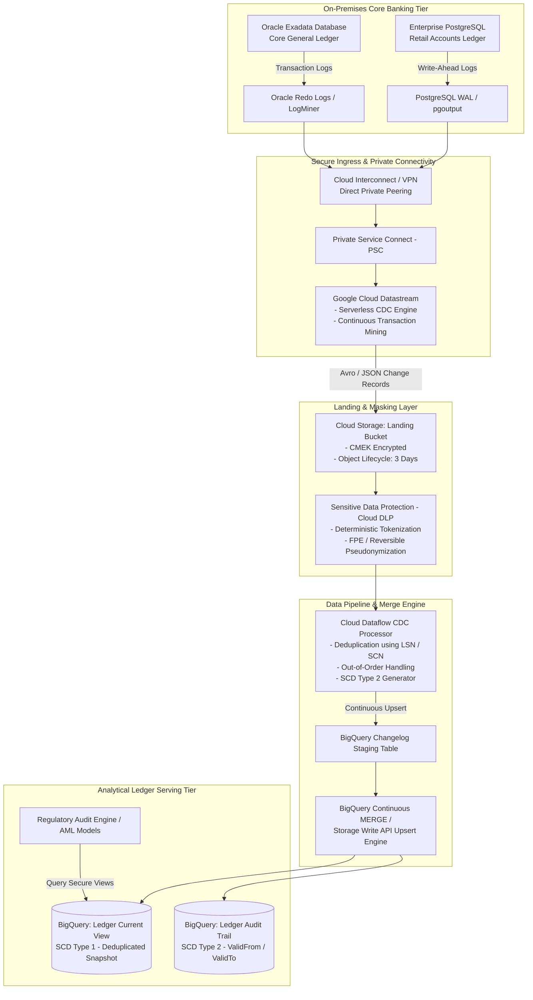
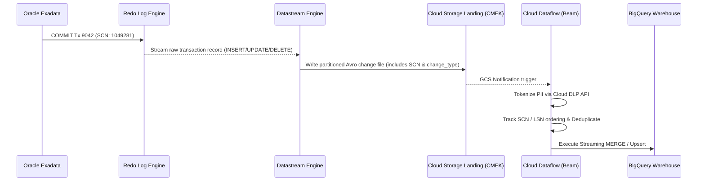
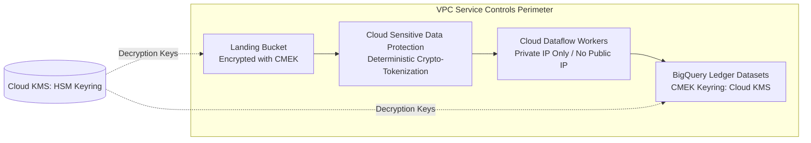

# Case Study 02: Change Data Capture (CDC) Enterprise Financial Replication

## 1. Executive Summary & Regulatory Context
A global tier-1 retail banking institution operates its primary core ledger and transaction ledger across on-premises **Oracle Database Exadata** and **Enterprise PostgreSQL** clusters. The financial institution must replicate all ledger operations into **BigQuery** to power continuous regulatory reporting (Basel III, CCAR), anti-money laundering (AML) detection, and intraday fraud surveillance.

### Key Non-Negotiable Constraints:
1. **Zero Database Disruption**: Cannot run polling queries or add database triggers to the operational OLTP databases.
2. **Sub-Minute Replication Latency**: Ledger events must be queryable in BigQuery within 30-60 seconds of transaction commit.
3. **Data Integrity & Exactly-Once Semantics**: Complete transactional consistency. Zero duplicate balances or missing debits/credits. Support for Slowly Changing Dimensions (SCD Type 2).
4. **Strict Security & Compliance**: PCI-DSS and GDPR compliance. PII (SSN, credit card PAN, account numbers) must be dynamically de-identified via **Cloud Sensitive Data Protection (DLP)** before entering analytical storage. All data at rest must use **Customer-Managed Encryption Keys (CMEK)**.

---

## 2. End-to-End System Architecture



---

## 3. Ingestion Mechanics: CDC Log Mining vs. Anti-Patterns

### Why CDC Log Mining Over Dual-Write & Polling:
- **Anti-Pattern 1: Application Dual-Write**:
  Writing simultaneously to Oracle and BigQuery from microservices violates ACID distributed transactions without complex two-phase commit (2PC) protocols. Network partitions inevitably create data drift between the operational ledger and the analytical warehouse.
- **Anti-Pattern 2: Timestamp Polling (`SELECT ... WHERE updated_at > last_sync`)**:
  Polling consumes significant CPU on production databases, misses `DELETE` operations, and fails when multiple transactions commit with identical timestamps or out-of-order transaction commit locks.
- **Architectural Solution: Asynchronous Log Mining**:
  - **Datastream for Oracle**: Interacts with Oracle LogMiner to stream change events directly from Oracle **Redo Logs** without acquiring row locks.
  - **Datastream for PostgreSQL**: Connects to PostgreSQL logical replication slots using `pgoutput`, consuming Write-Ahead Logs (`WAL`) at sub-second latency.



---

## 4. Data Integrity, Deduplication & SCD Type 2 Modeling

In distributed CDC pipelines, network retries and transient worker failures can cause duplicate event deliveries (at-least-once). Furthermore, database transactions do not always commit in physical serial order across distributed shards.

### Tracking Change Metadata
Datastream enriches every event with canonical metadata:
- `_metadata_source_type`: Oracle / PostgreSQL
- `_metadata_scn`: System Change Number (Oracle)
- `_metadata_lsn`: Log Sequence Number (PostgreSQL)
- `_metadata_timestamp`: Commit timestamp on source database
- `_metadata_change_type`: `INSERT`, `UPDATE`, `DELETE`

### BigQuery MERGE Upsertion Strategy
To maintain a current snapshot (SCD Type 1) without locking the target table:
```sql
MERGE INTO `core_banking.account_balances` T
USING (
  SELECT * FROM (
    SELECT 
      account_id,
      customer_id,
      balance_amount,
      currency_code,
      _metadata_change_type,
      _metadata_scn,
      _metadata_timestamp,
      ROW_NUMBER() OVER (
        PARTITION BY account_id 
        ORDER BY _metadata_scn DESC, _metadata_timestamp DESC
      ) as rn
    FROM `core_banking.account_balances_staging`
  ) WHERE rn = 1
) S
ON T.account_id = S.account_id
WHEN MATCHED AND S._metadata_change_type = 'DELETE' THEN
  DELETE
WHEN MATCHED AND S._metadata_change_type != 'DELETE' AND S._metadata_scn > T.last_scn THEN
  UPDATE SET 
    T.balance_amount = S.balance_amount,
    T.currency_code = S.currency_code,
    T.last_scn = S._metadata_scn,
    T.last_updated = S._metadata_timestamp
WHEN NOT MATCHED AND S._metadata_change_type != 'DELETE' THEN
  INSERT (account_id, customer_id, balance_amount, currency_code, last_scn, last_updated)
  VALUES (S.account_id, S.customer_id, S.balance_amount, S.currency_code, S._metadata_scn, S._metadata_timestamp);
```

### Slowly Changing Dimensions (SCD Type 2) Table
For compliance auditing, ledger mutations are appended to an immutable historical audit table containing `valid_from`, `valid_to`, and `is_current` flags:
- An update operation closes the existing record (`is_current = FALSE, valid_to = _metadata_timestamp`) and inserts a new row (`is_current = TRUE, valid_from = _metadata_timestamp, valid_to = NULL`).

---

## 5. Security & Regulatory Compliance Implementation



1. **VPC Service Controls (VPC-SC)**:
   - All Cloud Storage buckets, Dataflow workers, Cloud KMS keys, and BigQuery datasets reside inside a strict **VPC-SC Service Perimeter**.
   - Prohibits data exfiltration: egress and ingress across the perimeter boundary are blocked, even if IAM credentials are leaked.
2. **Deterministic Tokenization via Cloud DLP (Cloud SDP)**:
   - Credit card numbers (PAN) and Tax IDs (SSN) are masked using **Format-Preserving Encryption (FPE)** using a cryptographic key held inside Cloud KMS.
   - *Example*: Original SSN `123-45-6789` is encrypted into tokenized format `982-14-1182`.
   - **Advantage**: Preserves data format and allows analytical joins and aggregations across tables on tokenized IDs without exposing the raw plaintext values to data analysts.
3. **Customer-Managed Encryption Keys (CMEK)**:
   - Primary encryption keys are stored on FIPS 140-2 Level 3 Hardware Security Modules (Cloud HSM).
   - If a regulatory subpoena or breach occurs, revoking key access instantly cryptographically shred-locks all landing buckets and BigQuery tables.
4. **Column-Level Policy Tags**:
   - Integrated with **Dataplex Universal Catalog**. Columns containing sensitive financial values are tagged with Policy Tags (`Confidential - PII`, `Restricted - Financial Balance`).
   - Only users belonging to the authorized IAM role (`roles/datacatalog.categoryFineGrainedReader`) can view unmasked columns; unauthorized queries return hash masks automatically.

---

## 6. Disaster Recovery & RTO / RPO Matrix

| Disaster Scenario | Recovery Objective (RTO) | Recovery Point Objective (RPO) | Architectural Failover Strategy |
| :--- | :--- | :--- | :--- |
| **Zone Outage in Primary Region** | < 1 minute | 0 seconds (RPO = 0) | BigQuery, Cloud Storage, and Dataflow operate multi-zonal by default. Automatic regional routing. |
| **Complete Regional Outage (e.g., us-east4 down)** | < 15 minutes | < 30 seconds | Datastream configured with secondary stream in target region (`us-central1`). BigQuery cross-region dataset replication promoted to primary. |
| **Corrupt Transaction Ingested (Application Bug)** | < 30 minutes | 0 seconds | BigQuery **Time Travel** allows querying data as it existed at any point within the past 7 days: `SELECT * FROM table FOR SYSTEM_TIME AS OF TIMESTAMP_SUB(CURRENT_TIMESTAMP(), INTERVAL 2 HOUR)`. |
| **Accidental Table Drop** | < 5 minutes | 0 seconds | Restore dropped table using BigQuery Snapshots or undelete via `bq cp table@<timestamp> restored_table`. |
