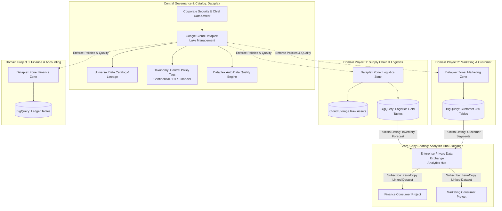
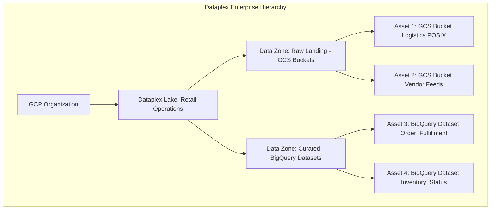
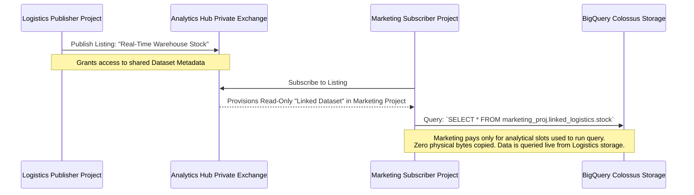
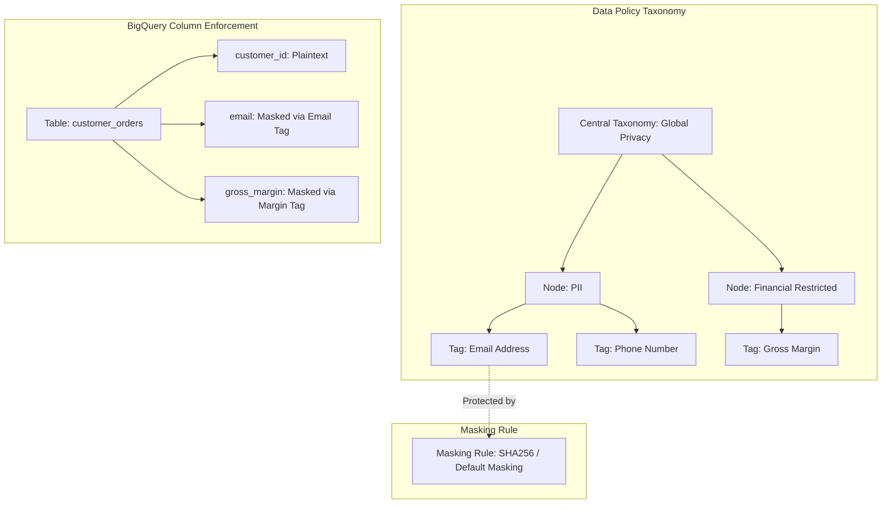

# Case Study 03: Decentralized Enterprise Data Mesh & Analytics Hub

## 1. Executive Summary & Organizational Context
A multinational retail conglomerate operates three independent, autonomous business divisions:
1. **Supply Chain & Logistics**: Tracks factory production, supplier inventory, warehouse stock, and shipping telemetry.
2. **Retail & E-Commerce Marketing**: Owns customer digital identities, campaigns, clickstream funnels, and loyalty programs.
3. **Enterprise Finance**: Manages merchant settlements, corporate accounting, tax filings, and revenue forecasting.

### The Problem: The Centralized Monolith Bottleneck
Historically, a central corporate data engineering team managed a single monolithic data lake. This created severe operational failures:
- **Central Team Burnout**: The central team lacked business domain context and became a bottleneck for every minor schema change and analytical request.
- **Data Duplication & Drift**: Frustrated domains copied CSV exports across projects, causing data exfiltration risks and divergent KPI figures.
- **Access Chaos**: Broad IAM permissions resulted in marketing interns accidentally viewing sensitive finance ledger balances.

### The Architectural Target: Data Mesh on Google Cloud
The enterprise adopted the **Data Mesh architectural paradigm**:
- **Domain Ownership**: Each business unit owns its data lifecycle as a **Data Product**.
- **Self-Serve Platform**: Standardized infrastructure templates deployed via Terraform.
- **Federated Computational Governance**: Central policies (security, compliance, quality) enforced automatically via **Google Cloud Dataplex**.
- **Zero-Copy Data Sharing**: Domain-to-domain data sharing facilitated via **Analytics Hub** and **BigLake** without physically copying data across cloud buckets or projects.

---

## 2. End-to-End Data Mesh Architecture



---

## 3. Decentralized Domain Architecture with Dataplex

Dataplex organizes data assets across Google Cloud projects into a logical business hierarchy without requiring physical data migration.



### Hierarchy Construct:
1. **Lakes**: Represent major business departments or domains (e.g., `logistics-domain-lake`).
2. **Zones**: Logical groupings categorizing data readiness:
   - **Raw Data Zones**: Storage buckets holding unstructured or unvalidated data.
   - **Curated Data Zones**: Cleaned, partitioned, schema-validated BigQuery tables and BigLake Parquet files.
3. **Assets**: Physical cloud resources (Cloud Storage buckets or BigQuery datasets) mapped into zones across multiple GCP projects.
4. **Automated Metadata Discovery**:
   - Dataplex continuously scans registered assets, discovers schemas, extracts technical metadata, and registers external tables in BigQuery automatically.

---

## 4. Zero-Copy Cross-Domain Sharing: Analytics Hub vs. Anti-Patterns

### Anti-Pattern: ETL Data Copying
In legacy architectures, when Marketing needs inventory status from Logistics, an Airflow DAG runs nightly:
$$\text{Logistics BQ} \longrightarrow \text{Export to CSV} \longrightarrow \text{Transfer across VPC} \longrightarrow \text{Import to Marketing BQ}$$
- **Architectural Defects**: Compute costs doubled, egress charges incurred, sync schedules slip, stale data consumed, and audit logging fragmented.

### Solution: Analytics Hub Private Data Exchanges
Analytics Hub enables **zero-copy data sharing** powered by BigQuery’s separated storage engine:



#### Core Benefits of Analytics Hub:
1. **Zero Data Movement**: The subscriber queries the publisher’s data directly in Colossus storage.
2. **Immediate Freshness**: The moment Logistics updates an inventory row, Marketing queries observe the update instantly.
3. **Isolated Billing**: Query compute (slots) is billed entirely to the **subscriber’s GCP project**, preventing noisy-neighbor compute drains on the publisher.

---

## 5. Federated Governance, Policy Tags & Row-Level Security

Central governance is applied uniformly using **BigLake and Dataplex Policy Taxonomies**.



### 1. Column-Level Security (Policy Tags):
- Created under Dataplex Universal Catalog.
- When an analyst without `Fine-Grained Reader` privileges queries `customer_orders`, sensitive columns appear as `XXXX-XXXX` or SHA256 hashes automatically.

### 2. Row-Level Security (RLS):
Ensures regional teams only see records relevant to their country:
```sql
CREATE OR REPLACE ROW ACCESS POLICY regional_filter_emea
ON `corporate_sales.transactions`
GRANT TO ('group:emea-sales-team@enterprise.com')
FILTER USING (region = 'EMEA');
```

### 3. Automated Data Quality (Dataplex Data Quality):
- Dataplex executes automated, serverless data quality scans directly within BigQuery without extracting data.
- Built-in rule definitions (YAML declarative rules):
  ```yaml
  rules:
    - column: transaction_amount
      ruleType: NOT_NULL
    - column: transaction_amount
      ruleType: MIN_VALUE
      params:
        minValue: 0.01
    - column: currency_code
      ruleType: REGEX_MATCH
      params:
        regex: '^[A-Z]{3}$'
  ```
- If quality metrics drop below 99.5%, alerts fire to Cloud Monitoring, and downstream Analytics Hub listings are automatically suspended.

---

## 6. Exam Clues & Architectural Pattern Summary

| Architecture Requirement in Exam | Outdated / Flawed Pattern | Target Data Mesh Pattern |
| :--- | :--- | :--- |
| *"Share multi-terabyte datasets across 15 departmental projects without data duplication or cross-project data transfer fees."* | BigQuery Data Transfer Service copy or export/import scripts | **Analytics Hub Private Data Exchange (Linked Datasets)** |
| *"Enforce centralized compliance and metadata tagging across data stored in both GCS buckets and BigQuery across distinct projects."* | Individual IAM policies per bucket and manual BigQuery table permissions | **Google Cloud Dataplex (Lakes, Zones, and Universal Catalog Policy Tags)** |
| *"Prevent marketing analysts from viewing gross profit margins while allowing access to transaction volumes in the same table."* | Create multiple duplicate tables with omitted columns | **BigQuery Column-Level Security via Dataplex Policy Tags** |
| *"Ensure branch sales managers only query records matching their specific geographic territory in a single enterprise table."* | Partition table by region and grant access to individual partition views | **BigQuery Row Access Policies (`CREATE ROW ACCESS POLICY`)** |
| *"Verify that newly landed supplier CSV files do not contain null primary keys without running heavy external Spark pipelines."* | Provision Dataproc cluster running Great Expectations | **Dataplex Auto Data Quality Tasks (Serverless in-place verification)** |
