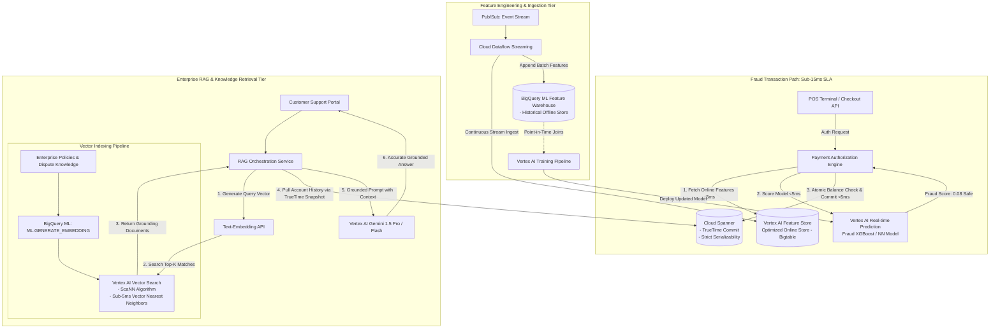
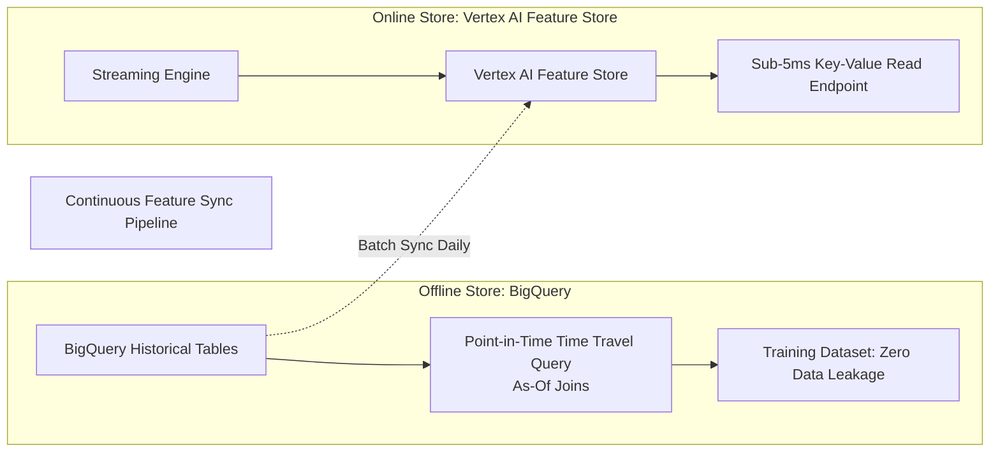
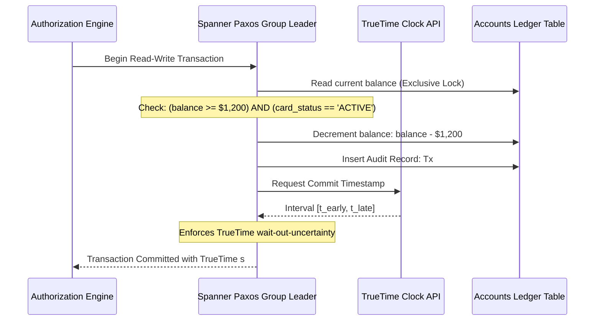

# Case Study 04: Production ML Feature Store, Real-Time Fraud Detection & Enterprise RAG

## 1. Executive Summary & Business Mission
A global fintech and banking platform processes **40,000 credit card authorizations/second** while supporting an AI-powered conversational customer support platform handling **500,000 customer inquiries/day**.

### The Two Interconnected Core Requirements:
1. **Sub-15ms Real-Time Fraud Inference & Transaction Gating**:
   Every swipe or online checkout must be evaluated against a machine learning fraud model within a strict **15ms roundtrip SLA**. The pipeline must fetch fresh feature vectors (e.g., *number of failed PIN attempts in last 10 minutes*, *velocity of transactions across merchant categories*), execute model inference, check account balances, and atomically lock/commit ledger rows.
2. **Enterprise Retrieval-Augmented Generation (RAG) Customer Copilot**:
   A generative support engine powered by Gemini must answer user inquiries (e.g., *"Why was transaction #9821 flagged?"* or *"What is my dispute eligibility under Policy 44B?"*) grounded in real-time knowledge embeddings and customer account transaction history, without hallucination.

---

## 2. End-to-End System Architecture



---

## 3. Online vs. Offline Feature Store Architecture

Machine learning in financial production requires solving the **Train-Serve Skew** and **Data Leakage** problems.



### 1. The Online Store (Vertex AI Feature Store with Bigtable/Cache Engine):
- Engineered for ultra-low latency point lookups (`<5ms`).
- Keyed by `entity_id` (e.g., `user_id` or `card_id`).
- Stores the most recent, dynamic feature values:
  - `user_velocity_1h`: Number of transactions in last 60 minutes.
  - `ip_country_mismatch`: Boolean flag indicating current IP vs. home billing address.
  - `avg_spend_deviation_24h`: Ratio of current transaction amount to 30-day moving average.

### 2. The Offline Store (BigQuery):
- Stores historical append-only logs of features over multi-year periods.
- **Point-in-Time Correct Feature Retrieval (As-Of Joins)**:
  When training a model to predict whether a historical transaction on June 12 was fraudulent, the training pipeline must reconstruct the user's features **exactly as they existed at the millisecond of the swipe**. Querying current values introduces future data leakage, invalidating the model.
- Using BigQuery's `ML.FEATURE_TIME` or timestamp window joins ensures point-in-time mathematical correctness:
  ```sql
  SELECT 
    t.transaction_id,
    t.transaction_time,
    t.is_fraud,
    f.user_velocity_1h,
    f.avg_spend_deviation_24h
  FROM `fintech_dw.transactions` t
  LEFT JOIN `fintech_dw.features_daily` f
    ON t.user_id = f.user_id
    AND f.feature_timestamp = (
      SELECT MAX(feature_timestamp)
      FROM `fintech_dw.features_daily` f2
      WHERE f2.user_id = t.user_id
        AND f2.feature_timestamp <= t.transaction_time
    );
  ```

---

## 4. Real-Time Vector Search & RAG Architecture

When customers query the conversational assistant, the system performs grounding using **Vertex AI Vector Search (formerly Matching Engine)** and **BigQuery ML**.

### 1. Generating Embeddings at Scale in BigQuery:
Enterprise dispute policies and regulatory manuals are embedded directly within BigQuery using native foundation models without exporting data:
```sql
CREATE OR REPLACE TABLE `knowledge_base.policy_embeddings` AS
SELECT 
  doc_id,
  doc_section,
  content_text,
  ml_generate_embedding_result AS text_embedding
FROM ML.GENERATE_EMBEDDING(
  MODEL `knowledge_base.text_embedding_model`,
  TABLE `knowledge_base.regulatory_documents`,
  STRUCT('RETRIEVAL_DOCUMENT' AS task_type)
);
```

### 2. Ultra-Low Latency Vector Search (ScaNN):
- Embeddings are exported into **Vertex AI Vector Search**.
- **Underlying Physics**: Implements Google’s proprietary **ScaNN (Score-aware Quantization Loss)** algorithm.
- Delivers vector similarity matching across 100 million embeddings in **under 5 milliseconds** at 99% recall.

### 3. Grounding & Hallucination Defense:
1. User asks: *"Why was my transaction of $1,200 at Paris Electronics declined yesterday?"*
2. RAG Orchestrator generates query embedding via `text-embedding-004`.
3. Vector Search identifies relevant banking policy: *"Policy 82: Cross-border electronics purchases over $1,000 require multi-factor SMS challenge if foreign IP detected."*
4. Operational context is retrieved from **Cloud Spanner** using a read-only transaction snapshot at TrueTime:
   - Transaction status: `DECLINED_MFA_TIMEOUT`.
5. Orchestrator constructs the grounded system prompt and feeds it to **Gemini 1.5 Pro**:
   ```
   Context: Policy 82 (...)
   Customer Record: Transaction #9821 declined because MFA challenge was not completed within 300 seconds.
   User Question: Why was my transaction declined?
   Instruction: Answer strictly based on the Context and Customer Record.
   ```
6. Gemini generates an accurate, hallucination-free explanation to the customer.

---

## 5. Operational Transactional Validation in Cloud Spanner

Once the ML model confirms the transaction has a safe fraud score ($\text{score} < 0.15$), the transaction must be validated and balance-adjusted in **Cloud Spanner**.



### Why Spanner is Essential Here:
- **Global ACID Consistency**: Prevents double-spending attacks where an attacker simultaneously swipes the same cloned credit card in Tokyo and New York within 100 milliseconds.
- **Interleaved Tables**: The `Transactions` table is physically interleaved inside the parent `Accounts` table on disk. Reading account balance and inserting a transaction row occurs in a single localized SSD read/write operation without cross-machine network RPCs.

---

## 6. Drift Monitoring, SLAs & Failure Modes

| Component / Layer | Metric / SLA Threshold | Failure Mode | Mitigation & Fail-Safe Mechanism |
| :--- | :--- | :--- | :--- |
| **Online Feature Store** | Read Latency: **p99 < 8ms** | Bigtable node saturation or network throttling | **Circuit Breaker**: If feature lookup exceeds 8ms, fallback to pre-cached baseline risk features stored in Redis/App memory. |
| **Vertex AI Endpoint** | Inference Latency: **p99 < 6ms** | Model container crash or quota limit | **Shadow Fallback**: Route to lightweight rule-based heuristic scoring engine; fail closed on high-risk amounts (>\$5,000), fail open on micro-transactions. |
| **Model Drift Detection** | Feature Drift / Concept Drift | Customer spending patterns alter radically (e.g., holiday season) | **Vertex AI Model Monitoring**: Calculates Jensen-Shannon divergence between production inference requests and training baseline. Alerts when drift exceeds 0.05. |
| **Cloud Spanner Commit** | Commit Latency: **p99 < 10ms** | High lock contention on single account | Apply transaction retry loops with exponential backoff and randomized jitter. Interleave child rows to eliminate distributed two-phase commits. |
| **Vector Search & RAG** | Vector Recall > 98% | Stale embeddings; outdated policy answers | Eventarc triggers Cloud Workflows to re-embed and index updated policy files to Vector Search within 10 minutes of GCS document upload. |
