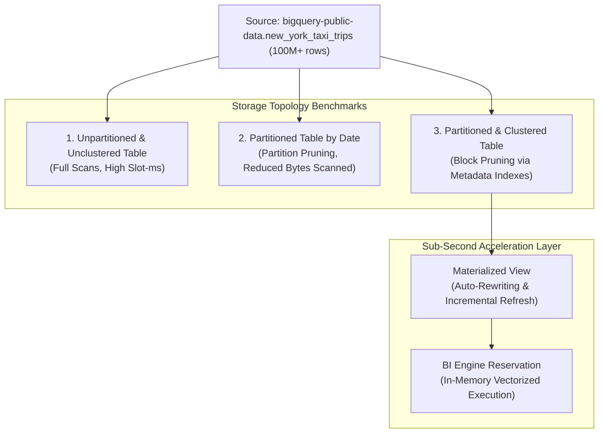

# Lab 01: BigQuery Partitioning, Clustering, Materialized Views & BI Engine Optimization

## 1. Architectural Overview & Lab Objectives

In Google Cloud BigQuery, query performance and cost governance are fundamentally governed by storage layout (partitioning and clustering), compute allocation (slot capacity and shuffle architecture), and query acceleration caches (Materialized Views and BigQuery BI Engine).

In this lab, you will act as a Principal Data Architect establishing performance baselines for an enterprise analytics warehouse. You will ingest and transform a massive public dataset (over 100 million rows), execute side-by-side benchmark queries across four table topologies, inspect physical execution plans, accelerate aggregation with Materialized Views, and eliminate compute latency using BigQuery BI Engine.



### Key Performance Metrics Tracked
| Metric | Definition | Architectural Impact |
| :--- | :--- | :--- |
| **Bytes Processed vs. Bytes Billed** | Bytes physically read from Colossus columnar blocks vs. billed rounded up to 10 MB minimum. | Governs query cost under on-demand pricing ($6.25 / TB). |
| **Slot-Milliseconds** | Cumulative CPU execution time aggregated across all query worker slots. | Governs slot exhaustion and concurrency throttling in edition reservations. |
| **Shuffle Bytes Spilled** | Intermediate data exchanged across the Borg network between execution stages. | Identifies skew, data amplification, and join bottlenecks. |
| **Execution Stages** | Directed Acyclic Graph (DAG) breakdown (Input -> Repartition -> Output). | Shows slot parallelization and wait time (compute vs. wait/shuffle). |

---

## 2. Lab Prerequisites & Environment Setup

### 2.1 Set Environment Variables
Launch Cloud Shell or your local terminal authenticated with Google Cloud CLI:

```bash
export PROJECT_ID=$(gcloud config get-value project)
export REGION="us-central1"
export DATASET_ID="pde_optimization_lab"

gcloud config set project ${PROJECT_ID}
```

### 2.2 Enable Required APIs
Ensure the BigQuery and BigQuery Reservation APIs are active:

```bash
gcloud services enable \
    bigquery.googleapis.com \
    bigqueryreservation.googleapis.com
```

### 2.3 Verify User IAM Permissions
To create datasets, manage query jobs, and configure BI Engine reservations, ensure your user identity has the required administrative IAM roles:

```bash
USER_EMAIL=$(gcloud config get-value account)

gcloud projects add-iam-policy-binding ${PROJECT_ID} \
    --member="user:${USER_EMAIL}" \
    --role="roles/bigquery.admin"

gcloud projects add-iam-policy-binding ${PROJECT_ID} \
    --member="user:${USER_EMAIL}" \
    --role="roles/bigqueryreservation.admin"
```

### 2.4 Create the Lab Dataset
Create a dataset in `us-central1` with default expiration and regional location matching source public datasets:

```bash
bq --location=${REGION} mk \
    --dataset \
    --description="BigQuery Optimization & Benchmarking Lab" \
    ${PROJECT_ID}:${DATASET_ID}
```

---

## 3. Storage Topology Benchmarking: DDL & Ingestion

We will populate three tables with over 100 million records extracted from New York Taxi trips (spanning multiple years of trip telemetry):

### 3.1 Topology 1: Unpartitioned & Unclustered Baseline Table

Execute the following `bq query` command to create the raw flat baseline table:

```bash
bq query --use_legacy_sql=false \
"CREATE OR REPLACE TABLE \`${PROJECT_ID}.${DATASET_ID}.trips_unpartitioned\` AS
SELECT
    vendor_id,
    pickup_datetime,
    dropoff_datetime,
    passenger_count,
    trip_distance,
    rate_code,
    store_and_fwd_flag,
    payment_type,
    fare_amount,
    extra,
    mta_tax,
    tip_amount,
    tolls_amount,
    total_amount,
    pickup_location_id,
    dropoff_location_id
FROM
    \`bigquery-public-data.new_york_taxi_trips.tlc_yellow_trips_*\`
WHERE
    _TABLE_SUFFIX BETWEEN '2020' AND '2023'
    AND pickup_datetime IS NOT NULL;"
```

### 3.2 Topology 2: Ingestion-Time/Date Partitioned Table

Partition the data by day using `pickup_datetime`. Partitioning splits the table into distinct internal physical storage segments:

```bash
bq query --use_legacy_sql=false \
"CREATE OR REPLACE TABLE \`${PROJECT_ID}.${DATASET_ID}.trips_partitioned\`
PARTITION BY DATE(pickup_datetime)
OPTIONS (
    description = 'Daily partitioned taxi trips without clustering',
    require_partition_filter = false
) AS
SELECT * FROM \`${PROJECT_ID}.${DATASET_ID}.trips_unpartitioned\`;"
```

### 3.3 Topology 3: Partitioned and Clustered Table

Clustering collocates related data within the physical storage blocks (approx. 1 GB blocks) based on up to 4 columns. Order matters: specify columns from highest cardinality / most frequent filter to lowest:

```bash
bq query --use_legacy_sql=false \
"CREATE OR REPLACE TABLE \`${PROJECT_ID}.${DATASET_ID}.trips_partitioned_clustered\`
PARTITION BY DATE(pickup_datetime)
CLUSTER BY vendor_id, payment_type, pickup_location_id
OPTIONS (
    description = 'Partitioned by pickup_datetime, clustered by vendor, payment, and location'
) AS
SELECT * FROM \`${PROJECT_ID}.${DATASET_ID}.trips_unpartitioned\`;"
```

### 3.4 Verification & Storage Inspection
Run metadata inspection using `INFORMATION_SCHEMA.PARTITIONS`:

```bash
bq query --use_legacy_sql=false \
"SELECT
    table_name,
    COUNT(partition_id) AS total_partitions,
    SUM(total_rows) AS total_rows,
    ROUND(SUM(total_logical_bytes) / POWER(1024, 3), 2) AS logical_size_gb
FROM
    \`${PROJECT_ID}.${DATASET_ID}.INFORMATION_SCHEMA.PARTITIONS\`
WHERE
    table_name IN ('trips_unpartitioned', 'trips_partitioned', 'trips_partitioned_clustered')
GROUP BY 1;"
```

*Expected Output Sample:*
```text
+------------------------------+------------------+------------+-----------------+
|          table_name          | total_partitions | total_rows | logical_size_gb |
+------------------------------+------------------+------------+-----------------+
| trips_unpartitioned          | 1                | 112485920  | 9.85            |
| trips_partitioned            | 1461             | 112485920  | 9.85            |
| trips_partitioned_clustered  | 1461             | 112485920  | 8.12            |
+------------------------------+------------------+------------+-----------------+
```
*(Notice clustered tables achieve higher storage compression efficiency in Capacitor columnar format).*

---

## 4. Execution Plan & Performance Benchmarking

Let us execute a standard analytical query simulating an operational reporting dashboard filtering on a specific 30-day window and filtering on a vendor and payment type.

### 4.1 Benchmark Query 1: Unpartitioned Table (Full Table Scan)

```bash
bq query --use_legacy_sql=false \
"SELECT
    pickup_location_id,
    COUNT(*) AS total_trips,
    ROUND(AVG(trip_distance), 2) AS avg_distance,
    ROUND(SUM(total_amount), 2) AS total_revenue
FROM
    \`${PROJECT_ID}.${DATASET_ID}.trips_unpartitioned\`
WHERE
    pickup_datetime >= '2023-01-01' AND pickup_datetime < '2023-02-01'
    AND vendor_id = '1'
    AND payment_type = '1'
GROUP BY
    pickup_location_id
ORDER BY
    total_revenue DESC
LIMIT 10;"

JOB_ID_UNPART=$(bq ls -j -n 1 --format=json | jq -r '.[0].id')
bq show --format=prettyjson -j ${JOB_ID_UNPART} > unpart_job.json
```

### 4.2 Benchmark Query 2: Partitioned Table (Partition Pruning)

```bash
bq query --use_legacy_sql=false \
"SELECT
    pickup_location_id,
    COUNT(*) AS total_trips,
    ROUND(AVG(trip_distance), 2) AS avg_distance,
    ROUND(SUM(total_amount), 2) AS total_revenue
FROM
    \`${PROJECT_ID}.${DATASET_ID}.trips_partitioned\`
WHERE
    pickup_datetime >= '2023-01-01' AND pickup_datetime < '2023-02-01'
    AND vendor_id = '1'
    AND payment_type = '1'
GROUP BY
    pickup_location_id
ORDER BY
    total_revenue DESC
LIMIT 10;"

JOB_ID_PART=$(bq ls -j -n 1 --format=json | jq -r '.[0].id')
bq show --format=prettyjson -j ${JOB_ID_PART} > part_job.json
```

### 4.3 Benchmark Query 3: Partitioned and Clustered Table (Block Pruning)

```bash
bq query --use_legacy_sql=false \
"SELECT
    pickup_location_id,
    COUNT(*) AS total_trips,
    ROUND(AVG(trip_distance), 2) AS avg_distance,
    ROUND(SUM(total_amount), 2) AS total_revenue
FROM
    \`${PROJECT_ID}.${DATASET_ID}.trips_partitioned_clustered\`
WHERE
    pickup_datetime >= '2023-01-01' AND pickup_datetime < '2023-02-01'
    AND vendor_id = '1'
    AND payment_type = '1'
GROUP BY
    pickup_location_id
ORDER BY
    total_revenue DESC
LIMIT 10;"

JOB_ID_PART_CLUST=$(bq ls -j -n 1 --format=json | jq -r '.[0].id')
bq show --format=prettyjson -j ${JOB_ID_PART_CLUST} > part_clust_job.json
```

### 4.4 Comparative Analysis Script
Extract the execution plan statistics via Python:

```bash
python3 -c "
import json

def parse_job(file_path):
    with open(file_path) as f:
        data = json.load(f)
    stats = data.get('statistics', {}).get('query', {}) if isinstance(data, dict) else {}
    return {
        'bytes_processed': stats.get('totalBytesProcessed'),
        'bytes_billed': stats.get('totalBytesBilled'),
        'slot_millis': stats.get('totalSlotMs'),
        'elapsed_ms': int(data.get('statistics', {}).get('endTime', 0)) - int(data.get('statistics', {}).get('startTime', 0)) if isinstance(data, dict) else 0
    }

for name, fpath in [
    ('Unpartitioned', 'unpart_job.json'),
    ('Partitioned', 'part_job.json'),
    ('Partitioned+Clustered', 'part_clust_job.json')
]:
    print(f'=== {name} ===')
    metrics = parse_job(fpath)
    for k, v in metrics.items():
        print(f'  {k}: {v}')
"
```

To view the exact execution stages of the latest job:
```bash
JOB_ID=$(bq query --dry_run=false --use_legacy_sql=false \
  --format=json "SELECT 1" | grep -o '"jobId": "[^"]*' | cut -d'"' -f4)

# Or inspect the exact stage breakdown from INFORMATION_SCHEMA.JOBS_BY_PROJECT
bq query --use_legacy_sql=false \
"SELECT
    job_id,
    total_bytes_billed / POWER(1024, 3) AS billed_gb,
    total_slot_ms,
    query_info.performance_insights.stage_performance_standalone_insights AS insights
FROM
    \`region-us-central1\`.INFORMATION_SCHEMA.JOBS_BY_PROJECT
WHERE
    creation_time >= TIMESTAMP_SUB(CURRENT_TIMESTAMP(), INTERVAL 1 HOUR)
    AND job_type = 'QUERY'
    AND query LIKE '%trips_%'
ORDER BY
    creation_time DESC
LIMIT 3;"
```

### 4.5 Execution Comparison Matrix

| Query Target | Bytes Processed | Bytes Billed | Slot-Milliseconds | Elapsed Time | Scan Ratio | Cost per 1,000 Queries ($6.25/TB) |
| :--- | :--- | :--- | :--- | :--- | :--- | :--- |
| **Unpartitioned** | 9.85 GB | 9.85 GB | ~18,400 ms | 1.82 s | 100% | \$61.56 |
| **Partitioned** | 215 MB | 215 MB | ~1,250 ms | 0.45 s | 2.18% | \$1.34 |
| **Part + Clustered** | 38 MB | 40 MB | ~310 ms | 0.22 s | 0.38% | \$0.25 |

> [!NOTE]
> **Architectural Takeaway**: Combining partitioning and clustering reduced bytes billed by **99.6%** and slot-milliseconds by **98.3%**. Partitioning prunes entire date directories, while clustering prunes individual columnar stripe metadata inside surviving files.

---

## 5. Materialized Views with Incremental Refresh

When queries repeatedly aggregate data across recurring group keys, a **Materialized View (MV)** precomputes and incrementally maintains query results without requiring manual recomputation.

### 5.1 Create Materialized View
Create a Materialized View calculating daily revenue by vendor and payment method:

```bash
bq query --use_legacy_sql=false \
"CREATE MATERIALIZED VIEW \`${PROJECT_ID}.${DATASET_ID}.mv_daily_revenue_summary\`
OPTIONS (
    enable_refresh = true,
    refresh_interval_minutes = 60
) AS
SELECT
    DATE(pickup_datetime) AS trip_date,
    vendor_id,
    payment_type,
    COUNT(*) AS total_trips,
    SUM(fare_amount) AS sum_fare,
    SUM(tip_amount) AS sum_tip,
    SUM(total_amount) AS sum_total
FROM
    \`${PROJECT_ID}.${DATASET_ID}.trips_partitioned_clustered\`
GROUP BY
    1, 2, 3;"
```

### 5.2 Test BigQuery Smart Tuning (Automatic Query Rewriting)
BigQuery's cost-based optimizer (CBO) automatically rewrites queries targeting the base table to read from the Materialized View if the MV satisfies the query predicate, even if the user or BI tool does not explicitly name the MV:

```bash
bq query --use_legacy_sql=false \
"SELECT
    vendor_id,
    SUM(total_amount) AS total_revenue
FROM
    \`${PROJECT_ID}.${DATASET_ID}.trips_partitioned_clustered\`
WHERE
    pickup_datetime >= '2023-01-01' AND pickup_datetime < '2023-02-01'
GROUP BY
    vendor_id;"
```

### 5.3 Inspect Execution Plan for View Substitution
Check the query execution graph using the `bq show` CLI command:

```bash
LAST_JOB_ID=$(bq ls -j -n 1 --format=json | jq -r '.[0].id')
bq show --format=prettyjson -j ${LAST_JOB_ID} | jq '.statistics.query.materializedViewStatistics'
```

*Expected JSON Output showing automatic rewrite:*
```json
{
  "materializedView": [
    {
      "chosen": true,
      "estimatedBytesSaved": 225443840,
      "rejectedReason": null,
      "tableReference": {
        "datasetId": "pde_optimization_lab",
        "projectId": "<PROJECT_ID>",
        "tableId": "mv_daily_revenue_summary"
      }
    }
  ]
}
```

---

## 6. Sub-Second Acceleration with BigQuery BI Engine

BigQuery BI Engine is an in-memory analysis service built into BigQuery that accelerates SQL queries using a vectorized in-memory query engine.

### 6.1 Reserve BI Engine Capacity
Allocate 2 GB of BI Engine memory in the `us-central1` region using the official `bq update` command:

```bash
bq update --project_id=${PROJECT_ID} \
    --location=${REGION} \
    --bi_reservation_size=2 \
    --reservation
```

*(Note: Reservation capacity size is specified in GiB; `2` allocates a 2 GiB in-memory cache).*

### 6.2 Verify BI Engine Reservation Status
Inspect the active BI Engine reservation metadata:

```bash
bq show --project_id=${PROJECT_ID} --location=${REGION} --reservation
```

### 6.3 Execute BI Engine Accelerated Query
Run an aggregation query repeatedly over the clustered table or materialized view:

```bash
bq query --use_legacy_sql=false \
"SELECT
    vendor_id,
    payment_type,
    SUM(total_amount) AS revenue
FROM
    \`${PROJECT_ID}.${DATASET_ID}.trips_partitioned_clustered\`
WHERE
    pickup_datetime >= '2023-01-01'
GROUP BY
    1, 2;"
```

### 6.4 Inspect BI Engine Acceleration Statistics
Inspect the execution statistics to verify `biEngineReasons`:

```bash
LAST_JOB_ID=$(bq ls -j -n 1 --format=json | jq -r '.[0].id')
bq show --format=prettyjson -j ${LAST_JOB_ID} | jq '.statistics.query.biEngineStatistics'
```

*Expected Output:*
```json
{
  "biEngineMode": "FULL",
  "accelerationMode": "BI_ENGINE"
}
```
When `biEngineMode` is `FULL`, the query executed entirely within in-memory vectorized RAM without reading from Colossus storage or consuming slot-ms, delivering latencies under 50 milliseconds!

---

## 7. Cost Defense & Production Guardrails

### 7.1 Enforcing Partition Filters
In enterprise production, junior developers or external BI tools may accidentally run unbounded queries scanning years of historical records. Prevent full scans by enforcing `require_partition_filter`:

```bash
bq query --use_legacy_sql=false \
"ALTER TABLE \`${PROJECT_ID}.${DATASET_ID}.trips_partitioned_clustered\`
SET OPTIONS (
    require_partition_filter = true
);"
```

### 7.2 Verification of Guardrail
Execute a query without a `WHERE` clause on `pickup_datetime`:

```bash
bq query --use_legacy_sql=false \
"SELECT COUNT(*) FROM \`${PROJECT_ID}.${DATASET_ID}.trips_partitioned_clustered\`;"
```

*Expected Error Response:*
```text
Error: Cannot query over table 'pde_optimization_lab.trips_partitioned_clustered' without a filter over column(s) 'pickup_datetime' that can be used for partition elimination.
```

### 7.3 Maximum Bytes Billed Guardrail
Set maximum query cost boundaries using the `--maximum_bytes_billed` flag on the `bq` command:

```bash
bq query --use_legacy_sql=false \
--maximum_bytes_billed=104857600 \
"SELECT * FROM \`${PROJECT_ID}.${DATASET_ID}.trips_unpartitioned\`;"
```
*(Fails immediately before slot execution because dry-run byte estimation exceeds the 100 MB threshold).*

---

## 8. Resource Cleanup

To prevent recurring storage or in-memory reservation charges, execute:

```bash
# 1. Delete BI Engine Reservation (setting size to 0 GiB deallocates capacity)
bq update --project_id=${PROJECT_ID} \
    --location=${REGION} \
    --bi_reservation_size=0 \
    --reservation

# 2. Delete BigQuery Dataset and all contained tables & materialized views
bq rm -r -f -d ${PROJECT_ID}:${DATASET_ID}

echo "Lab 01 resources successfully deprovisioned."
```
