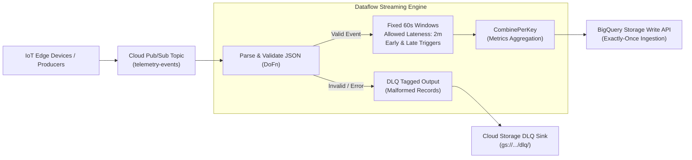

# Lab 02: Streaming Analytics with Apache Beam, Pub/Sub & Dataflow

## 1. Architectural Overview & Lab Objectives

In modern event-driven architectures, data arrives continuously out of order due to network jitter, intermittent edge connectivity, and distributed clock skew. Robust stream processing requires handling late data, managing window lifecycles, isolating malformed payloads to Dead-Letter Queues (DLQ), and achieving high-throughput, exactly-once ingestion into Google Cloud BigQuery.

In this lab, you will author, package, and deploy a production-grade **Apache Beam streaming pipeline in Python** running on **Google Cloud Dataflow**.



### Technical Capabilities Implemented
- **Apache Beam 2.50+ Python SDK** using streaming pipelines.
- **Windowing & Watermarks**: 60-second fixed event-time windows with a 2-minute allowed lateness boundary.
- **Trigger Strategy**: `AfterWatermark.pastEndOfWindow()` with speculative early firings (`AfterProcessingTime`) and accumulating late firings.
- **Error Handling**: Side-output / tagged output branching for schema violations into a Dead-Letter Queue (GCS).
- **BigQuery Storage Write API**: High-throughput exactly-once streaming inserts (`STORAGE_WRITE_API`).
- **Dataflow Runner V2 & Streaming Engine**: Decoupled state and compute execution.

---

## 2. Environment Setup & Cloud Resources

### 2.1 Set Variables and Working Directory
```bash
export PROJECT_ID=$(gcloud config get-value project)
export REGION="us-central1"
export BUCKET_NAME="gs://${PROJECT_ID}-dataflow-streaming-lab"
export PUBSUB_TOPIC="telemetry-events"
export PUBSUB_SUBSCRIPTION="telemetry-events-sub"
export DATASET_ID="streaming_lakehouse"
export TABLE_ID="aggregated_metrics"

gcloud config set project ${PROJECT_ID}
mkdir -p ~/beam_streaming_lab/src
cd ~/beam_streaming_lab
```

### 2.2 Enable Cloud APIs
```bash
gcloud services enable \
    pubsub.googleapis.com \
    dataflow.googleapis.com \
    bigquery.googleapis.com \
    storage.googleapis.com
```

### 2.3 Create Cloud Storage Bucket & Pub/Sub Resources
```bash
# Create staging bucket
gcloud storage buckets create ${BUCKET_NAME} \
    --location=${REGION} \
    --uniform-bucket-level-access

# Create Pub/Sub topic and pull subscription
gcloud pubsub topics create ${PUBSUB_TOPIC}
gcloud pubsub subscriptions create ${PUBSUB_SUBSCRIPTION} \
    --topic=${PUBSUB_TOPIC} \
    --ack-deadline=60
```

### 2.4 Create BigQuery Destination Dataset and Table
```bash
bq --location=${REGION} mk --dataset ${PROJECT_ID}:${DATASET_ID}

bq query --use_legacy_sql=false \
"CREATE OR REPLACE TABLE \`${PROJECT_ID}.${DATASET_ID}.${TABLE_ID}\` (
    window_start TIMESTAMP,
    window_end TIMESTAMP,
    device_type STRING,
    reading_count INT64,
    avg_temperature FLOAT64,
    max_temperature FLOAT64,
    ingestion_timestamp TIMESTAMP
)
PARTITION BY DATE(window_start)
CLUSTER BY device_type;"
```

---

## 3. Pipeline Implementation Code

### 3.1 Project Dependencies (`requirements.txt`)
Create `requirements.txt`:
```text
apache-beam[gcp]==2.54.0
google-cloud-pubsub==2.19.7
google-cloud-bigquery==3.18.0
```

### 3.2 Packaging Configuration (`setup.py`)
Dataflow workers require `setup.py` when shipping custom helper modules or non-trivial packages:
```python
import setuptools

setuptools.setup(
    name='beam_streaming_pipeline',
    version='1.0.0',
    install_requires=[
        'apache-beam[gcp]==2.54.0',
    ],
    packages=setuptools.find_packages(),
)
```

### 3.3 Core Pipeline Code (`src/pipeline.py`)
Create the complete executable streaming pipeline:

```python
import argparse
import json
import logging
from datetime import datetime
import apache_beam as beam
from apache_beam import pvalue
from apache_beam.options.pipeline_options import PipelineOptions, StandardOptions, SetupOptions, GoogleCloudOptions
from apache_beam.transforms.window import FixedWindows, AfterWatermark, AfterProcessingTime, AccumulationMode
from apache_beam.transforms.trigger import Repeatedly

# Define Dead Letter Queue tag
TAG_DLQ = 'dead_letter_records'
TAG_VALID = 'valid_records'

class ParseAndValidateTelemetry(beam.DoFn):
    """
    Parses JSON payload, extracts custom event timestamp, and routes
    corrupt records to a tagged side-output Dead-Letter Queue (DLQ).
    """
    def process(self, element, publish_time=beam.DoFn.TimestampParam):
        try:
            # Decode Pub/Sub byte string
            payload_str = element.decode('utf-8')
            payload = json.loads(payload_str)

            # Schema validation
            required_fields = ['device_id', 'device_type', 'temperature', 'timestamp']
            for field in required_fields:
                if field not in payload:
                    raise ValueError(f"Missing required field: {field}")

            # Parse event-time
            event_time = datetime.fromisoformat(payload['timestamp']).timestamp()
            
            # Emit valid record with extracted event timestamp
            yield beam.window.TimestampedValue(payload, event_time)
            
        except Exception as e:
            # Emit corrupt payload to DLQ side-output
            dlq_record = {
                'raw_payload': element.decode('utf-8', errors='replace'),
                'error_message': str(e),
                'failed_at': datetime.utcnow().isoformat()
            }
            yield pvalue.TaggedOutput(TAG_DLQ, dlq_record)

class AggregateTelemetry(beam.CombineFn):
    """
    Aggregates reading count, average temperature, and max temperature.
    Accumulator format: (count, sum_temp, max_temp)
    """
    def create_accumulator(self):
        return (0, 0.0, float('-inf'))

    def add_input(self, accumulator, input_data):
        count, sum_temp, max_temp = accumulator
        temp = float(input_data['temperature'])
        return (count + 1, sum_temp + temp, max(max_temp, temp))

    def merge_accumulators(self, accumulators):
        total_count = sum(acc[0] for acc in accumulators)
        total_sum = sum(acc[1] for acc in accumulators)
        max_val = max(acc[2] for acc in accumulators)
        return (total_count, total_sum, max_val)

    def extract_output(self, accumulator):
        count, sum_temp, max_temp = accumulator
        avg_temp = (sum_temp / count) if count > 0 else 0.0
        return {
            'reading_count': count,
            'avg_temperature': round(avg_temp, 2),
            'max_temperature': round(max_temp, 2)
        }

class FormatWindowOutput(beam.DoFn):
    """Formats windowed grouped metrics into BigQuery table row schema."""
    def process(self, element, window=beam.DoFn.WindowParam):
        device_type, stats = element
        yield {
            'window_start': window.start.to_utc_datetime().strftime('%Y-%m-%d %H:%M:%S'),
            'window_end': window.end.to_utc_datetime().strftime('%Y-%m-%d %H:%M:%S'),
            'device_type': device_type,
            'reading_count': stats['reading_count'],
            'avg_temperature': stats['avg_temperature'],
            'max_temperature': stats['max_temperature'],
            'ingestion_timestamp': datetime.utcnow().strftime('%Y-%m-%d %H:%M:%S')
        }

def run():
    parser = argparse.ArgumentParser()
    parser.add_argument('--subscription', required=True, help='Input Pub/Sub subscription')
    parser.add_argument('--output_table', required=True, help='Output BigQuery table')
    parser.add_argument('--dlq_path', required=True, help='GCS DLQ path prefix')
    known_args, pipeline_args = parser.parse_known_args()

    pipeline_options = PipelineOptions(pipeline_args)
    pipeline_options.view_as(StandardOptions).streaming = True
    pipeline_options.view_as(SetupOptions).save_main_session = True

    with beam.Pipeline(options=pipeline_options) as p:
        # 1. Ingest streaming records from Pub/Sub
        raw_events = (
            p 
            | 'ReadFromPubSub' >> beam.io.ReadFromPubSub(subscription=known_args.subscription)
        )

        # 2. Parse & Tag (Main Valid Records vs. DLQ)
        parsed_results = (
            raw_events 
            | 'ParseAndValidate' >> beam.ParDo(ParseAndValidateTelemetry()).with_outputs(
                TAG_DLQ, main=TAG_VALID
            )
        )

        # Branch A: Handle DLQ Corrupt Records
        _ = (
            parsed_results[TAG_DLQ]
            | 'FormatDLQJson' >> beam.Map(json.dumps)
            | 'WriteDLQToGCS' >> beam.io.WriteToText(
                known_args.dlq_path,
                file_name_suffix='.json',
                shard_name_template='-SSSSS-of-NNNNN'
            )
        )

        # Branch B: Windowing, Aggregation, and BigQuery Storage Write API
        valid_stream = parsed_results[TAG_VALID]

        aggregated_stream = (
            valid_stream
            | 'ApplyEventWindows' >> beam.WindowInto(
                FixedWindows(60),  # 60-second fixed window
                trigger=Repeatedly(
                    AfterWatermark(
                        early=AfterProcessingTime(10), # Speculative early results every 10s
                        late=AfterProcessingTime(30)   # Late data re-firings
                    )
                ),
                allowed_lateness=120, # 2 minutes allowed lateness
                accumulation_mode=AccumulationMode.ACCUMULATING
            )
            | 'KeyByDeviceType' >> beam.Map(lambda x: (x['device_type'], x))
            | 'CombineMetrics' >> beam.CombinePerKey(AggregateTelemetry())
            | 'FormatBQRecord' >> beam.ParDo(FormatWindowOutput())
        )

        # Ingestion into BigQuery via Storage Write API
        _ = (
            aggregated_stream
            | 'WriteToBigQuery' >> beam.io.WriteToBigQuery(
                table=known_args.output_table,
                schema={
                    'fields': [
                        {'name': 'window_start', 'type': 'TIMESTAMP', 'mode': 'REQUIRED'},
                        {'name': 'window_end', 'type': 'TIMESTAMP', 'mode': 'REQUIRED'},
                        {'name': 'device_type', 'type': 'STRING', 'mode': 'REQUIRED'},
                        {'name': 'reading_count', 'type': 'INTEGER', 'mode': 'REQUIRED'},
                        {'name': 'avg_temperature', 'type': 'FLOAT', 'mode': 'REQUIRED'},
                        {'name': 'max_temperature', 'type': 'FLOAT', 'mode': 'REQUIRED'},
                        {'name': 'ingestion_timestamp', 'type': 'TIMESTAMP', 'mode': 'REQUIRED'}
                    ]
                },
                create_disposition=beam.io.BigQueryDisposition.CREATE_NEVER,
                write_disposition=beam.io.BigQueryDisposition.WRITE_APPEND,
                method=beam.io.WriteToBigQuery.Method.STORAGE_WRITE_API
            )
        )

if __name__ == '__main__':
    logging.getLogger().setLevel(logging.INFO)
    run()
```

---

## 4. Pipeline Deployment to Dataflow

Deploy the streaming job configured with Dataflow Streaming Engine, auto-scaling, and VPC isolation:

```bash
python3 src/pipeline.py \
    --runner=DataflowRunner \
    --project=${PROJECT_ID} \
    --region=${REGION} \
    --temp_location=${BUCKET_NAME}/temp \
    --staging_location=${BUCKET_NAME}/staging \
    --setup_file=./setup.py \
    --job_name=telemetry-streaming-analytics \
    --subscription=projects/${PROJECT_ID}/subscriptions/${PUBSUB_SUBSCRIPTION} \
    --output_table=${PROJECT_ID}:${DATASET_ID}.${TABLE_ID} \
    --dlq_path=${BUCKET_NAME}/dlq/failed_events \
    --enable_streaming_engine \
    --max_num_workers=4 \
    --worker_machine_type=n2-standard-2 \
    --experiments=use_runner_v2
```

### Verification in Dataflow Console
Verify the job is entering the `Running` state:
```bash
gcloud dataflow jobs list \
    --status=active \
    --region=${REGION}
```

---

## 5. Synthetic Traffic Generation & Late-Data Verification

### 5.1 Test Traffic Generator Script (`generate_events.py`)
Create a traffic generator capable of publishing on-time events, late events beyond the watermark, and malformed events:

```python
import time
import json
from datetime import datetime, timezone, timedelta
from google.cloud import pubsub_v1

project_id = "<PROJECT_ID>"
topic_id = "telemetry-events"

publisher = pubsub_v1.PublisherClient()
topic_path = publisher.topic_path(project_id, topic_id)

def send_payload(data):
    body = json.dumps(data).encode('utf-8')
    future = publisher.publish(topic_path, body)
    print(f"Published event: {data}")
    return future.result()

now = datetime.now(timezone.utc)

# 1. Normal On-Time Events
print("--- Sending On-Time Events ---")
for i in range(5):
    send_payload({
        "device_id": f"dev_{i}",
        "device_type": "industrial_sensor",
        "temperature": 72.5 + i,
        "timestamp": now.isoformat()
    })

# 2. Corrupt / Malformed Event (DLQ Test)
print("--- Sending Malformed Event (Missing Fields) ---")
publisher.publish(topic_path, b'{"invalid_json": true}')

# 3. Late Event (Arriving 90 seconds behind current time, within allowed lateness)
print("--- Sending Acceptable Late Event (Within 120s Lateness) ---")
acceptable_late_time = now - timedelta(seconds=90)
send_payload({
    "device_id": "dev_late_acceptable",
    "device_type": "industrial_sensor",
    "temperature": 105.4,
    "timestamp": acceptable_late_time.isoformat()
})

# 4. Dropped Event (Arriving 300 seconds behind current time, exceeding 120s lateness)
print("--- Sending Dropped Event (Beyond Allowed Lateness) ---")
dropped_late_time = now - timedelta(seconds=300)
send_payload({
    "device_id": "dev_dropped",
    "device_type": "industrial_sensor",
    "temperature": 999.9,
    "timestamp": dropped_late_time.isoformat()
})
```

Execute the traffic generator:
```bash
sed -i "s/<PROJECT_ID>/${PROJECT_ID}/g" generate_events.py
python3 generate_events.py
```

### 5.2 BigQuery Validation
Query the destination table to observe the window aggregations:

```bash
bq query --use_legacy_sql=false \
"SELECT
    window_start,
    window_end,
    device_type,
    reading_count,
    avg_temperature,
    max_temperature
FROM
    \`${PROJECT_ID}.${DATASET_ID}.${TABLE_ID}\`
ORDER BY
    window_start DESC
LIMIT 10;"
```

### 5.3 Dead-Letter Queue (DLQ) Verification
Verify that the malformed JSON was successfully directed to the Cloud Storage DLQ bucket:

```bash
gcloud storage ls ${BUCKET_NAME}/dlq/
gcloud storage cat $(gcloud storage ls ${BUCKET_NAME}/dlq/*.json | head -n 1)
```

*Expected DLQ Content:*
```json
{"raw_payload": "{\"invalid_json\": true}", "error_message": "Missing required field: device_id", "failed_at": "..."}
```

---

## 6. Troubleshooting & Operational Monitoring

| Symptom | Root Cause | Remediation |
| :--- | :--- | :--- |
| **High System Lag (Watermark Stalled)** | Worker slot starvation or hotspotting key partition. | Increase `--max_num_workers`, verify key distribution (`CombinePerKey` hotkeys), enable Streaming Engine. |
| **Storage Write API Permission Denied** | Worker Service Account lacks `bigquery.dataEditor` or `bigquery.write` permissions. | Grant `roles/bigquery.dataEditor` and `roles/bigquery.jobUser` to the Compute Engine default service account. |
| **Data Dropped Silently** | Records arriving past `allowed_lateness` are discarded by Apache Beam default behavior. | Add a side output using `pvalue.TaggedOutput` for late data or adjust `allowed_lateness` parameter. |

---

## 7. Resource Cleanup

Drain the Dataflow streaming job and deprovision resources:

```bash
# 1. Drain Dataflow job (allows in-flight elements to finish processing)
JOB_ID=$(gcloud dataflow jobs list --status=active --region=${REGION} --format="value(id)")
if [ -n "$JOB_ID" ]; then
    gcloud dataflow jobs drain ${JOB_ID} --region=${REGION}
fi

# 2. Delete Pub/Sub resources
gcloud pubsub subscriptions delete ${PUBSUB_SUBSCRIPTION}
gcloud pubsub topics delete ${PUBSUB_TOPIC}

# 3. Delete BigQuery Dataset
bq rm -r -f -d ${PROJECT_ID}:${DATASET_ID}

# 4. Remove GCS Bucket
gcloud storage rm -r ${BUCKET_NAME}

echo "Lab 02 streaming pipeline resources successfully decommissioned."
```
