# Lab 03: Real-Time CDC Replication with Datastream to BigQuery

## 1. Architectural Overview & Lab Objectives

Capturing transactional database state in near-real-time without placing query load on production OLTP engines is a cornerstone requirement of enterprise data architecture. **Change Data Capture (CDC)** relies on reading database Write-Ahead Logs (WAL) as transactions commit, streaming log events continuously to analytical destinations.

In this lab, you will configure an enterprise CDC pipeline replicating transactional tables from **Cloud SQL for PostgreSQL** directly into **Google Cloud BigQuery** using **Datastream**, Google Cloud's serverless, serverless-native CDC and replication service.

```mermaid
flowchart LR
    subgraph CloudSQL["Cloud SQL (PostgreSQL OLTP)"]
        WAL["Write-Ahead Log (WAL)<br/>logical_decoding = on"]
        Publication["PostgreSQL Publication<br/>(pgoutput plugin)"]
        WAL --> Publication
    end

    subgraph DatastreamService["Datastream (Managed CDC)"]
        ConnSource["Source Connection Profile<br/>(Private IP / PSC)"]
        StreamEngine["Streaming Engine<br/>(Backfill + CDC Tail)"]
        ConnDest["Destination Connection Profile<br/>(BigQuery)"]
        ConnSource --> StreamEngine --> ConnDest
    end

    subgraph BigQueryTarget["BigQuery Lakehouse"]
        CDC_Table["Target BigQuery Table<br/>(Direct CDC Upsert Mode)"]
        MaxStaleness["Query Layer<br/>max_staleness = INTERVAL 0 MINUTE"]
        CDC_Table --> MaxStaleness
    end

    Publication -->|Replication Stream| ConnSource
    ConnDest -->|Storage Write API| CDC_Table
```



### Key Capabilities Demonstrated
1. **Cloud SQL PostgreSQL WAL Configuration**: Enabling `cloudsql.logical_decoding`, setting replication slots and publication mechanisms.
2. **Private Network Routing**: Establishing secure connectivity between Datastream and Cloud SQL without exposing databases to public ingress.
3. **Datastream BigQuery Destination**: Direct streaming replication into BigQuery without intermediate Cloud Storage landing buckets or Dataflow transformation jobs.
4. **BigQuery Change-Apply Mechanism**: Understanding `_metadata_deleted_flag`, `_metadata_timestamp`, and the BigQuery continuous CDC auto-merging storage engine.
5. **DML Mutation Testing**: Executing `INSERT`, `UPDATE`, and `DELETE` on Cloud SQL and measuring replication lag in BigQuery.

---

## 2. Environment Setup & Cloud SQL Provisioning

### 2.1 Set Environment Variables
```bash
export PROJECT_ID=$(gcloud config get-value project)
export REGION="us-central1"
export ZONE="us-central1-a"
export DB_INSTANCE_NAME="pg-orders-oltp"
export DB_PASSWORD="PdeSuperSecure2026!"
export DATASET_ID="pg_cdc_orders"
export STREAM_ID="pg-to-bq-cdc-stream"
export NETWORK_NAME="default"

gcloud config set project ${PROJECT_ID}
```

### 2.2 Enable Required APIs
```bash
gcloud services enable \
    sqladmin.googleapis.com \
    datastream.googleapis.com \
    bigquery.googleapis.com \
    compute.googleapis.com
```

### 2.3 Provision Cloud SQL PostgreSQL Instance with Logical Decoding
Cloud SQL requires specific database flags to enable logical WAL streaming. For standalone lab execution where Private Services Access (PSA) peering is not pre-configured, provision the instance directly with an external IP and authorized networks to support Datastream static IP connectivity:

```bash
gcloud sql instances create ${DB_INSTANCE_NAME} \
    --database-version=POSTGRES_15 \
    --tier=db-custom-2-7680 \
    --region=${REGION} \
    --zone=${ZONE} \
    --root-password="${DB_PASSWORD}" \
    --database-flags=cloudsql.logical_decoding=on \
    --assign-ip \
    --authorized-networks=0.0.0.0/0
```

> [!WARNING]
> Permitting `0.0.0.0/0` is strictly for temporary lab sandbox validation. In enterprise architectures, always utilize Datastream Private Connectivity configurations or IP allowlisting restricted to Google Cloud Datastream regional NAT IP blocks.

### 2.4 Configure Datastream Service Agent BigQuery IAM Roles
Datastream utilizes a Google-managed service agent to stream CDC events into BigQuery via the Storage Write API. Grant the service agent the required BigQuery permissions:

```bash
export PROJECT_NUMBER=$(gcloud projects describe ${PROJECT_ID} --format="value(projectNumber)")
export DATASTREAM_SA="service-${PROJECT_NUMBER}@gcp-sa-datastream.iam.gserviceaccount.com"

# Ensure Datastream service agent exists
gcloud beta services identity create \
    --service=datastream.googleapis.com \
    --project=${PROJECT_ID}

# Grant BigQuery permissions
gcloud projects add-iam-policy-binding ${PROJECT_ID} \
    --member="serviceAccount:${DATASTREAM_SA}" \
    --role="roles/bigquery.dataEditor"

gcloud projects add-iam-policy-binding ${PROJECT_ID} \
    --member="serviceAccount:${DATASTREAM_SA}" \
    --role="roles/bigquery.jobUser"
```

---

## 3. Database Schema, Replication User & Publication Setup

Connect to your Cloud SQL PostgreSQL instance using Cloud Shell or the Cloud SQL Auth Proxy:

```bash
gcloud sql connect ${DB_INSTANCE_NAME} --user=postgres
```

Execute the following SQL commands within the PostgreSQL prompt:

### 3.1 Create Application Database and Tables
```sql
CREATE DATABASE sales;
\c sales;

CREATE TABLE customers (
    customer_id SERIAL PRIMARY KEY,
    first_name VARCHAR(50) NOT NULL,
    last_name VARCHAR(50) NOT NULL,
    email VARCHAR(100) UNIQUE NOT NULL,
    created_at TIMESTAMP WITH TIME ZONE DEFAULT CURRENT_TIMESTAMP,
    updated_at TIMESTAMP WITH TIME ZONE DEFAULT CURRENT_TIMESTAMP
);

CREATE TABLE orders (
    order_id SERIAL PRIMARY KEY,
    customer_id INT REFERENCES customers(customer_id),
    order_total NUMERIC(10, 2) NOT NULL,
    order_status VARCHAR(20) NOT NULL,
    order_timestamp TIMESTAMP WITH TIME ZONE DEFAULT CURRENT_TIMESTAMP
);

-- Seed initial records for historical backfill
INSERT INTO customers (first_name, last_name, email) VALUES
('Elena', 'Rostova', 'elena.rostova@example.com'),
('Marcus', 'Vance', 'marcus.vance@example.com'),
('Amina', 'Diallo', 'amina.diallo@example.com');

INSERT INTO orders (customer_id, order_total, order_status) VALUES
(1, 149.99, 'COMPLETED'),
(2, 89.50, 'PENDING'),
(3, 1250.00, 'PROCESSING');
```

### 3.2 Create Dedicated Datastream CDC User
```sql
-- Create Datastream service account in PostgreSQL
CREATE USER datastream_cdc WITH REPLICATION LOGIN PASSWORD 'DatastreamSecret2026!';

-- Grant read privileges
GRANT USAGE ON SCHEMA public TO datastream_cdc;
GRANT SELECT ON ALL TABLES IN SCHEMA public TO datastream_cdc;
ALTER DEFAULT PRIVILEGES IN SCHEMA public GRANT SELECT ON TABLES TO datastream_cdc;
```

### 3.3 Create PostgreSQL Publication & Replication Slot
Datastream utilizes native PostgreSQL logical decoding via `pgoutput`:

```sql
-- Create publication for all tables in the sales database
CREATE PUBLICATION datastream_publication FOR ALL TABLES;

-- Create logical replication slot named 'datastream_slot' using pgoutput
SELECT PG_CREATE_LOGICAL_REPLICATION_SLOT('datastream_slot', 'pgoutput');

-- Verify slot status
SELECT slot_name, plugin, active FROM pg_replication_slots;
```
Exit the database CLI (`\q`).

---

## 4. Destination BigQuery Setup

Create the destination BigQuery dataset to receive the replicated tables:

```bash
bq --location=${REGION} mk \
    --dataset \
    --description="Datastream PostgreSQL CDC Destination" \
    ${PROJECT_ID}:${DATASET_ID}
```

---

## 5. Datastream Connection Profiles & Stream Deployment

### 5.1 Obtain Cloud SQL Public IP
```bash
DB_IP=$(gcloud sql instances describe ${DB_INSTANCE_NAME} --format="value(ipAddresses[0].ipAddress)")
echo "Database IP: ${DB_IP}"
```

### 5.2 Create PostgreSQL Source Connection Profile
Define the source connection profile pointing to the Cloud SQL instance:

```bash
gcloud datastream connection-profiles create pg-source-profile \
    --location=${REGION} \
    --type=postgresql \
    --display-name="Cloud SQL PostgreSQL Source" \
    --postgresql-hostname=${DB_IP} \
    --postgresql-port=5432 \
    --postgresql-username="datastream_cdc" \
    --postgresql-password="DatastreamSecret2026!" \
    --postgresql-database="sales" \
    --static-ip-connectivity
```

### 5.3 Create BigQuery Destination Connection Profile
Datastream features native zero-ETL integration with BigQuery:

```bash
gcloud datastream connection-profiles create bq-dest-profile \
    --location=${REGION} \
    --type=bigquery \
    --display-name="BigQuery CDC Destination" \
    --static-ip-connectivity
```

### 5.4 Create and Activate Datastream Stream
Deploy the stream with full backfill and real-time CDC tailing:

```bash
gcloud datastream streams create ${STREAM_ID} \
    --location=${REGION} \
    --display-name="Sales DB to BigQuery Stream" \
    --source=projects/${PROJECT_ID}/locations/${REGION}/connectionProfiles/pg-source-profile \
    --destination=projects/${PROJECT_ID}/locations/${REGION}/connectionProfiles/bq-dest-profile \
    --postgresql-source-config='{
        "includeObjects": {
            "schemas": [
                {
                    "schema": "public",
                    "tables": [
                        {"table": "customers"},
                        {"table": "orders"}
                    ]
                }
            ]
        },
        "publication": "datastream_publication",
        "replicationSlot": "datastream_slot"
    }' \
    --bigquery-destination-config='{
        "singleTargetDataset": {
            "datasetId": "projects/'${PROJECT_ID}'/datasets/'${DATASET_ID}'"
        },
        "dataFreshness": "0s"
    }' \
    --backfill-all
```

Start the replication stream:
```bash
gcloud datastream streams update ${STREAM_ID} \
    --location=${REGION} \
    --state=RUNNING \
    --update-mask=state
```

---

## 6. Verification: Backfill & Real-Time DML Mutation Testing

### 6.1 Historical Backfill Verification
Inspect BigQuery to verify that initial rows have synced:

```bash
bq query --use_legacy_sql=false \
"SELECT * FROM \`${PROJECT_ID}.${DATASET_ID}.customers\`;"
```

*Observe the metadata columns appended by Datastream:*
- `_metadata_timestamp`: Commit timestamp from source WAL.
- `_metadata_deleted_flag`: Boolean tracking logical deletions.
- `_metadata_change_type`: Ingestion mutation tag (`INSERT`, `UPDATE`, `DELETE`).

### 6.2 Execute DML Mutations in Cloud SQL
Connect back to the PostgreSQL database to simulate production write activity:

```bash
gcloud sql connect ${DB_INSTANCE_NAME} --user=postgres
```

```sql
\c sales;

-- 1. Insert new customer
INSERT INTO customers (first_name, last_name, email) 
VALUES ('Sophia', 'Chen', 'sophia.chen@example.com');

-- 2. Update existing order status
UPDATE orders 
SET order_status = 'SHIPPED' 
WHERE customer_id = 2;

-- 3. Delete an order
DELETE FROM orders 
WHERE customer_id = 1;
```
Exit the database CLI (`\q`).

### 6.3 Validate BigQuery Near-Real-Time Upsert
Datastream with BigQuery Direct Mode uses continuous change table merging. Verify the changes are reflected within seconds:

```bash
# Query customers to verify Sophia Chen exists
bq query --use_legacy_sql=false \
"SELECT customer_id, first_name, last_name, email, _metadata_change_type 
FROM \`${PROJECT_ID}.${DATASET_ID}.customers\`
WHERE first_name = 'Sophia';"

# Query orders to verify order 2 is SHIPPED and order 1 is absent / marked deleted
bq query --use_legacy_sql=false \
"SELECT order_id, customer_id, order_total, order_status, _metadata_deleted_flag
FROM \`${PROJECT_ID}.${DATASET_ID}.orders\`;"
```

### 6.4 Query Optimization with `max_staleness`
In BigQuery continuous CDC, tables maintain internal delta files. To guarantee zero staleness at query time, configure the table's `max_staleness` option via DDL:

```bash
# Set max_staleness to 0 MINUTE to enforce continuous real-time merging
bq query --use_legacy_sql=false \
"ALTER TABLE \`${PROJECT_ID}.${DATASET_ID}.orders\`
SET OPTIONS (
    max_staleness = INTERVAL 0 MINUTE
);"

# Query the table with zero staleness guaranteed
bq query --use_legacy_sql=false \
"SELECT 
    order_id, 
    order_status, 
    order_total 
FROM 
    \`${PROJECT_ID}.${DATASET_ID}.orders\`;"
```

> [!TIP]
> Setting `max_staleness = INTERVAL 0 MINUTE` forces BigQuery to apply all pending change records at query runtime. For BI dashboards where 5-minute freshness is acceptable, setting `max_staleness = INTERVAL 5 MINUTE` significantly reduces slot consumption by utilizing pre-materialized base snapshots.

---

## 7. Troubleshooting & Operational Guardrails

| Issue | Cause | Resolution |
| :--- | :--- | :--- |
| **Datastream Error: Replication Slot Active** | Another process is holding `datastream_slot`. | Run `SELECT * FROM pg_replication_slots;` and terminate competing replication sessions. |
| **Cloud SQL Disk Full** | Inactive replication slot causes WAL files to accumulate on disk without pruning. | If pausing Datastream for extended periods, drop the replication slot in PostgreSQL to avoid WAL disk exhaustion. |
| **BigQuery Schema Drift** | New columns added to PostgreSQL source table. | Datastream automatically propagates non-breaking additive schema changes (new columns) into BigQuery. |

---

## 8. Resource Cleanup

```bash
# 1. Stop and Delete Datastream Stream
gcloud datastream streams delete ${STREAM_ID} \
    --location=${REGION} \
    --quiet

# 2. Delete Connection Profiles
gcloud datastream connection-profiles delete pg-source-profile \
    --location=${REGION} \
    --quiet

gcloud datastream connection-profiles delete bq-dest-profile \
    --location=${REGION} \
    --quiet

# 3. Delete Cloud SQL Instance (drops database and replication slots)
gcloud sql instances delete ${DB_INSTANCE_NAME} --quiet

# 4. Delete BigQuery Dataset
bq rm -r -f -d ${PROJECT_ID}:${DATASET_ID}

echo "Lab 03 CDC resources cleanly terminated."
```
