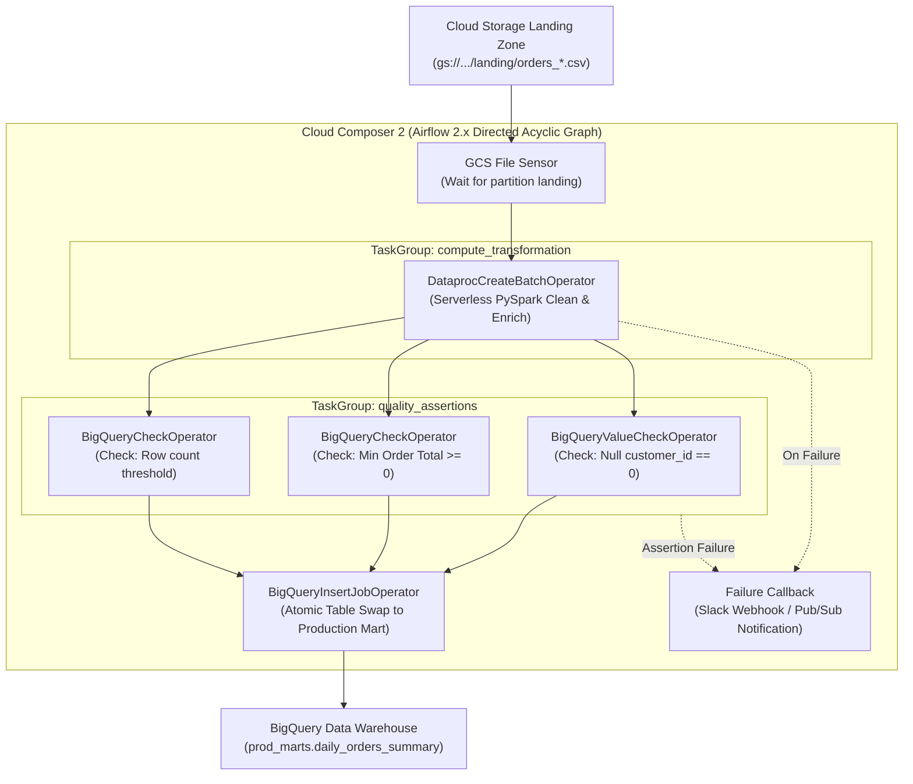

# Lab 04: Production Pipeline Orchestration with Cloud Composer

## 1. Architectural Overview & Lab Objectives

In enterprise data platforms, multi-engine workflows require resilient, idempotent, and auditable orchestration. In Google Cloud, **Cloud Composer** (managed Apache Airflow) serves as the centralized control plane connecting disparate storage, serverless compute, and analytical query engines.

In this lab, you will author, validate, and deploy an enterprise-grade Airflow DAG implementing an **ELT pipeline pattern**:
1. **Sensor Stage**: Detect landing files in Cloud Storage using event-driven prefixes.
2. **Serverless Compute Stage**: Trigger a serverless PySpark batch transformation job using **Dataproc Serverless**.
3. **Data Quality & Assertions Stage**: Execute automated SQL assertion checks in **BigQuery** inside Airflow Task Groups.
4. **Idempotence & Failure Handlers**: Implement retries with exponential backoff and custom Slack/PubSub failure alert callbacks.



---

## 2. Environment Setup & Cloud Composer Provisioning

### 2.1 Set Environment Variables
```bash
export PROJECT_ID=$(gcloud config get-value project)
export REGION="us-central1"
export COMPOSER_ENV="pde-orchestration-lab"
export BUCKET_CODE="gs://${PROJECT_ID}-orchestration-code"
export BUCKET_DATA="gs://${PROJECT_ID}-orchestration-data"
export DATASET_STAGING="staging_lakehouse"
export DATASET_PROD="prod_marts"

gcloud config set project ${PROJECT_ID}
```

### 2.2 Enable Required APIs
```bash
gcloud services enable \
    composer.googleapis.com \
    dataproc.googleapis.com \
    bigquery.googleapis.com \
    storage.googleapis.com
```

### 2.3 Create Cloud Storage Buckets & BigQuery Datasets
```bash
# Buckets for PySpark scripts, temporary files, and landing data
gcloud storage buckets create ${BUCKET_CODE} --location=${REGION} --uniform-bucket-level-access
gcloud storage buckets create ${BUCKET_DATA} --location=${REGION} --uniform-bucket-level-access

# Create staging and production BigQuery datasets
bq --location=${REGION} mk --dataset ${PROJECT_ID}:${DATASET_STAGING}
bq --location=${REGION} mk --dataset ${PROJECT_ID}:${DATASET_PROD}
```

### 2.4 Service Account & IAM Permissions
Dataproc Serverless and Cloud Composer require specific IAM permissions:

```bash
# Get default Compute Engine Service Account
COMPUTE_SA=$(gcloud iam service-accounts list \
    --filter="displayName:Compute Engine default service account" \
    --format="value(email)")

# Grant Dataproc Worker and BigQuery Admin roles
gcloud projects add-iam-policy-binding ${PROJECT_ID} \
    --member="serviceAccount:${COMPUTE_SA}" \
    --role="roles/dataproc.worker"

gcloud projects add-iam-policy-binding ${PROJECT_ID} \
    --member="serviceAccount:${COMPUTE_SA}" \
    --role="roles/bigquery.admin"

gcloud projects add-iam-policy-binding ${PROJECT_ID} \
    --member="serviceAccount:${COMPUTE_SA}" \
    --role="roles/storage.admin"
```

---

## 3. Serverless PySpark Transformation Script

Create the PySpark script (`pyspark_orders_transform.py`) executed by Dataproc Serverless:

```python
import sys
from pyspark.sql import SparkSession
from pyspark.sql import functions as F

def main():
    if len(sys.argv) < 4:
        print("Usage: pyspark_orders_transform.py <input_gcs_path> <staging_bq_table> <temp_gcs_bucket>")
        sys.exit(1)

    input_path = sys.argv[1]
    staging_table = sys.argv[2]
    temp_bucket = sys.argv[3]

    spark = SparkSession.builder \
        .appName("DataprocServerless_OrdersTransform") \
        .getOrCreate()

    # Read CSV landing records
    raw_df = spark.read \
        .option("header", "true") \
        .option("inferSchema", "true") \
        .csv(input_path)

    # Transformations: Clean nulls, format timestamps, calculate discounts
    cleaned_df = raw_df \
        .filter(F.col("order_id").isNotNull()) \
        .withColumn("order_total", F.col("order_total").cast("double")) \
        .withColumn("order_date", F.to_date(F.col("order_timestamp"))) \
        .withColumn("processed_at", F.current_timestamp())

    # Write staging table to BigQuery via Spark BigQuery Connector
    cleaned_df.write \
        .format("bigquery") \
        .option("table", staging_table) \
        .option("temporaryGcsBucket", temp_bucket.replace("gs://", "")) \
        .mode("overwrite") \
        .save()

    spark.stop()

if __name__ == "__main__":
    main()
```

Upload the script to the code bucket:
```bash
gcloud storage cp pyspark_orders_transform.py ${BUCKET_CODE}/scripts/pyspark_orders_transform.py
```

---

## 4. Production Airflow DAG Implementation

Create `dags/pde_production_elt_dag.py` adhering to Airflow 2.x standards, including TaskGroups, exponential backoff, and idempotent table swaps:

```python
"""
PDE Master Handbook - Lab 04
Production ELT Orchestration DAG: GCS -> Dataproc Serverless -> BigQuery -> Assertions
"""
from datetime import datetime, timedelta
import logging
from airflow import DAG
from airflow.utils.task_group import TaskGroup
from airflow.providers.google.cloud.sensors.gcs import GCSObjectsWithPrefixExistenceSensor
from airflow.providers.google.cloud.operators.dataproc import DataprocCreateBatchOperator
from airflow.providers.google.cloud.operators.bigquery import (
    BigQueryInsertJobOperator,
    BigQueryCheckOperator,
    BigQueryValueCheckOperator,
)

# Configuration Constants
PROJECT_ID = "{{ var.value.gcp_project_id }}"
REGION = "us-central1"
BUCKET_CODE = "{{ var.value.bucket_code }}"
BUCKET_DATA = "{{ var.value.bucket_data }}"
DATASET_STAGING = "staging_lakehouse"
DATASET_PROD = "prod_marts"

def alert_on_failure_callback(context):
    """
    Custom failure handler callback invoked whenever a task fails.
    Integrates with webhook endpoints, Slack alerts, or Pub/Sub dead-letter notifications.
    """
    task_instance = context.get('task_instance')
    dag_id = context.get('dag').dag_id
    execution_date = context.get('execution_date')
    exception = context.get('exception')
    
    log_message = (
        f"[PIPELINE ALERT] DAG: {dag_id} failed on Task: {task_instance.task_id} "
        f"for logical date: {execution_date}. Reason: {exception}"
    )
    logging.error(log_message)
    # Production webhook payload execution would trigger here:
    # requests.post(SLACK_WEBHOOK_URL, json={"text": log_message})

default_args = {
    'owner': 'data-engineering',
    'depends_on_past': False,
    'email_on_failure': False,
    'retries': 2,
    'retry_delay': timedelta(minutes=2),
    'retry_exponential_backoff': True,
    'max_retry_delay': timedelta(minutes=10),
    'on_failure_callback': alert_on_failure_callback,
}

with DAG(
    dag_id='pde_production_elt_orchestrator',
    default_args=default_args,
    description='Production ELT DAG with GCS Sensor, Serverless Dataproc, and BigQuery DQ Gates',
    schedule_interval='@daily',
    start_date=datetime(2026, 1, 1),
    catchup=False,
    max_active_runs=1,
    tags=['pde', 'production', 'dataproc', 'bigquery', 'elt'],
) as dag:

    # 1. GCS Landing Zone Sensor (Idempotent polling with timeout)
    wait_for_landing_data = GCSObjectsWithPrefixExistenceSensor(
        task_id='wait_for_landing_data',
        bucket=BUCKET_DATA.replace("gs://", ""),
        prefix='landing/{{ ds_nodash }}/orders_',
        mode='reschedule',  # Releases Airflow worker slot while waiting
        poke_interval=60,
        timeout=3600,
    )

    # 2. TaskGroup: Dataproc Serverless PySpark Compute
    with TaskGroup(group_id='dataproc_serverless_compute') as dataproc_compute_group:
        
        batch_details = {
            "pyspark_batch": {
                "main_python_file_uri": f"{BUCKET_CODE}/scripts/pyspark_orders_transform.py",
                "args": [
                    f"{BUCKET_DATA}/landing/{{{{ ds_nodash }}}}/",
                    f"{PROJECT_ID}:{DATASET_STAGING}.stg_orders_{{{{ ds_nodash }}}}",
                    f"{BUCKET_DATA}/spark-temp",
                ],
                "jar_file_uris": [
                    "gs://spark-lib/bigquery/spark-bigquery-with-dependencies_2.12-0.34.0.jar"
                ]
            },
            "environment_config": {
                "execution_config": {
                    "subnetwork_uri": "default"
                }
            },
            "runtime_config": {
                "version": "2.1"
            }
        }

        run_spark_batch = DataprocCreateBatchOperator(
            task_id='run_pyspark_orders_transform',
            project_id=PROJECT_ID,
            region=REGION,
            batch_id='orders-transform-{{ ds_nodash }}-{{ ts_nodash.lower() }}',
            batch=batch_details,
        )

    # 3. TaskGroup: Data Quality Validation Gates
    with TaskGroup(group_id='data_quality_gates') as data_quality_group:

        # Assert no null primary keys
        check_no_null_keys = BigQueryValueCheckOperator(
            task_id='assert_zero_null_order_ids',
            sql=f"""
                SELECT COUNT(*) 
                FROM `{PROJECT_ID}.{DATASET_STAGING}.stg_orders_{{{{ ds_nodash }}}}`
                WHERE order_id IS NULL
            """,
            pass_value=0,
            use_legacy_sql=false,
        )

        # Assert all order totals are non-negative
        check_valid_totals = BigQueryCheckOperator(
            task_id='assert_positive_order_totals',
            sql=f"""
                SELECT MIN(order_total) >= 0 
                FROM `{PROJECT_ID}.{DATASET_STAGING}.stg_orders_{{{{ ds_nodash }}}}`
            """,
            use_legacy_sql=False,
        )

        # Assert volume meets minimum threshold
        check_minimum_volume = BigQueryCheckOperator(
            task_id='assert_minimum_row_count',
            sql=f"""
                SELECT COUNT(*) >= 1 
                FROM `{PROJECT_ID}.{DATASET_STAGING}.stg_orders_{{{{ ds_nodash }}}}`
            """,
            use_legacy_sql=False,
        )

    # 4. Atomic Table Publish into Production Data Mart
    publish_to_production = BigQueryInsertJobOperator(
        task_id='publish_to_production_mart',
        configuration={
            "query": {
                "query": f"""
                    MERGE `{PROJECT_ID}.{DATASET_PROD}.fact_orders` T
                    USING `{PROJECT_ID}.{DATASET_STAGING}.stg_orders_{{{{ ds_nodash }}}}` S
                    ON T.order_id = S.order_id AND T.order_date = S.order_date
                    WHEN MATCHED THEN
                        UPDATE SET 
                            order_total = S.order_total,
                            order_status = S.order_status,
                            updated_at = CURRENT_TIMESTAMP()
                    WHEN NOT MATCHED THEN
                        INSERT (order_id, customer_id, order_total, order_status, order_date, updated_at)
                        VALUES (S.order_id, S.customer_id, S.order_total, S.order_status, S.order_date, CURRENT_TIMESTAMP());
                """,
                "useLegacySql": False,
            }
        },
    )

    # 5. Dependency Graph
    wait_for_landing_data >> dataproc_compute_group >> data_quality_group >> publish_to_production
```

---

## 5. DAG Deployment & Execution in Cloud Composer

### 5.1 Set Airflow Variables
Composer utilizes Airflow Variables for environment portability. Set variables via `gcloud composer`:

```bash
gcloud composer environments run ${COMPOSER_ENV} \
    --location=${REGION} \
    variables set -- gcp_project_id "${PROJECT_ID}"

gcloud composer environments run ${COMPOSER_ENV} \
    --location=${REGION} \
    variables set -- bucket_code "${BUCKET_CODE}"

gcloud composer environments run ${COMPOSER_ENV} \
    --location=${REGION} \
    variables set -- bucket_data "${BUCKET_DATA}"
```

### 5.2 Upload DAG to Composer DAGs Folder
Locate your Cloud Composer DAGs GCS folder:

```bash
DAGS_BUCKET=$(gcloud composer environments describe ${COMPOSER_ENV} \
    --location=${REGION} \
    --format="value(config.dagGcsPrefix)")

echo "Deploying DAG to: ${DAGS_BUCKET}"
gcloud storage cp dags/pde_production_elt_dag.py ${DAGS_BUCKET}/pde_production_elt_dag.py
```

### 5.3 Trigger Ingestion by Landing Mock Files
Simulate landing data matching the sensor's expected prefix:

```bash
TODAY=$(date +%Y%m%d)

cat <<EOF > mock_orders.csv
order_id,customer_id,order_total,order_status,order_timestamp
1001,501,120.50,COMPLETED,2026-02-14 10:15:00
1002,502,45.00,PENDING,2026-02-14 10:20:00
1003,503,310.99,COMPLETED,2026-02-14 10:25:00
EOF

gcloud storage cp mock_orders.csv ${BUCKET_DATA}/landing/${TODAY}/orders_01.csv
```

### 5.4 Observe Execution & Verify Production Mart
Trigger DAG manually or wait for the sensor to unblock:

```bash
gcloud composer environments run ${COMPOSER_ENV} \
    --location=${REGION} \
    dags trigger -- pde_production_elt_orchestrator
```

Verify that BigQuery holds the production rows:
```bash
bq query --use_legacy_sql=false \
"SELECT * FROM \`${PROJECT_ID}.${DATASET_PROD}.fact_orders\` LIMIT 10;"
```

---

## 6. Testing Failure Scenarios & Callback Handlers

### 6.1 Simulate Data Quality Assertion Breach
Land corrupt records containing negative order values:

```bash
cat <<EOF > corrupt_orders.csv
order_id,customer_id,order_total,order_status,order_timestamp
9999,999,-50.00,ANOMALY,2026-02-14 11:00:00
EOF

gcloud storage cp corrupt_orders.csv ${BUCKET_DATA}/landing/${TODAY}/orders_02.csv
```

When the DAG executes, `assert_positive_order_totals` fails. Notice that:
1. The Task Group halts downstream processing.
2. The `publish_to_production_mart` task is **never executed**, safeguarding downstream BI and reporting tables.
3. The `alert_on_failure_callback` fires, dispatching alert notifications.

---

## 7. Resource Cleanup

```bash
# 1. Delete Composer Environment (if provisioned exclusively for this lab)
# gcloud composer environments delete ${COMPOSER_ENV} --location=${REGION} --quiet

# 2. Clean Storage Buckets
gcloud storage rm -r ${BUCKET_CODE}
gcloud storage rm -r ${BUCKET_DATA}

# 3. Clean BigQuery Datasets
bq rm -r -f -d ${PROJECT_ID}:${DATASET_STAGING}
bq rm -r -f -d ${PROJECT_ID}:${DATASET_PROD}

echo "Lab 04 orchestration resources cleaned up successfully."
```
