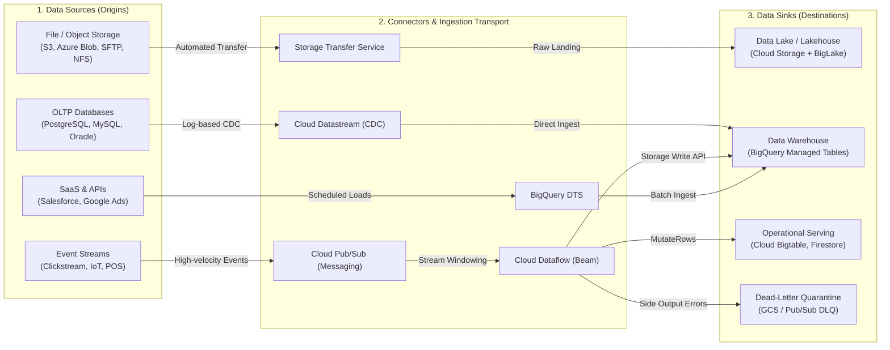

# Introduction to Data Engineering: Data Sources vs. Data Sinks on Google Cloud

**Module Scope**: Fundamental data engineering taxonomy, architecture patterns, and Google Cloud product mappings for data origins (sources), pipeline ingestion transports (connectors), and downstream consumption targets (sinks).  
**Exam Alignment**: Official Google Cloud Professional Data Engineer (PDE) Exam Guide Domain 2.1 (*"Planning the data pipelines: Data source and sink identification"*).

---

## 1. Executive Conceptual Architecture

In modern enterprise data architecture, every data workflow is fundamentally modeled as a directed acyclic graph (DAG) connecting **Data Sources** to **Data Sinks** via **Ingestion and Transformation Pipelines**:



### Core Definitions

| Component | Technical Role | Architectural Responsibility | Google Cloud Examples |
| :--- | :--- | :--- | :--- |
| **Data Source** | Origin / Producer | Produces or holds raw data. Provides read interfaces (APIs, logs, tables, files). | Cloud SQL, On-premise Oracle, Pub/Sub topics, POS registers, AWS S3. |
| **Ingestion Connector** | Transport / Mediator | Extracts, captures, and transports data across network boundaries with zero data loss. | Datastream, Pub/Sub, Storage Transfer Service, BigQuery DTS. |
| **Processing Pipeline** | Engine / Transformer | Enforces schemas, parses payloads, validates data quality, windows streams, and joins state. | Cloud Dataflow (Apache Beam), Cloud Dataproc (Spark), Dataform. |
| **Data Sink** | Destination / Consumer | Receives, indexes, and stores transformed data for query analysis, serving, or archival. | BigQuery, Cloud Bigtable, Cloud Storage, Cloud Spanner, Firestore. |

---

## 2. Taxonomy of Data Sources

Data sources dictate the **velocity, volume, format, and network posture** required for ingestion.

### 2.1 Transactional OLTP Databases
- **Characteristics**: High-concurrency ACID transactions (thousands of small `INSERT`, `UPDATE`, `DELETE` operations per second). Highly normalized schemas (3NF).
- **Google Cloud & External Engines**: Cloud SQL (MySQL, PostgreSQL, SQL Server), AlloyDB, Cloud Spanner, on-premises Oracle / SQL Server / DB2.
- **Ingestion Pattern**: Never run bulk analytical SQL queries (`SELECT * FROM table`) against primary OLTP instances during business hours. Use **Change Data Capture (CDC)** to stream transaction log records (PostgreSQL WAL, MySQL binary log, Oracle GoldenGate/Redo) into Google Cloud with sub-second latency and minimal source CPU overhead.

### 2.2 Unbounded Streaming Event Feeds
- **Characteristics**: Continuous, real-time message streams generated by distributed clients, sensors, web applications, and point-of-sale terminals. Events arrive out-of-order with unpredictable network lag.
- **Protocols & Encodings**: REST, gRPC, MQTT, WebSocket; Avro, Protobuf, JSON.
- **Ingestion Pattern**: Publish to a massively scalable distributed buffer (Cloud Pub/Sub or Pub/Sub Lite) that decouples publishers from downstream subscribers, preserving messages for up to 31 days with at-least-once or exactly-once delivery.

### 2.3 Object and Bulk File Repositories
- **Characteristics**: Large batches of structured, semi-structured, or unstructured files (CSV, JSONL, Parquet, Avro, images, audio, video).
- **Locations**: Amazon S3, Microsoft Azure Blob Storage, on-premises POSIX filesystems, SAN/NAS arrays, or Cloud Storage staging buckets.
- **Ingestion Pattern**: Automated, parallel transfer using **Storage Transfer Service (STS)** for cloud-to-cloud and on-premise-to-cloud data movements, bypassing custom intermediate VM scripts.

### 2.4 Enterprise SaaS and External APIs
- **Characteristics**: Rate-limited, paginated REST/GraphQL APIs providing periodic business snapshots (marketing, CRM, billing).
- **Platforms**: Salesforce, Google Ads, Google Analytics 4, ServiceNow, Stripe, Workday.
- **Ingestion Pattern**: Managed scheduled extraction using **BigQuery Data Transfer Service (BQ DTS)** or serverless orchestration (Cloud Composer / Cloud Workflows invoking Cloud Run functions).

---

## 3. Taxonomy of Data Sinks

Selecting the proper sink depends on access patterns, query latency requirements, and consistency boundaries.

### 3.1 Analytical Data Warehouses (OLAP)
- **Primary Product**: **Google Cloud BigQuery**
- **Optimal Workload**: Ad-hoc analytical queries, petabyte-scale aggregations, dimensional star/snowflake schemas, business intelligence dashboards (Looker, Tableau), machine learning feature preparation.
- **Ingestion Mechanisms**:
  - *Streaming*: BigQuery Storage Write API (supports `COMMITTED`, `PENDING`, and `BUFFERED` modes with robust exactly-once semantics).
  - *Batch*: Direct load jobs (`bq load`) from Cloud Storage Parquet/ORC/CSV files (free metadata ingestion, consumes zero query slots).

### 3.2 Data Lakes & Lakehouses
- **Primary Product**: **Cloud Storage (GCS) + BigLake**
- **Optimal Workload**: Raw landing zone (Bronze medallion layer), regulatory WORM archive (Bucket Lock), open-table formats (Apache Iceberg, Delta Lake, Apache Hudi, Apache Parquet).
- **Key Capabilities**: Global strong consistency, storage class tiering via Autoclass, Turbo Replication for 15-minute cross-region RPO, fine-grained access delegation via BigLake connectors.

### 3.3 Low-Latency Operational & Serving Stores (NoSQL)
- **Primary Products**: **Cloud Bigtable**, **Cloud Firestore**, **Cloud Memorystore (Redis)**
- **Optimal Workloads**:
  - *Cloud Bigtable*: High-throughput streaming writes ($>100\text{k}$ QPS), time-series sensor telemetry, point lookups with sub-10ms latency targets, user profile feature serving.
  - *Cloud Firestore*: Mobile/web application backends, real-time client listeners, offline synchronization, multi-document ACID transactions.
  - *Cloud Memorystore*: Sub-millisecond in-memory caching, session storage, real-time leaderboard ranking.

### 3.4 Operational Relational Databases
- **Primary Products**: **Cloud Spanner**, **AlloyDB for PostgreSQL**, **Cloud SQL**
- **Optimal Workload**: High-integrity transactional backends, global multi-region consistency (Spanner with TrueTime commit-wait), relational reporting marts requiring full SQL foreign-key constraints.

### 3.5 Dead-Letter and Quarantine Sinks
- **Primary Products**: **Cloud Storage dead-letter folders**, **Cloud Pub/Sub dead-letter topics**
- **Optimal Workload**: Unparseable payloads, schema violation events, malformed JSON records, and toxic messages. Quarantining poison-pill records isolates pipeline crashes while preserving raw data for forensic replay.

---

## 4. Master Google Cloud Source-to-Sink Mapping Matrix

| Source Category | Ingestion Connector | Target Data Sink | Data Delivery Pattern | Latency Profile | Exam Key Concept |
| :--- | :--- | :--- | :--- | :--- | :--- |
| **Operational RDBMS (PostgreSQL, MySQL, Oracle)** | Cloud Datastream | BigQuery / Cloud Storage | Log-based CDC (continuous stream) | 1–5 seconds | Zero source CPU query overhead; automatically synchronizes table DDL alterations. |
| **High-Velocity Mobile/IoT Events** | Cloud Pub/Sub + Dataflow | BigQuery + Cloud Bigtable | Streaming event processing with windowing | 100ms – 2 seconds | Storage Write API exactly-once writes to BigQuery; MutateRows writes to Bigtable. |
| **Multi-Cloud Data Lake (AWS S3, Azure Blob)** | Storage Transfer Service (STS) | Cloud Storage (GCS) | Managed cloud-to-cloud batch transfer | Scheduled (hourly/daily) | Bandwidth optimization; zero VM egress costs inside GCP; automated checksum validation. |
| **On-Premise Network File System (NFS)** | STS On-Premise Agent Pools | Cloud Storage (GCS) | Outbound HTTPS (port 443) parallel stream | Continuous / Scheduled | Agents scale in Docker containers behind corporate firewalls without opening inbound ports. |
| **SaaS Marketing Applications (Salesforce, Google Ads)** | BigQuery Data Transfer Service (BQ DTS) | BigQuery Native Tables | Managed scheduled batch load | Recurring (hourly/daily) | Serverless automation; managed OAuth tokens; automatic schema population. |
| **Streaming Pipeline Poison Pills / Schema Errors** | Apache Beam `TaggedOutput` | Cloud Storage / Pub/Sub DLQ | Side-output error quarantine | Real-time (<1 second) | Prevents pipeline halts while allowing offline inspection and retroactive replay. |
| **Curated Lakehouse Files (Parquet, Iceberg)** | BigQuery BigLake Metastore | BigQuery External Virtual Tables | In-place zero-copy query execution | Interactive (sub-second to seconds) | Decoupled compute reads directly from GCS with column-level security and row-level access controls. |

---

## 5. Architectural Lifecycle: The Medallion Lakehouse Pattern

In Google Cloud enterprise architectures (such as RetailFlow), data transitions through structured source-sink tiers:

```
[External Sources]
       │
       ▼
┌────────────────────────────────────────────────────────┐
│  BRONZE SINK: Cloud Storage Staging Lake               │
│  - Raw, immutable append-only landing files            │
│  - Retains source structure, headers, raw timestamps   │
│  - Enforces Cloud Storage Bucket Lock (WORM)           │
└──────────────────────────┬─────────────────────────────┘
                           │ Dataflow / Dataproc / Dataform
                           ▼
┌────────────────────────────────────────────────────────┐
│  SILVER SINK: BigQuery Storage / BigLake Tables        │
│  - Cleaned, deduplicated, and schema-validated rows    │
│  - Conformed datatypes, standardized timestamps (UTC)  │
│  - Anonymized PII via Sensitive Data Protection (DLP)  │
└──────────────────────────┬─────────────────────────────┘
                           │ BigQuery SQLX / Dataform / BI Engine
                           ▼
┌────────────────────────────────────────────────────────┐
│  GOLD SINK: Curated Business Marts & Bigtable Cache    │
│  - Aggregated Star/Snowflake analytical fact tables    │
│  - High-performance materialized views                 │
│  - Bigtable rowkey-optimized serving layer             │
└────────────────────────────────────────────────────────┘
```

---

## 6. Security, Governance, and Failure Semantics

### 6.1 Network Security Across Ingestion Boundaries
- **Private Google Access (PGA)**: Enables Compute Engine VMs and Dataproc workers with private internal RFC 1918 IPs to securely connect to Google APIs and Cloud Storage without public internet routes or NAT gateways.
- **Private Service Connect (PSC)**: Exposes managed Google Cloud services (such as Cloud SQL, BigQuery, or third-party partner VPCs) as private IP endpoints directly inside consumer subnets.
- **VPC Service Controls (VPC-SC)**: Establishes a security perimeter around BigQuery, Cloud Storage, and Pub/Sub resources, strictly blocking unauthorized cross-project egress and token-exfiltration attacks.

### 6.2 Delivery Semantics & Idempotent Sinks
- **At-Least-Once Delivery**: Standard streaming transports (Cloud Pub/Sub) guarantee that every message is delivered at least once, meaning network reconnections can produce duplicate deliveries.
- **Idempotency Requirement**: Sinks must handle duplicate events without corrupting aggregate counts or account balances:
  - *BigQuery*: Use the **BigQuery Storage Write API** with stream offsets and stream naming to ensure deterministic exactly-once record insertion.
  - *SQL MERGE*: Execute atomic `MERGE` statements on unique business primary keys (`event_id`, `transaction_id`) to perform upserts rather than blind appends.
  - *Cloud Bigtable*: Set row keys deterministically and write idempotent mutations (e.g., cell timestamps based on event-time rather than server wall-clock time).

---

## 7. Scenario Knowledge Checks & Exam Traps

### Question 1 (Data Source vs. Sink Selection)
**Scenario**: An international airline needs to ingest real-time flight telemetry from 2,000 aircraft across the globe. Each aircraft sends cabin temperature, GPS coordinates, and engine vibrations every 100 milliseconds via satellite. Ground operations need to look up current aircraft coordinates with single-digit millisecond latency, while historical telemetry data must be retained for 10 years for safety compliance and queried periodically using SQL. Which source, connector, and sink architecture satisfies these requirements with the lowest operational overhead?

- **A.** Ingest flight records via Cloud SQL PostgreSQL; replicate nightly using `pg_dump` to Cloud Storage Coldline.
- **B.** Stream flight records into Cloud Pub/Sub; process with Cloud Dataflow; sink point-lookup telemetry into Cloud Bigtable and archive complete historical logs into Cloud Storage BigLake queried via BigQuery.
- **C.** Ingest data directly into BigQuery using legacy streaming inserts; export tables monthly to AWS S3 using BigQuery Omni.
- **D.** Transfer telemetry files via Storage Transfer Service into Cloud Storage Standard; run ephemeral Dataproc clusters on Spot VMs every 10 minutes.

**Correct Answer**: **B**

#### Detailed Rationale:
- **Why B is Correct**: Cloud Pub/Sub easily handles high-frequency global concurrent message ingestion. Cloud Dataflow dynamically forks the stream into two optimal sinks: Cloud Bigtable for high-throughput single-digit millisecond operational lookups by aircraft ID, and Cloud Storage for cost-effective 10-year compliance archival queried via BigQuery BigLake without duplication.
- **Why A is Incorrect**: Cloud SQL cannot sustain sub-second telemetry writes from 2,000 concurrent aircraft without connection exhaustion and disk I/O bottlenecks.
- **Why C is Incorrect**: Legacy streaming inserts are deprecated, costly, and do not provide single-digit millisecond point lookup serving.
- **Why D is Incorrect**: Storage Transfer Service is designed for batch file transfers, not sub-second sensor telemetry streams.

---

## 8. Summary Checklist for the Data Architect

- [x] **Source Characteristics Evaluated**: Data velocity (batch vs stream), payload size, protocol, network egress posture.
- [x] **Transport Mechanism Aligned**: Pub/Sub for messaging, Datastream for CDC, STS for bulk objects, BQ DTS for SaaS.
- [x] **Sink Optimized for Consumption**: BigQuery for OLAP analytics, Bigtable for high-throughput sub-10ms point reads, GCS for raw object storage and compliance.
- [x] **Failure Boundaries Defined**: Dead-letter quarantine paths (GCS/PubSub) implemented for all malformed records.
- [x] **Idempotency Enforced**: Pipeline sinks use deterministic upserts (`MERGE` / Storage Write API committed streams / Bigtable cell timestamps).