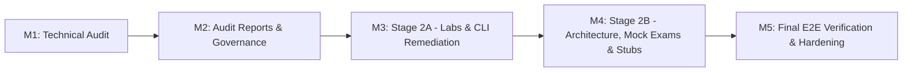

# Executive Technical Audit Report: Google Cloud Professional Data Engineer Handbook

**Deliverable**: Stage 1 Executive Technical & Governance Audit Report  
**Location**: `docs/audits/EXECUTIVE_AUDIT_REPORT.md` (Summarized in root `AUDIT_REPORT.md`)  
**Audit Standard**: Official Google Cloud Documentation (`https://cloud.google.com/`), Google Cloud SDK CLI Reference, and Official PDE Exam Guide (v4.2)  
**Date**: November 2026  
**Auditor**: Teamwork Stage 1 Technical Audit & Governance Group  

---

## 1. Executive Summary

A comprehensive, non-sampled technical audit of the **Google Cloud Professional Data Engineer (PDE) Handbook** was conducted across all 49 Markdown documents (14,793 lines of technical curriculum, architecture blueprints, hands-on labs, and scenario mock exams). The objective of Stage 1 was to rigorously fact-check 100% of technical claims, commands, architecture patterns, and contractual commitments against official Google Cloud documentation without modifying curriculum source files.

### 1.1 Repository Health & Audit Scorecard

```
+-------------------------------------------------------------------------------+
|                       REPOSITORY AUDIT SCORECARD                              |
+-------------------------------------------------------------------------------+
| Total Census Files Inspected          : 49 / 49 (100% evaluated, no sampling) |
| Total Exam Guide Objectives Audited   : 19 / 19 (v4.2 blueprint alignment)    |
| Fully Covered Objectives (FC)         : 7 / 19 (36.8%)                        |
| Partially Covered Objectives (PC)     : 2 / 19 (10.5%)                        |
| Covered but Technically Incorrect (TI): 10 / 19 (52.6%)                       |
| Completely Missing Objectives (M)     : 0 / 19 (0.0%)                         |
| Total Discrete Technical Findings     : 56 issues cataloged in backlog        |
| - Priority 0 (Critical / Blockers)    : 18 issues                             |
| - Priority 1 (High / Operational)     : 24 issues                             |
| - Priority 2 (Medium / Currency)      : 11 issues                             |
| - Priority 3 (Low / Polish)           : 3 issues                              |
+-------------------------------------------------------------------------------+
```

### 1.2 Core Audit Assessment
The handbook demonstrates outstanding pedagogical architecture, rich production scenarios (such as the RetailFlow enterprise lifecycle), and deep coverage of advanced data engineering capabilities (BigLake Iceberg, BigQuery Editions, Dataplex AutoDQ, and Analytics Hub).

However, the audit revealed **18 critical (P0) execution blockers and misleading claims** that severely undermine hands-on reproducibility and certification precision:
1. **Contractual SLA Fallacies**: Repeated claims that Google Cloud Storage Turbo Replication provides a "100% SLA" (contractually impossible; official SLA is $\ge 99.9\%$ volume conformance).
2. **Conflation of Operational Targets with SLAs**: Mislabeled tables and headings citing sub-10ms Bigtable latency as a "vendor SLA" rather than an application-level Service Level Objective (SLO).
3. **Hallucinated CLI Commands**: Use of non-existent SDK command groups such as `gcloud bi-engine reservations`, `gcloud bi-engine capacities`, and `gcloud dlp jobs create`.
4. **Fatal Runtime Script Errors**: Python scripts in Lab 01 crashing with `AttributeError` when parsing query JSON arrays as Job objects, and Python DAG syntax errors in Lab 04 (`use_legacy_sql=false` using lowercase boolean).
5. **Omitted Lab Infrastructure**: Lab 04 completely omitting the `gcloud composer environments create` command.
6. **Machine-Specific Broken Links**: 108 internal links across legacy audit files hardcoded to absolute Windows URIs (`file:///e:/gcp_pde_revamp/...`).

---

## 2. Risk Matrix & Quality Assessment

| Risk Vector | Severity | Current Status | Production & Certification Impact | Remediation Milestone |
|:---|:---:|:---:|:---|:---:|
| **Lab Execution Reproducibility** | **Critical** | Compromised | Students cannot complete Labs 01, 03, and 04 due to CLI syntax errors, missing IAM roles, and Python crashes. | Milestone 3 (Stage 2A) |
| **Contractual SLA Accuracy** | **Critical** | Defective | Candidates will fail exam questions and make flawed disaster recovery commitments assuming 100% SLA. | Milestone 4 (Stage 2B) |
| **CLI Quick Reference Integrity** | **Critical** | Compromised | 10 CLI syntax errors in `00_data_engineer_cli_cheat_sheet.md` cause immediate gcloud command rejections. | Milestone 3 (Stage 2A) |
| **Exam Blueprint Alignment** | **Moderate** | Sub-bullet Gaps | Domain 1.2 omits LLM prompt engineering for query generation; Domain 2.1 links an 8-line stub. | Milestone 4 (Stage 2B) |
| **Repository Link Portability** | **Moderate** | Broken | 108 links fail in Git / web rendering environments due to `file:///` URI prefixes. | Milestone 4 (Stage 2B) |

---

## 3. Master Performance Claims Classification Summary

Quantitative performance, latency, and SLA claims across the handbook were categorized into four formal tiers:

- **Category A (Officially Documented Service Guarantees)**: Contractually enforceable SLAs backed by financial service credits:
  - Cloud Spanner: 99.99% (Regional), 99.999% (Multi-Region)
  - BigQuery: 99.9% (Standard), 99.99% (Enterprise & Enterprise Plus)
  - Cloud SQL HA: 99.95% (Enterprise), 99.99% (Enterprise Plus)
  - Cloud Storage: 99.9% (Regional Standard), 99.0% (Regional Nearline/Coldline), 99.95% (Dual/Multi-Region Standard)
  - Turbo Replication: $\ge 99.9\%$ Monthly Replication Volume Conformance, $\ge 99.0\%$ Time Conformance
  - Cloud Bigtable: 99.9% (Single Cluster), 99.99% (2 Regions with Multi-Cluster Routing), 99.999% (3+ Regions with Multi-Cluster Routing)
  - Pub/Sub: 99.95% Availability
- **Category B (Documented Service Capabilities & Limits)**: Quota ceilings and operational thresholds:
  - BigQuery: 10,000 max partitions per table; 4,000 partitions modified per single operation; 10,000 columns; 1 MB query text.
  - Bigtable: ~100 column families; 100 MB max row; 10 MB cell; 5 TB SSD / 16 TB HDD storage density per node.
  - Cloud Storage: 5 TiB maximum object size; Autoclass 30d/90d/365d transition windows.
  - AlloyDB: Dynamically auto-scaling storage up to 128 TiB per cluster.
  - Pub/Sub: 10 MB maximum message size; 10m to 31d retention; 5 to 100 dead-letter delivery attempts.
- **Category C (Workload-Dependent Engineering Estimates)**: Heuristics dependent on data shape and provisioning:
  - Bigtable sub-10ms point read/write latency (<70% CPU, uniform keys, <100 KB payload).
  - BigQuery Capacitor ~6x to 12x columnar compression ratio.
  - Vertex AI Vector Search sub-5ms nearest-neighbor lookups via ScaNN algorithm.
  - Dataflow FlexRS ~40% batch compute cost savings.
- **Category D (Unsupported or Misleading Claims)**: Claims targeted for immediate remediation:
  - Turbo Replication "100% SLA" claims in `03_06`, `03_01`, `01_01`, `04_01`, and Exam 1 Q13.
  - Latency labeled as contractual "SLA" in `02_03:281`, `05_02:27`, `case_04:186`, and `00_resource_selection_guide:15-208`.
  - Blanket 99.99% BigQuery SLA omitting Standard Edition.

---

## 4. Controlled Remediation Roadmap (Stage 2)

Remediation is planned in two controlled, non-destructive execution milestones:



1. **Milestone 3 (Stage 2A: Labs & CLI Remediation)**:
   - Remediate execution blockers in Labs 01–04 (`gcloud bi-engine`, Python JSON parsing, Datastream connectivity flags, Airflow Python syntax, Composer environment creation).
   - Remediate 10 syntax and flag errors in `00_data_engineer_cli_cheat_sheet.md`.
2. **Milestone 4 (Stage 2B: Architecture, Claims, Exams & Stubs)**:
   - Correct all Category D "100% SLA" claims and latency SLA labels across Phase 0, 2, 3, 4, 5.
   - Fix Exam 1 Question 2 Apache Beam late trigger syntax (`late=AfterCount(1)`).
   - Expand `Intro_To_DE/data_sources_vs_data_sinks.md` into a complete reference module.
   - Synchronize `08_phase7_mock_exam_engine/exam_coverage_tracker.md` with the 19-objective matrix.
   - Resolve all 108 broken links in `docs/audits/` using relative `../../` paths.
   - Record all modifications in root `CHANGELOG.md`.

---

## 5. Traceability Index to Stage 1 Audit Deliverables

- Detailed Findings Table: [FILE_BY_FILE_FINDINGS.md](FILE_BY_FILE_FINDINGS.md)
- Prioritized Remediation Backlog: [REMEDIATION_BACKLOG.md](REMEDIATION_BACKLOG.md)
- Official Exam Blueprint Matrix: [EXAM_COVERAGE_MATRIX.md](EXAM_COVERAGE_MATRIX.md)
- Enterprise Architecture Improvements: [ARCHITECTURE_IMPROVEMENTS.md](ARCHITECTURE_IMPROVEMENTS.md)
- Hands-On Lab Execution Report: [LAB_EXECUTION_REPORT.md](LAB_EXECUTION_REPORT.md)
- Documentation Quality Plan: [DOCUMENTATION_IMPROVEMENT_PLAN.md](DOCUMENTATION_IMPROVEMENT_PLAN.md)
- Root Governance Reports: `AUDIT_REPORT.md`, `CHANGELOG.md`, `SOURCES.md`
